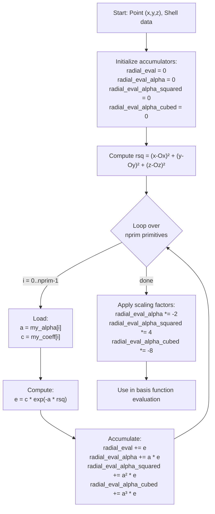
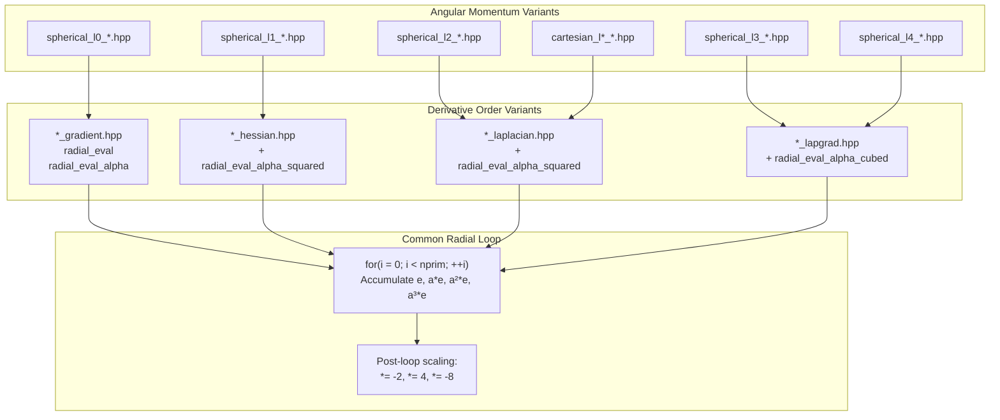
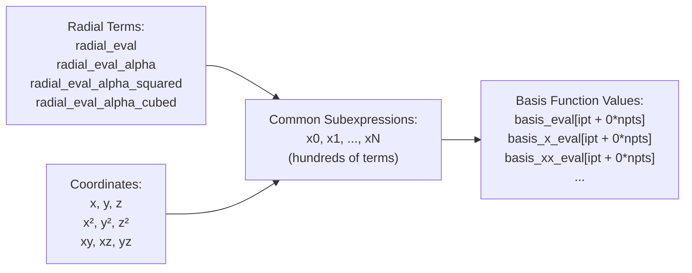
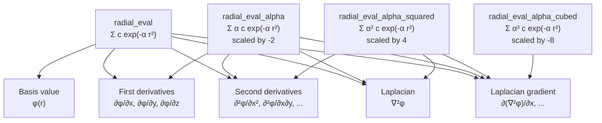

<!-- source: DeepWiki mcp.deepwiki.com · repo microsoft/skala · extra page Radial Evaluation and Derivative Computation · fetched 2026-10-26 -->

# Radial Evaluation and Derivative Computation

<details>
<summary>Relevant source files</summary>

The following files were used as context for generating this wiki page:

- [third_party/gauxc/src/xc_integrator/local_work_driver/device/cuda/kernels/collocation/collocation_shell_to_task_kernels_cartesian_l1.hpp](third_party/gauxc/src/xc_integrator/local_work_driver/device/cuda/kernels/collocation/collocation_shell_to_task_kernels_cartesian_l1.hpp)
- [third_party/gauxc/src/xc_integrator/local_work_driver/device/cuda/kernels/collocation/collocation_shell_to_task_kernels_cartesian_l1_hessian.hpp](third_party/gauxc/src/xc_integrator/local_work_driver/device/cuda/kernels/collocation/collocation_shell_to_task_kernels_cartesian_l1_hessian.hpp)
- [third_party/gauxc/src/xc_integrator/local_work_driver/device/cuda/kernels/collocation/collocation_shell_to_task_kernels_cartesian_l1_lapgrad.hpp](third_party/gauxc/src/xc_integrator/local_work_driver/device/cuda/kernels/collocation/collocation_shell_to_task_kernels_cartesian_l1_lapgrad.hpp)
- [third_party/gauxc/src/xc_integrator/local_work_driver/device/cuda/kernels/collocation/collocation_shell_to_task_kernels_cartesian_l1_laplacian.hpp](third_party/gauxc/src/xc_integrator/local_work_driver/device/cuda/kernels/collocation/collocation_shell_to_task_kernels_cartesian_l1_laplacian.hpp)
- [third_party/gauxc/src/xc_integrator/local_work_driver/device/cuda/kernels/collocation/collocation_shell_to_task_kernels_cartesian_l2_lapgrad.hpp](third_party/gauxc/src/xc_integrator/local_work_driver/device/cuda/kernels/collocation/collocation_shell_to_task_kernels_cartesian_l2_lapgrad.hpp)
- [third_party/gauxc/src/xc_integrator/local_work_driver/device/cuda/kernels/collocation/collocation_shell_to_task_kernels_cartesian_l2_laplacian.hpp](third_party/gauxc/src/xc_integrator/local_work_driver/device/cuda/kernels/collocation/collocation_shell_to_task_kernels_cartesian_l2_laplacian.hpp)
- [third_party/gauxc/src/xc_integrator/local_work_driver/device/cuda/kernels/collocation/collocation_shell_to_task_kernels_cartesian_l3_hessian.hpp](third_party/gauxc/src/xc_integrator/local_work_driver/device/cuda/kernels/collocation/collocation_shell_to_task_kernels_cartesian_l3_hessian.hpp)
- [third_party/gauxc/src/xc_integrator/local_work_driver/device/cuda/kernels/collocation/collocation_shell_to_task_kernels_cartesian_l3_laplacian.hpp](third_party/gauxc/src/xc_integrator/local_work_driver/device/cuda/kernels/collocation/collocation_shell_to_task_kernels_cartesian_l3_laplacian.hpp)
- [third_party/gauxc/src/xc_integrator/local_work_driver/device/cuda/kernels/collocation/collocation_shell_to_task_kernels_cartesian_l4_gradient.hpp](third_party/gauxc/src/xc_integrator/local_work_driver/device/cuda/kernels/collocation/collocation_shell_to_task_kernels_cartesian_l4_gradient.hpp)
- [third_party/gauxc/src/xc_integrator/local_work_driver/device/cuda/kernels/collocation/collocation_shell_to_task_kernels_spherical_l0_hessian.hpp](third_party/gauxc/src/xc_integrator/local_work_driver/device/cuda/kernels/collocation/collocation_shell_to_task_kernels_spherical_l0_hessian.hpp)
- [third_party/gauxc/src/xc_integrator/local_work_driver/device/cuda/kernels/collocation/collocation_shell_to_task_kernels_spherical_l0_laplacian.hpp](third_party/gauxc/src/xc_integrator/local_work_driver/device/cuda/kernels/collocation/collocation_shell_to_task_kernels_spherical_l0_laplacian.hpp)
- [third_party/gauxc/src/xc_integrator/local_work_driver/device/cuda/kernels/collocation/collocation_shell_to_task_kernels_spherical_l1_gradient.hpp](third_party/gauxc/src/xc_integrator/local_work_driver/device/cuda/kernels/collocation/collocation_shell_to_task_kernels_spherical_l1_gradient.hpp)
- [third_party/gauxc/src/xc_integrator/local_work_driver/device/cuda/kernels/collocation/collocation_shell_to_task_kernels_spherical_l1_hessian.hpp](third_party/gauxc/src/xc_integrator/local_work_driver/device/cuda/kernels/collocation/collocation_shell_to_task_kernels_spherical_l1_hessian.hpp)
- [third_party/gauxc/src/xc_integrator/local_work_driver/device/cuda/kernels/collocation/collocation_shell_to_task_kernels_spherical_l1_lapgrad.hpp](third_party/gauxc/src/xc_integrator/local_work_driver/device/cuda/kernels/collocation/collocation_shell_to_task_kernels_spherical_l1_lapgrad.hpp)
- [third_party/gauxc/src/xc_integrator/local_work_driver/device/cuda/kernels/collocation/collocation_shell_to_task_kernels_spherical_l1_laplacian.hpp](third_party/gauxc/src/xc_integrator/local_work_driver/device/cuda/kernels/collocation/collocation_shell_to_task_kernels_spherical_l1_laplacian.hpp)
- [third_party/gauxc/src/xc_integrator/local_work_driver/device/cuda/kernels/collocation/collocation_shell_to_task_kernels_spherical_l2_hessian.hpp](third_party/gauxc/src/xc_integrator/local_work_driver/device/cuda/kernels/collocation/collocation_shell_to_task_kernels_spherical_l2_hessian.hpp)
- [third_party/gauxc/src/xc_integrator/local_work_driver/device/cuda/kernels/collocation/collocation_shell_to_task_kernels_spherical_l2_lapgrad.hpp](third_party/gauxc/src/xc_integrator/local_work_driver/device/cuda/kernels/collocation/collocation_shell_to_task_kernels_spherical_l2_lapgrad.hpp)
- [third_party/gauxc/src/xc_integrator/local_work_driver/device/cuda/kernels/collocation/collocation_shell_to_task_kernels_spherical_l2_laplacian.hpp](third_party/gauxc/src/xc_integrator/local_work_driver/device/cuda/kernels/collocation/collocation_shell_to_task_kernels_spherical_l2_laplacian.hpp)
- [third_party/gauxc/src/xc_integrator/local_work_driver/device/cuda/kernels/collocation/collocation_shell_to_task_kernels_spherical_l3_hessian.hpp](third_party/gauxc/src/xc_integrator/local_work_driver/device/cuda/kernels/collocation/collocation_shell_to_task_kernels_spherical_l3_hessian.hpp)
- [third_party/gauxc/src/xc_integrator/local_work_driver/device/cuda/kernels/collocation/collocation_shell_to_task_kernels_spherical_l3_lapgrad.hpp](third_party/gauxc/src/xc_integrator/local_work_driver/device/cuda/kernels/collocation/collocation_shell_to_task_kernels_spherical_l3_lapgrad.hpp)
- [third_party/gauxc/src/xc_integrator/local_work_driver/device/cuda/kernels/collocation/collocation_shell_to_task_kernels_spherical_l4_hessian.hpp](third_party/gauxc/src/xc_integrator/local_work_driver/device/cuda/kernels/collocation/collocation_shell_to_task_kernels_spherical_l4_hessian.hpp)
- [third_party/gauxc/src/xc_integrator/local_work_driver/device/cuda/kernels/collocation/collocation_shell_to_task_kernels_spherical_l4_lapgrad.hpp](third_party/gauxc/src/xc_integrator/local_work_driver/device/cuda/kernels/collocation/collocation_shell_to_task_kernels_spherical_l4_lapgrad.hpp)
- [third_party/gauxc/src/xc_integrator/local_work_driver/device/cuda/kernels/collocation/collocation_shell_to_task_kernels_spherical_l4_laplacian.hpp](third_party/gauxc/src/xc_integrator/local_work_driver/device/cuda/kernels/collocation/collocation_shell_to_task_kernels_spherical_l4_laplacian.hpp)

</details>


**Purpose**: This page documents the core radial evaluation algorithm used by all collocation kernels in GauXC's GPU path. It explains how Gaussian primitive contractions are evaluated and how radial derivative terms are accumulated to enable efficient computation of basis function values and derivatives up to third order.

**Scope**: This page focuses on the radial component evaluation (lines ~86-116 in the collocation kernel files). For the overall kernel structure and task distribution, see [Shell-to-Task Kernels](#7.2.2). For how radial terms are combined with angular parts, see the specific kernel implementations by derivative order.

---

## Overview

Gaussian basis functions in GauXC are represented as contractions of primitive Gaussians with the general form:

```
φ(r) = A(x,y,z) * Σᵢ cᵢ exp(-αᵢ r²)
```

where:
- `A(x,y,z)` is the angular part (polynomials in x, y, z)
- `cᵢ` are contraction coefficients
- `αᵢ` are Gaussian exponents
- `r² = (x-Oₓ)² + (y-Oᵧ)² + (z-Oᵧ)²`

Computing derivatives of φ requires applying the chain rule to the radial Gaussian component. The GPU kernels optimize this by pre-accumulating weighted radial terms during a single pass over the primitive contractions.

**Sources**: [third_party/gauxc/src/xc_integrator/local_work_driver/device/cuda/kernels/collocation/collocation_shell_to_task_kernels_spherical_l4_lapgrad.hpp:86-116]()

---

## Radial Accumulation Loop

### Algorithm Structure

All collocation kernels follow the same pattern for radial evaluation:



**Diagram**: Radial Accumulation Loop Flow

**Sources**: 
- [third_party/gauxc/src/xc_integrator/local_work_driver/device/cuda/kernels/collocation/collocation_shell_to_task_kernels_spherical_l4_lapgrad.hpp:86-116]()
- [third_party/gauxc/src/xc_integrator/local_work_driver/device/cuda/kernels/collocation/collocation_shell_to_task_kernels_cartesian_l3_laplacian.hpp:86-104]()

### Code Implementation

The accumulation loop is implemented identically across all kernel variants:

| Kernel Type | Accumulators | Lines (example) |
|-------------|--------------|-----------------|
| Value only | `radial_eval` | N/A (uses simplified path) |
| Gradient | `radial_eval`, `radial_eval_alpha` | [spherical_l1_gradient.hpp:92-108]() |
| Hessian | `radial_eval`, `radial_eval_alpha`, `radial_eval_alpha_squared` | [spherical_l2_hessian.hpp:92-109]() |
| Laplacian | `radial_eval`, `radial_eval_alpha`, `radial_eval_alpha_squared` | [cartesian_l2_laplacian.hpp:87-104]() |
| Laplacian Gradient | `radial_eval`, `radial_eval_alpha`, `radial_eval_alpha_squared`, `radial_eval_alpha_cubed` | [spherical_l4_lapgrad.hpp:96-116]() |

**Sources**: Multiple files as cited in table

---

## Mathematical Derivation

### Derivative Chain Rule

For a Gaussian primitive `g(r) = exp(-α r²)`, derivatives with respect to Cartesian coordinates follow:

**First derivative**:
```
∂g/∂x = ∂g/∂r² * ∂r²/∂x = -α exp(-α r²) * 2x = -2α x g(r)
```

**Second derivative**:
```
∂²g/∂x² = -2α [g(r) + x * ∂g/∂x]
        = -2α [g(r) + x * (-2α x g(r))]
        = -2α g(r) + 4α² x² g(r)
```

**Third derivative** (for Laplacian gradient):
```
∂³g/∂x³ = involves α³ terms with exp(-α r²)
```

### Accumulated Terms

The four accumulator variables correspond to:

| Variable | Mathematical Meaning | Usage |
|----------|---------------------|-------|
| `radial_eval` | `Σᵢ cᵢ exp(-αᵢ r²)` | Base radial function value |
| `radial_eval_alpha` | `Σᵢ αᵢ cᵢ exp(-αᵢ r²)` | First derivative coefficient |
| `radial_eval_alpha_squared` | `Σᵢ αᵢ² cᵢ exp(-αᵢ r²)` | Second derivative coefficient |
| `radial_eval_alpha_cubed` | `Σᵢ αᵢ³ cᵢ exp(-αᵢ r²)` | Third derivative coefficient |

**Sources**: 
- [third_party/gauxc/src/xc_integrator/local_work_driver/device/cuda/kernels/collocation/collocation_shell_to_task_kernels_spherical_l2_lapgrad.hpp:96-116]()

---

## Scaling Factors

After the accumulation loop, derivative terms are scaled by constants that arise from the chain rule:

```cpp
radial_eval_alpha *= -2;              // -2 from ∂r²/∂x = 2x
radial_eval_alpha_squared *= 4;       // 4 from (2x)²
radial_eval_alpha_cubed *= -8;        // -8 from -(2x)³
```

These factors ensure that when combined with angular parts and Cartesian coordinates, the correct derivative values emerge.

### Scaling Factor Reference

| Derivative Order | Scaling Factor | Mathematical Origin |
|------------------|----------------|---------------------|
| 0 (value) | 1 | N/A |
| 1 (gradient) | -2 | ∂r²/∂x = 2x, sign from chain rule |
| 2 (Hessian) | 4 | (∂r²/∂x)² = 4x² |
| 3 (Lapl grad) | -8 | -(∂r²/∂x)³ = -8x³ |

**Sources**: 
- [third_party/gauxc/src/xc_integrator/local_work_driver/device/cuda/kernels/collocation/collocation_shell_to_task_kernels_spherical_l4_lapgrad.hpp:113-115]()
- [third_party/gauxc/src/xc_integrator/local_work_driver/device/cuda/kernels/collocation/collocation_shell_to_task_kernels_cartesian_l2_lapgrad.hpp:113-115]()

---

## Code Entity Mapping

### File Organization



**Diagram**: Kernel Variant Structure and Radial Loop Reuse

**Sources**: All collocation kernel files in [third_party/gauxc/src/xc_integrator/local_work_driver/device/cuda/kernels/collocation/]()

### Key Code Variables

The following variables appear consistently across all kernel implementations:

| Variable Name | Type | Purpose | Typical Lines |
|---------------|------|---------|---------------|
| `nprim` | `uint32_t` | Number of Gaussian primitives in shell | Load: ~38 |
| `my_alpha` | `double*` | Shared memory pointer to exponents | Indexed: ~104 |
| `my_coeff` | `double*` | Shared memory pointer to coefficients | Indexed: ~105 |
| `rsq` | `double` | Distance squared from shell center | Compute: ~94 |
| `radial_eval` | `double` | Zeroth-order radial term | Init: ~88-93 |
| `radial_eval_alpha` | `double` | First-order radial term | Init: ~88-93 |
| `radial_eval_alpha_squared` | `double` | Second-order radial term | Init: ~88-93 |
| `radial_eval_alpha_cubed` | `double` | Third-order radial term | Init: ~88-93 |

**Sources**: 
- [third_party/gauxc/src/xc_integrator/local_work_driver/device/cuda/kernels/collocation/collocation_shell_to_task_kernels_spherical_l4_lapgrad.hpp:38-116]()

---

## Usage in Basis Function Evaluation

### Combining Radial and Angular Parts

After radial accumulation, the kernel computes "common subexpressions" that combine radial terms with angular coordinates:



**Diagram**: Data Flow from Radial Terms to Basis Functions

### Example: First Derivative

From [spherical_l4_lapgrad.hpp:413-423]():

```cpp
// First derivative wrt x uses radial_eval and radial_eval_alpha:
basis_x_eval[ipt + 0*npts] = x1*(radial_eval_alpha*x45 + x44);
basis_x_eval[ipt + 1*npts] = x46*x49;
basis_x_eval[ipt + 2*npts] = x15*(radial_eval*x50 + radial_eval_alpha*x51);
```

Where `x44`, `x45`, `x46`, etc. are angular terms computed in the "Common Subexpressions" section.

### Example: Second Derivative

From [spherical_l4_hessian.hpp:335-345]():

```cpp
// Second derivative wrt xx uses radial_eval, radial_eval_alpha, and radial_eval_alpha_squared:
basis_xx_eval[ipt + 0*npts] = x2*(x110 + x46);
// where x110 involves combinations of all three radial terms
```

### Example: Third Derivative (Laplacian Gradient)

From [spherical_l4_lapgrad.hpp:523-533]():

```cpp
// Laplacian gradient (third derivative) uses all four radial terms:
basis_lapl_x_eval[ipt + 0*npts] = x1*(x*x204*x8 + 3.0*x116 + ...);
// where x204 involves radial_eval_alpha_cubed
```

**Sources**:
- [third_party/gauxc/src/xc_integrator/local_work_driver/device/cuda/kernels/collocation/collocation_shell_to_task_kernels_spherical_l4_lapgrad.hpp:413-553]()
- [third_party/gauxc/src/xc_integrator/local_work_driver/device/cuda/kernels/collocation/collocation_shell_to_task_kernels_spherical_l4_hessian.hpp:335-400]()

---

## Optimization Considerations

### Memory Access Pattern

The radial loop accesses shell data from shared memory, which has been pre-loaded at [spherical_l4_lapgrad.hpp:44-52]():

```cpp
// Read in coeffs/exps into SM on first warp
{
  auto* coeff_gm = shell->coeff_data();
  auto* alpha_gm = shell->alpha_data();
  static_assert( detail::shell_nprim_max == cuda::warp_size );
  const int warp_rank = threadIdx.x % cuda::warp_size;
  my_alpha[warp_rank] = alpha_gm[warp_rank];
  my_coeff[warp_rank] = coeff_gm[warp_rank];
}
```

This ensures:
- Exponents `α` and coefficients `c` are accessed from fast shared memory
- Broadcast from shared memory to all threads in warp is efficient
- No global memory accesses during the tight accumulation loop

### Loop Unrolling Control

The accumulation loop uses `#pragma unroll 1` at [spherical_l4_lapgrad.hpp:102]():

```cpp
#pragma unroll 1
for( uint32_t i = 0; i < nprim; ++i ) {
```

This directive prevents automatic loop unrolling, which is important because:
- `nprim` varies at runtime (different shells have different numbers of primitives)
- Unrolling would increase register pressure significantly
- The loop body is already compute-bound (exp() evaluation)

### Register Usage

The four accumulator variables are kept in registers throughout the loop, minimizing memory traffic. Total register usage for the radial accumulators:

| Derivative Order | Registers for Radial Terms |
|------------------|---------------------------|
| Gradient | 2 (eval, alpha) |
| Hessian | 3 (eval, alpha, alpha²) |
| Laplacian | 3 (eval, alpha, alpha²) |
| Laplacian Gradient | 4 (eval, alpha, alpha², alpha³) |

**Sources**:
- [third_party/gauxc/src/xc_integrator/local_work_driver/device/cuda/kernels/collocation/collocation_shell_to_task_kernels_spherical_l4_lapgrad.hpp:25-52]()
- [third_party/gauxc/src/xc_integrator/local_work_driver/device/cuda/kernels/collocation/collocation_shell_to_task_kernels_spherical_l4_lapgrad.hpp:102-111]()

---

## Derivative Dependency Chain

The following diagram illustrates which radial terms are required for each derivative order:



**Diagram**: Radial Term Dependencies for Different Derivative Orders

**Sources**: Derived from common patterns across all kernel files

---

## Cross-References

- For the overall kernel structure that invokes this radial evaluation, see [Shell-to-Task Kernels](#7.2.2)
- For the complete list of kernel specializations, see [Kernel Specialization Matrix](#7.2.3)
- For how collocation results are used in density evaluation, see [Device Computation](#7)
- For the SIMD-optimized host equivalent, see [Obara-Saika Integral Evaluation](#6.2)

---

