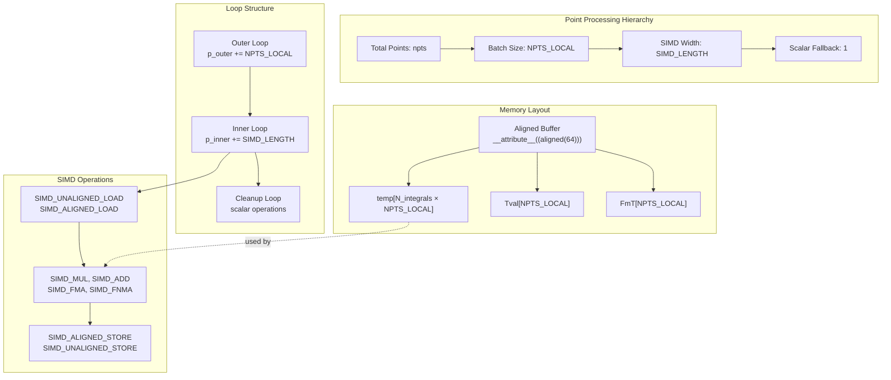
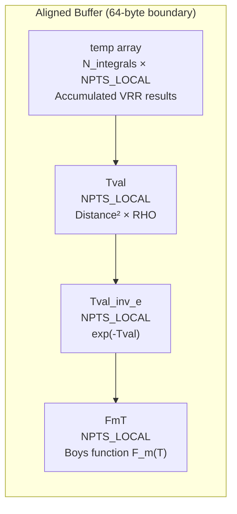
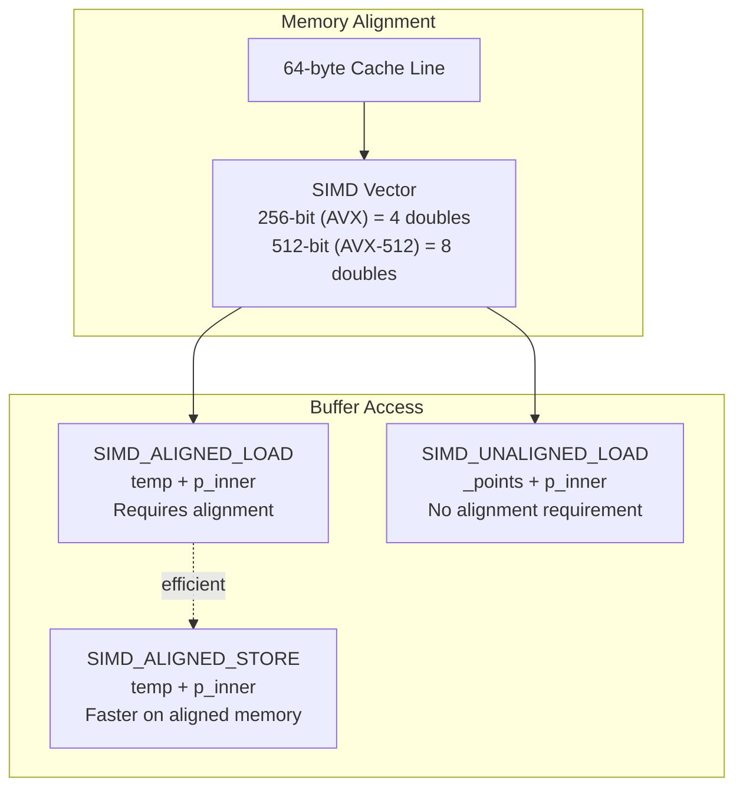
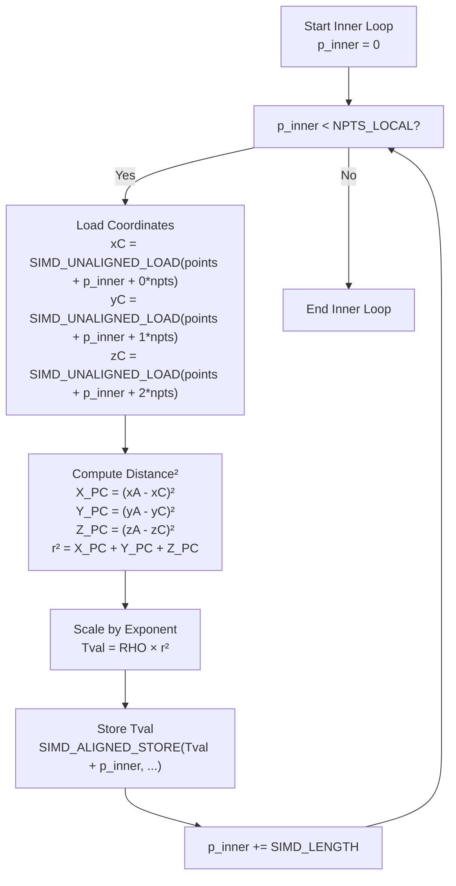
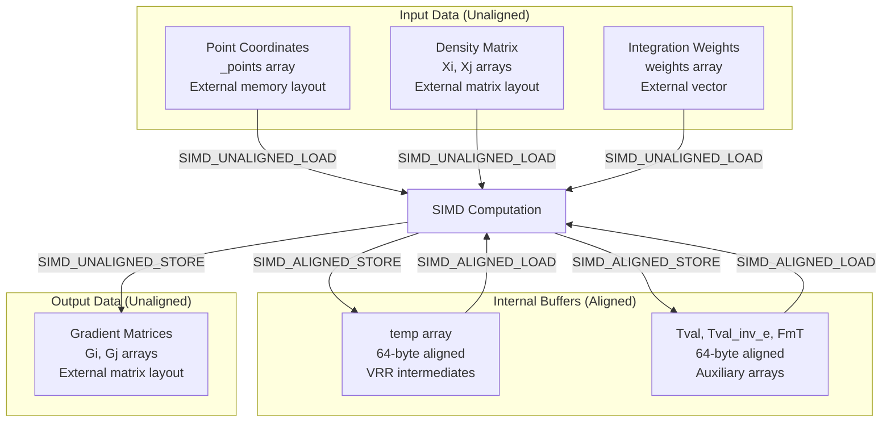
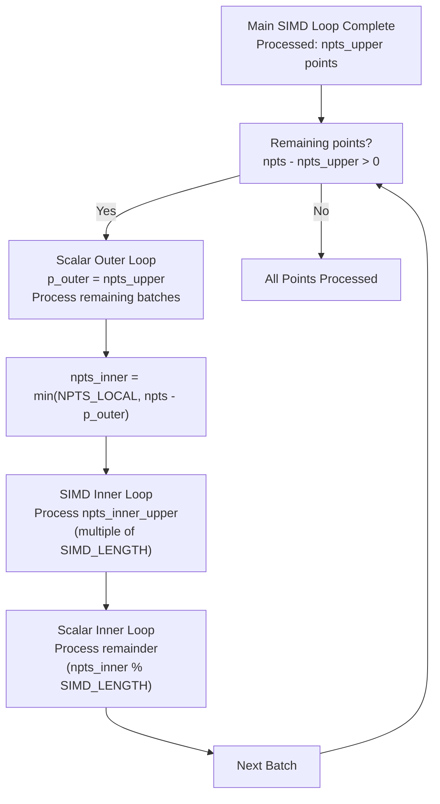

<!-- source: DeepWiki mcp.deepwiki.com · repo microsoft/skala · extra page SIMD Vectorization Strategy · fetched 2026-10-26 -->

# SIMD Vectorization Strategy

<details>
<summary>Relevant source files</summary>

The following files were used as context for generating this wiki page:

- [third_party/gauxc/src/xc_integrator/local_work_driver/host/obara_saika/src/integral_0.cxx](third_party/gauxc/src/xc_integrator/local_work_driver/host/obara_saika/src/integral_0.cxx)
- [third_party/gauxc/src/xc_integrator/local_work_driver/host/obara_saika/src/integral_1.cxx](third_party/gauxc/src/xc_integrator/local_work_driver/host/obara_saika/src/integral_1.cxx)
- [third_party/gauxc/src/xc_integrator/local_work_driver/host/obara_saika/src/integral_2.cxx](third_party/gauxc/src/xc_integrator/local_work_driver/host/obara_saika/src/integral_2.cxx)
- [third_party/gauxc/src/xc_integrator/local_work_driver/host/obara_saika/src/integral_2_1.cxx](third_party/gauxc/src/xc_integrator/local_work_driver/host/obara_saika/src/integral_2_1.cxx)
- [third_party/gauxc/src/xc_integrator/local_work_driver/host/obara_saika/src/integral_2_2.cxx](third_party/gauxc/src/xc_integrator/local_work_driver/host/obara_saika/src/integral_2_2.cxx)
- [third_party/gauxc/src/xc_integrator/local_work_driver/host/obara_saika/src/integral_3.cxx](third_party/gauxc/src/xc_integrator/local_work_driver/host/obara_saika/src/integral_3.cxx)
- [third_party/gauxc/src/xc_integrator/local_work_driver/host/obara_saika/src/integral_3_2.cxx](third_party/gauxc/src/xc_integrator/local_work_driver/host/obara_saika/src/integral_3_2.cxx)
- [third_party/gauxc/src/xc_integrator/local_work_driver/host/obara_saika/src/integral_4.cxx](third_party/gauxc/src/xc_integrator/local_work_driver/host/obara_saika/src/integral_4.cxx)
- [third_party/gauxc/src/xc_integrator/local_work_driver/host/obara_saika/src/integral_4_0.cxx](third_party/gauxc/src/xc_integrator/local_work_driver/host/obara_saika/src/integral_4_0.cxx)
- [third_party/gauxc/src/xc_integrator/local_work_driver/host/obara_saika/src/integral_4_1.cxx](third_party/gauxc/src/xc_integrator/local_work_driver/host/obara_saika/src/integral_4_1.cxx)
- [third_party/gauxc/src/xc_integrator/local_work_driver/host/obara_saika/src/integral_4_3.cxx](third_party/gauxc/src/xc_integrator/local_work_driver/host/obara_saika/src/integral_4_3.cxx)

</details>


## Purpose and Scope

This document describes the SIMD (Single Instruction Multiple Data) vectorization strategy used in the Obara-Saika integral evaluation code on the CPU host path. The implementation achieves efficient vectorization through batched point processing, aligned memory allocation, and compiler-agnostic SIMD abstractions. For the broader context of host computation including Gau2Grid collocation, see [Host Computation](#6). For the Obara-Saika VRR algorithm itself, see [VRR Algorithm and Boys Functions](#6.2.2).

---

## Architecture Overview

The vectorization strategy employs a three-level hierarchy: outer batching by `NPTS_LOCAL`, inner SIMD vectorization by `SIMD_LENGTH`, and scalar fallback for remainder points.

**Diagram: SIMD Vectorization Architecture**



Sources: [third_party/gauxc/src/xc_integrator/local_work_driver/host/obara_saika/src/integral_3.cxx:29-46](), [third_party/gauxc/src/xc_integrator/local_work_driver/host/obara_saika/src/integral_0.cxx:29-46]()

---

## NPTS_LOCAL Batching Strategy

### Batch Size Selection

The outer loop processes grid points in fixed-size batches of `NPTS_LOCAL` elements. This batch size is defined at compile time through `config_obara_saika.hpp` and determines the size of aligned temporary buffers.

**Key Implementation Pattern:**

```
size_t npts_upper = NPTS_LOCAL * (npts / NPTS_LOCAL);
for(p_outer = 0; p_outer < npts_upper; p_outer += NPTS_LOCAL) {
    // Process NPTS_LOCAL points
}
// Cleanup remainder: npts - npts_upper points
```

| Aspect | Implementation | Purpose |
|--------|----------------|---------|
| Batch Calculation | `npts_upper = NPTS_LOCAL * (npts / NPTS_LOCAL)` | Compute largest multiple of NPTS_LOCAL |
| Main Loop | `p_outer += NPTS_LOCAL` | Process full batches |
| Cleanup Loop | `for(; p_outer < npts; ...)` | Handle remainder points |
| Buffer Allocation | `buffer[N × NPTS_LOCAL]` | Stack-allocated with compile-time size |

Sources: [third_party/gauxc/src/xc_integrator/local_work_driver/host/obara_saika/src/integral_3.cxx:36-40](), [third_party/gauxc/src/xc_integrator/local_work_driver/host/obara_saika/src/integral_4.cxx:36-40]()

### Buffer Organization

Each batch allocates a stack-based, aligned buffer containing:

1. **Temporary integrals**: `temp[N_integrals × NPTS_LOCAL]`
2. **T-values**: `Tval[NPTS_LOCAL]`
3. **Inverse exponentials**: `Tval_inv_e[NPTS_LOCAL]`
4. **Boys function results**: `FmT[NPTS_LOCAL]`

**Diagram: Buffer Memory Layout**



Sources: [third_party/gauxc/src/xc_integrator/local_work_driver/host/obara_saika/src/integral_3.cxx:29-34](), [third_party/gauxc/src/xc_integrator/local_work_driver/host/obara_saika/src/integral_4_1.cxx:31-36]()

---

## Aligned Memory Allocation

### 64-Byte Alignment

All temporary buffers are allocated with 64-byte alignment using GCC's `__attribute__` syntax. This alignment ensures optimal cache line usage and enables efficient SIMD loads/stores.

**Declaration Pattern:**

```
__attribute__((__aligned__(64))) double buffer[N * NPTS_LOCAL + 3 * NPTS_LOCAL];
```

| Buffer Component | Size | Purpose |
|------------------|------|---------|
| `temp` | `N_integrals × NPTS_LOCAL` | VRR intermediate results |
| `Tval` | `NPTS_LOCAL` | Squared distances scaled by exponent |
| `Tval_inv_e` | `NPTS_LOCAL` | Exponential decay factors |
| `FmT` | `NPTS_LOCAL` | Boys function evaluations |

**Diagram: Aligned Memory Access Pattern**



Sources: [third_party/gauxc/src/xc_integrator/local_work_driver/host/obara_saika/src/integral_2.cxx:29-34](), [third_party/gauxc/src/xc_integrator/local_work_driver/host/obara_saika/src/integral_2_2.cxx:31-36]()

---

## SIMD Type Abstractions

### Type Definitions

The code uses compile-time macros to abstract SIMD types and operations, allowing the same source to compile with different SIMD instruction sets (SSE, AVX, AVX-512, ARM NEON, etc.).

**Core SIMD Types:**

| Type | Description | Typical Values |
|------|-------------|----------------|
| `SIMD_TYPE` | SIMD vector register type | `__m256d` (AVX), `__m512d` (AVX-512) |
| `SIMD_LENGTH` | Number of doubles per vector | 4 (AVX), 8 (AVX-512) |
| `SCALAR_TYPE` | Scalar fallback type | `double` |
| `SCALAR_LENGTH` | Scalar increment | 1 |

**SIMD Operation Macros:**

| Operation | Description | Example Usage |
|-----------|-------------|---------------|
| `SIMD_ZERO()` | Create zero vector | Initialization |
| `SIMD_SET1(x)` | Broadcast scalar to all lanes | Constants |
| `SIMD_DUPLICATE(&x)` | Load and broadcast | Read single value |
| `SIMD_LOAD(ptr)` | Aligned load | Read aligned buffer |
| `SIMD_UNALIGNED_LOAD(ptr)` | Unaligned load | Read input points |
| `SIMD_STORE(ptr, val)` | Aligned store | Write aligned buffer |
| `SIMD_UNALIGNED_STORE(ptr, val)` | Unaligned store | Write results |
| `SIMD_ADD(a, b)` | Vector addition | a + b |
| `SIMD_SUB(a, b)` | Vector subtraction | a - b |
| `SIMD_MUL(a, b)` | Vector multiplication | a × b |
| `SIMD_FMA(a, b, c)` | Fused multiply-add | a × b + c |
| `SIMD_FNMA(a, b, c)` | Fused negative multiply-add | c - a × b |

Sources: [third_party/gauxc/src/xc_integrator/local_work_driver/host/obara_saika/src/integral_3.cxx:58-71](), [third_party/gauxc/src/xc_integrator/local_work_driver/host/obara_saika/src/integral_4.cxx:58-75]()

### Fused Multiply-Add Usage

The VRR recurrence relations extensively use fused multiply-add operations to minimize floating-point rounding and improve performance.

**Common FMA Patterns:**

```
// Distance calculation: r² = (x-xC)² + (y-yC)² + (z-zC)²
X_PC = SIMD_MUL(X_PC, X_PC);           // (x-xC)²
X_PC = SIMD_FMA(Y_PC, Y_PC, X_PC);     // (x-xC)² + (y-yC)²
X_PC = SIMD_FMA(Z_PC, Z_PC, X_PC);     // (x-xC)² + (y-yC)² + (z-zC)²

// VRR term: t20 = X_PA × t10 - X_PC × t11 + 0.5/RHO × (t00 - t01)
t20 = SIMD_FNMA(X_PC, t11, t20);       // t20 - X_PC × t11
t20 = SIMD_FMA(tx, ty, t20);            // t20 + tx × ty
```

Sources: [third_party/gauxc/src/xc_integrator/local_work_driver/host/obara_saika/src/integral_3.cxx:67-69](), [third_party/gauxc/src/xc_integrator/local_work_driver/host/obara_saika/src/integral_3.cxx:107-124]()

---

## Inner SIMD Loop Structure

### Point Coordinate Loading

The inner loop processes `NPTS_LOCAL` points in chunks of `SIMD_LENGTH`, loading coordinates from the point array in structure-of-arrays (SoA) layout.

**Diagram: SIMD Inner Loop Flow**



Sources: [third_party/gauxc/src/xc_integrator/local_work_driver/host/obara_saika/src/integral_3.cxx:58-72](), [third_party/gauxc/src/xc_integrator/local_work_driver/host/obara_saika/src/integral_4_1.cxx:63-77]()

### VRR Computation Loop

After computing T-values and Boys function results, a second inner loop evaluates the VRR recurrence relations using SIMD operations.

**SIMD VRR Pattern:**

```
for(size_t p_inner = 0; p_inner < NPTS_LOCAL; p_inner += SIMD_LENGTH) {
    // Load point coordinates (SIMD_LENGTH points)
    SIMD_TYPE xC = SIMD_UNALIGNED_LOAD((_point_outer + p_inner + 0 * npts));
    SIMD_TYPE yC = SIMD_UNALIGNED_LOAD((_point_outer + p_inner + 1 * npts));
    SIMD_TYPE zC = SIMD_UNALIGNED_LOAD((_point_outer + p_inner + 2 * npts));
    
    // Compute displacement vectors
    SIMD_TYPE X_PC = SIMD_SUB(SIMD_DUPLICATE(&(xA)), xC);
    SIMD_TYPE Y_PC = SIMD_SUB(SIMD_DUPLICATE(&(yA)), yC);
    SIMD_TYPE Z_PC = SIMD_SUB(SIMD_DUPLICATE(&(zA)), zC);
    
    // Load auxiliary data
    SIMD_TYPE tval = SIMD_ALIGNED_LOAD((Tval + p_inner));
    SIMD_TYPE tval_inv_e = SIMD_ALIGNED_LOAD((Tval_inv_e + p_inner));
    SIMD_TYPE t00 = ...; // Boys function result
    
    // VRR recurrence (example)
    SIMD_TYPE t10 = SIMD_MUL(SIMD_DUPLICATE(&(X_PA)), t00);
    t10 = SIMD_FNMA(X_PC, t01, t10);  // t10 = X_PA*t00 - X_PC*t01
    
    // Accumulate into temp buffer
    SIMD_TYPE tx = SIMD_ALIGNED_LOAD((temp + offset * NPTS_LOCAL + p_inner));
    tx = SIMD_ADD(tx, t10);
    SIMD_ALIGNED_STORE((temp + offset * NPTS_LOCAL + p_inner), tx);
}
```

Sources: [third_party/gauxc/src/xc_integrator/local_work_driver/host/obara_saika/src/integral_3.cxx:78-162](), [third_party/gauxc/src/xc_integrator/local_work_driver/host/obara_saika/src/integral_2_1.cxx:84-265]()

---

## Buffer Initialization

### Zero Initialization

Before accumulating integral contributions from each primitive pair, the temporary buffer is zeroed using SIMD operations.

**Initialization Loop:**

```
for(int i = 0; i < N_integrals * NPTS_LOCAL; i += SIMD_LENGTH) {
    SIMD_ALIGNED_STORE((temp + i), SIMD_ZERO());
}
```

| Parameter | Value | Purpose |
|-----------|-------|---------|
| Loop stride | `SIMD_LENGTH` | Process one SIMD vector per iteration |
| Buffer size | `N_integrals × NPTS_LOCAL` | Zero all integral storage |
| Store type | Aligned | Fast write to aligned buffer |
| Value | `SIMD_ZERO()` | All-zeros vector |

Sources: [third_party/gauxc/src/xc_integrator/local_work_driver/host/obara_saika/src/integral_3.cxx:45](), [third_party/gauxc/src/xc_integrator/local_work_driver/host/obara_saika/src/integral_4.cxx:45]()

---

## Memory Access Patterns

### Aligned vs. Unaligned Access

The implementation distinguishes between aligned and unaligned memory accesses to optimize performance.

**Diagram: Memory Access Classification**



**Access Pattern Table:**

| Memory Location | Alignment | Load Operation | Store Operation |
|----------------|-----------|----------------|-----------------|
| `temp` buffer | 64-byte | `SIMD_ALIGNED_LOAD` | `SIMD_ALIGNED_STORE` |
| `Tval`, `FmT` | 64-byte | `SIMD_ALIGNED_LOAD` | `SIMD_ALIGNED_STORE` |
| `_points` | Unaligned | `SIMD_UNALIGNED_LOAD` | N/A (read-only) |
| `Xi`, `Xj` | Unaligned | `SIMD_UNALIGNED_LOAD` | N/A (read-only) |
| `Gi`, `Gj` | Unaligned | `SIMD_UNALIGNED_LOAD` | `SIMD_UNALIGNED_STORE` |
| `weights` | Unaligned | `SIMD_UNALIGNED_LOAD` | N/A (read-only) |

Sources: [third_party/gauxc/src/xc_integrator/local_work_driver/host/obara_saika/src/integral_3.cxx:59-61](), [third_party/gauxc/src/xc_integrator/local_work_driver/host/obara_saika/src/integral_2_1.cxx:269-294]()

---

## Scalar Fallback Implementation

### Remainder Point Processing

When the total number of points is not a multiple of `NPTS_LOCAL`, the cleanup loop processes remaining points using scalar operations. This maintains correctness without requiring padding.

**Diagram: Scalar Fallback Flow**



Sources: [third_party/gauxc/src/xc_integrator/local_work_driver/host/obara_saika/src/integral_0.cxx:103-214](), [third_party/gauxc/src/xc_integrator/local_work_driver/host/obara_saika/src/integral_1.cxx:236-339]()

### Scalar Operation Macros

The scalar fallback uses analogous macros with `SCALAR_` prefix:

| SIMD Operation | Scalar Equivalent | Description |
|----------------|-------------------|-------------|
| `SIMD_TYPE` | `SCALAR_TYPE` | `double` |
| `SIMD_LENGTH` | `SCALAR_LENGTH` | 1 |
| `SIMD_LOAD` | `SCALAR_LOAD` | Dereference pointer |
| `SIMD_STORE` | `SCALAR_STORE` | Assign through pointer |
| `SIMD_ADD` | `SCALAR_ADD` | Scalar addition |
| `SIMD_MUL` | `SCALAR_MUL` | Scalar multiplication |
| `SIMD_FMA` | `SCALAR_FMA` | `a * b + c` |

**Cleanup Loop Structure:**

```
// Cleanup code for remaining points
for(; p_outer < npts; p_outer += NPTS_LOCAL) {
    size_t npts_inner = std::min((size_t) NPTS_LOCAL, npts - p_outer);
    
    // ... initialize buffers ...
    
    // Process full SIMD vectors in inner batch
    size_t npts_inner_upper = SIMD_LENGTH * (npts_inner / SIMD_LENGTH);
    for(size_t p_inner = 0; p_inner < npts_inner_upper; p_inner += SIMD_LENGTH) {
        // SIMD operations
    }
    
    // Process remaining points with scalar operations
    for(; p_inner < npts_inner; p_inner += SCALAR_LENGTH) {
        // SCALAR operations (single point at a time)
    }
}
```

Sources: [third_party/gauxc/src/xc_integrator/local_work_driver/host/obara_saika/src/integral_0.cxx:103-214](), [third_party/gauxc/src/xc_integrator/local_work_driver/host/obara_saika/src/integral_1.cxx:236-339]()

---

## Accumulation and Output

### Primitive Pair Accumulation

For each primitive pair, VRR results are accumulated into the `temp` buffer using SIMD add operations:

```
// Accumulate integral contribution
SIMD_TYPE tx = SIMD_ALIGNED_LOAD((temp + offset * NPTS_LOCAL + p_inner));
tx = SIMD_ADD(tx, t_integral);  // Add this pair's contribution
SIMD_ALIGNED_STORE((temp + offset * NPTS_LOCAL + p_inner), tx);
```

Sources: [third_party/gauxc/src/xc_integrator/local_work_driver/host/obara_saika/src/integral_3.cxx:173-175](), [third_party/gauxc/src/xc_integrator/local_work_driver/host/obara_saika/src/integral_4_1.cxx:174-176]()

### Final Gradient Computation

After processing all primitive pairs, the accumulated integrals are combined with density matrices and weights to produce gradient contributions:

**Gradient Accumulation Pattern:**

```
for(size_t p_inner = 0; p_inner < NPTS_LOCAL; p_inner += SIMD_LENGTH) {
    // Load basis function integral
    SIMD_TYPE integral = SIMD_ALIGNED_LOAD((temp + idx * NPTS_LOCAL + p_inner));
    
    // Load integration weight
    SIMD_TYPE wg = SIMD_UNALIGNED_LOAD((weights + p_outer + p_inner));
    
    // Load density matrix elements
    SIMD_TYPE xi = SIMD_UNALIGNED_LOAD((Xi + basis_idx * ldX));
    
    // Load current gradient
    SIMD_TYPE gi = SIMD_UNALIGNED_LOAD((Gi + basis_idx * ldG));
    
    // Accumulate: Gi += weight * integral * Xi
    integral = SIMD_MUL(integral, wg);
    gi = SIMD_FMA(integral, xi, gi);
    
    // Store updated gradient
    SIMD_UNALIGNED_STORE((Gi + basis_idx * ldG), gi);
}
```

Sources: [third_party/gauxc/src/xc_integrator/local_work_driver/host/obara_saika/src/integral_1.cxx:165-212](), [third_party/gauxc/src/xc_integrator/local_work_driver/host/obara_saika/src/integral_2_1.cxx:268-344]()

---

## Performance Considerations

### Cache Efficiency

The `NPTS_LOCAL` batching strategy keeps frequently accessed temporary buffers within L1/L2 cache:

| Buffer Type | Size (L=3, NPTS_LOCAL=128, AVX) | Purpose |
|-------------|----------------------------------|---------|
| `temp` | 74 × 128 × 8 bytes = 75.8 KB | VRR results |
| `Tval` | 128 × 8 bytes = 1 KB | T-values |
| `FmT` | 128 × 8 bytes = 1 KB | Boys function |
| **Total** | ~78 KB | Fits in L2 cache |

Sources: [third_party/gauxc/src/xc_integrator/local_work_driver/host/obara_saika/src/integral_3.cxx:29]()

### SIMD Width Adaptability

The abstraction layer allows the same code to compile for different SIMD instruction sets:

| ISA | SIMD_LENGTH | Register Type | Throughput |
|-----|-------------|---------------|------------|
| SSE | 2 | `__m128d` | 2 double/cycle |
| AVX | 4 | `__m256d` | 4 double/cycle |
| AVX-512 | 8 | `__m512d` | 8 double/cycle |
| ARM NEON | 2 | `float64x2_t` | 2 double/cycle |

The inner loop automatically processes the optimal number of points per iteration based on `SIMD_LENGTH`, maximizing throughput for the target architecture.

### Fused Operations

Extensive use of FMA instructions reduces both instruction count and floating-point rounding error:

- **Without FMA**: `result = a + (b * c)` → 2 operations, 2 rounding steps
- **With FMA**: `result = fma(b, c, a)` → 1 operation, 1 rounding step

The VRR recurrence relations contain numerous terms of the form `a × b + c` and `c - a × b`, making FMA instructions particularly beneficial.

Sources: [third_party/gauxc/src/xc_integrator/local_work_driver/host/obara_saika/src/integral_3.cxx:67-69](), [third_party/gauxc/src/xc_integrator/local_work_driver/host/obara_saika/src/integral_3.cxx:107-124]()

---

## Integration with Function Hierarchy

The SIMD vectorization strategy is implemented consistently across all angular momentum combinations in the `integral_X` and `integral_X_Y` function family. For the full function hierarchy, see [Integral Function Hierarchy](#6.2.1).

**Function Family SIMD Uniformity:**

| Function | Angular Momenta | Buffer Size | SIMD Pattern |
|----------|-----------------|-------------|--------------|
| `integral_0` | (0,0) s-s | 1 × NPTS_LOCAL | Identical |
| `integral_1` | (1,0) p-s | 9 × NPTS_LOCAL | Identical |
| `integral_2` | (2,0) d-s | 31 × NPTS_LOCAL | Identical |
| `integral_3` | (3,0) f-s | 74 × NPTS_LOCAL | Identical |
| `integral_4` | (4,0) g-s | 145 × NPTS_LOCAL | Identical |
| `integral_2_1` | (2,1) d-p | 16 × NPTS_LOCAL | Identical |
| `integral_2_2` | (2,2) d-d | 31 × NPTS_LOCAL | Identical |

All functions share the same three-level hierarchy (outer batch, inner SIMD, scalar fallback), differing only in the number of integrals computed and stored in the `temp` buffer.

Sources: [third_party/gauxc/src/xc_integrator/local_work_driver/host/obara_saika/src/integral_0.cxx:17-29](), [third_party/gauxc/src/xc_integrator/local_work_driver/host/obara_saika/src/integral_4.cxx:17-29]()

---

