<!-- source: DeepWiki mcp.deepwiki.com · repo microsoft/skala · extra page SSF Weight Modification · fetched 2026-10-26 -->

# SSF Weight Modification

<details>
<summary>Relevant source files</summary>

The following files were used as context for generating this wiki page:

- [third_party/gauxc/attic/src/integrator/cuda/cuda_weights.cu](third_party/gauxc/attic/src/integrator/cuda/cuda_weights.cu)
- [third_party/gauxc/attic/src/new_integrator/device/cuda/cuda_weights.cu](third_party/gauxc/attic/src/new_integrator/device/cuda/cuda_weights.cu)
- [third_party/gauxc/attic/src/new_integrator/device/hip/hip_weights.hip](third_party/gauxc/attic/src/new_integrator/device/hip/hip_weights.hip)
- [third_party/gauxc/src/xc_integrator/local_work_driver/device/cuda/kernels/cuda_ssf_1d.cu](third_party/gauxc/src/xc_integrator/local_work_driver/device/cuda/kernels/cuda_ssf_1d.cu)
- [third_party/gauxc/src/xc_integrator/local_work_driver/device/cuda/kernels/cuda_ssf_2d.hu](third_party/gauxc/src/xc_integrator/local_work_driver/device/cuda/kernels/cuda_ssf_2d.hu)
- [third_party/gauxc/src/xc_integrator/local_work_driver/device/cuda/kernels/grid_to_center.cu](third_party/gauxc/src/xc_integrator/local_work_driver/device/cuda/kernels/grid_to_center.cu)
- [third_party/gauxc/src/xc_integrator/local_work_driver/device/hip/kernels/grid_to_center.hip](third_party/gauxc/src/xc_integrator/local_work_driver/device/hip/kernels/grid_to_center.hip)
- [third_party/gauxc/src/xc_integrator/local_work_driver/device/hip/kernels/hip_ssf_1d.hip](third_party/gauxc/src/xc_integrator/local_work_driver/device/hip/kernels/hip_ssf_1d.hip)
- [third_party/gauxc/src/xc_integrator/local_work_driver/device/hip/kernels/hip_ssh_2d.hip](third_party/gauxc/src/xc_integrator/local_work_driver/device/hip/kernels/hip_ssh_2d.hip)

</details>


## Purpose and Scope

This page documents the GPU kernels that modify integration weights using the Smooth Step Function (SSF) partitioning scheme. SSF weight modification is the second stage of the two-phase weight calculation pipeline, following the distance computation documented in [Distance Computation](#7.1.1). These kernels implement the Stratmann-Scuseria-Frisch partition function to distribute integration points across atomic centers in a numerically stable manner.

For the overall weight calculation pipeline and the wrapper function `partition_weights_*_SoA`, see [Weight Calculation Kernels](#7.1). For general GPU optimization techniques used in these kernels, see [Warp-Level Parallelism](#8.2) and [Loop Unrolling and Vectorization](#8.3).

## Mathematical Foundation

The SSF partitioning scheme computes partition weights that smoothly distribute integration points across atomic centers. For each integration point `r` and each atomic center `i`, a partition weight `P_i(r)` is computed as:

```
P_i(r) = ∏_{j≠i} s(μ_ij)
```

where `μ_ij = (r_i - r_j) / R_AB[i,j]` is the confocal elliptical coordinate, `r_i` is the distance from point `r` to center `i`, and `R_AB[i,j]` is the inter-atomic distance between centers `i` and `j`.

The smooth step function `s(x)` is defined using the Frisch polynomial:

```
g(x) = (35*(s_x - s_x³) + 21*s_x⁵ - 5*s_x⁷)
s_x = x / α

s(x) = {
  0.5 * (1 - g(x)/16)  if |x| < α
  0                     if x ≥ α
  1                     if x ≤ -α
}
```

where `α = magic_ssf_factor<>` ≈ 0.64 is the cutoff parameter.

The final weight modification is:

```
w(r) *= P_iParent(r) / Σ_i P_i(r)
```

where `iParent` is the atomic center to which point `r` is assigned.

**Sources:** [third_party/gauxc/src/xc_integrator/local_work_driver/device/cuda/kernels/cuda_ssf_2d.hu:17-36](), [third_party/gauxc/src/xc_integrator/local_work_driver/device/cuda/kernels/cuda_ssf_1d.cu:33-50]()

## Kernel Variants

GauXC provides two SSF weight modification kernel variants with different parallelization strategies:

| Variant | Function Name | Parallelism Model | Best For |
|---------|---------------|-------------------|----------|
| 1D | `modify_weights_ssf_kernel_1d` | One thread per point | Small molecules, simple parallelism |
| 2D | `modify_weights_ssf_kernel_2d` | One warp per point | Large molecules, complex parallelism |

The 1D kernel assigns each thread to process one integration point independently, while the 2D kernel assigns an entire warp (32 threads) to cooperatively process each point, enabling more sophisticated optimizations.

**Sources:** [third_party/gauxc/src/xc_integrator/local_work_driver/device/cuda/kernels/cuda_ssf_1d.cu:20-127](), [third_party/gauxc/src/xc_integrator/local_work_driver/device/cuda/kernels/cuda_ssf_2d.hu:42-187]()

## Core Function Implementations

### Frisch Partition Functions

The `gFrisch` and `sFrisch` functions implement the mathematical formulation described above. These are device-side inline functions used by both kernel variants.

**CUDA Implementation:**

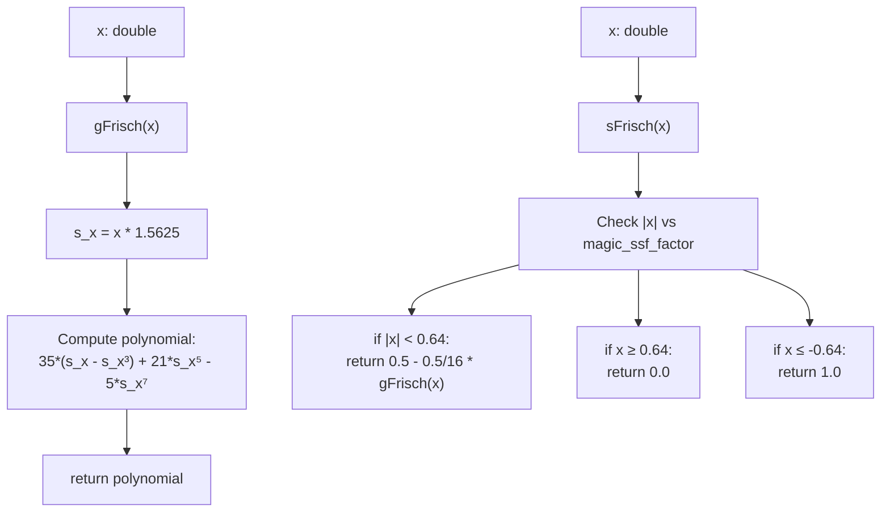

The `gFrisch` function uses the precomputed factor `1.5625` instead of dividing by `magic_ssf_factor<>` (0.64) for performance. The polynomial is evaluated using Horner's method to minimize operations.

**Sources:** [third_party/gauxc/src/xc_integrator/local_work_driver/device/cuda/kernels/cuda_ssf_2d.hu:17-36](), [third_party/gauxc/src/xc_integrator/local_work_driver/device/hip/kernels/hip_ssh_2d.hip:19-38]()

## 1D Kernel Implementation

### Algorithm Overview

The `modify_weights_ssf_kernel_1d` kernel processes integration points with a simple one-thread-per-point model:

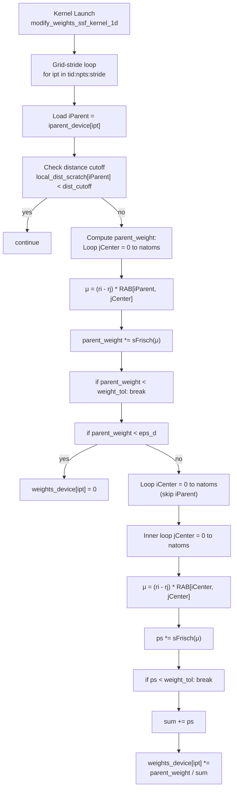

**Sources:** [third_party/gauxc/src/xc_integrator/local_work_driver/device/cuda/kernels/cuda_ssf_1d.cu:20-127]()

### Key Features

1. **Grid-Stride Loop**: The kernel uses a grid-stride loop pattern for flexible parallelism, allowing the same kernel to work with different grid sizes [third_party/gauxc/src/xc_integrator/local_work_driver/device/cuda/kernels/cuda_ssf_1d.cu:54-57]().

2. **Parent-First Strategy**: The algorithm computes the parent center's weight first, enabling early exit if the weight is negligible [third_party/gauxc/src/xc_integrator/local_work_driver/device/cuda/kernels/cuda_ssf_1d.cu:70-92]().

3. **Tolerance-Based Early Exit**: Inner loops break early when the partial product falls below `weight_tol = 1e-10`, avoiding unnecessary computation [third_party/gauxc/src/xc_integrator/local_work_driver/device/cuda/kernels/cuda_ssf_1d.cu:78-87]().

4. **Distance Cutoff Optimization**: Points very close to their parent center skip the full calculation [third_party/gauxc/src/xc_integrator/local_work_driver/device/cuda/kernels/cuda_ssf_1d.cu:64-67]().

### Launch Configuration

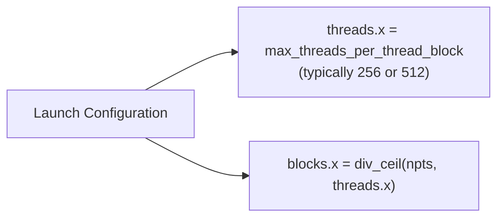

**Sources:** [third_party/gauxc/src/xc_integrator/local_work_driver/device/cuda/kernels/cuda_ssf_1d.cu:129-140]()

## 2D Kernel Implementation

### Warp-Level Parallelization Strategy

The `modify_weights_ssf_kernel_2d` kernel assigns one warp (32 threads) to each integration point, enabling sophisticated warp-level optimizations:

```mermaid
graph TB
    Launch["Kernel Launch<br/>modify_weights_ssf_kernel_2d"]
    WarpStride["Warp-stride loop<br/>for ipt in warp_id:npts:warp_stride"]
    LoadParent["Load iParent = iparent[ipt]"]
    
    SharedCounter["Allocate shared memory:<br/>jCounter_sm[max_warps_per_thread_block]"]
    
    ParentPhase["Parent Weight Computation Phase"]
    WarpLoop["Warp loop over natom_block<br/>(blockDim.x chunks)"]
    WarpLoad["Each thread computes contribution"]
    WarpReduce["contribution = warpReduceProd(contribution)"]
    WarpMul["parent_weight *= contribution"]
    
    CheckZero["if parent_weight < eps_d:<br/>weights[ipt] = 0, continue"]
    
    InitCounter["Thread 0: jCounter[0] = 0"]
    
    DynamicPhase["Dynamic Work Assignment Phase"]
    AtomicGet["iCenter = atomicAdd(jCounter, 1)"]
    SkipParent["if iCenter >= iParent: iCenter++"]
    
    VectorLoop["Vectorized loop over jCenters"]
    VectorLoad["Load double2 arrays:<br/>rj[weight_unroll/2]<br/>rab_val[weight_unroll/2]"]
    UnrolledCompute["Unrolled computation:<br/>mu[k] = (ri - rj[k]) * rab_val[k]<br/>ps *= sFrisch(mu[k])"]
    
    CheckDone["if ps < weight_tol or<br/>iCount >= lddist"]
    GetNext["sum += ps<br/>iCenter = atomicAdd(jCounter, 1)"]
    
    WarpSync["__any_sync: check if any<br/>thread has work remaining"]
    
    FinalReduce["sum = warpReduceSum(sum)"]
    FinalNorm["Thread 0:<br/>weights[ipt] *= parent_weight / sum"]
    
    Launch --> WarpStride
    WarpStride --> LoadParent
    LoadParent --> SharedCounter
    SharedCounter --> ParentPhase
    ParentPhase --> WarpLoop
    WarpLoop --> WarpLoad
    WarpLoad --> WarpReduce
    WarpReduce --> WarpMul
    WarpMul --> CheckZero
    CheckZero --> InitCounter
    InitCounter --> DynamicPhase
    DynamicPhase --> AtomicGet
    AtomicGet --> SkipParent
    SkipParent --> VectorLoop
    VectorLoop --> VectorLoad
    VectorLoad --> UnrolledCompute
    UnrolledCompute --> CheckDone
    CheckDone --> GetNext
    GetNext --> WarpSync
    WarpSync --> FinalReduce
    FinalReduce --> FinalNorm
```

**Sources:** [third_party/gauxc/src/xc_integrator/local_work_driver/device/cuda/kernels/cuda_ssf_2d.hu:42-187]()

### Dynamic Work Assignment

The 2D kernel employs a sophisticated dynamic work assignment scheme to balance load across threads in a warp:

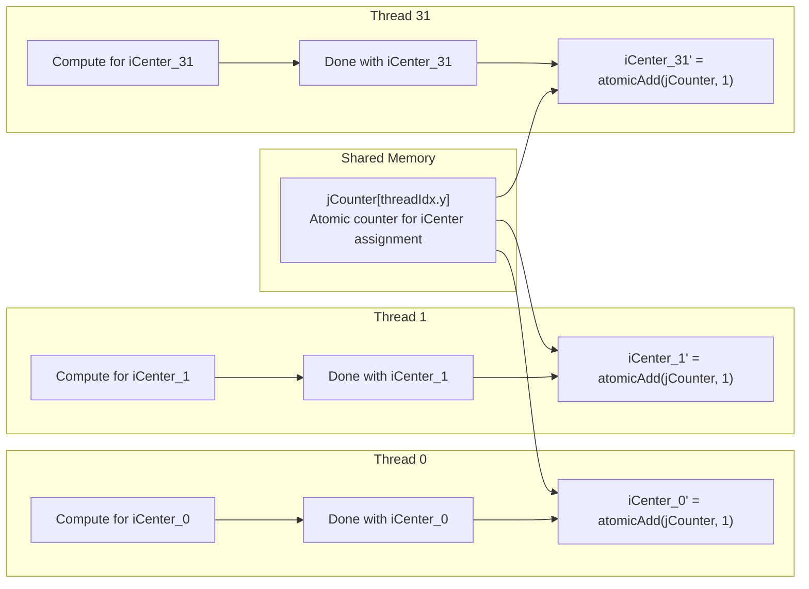

Each thread in the warp processes different atomic centers (`iCenter` values) independently. When a thread finishes computing the partition weight for its current center (either due to weight tolerance or completing all `jCenter` iterations), it atomically acquires the next unprocessed center. This continues until all centers are processed, with `__any_sync(0xffffffff, cont)` detecting when all threads are done.

**Sources:** [third_party/gauxc/src/xc_integrator/local_work_driver/device/cuda/kernels/cuda_ssf_2d.hu:110-171]()

### Vectorized Memory Access

The 2D kernel uses vectorized `double2` loads to improve memory bandwidth utilization:

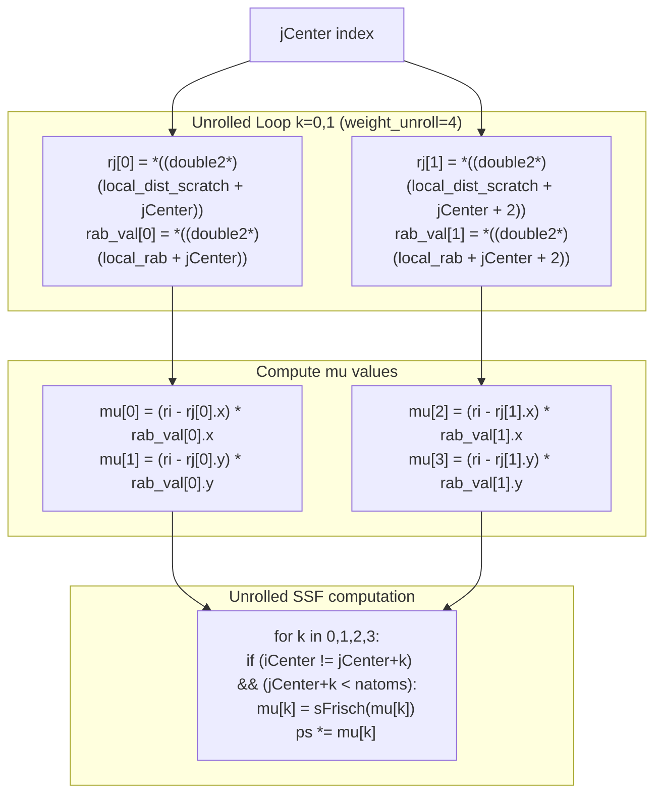

By loading two `double` values at a time using `double2` casts, the kernel reduces the number of memory transactions by half. The loop is unrolled by a factor of 4 (`weight_unroll = 4`), processing four `jCenter` values per iteration.

**Sources:** [third_party/gauxc/src/xc_integrator/local_work_driver/device/cuda/kernels/cuda_ssf_2d.hu:127-150]()

### Parent Weight Computation with Warp Reduction

The parent center's weight is computed collaboratively by the warp using warp reduction primitives:

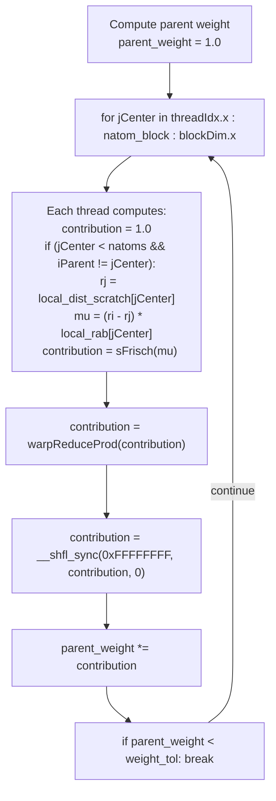

The `warpReduceProd` function computes the product of `contribution` values across all threads in the warp, then `__shfl_sync` broadcasts the result to all threads. This allows the entire warp to cooperatively compute the parent weight with early exit when the product becomes negligible.

**Sources:** [third_party/gauxc/src/xc_integrator/local_work_driver/device/cuda/kernels/cuda_ssf_2d.hu:75-96]()

### Launch Configuration

The 2D kernel uses template parameters for precise control over occupancy:

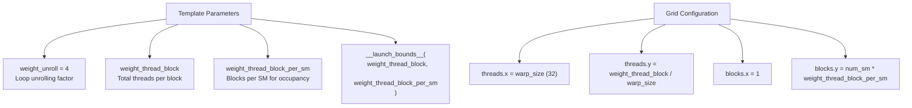

The `__launch_bounds__` hint informs the compiler about expected occupancy, allowing it to optimize register usage. The thread block is organized as a 2D grid with `threads.x = 32` (one warp width) and `threads.y` controlling the number of warps per block.

**Sources:** [third_party/gauxc/src/xc_integrator/local_work_driver/device/cuda/kernels/cuda_ssf_2d.hu:38-50](), [third_party/gauxc/src/xc_integrator/local_work_driver/device/hip/kernels/hip_ssh_2d.hip:186-211]()

## Kernel Parameters and Data Structures

### Function Signatures

**1D Kernel:**
```
modify_weights_ssf_kernel_1d(
  size_t npts,                    // Number of integration points
  size_t natoms,                  // Number of atomic centers
  const double* RAB,              // Inter-atomic distances [natoms × ldRAB]
  int32_t ldRAB,                  // Leading dimension of RAB
  const double* coords,           // Atomic coordinates (unused in kernel)
  const double* dist_scratch,     // Point-to-atom distances [npts × lddist]
  int32_t lddist,                 // Leading dimension of dist_scratch
  const int32_t* iparent_device,  // Parent center index for each point [npts]
  const double* dist_nearest_device, // Distance to nearest center [npts]
  double* weights_device          // Integration weights (modified in-place) [npts]
)
```

**2D Kernel:**
```
modify_weights_ssf_kernel_2d<weight_unroll, weight_thread_block, weight_thread_block_per_sm>(
  int32_t npts,                   // Number of integration points
  int32_t natoms,                 // Number of atomic centers
  const double* RAB,              // Inter-atomic distances [natoms × ldRAB]
  int32_t ldRAB,                  // Leading dimension of RAB
  const double* coords,           // Atomic coordinates (unused in kernel)
  const double* dist,             // Point-to-atom distances [npts × lddist]
  size_t lddist,                  // Leading dimension of dist
  const int32_t* iparent,         // Parent center index for each point [npts]
  const double* dist_nearest,     // Distance to nearest center [npts]
  double* weights                 // Integration weights (modified in-place) [npts]
)
```

**Sources:** [third_party/gauxc/src/xc_integrator/local_work_driver/device/cuda/kernels/cuda_ssf_1d.cu:20-31](), [third_party/gauxc/src/xc_integrator/local_work_driver/device/cuda/kernels/cuda_ssf_2d.hu:43-46]()

### Input Data Layout

| Array | Dimensions | Description |
|-------|-----------|-------------|
| `RAB` | `[natoms][ldRAB]` | Reciprocal inter-atomic distances: `1/R_AB[i,j]`. Used to compute confocal coordinates. Note: The kernel multiplies by `RAB` rather than dividing. |
| `dist_scratch` / `dist` | `[npts][lddist]` | Distances from each point to each atomic center, computed by `compute_grid_to_center_dist` (see [Distance Computation](#7.1.1)). |
| `iparent_device` / `iparent` | `[npts]` | Index of the parent atomic center for each integration point. |
| `dist_nearest_device` / `dist_nearest` | `[npts]` | Distance from each point to its nearest atomic center, used for distance cutoff optimization. |
| `weights_device` / `weights` | `[npts]` | Integration weights, modified in-place by multiplication with partition weights. |

**Sources:** [third_party/gauxc/src/xc_integrator/local_work_driver/device/cuda/kernels/cuda_ssf_1d.cu:20-31](), [third_party/gauxc/attic/src/new_integrator/device/cuda/cuda_weights.cu:411-421]()

### Constants and Thresholds

| Constant | Value | Purpose |
|----------|-------|---------|
| `magic_ssf_factor<>` | ~0.64 | Cutoff radius for SSF function. Points beyond this distance contribute 0 or 1 to the partition function. |
| `weight_tol` | 1e-10 | Tolerance for early termination. If a partial product falls below this, the loop exits early. |
| `eps_d` | `std::numeric_limits<double>::epsilon()` | Machine epsilon for double precision, used to check if parent weight is effectively zero. |
| `weight_unroll` | 4 | Loop unrolling factor for 2D kernel vectorization. |

**Sources:** [third_party/gauxc/src/xc_integrator/local_work_driver/device/cuda/kernels/cuda_ssf_2d.hu:13-51](), [third_party/gauxc/src/xc_integrator/local_work_driver/device/cuda/kernels/cuda_ssf_1d.cu:14-52]()

## Optimizations

### Distance Cutoff Screening

Both kernels employ a distance-based screening optimization to skip points that are very close to their parent center:

```
dist_cutoff = 0.5 * (1 - magic_ssf_factor<>) * dist_nearest[ipt]
if (local_dist_scratch[iParent] < dist_cutoff) continue;
```

If the parent center's distance is less than approximately 18% of the nearest-neighbor distance, the point is guaranteed to have a partition weight very close to 1, so the full calculation is skipped.

**Sources:** [third_party/gauxc/src/xc_integrator/local_work_driver/device/cuda/kernels/cuda_ssf_1d.cu:64-69](), [third_party/gauxc/src/xc_integrator/local_work_driver/device/cuda/kernels/cuda_ssf_2d.hu:70-73]()

### Wrap-Around jCenter Indexing

The 2D kernel uses a wrap-around strategy for the `jCenter` loop index to avoid expensive modulo operations:

```
jCenter += weight_unroll;
jCenter = (jCenter < ldRAB) ? jCenter : 0;
```

This conditional assignment is faster than `jCenter = (jCenter + weight_unroll) % ldRAB` on GPU architectures.

**Sources:** [third_party/gauxc/src/xc_integrator/local_work_driver/device/cuda/kernels/cuda_ssf_2d.hu:169-171]()

### Register-Based Computation

Key variables in the 2D kernel are kept in registers for the entire inner loop:

- `ri`: Distance from current point to current iCenter (register)
- `ps`: Partial product accumulator (register)  
- `iCount`: Counter for processed jCenters (register)
- `cont`: Continuation flag (register)

By maintaining these in registers and only accessing global memory for vectorized loads of `rj` and `rab_val`, the kernel minimizes memory latency.

**Sources:** [third_party/gauxc/src/xc_integrator/local_work_driver/device/cuda/kernels/cuda_ssf_2d.hu:118-167]()

## Platform-Specific Implementations

### CUDA vs HIP Differences

The SSF kernels are implemented for both CUDA and HIP with minimal differences:

| Aspect | CUDA | HIP |
|--------|------|-----|
| Kernel Launch | `kernel<<<blocks, threads, 0, stream>>>` | `hipLaunchKernelGGL(kernel, blocks, threads, 0, stream)` |
| Warp Intrinsics | `__any_sync(0xffffffff, cont)` | `__any(cont)` |
| Warp Reduce | `cuda::warp_reduce_prod<cuda::warp_size>` | `hip::warp_reduce_prod<hip::warp_size>` |
| Warp Reduce Sum | `cuda::warp_reduce_sum<cuda::warp_size>` | `hip::warp_reduce_sum<hip::warp_size>` |

The mathematical algorithm and optimization strategies are identical across platforms.

**Sources:** [third_party/gauxc/src/xc_integrator/local_work_driver/device/cuda/kernels/cuda_ssf_2d.hu:89-90](), [third_party/gauxc/src/xc_integrator/local_work_driver/device/hip/kernels/hip_ssh_2d.hip:91-125]()

## Wrapper Functions

### 1D Wrapper: `partition_weights_ssf_1d`

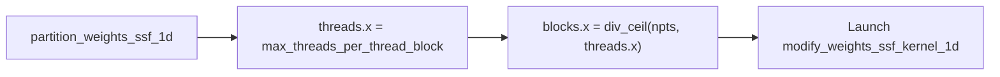

**Sources:** [third_party/gauxc/src/xc_integrator/local_work_driver/device/cuda/kernels/cuda_ssf_1d.cu:129-140]()

### 2D Wrapper: `partition_weights_ssf_2d`

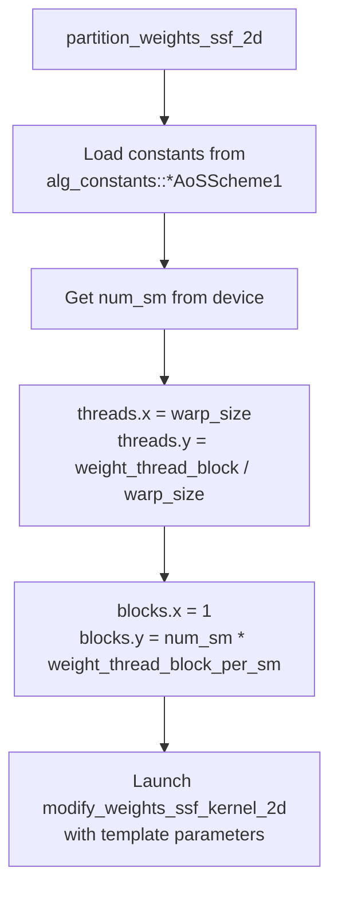

The 2D wrapper queries the device for the number of SMs (streaming multiprocessors / compute units) and launches enough thread blocks to saturate the GPU.

**Sources:** [third_party/gauxc/src/xc_integrator/local_work_driver/device/hip/kernels/hip_ssh_2d.hip:186-211]()

## Integration with Weight Calculation Pipeline

The SSF modification kernels are invoked as the second stage of weight calculation in `partition_weights_*_SoA`:

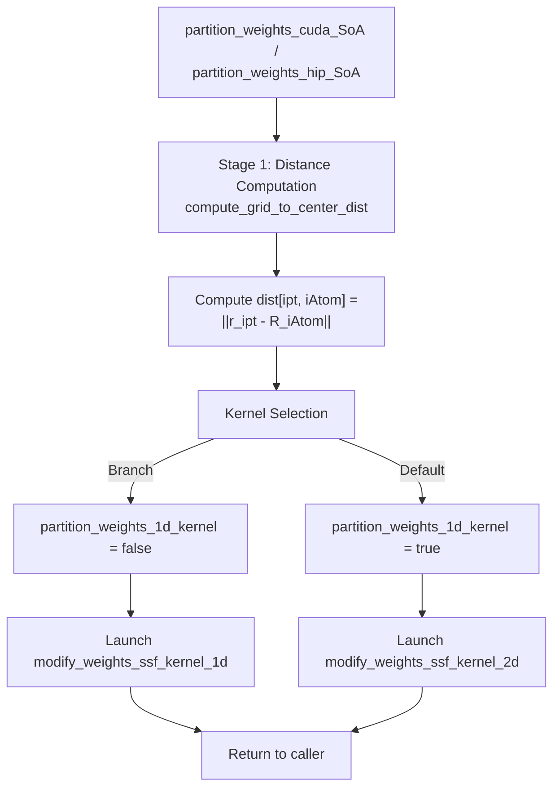

In the current implementation, `partition_weights_1d_kernel` is set to `true` by default, so the 2D kernel is used. The 1D kernel path exists for potential fallback but is typically disabled.

**Sources:** [third_party/gauxc/attic/src/new_integrator/device/cuda/cuda_weights.cu:564-623](), [third_party/gauxc/attic/src/new_integrator/device/hip/hip_weights.hip:564-624]()

## Performance Characteristics

### 1D Kernel

**Advantages:**
- Simple implementation, easy to understand
- Low shared memory usage (none)
- Good for small molecules where warp-level cooperation overhead dominates

**Disadvantages:**
- No warp-level parallelism for inner loops
- Sequential processing of centers
- Lower arithmetic intensity

### 2D Kernel

**Advantages:**
- Warp-level cooperation reduces latency for large `natoms`
- Dynamic work assignment balances load across threads
- Vectorized memory access (2× bandwidth)
- Early exit more effective with warp voting

**Disadvantages:**
- Higher shared memory usage (`jCounter_sm`)
- More complex implementation
- Atomic operations for work assignment (though minimal contention)

For typical molecular systems with 50-500 atoms, the 2D kernel generally outperforms the 1D kernel due to better utilization of warp-level parallelism and memory bandwidth.

**Sources:** [third_party/gauxc/attic/src/new_integrator/device/cuda/cuda_weights.cu:591-601]()

---

