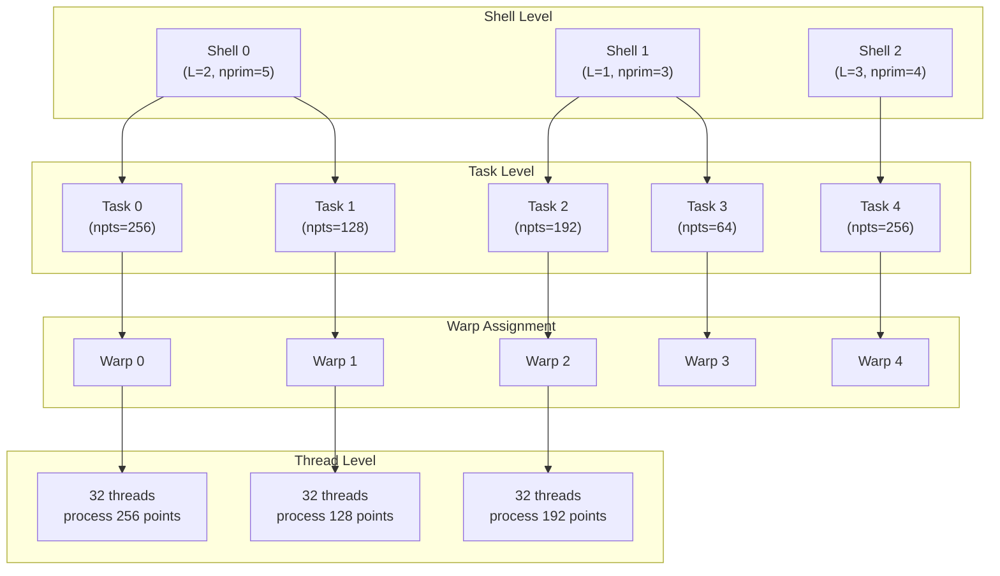
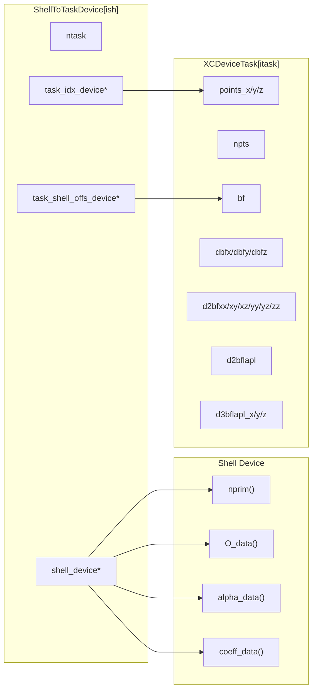
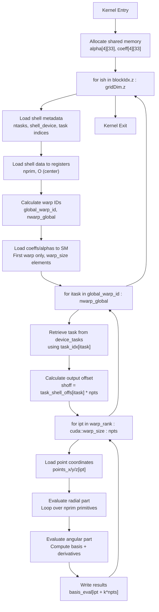
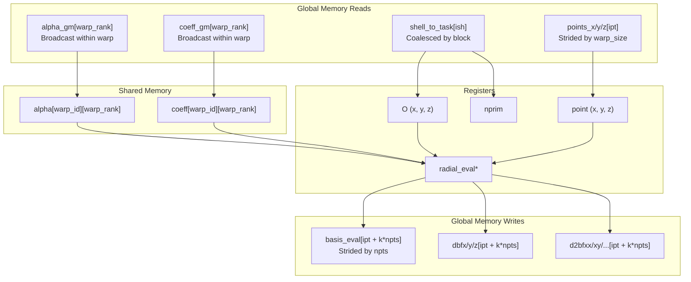
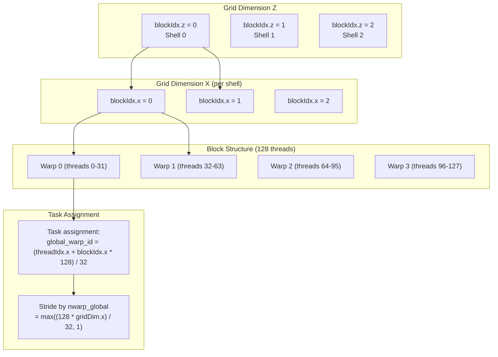
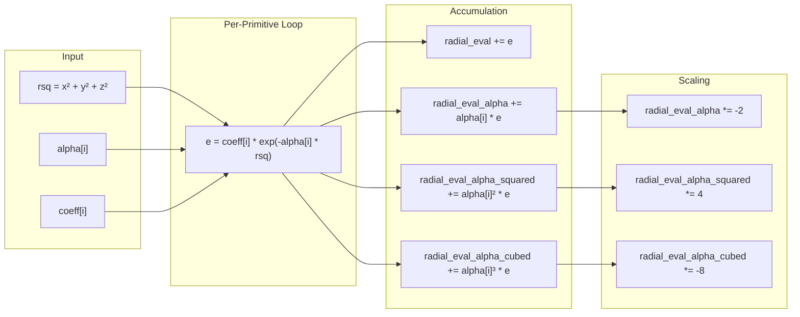
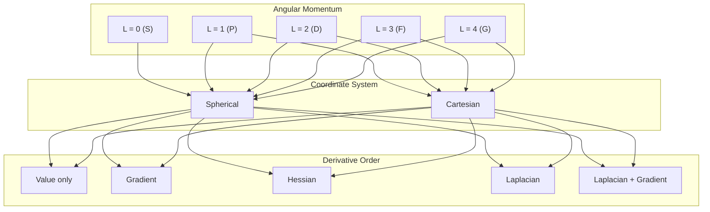

<!-- source: DeepWiki mcp.deepwiki.com · repo microsoft/skala · extra page Shell-to-Task Kernels · fetched 2026-10-26 -->

# Shell-to-Task Kernels

<details>
<summary>Relevant source files</summary>

The following files were used as context for generating this wiki page:

- [third_party/gauxc/src/xc_integrator/local_work_driver/device/cuda/kernels/collocation/collocation_shell_to_task_kernels_cartesian_l1.hpp](third_party/gauxc/src/xc_integrator/local_work_driver/device/cuda/kernels/collocation/collocation_shell_to_task_kernels_cartesian_l1.hpp)
- [third_party/gauxc/src/xc_integrator/local_work_driver/device/cuda/kernels/collocation/collocation_shell_to_task_kernels_cartesian_l1_hessian.hpp](third_party/gauxc/src/xc_integrator/local_work_driver/device/cuda/kernels/collocation/collocation_shell_to_task_kernels_cartesian_l1_hessian.hpp)
- [third_party/gauxc/src/xc_integrator/local_work_driver/device/cuda/kernels/collocation/collocation_shell_to_task_kernels_cartesian_l1_lapgrad.hpp](third_party/gauxc/src/xc_integrator/local_work_driver/device/cuda/kernels/collocation/collocation_shell_to_task_kernels_cartesian_l1_lapgrad.hpp)
- [third_party/gauxc/src/xc_integrator/local_work_driver/device/cuda/kernels/collocation/collocation_shell_to_task_kernels_cartesian_l1_laplacian.hpp](third_party/gauxc/src/xc_integrator/local_work_driver/device/cuda/kernels/collocation/collocation_shell_to_task_kernels_cartesian_l1_laplacian.hpp)
- [third_party/gauxc/src/xc_integrator/local_work_driver/device/cuda/kernels/collocation/collocation_shell_to_task_kernels_cartesian_l2_lapgrad.hpp](third_party/gauxc/src/xc_integrator/local_work_driver/device/cuda/kernels/collocation/collocation_shell_to_task_kernels_cartesian_l2_lapgrad.hpp)
- [third_party/gauxc/src/xc_integrator/local_work_driver/device/cuda/kernels/collocation/collocation_shell_to_task_kernels_cartesian_l2_laplacian.hpp](third_party/gauxc/src/xc_integrator/local_work_driver/device/cuda/kernels/collocation/collocation_shell_to_task_kernels_cartesian_l2_laplacian.hpp)
- [third_party/gauxc/src/xc_integrator/local_work_driver/device/cuda/kernels/collocation/collocation_shell_to_task_kernels_cartesian_l3_hessian.hpp](third_party/gauxc/src/xc_integrator/local_work_driver/device/cuda/kernels/collocation/collocation_shell_to_task_kernels_cartesian_l3_hessian.hpp)
- [third_party/gauxc/src/xc_integrator/local_work_driver/device/cuda/kernels/collocation/collocation_shell_to_task_kernels_cartesian_l3_laplacian.hpp](third_party/gauxc/src/xc_integrator/local_work_driver/device/cuda/kernels/collocation/collocation_shell_to_task_kernels_cartesian_l3_laplacian.hpp)
- [third_party/gauxc/src/xc_integrator/local_work_driver/device/cuda/kernels/collocation/collocation_shell_to_task_kernels_cartesian_l4_gradient.hpp](third_party/gauxc/src/xc_integrator/local_work_driver/device/cuda/kernels/collocation/collocation_shell_to_task_kernels_cartesian_l4_gradient.hpp)
- [third_party/gauxc/src/xc_integrator/local_work_driver/device/cuda/kernels/collocation/collocation_shell_to_task_kernels_spherical_l0_hessian.hpp](third_party/gauxc/src/xc_integrator/local_work_driver/device/cuda/kernels/collocation/collocation_shell_to_task_kernels_spherical_l0_hessian.hpp)
- [third_party/gauxc/src/xc_integrator/local_work_driver/device/cuda/kernels/collocation/collocation_shell_to_task_kernels_spherical_l0_laplacian.hpp](third_party/gauxc/src/xc_integrator/local_work_driver/device/cuda/kernels/collocation/collocation_shell_to_task_kernels_spherical_l0_laplacian.hpp)
- [third_party/gauxc/src/xc_integrator/local_work_driver/device/cuda/kernels/collocation/collocation_shell_to_task_kernels_spherical_l1_gradient.hpp](third_party/gauxc/src/xc_integrator/local_work_driver/device/cuda/kernels/collocation/collocation_shell_to_task_kernels_spherical_l1_gradient.hpp)
- [third_party/gauxc/src/xc_integrator/local_work_driver/device/cuda/kernels/collocation/collocation_shell_to_task_kernels_spherical_l1_hessian.hpp](third_party/gauxc/src/xc_integrator/local_work_driver/device/cuda/kernels/collocation/collocation_shell_to_task_kernels_spherical_l1_hessian.hpp)
- [third_party/gauxc/src/xc_integrator/local_work_driver/device/cuda/kernels/collocation/collocation_shell_to_task_kernels_spherical_l1_lapgrad.hpp](third_party/gauxc/src/xc_integrator/local_work_driver/device/cuda/kernels/collocation/collocation_shell_to_task_kernels_spherical_l1_lapgrad.hpp)
- [third_party/gauxc/src/xc_integrator/local_work_driver/device/cuda/kernels/collocation/collocation_shell_to_task_kernels_spherical_l1_laplacian.hpp](third_party/gauxc/src/xc_integrator/local_work_driver/device/cuda/kernels/collocation/collocation_shell_to_task_kernels_spherical_l1_laplacian.hpp)
- [third_party/gauxc/src/xc_integrator/local_work_driver/device/cuda/kernels/collocation/collocation_shell_to_task_kernels_spherical_l2_hessian.hpp](third_party/gauxc/src/xc_integrator/local_work_driver/device/cuda/kernels/collocation/collocation_shell_to_task_kernels_spherical_l2_hessian.hpp)
- [third_party/gauxc/src/xc_integrator/local_work_driver/device/cuda/kernels/collocation/collocation_shell_to_task_kernels_spherical_l2_lapgrad.hpp](third_party/gauxc/src/xc_integrator/local_work_driver/device/cuda/kernels/collocation/collocation_shell_to_task_kernels_spherical_l2_lapgrad.hpp)
- [third_party/gauxc/src/xc_integrator/local_work_driver/device/cuda/kernels/collocation/collocation_shell_to_task_kernels_spherical_l2_laplacian.hpp](third_party/gauxc/src/xc_integrator/local_work_driver/device/cuda/kernels/collocation/collocation_shell_to_task_kernels_spherical_l2_laplacian.hpp)
- [third_party/gauxc/src/xc_integrator/local_work_driver/device/cuda/kernels/collocation/collocation_shell_to_task_kernels_spherical_l3_hessian.hpp](third_party/gauxc/src/xc_integrator/local_work_driver/device/cuda/kernels/collocation/collocation_shell_to_task_kernels_spherical_l3_hessian.hpp)
- [third_party/gauxc/src/xc_integrator/local_work_driver/device/cuda/kernels/collocation/collocation_shell_to_task_kernels_spherical_l3_lapgrad.hpp](third_party/gauxc/src/xc_integrator/local_work_driver/device/cuda/kernels/collocation/collocation_shell_to_task_kernels_spherical_l3_lapgrad.hpp)
- [third_party/gauxc/src/xc_integrator/local_work_driver/device/cuda/kernels/collocation/collocation_shell_to_task_kernels_spherical_l4_hessian.hpp](third_party/gauxc/src/xc_integrator/local_work_driver/device/cuda/kernels/collocation/collocation_shell_to_task_kernels_spherical_l4_hessian.hpp)
- [third_party/gauxc/src/xc_integrator/local_work_driver/device/cuda/kernels/collocation/collocation_shell_to_task_kernels_spherical_l4_lapgrad.hpp](third_party/gauxc/src/xc_integrator/local_work_driver/device/cuda/kernels/collocation/collocation_shell_to_task_kernels_spherical_l4_lapgrad.hpp)
- [third_party/gauxc/src/xc_integrator/local_work_driver/device/cuda/kernels/collocation/collocation_shell_to_task_kernels_spherical_l4_laplacian.hpp](third_party/gauxc/src/xc_integrator/local_work_driver/device/cuda/kernels/collocation/collocation_shell_to_task_kernels_spherical_l4_laplacian.hpp)

</details>


## Purpose and Scope

Shell-to-Task kernels are GPU kernels that evaluate basis functions and their derivatives at quadrature points for DFT exchange-correlation integration. These kernels implement the "shell-to-task" parallelization strategy where multiple computational tasks can be associated with a single atomic shell, and each task is assigned to a GPU warp for parallel execution.

This page documents the kernel architecture, thread organization, memory management, and evaluation algorithms. For the broader collocation kernel ecosystem, see [Collocation Kernels](#7.2). For masked collocation variants, see [Masked Collocation Kernels](#7.2.1). For the complete kernel specialization landscape, see [Kernel Specialization Matrix](#7.2.3).

Sources: 
- [third_party/gauxc/src/xc_integrator/local_work_driver/device/cuda/kernels/collocation/collocation_shell_to_task_kernels_spherical_l4_lapgrad.hpp:1-660]()
- [third_party/gauxc/src/xc_integrator/local_work_driver/device/cuda/kernels/collocation/collocation_shell_to_task_kernels_cartesian_l4_gradient.hpp:1-378]()

## Shell-to-Task Parallelization Architecture

### Conceptual Overview



**Diagram: Shell-to-Task-to-Warp Mapping**

The shell-to-task pattern enables fine-grained load balancing by allowing a single shell to be associated with multiple tasks. Each task processes a batch of quadrature points and is assigned to an independent warp (32 threads on NVIDIA GPUs).

Sources:
- [third_party/gauxc/src/xc_integrator/local_work_driver/device/cuda/kernels/collocation/collocation_shell_to_task_kernels_spherical_l4_lapgrad.hpp:30-56]()
- [third_party/gauxc/src/xc_integrator/local_work_driver/device/cuda/kernels/collocation/collocation_shell_to_task_kernels_spherical_l4_hessian.hpp:30-56]()

### Data Structure Mapping



**Diagram: Data Structure Relationships in Shell-to-Task Kernels**

`ShellToTaskDevice` arrays store the mapping between shells and tasks. For each shell index `ish`, the structure contains the number of associated tasks, a pointer to shell parameters, and arrays indexing into the task list.

Sources:
- [third_party/gauxc/src/xc_integrator/local_work_driver/device/cuda/kernels/collocation/collocation_shell_to_task_kernels_spherical_l4_lapgrad.hpp:31-34]()
- [third_party/gauxc/src/xc_integrator/local_work_driver/device/cuda/kernels/collocation/collocation_shell_to_task_kernels_spherical_l4_lapgrad.hpp:58-78]()

## Kernel Structure and Organization

### Launch Configuration

All shell-to-task kernels use the `__launch_bounds__` directive to guide occupancy:

- **Standard kernels** (L1-L4): `__launch_bounds__(128, 2)` - 128 threads per block, minimum 2 blocks per SM
- **L0 kernels**: `__launch_bounds__(256, 2)` - 256 threads per block for S-orbital efficiency

The kernel signature is consistent across all variants:

```cpp
__global__ __launch_bounds__(128,2) 
void collocation_device_shell_to_task_kernel_<coord>_<deriv>_<L>(
  uint32_t nshell,
  ShellToTaskDevice* __restrict__ shell_to_task,
  XCDeviceTask* __restrict__ device_tasks
)
```

Sources:
- [third_party/gauxc/src/xc_integrator/local_work_driver/device/cuda/kernels/collocation/collocation_shell_to_task_kernels_spherical_l4_lapgrad.hpp:18-22]()
- [third_party/gauxc/src/xc_integrator/local_work_driver/device/cuda/kernels/collocation/collocation_shell_to_task_kernels_spherical_l0_hessian.hpp:18-22]()

### Execution Flow



**Diagram: Shell-to-Task Kernel Execution Flow**

Sources:
- [third_party/gauxc/src/xc_integrator/local_work_driver/device/cuda/kernels/collocation/collocation_shell_to_task_kernels_spherical_l4_lapgrad.hpp:25-660]()
- [third_party/gauxc/src/xc_integrator/local_work_driver/device/cuda/kernels/collocation/collocation_shell_to_task_kernels_spherical_l2_laplacian.hpp:25-274]()

## Memory Hierarchy and Optimization

### Shared Memory Usage

Each kernel allocates shared memory for Gaussian primitive parameters:

```cpp
__shared__ double alpha[4][detail::shell_nprim_max + 1]; 
__shared__ double coeff[4][detail::shell_nprim_max + 1];
double* my_alpha = alpha[threadIdx.x/32];
double* my_coeff = coeff[threadIdx.x/32];
```

The arrays are dimensioned to support 4 warps per block, with `detail::shell_nprim_max = 32` (matching warp size). Each warp maintains its own cache of coefficients and exponents in shared memory.

**Loading Pattern:**
- Only the first warp loads data (cooperative loading)
- Static assertion ensures `shell_nprim_max == cuda::warp_size`
- Each thread loads one element: `my_alpha[warp_rank] = alpha_gm[warp_rank]`

Sources:
- [third_party/gauxc/src/xc_integrator/local_work_driver/device/cuda/kernels/collocation/collocation_shell_to_task_kernels_spherical_l4_lapgrad.hpp:25-52]()
- [third_party/gauxc/src/xc_integrator/local_work_driver/device/cuda/kernels/collocation/collocation_shell_to_task_kernels_spherical_l4_hessian.hpp:25-52]()

### Register Optimization

Shell center coordinates are loaded into registers once per shell:

```cpp
const uint32_t nprim = shell->nprim();
const double3 O = *reinterpret_cast<const double3*>(shell->O_data());
```

During point evaluation, relative coordinates are computed and stored in registers:

```cpp
const auto x = point.x - O.x;
const auto y = point.y - O.y;
const auto z = point.z - O.z;
const auto rsq = x*x + y*y + z*z;
```

Sources:
- [third_party/gauxc/src/xc_integrator/local_work_driver/device/cuda/kernels/collocation/collocation_shell_to_task_kernels_spherical_l4_lapgrad.hpp:38-94]()
- [third_party/gauxc/src/xc_integrator/local_work_driver/device/cuda/kernels/collocation/collocation_shell_to_task_kernels_cartesian_l4_gradient.hpp:38-94]()

### Memory Access Patterns



**Diagram: Memory Access Pattern in Shell-to-Task Kernels**

Output arrays use a strided layout where `npts` separates consecutive basis functions for the same point. This enables coalesced writes when threads process different points within a warp.

Sources:
- [third_party/gauxc/src/xc_integrator/local_work_driver/device/cuda/kernels/collocation/collocation_shell_to_task_kernels_spherical_l4_lapgrad.hpp:65-78]()
- [third_party/gauxc/src/xc_integrator/local_work_driver/device/cuda/kernels/collocation/collocation_shell_to_task_kernels_spherical_l2_laplacian.hpp:65-69]()

## Thread Organization and Parallelism

### Three-Dimensional Grid Organization

The kernel uses a 3D grid configuration:
- **blockIdx.z**: Shell index (outer loop over shells)
- **blockIdx.x**: Warp group index (distributes tasks across blocks)
- **threadIdx.x**: Thread within block (maps to warps and warp lanes)



**Diagram: Three-Dimensional Grid and Warp Assignment**

Sources:
- [third_party/gauxc/src/xc_integrator/local_work_driver/device/cuda/kernels/collocation/collocation_shell_to_task_kernels_spherical_l4_lapgrad.hpp:30-42]()
- [third_party/gauxc/src/xc_integrator/local_work_driver/device/cuda/kernels/collocation/collocation_shell_to_task_kernels_spherical_l4_lapgrad.hpp:54-56]()

### Warp-Level Point Processing

Within each warp processing a task:

```cpp
const int global_warp_id = (threadIdx.x + blockIdx.x*blockDim.x) / cuda::warp_size;
const int nwarp_global = max((blockDim.x*gridDim.x) / cuda::warp_size, 1);

for(int itask = global_warp_id; itask < ntasks; itask += nwarp_global) {
  // ...
  #pragma unroll 1
  for(int ipt = threadIdx.x % cuda::warp_size; ipt < npts; ipt += cuda::warp_size) {
    // Each thread processes every 32nd point
  }
}
```

The `#pragma unroll 1` directive prevents loop unrolling, which is critical for register pressure management in kernels with complex derivative calculations.

Sources:
- [third_party/gauxc/src/xc_integrator/local_work_driver/device/cuda/kernels/collocation/collocation_shell_to_task_kernels_spherical_l4_lapgrad.hpp:41-83]()
- [third_party/gauxc/src/xc_integrator/local_work_driver/device/cuda/kernels/collocation/collocation_shell_to_task_kernels_spherical_l2_laplacian.hpp:73-74]()

## Radial Evaluation Algorithm

### Gaussian Primitive Accumulation

The radial part evaluation computes weighted sums over Gaussian primitives:



**Diagram: Radial Evaluation and Derivative Chain**

The number of `radial_eval_alpha*` terms computed depends on the maximum derivative order required:
- **Value only**: `radial_eval`
- **Gradient**: `radial_eval`, `radial_eval_alpha`
- **Hessian**: Add `radial_eval_alpha_squared`
- **Laplacian gradient**: Add `radial_eval_alpha_cubed`

Sources:
- [third_party/gauxc/src/xc_integrator/local_work_driver/device/cuda/kernels/collocation/collocation_shell_to_task_kernels_spherical_l4_lapgrad.hpp:96-116]()
- [third_party/gauxc/src/xc_integrator/local_work_driver/device/cuda/kernels/collocation/collocation_shell_to_task_kernels_spherical_l4_hessian.hpp:93-109]()
- [third_party/gauxc/src/xc_integrator/local_work_driver/device/cuda/kernels/collocation/collocation_shell_to_task_kernels_cartesian_l4_gradient.hpp:87-100]()

### Derivative Scaling Factors

The scaling factors applied to `radial_eval_alpha*` terms arise from the chain rule when differentiating the Gaussian exponential `exp(-α*r²)`:

| Term | Scaling | Purpose |
|------|---------|---------|
| `radial_eval_alpha` | `-2` | First derivative: ∂/∂x exp(-α*r²) ∝ -2*α*x |
| `radial_eval_alpha_squared` | `4` | Second derivative: ∂²/∂x² exp(-α*r²) ∝ 4*α² |
| `radial_eval_alpha_cubed` | `-8` | Third derivative: ∂³/∂x³ exp(-α*r²) ∝ -8*α³ |

Sources:
- [third_party/gauxc/src/xc_integrator/local_work_driver/device/cuda/kernels/collocation/collocation_shell_to_task_kernels_spherical_l4_lapgrad.hpp:113-115]()
- [third_party/gauxc/src/xc_integrator/local_work_driver/device/cuda/kernels/collocation/collocation_shell_to_task_kernels_spherical_l4_hessian.hpp:107-108]()

## Angular Evaluation and Common Subexpressions

### Common Subexpression Elimination

All kernels employ extensive common subexpression elimination (CSE) to reduce arithmetic operations. For example, in the L4 spherical lapgrad kernel:

```cpp
// Common Subexpressions
const auto x0 = 0.5*sqrt_35; 
const auto x1 = x0*y; 
const auto x2 = x*x1; 
const auto x3 = x*x; 
const auto x4 = x3; 
// ... hundreds more ...
const auto x279 = 8.0*x155; 
```

The CSE phase creates intermediate variables (`x0`, `x1`, ..., `x279`) that are reused in the final basis function evaluation. This optimization is critical for high-derivative kernels where the angular part can involve hundreds of terms.

Sources:
- [third_party/gauxc/src/xc_integrator/local_work_driver/device/cuda/kernels/collocation/collocation_shell_to_task_kernels_spherical_l4_lapgrad.hpp:117-398]()
- [third_party/gauxc/src/xc_integrator/local_work_driver/device/cuda/kernels/collocation/collocation_shell_to_task_kernels_spherical_l4_hessian.hpp:110-287]()

### Basis Function Evaluation Structure

After CSE, basis functions are computed from the intermediate expressions:

```cpp
// Evaluate basis function
basis_eval[ipt + 0*npts] = radial_eval*x2*x8;
basis_eval[ipt + 1*npts] = radial_eval*x11*x13;
basis_eval[ipt + 2*npts] = radial_eval*x16*x21;
// ... one entry per basis function in the shell
```

For a shell with angular momentum L, there are `2*L+1` basis functions in spherical coordinates or `(L+1)*(L+2)/2` in Cartesian coordinates.

Sources:
- [third_party/gauxc/src/xc_integrator/local_work_driver/device/cuda/kernels/collocation/collocation_shell_to_task_kernels_spherical_l4_lapgrad.hpp:400-409]()
- [third_party/gauxc/src/xc_integrator/local_work_driver/device/cuda/kernels/collocation/collocation_shell_to_task_kernels_cartesian_l4_gradient.hpp:149-165]()

### Derivative Evaluation

Derivatives follow the same pattern with different angular functions:

```cpp
// Evaluate first derivative of bfn wrt x
basis_x_eval[ipt + 0*npts] = x1*(radial_eval_alpha*x45 + x44);
basis_x_eval[ipt + 1*npts] = x46*x49;
// ...

// Evaluate second derivative of bfn wrt xx
basis_xx_eval[ipt + 0*npts] = x2*(x115 + x47);
basis_xx_eval[ipt + 1*npts] = x11*(x116 + x119);
// ...

// Evaluate Laplacian of bfn 
basis_lapl_eval[ipt + 0*npts] = x2*(x115 + x165 + x184);
// ...
```

The derivative outputs are written to separate arrays (`dbfx`, `dbfy`, `dbfz` for gradients; `d2bfxx`, `d2bfxy`, etc. for Hessians).

Sources:
- [third_party/gauxc/src/xc_integrator/local_work_driver/device/cuda/kernels/collocation/collocation_shell_to_task_kernels_spherical_l4_lapgrad.hpp:413-522]()
- [third_party/gauxc/src/xc_integrator/local_work_driver/device/cuda/kernels/collocation/collocation_shell_to_task_kernels_spherical_l4_hessian.hpp:302-400]()

## Kernel Specialization Matrix

### Specialization Dimensions

Shell-to-task kernels are specialized along three dimensions:



**Diagram: Kernel Specialization Dimensions**

Sources:
- [third_party/gauxc/src/xc_integrator/local_work_driver/device/cuda/kernels/collocation/collocation_shell_to_task_kernels_spherical_l4_lapgrad.hpp:1-8]()
- [third_party/gauxc/src/xc_integrator/local_work_driver/device/cuda/kernels/collocation/collocation_shell_to_task_kernels_cartesian_l4_gradient.hpp:1-8]()

### Kernel Naming Convention

Kernel functions follow a consistent naming pattern:

```
collocation_device_shell_to_task_kernel_<coord>_<deriv>_<L>
```

Examples:
- `collocation_device_shell_to_task_kernel_spherical_lapgrad_4` - Spherical, Laplacian+gradient, L=4
- `collocation_device_shell_to_task_kernel_cartesian_hessian_3` - Cartesian, Hessian, L=3
- `collocation_device_shell_to_task_kernel_spherical_gradient_1` - Spherical, gradient, L=1

The corresponding header files follow the pattern:
```
collocation_shell_to_task_kernels_<coord>_l<L>_<deriv>.hpp
```

Sources:
- [third_party/gauxc/src/xc_integrator/local_work_driver/device/cuda/kernels/collocation/collocation_shell_to_task_kernels_spherical_l4_lapgrad.hpp:18]()
- [third_party/gauxc/src/xc_integrator/local_work_driver/device/cuda/kernels/collocation/collocation_shell_to_task_kernels_cartesian_l3_hessian.hpp:18]()
- [third_party/gauxc/src/xc_integrator/local_work_driver/device/cuda/kernels/collocation/collocation_shell_to_task_kernels_spherical_l1_gradient.hpp:18]()

### Full Specialization Table

| Angular Momentum | Spherical Variants | Cartesian Variants |
|------------------|-------------------|-------------------|
| L=0 | Value, Gradient, Hessian, Laplacian, Lapgrad | N/A (S-orbitals always spherical) |
| L=1 | Value, Gradient, Hessian, Laplacian, Lapgrad | Value, Gradient, Hessian, Laplacian, Lapgrad |
| L=2 | Value, Gradient, Hessian, Laplacian, Lapgrad | Value, Gradient, Hessian, Laplacian, Lapgrad |
| L=3 | Value, Gradient, Hessian, Laplacian, Lapgrad | Value, Gradient, Hessian, Laplacian, Lapgrad |
| L=4 | Value, Gradient, Hessian, Laplacian, Lapgrad | Value, Gradient, Hessian, Laplacian, Lapgrad |

Each cell represents a unique kernel implementation. For derivative orders:
- **Value**: Computes only `bf`
- **Gradient**: Computes `bf`, `dbfx`, `dbfy`, `dbfz`
- **Hessian**: Computes gradient + `d2bfxx`, `d2bfxy`, `d2bfxz`, `d2bfyy`, `d2bfyz`, `d2bfzz`
- **Laplacian**: Computes value + derivatives + `d2bflapl` (trace of Hessian)
- **Lapgrad**: Computes Laplacian + `d3bflapl_x`, `d3bflapl_y`, `d3bflapl_z`

Sources:
- [third_party/gauxc/src/xc_integrator/local_work_driver/device/cuda/kernels/collocation/collocation_shell_to_task_kernels_spherical_l0_hessian.hpp]()
- [third_party/gauxc/src/xc_integrator/local_work_driver/device/cuda/kernels/collocation/collocation_shell_to_task_kernels_cartesian_l1.hpp]()
- [third_party/gauxc/src/xc_integrator/local_work_driver/device/cuda/kernels/collocation/collocation_shell_to_task_kernels_spherical_l2_lapgrad.hpp]()

## Performance Characteristics

### Thread Occupancy Strategy

The `__launch_bounds__(128, 2)` configuration targets:
- **128 threads per block**: Exactly 4 warps, minimizing warp scheduling overhead
- **Minimum 2 blocks per SM**: Ensures sufficient occupancy to hide memory latency

For L0 kernels, `__launch_bounds__(256, 2)` is used because:
- S-orbitals have simpler angular functions (constants)
- Lower register pressure allows doubling threads per block
- Better utilization for small shells with many tasks

Sources:
- [third_party/gauxc/src/xc_integrator/local_work_driver/device/cuda/kernels/collocation/collocation_shell_to_task_kernels_spherical_l4_lapgrad.hpp:18]()
- [third_party/gauxc/src/xc_integrator/local_work_driver/device/cuda/kernels/collocation/collocation_shell_to_task_kernels_spherical_l0_hessian.hpp:18]()

### Register Pressure Management

High-derivative kernels (Hessian, Laplacian gradient) generate hundreds of common subexpressions that consume registers. Key techniques to manage register pressure:

1. **Loop unroll prevention**: `#pragma unroll 1` on the point loop
2. **Shared memory for primitives**: Alpha/coeff in SM instead of registers
3. **Incremental evaluation**: Basis functions computed and written immediately

Without these optimizations, register spilling would significantly degrade performance.

Sources:
- [third_party/gauxc/src/xc_integrator/local_work_driver/device/cuda/kernels/collocation/collocation_shell_to_task_kernels_spherical_l4_lapgrad.hpp:82]()
- [third_party/gauxc/src/xc_integrator/local_work_driver/device/cuda/kernels/collocation/collocation_shell_to_task_kernels_spherical_l2_lapgrad.hpp:82]()

### Work Distribution

The shell-to-task architecture provides fine-grained load balancing:

- **Intra-shell parallelism**: Multiple tasks per shell handled by different warps
- **Inter-shell parallelism**: Multiple shells processed by different blocks (z-dimension)
- **Intra-task parallelism**: 32 threads within a warp process different points

This three-level hierarchy adapts to varying shell sizes and task batching strategies.

Sources:
- [third_party/gauxc/src/xc_integrator/local_work_driver/device/cuda/kernels/collocation/collocation_shell_to_task_kernels_spherical_l4_lapgrad.hpp:30-56]()
- [third_party/gauxc/src/xc_integrator/local_work_driver/device/cuda/kernels/collocation/collocation_shell_to_task_kernels_spherical_l2_laplacian.hpp:30-56]()

---

