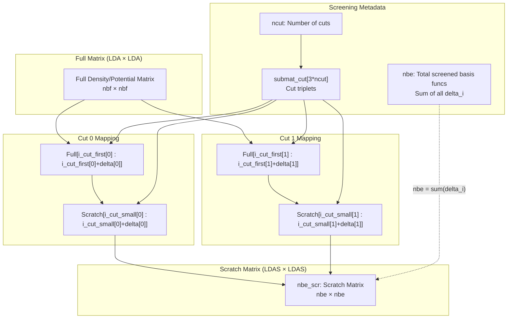
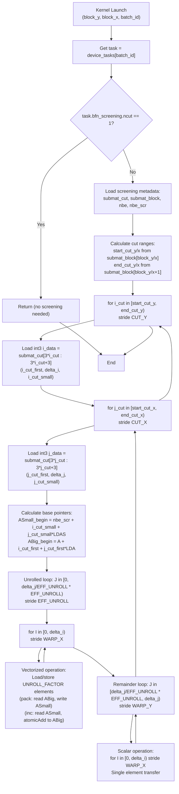
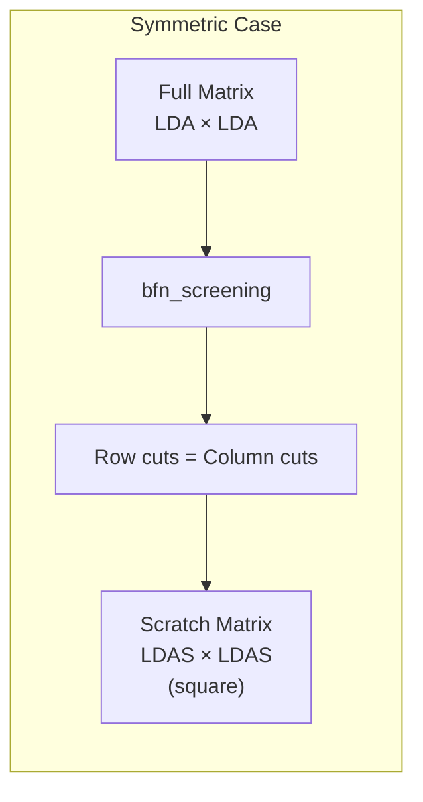
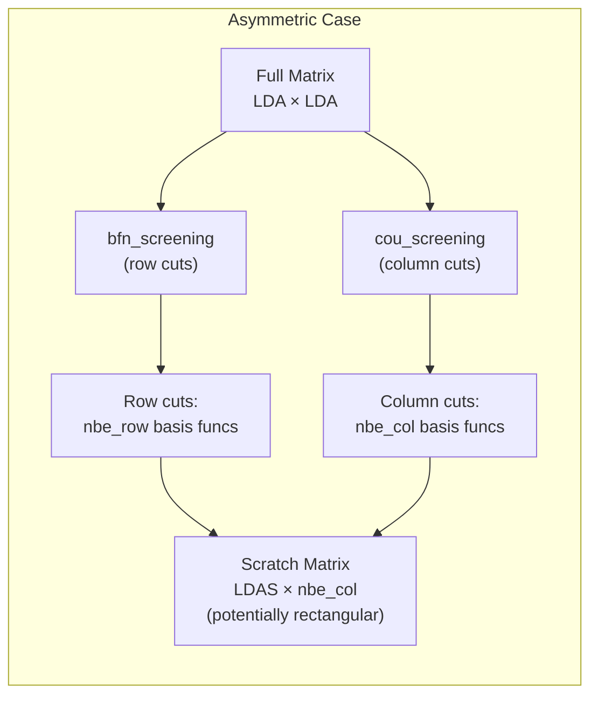

<!-- source: DeepWiki mcp.deepwiki.com · repo microsoft/skala · extra page Submatrix Screening and Cuts · fetched 2026-10-26 -->

# Submatrix Screening and Cuts

<details>
<summary>Relevant source files</summary>

The following files were used as context for generating this wiki page:

- [third_party/gauxc/attic/src/integrator/cuda/cuda_pack_density.cu](third_party/gauxc/attic/src/integrator/cuda/cuda_pack_density.cu)
- [third_party/gauxc/attic/src/new_integrator/device/cuda/cuda_inc_potential.cu](third_party/gauxc/attic/src/new_integrator/device/cuda/cuda_inc_potential.cu)
- [third_party/gauxc/attic/src/new_integrator/device/cuda/cuda_pack_density.cu](third_party/gauxc/attic/src/new_integrator/device/cuda/cuda_pack_density.cu)
- [third_party/gauxc/attic/src/new_integrator/device/hip/hip_inc_potential.hip](third_party/gauxc/attic/src/new_integrator/device/hip/hip_inc_potential.hip)
- [third_party/gauxc/attic/src/new_integrator/device/hip/hip_pack_density.hip](third_party/gauxc/attic/src/new_integrator/device/hip/hip_pack_density.hip)
- [third_party/gauxc/src/xc_integrator/local_work_driver/device/cuda/kernels/cuda_inc_potential.cu](third_party/gauxc/src/xc_integrator/local_work_driver/device/cuda/kernels/cuda_inc_potential.cu)
- [third_party/gauxc/src/xc_integrator/local_work_driver/device/cuda/kernels/pack_submat.cu](third_party/gauxc/src/xc_integrator/local_work_driver/device/cuda/kernels/pack_submat.cu)
- [third_party/gauxc/src/xc_integrator/local_work_driver/device/hip/kernels/hip_inc_potential.hip](third_party/gauxc/src/xc_integrator/local_work_driver/device/hip/kernels/hip_inc_potential.hip)
- [third_party/gauxc/src/xc_integrator/local_work_driver/device/hip/kernels/pack_submat.hip](third_party/gauxc/src/xc_integrator/local_work_driver/device/hip/kernels/pack_submat.hip)

</details>


## Purpose and Scope

This page documents the submatrix screening and cuts system used by GPU matrix operation kernels to reduce computational cost and memory footprint. The screening system identifies which portions of the full density and potential matrices significantly contribute to the computation, then packs only those portions into smaller scratch matrices for GPU processing.

For the overall matrix operation pipeline and the pack/increment kernels that use this screening system, see [Matrix Operations](#7.3). For information on how these cuts are determined during task generation, see [Task System and Data Structures](#4.3).

The screening system is critical for performance: when only a subset of basis functions contributes significantly to a given integration task, operating on the full nbf×nbf matrix wastes memory bandwidth and computation. The `submat_cut` data structure enables efficient extraction and reconstruction of these relevant submatrices.

---

## Submatrix Cut Data Structure

### Cut Representation

Each "cut" represents a contiguous range of rows or columns in the full matrix that should be included in the screened submatrix. The `submat_cut` array stores cut metadata as triplets of integers, accessed via `int3` vectorized loads on the GPU.

**Cut Triplet Format:**
| Field | Type | Description |
|-------|------|-------------|
| `i_cut_first` | `int` | Starting index in the full matrix (LDA×LDA) |
| `delta_i` | `int` | Number of consecutive rows/columns in this cut |
| `i_cut_small` | `int` | Starting index in the small scratch matrix (LDAS×LDAS) |

The `submat_cut` array is stored linearly in device memory with 3 integers per cut:
```
[cut0_first, cut0_delta, cut0_small, cut1_first, cut1_delta, cut1_small, ...]
```

Sources: [third_party/gauxc/src/xc_integrator/local_work_driver/device/cuda/kernels/pack_submat.cu:52-67](), [third_party/gauxc/src/xc_integrator/local_work_driver/device/cuda/kernels/cuda_inc_potential.cu:53-63]()

### Cut Organization and Mapping


**Diagram: Submatrix Cut Mapping Between Full and Scratch Matrices**

The small matrix index `i_cut_small` is cumulative: for sequentially screened shells, `i_cut_small[k+1] = i_cut_small[k] + delta_i[k]`, ensuring the small matrix is densely packed without gaps.

Sources: [third_party/gauxc/src/xc_integrator/local_work_driver/device/cuda/kernels/pack_submat.cu:35-42](), [third_party/gauxc/src/xc_integrator/local_work_driver/device/hip/kernels/pack_submat.hip:28-36]()

---

## Screening Systems

### Basis Function Screening (bfn_screening)

The `bfn_screening` structure defines which basis functions contribute significantly to the current task. It is used for both symmetric operations (where rows and columns use the same screening) and as the row screening for asymmetric operations.

**XCDeviceTask::bfn_screening Members:**
| Member | Type | Description |
|--------|------|-------------|
| `submat_cut` | `int32_t*` | Device pointer to cut triplets |
| `submat_block` | `int32_t*` | Block boundaries for tiled execution |
| `ncut` | `int32_t` | Total number of cuts |
| `nbe` | `int32_t` | Number of basis functions after screening (LDAS) |

Sources: [third_party/gauxc/src/xc_integrator/local_work_driver/device/cuda/kernels/pack_submat.cu:39-41](), [third_party/gauxc/src/xc_integrator/local_work_driver/device/cuda/kernels/cuda_inc_potential.cu:36-38]()

### Coulomb Screening (cou_screening)

For asymmetric matrices (e.g., when density and potential use different basis sets or screening criteria), a separate `cou_screening` structure defines column screening independently from row screening.

**Asymmetric Screening Usage:**
```
Row screening:    task.bfn_screening
Column screening: task.cou_screening
```

The asymmetric kernels (`asym_pack_submat`, `asym_task_inc_potential`) use both screening structures to handle rectangular submatrices where row and column cuts differ.

Sources: [third_party/gauxc/src/xc_integrator/local_work_driver/device/cuda/kernels/pack_submat.cu:151-154](), [third_party/gauxc/src/xc_integrator/local_work_driver/device/cuda/kernels/cuda_inc_potential.cu:134-137]()

---

## Block-Tiled Execution Strategy

### Submatrix Block Organization

To manage GPU resource limits and maximize occupancy, the matrix operation kernels divide the full cut space into blocks. The `submat_block` array stores cumulative counts of cuts, enabling efficient block-level iteration.

**Block Structure:**
```
submat_block[0] = 0
submat_block[1] = number of cuts in block 0
submat_block[2] = number of cuts in blocks 0 and 1
...
submat_block[n_blocks] = total ncut
```

Each kernel launch processes a 2D block tile defined by `(block_y, block_x)` indices:
```
start_cut_y = submat_block[block_y]
end_cut_y   = submat_block[block_y+1]
start_cut_x = submat_block[block_x]
end_cut_x   = submat_block[block_x+1]
```

Sources: [third_party/gauxc/src/xc_integrator/local_work_driver/device/cuda/kernels/pack_submat.cu:52-55](), [third_party/gauxc/src/xc_integrator/local_work_driver/device/cuda/kernels/cuda_inc_potential.cu:48-51]()

### Block Size Determination

The `submat_block_size` parameter (typically derived from `get_submat_cut_block()` in older code) determines the maximum matrix dimension processed per kernel launch. The host code launches a grid of kernels to cover all block combinations:

```cpp
auto n_launch = util::div_ceil(LDA, submat_block_size);
for (int i = 0; i < n_launch; i++) 
for (int j = 0; j < n_launch; j++) {
  kernel<<<blocks, threads, 0, stream>>>(ntasks, device_tasks, matrix, LDA, i, j);
}
```

This strategy balances:
- **Memory footprint:** Smaller blocks reduce register/shared memory pressure
- **Kernel launch overhead:** Fewer launches preferred
- **Occupancy:** Block size affects thread block dimensions

Sources: [third_party/gauxc/src/xc_integrator/local_work_driver/device/cuda/kernels/pack_submat.cu:117-123](), [third_party/gauxc/src/xc_integrator/local_work_driver/device/cuda/kernels/cuda_inc_potential.cu:109-116]()

---

## Kernel Execution Flow

### Thread Organization for Cut Processing

The CUDA kernels use a complex thread indexing scheme to process cuts efficiently with high occupancy:

**Thread Index Constants:**
| Constant | Value | Purpose |
|----------|-------|---------|
| `WARP_X` | 16 | Threads processing matrix rows within a cut |
| `WARP_Y` | 1 | Warps processing matrix columns |
| `CUT_X` | 8 | Thread blocks processing column cuts |
| `CUT_Y` | 8 | Thread blocks processing row cuts |
| `UNROLL_FACTOR` | 4 | Loop unrolling for vectorized stores/loads |

**Thread Assignment:**
```cpp
const int tid_xx = threadIdx.x % WARP_X;  // Intra-warp column index
const int tid_xy = threadIdx.x / WARP_X;  // Intra-warp row index
const int tid_yx = threadIdx.y % CUT_X;   // Inter-cut column index
const int tid_yy = threadIdx.y / CUT_X;   // Inter-cut row index
```

The nested loop structure iterates over:
1. Row cuts: `i_cut` in `[start_cut_y, end_cut_y)` with stride `CUT_Y`
2. Column cuts: `j_cut` in `[start_cut_x, end_cut_x)` with stride `CUT_X`
3. Column elements: `J` in `[0, delta_j)` with stride `EFF_UNROLL` (unrolled) then `WARP_Y` (remainder)
4. Row elements: `I` in `[0, delta_i)` with stride `WARP_X`

Sources: [third_party/gauxc/src/xc_integrator/local_work_driver/device/cuda/kernels/pack_submat.cu:40-100](), [third_party/gauxc/attic/src/new_integrator/device/cuda/cuda_pack_density.cu:40-95]()

### Cut Processing with Vectorized Loads


**Diagram: Kernel Execution Flow for Submatrix Cut Processing**

Sources: [third_party/gauxc/src/xc_integrator/local_work_driver/device/cuda/kernels/pack_submat.cu:22-102](), [third_party/gauxc/src/xc_integrator/local_work_driver/device/cuda/kernels/cuda_inc_potential.cu:25-94]()

### Optimized Memory Access Patterns

The unrolled inner loops use arrays to enable independent memory operations that can be pipelined by the GPU:

**Pack Operation (Reading from Full Matrix):**
```cpp
double val[UNROLL_FACTOR];
double* address[UNROLL_FACTOR];
#pragma unroll
for (int k = 0; k < UNROLL_FACTOR; k++) {
  val[k] = ABig_begin[I + (J + k*WARP_Y)*LDA];
  address[k] = ASmall_begin + I + (J + k*WARP_Y) * LDAS;
}
#pragma unroll
for (int k = 0; k < UNROLL_FACTOR; k++) {
  __stcs(address[k], val[k]);  // Cache-streaming store hint
}
```

**Increment Operation (Writing to Full Matrix):**
```cpp
double val[UNROLL_FACTOR];
double* address[UNROLL_FACTOR];
#pragma unroll
for (int k = 0; k < UNROLL_FACTOR; k++) {
  val[k] = ASmall_begin[I + (J+k*WARP_Y)*LDAS];
  address[k] = ABig_begin + I + (J+k*WARP_Y)*LDA;
}
#pragma unroll
for (int k = 0; k < UNROLL_FACTOR; k++) {
  atomicAdd(address[k], val[k]);
}
```

The `__stcs()` intrinsic (CUDA 11.0+) or inline PTX assembly marks stores as cache-streaming, hinting that the data will not be reused and should bypass L1 cache, improving bandwidth for write-heavy operations.

Sources: [third_party/gauxc/src/xc_integrator/local_work_driver/device/cuda/kernels/pack_submat.cu:73-91](), [third_party/gauxc/src/xc_integrator/local_work_driver/device/cuda/kernels/cuda_inc_potential.cu:69-83]()

---

## Symmetric vs Asymmetric Cut Handling

### Symmetric Kernel Variant

Symmetric kernels (`sym_pack_submat`, `sym_task_inc_potential`) use the same `bfn_screening` cuts for both rows and columns, processing square submatrices of the full matrix.


**Diagram: Symmetric Submatrix Screening**

**Kernel Signature:**
```cpp
void sym_pack_submat(size_t ntasks, XCDeviceTask* device_tasks, 
                     const double* A, int32_t LDA, 
                     int32_t submat_block_size, device_queue queue);

void sym_task_inc_potential(size_t ntasks, XCDeviceTask* device_tasks, 
                             double* V_device, size_t LDV,
                             size_t submat_block_size, device_queue queue);
```

Both operations reference `task.bfn_screening.submat_cut` for row and column cuts:
```cpp
const auto* submat_cut_device = task.bfn_screening.submat_cut;
const auto* submat_block_device = task.bfn_screening.submat_block;
```

Sources: [third_party/gauxc/src/xc_integrator/local_work_driver/device/cuda/kernels/pack_submat.cu:109-124](), [third_party/gauxc/src/xc_integrator/local_work_driver/device/cuda/kernels/cuda_inc_potential.cu:97-117]()

### Asymmetric Kernel Variant

Asymmetric kernels use separate screening for rows and columns, enabling rectangular submatrix extraction when row and column basis sets differ.


**Diagram: Asymmetric Submatrix Screening**

**Kernel Signature:**
```cpp
void asym_pack_submat(size_t ntasks, XCDeviceTask* device_tasks,
                      const double* A, int32_t LDA,
                      int32_t submat_block_size, device_queue queue);

void asym_task_inc_potential(size_t ntasks, XCDeviceTask* device_tasks,
                              double* V_device, size_t LDV,
                              size_t submat_block_size, device_queue queue);
```

The kernel accesses separate screening structures:
```cpp
const auto* row_submat_cut_device = task.bfn_screening.submat_cut;
const auto* row_submat_block_device = task.bfn_screening.submat_block;
const auto* col_submat_cut_device = task.cou_screening.submat_cut;
const auto* col_submat_block_device = task.cou_screening.submat_block;
```

Note that `task.bfn_screening.nbe` (LDAS) is still used as the leading dimension of the scratch matrix, even though column screening may yield a different count. This is because the scratch buffer is allocated based on the maximum of row and column screening results.

Sources: [third_party/gauxc/src/xc_integrator/local_work_driver/device/cuda/kernels/pack_submat.cu:224-239](), [third_party/gauxc/src/xc_integrator/local_work_driver/device/cuda/kernels/cuda_inc_potential.cu:198-218]()

---

## HIP Platform Differences

The HIP implementation uses a simpler kernel organization without block tiling. Instead of processing cuts in block-tiled chunks, the HIP kernels iterate over all cuts sequentially within each thread block.

**Key Differences:**
| Feature | CUDA Implementation | HIP Implementation |
|---------|-------------------|-------------------|
| Block tiling | Yes (2D launch grid with `block_y`, `block_x`) | No (simple 3D grid with `batch_id` in Z) |
| Unrolling | 4-way explicit unroll with vectorized ops | No explicit unrolling |
| Memory hints | `__stcs()` cache-streaming stores | Standard stores |
| Cut iteration | Block-based with `submat_block` boundaries | Full `ncut` iteration per kernel |
| Skip optimization | Template parameter `skip_single_cut` | Template parameter `skip_single_cut` |

**HIP Kernel Structure:**
```cpp
for (size_t i_cut = 0; i_cut < ncut; ++i_cut) {
  const int64_t i_cut_first = submat_cut_device[3*i_cut];
  const int64_t delta_i = submat_cut_device[3*i_cut + 1];
  // ... process cut
}
```

The simpler HIP approach trades some performance optimization for code clarity and may be better suited to AMD GPU architectures where warp/wavefront characteristics differ from NVIDIA GPUs.

Sources: [third_party/gauxc/src/xc_integrator/local_work_driver/device/hip/kernels/pack_submat.hip:44-64](), [third_party/gauxc/src/xc_integrator/local_work_driver/device/hip/kernels/hip_inc_potential.hip:39-60]()

---

## Performance Considerations

### Single Cut Optimization

When `ncut == 1`, the entire matrix is included and no screening benefit exists. The template parameter `skip_single_cut` enables early return to avoid unnecessary kernel overhead:

```cpp
if constexpr (skip_single_cut) {
  if (task.bfn_screening.ncut == 1) return;
}
```

This optimization is enabled by default in pack operations but disabled in increment operations, likely because increments still benefit from atomic accumulation even without screening.

Sources: [third_party/gauxc/src/xc_integrator/local_work_driver/device/cuda/kernels/pack_submat.cu:35-37](), [third_party/gauxc/src/xc_integrator/local_work_driver/device/hip/kernels/pack_submat.hip:29-31]()

### Launch Bounds and Occupancy

The `__launch_bounds__(1024, 1)` declaration specifies:
- Maximum threads per block: 1024
- Minimum blocks per SM: 1

With thread configuration `dim3 threads(warp_size/2, max_warps_per_thread_block*2, 1)`:
- CUDA: `threads(16, 32, 1)` = 512 threads per block
- HIP: `threads(64, 8, 1)` = 512 threads per block

This configuration balances occupancy with register pressure from the unrolled loops and local arrays.

Sources: [third_party/gauxc/src/xc_integrator/local_work_driver/device/cuda/kernels/pack_submat.cu:23](), [third_party/gauxc/src/xc_integrator/local_work_driver/device/cuda/kernels/cuda_inc_potential.cu:25]()

### Memory Bandwidth Optimization

The screening system reduces memory traffic by:
1. **Reduced matrix size:** Processing `nbe × nbe` instead of `nbf × nbf`
2. **Cache-streaming stores:** `__stcs()` hints prevent cache pollution
3. **Vectorized access:** 4-element unrolled loops improve memory coalescing
4. **Block tiling:** Enables better L2 cache reuse across kernel launches

When `nbe << nbf` (strong screening), bandwidth savings can be dramatic. For example, with `nbf=1000` and `nbe=200`, the scratch matrix is 25× smaller.

Sources: [third_party/gauxc/src/xc_integrator/local_work_driver/device/cuda/kernels/pack_submat.cu:78-91]()

---

