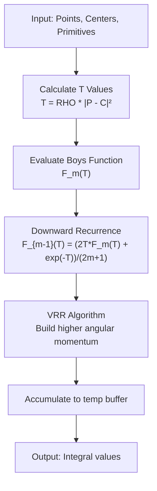
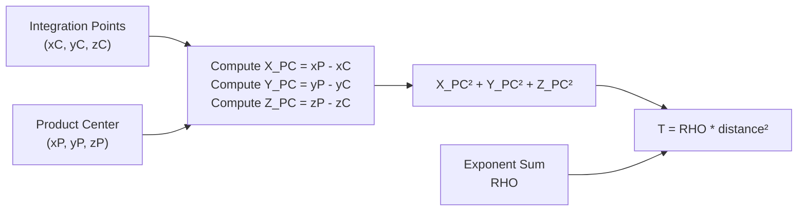
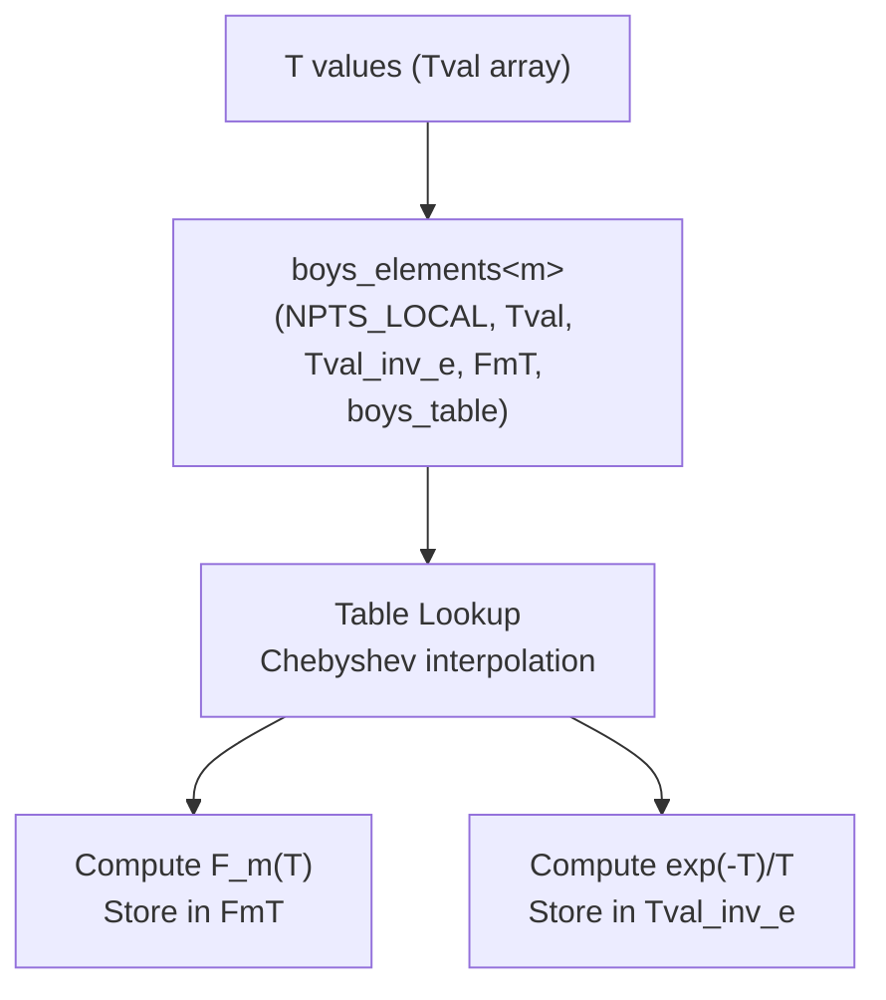
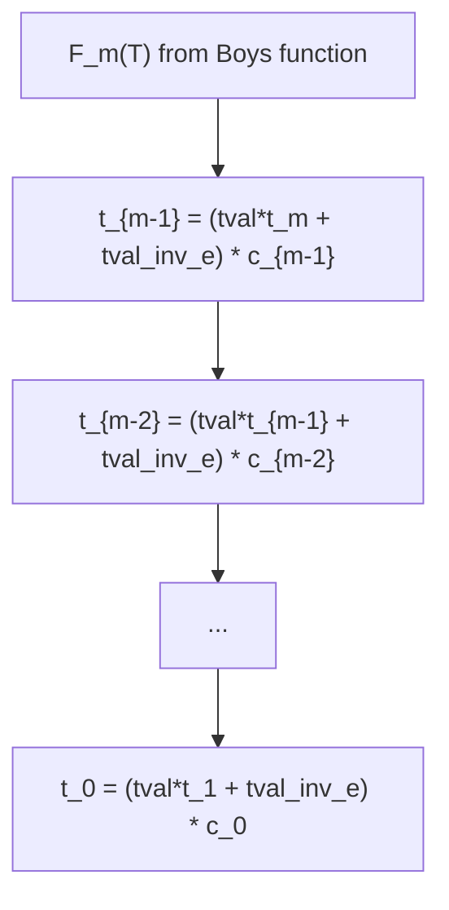
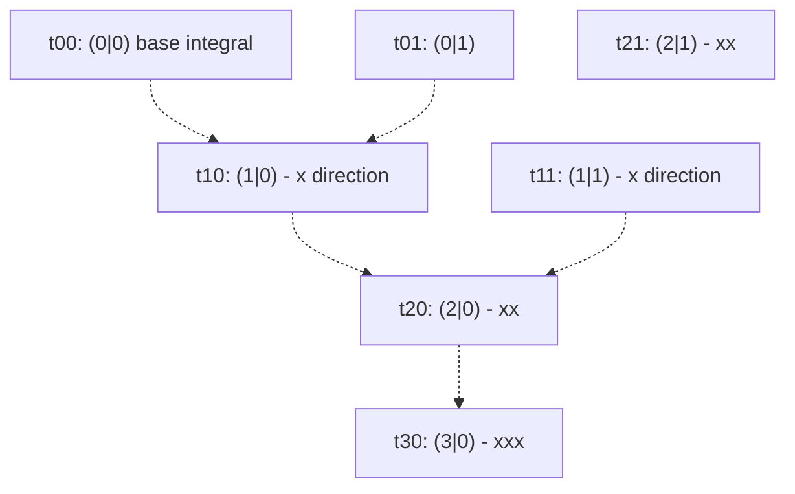
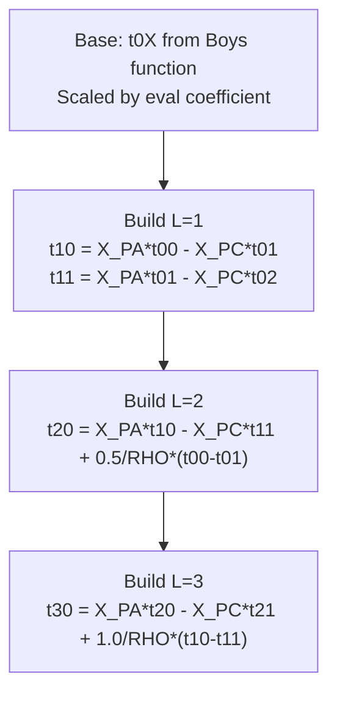
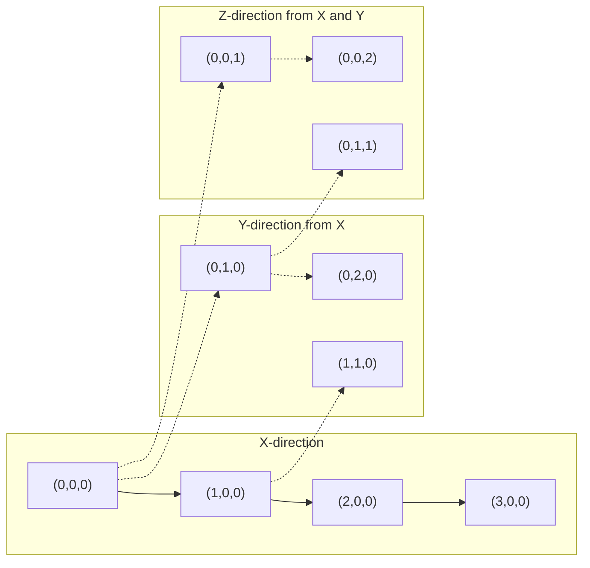
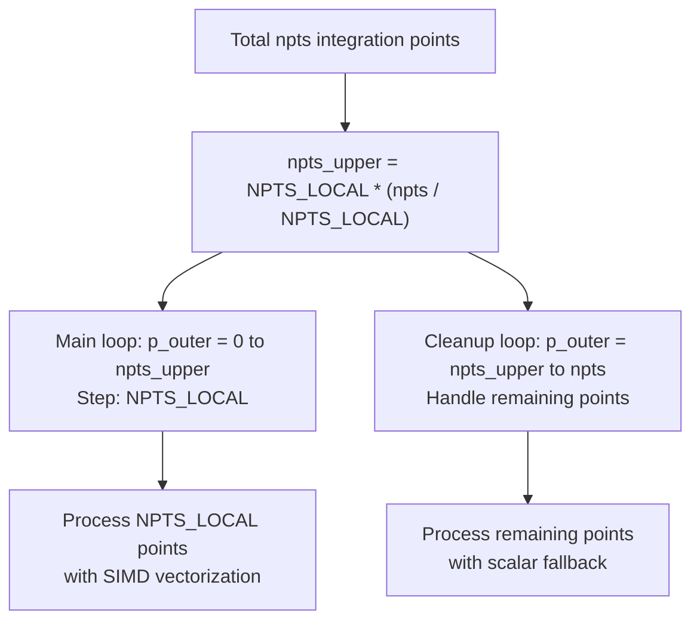
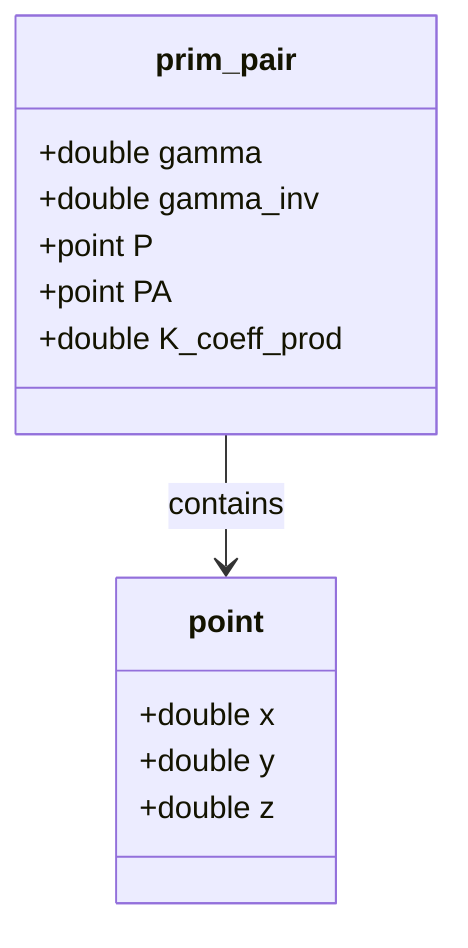
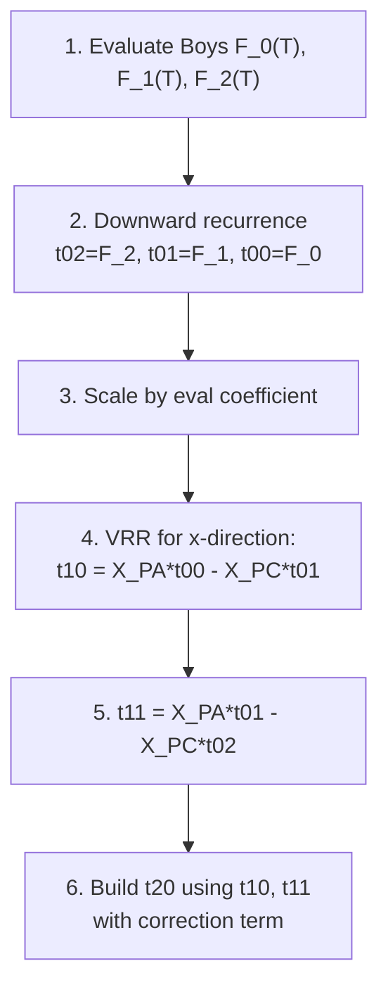

<!-- source: DeepWiki mcp.deepwiki.com · repo microsoft/skala · extra page VRR Algorithm and Boys Functions · fetched 2026-10-26 -->

# VRR Algorithm and Boys Functions

<details>
<summary>Relevant source files</summary>

The following files were used as context for generating this wiki page:

- [third_party/gauxc/src/xc_integrator/local_work_driver/host/obara_saika/src/integral_0.cxx](third_party/gauxc/src/xc_integrator/local_work_driver/host/obara_saika/src/integral_0.cxx)
- [third_party/gauxc/src/xc_integrator/local_work_driver/host/obara_saika/src/integral_1.cxx](third_party/gauxc/src/xc_integrator/local_work_driver/host/obara_saika/src/integral_1.cxx)
- [third_party/gauxc/src/xc_integrator/local_work_driver/host/obara_saika/src/integral_2.cxx](third_party/gauxc/src/xc_integrator/local_work_driver/host/obara_saika/src/integral_2.cxx)
- [third_party/gauxc/src/xc_integrator/local_work_driver/host/obara_saika/src/integral_2_1.cxx](third_party/gauxc/src/xc_integrator/local_work_driver/host/obara_saika/src/integral_2_1.cxx)
- [third_party/gauxc/src/xc_integrator/local_work_driver/host/obara_saika/src/integral_2_2.cxx](third_party/gauxc/src/xc_integrator/local_work_driver/host/obara_saika/src/integral_2_2.cxx)
- [third_party/gauxc/src/xc_integrator/local_work_driver/host/obara_saika/src/integral_3.cxx](third_party/gauxc/src/xc_integrator/local_work_driver/host/obara_saika/src/integral_3.cxx)
- [third_party/gauxc/src/xc_integrator/local_work_driver/host/obara_saika/src/integral_3_2.cxx](third_party/gauxc/src/xc_integrator/local_work_driver/host/obara_saika/src/integral_3_2.cxx)
- [third_party/gauxc/src/xc_integrator/local_work_driver/host/obara_saika/src/integral_4.cxx](third_party/gauxc/src/xc_integrator/local_work_driver/host/obara_saika/src/integral_4.cxx)
- [third_party/gauxc/src/xc_integrator/local_work_driver/host/obara_saika/src/integral_4_0.cxx](third_party/gauxc/src/xc_integrator/local_work_driver/host/obara_saika/src/integral_4_0.cxx)
- [third_party/gauxc/src/xc_integrator/local_work_driver/host/obara_saika/src/integral_4_1.cxx](third_party/gauxc/src/xc_integrator/local_work_driver/host/obara_saika/src/integral_4_1.cxx)
- [third_party/gauxc/src/xc_integrator/local_work_driver/host/obara_saika/src/integral_4_3.cxx](third_party/gauxc/src/xc_integrator/local_work_driver/host/obara_saika/src/integral_4_3.cxx)

</details>


## Purpose and Scope

This page documents the Vertical Recurrence Relations (VRR) algorithm and Boys function evaluation used in the Obara-Saika integral evaluation on the host CPU. These are the mathematical core of computing Gaussian integrals for exchange-correlation calculations. For the broader context of the Obara-Saika implementation, see [Obara-Saika Integral Evaluation](#6.2). For CPU-specific SIMD optimizations, see [SIMD Vectorization Strategy](#6.2.3). For the overall integral function hierarchy, see [Integral Function Hierarchy](#6.2.1).

The VRR algorithm builds integrals of higher angular momentum from lower angular momentum base cases, while the Boys functions provide the fundamental auxiliary integrals needed as starting points.

## Algorithm Overview



**Flow of Obara-Saika Integral Evaluation**

Sources: [third_party/gauxc/src/xc_integrator/local_work_driver/host/obara_saika/src/integral_0.cxx:52-82](), [third_party/gauxc/src/xc_integrator/local_work_driver/host/obara_saika/src/integral_1.cxx:57-162]()

## T Value Computation

The T value is the argument to the Boys function and represents the scaled squared distance from the Gaussian product center P to the integration point C.

### Mathematical Definition

For a primitive pair with combined exponent `RHO = α + β`:
```
T = RHO * |P - C|²
```

where:
- `P` is the Gaussian product center: `P = (α*A + β*B) / (α + β)`
- `C` is the integration point (grid point)
- `RHO = α + β` (sum of primitive exponents)

### Implementation



**T Value Computation Pipeline**

The computation is vectorized using SIMD operations:

| Step | Operation | Code Pattern |
|------|-----------|--------------|
| 1. Load points | Load (xC, yC, zC) | `SIMD_UNALIGNED_LOAD` |
| 2. Compute vectors | P - C for each dimension | `SIMD_SUB` |
| 3. Square components | X_PC², Y_PC², Z_PC² | `SIMD_MUL` |
| 4. Sum squares | X_PC² + Y_PC² + Z_PC² | `SIMD_FMA` (fused multiply-add) |
| 5. Scale by RHO | T = RHO * sum | `SIMD_MUL` |
| 6. Store | Write to Tval array | `SIMD_ALIGNED_STORE` |

Sources: [third_party/gauxc/src/xc_integrator/local_work_driver/host/obara_saika/src/integral_1.cxx:58-71](), [third_party/gauxc/src/xc_integrator/local_work_driver/host/obara_saika/src/integral_2.cxx:58-71]()

## Boys Function Evaluation

The Boys function `F_m(T)` is a fundamental auxiliary integral:

```
F_m(T) = ∫₀¹ t^(2m) exp(-T*t²) dt
```

### Evaluation Method

The implementation uses the `boys_elements` template function with Chebyshev interpolation for efficient evaluation.



**Boys Function Evaluation Process**

The template parameter `m` specifies the highest order Boys function needed:

| Angular Momentum | Max m | Example File |
|------------------|-------|--------------|
| L=0 (s) | 0 | integral_0.cxx:70 |
| L=1 (p) | 2 | integral_1.cxx:75 |
| L=2 (d) | 4 | integral_2.cxx:75 |
| L=3 (f) | 6 | integral_3.cxx:75 |
| L=4 (g) | 8 | integral_4.cxx:75 |

### Output Arrays

After evaluation, three arrays are populated:

1. **FmT**: Contains `F_m(T)` for the highest order m
2. **Tval_inv_e**: Contains `exp(-T)/T`, used for downward recurrence
3. **Tval**: Original T values (preserved for recurrence)

Sources: [third_party/gauxc/src/xc_integrator/local_work_driver/host/obara_saika/src/integral_0.cxx:69-70](), [third_party/gauxc/src/xc_integrator/local_work_driver/host/obara_saika/src/integral_4.cxx:75-76]()

## Downward Recurrence for Boys Functions

After evaluating the highest order `F_m(T)`, lower orders are computed using downward recurrence.

### Recurrence Relation

```
F_{m-1}(T) = (2T * F_m(T) + exp(-T)) / (2m + 1)
           = (2T * F_m(T) + T * Tval_inv_e) / (2m + 1)
```

### Implementation Pattern



**Downward Recurrence Chain**

The constants `c_k = 1/(2k+1)` are hardcoded for efficiency:

| k | Constant | Value | Code Pattern |
|---|----------|-------|--------------|
| 0 | 1/1 | 2.0 | `SIMD_SET1(2.00000000000000000000)` |
| 1 | 1/3 | 0.666... | `SIMD_SET1(0.66666666666666662966)` |
| 2 | 1/5 | 0.4 | `SIMD_SET1(0.40000000000000002220)` |
| 3 | 1/7 | 0.2857... | `SIMD_SET1(0.28571428571428569843)` |
| 4 | 1/9 | 0.2222... | `SIMD_SET1(0.22222222222222220989)` |

Example from L=2 integral:
```cpp
t04 = SIMD_ALIGNED_LOAD((FmT + p_inner));
t03 = SIMD_MUL(SIMD_ADD(SIMD_MUL(tval, t04), tval_inv_e), SIMD_SET1(0.28571428571428569843));
t02 = SIMD_MUL(SIMD_ADD(SIMD_MUL(tval, t03), tval_inv_e), SIMD_SET1(0.40000000000000002220));
t01 = SIMD_MUL(SIMD_ADD(SIMD_MUL(tval, t02), tval_inv_e), SIMD_SET1(0.66666666666666662966));
t00 = SIMD_MUL(SIMD_ADD(SIMD_MUL(tval, t01), tval_inv_e), SIMD_SET1(2.00000000000000000000));
```

Sources: [third_party/gauxc/src/xc_integrator/local_work_driver/host/obara_saika/src/integral_2.cxx:92-96](), [third_party/gauxc/src/xc_integrator/local_work_driver/host/obara_saika/src/integral_4.cxx:92-100]()

## Vertical Recurrence Relations (VRR)

The VRR builds integrals with angular momentum on center A from the base Boys function values.

### Fundamental VRR Formula

For Cartesian Gaussian integrals:
```
(a+1_i|m) = X_PA * (a|m) - X_PC * (a|m+1) + a_i/(2*RHO) * [(a-1_i|m) - (a-1_i|m+1)]
```

where:
- `a` is the angular momentum vector on center A
- `i` is the Cartesian direction (x, y, or z)
- `m` is the auxiliary index
- `X_PA = P_x - A_x` (x-component of P-A vector)
- `X_PC = P_x - C_x` (x-component of P-C vector)
- `RHO` is the sum of exponents

### Naming Convention

The code uses a systematic naming for intermediate values:



**Naming Convention: tXY where X is angular momentum, Y is auxiliary index**

The first digit represents total angular momentum, the second digit represents the auxiliary index needed for further recurrence.

Sources: [third_party/gauxc/src/xc_integrator/local_work_driver/host/obara_saika/src/integral_1.cxx:87-88](), [third_party/gauxc/src/xc_integrator/local_work_driver/host/obara_saika/src/integral_2.cxx:87-88]()

### VRR Implementation Pattern



**VRR Build-up from L=0 to Higher Angular Momentum**

### Code Pattern for VRR Step

Each VRR step follows this pattern:

```cpp
// For L=2 in x-direction:
t20 = SIMD_MUL(SIMD_DUPLICATE(&(X_PA)), t10);  // X_PA * (1|0)
t20 = SIMD_FNMA(X_PC, t11, t20);                // - X_PC * (1|1)
tx = SIMD_SUB(t00, t01);                        // (0|0) - (0|1)
ty = SIMD_SET1(0.5 * 1);                        // coefficient: a_i/(2*RHO)
ty = SIMD_MUL(ty, SIMD_DUPLICATE(&(RHO_INV)));
t20 = SIMD_FMA(tx, ty, t20);                    // add correction term
```

**Key SIMD Operations**:
- `SIMD_MUL`: Multiply X_PA by lower angular momentum integral
- `SIMD_FNMA`: Fused negative multiply-add for X_PC term (computes `a - b*c`)
- `SIMD_FMA`: Fused multiply-add for correction term (computes `a + b*c`)

Sources: [third_party/gauxc/src/xc_integrator/local_work_driver/host/obara_saika/src/integral_1.cxx:106-111](), [third_party/gauxc/src/xc_integrator/local_work_driver/host/obara_saika/src/integral_2.cxx:111-122]()

## Multi-Directional VRR

After building integrals in the x-direction, the algorithm builds y- and z-direction integrals.



**Multi-Directional Angular Momentum Build-up**

### Pattern for Y-direction

After computing x-direction integrals, y-direction uses the same VRR formula with Y_PA and Y_PC:

```cpp
// Start from (0|0), (0|1), (0|2)
t10 = SIMD_MUL(SIMD_DUPLICATE(&(Y_PA)), t00);
t10 = SIMD_FNMA(Y_PC, t01, t10);

// Build (0,2,0)
t20 = SIMD_MUL(SIMD_DUPLICATE(&(Y_PA)), t10);
t20 = SIMD_FNMA(Y_PC, t11, t20);
tx = SIMD_SUB(t00, t01);
ty = SIMD_SET1(0.5 * 1);
ty = SIMD_MUL(ty, SIMD_DUPLICATE(&(RHO_INV)));
t20 = SIMD_FMA(tx, ty, t20);
```

### Mixed Angular Momentum

For integrals like `(1,1,0)`, the VRR uses lower angular momentum in the other direction:

```cpp
// (1,1,0) from (1,0,0)
t20 = SIMD_MUL(SIMD_DUPLICATE(&(Y_PA)), t10);  // Y_PA * (1,0|0)
t20 = SIMD_FNMA(Y_PC, t11, t20);                // - Y_PC * (1,0|1)
// No correction term because a_y = 0 for the starting integral
```

Sources: [third_party/gauxc/src/xc_integrator/local_work_driver/host/obara_saika/src/integral_1.cxx:125-145](), [third_party/gauxc/src/xc_integrator/local_work_driver/host/obara_saika/src/integral_2.cxx:192-231]()

## Accumulation and Coefficient Scaling

### Initial Coefficient Scaling

All base integrals `t00` through `t0m` are multiplied by the primitive coefficient `eval`:

```cpp
double eval = prim_pairs[ij].K_coeff_prod;

t00 = SIMD_MUL(SIMD_DUPLICATE(&(eval)), t00);
t01 = SIMD_MUL(SIMD_DUPLICATE(&(eval)), t01);
t02 = SIMD_MUL(SIMD_DUPLICATE(&(eval)), t02);
// ... for all base integrals
```

This scales the entire tree of VRR-generated integrals by the Gaussian primitive product coefficients.

### Accumulation Pattern

Final integrals are accumulated into the `temp` buffer:

```cpp
tx = SIMD_ALIGNED_LOAD((temp + 0 * NPTS_LOCAL + p_inner));
tx = SIMD_ADD(tx, t20);  // Add contribution from this primitive pair
SIMD_ALIGNED_STORE((temp + 0 * NPTS_LOCAL + p_inner), tx);
```

The accumulation happens across all primitive pairs (`nprim_pairs` loop iterations), summing contributions from each contracted Gaussian primitive.

### Buffer Organization

The `temp` buffer stores results organized by integral type:

| Buffer Index | Integral Type | Example (L=2) |
|--------------|---------------|---------------|
| 0 | (2,0,0) | xx |
| 1 | (0,2,0) | yy |
| 2 | (0,0,2) | zz |
| 3 | (1,1,0) | xy |
| 4 | (1,0,1) | xz |
| 5 | (0,1,1) | yz |
| 6 | (3,0,0) | xxx (for L=3) |

Sources: [third_party/gauxc/src/xc_integrator/local_work_driver/host/obara_saika/src/integral_2.cxx:98-102](), [third_party/gauxc/src/xc_integrator/local_work_driver/host/obara_saika/src/integral_2.cxx:129-131]()

## Point Batching with NPTS_LOCAL

### Batching Strategy

Computation is organized in batches of `NPTS_LOCAL` points for SIMD efficiency:



**Point Batching Strategy**

### Inner SIMD Loop

Within each batch, points are processed in SIMD_LENGTH chunks:

```cpp
for(size_t p_inner = 0; p_inner < NPTS_LOCAL; p_inner += SIMD_LENGTH) {
    SIMD_TYPE xC = SIMD_UNALIGNED_LOAD((_point_outer + p_inner + 0 * npts));
    // ... process SIMD_LENGTH points at once
}
```

Typical values:
- `NPTS_LOCAL`: Often 128 or 256 (defined in config_obara_saika.hpp)
- `SIMD_LENGTH`: 4 for AVX2 (doubles), 8 for AVX-512

### Scalar Cleanup Code

For points that don't fill a complete SIMD vector in the cleanup loop:

```cpp
for(; p_inner < npts_inner; p_inner += SCALAR_LENGTH) {
    SCALAR_TYPE xC = SCALAR_LOAD((_point_outer + p_inner + 0 * npts));
    // ... process one point at a time
}
```

Where `SCALAR_LENGTH = 1`, processing individual points.

Sources: [third_party/gauxc/src/xc_integrator/local_work_driver/host/obara_saika/src/integral_0.cxx:36-38](), [third_party/gauxc/src/xc_integrator/local_work_driver/host/obara_saika/src/integral_0.cxx:103-178]()

## Data Structure: prim_pair

The `prim_pair` structure contains precomputed data for each primitive pair:



**prim_pair Data Structure**

| Field | Type | Description |
|-------|------|-------------|
| `gamma` | double | RHO = α + β (sum of exponents) |
| `gamma_inv` | double | 1/RHO (precomputed for efficiency) |
| `P` | point | Gaussian product center |
| `PA` | point | Vector from P to center A |
| `K_coeff_prod` | double | Product of normalization constants and coefficients |

### Usage in VRR

```cpp
for(int ij = 0; ij < nprim_pairs; ++ij) {
    double RHO = prim_pairs[ij].gamma;
    double RHO_INV = prim_pairs[ij].gamma_inv;
    double X_PA = prim_pairs[ij].PA.x;
    double Y_PA = prim_pairs[ij].PA.y;
    double Z_PA = prim_pairs[ij].PA.z;
    
    double xP = prim_pairs[ij].P.x;
    double yP = prim_pairs[ij].P.y;
    double zP = prim_pairs[ij].P.z;
    
    double eval = prim_pairs[ij].K_coeff_prod;
    // ... use these values in VRR
}
```

Sources: [third_party/gauxc/src/xc_integrator/local_work_driver/host/obara_saika/src/integral_2_1.cxx:49-60](), [third_party/gauxc/src/xc_integrator/local_work_driver/host/obara_saika/src/integral_4_1.cxx:46-60]()

## Special Cases: Centered Integrals

### When A = B (Single Center)

For integrals like `integral_2.cxx` and `integral_3.cxx` where `rA` is the only center:

```cpp
void integral_3(size_t npts,
               double *_points,
               point rA,
               point /*rB*/,  // rB commented out - not used
               ...)
```

In this case:
- `X_PA = Y_PA = Z_PA = 0.0` (marked as `constexpr`)
- The P center coincides with A
- `RHO_INV = 1.0 / RHO` is computed locally (not from prim_pair)
- Simplifies VRR: many terms drop out

Example simplification:
```cpp
constexpr double X_PA = 0.0;
constexpr double Y_PA = 0.0;
constexpr double Z_PA = 0.0;

t10 = SIMD_MUL(SIMD_DUPLICATE(&(X_PA)), t00);  // = 0
t10 = SIMD_FNMA(X_PC, t01, t10);                // = -X_PC * t01
```

Sources: [third_party/gauxc/src/xc_integrator/local_work_driver/host/obara_saika/src/integral_3.cxx:17-28](), [third_party/gauxc/src/xc_integrator/local_work_driver/host/obara_saika/src/integral_3.cxx:51-53]()

## Complete VRR Example: L=1 Integral

### Step-by-Step for (1,0,0)

For the simplest non-trivial case, building the `(1,0,0)` integral (p_x orbital):



**Complete Flow for L=1 Integral**

### Code Trace

```cpp
// 1. T value computation
X_PC = SIMD_MUL(X_PC, X_PC);
X_PC = SIMD_FMA(Y_PC, Y_PC, X_PC);
X_PC = SIMD_FMA(Z_PC, Z_PC, X_PC);
X_PC = SIMD_MUL(SIMD_DUPLICATE(&(RHO)), X_PC);
SIMD_ALIGNED_STORE((Tval + p_inner), X_PC);

// 2. Boys function
boys_elements<2>(NPTS_LOCAL, Tval, Tval_inv_e, FmT, boys_table);

// 3. Downward recurrence
t02 = SIMD_ALIGNED_LOAD((FmT + p_inner));
t01 = SIMD_MUL(SIMD_ADD(SIMD_MUL(tval, t02), tval_inv_e), SIMD_SET1(0.66666666666666662966));
t00 = SIMD_MUL(SIMD_ADD(SIMD_MUL(tval, t01), tval_inv_e), SIMD_SET1(2.00000000000000000000));

// 4. Scale
t00 = SIMD_MUL(SIMD_DUPLICATE(&(eval)), t00);
t01 = SIMD_MUL(SIMD_DUPLICATE(&(eval)), t01);
t02 = SIMD_MUL(SIMD_DUPLICATE(&(eval)), t02);

// 5. VRR
t10 = SIMD_MUL(SIMD_DUPLICATE(&(X_PA)), t00);
t10 = SIMD_FNMA(X_PC, t01, t10);
t11 = SIMD_MUL(SIMD_DUPLICATE(&(X_PA)), t01);
t11 = SIMD_FNMA(X_PC, t02, t11);

// 6. Accumulate t10 (which is the (1,0,0) integral)
tx = SIMD_ALIGNED_LOAD((temp + 0 * NPTS_LOCAL + p_inner));
tx = SIMD_ADD(tx, t10);
SIMD_ALIGNED_STORE((temp + 0 * NPTS_LOCAL + p_inner), tx);

// 7. Build higher angular momentum
t20 = SIMD_MUL(SIMD_DUPLICATE(&(X_PA)), t10);
t20 = SIMD_FNMA(X_PC, t11, t20);
tx = SIMD_SUB(t00, t01);
ty = SIMD_SET1(0.5 * 1);
ty = SIMD_MUL(ty, SIMD_DUPLICATE(&(RHO_INV)));
t20 = SIMD_FMA(tx, ty, t20);
tx = SIMD_ALIGNED_LOAD((temp + 3 * NPTS_LOCAL + p_inner));
tx = SIMD_ADD(tx, t20);
SIMD_ALIGNED_STORE((temp + 3 * NPTS_LOCAL + p_inner), tx);
```

Sources: [third_party/gauxc/src/xc_integrator/local_work_driver/host/obara_saika/src/integral_1.cxx:67-114]()

## Performance Considerations

### Memory Alignment

All intermediate buffers are aligned for SIMD efficiency:

```cpp
__attribute__((__aligned__(64))) double buffer[9 * NPTS_LOCAL + 3 * NPTS_LOCAL];
```

The 64-byte alignment ensures cache line alignment and optimal SIMD load/store performance.

### Fused Operations

The code extensively uses fused multiply-add operations:

| Operation | Function | Benefit |
|-----------|----------|---------|
| `SIMD_FMA(a, b, c)` | `c + a*b` | Single rounding, higher accuracy |
| `SIMD_FNMA(a, b, c)` | `c - a*b` | Avoids separate negation |

These operations reduce instruction count and improve numerical accuracy by avoiding intermediate rounding.

### Minimal Recomputation

Key values are computed once and reused:
- `RHO_INV` stored in `prim_pair`
- `Tval_inv_e` computed once for all integrals
- Product center `P` and displacement `PA` precomputed

### Vectorization Efficiency

The SIMD_LENGTH stride ensures all lanes are utilized:
- AVX2: 4 doubles per vector
- AVX-512: 8 doubles per vector
- Cleanup code handles non-multiple remainders

Sources: [third_party/gauxc/src/xc_integrator/local_work_driver/host/obara_saika/src/integral_1.cxx:29-34](), [third_party/gauxc/src/xc_integrator/local_work_driver/host/obara_saika/src/integral_2.cxx:29-34]()

---

