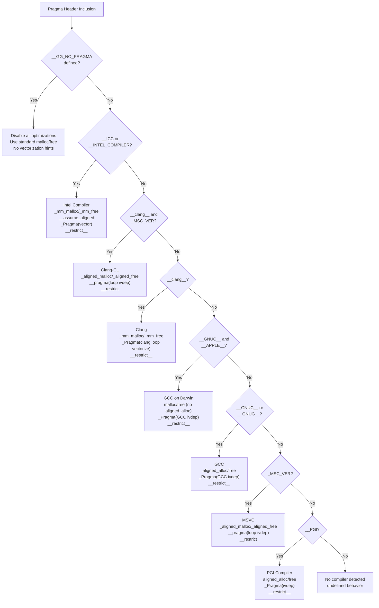
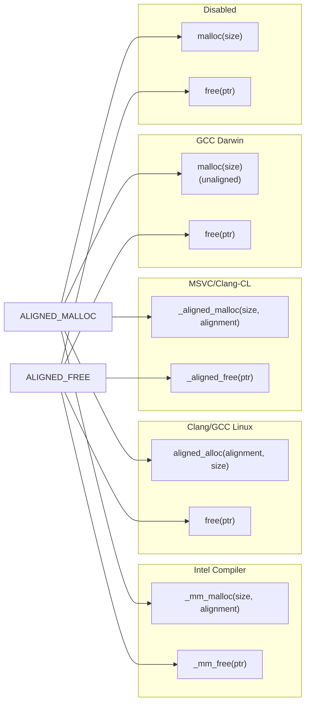
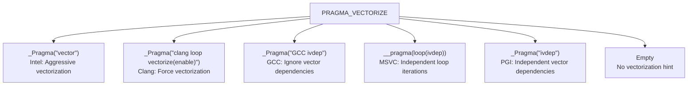
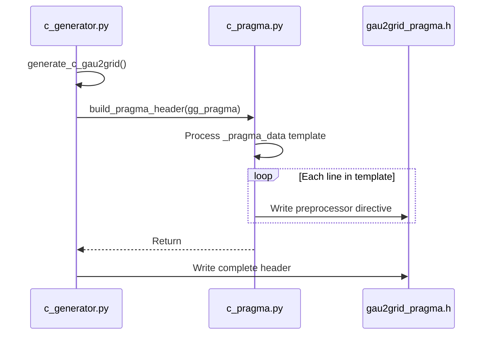
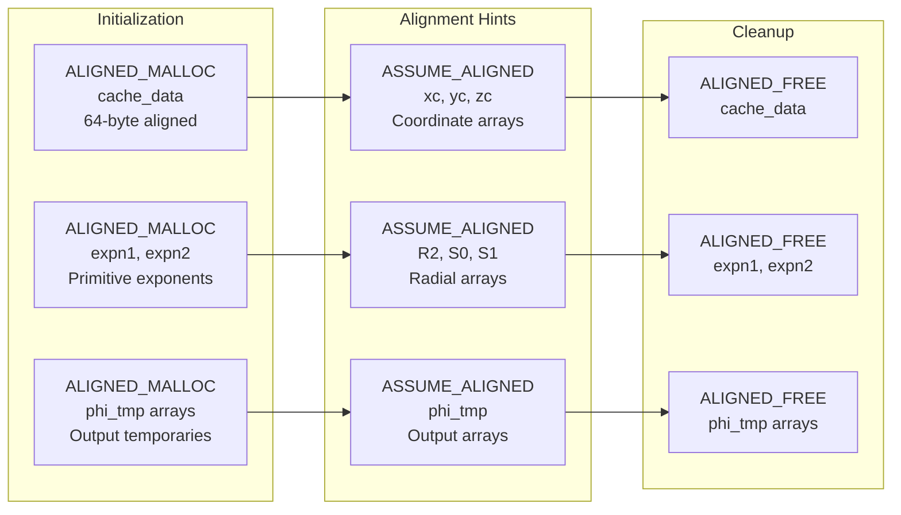
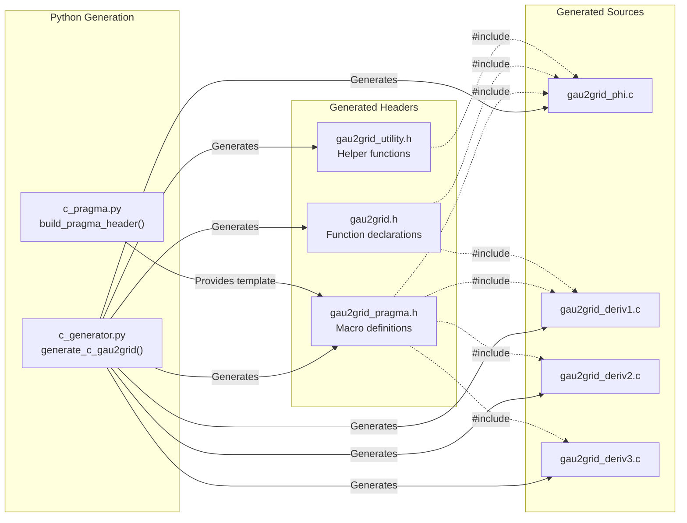

<!-- source: DeepWiki mcp.deepwiki.com · repo microsoft/skala · extra page Compiler Pragma System · fetched 2026-10-26 -->

# Compiler Pragma System

<details>
<summary>Relevant source files</summary>

The following files were used as context for generating this wiki page:

- [third_party/gauxc/external/gau2grid/generated_source/gau2grid/gau2grid_pragma.h](third_party/gauxc/external/gau2grid/generated_source/gau2grid/gau2grid_pragma.h)
- [third_party/gauxc/external/gau2grid/generated_source/gau2grid_deriv1.c](third_party/gauxc/external/gau2grid/generated_source/gau2grid_deriv1.c)
- [third_party/gauxc/external/gau2grid/generated_source/gau2grid_deriv2.c](third_party/gauxc/external/gau2grid/generated_source/gau2grid_deriv2.c)
- [third_party/gauxc/external/gau2grid/generated_source/gau2grid_deriv3.c](third_party/gauxc/external/gau2grid/generated_source/gau2grid_deriv3.c)
- [third_party/gauxc/external/gau2grid/generated_source/gau2grid_phi.c](third_party/gauxc/external/gau2grid/generated_source/gau2grid_phi.c)
- [third_party/gauxc/external/gau2grid/src/gau2grid/c_generator.py](third_party/gauxc/external/gau2grid/src/gau2grid/c_generator.py)
- [third_party/gauxc/external/gau2grid/src/gau2grid/c_pragma.py](third_party/gauxc/external/gau2grid/src/gau2grid/c_pragma.py)

</details>


## Purpose and Scope

The compiler pragma system provides a platform-independent abstraction layer for compiler-specific directives used throughout the Gau2Grid collocation kernels. This system enables the generated C code to leverage advanced compiler features such as vectorization hints, aligned memory allocation, and pointer aliasing restrictions across multiple compiler toolchains without requiring separate code generation paths.

For information about the code generation pipeline that produces the pragma header, see [Code Generation Pipeline](#6.1.1). For details on how these pragmas are used within the generated kernels, see [Generated Kernel Structure](#6.1.2).

**Sources:** [third_party/gauxc/external/gau2grid/src/gau2grid/c_pragma.py:1-106](), [third_party/gauxc/external/gau2grid/generated_source/gau2grid/gau2grid_pragma.h:1-99]()

## Macro Abstraction Layer

The pragma system defines five primary abstraction macros that encapsulate compiler-specific functionality:

| Macro | Purpose | Return Type |
|-------|---------|-------------|
| `ALIGNED_MALLOC(alignment, size)` | Allocates memory aligned to specified byte boundary | `void*` |
| `ALIGNED_FREE(ptr)` | Frees memory allocated by ALIGNED_MALLOC | `void` |
| `ASSUME_ALIGNED(ptr, width)` | Hints to compiler that pointer is aligned | Statement |
| `PRAGMA_VECTORIZE` | Enables automatic vectorization of following loop | Statement |
| `PRAGMA_RESTRICT` | Declares pointer with no aliasing (restrict keyword) | Type qualifier |

These macros are defined differently for each supported compiler toolchain, providing uniform semantics while utilizing platform-specific intrinsics and directives.

**Sources:** [third_party/gauxc/external/gau2grid/generated_source/gau2grid/gau2grid_pragma.h:16-99]()

## Compiler Detection and Specialization



**Diagram: Compiler Detection Flow**

The detection sequence is carefully ordered to handle compilers that define multiple preprocessor symbols. For example, Clang defines `__GNUC__`, so Clang detection must precede GCC detection to prevent misidentification.

**Sources:** [third_party/gauxc/external/gau2grid/generated_source/gau2grid/gau2grid_pragma.h:16-99]()

## Memory Allocation Abstractions

### ALIGNED_MALLOC and ALIGNED_FREE

Aligned memory allocation is critical for SIMD vectorization performance. The abstraction handles platform-specific allocation functions:



**Diagram: Memory Allocation Macro Expansion by Compiler**

**Parameter Order Variation:** Note that `_mm_malloc` and `_aligned_malloc` reverse the order of `size` and `alignment` parameters. The macro interface normalizes this to `(alignment, size)` order, with implementation-specific reordering.

**Sources:** [third_party/gauxc/external/gau2grid/generated_source/gau2grid/gau2grid_pragma.h:19-20,29-30,39-40,50-51,60-61,70-71,80-81,91-92]()

### ASSUME_ALIGNED

The `ASSUME_ALIGNED` macro provides compiler hints that a pointer is aligned to a specific boundary:

| Compiler | Implementation | Effect |
|----------|---------------|--------|
| Intel | `__assume_aligned(ptr, width)` | Enables aligned load/store instructions |
| Clang | Empty (no-op) | Relies on allocation alignment |
| GCC | Empty (no-op) | Relies on allocation alignment |
| MSVC | Empty (no-op) | Relies on allocation alignment |
| PGI | Empty (no-op) | Relies on allocation alignment |
| Disabled | Empty (no-op) | No optimization |

Only Intel compilers provide explicit alignment assumption intrinsics. Other compilers infer alignment from allocation or generate conservative code.

**Sources:** [third_party/gauxc/external/gau2grid/generated_source/gau2grid/gau2grid_pragma.h:21,31,38,49,59,69,79,90]()

## Vectorization and Optimization Pragmas

### PRAGMA_VECTORIZE

The vectorization macro instructs compilers to auto-vectorize loops using SIMD instructions:



**Diagram: Vectorization Pragma Expansion**

**Semantic Differences:**
- **Intel `vector`**: Most aggressive, may reorder operations
- **Clang `vectorize(enable)`**: Enables vectorization even if cost model suggests against it
- **GCC/PGI `ivdep`**: Asserts no loop-carried dependencies
- **MSVC `loop(ivdep)`**: Asserts iterations are independent

**Sources:** [third_party/gauxc/external/gau2grid/generated_source/gau2grid/gau2grid_pragma.h:23,33,43,54,64,74,84,95]()

### PRAGMA_RESTRICT

The `PRAGMA_RESTRICT` macro provides the C99 `restrict` keyword equivalent for each compiler:

| Compiler | Keyword | Standard |
|----------|---------|----------|
| Intel | `__restrict__` | GNU extension |
| Clang | `__restrict__` | GNU extension |
| GCC | `__restrict__` | GNU extension |
| MSVC/Clang-CL | `__restrict` | MSVC extension |
| PGI | `__restrict__` | GNU extension |
| Disabled | Empty | No aliasing hints |

This qualifier enables compilers to assume pointer arguments do not alias, permitting more aggressive optimizations such as reordering memory operations.

**Sources:** [third_party/gauxc/external/gau2grid/generated_source/gau2grid/gau2grid_pragma.h:24,34,44,55,65,75,85,96]()

## Pragma Header Generation

The pragma header is generated by Python code during the build process:



**Diagram: Pragma Header Generation Sequence**

The generation occurs in the `generate_c_gau2grid` function:

1. Creates a `CodeGen` object for the pragma header ([c_generator.py:68]())
2. Calls `c_pragma.build_pragma_header(gg_pragma)` ([c_generator.py:95]())
3. Writes the header to `gau2grid/gau2grid_pragma.h` ([c_generator.py:314]())

**Sources:** [third_party/gauxc/external/gau2grid/src/gau2grid/c_generator.py:68,95,314](), [third_party/gauxc/external/gau2grid/src/gau2grid/c_pragma.py:100-106]()

## Usage in Generated Code

The generated collocation kernels use these macros extensively to enable platform-optimized execution:

### Memory Allocation Pattern



**Diagram: Memory Management Pattern in Generated Kernels**

Example from `gg_collocation_L0`:
- Allocate cache block: `ALIGNED_MALLOC(64, 192 * sizeof(double))` ([gau2grid_phi.c:41]())
- Assign aligned pointers: `ASSUME_ALIGNED(xc, 64)` ([gau2grid_phi.c:43]())
- Free on exit: `ALIGNED_FREE(cache_data)` ([gau2grid_phi.c:141]())

**Sources:** [third_party/gauxc/external/gau2grid/generated_source/gau2grid_phi.c:41-53,141]()

### Vectorization Annotations

The `PRAGMA_VECTORIZE` macro appears before all performance-critical inner loops:

**Example Usage Pattern:**
```c
// From gau2grid_deriv1.c:97-111
PRAGMA_VECTORIZE
for (unsigned long i = 0; i < remain; i++) {
    xc[i] = x[i] - center_x;
    yc[i] = y[i] - center_y;
    zc[i] = z[i] - center_z;
    
    R2[i] = xc[i] * xc[i];
    R2[i] += yc[i] * yc[i];
    R2[i] += zc[i] * zc[i];
    
    S0[i] = 0.0;
    S1[i] = 0.0;
}
```

The pragma enables compilers to generate SIMD instructions (SSE, AVX, AVX-512) for these loops.

**Sources:** [third_party/gauxc/external/gau2grid/generated_source/gau2grid_deriv1.c:97,115,138,250,268,291,303]()

### Restrict Qualifier Usage

Function signatures use `PRAGMA_RESTRICT` to prevent pointer aliasing:

**Function Signature Example:**
```c
void gg_collocation_L1_deriv1(
    const unsigned long npoints, 
    const double* PRAGMA_RESTRICT xyz,
    const unsigned long xyz_stride, 
    const int nprim, 
    const double* PRAGMA_RESTRICT coeffs,
    const double* PRAGMA_RESTRICT exponents,
    const double* PRAGMA_RESTRICT center,
    const int order, 
    double* PRAGMA_RESTRICT phi_out,
    double* PRAGMA_RESTRICT phi_x_out,
    double* PRAGMA_RESTRICT phi_y_out,
    double* PRAGMA_RESTRICT phi_z_out
)
```

This guarantees to the compiler that `xyz`, `coeffs`, `exponents`, `center`, and output arrays do not overlap in memory, enabling aggressive optimization.

**Sources:** [third_party/gauxc/external/gau2grid/generated_source/gau2grid_deriv1.c:178](), [third_party/gauxc/external/gau2grid/src/gau2grid/c_generator.py:392-403]()

## Integration with Code Generation

The pragma system integrates into the code generation pipeline through standard includes:



**Diagram: Pragma System Integration in Build Pipeline**

All generated C files include the pragma header:
```c
#include "gau2grid/gau2grid.h"
#include "gau2grid/gau2grid_utility.h"
#include "gau2grid/gau2grid_pragma.h"
```

**Sources:** [third_party/gauxc/external/gau2grid/src/gau2grid/c_generator.py:113-116](), [third_party/gauxc/external/gau2grid/generated_source/gau2grid_phi.c:19-21]()

## Design Rationale

The pragma abstraction layer addresses several critical requirements:

### Cross-Platform Compatibility

Different platforms provide different mechanisms for aligned allocation:
- **POSIX (Linux, Unix)**: `aligned_alloc()` from C11
- **macOS**: Standard `malloc()` only (no `aligned_alloc()`)
- **Windows**: `_aligned_malloc()` from CRT
- **Intel**: `_mm_malloc()` from compiler intrinsics

The abstraction ensures generated code compiles and runs optimally on all platforms without conditional compilation in the generated kernels.

### Performance Portability

Vectorization hints differ semantically across compilers:
- Some compilers (`ivdep`) only assert independence
- Others (`vector`, `vectorize(enable)`) actively force vectorization
- The abstraction allows each compiler to use its most effective directive

### Maintainability

Generated code uses consistent macro names (`PRAGMA_VECTORIZE`, `ALIGNED_MALLOC`) rather than compiler-specific syntax. This:
- Simplifies code generation templates
- Makes generated code more readable
- Localizes platform-specific knowledge to a single header

### Fallback Safety

The `__GG_NO_PRAGMA` path provides a safety valve for platforms with problematic pragma support, allowing compilation to succeed (albeit without optimizations) on any C99-compliant compiler.

**Sources:** [third_party/gauxc/external/gau2grid/src/gau2grid/c_pragma.py:1-106]()

## Compiler Support Matrix

| Compiler | Version Tested | SIMD Support | Aligned Alloc | Restrict | Notes |
|----------|----------------|--------------|---------------|----------|-------|
| Intel ICC | 18.0+ | AVX, AVX-512 | `_mm_malloc` | `__restrict__` | Best vectorization |
| Clang | 8.0+ | SSE, AVX | `_mm_malloc` | `__restrict__` | Requires explicit enable |
| GCC | 7.0+ | SSE, AVX | `aligned_alloc` | `__restrict__` | Strong `ivdep` |
| MSVC | 2017+ | SSE, AVX | `_aligned_malloc` | `__restrict` | Limited vectorization |
| PGI | 19.0+ | SSE, AVX | `aligned_alloc` | `__restrict__` | HPC-focused |
| AppleClang | 10.0+ | SSE, AVX | `malloc` | `__restrict__` | No aligned_alloc |

The system automatically detects and configures for each compiler at compile time through preprocessor macros.

**Sources:** [third_party/gauxc/external/gau2grid/generated_source/gau2grid/gau2grid_pragma.h:26-96]()

---

