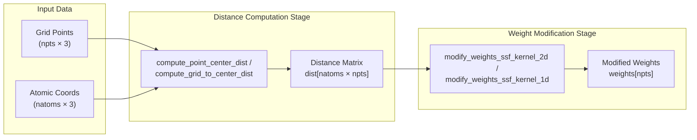
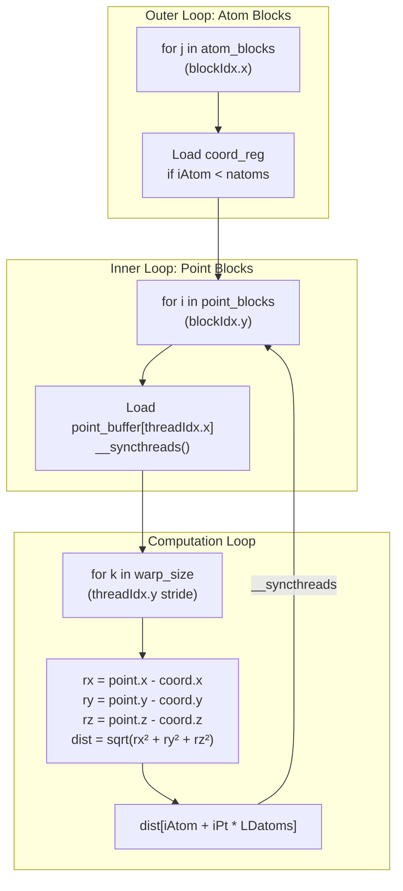
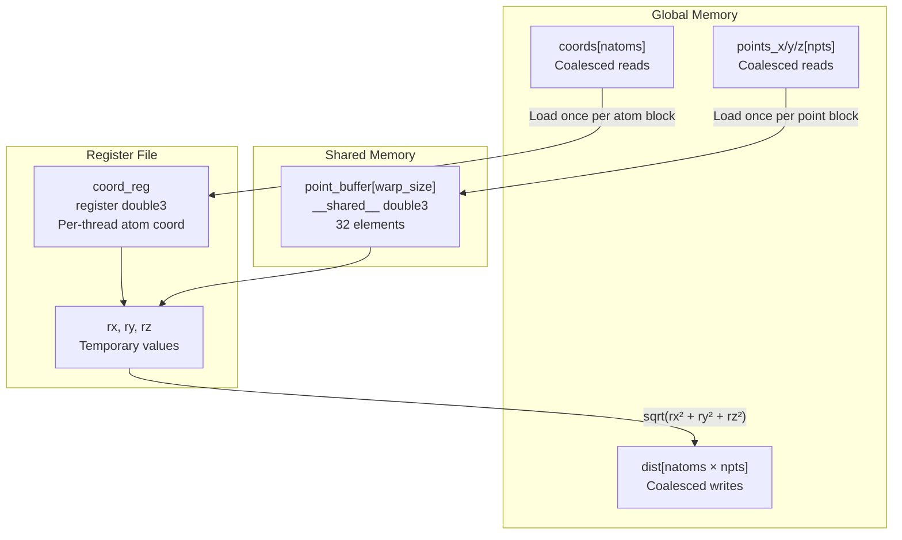
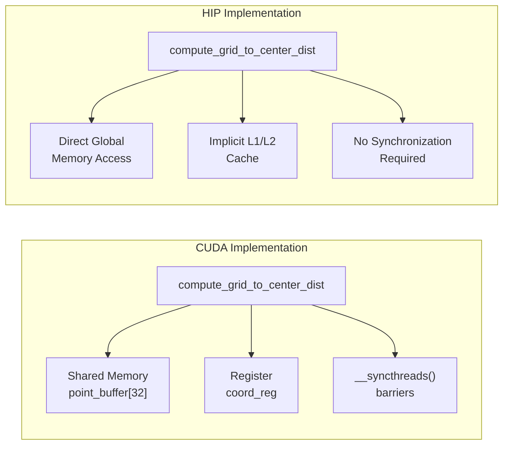

<!-- source: DeepWiki mcp.deepwiki.com · repo microsoft/skala · extra page Distance Computation · fetched 2026-10-26 -->

# Distance Computation

<details>
<summary>Relevant source files</summary>

The following files were used as context for generating this wiki page:

- [third_party/gauxc/attic/src/integrator/cuda/cuda_weights.cu](third_party/gauxc/attic/src/integrator/cuda/cuda_weights.cu)
- [third_party/gauxc/attic/src/new_integrator/device/cuda/cuda_weights.cu](third_party/gauxc/attic/src/new_integrator/device/cuda/cuda_weights.cu)
- [third_party/gauxc/attic/src/new_integrator/device/hip/hip_weights.hip](third_party/gauxc/attic/src/new_integrator/device/hip/hip_weights.hip)
- [third_party/gauxc/src/xc_integrator/local_work_driver/device/cuda/kernels/cuda_ssf_1d.cu](third_party/gauxc/src/xc_integrator/local_work_driver/device/cuda/kernels/cuda_ssf_1d.cu)
- [third_party/gauxc/src/xc_integrator/local_work_driver/device/cuda/kernels/cuda_ssf_2d.hu](third_party/gauxc/src/xc_integrator/local_work_driver/device/cuda/kernels/cuda_ssf_2d.hu)
- [third_party/gauxc/src/xc_integrator/local_work_driver/device/cuda/kernels/grid_to_center.cu](third_party/gauxc/src/xc_integrator/local_work_driver/device/cuda/kernels/grid_to_center.cu)
- [third_party/gauxc/src/xc_integrator/local_work_driver/device/hip/kernels/grid_to_center.hip](third_party/gauxc/src/xc_integrator/local_work_driver/device/hip/kernels/grid_to_center.hip)
- [third_party/gauxc/src/xc_integrator/local_work_driver/device/hip/kernels/hip_ssf_1d.hip](third_party/gauxc/src/xc_integrator/local_work_driver/device/hip/kernels/hip_ssf_1d.hip)
- [third_party/gauxc/src/xc_integrator/local_work_driver/device/hip/kernels/hip_ssh_2d.hip](third_party/gauxc/src/xc_integrator/local_work_driver/device/hip/kernels/hip_ssh_2d.hip)

</details>


## Purpose and Scope

The distance computation kernel (`compute_point_center_dist` or `compute_grid_to_center_dist`) calculates the Euclidean distance between each grid point and each atomic center in the molecular system. This is the first stage of the weight calculation pipeline and produces a distance matrix that is subsequently consumed by the SSF (Smooth Step Function) weight modification kernels. For the SSF weight modification stage, see [SSF Weight Modification](#7.1.2).

This document covers the GPU kernel implementation, blocking strategy, memory hierarchy optimizations, and synchronization patterns used to efficiently compute these distances on both CUDA and HIP platforms.

---

## Computational Role

The distance computation kernel is invoked as the first step in the `partition_weights_*_SoA` functions before weight modification. It populates a scratch buffer containing all point-to-center distances, which enables the subsequent weight kernels to access pre-computed distances rather than recomputing them for each atomic center pair.

**Diagram: Distance Computation in Weight Calculation Pipeline**



**Sources:**
- [third_party/gauxc/attic/src/integrator/cuda/cuda_weights.cu:579-590]()
- [third_party/gauxc/attic/src/new_integrator/device/cuda/cuda_weights.cu:579-590]()

---

## Kernel Interface

The distance computation kernel has evolved across versions of the codebase. Two primary interfaces exist:

### Legacy Interface (Attic)

The older implementation uses a single `double*` pointer for points data stored as interleaved coordinates:

```
__global__ void compute_point_center_dist(
        size_t      npts,
        size_t      LDatoms,
        size_t      natoms,
  const double*     coords,      // Atomic coordinates as double3[]
  const double*     points,      // Grid points as double3[]
        double*     dist          // Output: dist[natoms, npts]
)
```

### Current Interface

The current implementation uses separate arrays for x, y, z coordinates (Array of Structures of Arrays layout):

```
__global__ void compute_grid_to_center_dist(
        int32_t npts,
        int32_t natoms,
  const double* coords,          // Atomic coordinates as double3[]
  const double* points_x,        // Grid point x-coordinates
  const double* points_y,        // Grid point y-coordinates
  const double* points_z,        // Grid point z-coordinates
        double* dist,            // Output: dist[natoms, npts]
        size_t lddist            // Leading dimension for dist
)
```

**Parameter Descriptions:**

| Parameter | Type | Description |
|-----------|------|-------------|
| `npts` | `int32_t`/`size_t` | Number of grid points |
| `natoms` | `int32_t`/`size_t` | Number of atomic centers |
| `coords` | `const double*` | Atomic coordinates stored as `double3` array |
| `points_*` | `const double*` | Grid point coordinates (separate arrays or interleaved) |
| `dist` | `double*` | Output distance matrix with column-major layout |
| `lddist` | `size_t` | Leading dimension of `dist` (≥ `natoms`) |

The output matrix uses the layout: `dist[iAtom + iPt * lddist]` where distances from point `iPt` to all atoms are stored contiguously.

**Sources:**
- [third_party/gauxc/attic/src/integrator/cuda/cuda_weights.cu:23-30]()
- [third_party/gauxc/src/xc_integrator/local_work_driver/device/cuda/kernels/grid_to_center.cu:14-24]()
- [third_party/gauxc/src/xc_integrator/local_work_driver/device/hip/kernels/grid_to_center.hip:16-25]()

---

## Algorithm and Blocking Strategy

### Legacy Blocked Algorithm (CUDA)

The original CUDA implementation employs a sophisticated 2D blocking strategy that maximizes data reuse through shared memory and register caching:

**Diagram: Legacy Blocked Algorithm Structure**



**Key Implementation Details:**

1. **Blocking Parameters:**
   - Atom blocks: `natoms_block = (natoms + warp_size - 1) / warp_size`
   - Point blocks: `coords_block = (npts + warp_size - 1) / warp_size`
   - Each block processes `warp_size` (32) elements

2. **Memory Access Pattern:**
   - Atomic coordinates loaded into registers once per atom block
   - Grid points loaded into shared memory once per point block
   - Inner loop computes distances for all point-atom pairs in the block

3. **Loop Unrolling:**
   - `#pragma unroll 2` directive applied to the computation loop
   - `threadIdx.y` stride is `warp_size/2` for better occupancy

**Sources:**
- [third_party/gauxc/attic/src/integrator/cuda/cuda_weights.cu:32-70]()
- [third_party/gauxc/attic/src/new_integrator/device/cuda/cuda_weights.cu:32-70]()

### Current Simplified Algorithm (CUDA)

The modern CUDA implementation retains the blocking strategy but with a cleaner implementation:

```cuda
const int natoms_block = (natoms + cuda::warp_size-1) / cuda::warp_size;
const int coords_block = (npts + cuda::warp_size-1) / cuda::warp_size;

for (int j = blockIdx.x; j < natoms_block; j += gridDim.x) {
    const int iAtom = j * cuda::warp_size + threadIdx.x;
    if (iAtom < natoms) {
        coord_reg = coords_vec[iAtom];  // Load to register
    }
    
    for (int i = blockIdx.y; i < coords_block; i += gridDim.y) {
        // Load points to shared memory
        const int iPt_load = i * cuda::warp_size + threadIdx.x;
        if (iPt_load < npts) {
            point_buffer[threadIdx.x].x = points_x[iPt_load];
            point_buffer[threadIdx.x].y = points_y[iPt_load];
            point_buffer[threadIdx.x].z = points_z[iPt_load];
        }
        __syncthreads();
        
        // Compute distances
        for (int k = threadIdx.y; k < cuda::warp_size; k += cuda::warp_size/2) {
            // Distance calculation and storage
        }
        __syncthreads();
    }
}
```

**Sources:**
- [third_party/gauxc/src/xc_integrator/local_work_driver/device/cuda/kernels/grid_to_center.cu:26-67]()

### Simplified Algorithm (HIP)

The HIP implementation uses a straightforward 2D thread grid without complex blocking:

```cuda
const auto tid_x = threadIdx.x + blockIdx.x * blockDim.x;  // atom index
const auto tid_y = threadIdx.y + blockIdx.y * blockDim.y;  // point index

if (tid_x < natoms && tid_y < npts) {
    const double3* coords_vec = (double3*) coords;
    const auto RA = coords_vec[tid_x];
    
    const double rx = RA.x - points_x[tid_y];
    const double ry = RA.y - points_y[tid_y];
    const double rz = RA.z - points_z[tid_y];
    
    dist[tid_x + tid_y * lddist] = std::sqrt(rx*rx + ry*ry + rz*rz);
}
```

This approach trades memory reuse for simplicity, relying on the GPU's L1/L2 cache hierarchy.

**Sources:**
- [third_party/gauxc/src/xc_integrator/local_work_driver/device/hip/kernels/grid_to_center.hip:27-43]()

---

## Memory Hierarchy Optimization

### CUDA Implementation

The CUDA kernel employs a three-tier memory hierarchy to minimize global memory traffic:

**Diagram: Memory Hierarchy in CUDA Implementation**



**Memory Usage Breakdown:**

| Memory Type | Data | Access Pattern | Reuse Factor |
|-------------|------|----------------|--------------|
| Registers | `coord_reg` (double3) | Loaded once per atom block | ≈ `npts / warp_size` times |
| Shared Memory | `point_buffer[32]` (double3) | Loaded once per point block | `warp_size` threads |
| Global Memory | `coords`, `points_*` | Coalesced reads | 1× read |
| Global Memory | `dist` | Coalesced writes | 1× write |

**Shared Memory Declaration:**

The shared memory buffer is declared as:
```cuda
__shared__ double3 point_buffer[warp_size];  // warp_size = 32
```

This allocates 32 × 24 bytes = 768 bytes of shared memory per thread block.

**Sources:**
- [third_party/gauxc/attic/src/integrator/cuda/cuda_weights.cu:32-33]()
- [third_party/gauxc/src/xc_integrator/local_work_driver/device/cuda/kernels/grid_to_center.cu:26-27]()

### HIP Implementation

The HIP implementation does not use shared memory or register caching, instead relying on implicit caching:

```cuda
const auto tid_x = threadIdx.x + blockIdx.x*blockDim.x;
const auto tid_y = threadIdx.y + blockIdx.y*blockDim.y;

if (tid_x < natoms && tid_y < npts) {
    const double3* coords_vec = (double3*) coords;
    const auto RA = coords_vec[tid_x];  // Direct read
    
    const double rix = points_x[tid_y];  // Direct reads
    const double riy = points_y[tid_y];
    const double riz = points_z[tid_y];
    
    const auto rx = RA.x - rix;
    const auto ry = RA.y - riy;
    const auto rz = RA.z - riz;
    
    dist[tid_x + tid_y * lddist] = std::sqrt(rx*rx + ry*ry + rz*rz);
}
```

Each thread performs independent global memory reads. The GPU's L1/L2 cache may coalesce some accesses, but there is no explicit software-managed data reuse.

**Sources:**
- [third_party/gauxc/src/xc_integrator/local_work_driver/device/hip/kernels/grid_to_center.hip:27-43]()

---

## Synchronization and Thread Organization

### CUDA Thread Organization

The CUDA kernel uses a 2D thread block with y-dimension striding:

**Launch Configuration:**
```cpp
const int distance_thread_y = max_warps_per_thread_block / 2;
dim3 threads(warp_size, distance_thread_y);
dim3 blocks(util::div_ceil(natoms, threads.x), 
            util::div_ceil(npts, threads.y * distance_thread_y));
```

**Thread Block Structure:**
- `threadIdx.x`: Index within warp (0-31), used for coalesced memory access
- `threadIdx.y`: Warp index within block, enables multiple warps to process different points
- `blockIdx.x`: Atom block index
- `blockIdx.y`: Point block index

**Synchronization Points:**

1. **After Loading Points to Shared Memory:**
   ```cuda
   if (iPt_load < npts) {
       point_buffer[threadIdx.x] = ...;
   }
   __syncthreads();  // Ensure all threads have loaded data
   ```

2. **After Computing Distances:**
   ```cuda
   // Compute and store distances
   __syncthreads();  // Prepare for next point block
   ```

The `__syncthreads()` barriers ensure that:
- All threads have finished writing to shared memory before any thread reads
- No thread begins loading new data while others are still computing

**Sources:**
- [third_party/gauxc/attic/src/integrator/cuda/cuda_weights.cu:48-53]()
- [third_party/gauxc/attic/src/integrator/cuda/cuda_weights.cu:64-68]()
- [third_party/gauxc/src/xc_integrator/local_work_driver/device/cuda/kernels/grid_to_center.cu:49-64]()

### HIP Thread Organization

The HIP kernel uses a simpler 2D grid without complex synchronization:

**Launch Configuration:**
```cpp
dim3 threads(hip::warp_size, hip::max_warps_per_thread_block);
dim3 blocks(util::div_ceil(natoms, threads.x),
            util::div_ceil(npts, threads.y));
```

Each thread computes exactly one distance value independently. No synchronization is required since there is no shared memory or inter-thread communication.

**Sources:**
- [third_party/gauxc/src/xc_integrator/local_work_driver/device/hip/kernels/grid_to_center.hip:52-57]()

---

## Platform-Specific Implementations

### CUDA vs HIP Comparison

**Diagram: Platform Implementation Differences**



**Feature Comparison Table:**

| Feature | CUDA Implementation | HIP Implementation |
|---------|--------------------|--------------------|
| Shared Memory | Yes (`point_buffer[32]`) | No |
| Register Caching | Yes (`coord_reg`) | Implicit compiler optimization |
| Blocking Strategy | 2D nested loops over blocks | Simple 2D thread grid |
| Synchronization | `__syncthreads()` barriers | None |
| Memory Reuse | Explicit software management | Implicit hardware caching |
| Code Complexity | Higher | Lower |
| Theoretical Performance | Better for large problems | Depends on cache efficiency |

**Sources:**
- [third_party/gauxc/src/xc_integrator/local_work_driver/device/cuda/kernels/grid_to_center.cu:14-67]()
- [third_party/gauxc/src/xc_integrator/local_work_driver/device/hip/kernels/grid_to_center.hip:16-45]()

### Launch Wrapper Functions

Both platforms provide C++ wrapper functions that encapsulate the kernel launch:

**CUDA Wrapper:**
```cpp
void compute_grid_to_center_dist(
    int32_t npts, int32_t natoms,
    const double* coords, 
    const double* points_x, const double* points_y, const double* points_z,
    double* dist, int32_t lddist, 
    cudaStream_t stream
) {
    const int distance_thread_y = cuda::max_warps_per_thread_block / 2;
    dim3 threads(cuda::warp_size, distance_thread_y);
    dim3 blocks(util::div_ceil(natoms, threads.x), 
                util::div_ceil(npts, threads.y * distance_thread_y));

    compute_grid_to_center_dist<<<blocks, threads, 0, stream>>>(
        npts, natoms, coords, points_x, points_y, points_z, dist, lddist
    );
}
```

**HIP Wrapper:**
```cpp
void compute_grid_to_center_dist(
    int32_t npts, int32_t natoms,
    const double* coords,
    const double* points_x, const double* points_y, const double* points_z,
    double* dist, int32_t lddist,
    hipStream_t stream
) {
    dim3 threads(hip::warp_size, hip::max_warps_per_thread_block);
    dim3 blocks(util::div_ceil(natoms, threads.x),
                util::div_ceil(npts, threads.y));

    hipLaunchKernelGGL(compute_grid_to_center_dist, 
        blocks, threads, 0, stream,
        npts, natoms, coords, points_x, points_y, points_z, dist, lddist
    );
}
```

The key difference is the kernel launch syntax:
- CUDA uses `<<<>>>` syntax
- HIP uses `hipLaunchKernelGGL` macro

**Sources:**
- [third_party/gauxc/src/xc_integrator/local_work_driver/device/cuda/kernels/grid_to_center.cu:69-82]()
- [third_party/gauxc/src/xc_integrator/local_work_driver/device/hip/kernels/grid_to_center.hip:47-59]()

---

## Integration with Weight Calculation

The distance computation kernel is invoked as the first stage of the weight partition calculation:

**CUDA Integration Example:**
```cpp
template <typename F>
void partition_weights_cuda_SoA(...) {
    // Evaluate point-to-atom collocation
    {
        const int distance_thread_y = max_warps_per_thread_block / 2;
        dim3 threads(warp_size, distance_thread_y);
        dim3 blocks(util::div_ceil(natoms, threads.x), 
                    util::div_ceil(npts, threads.y * distance_thread_y));

        compute_point_center_dist<<<blocks, threads, 0, stream>>>(
            npts, LDatoms, natoms, 
            atomic_coords_device, points_device, 
            dist_scratch_device
        );
    }
    
    // Modify weights using computed distances
    modify_weights_ssf_kernel_2d<<<...>>>(
        npts, LDatoms, natoms, 
        rab_device, atomic_coords_device, 
        dist_scratch_device,  // Uses pre-computed distances
        iparent_device, dist_nearest_device, 
        weights_device
    );
}
```

The `dist_scratch_device` buffer is allocated by the caller and has dimensions `[natoms × npts]`. It persists for the duration of the weight calculation, allowing the SSF kernels to access distances without recomputation.

**Sources:**
- [third_party/gauxc/attic/src/integrator/cuda/cuda_weights.cu:579-600]()
- [third_party/gauxc/attic/src/new_integrator/device/cuda/cuda_weights.cu:579-600]()

---

## Performance Characteristics

### Computational Complexity

- **Arithmetic Operations:** 6 FLOPs per distance (3 subtractions, 3 multiplications, 1 addition, 1 square root)
- **Total Operations:** `O(natoms × npts × 6)` FLOPs
- **Memory Traffic:** 
  - Reads: `natoms × 3 + npts × 3` doubles
  - Writes: `natoms × npts` doubles
  - With CUDA blocking: Reduced by reuse factors

### Memory Bandwidth Considerations

For typical molecular systems:
- `natoms` ≈ 10-100
- `npts` ≈ 10,000-100,000 per batch

The CUDA implementation amortizes coordinate reads across multiple distance computations:
- Each atomic coordinate read is reused ≈ `npts / warp_size` times
- Each grid point read is reused `warp_size` times within the block

The HIP implementation relies on hardware caching, which may be less effective for large `npts` values where the working set exceeds cache capacity.

### Occupancy

**CUDA:**
- Registers per thread: ~10-15
- Shared memory per block: 768 bytes
- Theoretical occupancy: High (limited primarily by register usage)

**HIP:**
- Registers per thread: ~5-8
- Shared memory per block: 0 bytes
- Theoretical occupancy: Very high (minimal resource constraints)

**Sources:**
- [third_party/gauxc/attic/src/integrator/cuda/cuda_weights.cu:580-584]()
- [third_party/gauxc/src/xc_integrator/local_work_driver/device/hip/kernels/grid_to_center.hip:52-54]()

---

