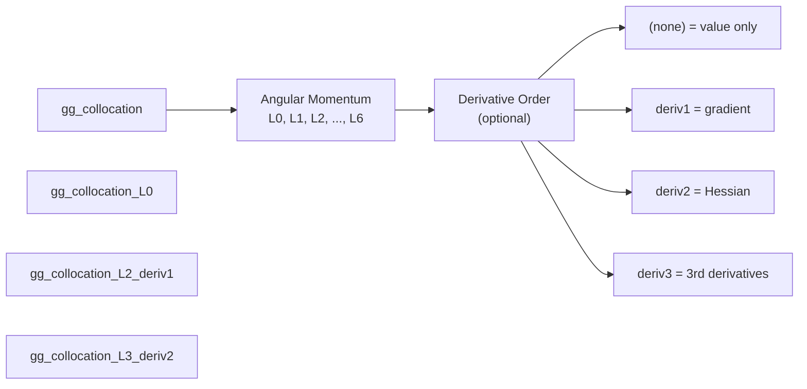
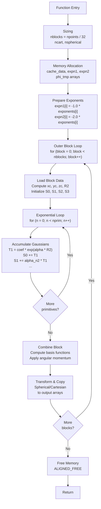
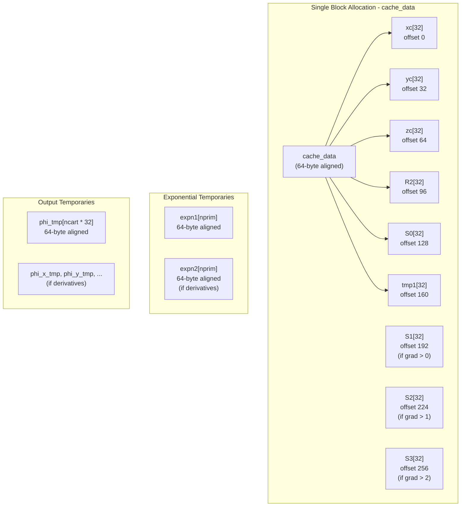
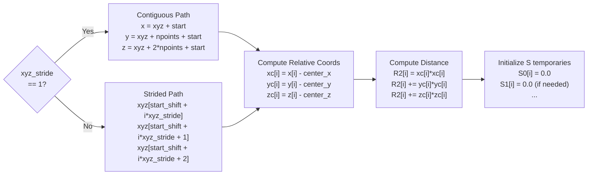
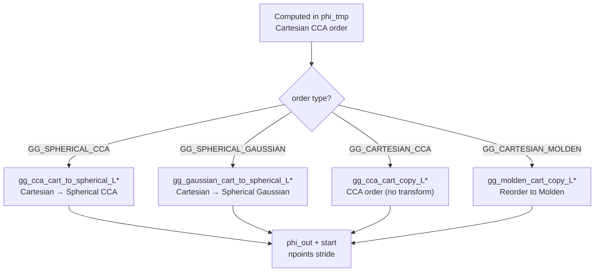

<!-- source: DeepWiki mcp.deepwiki.com · repo microsoft/skala · extra page Generated Kernel Structure · fetched 2026-10-26 -->

# Generated Kernel Structure

<details>
<summary>Relevant source files</summary>

The following files were used as context for generating this wiki page:

- [third_party/gauxc/external/gau2grid/generated_source/gau2grid/gau2grid_pragma.h](third_party/gauxc/external/gau2grid/generated_source/gau2grid/gau2grid_pragma.h)
- [third_party/gauxc/external/gau2grid/generated_source/gau2grid_deriv1.c](third_party/gauxc/external/gau2grid/generated_source/gau2grid_deriv1.c)
- [third_party/gauxc/external/gau2grid/generated_source/gau2grid_deriv2.c](third_party/gauxc/external/gau2grid/generated_source/gau2grid_deriv2.c)
- [third_party/gauxc/external/gau2grid/generated_source/gau2grid_deriv3.c](third_party/gauxc/external/gau2grid/generated_source/gau2grid_deriv3.c)
- [third_party/gauxc/external/gau2grid/generated_source/gau2grid_phi.c](third_party/gauxc/external/gau2grid/generated_source/gau2grid_phi.c)
- [third_party/gauxc/external/gau2grid/src/gau2grid/c_generator.py](third_party/gauxc/external/gau2grid/src/gau2grid/c_generator.py)
- [third_party/gauxc/external/gau2grid/src/gau2grid/c_pragma.py](third_party/gauxc/external/gau2grid/src/gau2grid/c_pragma.py)

</details>


This page documents the structure and organization of the C functions generated by the Gau2Grid code generation pipeline. These functions, with names like `gg_collocation_L0`, `gg_collocation_L1_deriv2`, etc., perform basis function collocation on grids of integration points. For information about the Python code that generates these functions, see [Code Generation Pipeline](#6.1.1). For information about compiler pragma abstraction, see [Compiler Pragma System](#6.1.3).

## Function Naming Convention and Specialization

The generated functions follow a systematic naming convention that encodes their specialization:



Each function is specialized at compile time for:
- **Angular momentum (L)**: Determines the number of Cartesian components ((L+1)(L+2)/2) and spherical components (2L+1)
- **Derivative order**: Controls which S temporaries (S0, S1, S2, S3) are computed and which output arrays are populated
- **Inner block size**: Fixed at 32 doubles for cache optimization

**Sources:** [third_party/gauxc/external/gau2grid/src/gau2grid/c_generator.py:317-340]()

## Function Signature Structure

All generated functions share a common signature pattern:

| Parameter | Type | Description |
|-----------|------|-------------|
| `npoints` | `unsigned long` | Total number of grid points |
| `xyz` | `const double*` | Grid point coordinates |
| `xyz_stride` | `unsigned long` | Stride between coordinates (1 for contiguous) |
| `nprim` | `int` | Number of primitive Gaussians |
| `coeffs` | `const double*` | Contraction coefficients |
| `exponents` | `const double*` | Gaussian exponents |
| `center` | `const double*` | Basis function center (3 doubles) |
| `order` | `int` | Output ordering (spherical CCA/Gaussian, Cartesian CCA/Molden) |
| `phi_out` | `double*` | Output array for basis function values |
| `phi_{x,y,z}_out` | `double*` | (Derivative functions only) Gradient outputs |
| `phi_{xx,xy,...}_out` | `double*` | (Hessian functions only) Second derivative outputs |
| `phi_{xxx,xxy,...}_out` | `double*` | (Third derivative functions only) Third derivative outputs |

The `PRAGMA_RESTRICT` macro expands to compiler-specific restrict keywords to enable aliasing optimizations.

**Sources:** [third_party/gauxc/external/gau2grid/generated_source/gau2grid_phi.c:25](), [third_party/gauxc/external/gau2grid/src/gau2grid/c_generator.py:389-403]()

## Block-Based Processing Loop

The generated kernels use a three-level nested loop structure optimized for cache locality:



**Sources:** [third_party/gauxc/external/gau2grid/generated_source/gau2grid_phi.c:73-138](), [third_party/gauxc/external/gau2grid/src/gau2grid/c_generator.py:506-764]()

### Block Size and Remain Calculation

Each block processes up to 32 points with special handling for the final partial block:

```c
// From generated code
const unsigned long start = block * 32;
const unsigned long remain = ((start + 32) > npoints) ? (npoints - start) : 32;
```

The `remain` variable ensures the final iteration only processes the actual remaining points, avoiding out-of-bounds access.

**Sources:** [third_party/gauxc/external/gau2grid/generated_source/gau2grid_phi.c:78-79]()

## Memory Allocation Strategy

The generated code employs a cache-optimized memory allocation strategy using aligned memory:



This single-block allocation strategy keeps all S temporaries (`xc`, `yc`, `zc`, `R2`, `S0`, `S1`, `S2`, `S3`) contiguous in memory to maximize cache line utilization.

**Sources:** [third_party/gauxc/external/gau2grid/generated_source/gau2grid_phi.c:41-60](), [third_party/gauxc/external/gau2grid/src/gau2grid/c_generator.py:426-481]()

### Alignment Requirements

All arrays are aligned to 64-byte boundaries (cache line size) using the `ALIGNED_MALLOC` macro:

```c
double* PRAGMA_RESTRICT cache_data = (double*)ALIGNED_MALLOC(64, 192 * sizeof(double));
ASSUME_ALIGNED(xc, 64);
```

The `ASSUME_ALIGNED` macro provides alignment hints to the compiler for vectorization optimization.

**Sources:** [third_party/gauxc/external/gau2grid/generated_source/gau2grid/gau2grid_pragma.h:19-31]()

## Computational Phases

The computation within each block proceeds through distinct phases:

### Phase 1: Data Loading and Distance Computation

Two code paths handle contiguous vs. strided xyz data:



Both paths are annotated with `PRAGMA_VECTORIZE` to encourage compiler vectorization.

**Sources:** [third_party/gauxc/external/gau2grid/generated_source/gau2grid_phi.c:82-117]()

### Phase 2: Gaussian Exponential Accumulation

The inner primitive loop accumulates Gaussian contributions:

```c
// For L0, no derivatives
for (unsigned long n = 0; n < nprim; n++) {
    const double coef = coeffs[n];
    const double alpha_n1 = expn1[n];
    
    PRAGMA_VECTORIZE
    for (unsigned long i = 0; i < remain; i++) {
        const double width = alpha_n1 * R2[i];
        const double T1 = coef * exp(width);
        S0[i] += T1;
    }
}

// With first derivatives
// ... T1 computed as above ...
const double T2 = alpha_n2 * T1;
S1[i] += T2;

// With second derivatives
// ... T2 computed as above ...
const double T3 = alpha_n2 * T2;
S2[i] += T3;

// With third derivatives
// ... T3 computed as above ...
const double T4 = alpha_n2 * T3;
S3[i] += T4;
```

The S temporaries represent successive derivatives of the Gaussian:
- `S0[i]` = Σ c_n exp(-α_n R²)
- `S1[i]` = Σ c_n (-2α_n) exp(-α_n R²)
- `S2[i]` = Σ c_n (-2α_n)² exp(-α_n R²)
- `S3[i]` = Σ c_n (-2α_n)³ exp(-α_n R²)

**Sources:** [third_party/gauxc/external/gau2grid/generated_source/gau2grid_phi.c:119-131](), [third_party/gauxc/external/gau2grid/generated_source/gau2grid_deriv1.c:132-147]()

### Phase 3: Basis Function Evaluation

The "Combine blocks" section computes the actual basis functions from S temporaries and coordinate powers. This phase is highly specialized by angular momentum and derivative order.

For L0 (s-functions), no angular dependence exists:
```c
phi_out[start + i] = S0[i];
```

For L1 (p-functions), linear combinations are computed:
```c
// Density (basis value)
phi_tmp[i] = S0[i] * xc[i];      // Component X
phi_tmp[32 + i] = S0[i] * yc[i];  // Component Y
phi_tmp[64 + i] = S0[i] * zc[i];  // Component Z

// Gradient
const double SX = S1[i] * xc[i];
const double SY = S1[i] * yc[i];
const double SZ = S1[i] * zc[i];

phi_x_tmp[i] = SX * xc[i];
phi_x_tmp[i] += S0[i];  // Derivative adds constant term
```

For higher L values, the code computes polynomial combinations and their derivatives.

**Sources:** [third_party/gauxc/external/gau2grid/generated_source/gau2grid_phi.c:257-270](), [third_party/gauxc/external/gau2grid/generated_source/gau2grid_deriv1.c:302-337]()

## Coordinate Transformations

The final step transforms the computed Cartesian basis functions to the requested output ordering:



These transformation functions are also generated by the code generator and handle:
- Converting Cartesian (XX, XY, XZ, YY, YZ, ZZ) to spherical harmonics (m = -l...+l)
- Reordering Cartesian components to different conventions (CCA vs. Molden)
- Transposing from block-contiguous layout (32 points × n_components) to point-strided layout (n_points × 1 component)

**Sources:** [third_party/gauxc/external/gau2grid/generated_source/gau2grid_phi.c:273-285](), [third_party/gauxc/external/gau2grid/src/gau2grid/c_generator.py:165-191]()

## SIMD Vectorization Patterns

The generated code employs several patterns to enable compiler vectorization:

### Vectorization Pragmas

Every computationally intensive loop is annotated:
```c
PRAGMA_VECTORIZE
for (unsigned long i = 0; i < remain; i++) {
    // Compute-intensive operations
}
```

The `PRAGMA_VECTORIZE` macro expands to compiler-specific directives:
- Intel: `_Pragma("vector")`
- Clang: `_Pragma("clang loop vectorize(enable)")`
- GCC: `_Pragma("GCC ivdep")`
- MSVC: `__pragma(loop(ivdep))`

**Sources:** [third_party/gauxc/external/gau2grid/generated_source/gau2grid/gau2grid_pragma.h:23-85]()

### Loop Structure for Vectorization

Loops are structured to maximize vectorization efficiency:

1. **Aligned memory access**: All arrays 64-byte aligned
2. **Contiguous memory**: Single block allocation keeps related data together
3. **No loop-carried dependencies**: Each iteration independent
4. **Fixed or runtime-bounded trip count**: `remain` calculated once
5. **Restrict pointers**: All pointers marked with `PRAGMA_RESTRICT` to guarantee no aliasing

### Common Subexpression Elimination

The generator performs algebraic simplifications during code generation to reduce arithmetic operations. For example, terms like `A = 1` are eliminated, and common subexpressions are computed once and reused.

**Sources:** [third_party/gauxc/external/gau2grid/src/gau2grid/c_generator.py:781-832]()

## Memory Deallocation

All allocated memory is freed in reverse order of allocation:

```c
// Free S temporaries
ALIGNED_FREE(cache_data);
ALIGNED_FREE(expn1);
ALIGNED_FREE(expn2);

// Free inner temporaries
ALIGNED_FREE(phi_tmp);
ALIGNED_FREE(phi_x_tmp);
// ... etc
```

The `ALIGNED_FREE` macro expands to the appropriate platform-specific deallocation function (`_mm_free`, `_aligned_free`, or `free`).

**Sources:** [third_party/gauxc/external/gau2grid/generated_source/gau2grid_phi.c:140-145](), [third_party/gauxc/external/gau2grid/generated_source/gau2grid/gau2grid_pragma.h:19-99]()

## Derivative Computation Pattern

Functions computing derivatives follow a systematic pattern for combining S temporaries:

| Quantity | Formula | S Temporaries Used |
|----------|---------|-------------------|
| Basis value φ | S₀ × r^n | S₀ |
| ∂φ/∂x | S₁·xc × r^n + S₀ × ∂r^n/∂x | S₀, S₁ |
| ∂²φ/∂x² | S₂·xc² × r^n + 2S₁·xc × ∂r^n/∂x + S₀ × ∂²r^n/∂x² | S₀, S₁, S₂ |
| ∂³φ/∂x³ | S₃·xc³ × r^n + 3S₂·xc² × ∂r^n/∂x + ... | S₀, S₁, S₂, S₃ |

For example, the gradient components for L=1, component X:
```c
// Gradient AM=1 Component=X
phi_x_tmp[i] = SX * xc[i];
phi_y_tmp[i] = SY * xc[i];
phi_z_tmp[i] = SZ * xc[i];
phi_x_tmp[i] += S0[i];  // ∂/∂x of (xc) contributes S0
```

**Sources:** [third_party/gauxc/external/gau2grid/generated_source/gau2grid_deriv1.c:302-337](), [third_party/gauxc/external/gau2grid/generated_source/gau2grid_deriv2.c:362-441]()

---

