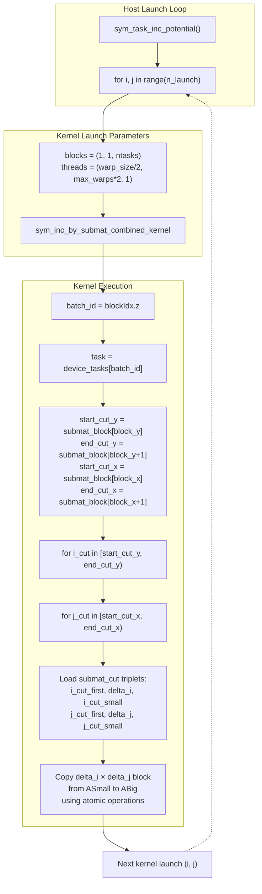
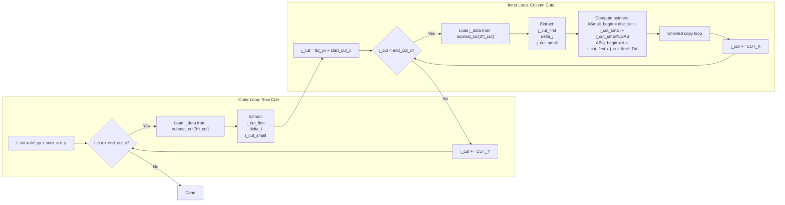
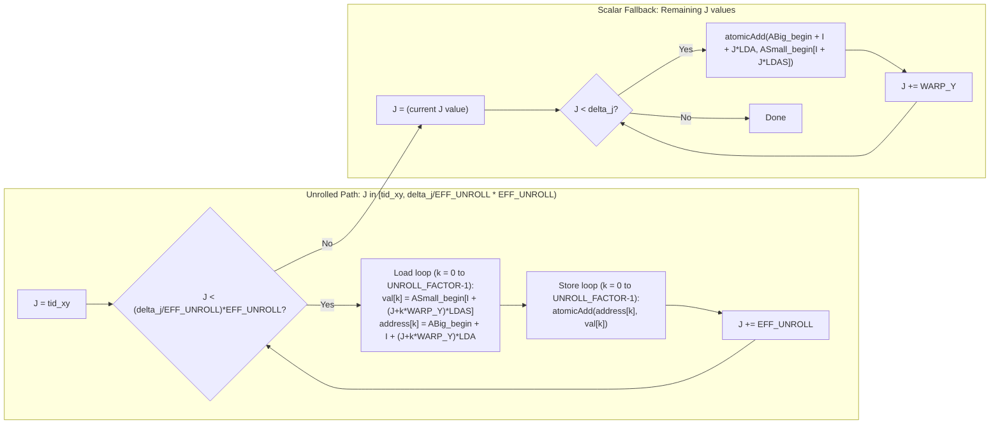

<!-- source: DeepWiki mcp.deepwiki.com · repo microsoft/skala · extra page Increment Potential Operations · fetched 2026-10-26 -->

# Increment Potential Operations

<details>
<summary>Relevant source files</summary>

The following files were used as context for generating this wiki page:

- [third_party/gauxc/attic/src/integrator/cuda/cuda_pack_density.cu](third_party/gauxc/attic/src/integrator/cuda/cuda_pack_density.cu)
- [third_party/gauxc/attic/src/new_integrator/device/cuda/cuda_inc_potential.cu](third_party/gauxc/attic/src/new_integrator/device/cuda/cuda_inc_potential.cu)
- [third_party/gauxc/attic/src/new_integrator/device/cuda/cuda_pack_density.cu](third_party/gauxc/attic/src/new_integrator/device/cuda/cuda_pack_density.cu)
- [third_party/gauxc/attic/src/new_integrator/device/hip/hip_inc_potential.hip](third_party/gauxc/attic/src/new_integrator/device/hip/hip_inc_potential.hip)
- [third_party/gauxc/attic/src/new_integrator/device/hip/hip_pack_density.hip](third_party/gauxc/attic/src/new_integrator/device/hip/hip_pack_density.hip)
- [third_party/gauxc/src/xc_integrator/local_work_driver/device/cuda/kernels/cuda_inc_potential.cu](third_party/gauxc/src/xc_integrator/local_work_driver/device/cuda/kernels/cuda_inc_potential.cu)
- [third_party/gauxc/src/xc_integrator/local_work_driver/device/cuda/kernels/pack_submat.cu](third_party/gauxc/src/xc_integrator/local_work_driver/device/cuda/kernels/pack_submat.cu)
- [third_party/gauxc/src/xc_integrator/local_work_driver/device/hip/kernels/hip_inc_potential.hip](third_party/gauxc/src/xc_integrator/local_work_driver/device/hip/kernels/hip_inc_potential.hip)
- [third_party/gauxc/src/xc_integrator/local_work_driver/device/hip/kernels/pack_submat.hip](third_party/gauxc/src/xc_integrator/local_work_driver/device/hip/kernels/pack_submat.hip)

</details>


## Purpose and Scope

This document describes the GPU kernels and host-side API functions that perform increment potential operations on device-resident matrices. Increment operations transfer computed XC potential contributions from task-local scratch matrices back to the full potential matrix V using atomic accumulation. This is the inverse operation to the pack density operations documented in [Pack Density Operations](#7.3.1).

For details on submatrix screening and the `submat_cut` data structure, see [Submatrix Screening and Cuts](#7.3.3).

## Overview

Increment potential operations accumulate task-computed potential matrix blocks from device scratch memory (`nbe_scr`) into the full potential matrix V on the device. After collocation, density evaluation, and XC functional evaluation have computed contributions to the potential matrix in a compressed submatrix format, these contributions must be added back to the full matrix. Because multiple tasks may write to overlapping regions of V simultaneously, atomic operations are required to ensure correctness.

The increment operation performs:
```
V[i_cut_first + I, j_cut_first + J] += V_scratch[i_cut_small + I, j_cut_small + J]
```

where the mapping from scratch to full matrix indices is determined by the `submat_cut` screening data structure.

**Sources:** [third_party/gauxc/src/xc_integrator/local_work_driver/device/cuda/kernels/cuda_inc_potential.cu:1-223]()

## Kernel Variants

GauXC provides two primary kernel variants for increment operations, differing in their handling of row and column screening:

| Variant | Kernel Name | Row Screening | Column Screening | Use Case |
|---------|-------------|---------------|------------------|----------|
| Symmetric | `sym_inc_by_submat_combined_kernel` | `bfn_screening.submat_cut` | `bfn_screening.submat_cut` | Standard XC potential (symmetric matrix) |
| Asymmetric | `asym_inc_by_submat_combined_kernel` | `bfn_screening.submat_cut` | `cou_screening.submat_cut` | EXX or other asymmetric potentials |

The symmetric variant assumes the same basis function screening applies to both rows and columns, while the asymmetric variant allows independent screening for rows (bfn_screening) and columns (cou_screening).

**Sources:** [third_party/gauxc/src/xc_integrator/local_work_driver/device/cuda/kernels/cuda_inc_potential.cu:25-95](), [third_party/gauxc/src/xc_integrator/local_work_driver/device/cuda/kernels/cuda_inc_potential.cu:123-196]()

## Algorithm Structure

### Block-Tiled Execution Pattern



The host launches multiple kernel invocations in a nested loop over `(block_y, block_x)` pairs, where each pair processes a tile of the full matrix. The `submat_block_size` parameter (typically derived from `get_submat_cut_block()`) determines the tile size. Within each kernel, threads iterate over cuts within their assigned tile.

**Sources:** [third_party/gauxc/src/xc_integrator/local_work_driver/device/cuda/kernels/cuda_inc_potential.cu:97-117](), [third_party/gauxc/src/xc_integrator/local_work_driver/device/cuda/kernels/cuda_inc_potential.cu:48-94]()

### Submatrix Iteration



Each thread processes a subset of cuts determined by its thread ID modulo the cut stride (`CUT_X` = 8, `CUT_Y` = 8). The `submat_cut` array stores consecutive triplets of integers for each cut, loaded as `int3` for efficiency.

**Sources:** [third_party/gauxc/src/xc_integrator/local_work_driver/device/cuda/kernels/cuda_inc_potential.cu:53-94]()

## Thread Organization

### 2D Thread Grid Configuration

The kernel uses a 2D thread block organization optimized for matrix operations:

```
Compile-time constants:
  WARP_X = 16      // Threads per warp in x-dimension
  WARP_Y = 1       // Threads per warp in y-dimension
  CUT_X = 8        // Cut stride in x-dimension
  CUT_Y = 8        // Cut stride in y-dimension
  UNROLL_FACTOR = 4

Thread block dimensions:
  threads.x = warp_size / 2 = 16
  threads.y = max_warps_per_thread_block * 2
  threads.z = 1

Block dimensions:
  blocks.x = 1
  blocks.y = 1
  blocks.z = ntasks
```

**Thread ID Mapping:**

Within each thread block, thread indices are decomposed into hierarchical coordinates:

```
tid_xx = threadIdx.x % WARP_X     // Position within warp (x)
tid_xy = threadIdx.x / WARP_X     // Warp ID (x)

tid_yx = threadIdx.y % CUT_X      // Position within cut tile (x)
tid_yy = threadIdx.y / CUT_X      // Cut tile ID (y)
```

This 4-level hierarchy allows threads to:
1. Select which cut to process (via `tid_yy` and `tid_yx`)
2. Select which column block to process (via `tid_xy`)
3. Select which element within the block to process (via `tid_xx`)

**Sources:** [third_party/gauxc/src/xc_integrator/local_work_driver/device/cuda/kernels/cuda_inc_potential.cu:14-23](), [third_party/gauxc/src/xc_integrator/local_work_driver/device/cuda/kernels/cuda_inc_potential.cu:42-51](), [third_party/gauxc/src/xc_integrator/local_work_driver/device/cuda/kernels/cuda_inc_potential.cu:106-107]()

### Thread-to-Element Mapping

```mermaid
graph TB
    subgraph "Cut Selection (tid_yy, tid_yx)"
        CUTS["CUT_Y × CUT_X grid of cuts<br/>Each thread handles cuts at<br/>(tid_yy + k*CUT_Y, tid_yx + m*CUT_X)"]
    end
    
    subgraph "Within Each Cut: Column Selection (tid_xy)"
        COLS["Column groups processed in steps of EFF_UNROLL<br/>J = tid_xy, tid_xy + EFF_UNROLL, ..."]
    end
    
    subgraph "Within Each Column Group: Element Selection (tid_xx)"
        ELEM["Elements I = tid_xx, tid_xx + WARP_X, ...]
    end
    
    CUTS --> COLS
    COLS --> ELEM
    
    ELEM --> ATOMIC["atomicAdd(ABig_begin + I + J*LDA, val)"]
```

**Sources:** [third_party/gauxc/src/xc_integrator/local_work_driver/device/cuda/kernels/cuda_inc_potential.cu:68-90]()

## Atomic Accumulation

### Why Atomic Operations Are Required

Unlike pack operations which read from the large matrix, increment operations write to it. Since multiple tasks may have overlapping basis function support, multiple threads across different tasks (different values of `blockIdx.z`) may attempt to write to the same matrix element simultaneously. Atomic operations prevent data races and ensure all contributions are correctly accumulated.

The increment kernel uses `atomicAdd()` exclusively:

```cuda
atomicAdd(address[k], val[k]);  // Unrolled path
atomicAdd(ABig_begin + I + J*LDA, ASmall_begin[I + J*LDAS]);  // Scalar fallback
```

**Performance Implications:**

Atomic operations introduce serialization when multiple threads access the same memory location. To minimize contention:
- Block-tiled execution reduces spatial overlap between tasks
- Submatrix screening ensures tasks only write to relevant regions
- Unrolling processes multiple elements per thread, increasing arithmetic intensity relative to atomic overhead

**Sources:** [third_party/gauxc/src/xc_integrator/local_work_driver/device/cuda/kernels/cuda_inc_potential.cu:79-89]()

## Loop Unrolling Strategy

### Unrolled Copy Loop

The innermost copy loop is explicitly unrolled to process `UNROLL_FACTOR` = 4 elements per iteration:



The unrolled path:
1. Loads `UNROLL_FACTOR` values from the small matrix into registers (`val[0..3]`)
2. Computes `UNROLL_FACTOR` destination addresses (`address[0..3]`)
3. Issues `UNROLL_FACTOR` atomic add operations

This organization:
- Increases instruction-level parallelism
- Amortizes loop overhead across multiple elements
- Allows the compiler to optimize memory access patterns

The scalar fallback handles remaining columns when `delta_j` is not divisible by `EFF_UNROLL`.

**Sources:** [third_party/gauxc/src/xc_integrator/local_work_driver/device/cuda/kernels/cuda_inc_potential.cu:68-90]()

## API Functions

### Symmetric Increment: `sym_task_inc_potential`

```cpp
void sym_task_inc_potential( size_t        ntasks,
                              XCDeviceTask* device_tasks,
                              double*       V_device,
                              size_t        LDV,
                              size_t        submat_block_size,
                              device_queue  queue );
```

**Parameters:**
- `ntasks`: Number of device tasks to process
- `device_tasks`: Array of `XCDeviceTask` structures on device
- `V_device`: Potential matrix on device (LDV × LDV)
- `LDV`: Leading dimension of V_device
- `submat_block_size`: Tile size for block-level parallelism
- `queue`: Device queue (CUDA stream or HIP stream)

**Behavior:**
- Launches `n_launch²` kernel invocations, where `n_launch = div_ceil(LDV, submat_block_size)`
- Each kernel processes a tile `(block_y, block_x)` of the full matrix
- Uses `bfn_screening.submat_cut` for both row and column indexing
- Accumulates `task.nbe_scr` into `V_device` using atomic operations

**Sources:** [third_party/gauxc/src/xc_integrator/local_work_driver/device/cuda/kernels/cuda_inc_potential.cu:97-117]()

### Asymmetric Increment: `asym_task_inc_potential`

```cpp
void asym_task_inc_potential( size_t        ntasks,
                               XCDeviceTask* device_tasks,
                               double*       V_device,
                               size_t        LDV,
                               size_t        submat_block_size,
                               device_queue  queue );
```

**Parameters:** Identical to `sym_task_inc_potential`

**Behavior:**
- Identical launch pattern to symmetric variant
- Uses `bfn_screening.submat_cut` for row indexing
- Uses `cou_screening.submat_cut` for column indexing
- Supports asymmetric potential matrices (e.g., EXX K-matrix contributions)

**Sources:** [third_party/gauxc/src/xc_integrator/local_work_driver/device/cuda/kernels/cuda_inc_potential.cu:198-218]()

## Relationship to Pack Operations

Increment and pack operations are complementary matrix transformations in the GauXC pipeline:

```mermaid
graph LR
    subgraph "Pack Operation (7.3.1)"
        P_LARGE["Full Density Matrix P<br/>LDA × LDA"]
        P_LARGE -->|"Read (no atomics)"| P_PACK["sym_pack_submat"]
        P_PACK --> P_SMALL["Scratch Matrix P_scr<br/>LDAS × LDAS<br/>(task.nbe_scr)"]
    end
    
    subgraph "Computation"
        P_SMALL --> COLLOC["Collocation Kernels"]
        COLLOC --> DENSITY["Density Evaluation"]
        DENSITY --> XC["XC Functional Evaluation"]
        XC --> V_SMALL["Scratch Matrix V_scr<br/>LDAS × LDAS<br/>(task.nbe_scr)"]
    end
    
    subgraph "Increment Operation (7.3.2)"
        V_SMALL --> V_INC["sym_task_inc_potential"]
        V_INC -->|"Write (atomics)"| V_LARGE["Full Potential Matrix V<br/>LDA × LDA"]
    end
```



**Key Differences:**

| Aspect | Pack (7.3.1) | Increment (7.3.2) |
|--------|--------------|-------------------|
| Direction | Large → Small | Small → Large |
| Operation | Read (load) | Write (store) |
| Atomics | Not required | Required (`atomicAdd`) |
| Matrix | Density P | Potential V |
| Pipeline Stage | Before computation | After computation |
| Cache Hint | Evict-first (`__stcs`) in CUDA ≥11.0 | None |

**Submatrix Reuse:**

Both operations use the same `submat_cut` and `submat_block` screening structures generated during task setup, ensuring consistent indexing between pack and increment operations for each task.

**Sources:** [third_party/gauxc/src/xc_integrator/local_work_driver/device/cuda/kernels/cuda_inc_potential.cu:1-223](), [third_party/gauxc/src/xc_integrator/local_work_driver/device/cuda/kernels/pack_submat.cu:1-243]()

## Platform Support

### CUDA Implementation

**File:** [third_party/gauxc/src/xc_integrator/local_work_driver/device/cuda/kernels/cuda_inc_potential.cu]()

**Features:**
- Uses CUDA-specific launch syntax: `kernel<<<blocks, threads, 0, stream>>>(args)`
- Stream type: `cudaStream_t` (extracted via `queue.queue_as<util::cuda_stream>()`)
- Supports both symmetric and asymmetric variants
- Uses `atomicAdd()` for double precision

**Launch Bounds:**
```cuda
__global__ __launch_bounds__(1024, 1)
```
Specifies maximum 1024 threads per block, minimum 1 block per SM for occupancy hints.

**Sources:** [third_party/gauxc/src/xc_integrator/local_work_driver/device/cuda/kernels/cuda_inc_potential.cu:1-223]()

### HIP Implementation

**File:** [third_party/gauxc/src/xc_integrator/local_work_driver/device/hip/kernels/hip_inc_potential.hip]()

**Features:**
- Uses HIP-specific launch syntax: `hipLaunchKernelGGL(kernel, blocks, threads, 0, stream, args)`
- Stream type: `hipStream_t` (extracted via `queue.queue_as<util::hip_stream>()`)
- Currently provides only symmetric variant (`sym_task_inc_potential`)
- Simpler implementation without unrolling optimizations

**Key Difference:**
The HIP implementation uses a simpler nested loop structure without the unrolling optimizations present in the CUDA version:

```cpp
for( size_t J = tid_y; J < delta_j; J += blockDim.y )      
for( size_t I = tid_x; I < delta_i; I += blockDim.x )
  atomicAdd( ABig_begin + I + J*LDA, ASmall_begin[I+J*LDAS] );
```

This suggests the HIP version may target AMD GPUs where different optimization strategies are beneficial, or represents an earlier implementation stage.

**Sources:** [third_party/gauxc/src/xc_integrator/local_work_driver/device/hip/kernels/hip_inc_potential.hip:1-85]()

### Platform Abstraction

Both implementations are accessed through the `device_queue` abstraction, which wraps platform-specific stream types. The calling code in `LocalWorkDriver` implementations selects the appropriate variant based on compile-time flags (`GAUXC_HAS_CUDA`, `GAUXC_HAS_HIP`).

**Sources:** [third_party/gauxc/src/xc_integrator/local_work_driver/device/cuda/kernels/cuda_inc_potential.cu:104](), [third_party/gauxc/src/xc_integrator/local_work_driver/device/hip/kernels/hip_inc_potential.hip:73]()

---

