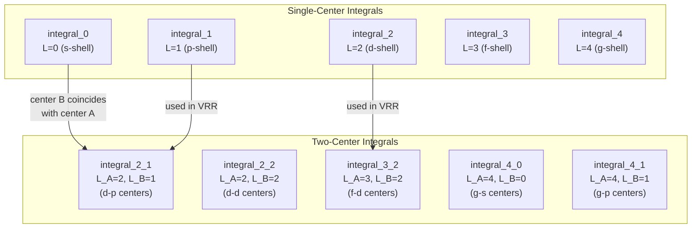
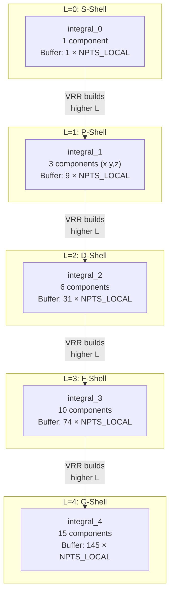
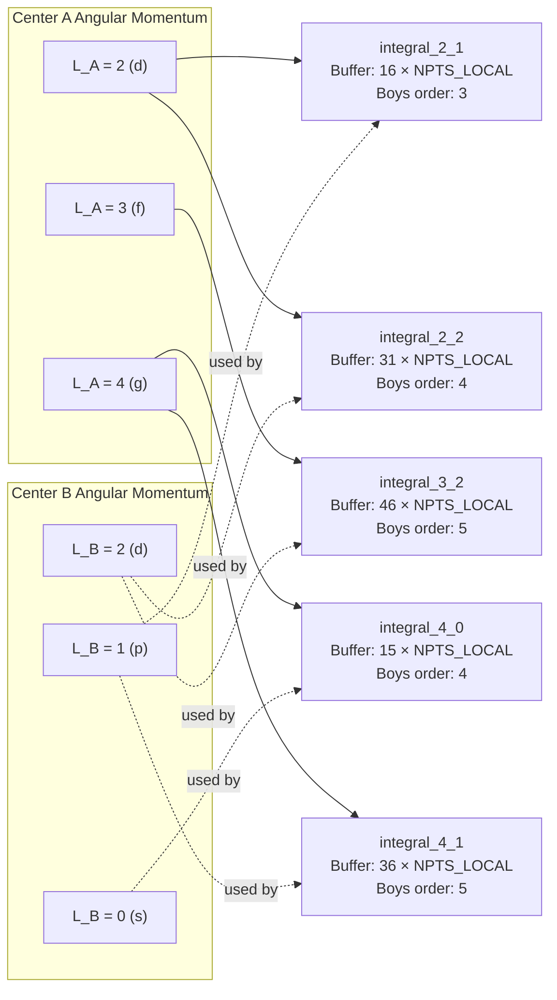
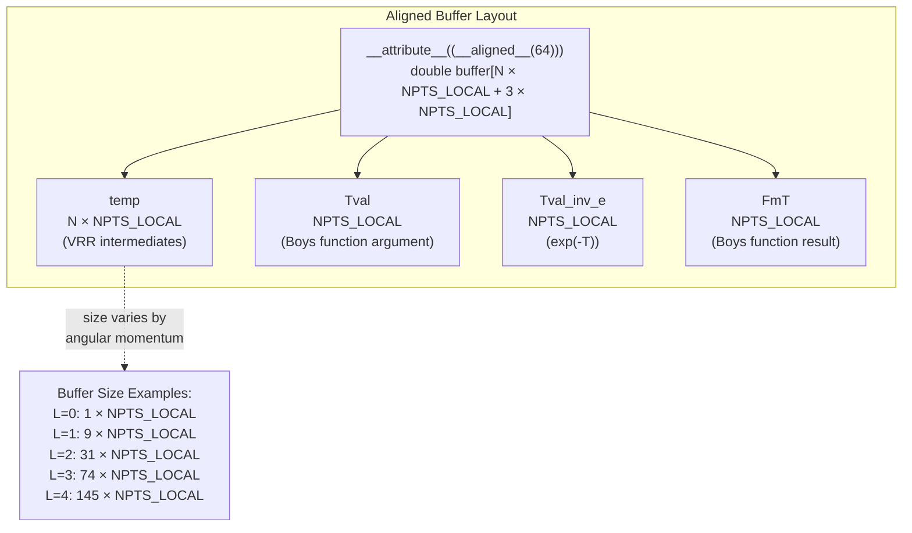
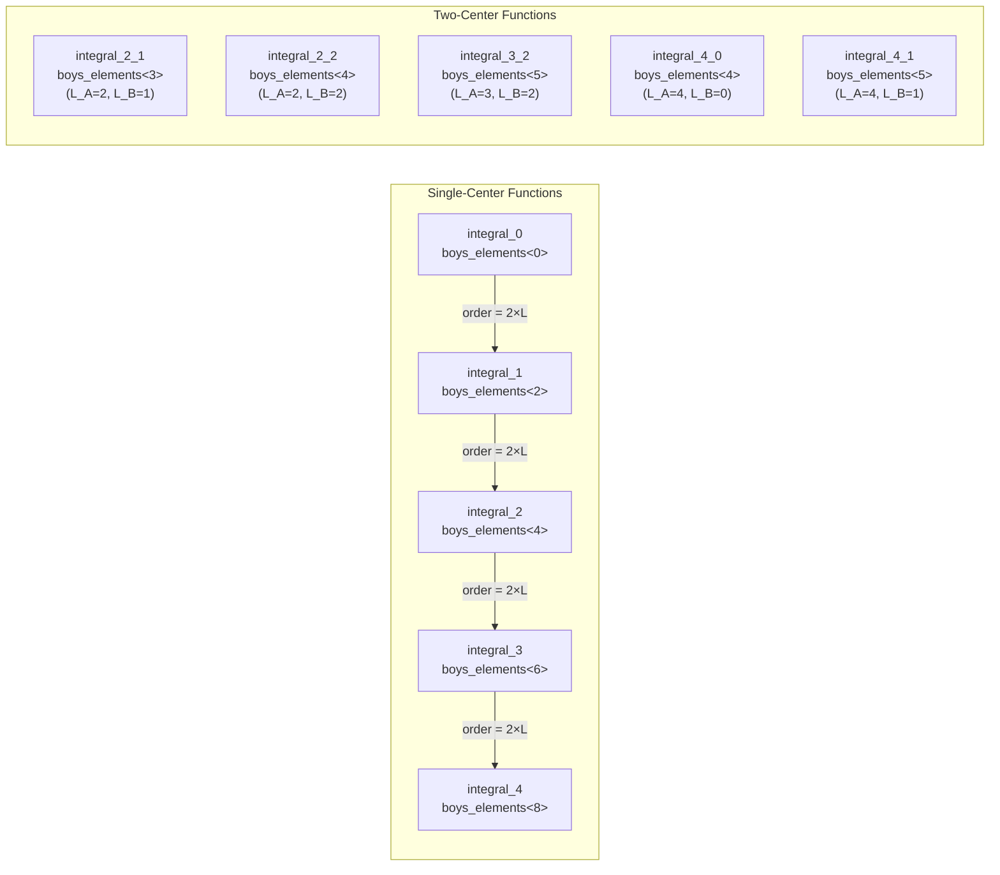
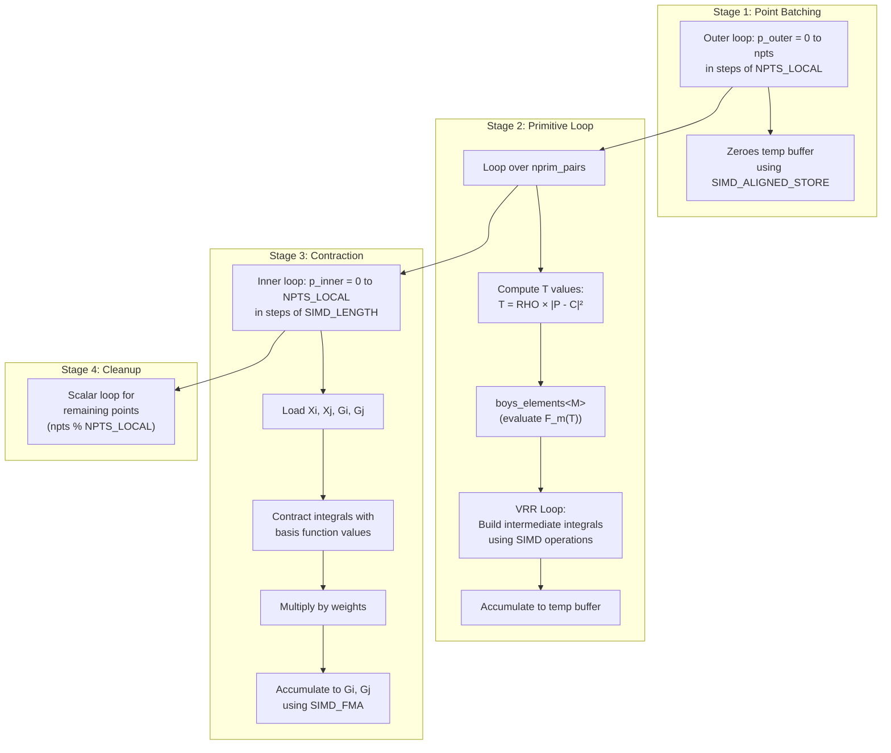

<!-- source: DeepWiki mcp.deepwiki.com · repo microsoft/skala · extra page Integral Function Hierarchy · fetched 2026-10-26 -->

# Integral Function Hierarchy

<details>
<summary>Relevant source files</summary>

The following files were used as context for generating this wiki page:

- [third_party/gauxc/src/xc_integrator/local_work_driver/host/obara_saika/src/integral_0.cxx](third_party/gauxc/src/xc_integrator/local_work_driver/host/obara_saika/src/integral_0.cxx)
- [third_party/gauxc/src/xc_integrator/local_work_driver/host/obara_saika/src/integral_1.cxx](third_party/gauxc/src/xc_integrator/local_work_driver/host/obara_saika/src/integral_1.cxx)
- [third_party/gauxc/src/xc_integrator/local_work_driver/host/obara_saika/src/integral_2.cxx](third_party/gauxc/src/xc_integrator/local_work_driver/host/obara_saika/src/integral_2.cxx)
- [third_party/gauxc/src/xc_integrator/local_work_driver/host/obara_saika/src/integral_2_1.cxx](third_party/gauxc/src/xc_integrator/local_work_driver/host/obara_saika/src/integral_2_1.cxx)
- [third_party/gauxc/src/xc_integrator/local_work_driver/host/obara_saika/src/integral_2_2.cxx](third_party/gauxc/src/xc_integrator/local_work_driver/host/obara_saika/src/integral_2_2.cxx)
- [third_party/gauxc/src/xc_integrator/local_work_driver/host/obara_saika/src/integral_3.cxx](third_party/gauxc/src/xc_integrator/local_work_driver/host/obara_saika/src/integral_3.cxx)
- [third_party/gauxc/src/xc_integrator/local_work_driver/host/obara_saika/src/integral_3_2.cxx](third_party/gauxc/src/xc_integrator/local_work_driver/host/obara_saika/src/integral_3_2.cxx)
- [third_party/gauxc/src/xc_integrator/local_work_driver/host/obara_saika/src/integral_4.cxx](third_party/gauxc/src/xc_integrator/local_work_driver/host/obara_saika/src/integral_4.cxx)
- [third_party/gauxc/src/xc_integrator/local_work_driver/host/obara_saika/src/integral_4_0.cxx](third_party/gauxc/src/xc_integrator/local_work_driver/host/obara_saika/src/integral_4_0.cxx)
- [third_party/gauxc/src/xc_integrator/local_work_driver/host/obara_saika/src/integral_4_1.cxx](third_party/gauxc/src/xc_integrator/local_work_driver/host/obara_saika/src/integral_4_1.cxx)
- [third_party/gauxc/src/xc_integrator/local_work_driver/host/obara_saika/src/integral_4_3.cxx](third_party/gauxc/src/xc_integrator/local_work_driver/host/obara_saika/src/integral_4_3.cxx)

</details>


## Purpose and Scope

This document describes the hierarchical organization of Obara-Saika integral evaluation functions in the host CPU computation path. These functions compute Gaussian integrals for basis functions centered at one or two atomic centers, specialized by angular momentum quantum number. 

For information about the vertical recurrence relations and Boys function evaluation used within these functions, see [VRR Algorithm and Boys Functions](#6.2.2). For details on the SIMD vectorization techniques employed, see [SIMD Vectorization Strategy](#6.2.3). For the GPU collocation kernels, see [Collocation Kernels](#7.2).

---

## Function Naming Convention

The integral functions follow a systematic naming pattern based on angular momentum quantum numbers:



**Naming Pattern:**
- `integral_X`: Single-center integrals where both Gaussian primitives share the same center, with total angular momentum `X`
- `integral_X_Y`: Two-center integrals where center A has angular momentum `X` and center B has angular momentum `Y`

**Sources:** [third_party/gauxc/src/xc_integrator/local_work_driver/host/obara_saika/src/integral_0.cxx:17-17](), [third_party/gauxc/src/xc_integrator/local_work_driver/host/obara_saika/src/integral_2_1.cxx:17-17](), [third_party/gauxc/src/xc_integrator/local_work_driver/host/obara_saika/src/integral_4_1.cxx:17-17]()

---

## Angular Momentum Hierarchy

### Overview Table

| Function | Angular Momentum | Buffer Size | Boys Order | Cartesian Components |
|----------|-----------------|-------------|------------|---------------------|
| `integral_0` | L=0 (s) | 1 × NPTS_LOCAL | 0 | 1 |
| `integral_1` | L=1 (p) | 9 × NPTS_LOCAL | 2 | 3 |
| `integral_2` | L=2 (d) | 31 × NPTS_LOCAL | 4 | 6 |
| `integral_3` | L=3 (f) | 74 × NPTS_LOCAL | 6 | 10 |
| `integral_4` | L=4 (g) | 145 × NPTS_LOCAL | 8 | 15 |

**Sources:** [third_party/gauxc/src/xc_integrator/local_work_driver/host/obara_saika/src/integral_0.cxx:29-29](), [third_party/gauxc/src/xc_integrator/local_work_driver/host/obara_saika/src/integral_1.cxx:29-29](), [third_party/gauxc/src/xc_integrator/local_work_driver/host/obara_saika/src/integral_2.cxx:29-29](), [third_party/gauxc/src/xc_integrator/local_work_driver/host/obara_saika/src/integral_3.cxx:29-29](), [third_party/gauxc/src/xc_integrator/local_work_driver/host/obara_saika/src/integral_4.cxx:29-29]()

### Hierarchy Diagram



**Sources:** [third_party/gauxc/src/xc_integrator/local_work_driver/host/obara_saika/src/integral_0.cxx:70-70](), [third_party/gauxc/src/xc_integrator/local_work_driver/host/obara_saika/src/integral_1.cxx:75-75](), [third_party/gauxc/src/xc_integrator/local_work_driver/host/obara_saika/src/integral_2.cxx:75-75](), [third_party/gauxc/src/xc_integrator/local_work_driver/host/obara_saika/src/integral_3.cxx:75-75](), [third_party/gauxc/src/xc_integrator/local_work_driver/host/obara_saika/src/integral_4.cxx:75-75]()

---

## Two-Center Integral Specializations

### Two-Center Function Matrix



**Sources:** [third_party/gauxc/src/xc_integrator/local_work_driver/host/obara_saika/src/integral_2_1.cxx:31-31](), [third_party/gauxc/src/xc_integrator/local_work_driver/host/obara_saika/src/integral_2_2.cxx:31-31](), [third_party/gauxc/src/xc_integrator/local_work_driver/host/obara_saika/src/integral_3_2.cxx:31-31](), [third_party/gauxc/src/xc_integrator/local_work_driver/host/obara_saika/src/integral_4_0.cxx:31-31](), [third_party/gauxc/src/xc_integrator/local_work_driver/host/obara_saika/src/integral_4_1.cxx:31-31]()

### Center Configuration Detection

Two-center functions distinguish between single-center and two-center cases through their parameter handling:

**Single-Center Pattern** (e.g., `integral_3`):
- Parameter `rB` is commented out: `point /*rB*/`
- Uses constexpr zero displacements: `constexpr double X_PA = 0.0`
- Computes integrals where both Gaussians share center A

[third_party/gauxc/src/xc_integrator/local_work_driver/host/obara_saika/src/integral_3.cxx:19-20](), [third_party/gauxc/src/xc_integrator/local_work_driver/host/obara_saika/src/integral_3.cxx:51-53]()

**Two-Center Pattern** (e.g., `integral_2_1`):
- Uses both `rA` and `rB` parameters
- Computes displacement: `double X_AB = rA.x - rB.x`
- Retrieves `X_PA`, `Y_PA`, `Z_PA` from `prim_pairs` structure

[third_party/gauxc/src/xc_integrator/local_work_driver/host/obara_saika/src/integral_2_1.cxx:19-20](), [third_party/gauxc/src/xc_integrator/local_work_driver/host/obara_saika/src/integral_2_1.cxx:43-45](), [third_party/gauxc/src/xc_integrator/local_work_driver/host/obara_saika/src/integral_2_1.cxx:52-54]()

---

## Common Function Signature

All integral functions in the hierarchy share a consistent signature pattern:

```cpp
void integral_X[_Y](
    size_t npts,              // Number of integration points
    double *_points,          // Grid point coordinates [3 × npts]
    point rA,                 // Center A position
    point rB,                 // Center B position (or /*rB*/ if single-center)
    int nprim_pairs,          // Number of primitive pairs
    prim_pair *prim_pairs,    // Primitive pair data
    double *Xi,               // Basis values for center A
    double *Xj,               // Basis values for center B (two-center only)
    int ldX,                  // Leading dimension for X arrays
    double *Gi,               // Gradient accumulator for center A
    double *Gj,               // Gradient accumulator for center B (two-center only)
    int ldG,                  // Leading dimension for G arrays
    double *weights,          // Integration weights
    double *boys_table        // Precomputed Boys function table
)
```

**Parameter Variations:**

| Function Type | `rB` Parameter | `Xj` Parameter | `Gj` Parameter |
|--------------|----------------|----------------|----------------|
| Single-center (`integral_X`) | `/*rB*/` commented | Not present | Not present |
| Two-center (`integral_X_Y`) | Active | Present | Present |

**Sources:** [third_party/gauxc/src/xc_integrator/local_work_driver/host/obara_saika/src/integral_0.cxx:17-28](), [third_party/gauxc/src/xc_integrator/local_work_driver/host/obara_saika/src/integral_2_1.cxx:17-30]()

---

## Buffer Allocation Strategy

### Memory Layout

Each function allocates a single aligned buffer that is partitioned into multiple regions:



**Allocation Example** (from `integral_3`):
```cpp
__attribute__((__aligned__(64))) double buffer[74 * NPTS_LOCAL + 3 * NPTS_LOCAL];

double *temp       = (buffer + 0);
double *Tval       = (buffer + 74 * NPTS_LOCAL + 0 * NPTS_LOCAL);
double *Tval_inv_e = (buffer + 74 * NPTS_LOCAL + 1 * NPTS_LOCAL);
double *FmT        = (buffer + 74 * NPTS_LOCAL + 2 * NPTS_LOCAL);
```

**Sources:** [third_party/gauxc/src/xc_integrator/local_work_driver/host/obara_saika/src/integral_3.cxx:29-34]()

### Buffer Size Scaling

The `temp` buffer size grows with the number of intermediate VRR terms needed:

| Angular Momentum | Intermediate Terms | Buffer Multiplier |
|-----------------|-------------------|-------------------|
| L=0 | 1 (just F₀⁰) | 1 |
| L=1 | 9 | 9 |
| L=2 | 31 | 31 |
| L=3 | 74 | 74 |
| L=4 | 145 | 145 |

The scaling follows the pattern: (L+1)(L+2)(2L+3)/6 for the total number of intermediates stored.

**Sources:** [third_party/gauxc/src/xc_integrator/local_work_driver/host/obara_saika/src/integral_0.cxx:29-29](), [third_party/gauxc/src/xc_integrator/local_work_driver/host/obara_saika/src/integral_1.cxx:29-29](), [third_party/gauxc/src/xc_integrator/local_work_driver/host/obara_saika/src/integral_2.cxx:29-29](), [third_party/gauxc/src/xc_integrator/local_work_driver/host/obara_saika/src/integral_3.cxx:29-29](), [third_party/gauxc/src/xc_integrator/local_work_driver/host/obara_saika/src/integral_4.cxx:29-29]()

---

## Relationship to Boys Function Order

The Boys function evaluation order increases with total angular momentum:



**Boys Function Order Formula:**
- Single-center: `M = 2 × L`
- Two-center: `M = L_A + L_B`

**Sources:** [third_party/gauxc/src/xc_integrator/local_work_driver/host/obara_saika/src/integral_0.cxx:70-70](), [third_party/gauxc/src/xc_integrator/local_work_driver/host/obara_saika/src/integral_1.cxx:75-75](), [third_party/gauxc/src/xc_integrator/local_work_driver/host/obara_saika/src/integral_2.cxx:75-75](), [third_party/gauxc/src/xc_integrator/local_work_driver/host/obara_saika/src/integral_3.cxx:75-75](), [third_party/gauxc/src/xc_integrator/local_work_driver/host/obara_saika/src/integral_4.cxx:75-75](), [third_party/gauxc/src/xc_integrator/local_work_driver/host/obara_saika/src/integral_2_1.cxx:81-81](), [third_party/gauxc/src/xc_integrator/local_work_driver/host/obara_saika/src/integral_4_1.cxx:80-80]()

---

## Execution Pipeline

All functions follow a common four-stage pipeline:



**Sources:** [third_party/gauxc/src/xc_integrator/local_work_driver/host/obara_saika/src/integral_1.cxx:36-163](), [third_party/gauxc/src/xc_integrator/local_work_driver/host/obara_saika/src/integral_2_1.cxx:38-266]()

---

## Primitive Screening

Two-center functions implement primitive pair screening to skip negligible contributions:

```cpp
double eval = prim_pairs[ij].K_coeff_prod;
if(std::abs(eval) < shpair_screen_tol) continue;
```

This screening check appears in two-center functions like `integral_2_1`, `integral_2_2`, `integral_3_2`, but is **absent** from single-center functions like `integral_0`, `integral_1`, `integral_2`, `integral_3`, `integral_4`.

**Sources:** [third_party/gauxc/src/xc_integrator/local_work_driver/host/obara_saika/src/integral_2_1.cxx:60-61](), [third_party/gauxc/src/xc_integrator/local_work_driver/host/obara_saika/src/integral_2_2.cxx:60-61]()

---

## NPTS_LOCAL Batching Constant

All functions process grid points in batches of size `NPTS_LOCAL`, which is defined in the configuration:

```cpp
size_t npts_upper = NPTS_LOCAL * (npts / NPTS_LOCAL);
```

This constant determines:
1. The SIMD batch processing size
2. The temporary buffer allocation
3. The alignment requirements for memory access

Points beyond `npts_upper` are handled by a scalar cleanup loop that processes `npts % NPTS_LOCAL` remaining points.

**Sources:** [third_party/gauxc/src/xc_integrator/local_work_driver/host/obara_saika/src/integral_0.cxx:36-36](), [third_party/gauxc/src/xc_integrator/local_work_driver/host/obara_saika/src/integral_1.cxx:36-36]()

---

## Integration with VRR Algorithm

The integral functions serve as entry points that invoke the Vertical Recurrence Relations (VRR) algorithm. Within each function's VRR evaluation loop [third_party/gauxc/src/xc_integrator/local_work_driver/host/obara_saika/src/integral_1.cxx:78-162]():

1. **Load Boys function results**: `t02 = SIMD_ALIGNED_LOAD((FmT + p_inner))`
2. **Downward recurrence** to compute all F_m values from highest order
3. **Scale by eval coefficient**: `t00 = SIMD_MUL(SIMD_DUPLICATE(&(eval)), t00)`
4. **Apply VRR**: Build higher angular momentum integrals using displacement vectors
5. **Accumulate**: Store intermediate results to `temp` buffer

For detailed VRR implementation, see [VRR Algorithm and Boys Functions](#6.2.2).

**Sources:** [third_party/gauxc/src/xc_integrator/local_work_driver/host/obara_saika/src/integral_1.cxx:92-98](), [third_party/gauxc/src/xc_integrator/local_work_driver/host/obara_saika/src/integral_1.cxx:99-124]()

---

