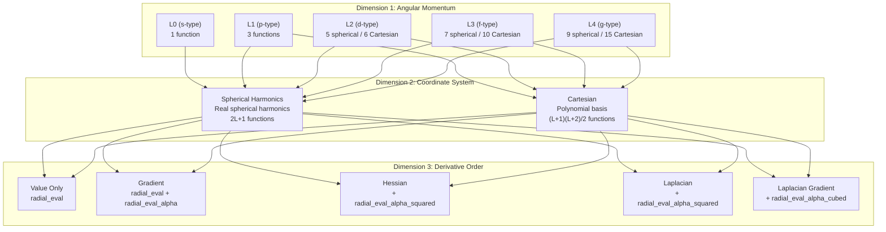
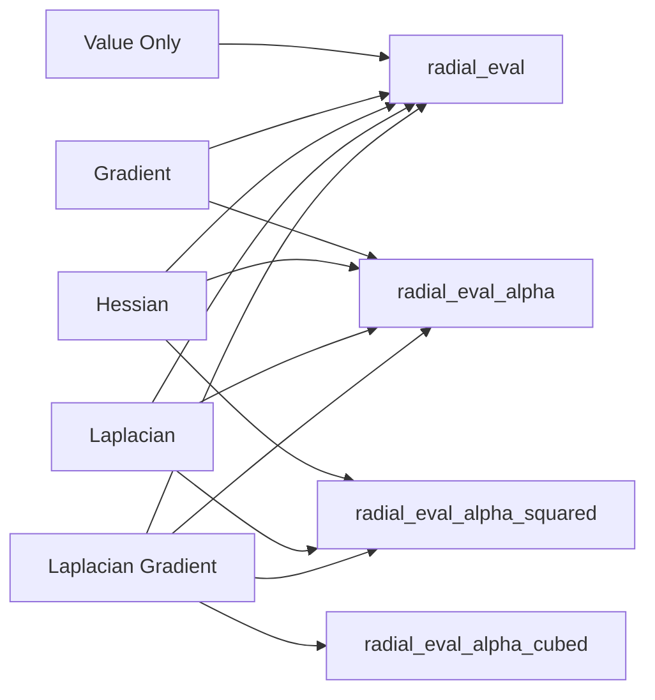
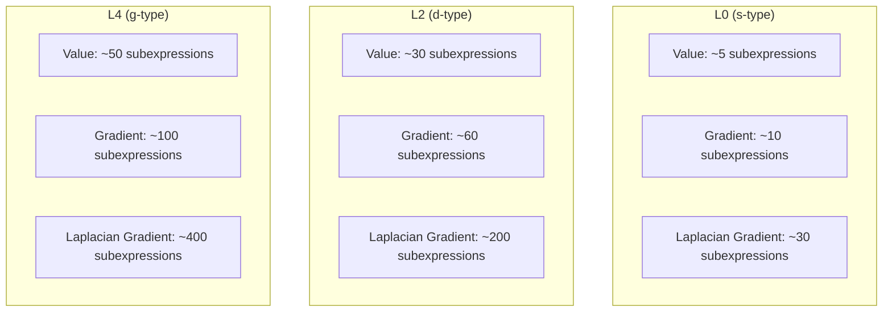
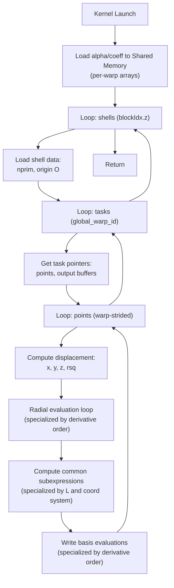

<!-- source: DeepWiki mcp.deepwiki.com · repo microsoft/skala · extra page Kernel Specialization Matrix · fetched 2026-10-26 -->

# Kernel Specialization Matrix

<details>
<summary>Relevant source files</summary>

The following files were used as context for generating this wiki page:

- [third_party/gauxc/src/xc_integrator/local_work_driver/device/cuda/kernels/collocation/collocation_shell_to_task_kernels_cartesian_l1.hpp](third_party/gauxc/src/xc_integrator/local_work_driver/device/cuda/kernels/collocation/collocation_shell_to_task_kernels_cartesian_l1.hpp)
- [third_party/gauxc/src/xc_integrator/local_work_driver/device/cuda/kernels/collocation/collocation_shell_to_task_kernels_cartesian_l1_hessian.hpp](third_party/gauxc/src/xc_integrator/local_work_driver/device/cuda/kernels/collocation/collocation_shell_to_task_kernels_cartesian_l1_hessian.hpp)
- [third_party/gauxc/src/xc_integrator/local_work_driver/device/cuda/kernels/collocation/collocation_shell_to_task_kernels_cartesian_l1_lapgrad.hpp](third_party/gauxc/src/xc_integrator/local_work_driver/device/cuda/kernels/collocation/collocation_shell_to_task_kernels_cartesian_l1_lapgrad.hpp)
- [third_party/gauxc/src/xc_integrator/local_work_driver/device/cuda/kernels/collocation/collocation_shell_to_task_kernels_cartesian_l1_laplacian.hpp](third_party/gauxc/src/xc_integrator/local_work_driver/device/cuda/kernels/collocation/collocation_shell_to_task_kernels_cartesian_l1_laplacian.hpp)
- [third_party/gauxc/src/xc_integrator/local_work_driver/device/cuda/kernels/collocation/collocation_shell_to_task_kernels_cartesian_l2_lapgrad.hpp](third_party/gauxc/src/xc_integrator/local_work_driver/device/cuda/kernels/collocation/collocation_shell_to_task_kernels_cartesian_l2_lapgrad.hpp)
- [third_party/gauxc/src/xc_integrator/local_work_driver/device/cuda/kernels/collocation/collocation_shell_to_task_kernels_cartesian_l2_laplacian.hpp](third_party/gauxc/src/xc_integrator/local_work_driver/device/cuda/kernels/collocation/collocation_shell_to_task_kernels_cartesian_l2_laplacian.hpp)
- [third_party/gauxc/src/xc_integrator/local_work_driver/device/cuda/kernels/collocation/collocation_shell_to_task_kernels_cartesian_l3_hessian.hpp](third_party/gauxc/src/xc_integrator/local_work_driver/device/cuda/kernels/collocation/collocation_shell_to_task_kernels_cartesian_l3_hessian.hpp)
- [third_party/gauxc/src/xc_integrator/local_work_driver/device/cuda/kernels/collocation/collocation_shell_to_task_kernels_cartesian_l3_laplacian.hpp](third_party/gauxc/src/xc_integrator/local_work_driver/device/cuda/kernels/collocation/collocation_shell_to_task_kernels_cartesian_l3_laplacian.hpp)
- [third_party/gauxc/src/xc_integrator/local_work_driver/device/cuda/kernels/collocation/collocation_shell_to_task_kernels_cartesian_l4_gradient.hpp](third_party/gauxc/src/xc_integrator/local_work_driver/device/cuda/kernels/collocation/collocation_shell_to_task_kernels_cartesian_l4_gradient.hpp)
- [third_party/gauxc/src/xc_integrator/local_work_driver/device/cuda/kernels/collocation/collocation_shell_to_task_kernels_spherical_l0_hessian.hpp](third_party/gauxc/src/xc_integrator/local_work_driver/device/cuda/kernels/collocation/collocation_shell_to_task_kernels_spherical_l0_hessian.hpp)
- [third_party/gauxc/src/xc_integrator/local_work_driver/device/cuda/kernels/collocation/collocation_shell_to_task_kernels_spherical_l0_laplacian.hpp](third_party/gauxc/src/xc_integrator/local_work_driver/device/cuda/kernels/collocation/collocation_shell_to_task_kernels_spherical_l0_laplacian.hpp)
- [third_party/gauxc/src/xc_integrator/local_work_driver/device/cuda/kernels/collocation/collocation_shell_to_task_kernels_spherical_l1_gradient.hpp](third_party/gauxc/src/xc_integrator/local_work_driver/device/cuda/kernels/collocation/collocation_shell_to_task_kernels_spherical_l1_gradient.hpp)
- [third_party/gauxc/src/xc_integrator/local_work_driver/device/cuda/kernels/collocation/collocation_shell_to_task_kernels_spherical_l1_hessian.hpp](third_party/gauxc/src/xc_integrator/local_work_driver/device/cuda/kernels/collocation/collocation_shell_to_task_kernels_spherical_l1_hessian.hpp)
- [third_party/gauxc/src/xc_integrator/local_work_driver/device/cuda/kernels/collocation/collocation_shell_to_task_kernels_spherical_l1_lapgrad.hpp](third_party/gauxc/src/xc_integrator/local_work_driver/device/cuda/kernels/collocation/collocation_shell_to_task_kernels_spherical_l1_lapgrad.hpp)
- [third_party/gauxc/src/xc_integrator/local_work_driver/device/cuda/kernels/collocation/collocation_shell_to_task_kernels_spherical_l1_laplacian.hpp](third_party/gauxc/src/xc_integrator/local_work_driver/device/cuda/kernels/collocation/collocation_shell_to_task_kernels_spherical_l1_laplacian.hpp)
- [third_party/gauxc/src/xc_integrator/local_work_driver/device/cuda/kernels/collocation/collocation_shell_to_task_kernels_spherical_l2_hessian.hpp](third_party/gauxc/src/xc_integrator/local_work_driver/device/cuda/kernels/collocation/collocation_shell_to_task_kernels_spherical_l2_hessian.hpp)
- [third_party/gauxc/src/xc_integrator/local_work_driver/device/cuda/kernels/collocation/collocation_shell_to_task_kernels_spherical_l2_lapgrad.hpp](third_party/gauxc/src/xc_integrator/local_work_driver/device/cuda/kernels/collocation/collocation_shell_to_task_kernels_spherical_l2_lapgrad.hpp)
- [third_party/gauxc/src/xc_integrator/local_work_driver/device/cuda/kernels/collocation/collocation_shell_to_task_kernels_spherical_l2_laplacian.hpp](third_party/gauxc/src/xc_integrator/local_work_driver/device/cuda/kernels/collocation/collocation_shell_to_task_kernels_spherical_l2_laplacian.hpp)
- [third_party/gauxc/src/xc_integrator/local_work_driver/device/cuda/kernels/collocation/collocation_shell_to_task_kernels_spherical_l3_hessian.hpp](third_party/gauxc/src/xc_integrator/local_work_driver/device/cuda/kernels/collocation/collocation_shell_to_task_kernels_spherical_l3_hessian.hpp)
- [third_party/gauxc/src/xc_integrator/local_work_driver/device/cuda/kernels/collocation/collocation_shell_to_task_kernels_spherical_l3_lapgrad.hpp](third_party/gauxc/src/xc_integrator/local_work_driver/device/cuda/kernels/collocation/collocation_shell_to_task_kernels_spherical_l3_lapgrad.hpp)
- [third_party/gauxc/src/xc_integrator/local_work_driver/device/cuda/kernels/collocation/collocation_shell_to_task_kernels_spherical_l4_hessian.hpp](third_party/gauxc/src/xc_integrator/local_work_driver/device/cuda/kernels/collocation/collocation_shell_to_task_kernels_spherical_l4_hessian.hpp)
- [third_party/gauxc/src/xc_integrator/local_work_driver/device/cuda/kernels/collocation/collocation_shell_to_task_kernels_spherical_l4_lapgrad.hpp](third_party/gauxc/src/xc_integrator/local_work_driver/device/cuda/kernels/collocation/collocation_shell_to_task_kernels_spherical_l4_lapgrad.hpp)
- [third_party/gauxc/src/xc_integrator/local_work_driver/device/cuda/kernels/collocation/collocation_shell_to_task_kernels_spherical_l4_laplacian.hpp](third_party/gauxc/src/xc_integrator/local_work_driver/device/cuda/kernels/collocation/collocation_shell_to_task_kernels_spherical_l4_laplacian.hpp)

</details>


This page documents the full specialization space for GPU collocation kernels, including the dimensions of variation (angular momentum, coordinate system, derivative order), the naming conventions, and how each specialization affects kernel implementation details.

For the overall collocation kernel architecture, see [Shell-to-Task Kernels](#7.2.2). For radial evaluation details, see [Radial Evaluation and Derivative Computation](#7.2.4).

---

## Specialization Dimensions

GauXC generates a complete matrix of collocation kernels specialized across three independent dimensions. Each combination produces a distinct CUDA kernel optimized for its specific computation pattern.



**Sources:**
- [third_party/gauxc/src/xc_integrator/local_work_driver/device/cuda/kernels/collocation/collocation_shell_to_task_kernels_spherical_l4_lapgrad.hpp:1-660]()
- [third_party/gauxc/src/xc_integrator/local_work_driver/device/cuda/kernels/collocation/collocation_shell_to_task_kernels_cartesian_l4_gradient.hpp:1-378]()

---

## Kernel Naming Convention

Each kernel follows a systematic naming pattern that encodes its specialization:

**File naming pattern:**
```
collocation_shell_to_task_kernels_{coord}_{angular}_{deriv}.hpp
```

**Kernel function naming pattern:**
```cpp
collocation_device_shell_to_task_kernel_{coord}_{deriv}_{L}
```

Where:
- `{coord}`: `spherical` or `cartesian`
- `{angular}` / `{L}`: `l0`, `l1`, `l2`, `l3`, `l4` or `0`, `1`, `2`, `3`, `4`
- `{deriv}`: omitted for value-only, or `gradient`, `hessian`, `laplacian`, `lapgrad`

**Examples:**

| File | Kernel Function | Description |
|------|----------------|-------------|
| `collocation_shell_to_task_kernels_spherical_l4_lapgrad.hpp` | `collocation_device_shell_to_task_kernel_spherical_lapgrad_4` | L4 spherical, Laplacian gradient |
| `collocation_shell_to_task_kernels_cartesian_l3_hessian.hpp` | `collocation_device_shell_to_task_kernel_cartesian_hessian_3` | L3 Cartesian, Hessian |
| `collocation_shell_to_task_kernels_spherical_l2_laplacian.hpp` | `collocation_device_shell_to_task_kernel_spherical_laplacian_2` | L2 spherical, Laplacian |

**Sources:**
- [third_party/gauxc/src/xc_integrator/local_work_driver/device/cuda/kernels/collocation/collocation_shell_to_task_kernels_spherical_l4_lapgrad.hpp:18-22]()
- [third_party/gauxc/src/xc_integrator/local_work_driver/device/cuda/kernels/collocation/collocation_shell_to_task_kernels_cartesian_l3_hessian.hpp:18-22]()

---

## Radial Evaluation Variants

The derivative order directly determines which radial evaluation terms are computed in the innermost primitive loop:



**Implementation in primitive accumulation loop:**

For **value-only** kernels:
```cpp
double radial_eval = 0.;

for( uint32_t i = 0; i < nprim; ++i ) {
  const auto a = my_alpha[i];
  const auto e = my_coeff[i] * std::exp( - a * rsq );
  radial_eval += e;
}
radial_eval_alpha *= -2;
```

For **gradient** kernels:
```cpp
double radial_eval = 0.;
double radial_eval_alpha = 0.;

for( uint32_t i = 0; i < nprim; ++i ) {
  const auto a = my_alpha[i];
  const auto e = my_coeff[i] * std::exp( - a * rsq );
  radial_eval += e;
  radial_eval_alpha += a * e;
}
radial_eval_alpha *= -2;
```

For **Hessian/Laplacian** kernels:
```cpp
double radial_eval = 0.;
double radial_eval_alpha = 0.;
double radial_eval_alpha_squared = 0.;

for( uint32_t i = 0; i < nprim; ++i ) {
  const auto a = my_alpha[i];
  const auto e = my_coeff[i] * std::exp( - a * rsq );
  radial_eval += e;
  radial_eval_alpha += a * e;
  radial_eval_alpha_squared += a * a * e;
}
radial_eval_alpha *= -2;
radial_eval_alpha_squared *= 4;
```

For **Laplacian gradient** kernels:
```cpp
double radial_eval = 0.;
double radial_eval_alpha = 0.;
double radial_eval_alpha_squared = 0.;
double radial_eval_alpha_cubed = 0.;

for( uint32_t i = 0; i < nprim; ++i ) {
  const auto a = my_alpha[i];
  const auto e = my_coeff[i] * std::exp( - a * rsq );
  radial_eval += e;
  radial_eval_alpha += a * e;
  radial_eval_alpha_squared += a * a * e;
  radial_eval_alpha_cubed += a * a * a * e;
}
radial_eval_alpha *= -2;
radial_eval_alpha_squared *= 4;
radial_eval_alpha_cubed *= -8;
```

**Sources:**
- [third_party/gauxc/src/xc_integrator/local_work_driver/device/cuda/kernels/collocation/collocation_shell_to_task_kernels_spherical_l4_lapgrad.hpp:92-116]()
- [third_party/gauxc/src/xc_integrator/local_work_driver/device/cuda/kernels/collocation/collocation_shell_to_task_kernels_spherical_l4_hessian.hpp:92-109]()
- [third_party/gauxc/src/xc_integrator/local_work_driver/device/cuda/kernels/collocation/collocation_shell_to_task_kernels_cartesian_l4_gradient.hpp:86-100]()

---

## Output Buffer Mapping

Each derivative order writes to a different set of output buffers in the `XCDeviceTask` structure:

| Derivative Order | Output Buffers Written |
|-----------------|------------------------|
| **Value** | `bf` |
| **Gradient** | `bf`, `dbfx`, `dbfy`, `dbfz` |
| **Hessian** | `bf`, `dbfx`, `dbfy`, `dbfz`, `d2bfxx`, `d2bfxy`, `d2bfxz`, `d2bfyy`, `d2bfyz`, `d2bfzz` |
| **Laplacian** | `bf`, `dbfx`, `dbfy`, `dbfz`, `d2bflapl` |
| **Laplacian Gradient** | `bf`, `dbfx`, `dbfy`, `dbfz`, `d2bfxx`, `d2bfxy`, `d2bfxz`, `d2bfyy`, `d2bfyz`, `d2bfzz`, `d2bflapl`, `d3bflapl_x`, `d3bflapl_y`, `d3bflapl_z` |

**Gradient kernel buffer setup:**
```cpp
auto* __restrict__ basis_eval = task->bf + shoff;
auto* __restrict__ basis_x_eval = task->dbfx + shoff;
auto* __restrict__ basis_y_eval = task->dbfy + shoff;
auto* __restrict__ basis_z_eval = task->dbfz + shoff;
```

**Laplacian gradient kernel buffer setup:**
```cpp
auto* __restrict__ basis_eval = task->bf + shoff;
auto* __restrict__ basis_x_eval = task->dbfx + shoff;
auto* __restrict__ basis_y_eval = task->dbfy + shoff;
auto* __restrict__ basis_z_eval = task->dbfz + shoff;
auto* __restrict__ basis_xx_eval = task->d2bfxx + shoff;
auto* __restrict__ basis_xy_eval = task->d2bfxy + shoff;
auto* __restrict__ basis_xz_eval = task->d2bfxz + shoff;
auto* __restrict__ basis_yy_eval = task->d2bfyy + shoff;
auto* __restrict__ basis_yz_eval = task->d2bfyz + shoff;
auto* __restrict__ basis_zz_eval = task->d2bfzz + shoff;
auto* __restrict__ basis_lapl_eval = task->d2bflapl + shoff;
auto* __restrict__ basis_lapl_x_eval = task->d3bflapl_x + shoff;
auto* __restrict__ basis_lapl_y_eval = task->d3bflapl_y + shoff;
auto* __restrict__ basis_lapl_z_eval = task->d3bflapl_z + shoff;
```

**Sources:**
- [third_party/gauxc/src/xc_integrator/local_work_driver/device/cuda/kernels/collocation/collocation_shell_to_task_kernels_cartesian_l4_gradient.hpp:65-68]()
- [third_party/gauxc/src/xc_integrator/local_work_driver/device/cuda/kernels/collocation/collocation_shell_to_task_kernels_spherical_l4_lapgrad.hpp:65-78]()

---

## Complete Specialization Matrix

The following table enumerates all kernel specializations generated for the GPU:

### Spherical Harmonics Kernels

| L | Value | Gradient | Hessian | Laplacian | Laplacian Gradient | # Basis Functions |
|---|-------|----------|---------|-----------|-------------------|-------------------|
| **L0** | ✓ | ✓ | ✓ | ✓ | ✓ | 1 |
| **L1** | ✓ | ✓ | ✓ | ✓ | ✓ | 3 |
| **L2** | ✓ | ✓ | ✓ | ✓ | ✓ | 5 |
| **L3** | ✓ | ✓ | ✓ | ✓ | ✓ | 7 |
| **L4** | ✓ | ✓ | ✓ | ✓ | ✓ | 9 |

**Total spherical kernels:** 5 × 5 = **25 kernels**

### Cartesian Kernels

| L | Value | Gradient | Hessian | Laplacian | Laplacian Gradient | # Basis Functions |
|---|-------|----------|---------|-----------|-------------------|-------------------|
| **L0** | ✓ | ✓ | ✓ | ✓ | ✓ | 1 |
| **L1** | ✓ | ✓ | ✓ | ✓ | ✓ | 3 |
| **L2** | ✓ | ✓ | ✓ | ✓ | ✓ | 6 |
| **L3** | ✓ | ✓ | ✓ | ✓ | ✓ | 10 |
| **L4** | ✓ | ✓ | ✓ | ✓ | ✓ | 15 |

**Total Cartesian kernels:** 5 × 5 = **25 kernels**

**Grand total:** **50 distinct kernel specializations**

**Sources:**
- [third_party/gauxc/src/xc_integrator/local_work_driver/device/cuda/kernels/collocation/collocation_shell_to_task_kernels_spherical_l4_lapgrad.hpp:1-8]()
- [third_party/gauxc/src/xc_integrator/local_work_driver/device/cuda/kernels/collocation/collocation_shell_to_task_kernels_cartesian_l4_gradient.hpp:1-8]()

---

## Common Subexpression Computation

The number and complexity of common subexpressions grows dramatically with both angular momentum and derivative order:



**Example from L4 Laplacian Gradient (spherical):**

The kernel precomputes 279 common subexpressions (x0 through x278) before evaluating any basis functions:

```cpp
// Common Subexpressions
const auto x0 = 0.5*sqrt_35; 
const auto x1 = x0*y; 
const auto x2 = x*x1; 
const auto x3 = x*x; 
// ... 275 more lines ...
const auto x278 = 8.0*x155; 
const auto x279 = 8.0*x181;
```

These are then used in the actual basis function evaluations:

```cpp
// Evaluate basis function
basis_eval[ipt + 0*npts] = radial_eval*x2*x8;
basis_eval[ipt + 1*npts] = radial_eval*x11*x13;
// ... 7 more basis functions ...

// Evaluate Laplacian gradient of bfn (dx)
basis_lapl_x_eval[ipt + 0*npts] = x1*(x*x204*x8 + 3.0*x116 + x185 + ...);
// ... complex expressions using precomputed subexpressions ...
```

**Sources:**
- [third_party/gauxc/src/xc_integrator/local_work_driver/device/cuda/kernels/collocation/collocation_shell_to_task_kernels_spherical_l4_lapgrad.hpp:118-398]()
- [third_party/gauxc/src/xc_integrator/local_work_driver/device/cuda/kernels/collocation/collocation_shell_to_task_kernels_spherical_l2_lapgrad.hpp:117-276]()

---

## Launch Configuration

Launch bounds are specified using the `__launch_bounds__` attribute and vary by angular momentum:

| Angular Momentum | Threads per Block | Min Blocks per SM | Shared Memory Layout |
|-----------------|-------------------|-------------------|----------------------|
| **L0** | 256 | 2 | `alpha[8][33]`, `coeff[8][33]` |
| **L1-L4** | 128 | 2 | `alpha[4][33]`, `coeff[4][33]` |

**L0 kernel (higher occupancy):**
```cpp
__global__ __launch_bounds__(256,2) void 
collocation_device_shell_to_task_kernel_spherical_hessian_0(
  uint32_t nshell,
  ShellToTaskDevice* __restrict__ shell_to_task,
  XCDeviceTask* __restrict__ device_tasks
) {
  __shared__ double alpha[8][detail::shell_nprim_max + 1]; 
  __shared__ double coeff[8][detail::shell_nprim_max + 1];
  // ...
}
```

**L1-L4 kernels (lower occupancy due to register pressure):**
```cpp
__global__ __launch_bounds__(128,2) void 
collocation_device_shell_to_task_kernel_spherical_lapgrad_4(
  uint32_t nshell,
  ShellToTaskDevice* __restrict__ shell_to_task,
  XCDeviceTask* __restrict__ device_tasks
) {
  __shared__ double alpha[4][detail::shell_nprim_max + 1]; 
  __shared__ double coeff[4][detail::shell_nprim_max + 1];
  // ...
}
```

The reduction from 256 to 128 threads per block for higher angular momentum kernels accommodates increased register usage from complex basis function expressions.

**Sources:**
- [third_party/gauxc/src/xc_integrator/local_work_driver/device/cuda/kernels/collocation/collocation_shell_to_task_kernels_spherical_l0_hessian.hpp:18-28]()
- [third_party/gauxc/src/xc_integrator/local_work_driver/device/cuda/kernels/collocation/collocation_shell_to_task_kernels_spherical_l4_lapgrad.hpp:18-28]()

---

## Kernel Structure Template

All kernels follow the same high-level structure regardless of specialization:



**Shared structure across all 50 kernels:**

1. **Shell data loading:** Lines 30-51 are identical
2. **Task iteration pattern:** Lines 54-63 use same warp-level scheduling
3. **Point loop:** Lines 73-83 use same warp-strided access
4. **Distance computation:** Lines 87-94 identical in all kernels
5. **Radial evaluation:** Lines 92-115 vary only in number of accumulation terms
6. **Output writes:** Different buffers but same access pattern

**Sources:**
- [third_party/gauxc/src/xc_integrator/local_work_driver/device/cuda/kernels/collocation/collocation_shell_to_task_kernels_spherical_l4_lapgrad.hpp:30-654]()
- [third_party/gauxc/src/xc_integrator/local_work_driver/device/cuda/kernels/collocation/collocation_shell_to_task_kernels_cartesian_l2_lapgrad.hpp:30-386]()

---

## Register Pressure Analysis

Higher angular momentum and derivative order directly impact register usage:

| Configuration | Approximate # Subexpressions | Register Pressure |
|--------------|------------------------------|-------------------|
| L0, Value | ~5 | Very Low |
| L1, Gradient | ~20 | Low |
| L2, Hessian | ~100 | Medium |
| L3, Laplacian | ~150 | Medium-High |
| L4, Laplacian Gradient | ~280 | High |

The large number of common subexpressions for high-L, high-derivative kernels explains the reduced thread block size (128 vs 256) to maintain occupancy despite register spilling.

**Example register footprint comparison:**

**L0 Hessian (low register count):**
```cpp
const auto x0 = radial_eval_alpha*x;
const auto x1 = radial_eval_alpha*y;
const auto x2 = radial_eval_alpha*z;
const auto x3 = radial_eval_alpha_squared*x*x;
// ... ~20 total subexpressions
```

**L4 Laplacian Gradient (high register count):**
```cpp
const auto x0 = 0.5*sqrt_35; 
const auto x1 = x0*y; 
const auto x2 = x*x1; 
// ... 276 more subexpressions ...
const auto x279 = 8.0*x181;
```

**Sources:**
- [third_party/gauxc/src/xc_integrator/local_work_driver/device/cuda/kernels/collocation/collocation_shell_to_task_kernels_spherical_l0_hessian.hpp:110-130]()
- [third_party/gauxc/src/xc_integrator/local_work_driver/device/cuda/kernels/collocation/collocation_shell_to_task_kernels_spherical_l4_lapgrad.hpp:118-398]()

---

