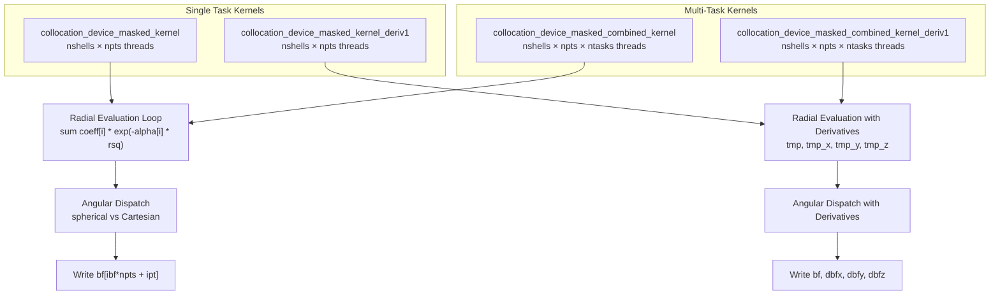
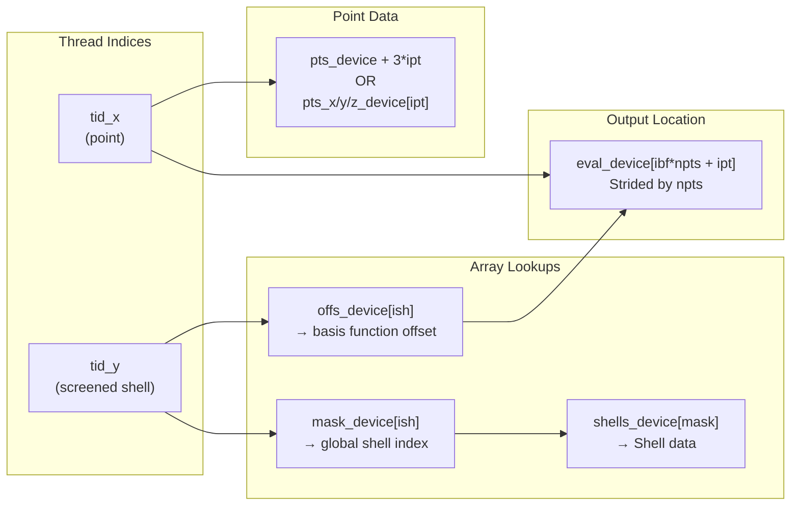
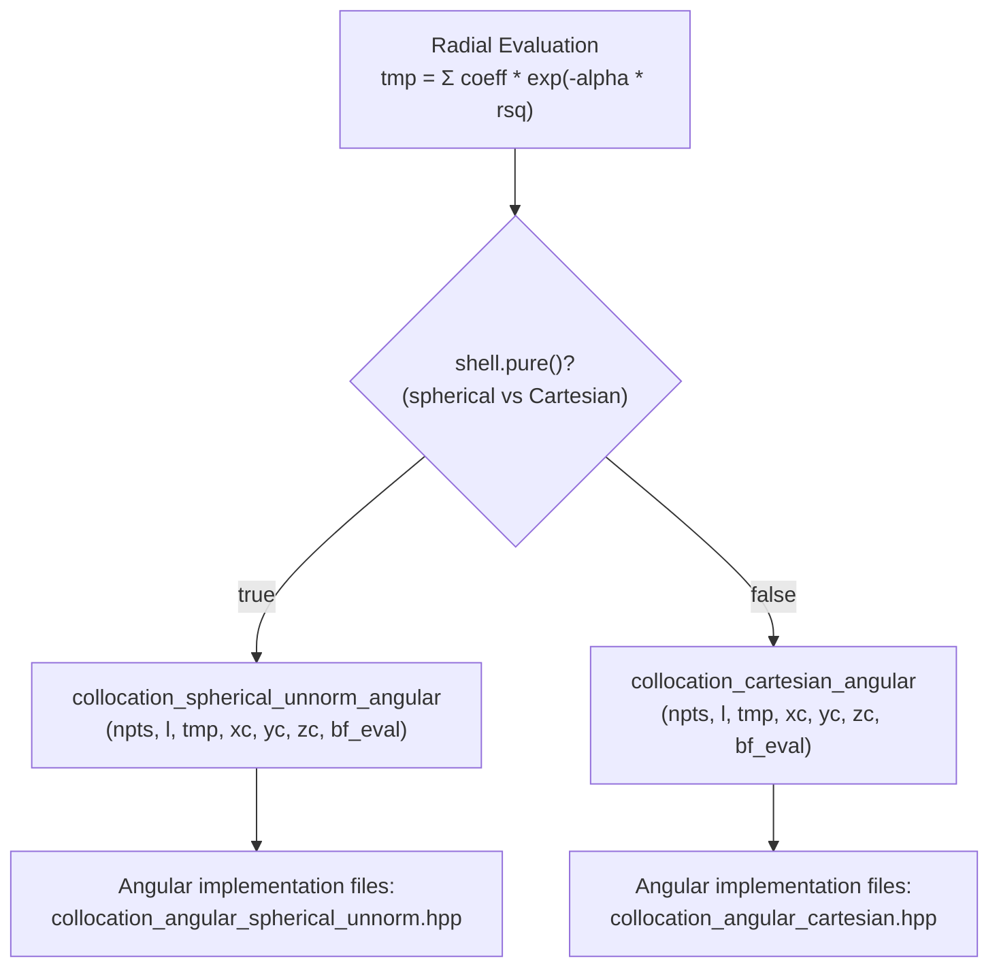
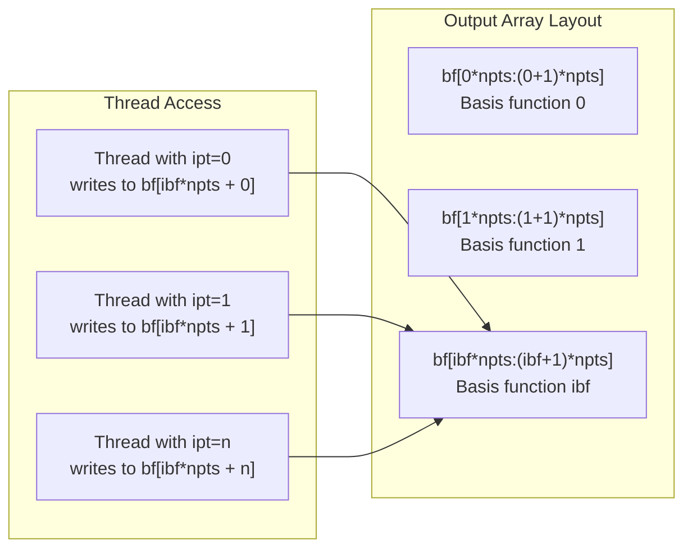
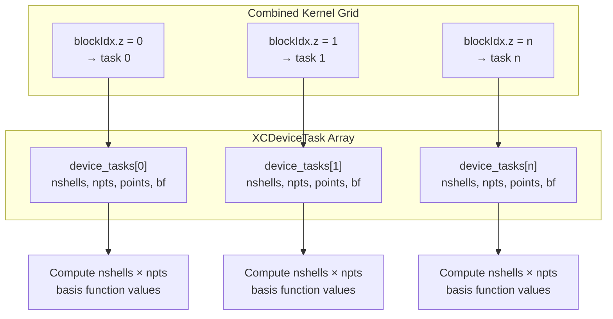

<!-- source: DeepWiki mcp.deepwiki.com · repo microsoft/skala · extra page Masked Collocation Kernels · fetched 2026-10-26 -->

# Masked Collocation Kernels

<details>
<summary>Relevant source files</summary>

The following files were used as context for generating this wiki page:

- [third_party/gauxc/attic/src/integrator/cuda/collocation_masked_combined_kernels.hpp](third_party/gauxc/attic/src/integrator/cuda/collocation_masked_combined_kernels.hpp)
- [third_party/gauxc/attic/src/integrator/cuda/collocation_masked_kernels.hpp](third_party/gauxc/attic/src/integrator/cuda/collocation_masked_kernels.hpp)
- [third_party/gauxc/attic/src/new_integrator/device/cuda/collocation_masked_combined_kernels.hpp](third_party/gauxc/attic/src/new_integrator/device/cuda/collocation_masked_combined_kernels.hpp)
- [third_party/gauxc/attic/src/new_integrator/device/cuda/collocation_masked_kernels.hpp](third_party/gauxc/attic/src/new_integrator/device/cuda/collocation_masked_kernels.hpp)
- [third_party/gauxc/attic/src/new_integrator/device/hip/collocation_masked_combined_kernels.hpp](third_party/gauxc/attic/src/new_integrator/device/hip/collocation_masked_combined_kernels.hpp)
- [third_party/gauxc/attic/src/new_integrator/device/hip/collocation_masked_kernels.hpp](third_party/gauxc/attic/src/new_integrator/device/hip/collocation_masked_kernels.hpp)
- [third_party/gauxc/src/xc_integrator/local_work_driver/device/cuda/kernels/collocation/collocation_radial.hpp](third_party/gauxc/src/xc_integrator/local_work_driver/device/cuda/kernels/collocation/collocation_radial.hpp)
- [third_party/gauxc/src/xc_integrator/local_work_driver/device/cuda/kernels/collocation_masked_combined_kernels.hpp](third_party/gauxc/src/xc_integrator/local_work_driver/device/cuda/kernels/collocation_masked_combined_kernels.hpp)
- [third_party/gauxc/src/xc_integrator/local_work_driver/device/cuda/kernels/collocation_masked_kernels.hpp](third_party/gauxc/src/xc_integrator/local_work_driver/device/cuda/kernels/collocation_masked_kernels.hpp)
- [third_party/gauxc/src/xc_integrator/local_work_driver/device/hip/kernels/collocation_masked_combined_kernels.hpp](third_party/gauxc/src/xc_integrator/local_work_driver/device/hip/kernels/collocation_masked_combined_kernels.hpp)
- [third_party/gauxc/src/xc_integrator/local_work_driver/device/hip/kernels/collocation_masked_kernels.hpp](third_party/gauxc/src/xc_integrator/local_work_driver/device/hip/kernels/collocation_masked_kernels.hpp)

</details>


## Purpose and Scope

This document describes the **masked collocation kernels**, a family of GPU kernels that evaluate Gaussian basis functions at quadrature points using shell-level screening. These kernels compute the radial component of basis function evaluation and dispatch to angular evaluation routines based on shell type (spherical vs Cartesian) and angular momentum. 

For information about the full collocation kernel hierarchy and specialization strategy, see [Collocation Kernels](#7.2). For shell-to-task kernels that use a different thread organization strategy, see [Shell-to-Task Kernels](#7.2.2). For angular momentum-specific implementations, see [Kernel Specialization Matrix](#7.2.3).

---

## Overview

Masked collocation kernels are the primary GPU implementation for basis function evaluation in GauXC. The term "masked" refers to the shell screening strategy: only shells that contribute significantly to a given batch of points are evaluated, determined by a precomputed `mask_device` array. This screening reduces computational cost by avoiding evaluation of distant shells.

The kernels operate in two stages:
1. **Radial evaluation**: Compute the radially symmetric Gaussian component
2. **Angular evaluation**: Apply angular momentum-dependent transformations

Both CUDA and HIP implementations exist with nearly identical logic.

**Sources**: [third_party/gauxc/src/xc_integrator/local_work_driver/device/cuda/kernels/collocation_masked_kernels.hpp:1-159]()

---

## Kernel Variants

The masked collocation system provides four primary kernel variants organized by functionality and batching strategy:

| Kernel Name | Computes | Task Handling | Platforms |
|-------------|----------|---------------|-----------|
| `collocation_device_masked_kernel` | Basis function values | Single task | CUDA, HIP |
| `collocation_device_masked_kernel_deriv1` | Basis values + gradients | Single task | CUDA, HIP |
| `collocation_device_masked_combined_kernel` | Basis function values | Multi-task batch | CUDA, HIP |
| `collocation_device_masked_combined_kernel_deriv1` | Basis values + gradients | Multi-task batch | CUDA, HIP |

The "combined" variants process multiple `XCDeviceTask` objects in a single kernel launch, with `blockIdx.z` selecting the task. This amortizes kernel launch overhead across multiple tasks.



**Sources**: 
- [third_party/gauxc/src/xc_integrator/local_work_driver/device/cuda/kernels/collocation_masked_kernels.hpp:19-71]()
- [third_party/gauxc/src/xc_integrator/local_work_driver/device/cuda/kernels/collocation_masked_kernels.hpp:80-155]()
- [third_party/gauxc/src/xc_integrator/local_work_driver/device/cuda/kernels/collocation_masked_combined_kernels.hpp:21-88]()
- [third_party/gauxc/src/xc_integrator/local_work_driver/device/cuda/kernels/collocation_masked_combined_kernels.hpp:104-195]()

---

## Thread Organization and Data Flow

Masked collocation kernels use a **2D thread grid** with an optional 3rd dimension for batching:

- **X dimension** (`tid_x`): Maps to quadrature points (`ipt`)
- **Y dimension** (`tid_y`): Maps to screened shells (`ish`)
- **Z dimension** (`blockIdx.z`): Selects task in combined variants

Each thread computes one shell's contribution at one quadrature point. The thread-to-work mapping is:

```
tid_x = blockIdx.x * blockDim.x + threadIdx.x  // Point index
tid_y = blockIdx.y * blockDim.y + threadIdx.y  // Shell index (screened)
```

The kernel exits early if the thread index exceeds problem dimensions:
```cpp
if( tid_x < npts and tid_y < nshells ) {
  // Perform computation
}
```

### Data Indexing



The `mask_device` array enables shell screening: it maps the local screened shell index `ish` to the global shell index in `shells_device`. The `offs_device` array provides the starting basis function index for each shell, accounting for the shell's size (e.g., p-shells have 3 basis functions).

**Sources**:
- [third_party/gauxc/src/xc_integrator/local_work_driver/device/cuda/kernels/collocation_masked_kernels.hpp:32-40]()
- [third_party/gauxc/src/xc_integrator/local_work_driver/device/cuda/kernels/collocation_masked_combined_kernels.hpp:29-52]()

---

## Shell Data Structure

The `Shell<T>` template class encapsulates all data for a contracted Gaussian shell. Each thread accesses shell data through const-restricted pointers:

```cpp
const auto* __restrict__ O     = shell.O_data();      // Origin [x, y, z]
const auto* __restrict__ alpha = shell.alpha_data();  // Exponents [nprim]
const auto* __restrict__ coeff = shell.coeff_data();  // Coefficients [nprim]
const uint32_t nprim = shell.nprim();                 // Number of primitives
const int l = shell.l();                              // Angular momentum
const bool do_sph = shell.pure();                     // Spherical vs Cartesian
```

The `Shell<T>` interface provides:
- **Geometric data**: `O_data()` returns the shell's origin (atomic center)
- **Primitive data**: `alpha_data()` and `coeff_data()` for the Gaussian expansion
- **Basis metadata**: `nprim()`, `l()`, `pure()` for contraction length, angular momentum, and basis type

The `__restrict__` qualifier informs the compiler that these pointers do not alias, enabling aggressive optimization.

**Sources**: 
- [third_party/gauxc/src/xc_integrator/local_work_driver/device/cuda/kernels/collocation_masked_kernels.hpp:46-48]()
- [third_party/gauxc/include/gauxc/shell.hpp]() (referenced but not provided)

---

## Radial Evaluation

The radial component evaluates the isotropic Gaussian envelope at a point. This is independent of angular momentum and identical across all basis function components within the shell.

### Standard Radial Evaluation

For basis function values only:

```cpp
// Compute displacement from shell origin
const auto xc = pt[0] - O[0];
const auto yc = pt[1] - O[1];
const auto zc = pt[2] - O[2];

// Radial distance squared
const auto rsq = xc*xc + yc*yc + zc*zc;

// Sum over primitive Gaussians
const uint32_t nprim = shell.nprim(); 
auto tmp = 0.;
for( uint32_t i = 0; i < nprim; ++i )
  tmp += coeff[i] * std::exp( - alpha[i] * rsq );
```

The accumulated value `tmp` represents:
$$\text{tmp} = \sum_{i=1}^{n_{\text{prim}}} c_i \exp(-\alpha_i r^2)$$

where $r^2 = x_c^2 + y_c^2 + z_c^2$ is the squared distance from the shell origin.

### Radial Evaluation with Derivatives

For gradient calculations, the kernel also accumulates radial derivatives:

```cpp
auto tmp = 0.;
auto tmp_x = 0., tmp_y = 0., tmp_z = 0.;
for( uint32_t i = 0; i < nprim; ++i ) {
  const auto a = alpha[i];
  const auto e = coeff[i] * std::exp( - a * rsq );
  const auto ae = 2. * a * e;
  
  tmp   += e;
  tmp_x -= ae * xc;
  tmp_y -= ae * yc;
  tmp_z -= ae * zc;
}
```

The gradient terms use the chain rule:
$$\frac{\partial}{\partial x} \exp(-\alpha r^2) = -2\alpha x_c \exp(-\alpha r^2)$$

These radial derivatives are scaled by the angular functions in the subsequent dispatch step.

### Separated Radial Functions

The codebase also provides device-callable helper functions in [third_party/gauxc/src/xc_integrator/local_work_driver/device/cuda/kernels/collocation/collocation_radial.hpp:16-96]():

- `collocation_device_radial_eval()`: Returns radial value and displaced coordinates
- `collocation_device_radial_eval_deriv1()`: Returns radial value, derivatives, and coordinates

These are used by other kernel variants for code reuse.

**Sources**:
- [third_party/gauxc/src/xc_integrator/local_work_driver/device/cuda/kernels/collocation_masked_kernels.hpp:50-59]()
- [third_party/gauxc/src/xc_integrator/local_work_driver/device/cuda/kernels/collocation_masked_kernels.hpp:114-129]()
- [third_party/gauxc/src/xc_integrator/local_work_driver/device/cuda/kernels/collocation/collocation_radial.hpp:16-96]()

---

## Angular Evaluation Dispatch

After computing the radial component, the kernel dispatches to angular-specific routines based on the shell's basis type (`pure()`) and angular momentum (`l()`). This separation allows the radial and angular components to be handled independently.



### Angular Function Signatures

**Value-only dispatch**:
```cpp
if( do_sph )
  collocation_spherical_unnorm_angular( npts, shell.l(), tmp, xc, yc, zc, bf_eval );
else
  collocation_cartesian_angular( npts, shell.l(), tmp, xc, yc, zc, bf_eval );
```

**Derivative dispatch**:
```cpp
if( do_sph ) 
  collocation_spherical_unnorm_angular_deriv1( npts, shell.l(), tmp, tmp_x, tmp_y, tmp_z, 
                                               xc, yc, zc, bf_eval, dx_eval, dy_eval, dz_eval );
else
  collocation_cartesian_angular_deriv1( npts, shell.l(), tmp, tmp_x, tmp_y, tmp_z, 
                                        xc, yc, zc, bf_eval, dx_eval, dy_eval, dz_eval );
```

The angular functions apply the appropriate spherical harmonic or Cartesian polynomial transformations. These functions are further specialized by angular momentum `l` using compile-time dispatch or switch statements internally. See [Kernel Specialization Matrix](#7.2.3) for details on angular momentum specialization.

**Sources**:
- [third_party/gauxc/src/xc_integrator/local_work_driver/device/cuda/kernels/collocation_masked_kernels.hpp:63-67]()
- [third_party/gauxc/src/xc_integrator/local_work_driver/device/cuda/kernels/collocation_masked_kernels.hpp:142-150]()
- [third_party/gauxc/src/xc_integrator/local_work_driver/device/cuda/kernels/collocation/collocation_angular_cartesian.hpp]() (referenced)
- [third_party/gauxc/src/xc_integrator/local_work_driver/device/cuda/kernels/collocation/collocation_angular_spherical_unnorm.hpp]() (referenced)

---

## Memory Access Patterns

The masked collocation kernels exhibit specific memory access patterns optimized for GPU memory hierarchy.

### Input Data Access

| Data Structure | Access Pattern | Coalescing |
|---------------|----------------|------------|
| `pts_device[3*ipt]` or `pts_{x,y,z}_device[ipt]` | Sequential by `tid_x` | Coalesced within warp |
| `mask_device[ish]` | Sequential by `tid_y` | Coalesced within warp |
| `offs_device[ish]` | Sequential by `tid_y` | Coalesced within warp |
| `shells_device[mask[ish]]` | Indirect via mask | May not coalesce |
| `alpha[i]`, `coeff[i]` | Loop over primitives | Broadcast-like access |

### Output Data Access

Output arrays are written with **strided access**:
```cpp
auto * bf_eval = eval_device + ibf*npts + ipt;
```

The stride is `npts`, meaning basis functions are stored in column-major order with points as the fast dimension. Within a warp (32 threads on NVIDIA, 64 on AMD), if threads have consecutive `ipt` values, the writes are coalesced.



### Point Storage Variations

The codebase supports two point storage formats:

1. **Interleaved**: `pts_device[3*ipt + 0/1/2]` for x, y, z
2. **Structure-of-Arrays (SoA)**: `pts_x_device[ipt]`, `pts_y_device[ipt]`, `pts_z_device[ipt]`

The combined kernels use SoA format ([collocation_masked_combined_kernels.hpp:40-42]()), which provides better coalescing:
```cpp
const auto* __restrict__ pts_x_device  = task.points_x;
const auto* __restrict__ pts_y_device  = task.points_y;
const auto* __restrict__ pts_z_device  = task.points_z;
const auto pt_x = pts_x_device[ipt];
const auto pt_y = pts_y_device[ipt];
const auto pt_z = pts_z_device[ipt];
```

**Sources**:
- [third_party/gauxc/src/xc_integrator/local_work_driver/device/cuda/kernels/collocation_masked_kernels.hpp:43-61]()
- [third_party/gauxc/src/xc_integrator/local_work_driver/device/cuda/kernels/collocation_masked_combined_kernels.hpp:40-76]()

---

## Combined Kernel Multi-Task Handling

The `collocation_device_masked_combined_kernel` variants extend the single-task kernels to process multiple `XCDeviceTask` objects in parallel using the Z dimension of the thread grid.

### Task Selection and Parameter Extraction

```cpp
if( blockIdx.z < ntasks ) {
  auto& task = device_tasks[ blockIdx.z ];
  
  const auto               nshells     = task.bfn_screening.nshells;
  const auto               npts        = task.npts;
  const auto* __restrict__ mask_device = task.bfn_screening.shell_list;
  const auto* __restrict__ offs_device = task.bfn_screening.shell_offs;
  auto* __restrict__ eval_device       = task.bf;
  
  // Standard masked kernel logic follows...
}
```

Each Z-block processes an independent task with its own:
- Point count and coordinates
- Shell screening list and offsets
- Output buffer location

This design amortizes kernel launch overhead when many small tasks need processing. The tasks are independent, allowing embarrassingly parallel execution across the Z dimension.



**Sources**:
- [third_party/gauxc/src/xc_integrator/local_work_driver/device/cuda/kernels/collocation_masked_combined_kernels.hpp:32-46]()
- [third_party/gauxc/src/xc_integrator/local_work_driver/device/cuda/kernels/collocation_masked_combined_kernels.hpp:116-134]()

---

## Platform Differences: CUDA vs HIP

The masked collocation kernels are implemented identically for both CUDA and HIP platforms, with only header differences for platform compatibility.

| Aspect | CUDA Implementation | HIP Implementation |
|--------|---------------------|-------------------|
| Header | `<iostream>`, `<cassert>`, `<gauxc/shell.hpp>` | `#include "hip/hip_runtime.h"` + same |
| Kernel qualifier | `__global__` | `__global__` (identical) |
| Launch bounds | Not specified in most | Some variants use `__launch_bounds__(1024,1)` |
| Thread indexing | `blockIdx`, `blockDim`, `threadIdx` | Identical |
| Kernel logic | Identical | Identical |

### File Locations

**CUDA**:
- [third_party/gauxc/src/xc_integrator/local_work_driver/device/cuda/kernels/collocation_masked_kernels.hpp:1-159]()
- [third_party/gauxc/src/xc_integrator/local_work_driver/device/cuda/kernels/collocation_masked_combined_kernels.hpp:1-198]()

**HIP**:
- [third_party/gauxc/src/xc_integrator/local_work_driver/device/hip/kernels/collocation_masked_kernels.hpp:1-160]()
- [third_party/gauxc/src/xc_integrator/local_work_driver/device/hip/kernels/collocation_masked_combined_kernels.hpp:1-199]()

The attic directory contains older versions showing the evolution of these kernels, but current implementations are under `src/xc_integrator/local_work_driver/device/{cuda,hip}/kernels/`.

**Sources**:
- [third_party/gauxc/src/xc_integrator/local_work_driver/device/cuda/kernels/collocation_masked_kernels.hpp:1-159]()
- [third_party/gauxc/src/xc_integrator/local_work_driver/device/hip/kernels/collocation_masked_kernels.hpp:1-160]()

---

## Relationship to Other Collocation Kernels

Masked collocation kernels are one strategy in a larger collocation kernel ecosystem. The table below compares the main approaches:

| Kernel Type | Thread Organization | Screening | Primary Use Case |
|-------------|---------------------|-----------|------------------|
| **Masked** (this page) | 2D: points × shells | Shell-level mask array | General purpose, screened shells |
| **Shell-to-Task** ([7.2.2](#7.2.2)) | 3D: points × warps × shells | Task-level assignment | Dense shell sets, warp-level parallelism |
| **Radial-only** | N/A | N/A | Helper functions for composition |
| **Angular-specific** ([7.2.3](#7.2.3)) | Varies by L | Compile-time L selection | Specialized by angular momentum |

The masked kernels provide the **baseline implementation** with simple thread organization and flexible screening. Shell-to-task kernels ([7.2.2](#7.2.2)) provide higher performance for specific workload characteristics through more sophisticated thread organization.

All collocation kernels ultimately rely on:
- Radial evaluation (Gaussian primitives)
- Angular dispatch (spherical vs Cartesian, L-dependent)
- Screening mechanisms (shell masks or task lists)

These components are documented across multiple pages within the [Collocation Kernels](#7.2) section.

**Sources**: All files referenced in this document

---

