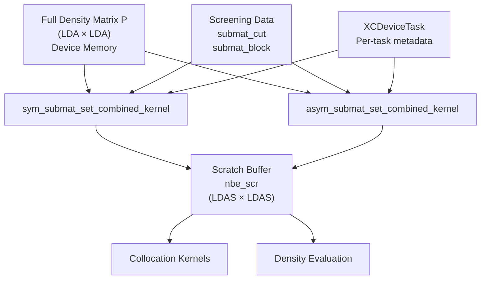
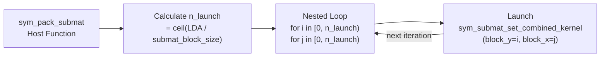
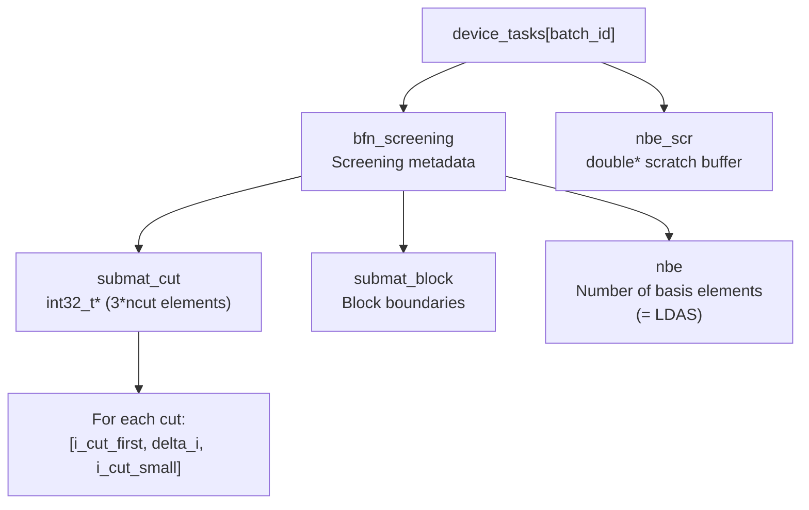
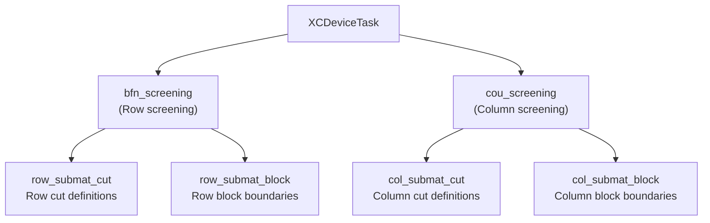
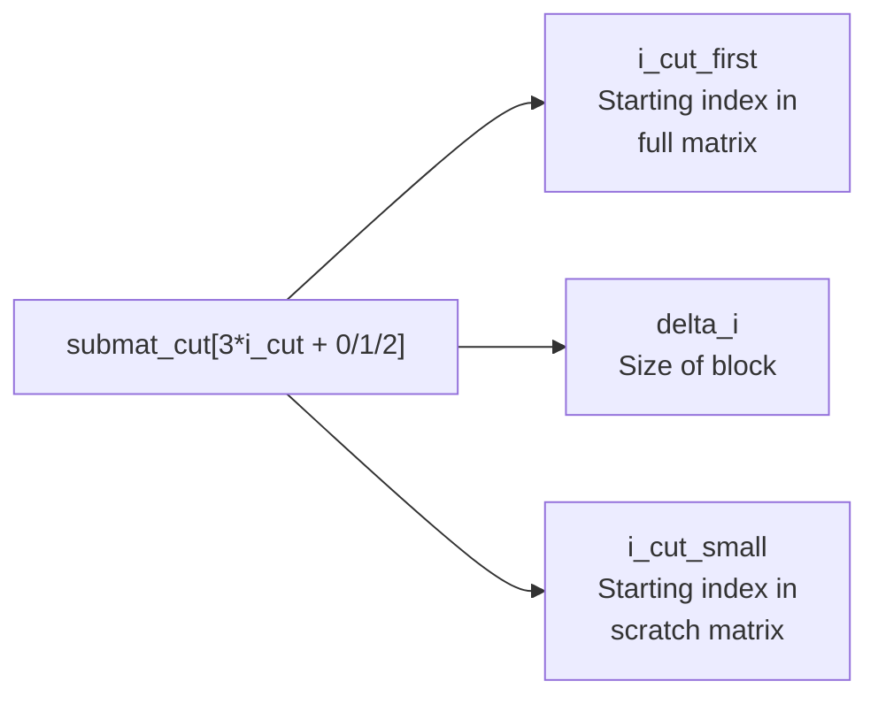
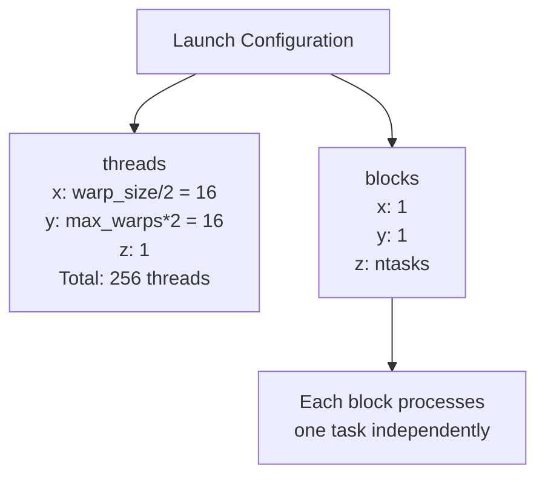
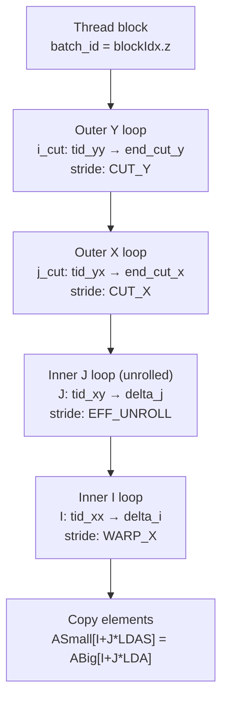
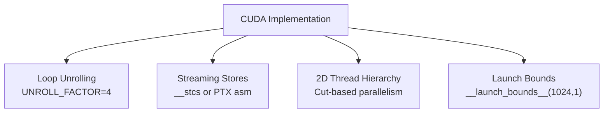
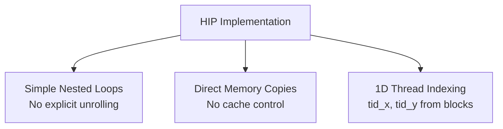
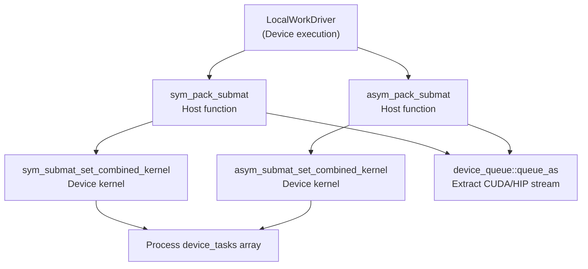

<!-- source: DeepWiki mcp.deepwiki.com · repo microsoft/skala · extra page Pack Density Operations · fetched 2026-10-26 -->

# Pack Density Operations

<details>
<summary>Relevant source files</summary>

The following files were used as context for generating this wiki page:

- [third_party/gauxc/attic/src/integrator/cuda/cuda_pack_density.cu](third_party/gauxc/attic/src/integrator/cuda/cuda_pack_density.cu)
- [third_party/gauxc/attic/src/new_integrator/device/cuda/cuda_inc_potential.cu](third_party/gauxc/attic/src/new_integrator/device/cuda/cuda_inc_potential.cu)
- [third_party/gauxc/attic/src/new_integrator/device/cuda/cuda_pack_density.cu](third_party/gauxc/attic/src/new_integrator/device/cuda/cuda_pack_density.cu)
- [third_party/gauxc/attic/src/new_integrator/device/hip/hip_inc_potential.hip](third_party/gauxc/attic/src/new_integrator/device/hip/hip_inc_potential.hip)
- [third_party/gauxc/attic/src/new_integrator/device/hip/hip_pack_density.hip](third_party/gauxc/attic/src/new_integrator/device/hip/hip_pack_density.hip)
- [third_party/gauxc/src/xc_integrator/local_work_driver/device/cuda/kernels/cuda_inc_potential.cu](third_party/gauxc/src/xc_integrator/local_work_driver/device/cuda/kernels/cuda_inc_potential.cu)
- [third_party/gauxc/src/xc_integrator/local_work_driver/device/cuda/kernels/pack_submat.cu](third_party/gauxc/src/xc_integrator/local_work_driver/device/cuda/kernels/pack_submat.cu)
- [third_party/gauxc/src/xc_integrator/local_work_driver/device/hip/kernels/hip_inc_potential.hip](third_party/gauxc/src/xc_integrator/local_work_driver/device/hip/kernels/hip_inc_potential.hip)
- [third_party/gauxc/src/xc_integrator/local_work_driver/device/hip/kernels/pack_submat.hip](third_party/gauxc/src/xc_integrator/local_work_driver/device/hip/kernels/pack_submat.hip)

</details>


## Purpose and Scope

This page documents the GPU kernel operations that extract submatrices from the full density matrix **P** and pack them into smaller scratch buffers for efficient GPU computation. These operations reduce memory bandwidth and computational cost by working only with the basis functions that are relevant to each task based on screening.

For the inverse operation that writes computed results back to the full matrix, see [Increment Potential Operations](#7.3.2). For details on the screening data structures that drive these operations, see [Submatrix Screening and Cuts](#7.3.3).

**Sources:** [src/xc_integrator/local_work_driver/device/cuda/kernels/pack_submat.cu:1-243](), [src/xc_integrator/local_work_driver/device/hip/kernels/pack_submat.hip:1-81]()

## Overview

Pack density operations transfer matrix elements from a large density matrix **P** (dimension `LDA × LDA`) to task-specific scratch buffers (dimension `LDAS × LDAS` where `LDAS ≤ LDA`). The extraction is guided by the `submat_cut` data structure, which defines which contiguous blocks of basis functions are relevant to each task after screening.

Two variants exist:
- **Symmetric packing** (`sym_pack_submat`): Uses the same screening for rows and columns
- **Asymmetric packing** (`asym_pack_submat`): Uses different screening for rows (`bfn_screening`) and columns (`cou_screening`)



**Sources:** [src/xc_integrator/local_work_driver/device/cuda/kernels/pack_submat.cu:22-102](), [src/xc_integrator/local_work_driver/device/cuda/kernels/pack_submat.cu:134-217]()

## Symmetric Pack Operation

The `sym_pack_submat` function extracts submatrices using the same screening information for both row and column dimensions. This is appropriate when the basis function set for rows and columns is identical (e.g., standard DFT calculations).

### Function Signature

```
void sym_pack_submat(
  size_t ntasks,
  XCDeviceTask* device_tasks,
  const double* A,
  int32_t LDA,
  int32_t submat_block_size,
  device_queue queue
)
```

| Parameter | Description |
|-----------|-------------|
| `ntasks` | Number of tasks to process |
| `device_tasks` | Array of task descriptors on device |
| `A` | Pointer to large matrix on device |
| `LDA` | Leading dimension of large matrix |
| `submat_block_size` | Block size for tiled kernel launches |
| `queue` | Device execution queue (CUDA stream or HIP stream) |

### Kernel Launch Strategy

The operation launches kernels in a tiled pattern to avoid kernel launch limits and improve L2 cache locality:



**Sources:** [src/xc_integrator/local_work_driver/device/cuda/kernels/pack_submat.cu:109-124]()

### Task Data Access

Each kernel invocation accesses per-task data from the `XCDeviceTask` structure:



**Sources:** [src/xc_integrator/local_work_driver/device/cuda/kernels/pack_submat.cu:32-42]()

## Asymmetric Pack Operation

The `asym_pack_submat` function handles cases where row and column screening differ. This occurs in asymmetric density matrix operations or when different basis sets are used for different purposes.

### Differences from Symmetric Packing

The key difference is the use of separate screening data structures:

| Dimension | Screening Source |
|-----------|------------------|
| Rows | `task.bfn_screening` (basis function screening) |
| Columns | `task.cou_screening` (Coulomb screening) |



**Sources:** [src/xc_integrator/local_work_driver/device/cuda/kernels/pack_submat.cu:151-154]()

### Dual Screening Iteration

The asymmetric kernel iterates over row cuts using `bfn_screening` and column cuts using `cou_screening`:

```
for( int i_cut = tid_yy + start_cut_y; i_cut < end_cut_y; i_cut += CUT_Y ) {
  const int3 i_data = *((int3*)(row_submat_cut_device + 3*i_cut));
  
  for( int j_cut = tid_yx + start_cut_x; j_cut < end_cut_x; j_cut += CUT_X ) {
    const int3 j_data = *((int3*)(col_submat_cut_device + 3*j_cut));
    // Copy block...
  }
}
```

**Sources:** [src/xc_integrator/local_work_driver/device/cuda/kernels/pack_submat.cu:172-216]()

## Kernel Implementation Details

### Submatrix Cut Data Structure

The `submat_cut` array stores triplets of integers for each contiguous block of basis functions:



Each thread block processes multiple cuts in nested loops, extracting rectangular blocks from the large matrix:

```
ASmall[i_cut_small : i_cut_small+delta_i,
       j_cut_small : j_cut_small+delta_j] 
  = 
ABig[i_cut_first : i_cut_first+delta_i,
     j_cut_first : j_cut_first+delta_j]
```

**Sources:** [src/xc_integrator/local_work_driver/device/cuda/kernels/pack_submat.cu:52-61]()

### CUDA Kernel Constants

The CUDA implementation uses carefully tuned constants for optimal performance:

| Constant | Value | Purpose |
|----------|-------|---------|
| `WARP_X` | 16 | Warp-level threads in X dimension |
| `WARP_Y` | 1 | Warp-level threads in Y dimension |
| `UNROLL_FACTOR` | 4 | Number of loop iterations to unroll |
| `EFF_UNROLL` | 4 | Effective unroll factor for loop bounds |
| `CUT_X` | 8 | Thread blocks in X cut dimension |
| `CUT_Y` | 8 | Thread blocks in Y cut dimension |

**Sources:** [src/xc_integrator/local_work_driver/device/cuda/kernels/pack_submat.cu:15-20]()

## Thread Organization and Parallelism

### Thread Block Configuration



Each thread block processes one task (`batch_id = blockIdx.z`). Within the block, threads are organized in a 2D grid with dimensions optimized for memory coalescing.

**Sources:** [src/xc_integrator/local_work_driver/device/cuda/kernels/pack_submat.cu:114-115]()

### Thread ID Decomposition

Threads are decomposed into multiple hierarchical indices for nested loop processing:

```
tid_xx = threadIdx.x % WARP_X    // [0, 15] - position within warp
tid_xy = threadIdx.x / WARP_X    // [0, 1]  - warp ID in X
tid_yx = threadIdx.y % CUT_X     // [0, 7]  - position within cut X
tid_yy = threadIdx.y / CUT_X     // [0, 1]  - cut ID in Y
```

This organization enables:
- Coalesced memory access patterns (via `tid_xx`)
- Parallel processing of multiple cuts (via `tid_yy` and `tid_yx`)
- Efficient loop unrolling (via `tid_xy`)

**Sources:** [src/xc_integrator/local_work_driver/device/cuda/kernels/pack_submat.cu:46-50]()

### Block-Level Work Distribution



**Sources:** [src/xc_integrator/local_work_driver/device/cuda/kernels/pack_submat.cu:57-101]()

## Memory Optimization Techniques

### Loop Unrolling and Vectorization

The CUDA kernel uses explicit loop unrolling with separate load and store phases to maximize instruction-level parallelism:

```cpp
double val[UNROLL_FACTOR];
double* address[UNROLL_FACTOR];

#pragma unroll
for (int k = 0; k < UNROLL_FACTOR; k++) {
  val[k] = ABig_begin[I + (J + k*WARP_Y)*LDA];
  address[k] = ASmall_begin + I + (J + k*WARP_Y) * LDAS;
}

#pragma unroll
for (int k = 0; k < UNROLL_FACTOR; k++) {
  __stcs(address[k], val[k]);  // Streaming store
}
```

This pattern:
1. Loads 4 consecutive elements from the large matrix
2. Stores addresses for the small matrix
3. Performs streaming stores to optimize cache usage

**Sources:** [src/xc_integrator/local_work_driver/device/cuda/kernels/pack_submat.cu:71-91]()

### Cache Control with Streaming Stores

CUDA 11.0+ provides the `__stcs` intrinsic for cache-streaming stores. For older versions, inline PTX assembly is used:

```cpp
#if (CUDART_VERSION >= 11000)
  __stcs(address[k], val[k]);
#else
  asm ("st.global.cs.f64 [%0], %1;" :: "l"(address[k]), "d"(val[k]));
#endif
```

The `.cs` modifier (cache-streaming) suggests immediate eviction of the written data from L1 cache, which is optimal since the scratch buffer is written once and read later by different kernels.

**Sources:** [src/xc_integrator/local_work_driver/device/cuda/kernels/pack_submat.cu:86-90]()

### Memory Coalescing

Memory access is coalesced through the `tid_xx` stride pattern:

```
for( int I = tid_xx; I < delta_i; I += WARP_X )
```

With `WARP_X = 16`, consecutive threads access consecutive memory locations when `tid_xx` ranges from 0-15, enabling coalesced 128-byte memory transactions.

**Sources:** [src/xc_integrator/local_work_driver/device/cuda/kernels/pack_submat.cu:74-92]()

## Platform Differences: CUDA vs HIP

### CUDA Implementation

The CUDA version uses advanced optimizations:



Thread configuration:
- 256 threads per block (16x16)
- Complex thread ID decomposition
- Optimized for warp-level execution

**Sources:** [src/xc_integrator/local_work_driver/device/cuda/kernels/pack_submat.cu:22-102]()

### HIP Implementation

The HIP version uses a simpler, more portable approach:



Key differences:

| Aspect | CUDA | HIP |
|--------|------|-----|
| Loop Structure | Unrolled, 4-way vectorized | Simple nested loops |
| Memory Ops | Streaming stores (`__stcs`) | Standard stores |
| Thread Indexing | 2-level decomposition | Block-relative indexing |
| Launch Bounds | `__launch_bounds__(1024,1)` | `__launch_bounds__(1024,1)` |
| Cuts per Thread | CUT_X × CUT_Y work items | All cuts per thread |

The HIP implementation iterates over all cuts sequentially:

```cpp
for( size_t i_cut = 0; i_cut < ncut; ++i_cut ) {
  for( size_t j_cut = 0; j_cut < ncut; ++j_cut ) {
    for( size_t J = tid_y; J < delta_j; J += blockDim.y )      
    for( size_t I = tid_x; I < delta_i; I += blockDim.x )
      ASmall_begin[I + J*LDAS] = ABig_begin[I + J*LDA];
  }
}
```

**Sources:** [src/xc_integrator/local_work_driver/device/hip/kernels/pack_submat.hip:16-67]()

### Early Exit Optimization

Both implementations support skipping tasks with a single cut (no screening):

```cpp
template <typename T, bool skip_single_cut = true>
__global__ void sym_submat_set_combined_kernel(...) {
  if constexpr (skip_single_cut) {
    if( task.bfn_screening.ncut == 1 ) return;
  }
  // ...
}
```

When `ncut == 1`, the entire matrix is relevant and the pack operation can be optimized away. This template parameter allows runtime selection of this behavior.

**Sources:** [src/xc_integrator/local_work_driver/device/cuda/kernels/pack_submat.cu:35-37](), [src/xc_integrator/local_work_driver/device/hip/kernels/pack_submat.hip:29-31]()

## Call Hierarchy



**Sources:** [src/xc_integrator/local_work_driver/device/cuda/kernels/pack_submat.cu:109-239]()

---

