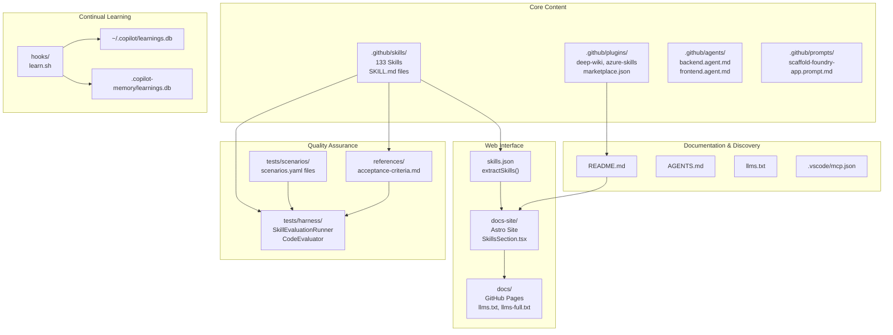
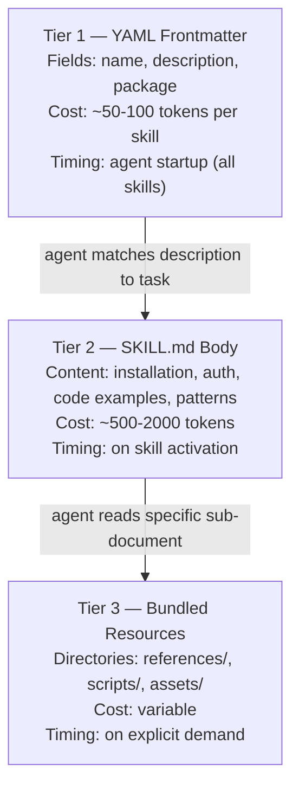
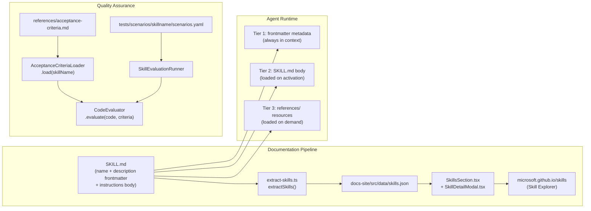

<!-- source: DeepWiki mcp.deepwiki.com · repo microsoft/skills · page 1 Overview · fetched 2026-10-30 -->

# Overview

<details>
<summary>Relevant source files</summary>

The following files were used as context for generating this wiki page:

- [.claude-plugin/marketplace.json](.claude-plugin/marketplace.json)
- [.github/agents/scaffolder.agent.md](.github/agents/scaffolder.agent.md)
- [.github/copilot-instructions.md](.github/copilot-instructions.md)
- [.github/docs/agent-integration.md](.github/docs/agent-integration.md)
- [.github/plugin/marketplace.json](.github/plugin/marketplace.json)
- [.github/plugins/deep-wiki/.claude-plugin/plugin.json](.github/plugins/deep-wiki/.claude-plugin/plugin.json)
- [.github/plugins/deep-wiki/README.md](.github/plugins/deep-wiki/README.md)
- [.github/plugins/deep-wiki/commands/ado.md](.github/plugins/deep-wiki/commands/ado.md)
- [.github/plugins/deep-wiki/commands/crisp.md](.github/plugins/deep-wiki/commands/crisp.md)
- [.github/plugins/deep-wiki/skills/wiki-ado-convert/SKILL.md](.github/plugins/deep-wiki/skills/wiki-ado-convert/SKILL.md)
- [.github/prompts/scaffold-foundry-app.prompt.md](.github/prompts/scaffold-foundry-app.prompt.md)
- [.github/skills/skill-creator/references/acceptance-criteria.md](.github/skills/skill-creator/references/acceptance-criteria.md)
- [Agents.md](Agents.md)
- [README.md](README.md)
- [context7.json](context7.json)
- [docs-site/src/pages/index.astro](docs-site/src/pages/index.astro)
- [docs/index.html](docs/index.html)
- [marketplace.json](marketplace.json)
- [tests/harness/criteria-loader.ts](tests/harness/criteria-loader.ts)
- [tests/scenarios/skill-creator/scenarios.yaml](tests/scenarios/skill-creator/scenarios.yaml)

</details>


The `microsoft/skills` repository is a catalog of **133 agent skills** — domain-specific knowledge modules that specialize AI coding agents for Azure SDK and Microsoft AI Foundry development. The repository provides five major components:

1. **Skills Catalog** — 133 skills covering Python, .NET, TypeScript, Java, and Rust Azure SDKs
2. **Deep Wiki Plugin** — AI-powered documentation generator with Mermaid diagrams and source citations
3. **Test Harness** — Quality validation system with acceptance criteria and scenario-based evaluation
4. **Documentation Site** — Astro-based skill explorer at [microsoft.github.io/skills](https://microsoft.github.io/skills)
5. **Continual Learning System** — Hooks for persistent agent memory across sessions

This page introduces the repository's architecture and how these components interact. For installation, see [Installation and Usage](#6). For skill structure, see [Agent Skills System](#2). For quality validation, see [Quality Assurance System](#4).

---

## Context-Driven Development

The premise is that frontier LLMs already encode Azure SDK patterns from pretraining. Skills provide **activation context** — targeted domain knowledge injected into an agent's context window — to reliably surface those latent patterns. This idea is articulated in [README.md:47-52]() and [.github/docs/blog.wordpress.xml:3-4]().

The critical constraint is **selective loading**. Loading all skills simultaneously causes **context rot**: diluted attention, wasted tokens, and conflated patterns from different frameworks. Only skills relevant to the current task should be loaded.

> "High signal-to-noise ratio is everything." — [.github/docs/blog.wordpress.xml:35]()

Skills use a three-tier **progressive disclosure** strategy to minimize context cost until a skill is actually needed. See [Understanding Skills and Progressive Disclosure](#2.1) for the full model.

Sources: [README.md:47-52](), [Agents.md:176-177](), [.github/docs/blog.wordpress.xml:3-35]()

---

## Repository Anatomy

**Repository Architecture: Four Primary Subsystems**



Sources: [README.md:512-540](), [.github/copilot-instructions.md:72-99](), [.github/plugins/deep-wiki/README.md:1-6](), [docs-site/scripts/extract-skills.ts:1-10](), [tests/harness/criteria-loader.ts:1-10]()

---

## What's Inside

| Resource | Location | Description |
|----------|----------|-------------|
| **Skills** | `.github/plugins/*/skills/`, `.github/skills/` | 133 `SKILL.md` knowledge modules for Azure SDKs |
| **Plugins** | `.github/plugins/` | Installable bundles: `deep-wiki`, `azure-skills`, `azure-sdk-*` |
| **Agent Personas** | `.github/agents/` | Role-specific agents: `backend.agent.md`, `frontend.agent.md`, `infrastructure.agent.md`, `planner.agent.md`, `presenter.agent.md`, `scaffolder.agent.md` |
| **AGENTS.md** | `AGENTS.md` | Template for configuring agent behavior in user projects |
| **Prompts** | `.github/prompts/` | Reusable prompt templates: `code-review.prompt.md`, `scaffold-foundry-app.prompt.md` |
| **MCP Configs** | `.vscode/mcp.json` | Pre-configured MCP server definitions: `microsoft-docs`, `context7`, `github`, `playwright` |
| **Foundry Docs** | `docs/llms.txt`, `docs/llms-full.txt` | LLM-friendly Microsoft Foundry documentation (updated daily via `.github/workflows/update-llms-txt.yml`) |
| **Skill Explorer** | `docs-site/` | Astro + React website with `SkillsSection.tsx` and `SkillDetailModal.tsx` components |
| **Test Harness** | `tests/harness/`, `tests/scenarios/` | `SkillEvaluationRunner`, `CodeEvaluator`, `AcceptanceCriteriaLoader` for quality validation |
| **Continual Learning** | `hooks/` | `learn.sh` script with SQLite-based session memory in `~/.copilot/learnings.db` and `.copilot-memory/learnings.db` |

Sources: [README.md:59-68](), [Agents.md:149-165](), [.github/plugins/deep-wiki/README.md:1-217](), [tests/harness/criteria-loader.ts:1-10]()

---

## Skill Catalog Summary

Skills are stored in language-specific plugin bundles under `.github/plugins/` and symlinked into `.github/skills/` for backward compatibility. Each skill name uses a language suffix for automatic discovery.

| Language | Count | Suffix | Plugin Bundle Directory |
|----------|-------|--------|------------------------|
| Core (language-agnostic) | 8 | — | `.github/skills/` (direct) |
| Python | 41 | `-py` | `.github/plugins/azure-sdk-python/skills/` |
| .NET | 28 | `-dotnet` | `.github/plugins/azure-sdk-dotnet/skills/` |
| TypeScript | 25 | `-ts` | `.github/plugins/azure-sdk-typescript/skills/` |
| Java | 25 | `-java` | `.github/plugins/azure-sdk-java/skills/` |
| Rust | 6 | `-rust` | `.github/plugins/azure-sdk-rust/skills/` |

**Total: 133 skills**

Skills are further categorized by domain: `foundry`, `data`, `messaging`, `monitoring`, `entra`, `integration`, `compute`, `communication`, `frontend`, `partner`, `m365`.

The `extractSkills()` function in `docs-site/scripts/extract-skills.ts` reads all `SKILL.md` frontmatter from plugin bundles and core skill directories, using the `PLUGIN_LANG_MAP` constant to assign language tags, and queries `skills/` symlinks via `findSymlinkInfo()` to assign category tags. The output is `docs-site/src/data/skills.json`, which powers the Skill Explorer website.

Sources: [README.md:75-83](), [docs-site/scripts/extract-skills.ts:96-203]()

---

## Main Subsystems

| Subsystem | Key Paths | Wiki Page |
|-----------|-----------|-----------|
| **Agent Skills** | `.github/plugins/`, `.github/skills/`, `SKILL.md` | [Agent Skills System](#2) |
| **Deep Wiki Plugin** | `.github/plugins/deep-wiki/` | [Deep Wiki Plugin](#3) |
| **Quality Assurance** | `tests/harness/`, `tests/scenarios/` | [Quality Assurance System](#4) |
| **Documentation Systems** | `docs-site/`, `docs/`, `.github/scripts/` | [Documentation Systems](#5) |
| **Installation and Usage** | `npx skills add`, `/plugin` CLI, `.vscode/mcp.json` | [Installation and Usage](#6) |
| **Development Guide** | `AGENTS.md`, `.github/copilot-instructions.md` | [Development Guide](#7) |

**Component Interaction: Skills Flow Through All Systems**

```mermaid
graph LR
    subgraph "Authoring"
        author["Developer<br/>writes SKILL.md"]
        criteria["writes acceptance-criteria.md"]
        scenario["writes scenarios.yaml"]
    end
    
    subgraph "Quality Gate"
        harness["SkillEvaluationRunner"]
        evaluator["CodeEvaluator"]
        ralph["RalphLoopController"]
    end
    
    subgraph "Publication"
        extract["extract-skills.ts<br/>extractSkills()"]
        website["Skill Explorer<br/>SkillsSection.tsx"]
        llms["llms.txt generation"]
    end
    
    subgraph "Runtime"
        agent["AI Agent"]
        tier1["Tier 1: frontmatter<br/>(50 tokens)"]
        tier2["Tier 2: SKILL.md body<br/>(500-2000 tokens)"]
        memory["Continual Learning<br/>learn.sh → learnings.db"]
    end
    
    author --> criteria
    author --> scenario
    criteria --> harness
    scenario --> harness
    harness --> evaluator
    evaluator --> ralph
    
    ralph -->|"passes quality"| extract
    extract --> website
    extract --> llms
    
    llms --> agent
    agent --> tier1
    tier1 -->|"activates"| tier2
    tier2 --> memory
```



Sources: [README.md:544-571](), [context7.json:1-13](), [tests/harness/criteria-loader.ts:1-10](), [docs-site/scripts/extract-skills.ts:1-10]()

---

## Installation

Three methods are available for adding skills to a project.

| Method | Command | Notes |
|--------|---------|-------|
| **npx CLI wizard** | `npx skills add microsoft/skills` | Interactive; selects and copies specific skills |
| **Copilot CLI plugin** | `/plugin marketplace add microsoft/skills` then `/plugin install deep-wiki@skills` | Installs as Copilot CLI plugin with slash commands |
| **Manual clone** | `git clone …` then `cp -r` or `ln -s` | Copy or symlink specific skill directories |

For multi-agent setups (Copilot, Claude Code, OpenCode in the same repo), a single symlink can share skills across all agent configuration directories:

```bash
ln -s ../.github/skills .opencode/skills
ln -s ../.github/skills .claude/skills
```

For full details including `plugin.json` structure and Claude Code-specific hook configuration, see [Installing Skills](#6.1) and [Claude Code Integration](#6.4).

Sources: [README.md:17-43](), [.github/docs/blog.wordpress.xml:40-65]()

---

## Progressive Disclosure

Each skill is a directory containing a `SKILL.md` file with two parts: a **YAML frontmatter** block (always loaded at startup) and a **Markdown body** (loaded only when the skill activates).

**Three-Tier Loading Strategy**



Sources: [.github/docs/agent-integration.md:59-78](), [Agents.md:149-154]()

The `AcceptanceCriteriaLoader` class in `tests/harness/criteria-loader.ts` uses the constant `CRITERIA_FILENAME = "references/acceptance-criteria.md"` to locate Tier 3 resource files for evaluation. See [Acceptance Criteria Format](#4.2).

---

## SKILL.md Data Flow Across Systems

The following diagram shows how a single `SKILL.md` file — and its companion test files — flows through every major system in the repository.

**SKILL.md Lifecycle: From Authoring to Agent Use**



Sources: [docs-site/scripts/extract-skills.ts:144-214](), [docs-site/src/components/SkillsSection.tsx:1-10](), [tests/harness/criteria-loader.ts:24-28](), [.github/docs/agent-integration.md:7-78]()

---

## Core Agent Principles

`AGENTS.md` and `.github/copilot-instructions.md` ship as templates for configuring agent behavior in any project. Both define five principles applied to every coding task:

| Principle | Practical Rule |
|-----------|---------------|
| **Fresh Information First** | Use `microsoft-docs` MCP to look up current API signatures before writing Azure SDK code |
| **Think Before Coding** | State assumptions explicitly; ask when ambiguous rather than guessing |
| **Simplicity First** | Write minimum code that solves the problem; no speculative abstractions |
| **Surgical Changes** | Touch only lines required by the request; match existing style |
| **Goal-Driven Execution** | Define verifiable success criteria before implementation; use TDD |

The authentication pattern repeated across all Azure SDK skills follows from these principles: always use `DefaultAzureCredential` from `azure-identity`, never hardcode credentials.

Sources: [Agents.md:28-86](), [.github/copilot-instructions.md:24-67]()

---

