<!-- source: DeepWiki mcp.deepwiki.com · repo microsoft/skills · page 2 Agent Skills System · fetched 2026-10-30 -->

# Agent Skills System

<details>
<summary>Relevant source files</summary>

The following files were used as context for generating this wiki page:

- [.github/agents/scaffolder.agent.md](.github/agents/scaffolder.agent.md)
- [.github/copilot-instructions.md](.github/copilot-instructions.md)
- [.github/docs/agent-integration.md](.github/docs/agent-integration.md)
- [.github/plugins/deep-wiki/.claude-plugin/plugin.json](.github/plugins/deep-wiki/.claude-plugin/plugin.json)
- [.github/plugins/deep-wiki/README.md](.github/plugins/deep-wiki/README.md)
- [.github/plugins/deep-wiki/commands/ado.md](.github/plugins/deep-wiki/commands/ado.md)
- [.github/plugins/deep-wiki/commands/crisp.md](.github/plugins/deep-wiki/commands/crisp.md)
- [.github/plugins/deep-wiki/skills/wiki-ado-convert/SKILL.md](.github/plugins/deep-wiki/skills/wiki-ado-convert/SKILL.md)
- [.github/prompts/scaffold-foundry-app.prompt.md](.github/prompts/scaffold-foundry-app.prompt.md)
- [.github/skills/skill-creator/references/acceptance-criteria.md](.github/skills/skill-creator/references/acceptance-criteria.md)
- [Agents.md](Agents.md)
- [README.md](README.md)
- [context7.json](context7.json)
- [docs-site/src/pages/index.astro](docs-site/src/pages/index.astro)
- [docs/index.html](docs/index.html)
- [tests/harness/criteria-loader.ts](tests/harness/criteria-loader.ts)
- [tests/scenarios/skill-creator/scenarios.yaml](tests/scenarios/skill-creator/scenarios.yaml)

</details>


This document describes the core skill system that provides domain-specific knowledge packages for AI agents working with Azure SDKs and Microsoft AI Foundry. It covers the skill file format, directory organization, progressive disclosure architecture, and how agents discover and load skills.

For information about creating new skills, see [Creating New Skills](#2.4). For browsing available skills through the web interface, see [Browsing and Discovering Skills](#2.2). For the Deep Wiki plugin architecture, see [Plugin Marketplace Architecture](#2.6).

---

## Architecture Overview

The Agent Skills System is a file-based knowledge distribution mechanism that packages SDK expertise, code patterns, and best practices into structured markdown documents. The system is designed to minimize context window usage through progressive disclosure while maintaining access to deep domain knowledge when needed.

### System Components

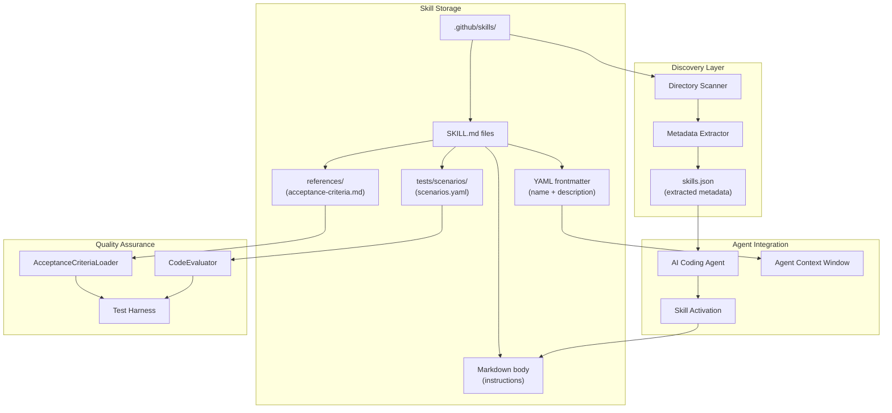

**Sources:** [README.md:1-70](), [Agents.md:147-164](), [.github/copilot-instructions.md:102-119]()

### Core Design Principles

| Principle | Implementation | Token Cost |
|-----------|----------------|------------|
| **Progressive Disclosure** | Load metadata at startup, full instructions on demand | ~50 tokens/skill (metadata), ~1500 tokens (full) |
| **Selective Loading** | Agents load only task-relevant skills to avoid context rot | Variable (2-5 skills per task) |
| **Source-Linked** | All patterns cite file paths and line numbers for verification | N/A |
| **Language-Aware** | Suffix-based categorization (`-py`, `-dotnet`, `-ts`, `-java`, `-rust`) | Automatic filtering |
| **Test-Driven** | Acceptance criteria and test scenarios validate skill quality | Enforced by CI/CD |

**Sources:** [README.md:47-51](), [Agents.md:149-177](), [.github/docs/agent-integration.md:59-77]()

---

## Skill File Structure

### SKILL.md Format

Each skill is a directory containing a `SKILL.md` file with YAML frontmatter and structured markdown content.

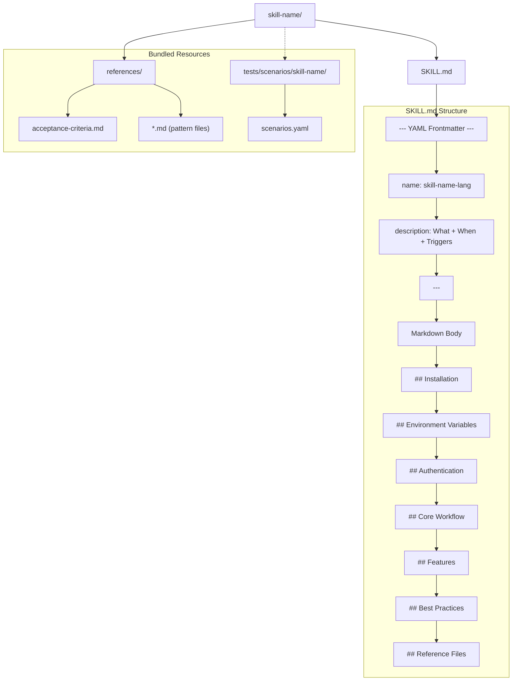

**Sources:** [.github/skills/skill-creator/references/acceptance-criteria.md:9-68](), [Agents.md:149-151](), [tests/scenarios/skill-creator/scenarios.yaml:10-89]()

### YAML Frontmatter Schema

The frontmatter contains metadata that agents scan at startup without loading the full skill content.

| Field | Type | Purpose | Required |
|-------|------|---------|----------|
| `name` | string | Skill identifier (matches directory name) | Yes |
| `description` | string | What the skill does + when to use + trigger phrases | Yes |

**Example frontmatter:**

```yaml
---
name: azure-cosmos-db-py
description: |
  Azure Cosmos DB SDK for Python. Use for NoSQL database operations,
  document CRUD, queries, and container management.
  Triggers: "cosmos db", "nosql", "document database", "azure cosmos".
---
```

**Sources:** [.github/skills/skill-creator/references/acceptance-criteria.md:94-105](), [tests/scenarios/skill-creator/scenarios.yaml:17-22]()

### Markdown Body Sections

The body follows a standard structure optimized for Azure SDK skills:

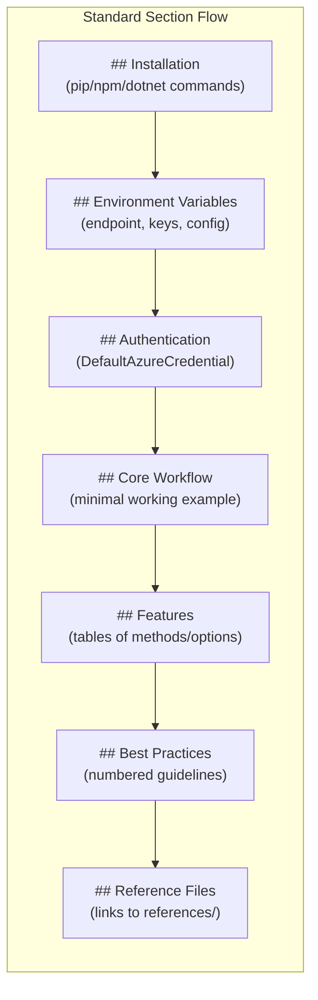

**Sources:** [.github/skills/skill-creator/references/acceptance-criteria.md:201-229](), [tests/scenarios/skill-creator/scenarios.yaml:90-186]()

---

## Progressive Disclosure Architecture

The system uses a three-tier loading strategy to balance context efficiency with access to deep knowledge.

### Three-Tier Loading Model

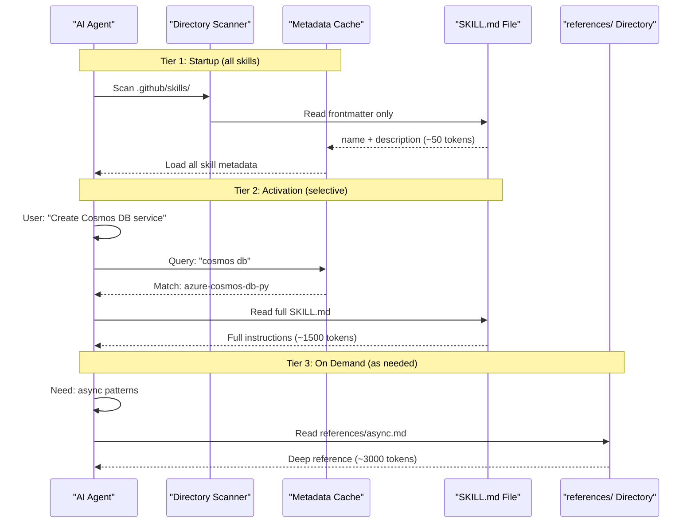

**Sources:** [.github/docs/agent-integration.md:59-77](), [README.md:47-51]()

### Token Cost Analysis

| Tier | Content | When Loaded | Token Cost | Skills in Context |
|------|---------|-------------|------------|-------------------|
| **Metadata** | `name` + `description` from YAML | Agent startup | ~50-100 per skill | All 133 skills (~6,650 tokens) |
| **Instructions** | Full `SKILL.md` markdown body | Skill activation | ~500-2000 per skill | 2-5 active skills (~3,000 tokens) |
| **Resources** | Files in `references/`, `scripts/`, `assets/` | On-demand reference | Variable (500-3000) | 0-2 reference files (~2,000 tokens) |

**Total context usage:** ~11,650 tokens maximum (vs. ~300,000 if all skills loaded fully at startup)

**Sources:** [.github/docs/agent-integration.md:59-67](), [Agents.md:175-177]()

### Context Rot Prevention

Loading all skills simultaneously causes three critical failures:

1. **Diluted Attention**: Agent cannot distinguish between Azure Cosmos DB patterns and Azure Storage patterns
2. **Wasted Tokens**: 98% of loaded content is irrelevant to current task
3. **Conflated Patterns**: Agent mixes authentication patterns from different SDKs

**Correct approach:**

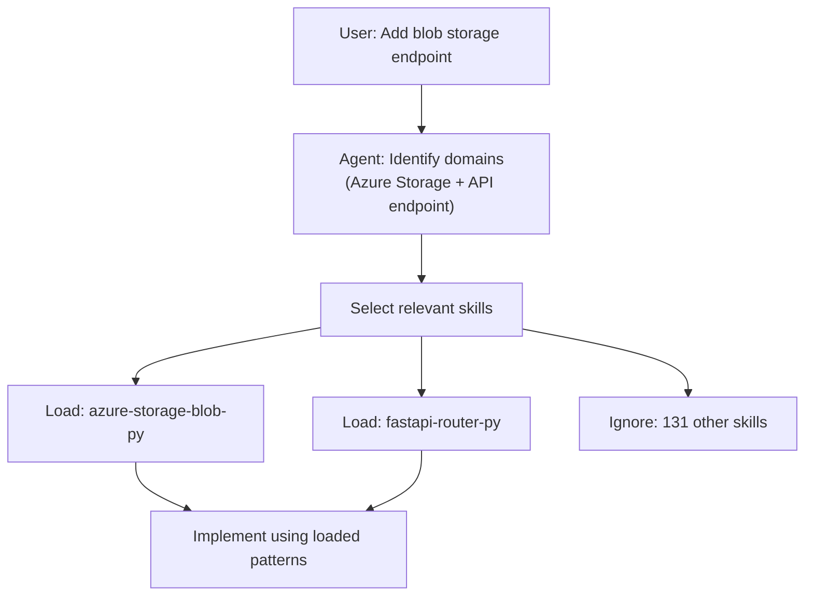

**Sources:** [README.md:47-51](), [Agents.md:175-177](), [.github/docs/agent-integration.md:100-117]()

---

## Discovery and Activation

### Directory Scanning Process

Agents discover skills through filesystem inspection at startup.

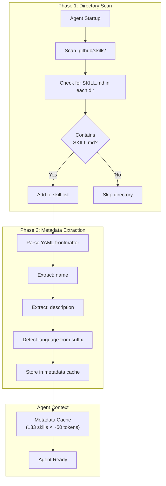

**Sources:** [.github/docs/agent-integration.md:6-35](), [tests/harness/criteria-loader.ts:63-86]()

### Skill Activation Flow

When an agent determines a skill is relevant, it loads the full content.

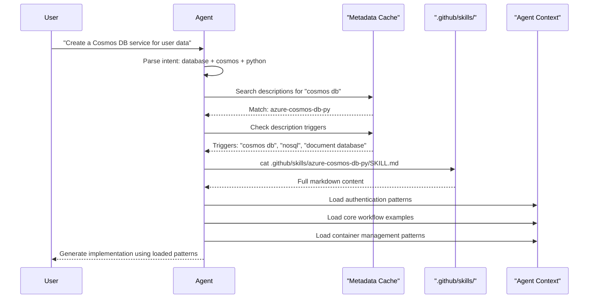

**Sources:** [.github/docs/agent-integration.md:66-77](), [.github/docs/agent-integration.md:87-98]()

### Agent-Specific Discovery

| Agent Type | Discovery Method | Configuration |
|------------|------------------|---------------|
| **VS Code / GitHub Copilot** | Workspace scanning + `.github/copilot-instructions.md` | Automatic when skills in `.github/skills/` |
| **Copilot CLI** | Directory scanning + context from `Agents.md` | Loaded from workspace root |
| **Claude Desktop** | `.claude/skills/` symlinks + `CLAUDE.md` pointer | Manual symlink setup |
| **Tool-Based Agents** | `load_skill(name)` tool function | Custom tool implementation |

**Sources:** [.github/docs/agent-integration.md:36-55](), [Agents.md:156-164]()

---

## Skill Organization

### Directory Structure

```
.github/
├── skills/                         # Backward-compatible symlinks (deprecated)
│   ├── azure-cosmos-db-py/         # Symlink → ../plugins/azure-sdk-python/skills/azure-cosmos-db-py
│   ├── azure-ai-projects-py/       # Symlink → ../plugins/azure-sdk-python/skills/azure-ai-projects-py
│   └── mcp-builder/                # Core skill (no symlink, owned by root)
│
├── plugins/                        # Canonical source (plugin bundles)
│   ├── azure-sdk-python/
│   │   ├── marketplace.json        # Plugin metadata
│   │   ├── skills/
│   │   │   ├── azure-cosmos-db-py/
│   │   │   │   ├── SKILL.md
│   │   │   │   ├── references/
│   │   │   │   │   └── acceptance-criteria.md
│   │   │   │   └── scripts/
│   │   │   └── azure-ai-projects-py/
│   │   │       └── SKILL.md
│   │   ├── commands/
│   │   └── agents/
│   │
│   ├── azure-sdk-dotnet/
│   ├── azure-sdk-typescript/
│   ├── azure-sdk-java/
│   └── deep-wiki/
│
└── prompts/                        # Reusable templates

tests/
└── scenarios/
    ├── azure-cosmos-db-py/
    │   └── scenarios.yaml          # Test scenarios for skill validation
    └── azure-ai-projects-py/
        └── scenarios.yaml
```

**Sources:** [README.md:513-541](), [Agents.md:149-154]()

### Naming Convention

Skills use language suffixes for automatic categorization and filtering.

| Language | Suffix | Count | Examples |
|----------|--------|-------|----------|
| **Core** (cross-language) | — | 8 | `mcp-builder`, `skill-creator`, `copilot-sdk`, `cloud-solution-architect` |
| **Python** | `-py` | 41 | `azure-cosmos-db-py`, `azure-ai-projects-py`, `fastapi-router-py` |
| **.NET** | `-dotnet` | 28 | `azure-ai-openai-dotnet`, `azure-identity-dotnet` |
| **TypeScript** | `-ts` | 25 | `azure-ai-projects-ts`, `zustand-store-ts`, `react-flow-node-ts` |
| **Java** | `-java` | 25 | `azure-cosmos-java`, `azure-ai-projects-java` |
| **Rust** | `-rust` | 7 | `azure-identity-rust`, `azure-cosmos-rust` |

**Pattern:** `azure-<service>-<language>` or `<domain>-<language>`

**Sources:** [README.md:72-83](), [Agents.md:166-173](), [.github/docs/agent-integration.md:140-149]()

### Skill Categories

Skills are logically grouped by product area for organizational clarity.

```mermaid
graph TD
    subgraph "Foundry & AI"
        foundry_skills["azure-ai-projects-*<br/>azure-ai-agents-*<br/>azure-search-documents-*<br/>azure-ai-voicelive-*"]
    end
    
    subgraph "Data & Storage"
        data_skills["azure-cosmos-*<br/>azure-storage-blob-*<br/>azure-data-tables-*"]
    end
    
    subgraph "Messaging & Events"
        messaging_skills["azure-eventhub-*<br/>azure-servicebus-*<br/>azure-eventgrid-*"]
    end
    
    subgraph "Monitoring"
        monitoring_skills["azure-monitor-*<br/>azure-applicationinsights-*"]
    end
    
    subgraph "Identity & Security"
        identity_skills["azure-identity-*<br/>azure-keyvault-*"]
    end
    
    subgraph "Integration"
        integration_skills["azure-appconfiguration-*<br/>azure-apimanagement-*"]
    end
    
    subgraph "Patterns & Frameworks"
        pattern_skills["fastapi-router-py<br/>pydantic-models-py<br/>zustand-store-ts<br/>react-flow-node-ts"]
    end
```

**Sources:** [README.md:86-216](), [Agents.md:213-223]()

---

## Plugin Marketplace Architecture

Skills can be bundled into installable plugins that combine skills, commands, and agents.

### Plugin Structure

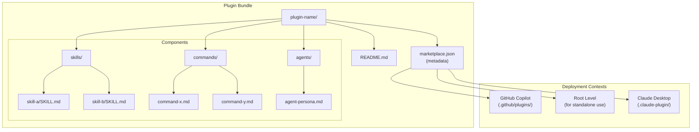

**Sources:** [README.md:545-559](), [.github/plugins/deep-wiki/.claude-plugin/plugin.json:1-11]()

### marketplace.json Schema

Plugin metadata defines name, version, components, and deployment contexts.

```json
{
  "name": "deep-wiki",
  "version": "2.0.0",
  "description": "AI-powered wiki generator",
  "skills": [
    "wiki-architect",
    "wiki-page-writer",
    "wiki-researcher"
  ],
  "commands": [
    "/deep-wiki:generate",
    "/deep-wiki:crisp",
    "/deep-wiki:page"
  ],
  "agents": [
    "wiki-architect",
    "wiki-writer"
  ]
}
```

**Sources:** [.github/plugins/deep-wiki/.claude-plugin/plugin.json:1-11](), [README.md:556-559]()

### Installation Methods

| Method | Command | Target Directory |
|--------|---------|------------------|
| **NPX Installer** | `npx skills add microsoft/skills` | `.github/skills/` |
| **Copilot CLI Plugin** | `/plugin install deep-wiki@skills` | Plugin-managed |
| **Manual Copy** | `cp -r agent-skills/.github/skills/<name> .` | Custom path |
| **Symlink** | `ln -s /path/to/skill .github/skills/<name>` | Custom path |

**Sources:** [README.md:17-43](), [Agents.md:156-160]()

---

## Quality Assurance System

Each skill includes acceptance criteria and test scenarios to validate generated code quality.

### Acceptance Criteria Structure

The `references/acceptance-criteria.md` file defines correct and incorrect code patterns.

```mermaid
graph TD
    subgraph "acceptance-criteria.md"
        sections["## Sections (e.g., Authentication, Core Workflow)"]
        
        subgraph "Per Section"
            correct_h3["### ✅ Correct"]
            correct_code["```python<br/>correct pattern<br/>```"]
            
            incorrect_h3["### ❌ Incorrect"]
            incorrect_code["```python<br/>anti-pattern<br/>```"]
        end
    end
    
    subgraph "AcceptanceCriteriaLoader"
        loader["AcceptanceCriteriaLoader.load()"]
        parse["Parse markdown sections"]
        extract_patterns["Extract code blocks"]
        categorize["Categorize as correct/incorrect"]
        rules["Generate ValidationRule objects"]
    end
    
    subgraph "Output"
        criteria_obj["AcceptanceCriteria Object"]
        correct_patterns["correctPatterns: CodePattern[]"]
        incorrect_patterns["incorrectPatterns: CodePattern[]"]
        validation_rules["rules: ValidationRule[]"]
    end
    
    sections --> correct_h3
    correct_h3 --> correct_code
    sections --> incorrect_h3
    incorrect_h3 --> incorrect_code
    
    correct_code --> loader
    incorrect_code --> loader
    loader --> parse
    parse --> extract_patterns
    extract_patterns --> categorize
    categorize --> rules
    
    rules --> criteria_obj
    criteria_obj --> correct_patterns
    criteria_obj --> incorrect_patterns
    criteria_obj --> validation_rules
```

**Sources:** [tests/harness/criteria-loader.ts:33-131](), [.github/skills/skill-creator/references/acceptance-criteria.md:1-7]()

### Test Scenario Format

The `tests/scenarios/<skill>/scenarios.yaml` file defines prompts and expected patterns.

```yaml
config:
  model: gpt-4
  max_tokens: 2000
  temperature: 0.3

scenarios:
  - name: scenario_identifier
    prompt: |
      Task description for the agent
    expected_patterns:
      - "pattern that must appear"
      - "import statement"
      - "DefaultAzureCredential"
    forbidden_patterns:
      - "hardcoded credential"
      - "api_key.*=.*sk-"
    tags:
      - category
    mock_response: |
      Expected generated code
```

**Sources:** [tests/scenarios/skill-creator/scenarios.yaml:1-11]()

### Test Harness Classes

| Class | Purpose | Key Methods |
|-------|---------|-------------|
| `AcceptanceCriteriaLoader` | Parse `acceptance-criteria.md` into structured rules | `load(skillName)`, `parseCriteria()` |
| `CodeEvaluator` | Validate generated code against patterns | `evaluate(code, criteria)` |
| `SkillEvaluationRunner` | Run scenarios and compute scores | `runScenario(scenario)` |
| `RalphLoopController` | Iterative improvement loop | `runWithFeedback()` |
| `CopilotClient` | Interface to Copilot SDK (mock/real) | `generateCode(prompt)` |

**Sources:** [tests/harness/criteria-loader.ts:51-100]()

### Evaluation Workflow

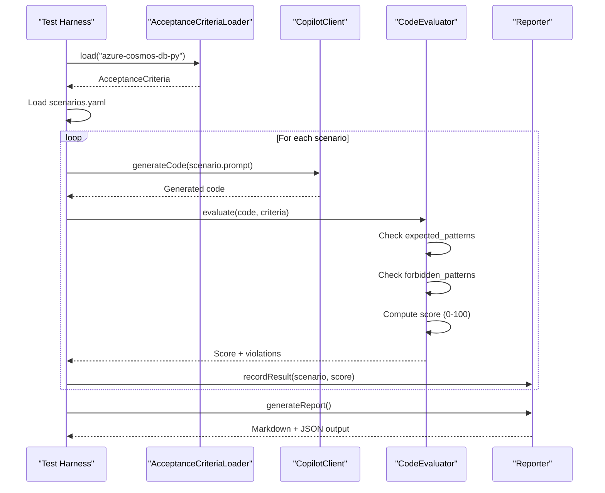

**Sources:** [tests/harness/criteria-loader.ts:88-100](), [README.md:610-631]()

---

## Web Interface Integration

The repository includes a documentation website that extracts skill metadata for browsing and filtering.

### Data Extraction Pipeline

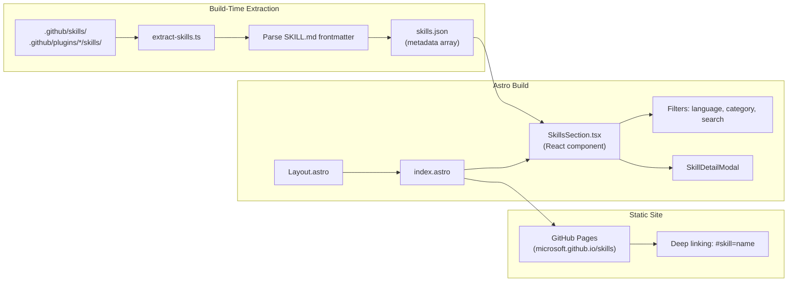

**Sources:** [docs-site/src/pages/index.astro:1-16](), [README.md:15]()

### Skill Metadata Schema

```typescript
interface Skill {
  name: string;           // e.g., "azure-cosmos-db-py"
  description: string;    // Full description with triggers
  lang: string;           // "py" | "dotnet" | "ts" | "java" | "rust" | "core"
  category: string;       // "foundry" | "data" | "messaging" | etc.
  path: string;           // ".github/skills/azure-cosmos-db-py"
  package: string;        // NPM/PyPI/NuGet package name
}
```

**Sources:** [docs-site/src/pages/index.astro:7]()

---

## Integration with Fresh Information First

The skill system implements the "Fresh Information First" principle for Azure SDK knowledge.

### Stale Knowledge Problem

AI agent training data becomes outdated as SDKs evolve. Skills address this through:

1. **MCP Server Integration**: Skills instruct agents to query `microsoft-docs` MCP server before using cached knowledge
2. **Daily Documentation Updates**: Automated workflows scrape Microsoft Learn and update `llms.txt` files
3. **Version-Specific Patterns**: Skills include version checks and compatibility notes

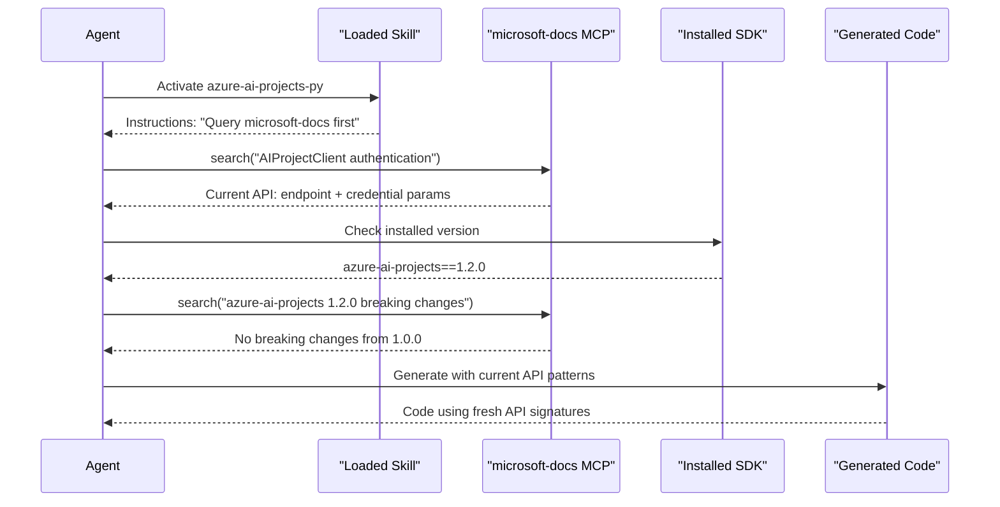

**Sources:** [Agents.md:6-23](), [.github/copilot-instructions.md:8-17]()

### Verification Commands

Skills include verification steps to prevent stale patterns:

```bash
# Always do this first (from skill instructions)
1. Search Microsoft Learn for current docs
2. Check Context7 for indexed Foundry documentation (updated daily)
3. Verify against actual installed package version
```

**Sources:** [Agents.md:16-20]()

---

## Summary

The Agent Skills System provides a scalable, context-efficient mechanism for distributing domain-specific knowledge to AI coding agents. Key architectural decisions include:

| Design Choice | Rationale | Impact |
|---------------|-----------|--------|
| **Progressive Disclosure** | Load metadata at startup, full content on activation | 98% reduction in context usage vs. loading all skills |
| **File-Based Storage** | No runtime dependencies, works with any filesystem-aware agent | Universal compatibility (VS Code, CLI, Claude) |
| **YAML Frontmatter** | Structured metadata separate from instructions | Enables metadata scanning without parsing markdown |
| **Language Suffixes** | Automatic categorization by target language | Agents can filter irrelevant skills before loading |
| **Test-Driven Validation** | Acceptance criteria + scenarios for each skill | Enforced quality gates in CI/CD pipeline |
| **Plugin Bundles** | Group related skills for domain-specific installation | Users install only relevant skill sets |

**Sources:** [README.md:1-70](), [Agents.md:147-177](), [.github/docs/agent-integration.md:1-150]()

---

