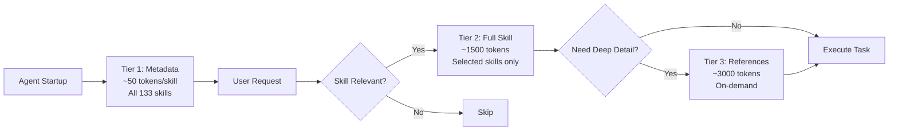
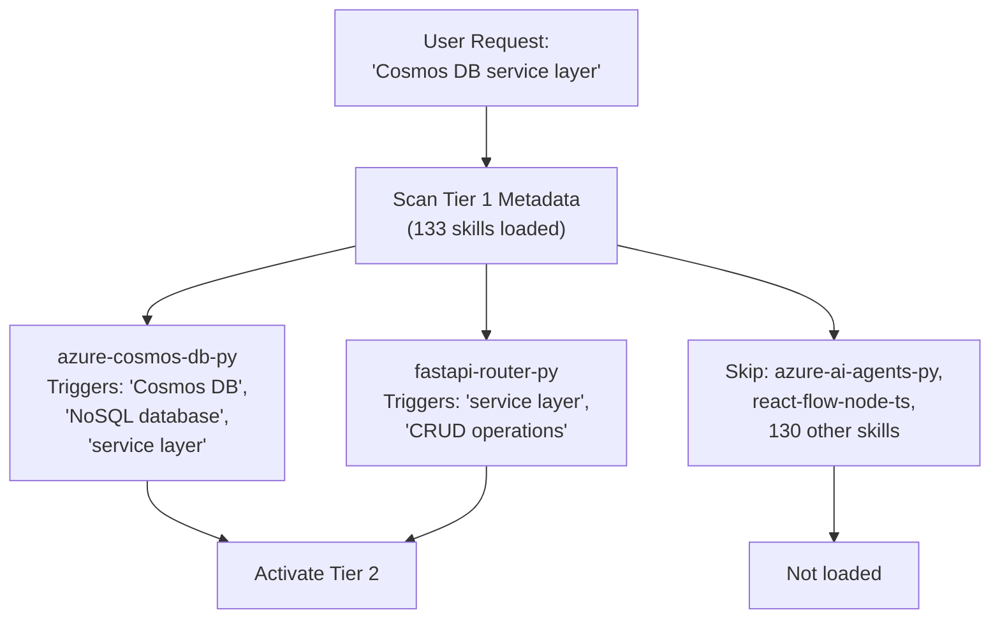
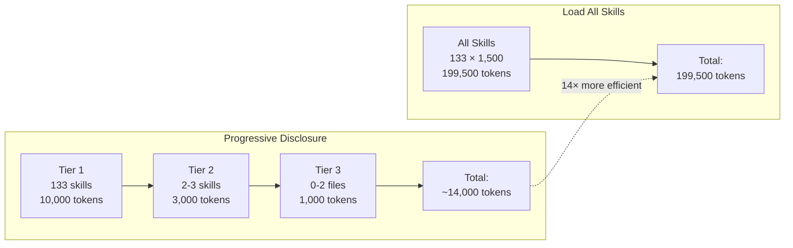
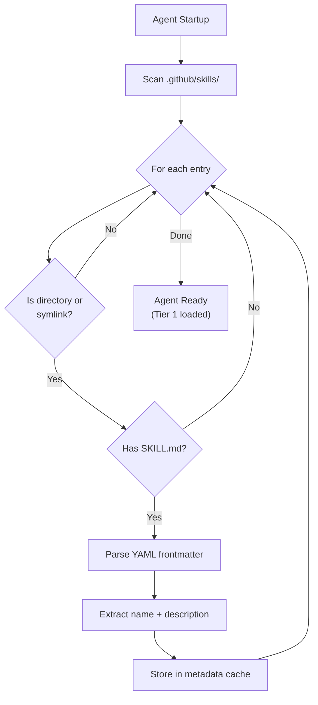

<!-- source: DeepWiki mcp.deepwiki.com · repo microsoft/skills · page 2.1 Understanding Skills and Progressive Disclosure · fetched 2026-10-30 -->

# Understanding Skills and Progressive Disclosure

<details>
<summary>Relevant source files</summary>

The following files were used as context for generating this wiki page:

- [.github/agents/scaffolder.agent.md](.github/agents/scaffolder.agent.md)
- [.github/copilot-instructions.md](.github/copilot-instructions.md)
- [.github/docs/agent-integration.md](.github/docs/agent-integration.md)
- [.github/prompts/scaffold-foundry-app.prompt.md](.github/prompts/scaffold-foundry-app.prompt.md)
- [.github/skills/continual-learning/SKILL.md](.github/skills/continual-learning/SKILL.md)
- [.github/skills/skill-creator/references/acceptance-criteria.md](.github/skills/skill-creator/references/acceptance-criteria.md)
- [Agents.md](Agents.md)
- [context7.json](context7.json)
- [docs-site/src/data/skills.json](docs-site/src/data/skills.json)
- [hooks/continual-learning/README.md](hooks/continual-learning/README.md)
- [hooks/continual-learning/hooks.json](hooks/continual-learning/hooks.json)
- [hooks/continual-learning/learn.sh](hooks/continual-learning/learn.sh)
- [tests/harness/criteria-loader.ts](tests/harness/criteria-loader.ts)
- [tests/scenarios/skill-creator/scenarios.yaml](tests/scenarios/skill-creator/scenarios.yaml)

</details>


## Purpose and Scope

This document explains the three-tier progressive disclosure architecture used by skills in the microsoft/skills repository. Progressive disclosure prevents context rot by loading minimal skill metadata at agent startup (~50 tokens per skill), activating full skill instructions only when relevant (~1500 tokens), and loading detailed reference files on-demand (~3000 tokens). This architecture enables agents to maintain awareness of 133 skills while consuming minimal context tokens.

For information about browsing and discovering skills through the web interface and discovery mechanisms, see [Browsing and Discovering Skills](#2.2). For the SKILL.md format specification, see [SKILL.md Format Specification](#2.3).

---

## The Problem: Context Rot

Loading all available skill instructions at agent startup causes **context rot**:

| Problem | Impact | Example |
|---------|--------|---------|
| **Diluted Attention** | Agent spreads focus across irrelevant domains | Loading React patterns when working on FastAPI backend |
| **Token Waste** | Unnecessary instructions consume context window | 133 skills × 1500 tokens = 199,500 tokens wasted |
| **Pattern Conflation** | Similar patterns from different SDKs interfere | Mixing Azure Storage blob patterns with Cosmos DB document patterns |
| **Stale Activation** | All skills loaded regardless of task relevance | Loading Java skills when writing Python code |

The repository contains 133 skills across 4 languages (Python, .NET, TypeScript, Java). Loading all skill instructions would consume the entire context window before any actual work begins.

**Sources:** [Agents.md:174-176](), [context7.json:8-11]()

---

## The Solution: Progressive Disclosure

Progressive disclosure loads skills in three tiers, activating each tier only when needed:



**Three-Tier Architecture**

This approach enables **selective loading**: only skills relevant to the current task consume significant context tokens. An agent working on Azure Cosmos DB might load 2-3 skills (~4500 tokens) instead of all 133 skills (~199,500 tokens).

**Sources:** [Agents.md:147-153](), [.github/docs/agent-integration.md:59-77]()

---

## Tier 1: Metadata (Frontmatter)

### What Is Loaded

At agent startup, only the **YAML frontmatter** from each `SKILL.md` file is loaded:

```yaml
---
name: azure-cosmos-db-py
description: Build Azure Cosmos DB NoSQL services with Python/FastAPI following production-grade patterns. Use when implementing database client setup with dual auth (DefaultAzureCredential + emulator), service layer classes with CRUD operations, partition key strategies, parameterized queries, or TDD patterns for Cosmos. Triggers on phrases like "Cosmos DB", "NoSQL database", "document store", "add persistence", "database service layer", or "Python Cosmos SDK".
---
```

The markdown body below the frontmatter is **not loaded** at this stage.

**Sources:** [Agents.md:149-151](), [.github/skills/skill-creator/references/acceptance-criteria.md:93-104]()

### Token Cost

- **~50-100 tokens per skill**
- 133 skills × 75 tokens (average) = **~10,000 tokens total**

This fits comfortably in the context window while providing enough information for activation decisions.

**Sources:** [.github/docs/agent-integration.md:62]()

### Directory Structure

Skills are discovered by scanning for `SKILL.md` files:

```
.github/skills/
├── azure-cosmos-db-py/
│   └── SKILL.md           ← Tier 1: frontmatter loaded at startup
├── azure-ai-agents-py/
│   └── SKILL.md           ← Tier 1: frontmatter loaded at startup
└── fastapi-router-py/
    └── SKILL.md           ← Tier 1: frontmatter loaded at startup
```

**Sources:** [Agents.md:149](), [.github/docs/agent-integration.md:9-23]()

### Activation Triggers

The `description` field includes **trigger phrases** that help agents identify relevant skills:

```yaml
description: |
  Azure Cosmos DB SDK for Python. Use for NoSQL database operations,
  document CRUD, queries, and container management.
  Triggers: "cosmos db", "nosql", "document database", "azure cosmos".
```

When a user request contains matching phrases, the agent activates the skill (loads Tier 2).

**Sources:** [tests/scenarios/skill-creator/scenarios.yaml:16-22](), [.github/skills/skill-creator/references/acceptance-criteria.md:167-173]()

---

## Tier 2: Full Skill (Markdown Body)

### What Is Loaded

When a skill is activated, the **entire markdown body** of `SKILL.md` is loaded:

```markdown
# Azure Cosmos DB SDK

## Installation

```bash
pip install azure-cosmos
```

## Environment Variables

```bash
AZURE_COSMOS_ENDPOINT=https://<account>.documents.azure.com:443/
AZURE_COSMOS_DATABASE=my-database
```

## Authentication

```python
from azure.identity import DefaultAzureCredential
from azure.cosmos import CosmosClient
import os

credential = DefaultAzureCredential()
client = CosmosClient(
    url=os.environ["AZURE_COSMOS_ENDPOINT"],
    credential=credential
)
```

## Core Workflow

[... implementation patterns ...]
```

**Sources:** [tests/scenarios/skill-creator/scenarios.yaml:38-88]()

### Token Cost

- **~500-2000 tokens per activated skill**
- Typical activation: 2-3 skills = **~3000-4500 tokens**

This provides sufficient implementation guidance without overwhelming the context window.

**Sources:** [.github/docs/agent-integration.md:62]()

### Activation Flow

```mermaid
sequenceDiagram
    participant User
    participant Agent
    participant Metadata["Metadata Cache<br/>(Tier 1)"]
    participant FS["Filesystem<br/>(.github/skills/)"]
    
    User->>Agent: "Create a Cosmos DB service for user data"
    Agent->>Metadata: Scan loaded metadata for triggers
    Metadata-->>Agent: Match: "azure-cosmos-db-py"<br/>Triggers: "Cosmos DB", "NoSQL database"
    Agent->>FS: Read .github/skills/azure-cosmos-db-py/SKILL.md
    FS-->>Agent: Full markdown body (Tier 2)
    Agent->>Agent: Follow implementation patterns
    Agent-->>User: Implementation code
```

**Sources:** [.github/docs/agent-integration.md:68-77]()

### Section Structure

Skills follow a standard section order optimized for progressive reading:

| Section | Purpose | Required |
|---------|---------|----------|
| **Installation** | Package install commands | Yes |
| **Environment Variables** | Required configuration | Yes |
| **Authentication** | `DefaultAzureCredential` pattern | Yes |
| **Core Workflow** | Minimal working example | Yes |
| **Features** | API methods, clients, options | Optional |
| **Best Practices** | Numbered recommendations | Optional |
| **Reference Files** | Links to Tier 3 resources | Optional |

**Sources:** [.github/skills/skill-creator/references/acceptance-criteria.md:205-229]()

---

## Tier 3: References (Separate Files)

### What Is Loaded

Detailed documentation stored in the `references/` subdirectory:

```
azure-ai-agents-py/
├── SKILL.md              ← Tier 2 (500-2000 tokens)
└── references/           ← Tier 3 (on-demand)
    ├── tools.md          ← ~1000 tokens (loaded when agent needs tool details)
    ├── streaming.md      ← ~1000 tokens (loaded when agent needs streaming patterns)
    ├── async.md          ← ~1000 tokens (loaded when agent needs async patterns)
    └── acceptance-criteria.md  ← Used by test harness, not agents
```

**Sources:** [.github/skills/skill-creator/references/acceptance-criteria.md:315-325]()

### Token Cost

- **~500-1500 tokens per reference file**
- Loaded **only when agent explicitly needs deep detail**

For example, an agent implementing streaming responses would:
1. Load `azure-ai-agents-py/SKILL.md` (Tier 2: ~1500 tokens)
2. Read reference to `references/streaming.md` in the main skill
3. Load `references/streaming.md` (Tier 3: ~1000 tokens)

**Sources:** [.github/docs/agent-integration.md:62]()

### Progressive Disclosure in Practice

The main `SKILL.md` links to reference files rather than including all content:

```markdown
## Streaming

For streaming patterns, see [references/streaming.md](references/streaming.md).

## Reference Files

| File | Contents |
|------|----------|
| [references/tools.md](references/tools.md) | Tool configurations |
| [references/streaming.md](references/streaming.md) | Event streaming patterns |
| [references/async.md](references/async.md) | Async/await patterns |
```

This keeps the main skill under 500 lines while maintaining access to detailed documentation.

**Sources:** [tests/scenarios/skill-creator/scenarios.yaml:250-267](), [.github/skills/skill-creator/references/acceptance-criteria.md:350-387]()

---

## Complete Activation Example

### Scenario: User Request

**User:** "Create a Cosmos DB service layer for storing user profiles with partition by user_id"

### Step 1: Metadata Scan (Tier 1)

Agent scans loaded metadata for relevant skills:



**Sources:** [.github/docs/agent-integration.md:68-77]()

### Step 2: Load Full Skills (Tier 2)

Agent reads complete `SKILL.md` files:

```bash
# Agent filesystem operations
cat .github/skills/azure-cosmos-db-py/SKILL.md
cat .github/skills/fastapi-router-py/SKILL.md
```

**Token cost:** ~1500 tokens (Cosmos DB) + ~1000 tokens (FastAPI) = **2500 tokens**

**Sources:** [.github/docs/agent-integration.md:83-88]()

### Step 3: Load References (Tier 3 - If Needed)

If agent needs detailed service layer patterns:

```bash
# On-demand reference loading
cat .github/skills/azure-cosmos-db-py/references/service-patterns.md
```

**Token cost:** ~1000 tokens (only loaded if agent explicitly needs deeper patterns)

### Total Token Budget

| Phase | Content | Tokens |
|-------|---------|--------|
| **Startup** | All 133 skill metadata | ~10,000 |
| **Activation** | 2 full skills | ~2,500 |
| **References** | 1 reference file (optional) | ~1,000 |
| **Total** | | **~13,500 tokens** |

Compare to loading all 133 skills fully: **~199,500 tokens** (15× more)

**Sources:** [.github/docs/agent-integration.md:62]()

---

## Token Economics

### Cost Comparison



### Selective Loading Strategies

Agents should load skills based on task context:

| Task Type | Skills to Load | Tier 2 Tokens |
|-----------|---------------|---------------|
| **Azure Cosmos DB API** | `azure-cosmos-db-py`, `fastapi-router-py` | ~2,500 |
| **Azure AI Agents** | `azure-ai-agents-py`, `azure-ai-projects-py` | ~3,000 |
| **Frontend UI** | `frontend-ui-dark-ts`, `react-flow-node-ts` | ~2,000 |
| **MCP Server** | `mcp-builder`, `skill-creator` | ~2,500 |

**Never load all skills.** Always use Tier 1 metadata to select only relevant skills.

**Sources:** [Agents.md:174-176](), [.github/docs/agent-integration.md:100-117]()

---

## Discovery and Directory Scanning

### Filesystem Structure

Skills are organized in `.github/skills/` with optional language-specific symlinks:

```
.github/
├── skills/                     ← Primary skill location
│   ├── azure-cosmos-db-py/
│   │   ├── SKILL.md           ← Frontmatter + body
│   │   └── references/
│   │       ├── service-patterns.md
│   │       └── acceptance-criteria.md
│   ├── azure-ai-agents-py/
│   │   └── SKILL.md
│   └── mcp-builder/           ← Cross-language skill (no suffix)
│       └── SKILL.md
│
└── plugins/                    ← Plugin bundles (canonical source)
    ├── azure-sdk-python/
    │   └── skills/
    │       ├── azure-cosmos-db-py/
    │       └── azure-ai-agents-py/
    └── azure-sdk-dotnet/
        └── skills/
            └── azure-ai-agents-dotnet/
```

**Note:** Skills in `.github/skills/` are duplicated from `.github/plugins/*/skills/` to support the `npx skills add microsoft/skills` installation workflow. The plugin directories remain the canonical source.

**Sources:** [Agents.md:149-154](), [.github/copilot-instructions.md:76-99]()

### Discovery Algorithm

Agents discover skills using this process:



**Sources:** [tests/harness/criteria-loader.ts:60-86](), [.github/docs/agent-integration.md:9-36]()

### Naming Convention

Skills use language suffixes for automatic categorization:

| Suffix | Language | Example |
|--------|----------|---------|
| `-py` | Python | `azure-cosmos-db-py` |
| `-dotnet` | .NET/C# | `azure-ai-inference-dotnet` |
| `-ts` | TypeScript/JavaScript | `azure-ai-agents-ts` |
| `-java` | Java | `azure-cosmos-java` |
| (none) | Cross-language | `mcp-builder`, `skill-creator` |

This allows agents to filter skills by project technology stack during Tier 1 scanning.

**Sources:** [.github/copilot-instructions.md:109-119](), [.github/docs/agent-integration.md:138-150]()

---

## Best Practices

### For Skill Authors

1. **Keep SKILL.md under 500 lines** - Use references for detailed content
2. **Include trigger phrases in description** - Help agents identify when to activate
3. **Link to references explicitly** - Use `[references/tools.md](references/tools.md)` syntax
4. **Follow section order** - Installation → Environment → Authentication → Core → References

**Sources:** [.github/skills/skill-creator/references/acceptance-criteria.md:205-229](), [.github/skills/skill-creator/references/acceptance-criteria.md:473-499]()

### For Agent Integration

1. **Never load all skills** - Always use selective loading based on task context
2. **Check metadata first** - Use Tier 1 triggers to determine relevance
3. **Load Tier 2 on activation** - Read full SKILL.md only when skill is relevant
4. **Load Tier 3 on-demand** - Access references only when deep detail is needed

**Sources:** [Agents.md:174-176](), [.github/docs/agent-integration.md:100-117]()

### Preventing Context Rot

| Anti-Pattern | Consequence | Solution |
|--------------|-------------|----------|
| Load all skills at startup | 199,500 tokens wasted | Use three-tier loading |
| Load full skill without checking triggers | Irrelevant content loaded | Check Tier 1 metadata first |
| Include everything in SKILL.md | File too large, Tier 2 inefficient | Move details to references/ |
| No trigger phrases in description | Skills don't activate correctly | Add "Use when...", "Triggers:" |

**Sources:** [.github/docs/agent-integration.md:100-117](), [.github/skills/skill-creator/references/acceptance-criteria.md:458-469]()

---

## Summary

Progressive disclosure enables agents to maintain awareness of 133 skills while consuming only ~10,000 tokens at startup. By loading full skill instructions only when relevant (~1,500 tokens) and detailed references on-demand (~1,000 tokens), the architecture prevents context rot while maintaining access to deep domain knowledge.

**Key Metrics:**
- **Tier 1 (Metadata):** ~50 tokens/skill × 133 skills = 10,000 tokens
- **Tier 2 (Full Skill):** ~1,500 tokens × 2-3 skills = 3,000-4,500 tokens  
- **Tier 3 (References):** ~1,000 tokens × 0-2 files = 0-2,000 tokens
- **Total:** ~13,000-16,500 tokens (vs. 199,500 if loading all skills fully)

This 14× token efficiency enables agents to work effectively across multiple domains without exhausting their context window.

**Sources:** [Agents.md:147-176](), [.github/docs/agent-integration.md:59-77](), [context7.json:8-11]()

---

