<!-- source: DeepWiki mcp.deepwiki.com · repo microsoft/skills · page 2.2 Browsing and Discovering Skills · fetched 2026-10-30 -->

# Browsing and Discovering Skills

<details>
<summary>Relevant source files</summary>

The following files were used as context for generating this wiki page:

- [.github/plugins/deep-wiki/.claude-plugin/plugin.json](.github/plugins/deep-wiki/.claude-plugin/plugin.json)
- [.github/plugins/deep-wiki/README.md](.github/plugins/deep-wiki/README.md)
- [.github/plugins/deep-wiki/commands/ado.md](.github/plugins/deep-wiki/commands/ado.md)
- [.github/plugins/deep-wiki/commands/crisp.md](.github/plugins/deep-wiki/commands/crisp.md)
- [.github/plugins/deep-wiki/skills/wiki-ado-convert/SKILL.md](.github/plugins/deep-wiki/skills/wiki-ado-convert/SKILL.md)
- [README.md](README.md)
- [docs-site/scripts/extract-skills.ts](docs-site/scripts/extract-skills.ts)
- [docs-site/src/components/CategoryTabs.tsx](docs-site/src/components/CategoryTabs.tsx)
- [docs-site/src/components/SkillDetailModal.tsx](docs-site/src/components/SkillDetailModal.tsx)
- [docs-site/src/components/SkillsSection.tsx](docs-site/src/components/SkillsSection.tsx)
- [docs-site/src/pages/index.astro](docs-site/src/pages/index.astro)
- [docs/_astro/SkillsSection.DSKr3JQZ.js](docs/_astro/SkillsSection.DSKr3JQZ.js)
- [docs/index.html](docs/index.html)
- [tests/scenarios/azure-search-documents-py/scenarios.yaml](tests/scenarios/azure-search-documents-py/scenarios.yaml)

</details>


This page documents the discovery mechanisms that enable users and AI agents to find and explore the 132+ skills in the repository. It covers the web interface, LLM-friendly discovery files, agent integration, and the metadata extraction pipeline.

For information about how skills implement progressive disclosure to prevent context rot, see [Understanding Skills and Progressive Disclosure](#2.1). For creating new skills, see [Creating New Skills](#2.4).

---

## Discovery Mechanisms Overview

The repository provides three discovery paths optimized for different consumers:

```mermaid
graph TB
    subgraph "Human Users"
        WEB["Web Interface<br/>microsoft.github.io/skills"]
        GITHUB["GitHub Repository<br/>Browse .github/skills/"]
    end
    
    subgraph "AI Agents"
        AGENTS["AGENTS.md<br/>Entry point instructions"]
        DIRSCAN["Directory Scanning<br/>.github/skills/ + .github/plugins/"]
    end
    
    subgraph "LLMs & MCP Tools"
        LLMS["llms.txt<br/>LLM-friendly index"]
        LLMSFULL["llms-full.txt<br/>Full content"]
        CONTEXT7["Context7 MCP<br/>Semantic search"]
    end
    
    subgraph "Metadata Pipeline"
        FRONTMATTER["SKILL.md<br/>YAML frontmatter"]
        EXTRACT["extract-skills.ts<br/>Metadata extraction"]
        JSON["skills.json<br/>Structured data"]
    end
    
    FRONTMATTER --> EXTRACT
    EXTRACT --> JSON
    JSON --> WEB
    
    WEB --> |Deep links| GITHUB
    AGENTS --> DIRSCAN
    LLMS --> LLMSFULL
    CONTEXT7 --> LLMSFULL
    
    style WEB fill:#2d333b,stroke:#58a6ff
    style AGENTS fill:#2d333b,stroke:#6d5dfc
    style LLMS fill:#2d333b,stroke:#f97316
    style JSON fill:#2d333b,stroke:#06b6d4
```



Sources: [README.md:1-80](), [docs-site/src/pages/index.astro:1-327](), [docs-site/scripts/extract-skills.ts:1-224]()

---

## Web Interface Discovery

The documentation site at `microsoft.github.io/skills` provides an interactive skill browser for human users.

### Skill Metadata Structure

Each skill exposes metadata through YAML frontmatter in its `SKILL.md` file:

| Field | Type | Purpose | Example |
|-------|------|---------|---------|
| `name` | string | Unique skill identifier | `azure-ai-projects-py` |
| `description` | string | Full skill description with triggers | `Build AI applications using the Azure AI Projects Python SDK...` |
| `package` | string (optional) | SDK package name | `azure-ai-projects` |

Derived fields added during extraction:

| Field | Source | Logic |
|-------|--------|-------|
| `lang` | Filename suffix or directory | `-py` → `py`, `-dotnet` → `dotnet`, etc. |
| `category` | Symlink structure in `skills/` | `skills/py/foundry/` → `foundry` |
| `path` | File location | `.github/plugins/azure-sdk-python/skills/azure-ai-projects-py` |

Sources: [docs-site/scripts/extract-skills.ts:18-25](), [docs-site/scripts/extract-skills.ts:42-57]()

### Extraction Pipeline

```mermaid
graph LR
    subgraph "Source Directories"
        PLUGINS[".github/plugins/<br/>azure-sdk-*/skills/"]
        CORE[".github/skills/<br/>Core skills"]
        SYMLINKS["skills/<br/>Language symlinks"]
    end
    
    subgraph "extract-skills.ts"
        SCAN["collectMarkdownFiles()<br/>Scan SKILL.md files"]
        PARSE["preprocessYamlFrontmatter()<br/>Fix @-prefixed packages"]
        MATTER["gray-matter<br/>Parse frontmatter"]
        INFER["inferLangFromName()<br/>Detect language"]
        LOOKUP["findSymlinkInfo()<br/>Read category from symlinks"]
    end
    
    subgraph "Output"
        JSON["skills.json<br/>Array of Skill objects"]
    end
    
    PLUGINS --> SCAN
    CORE --> SCAN
    SCAN --> PARSE
    PARSE --> MATTER
    MATTER --> INFER
    SYMLINKS --> LOOKUP
    INFER --> JSON
    LOOKUP --> JSON
    
    style SCAN fill:#2d333b,stroke:#f97316
    style JSON fill:#2d333b,stroke:#06b6d4
```



Sources: [docs-site/scripts/extract-skills.ts:144-204](), [docs-site/scripts/extract-skills.ts:96-103]()

The extraction script runs at build time:

1. **Scan plugin bundles** (`.github/plugins/azure-sdk-*/skills/`) using `PLUGIN_LANG_MAP` to determine language
2. **Scan core skills** (`.github/skills/`) using suffix inference (`-py`, `-dotnet`, etc.)
3. **Parse frontmatter** with `gray-matter` after preprocessing to fix `@`-prefixed package names
4. **Infer categories** by reading symlink targets in `skills/py/`, `skills/dotnet/`, etc.
5. **Write `skills.json`** for consumption by the web interface

Sources: [docs-site/scripts/extract-skills.ts:154-179](), [docs-site/scripts/extract-skills.ts:5-16]()

### Filtering System

The web interface provides three filtering dimensions implemented in React components:

```mermaid
graph TB
    subgraph "SkillsSection Component"
        STATE["useState hooks<br/>selectedLang, selectedCategory, searchQuery"]
        MEMO["useMemo<br/>filteredSkills computation"]
    end
    
    subgraph "Filter Components"
        LANGTABS["LanguageTabs.tsx<br/>All, Core, Python, .NET, TypeScript, Java, Rust"]
        CATTABS["CategoryTabs.tsx<br/>All, Foundry, M365, Data, Messaging, etc."]
        SEARCH["SearchInput.tsx<br/>Debounced search with ⌘K shortcut"]
    end
    
    subgraph "Results"
        GRID["SkillCard grid<br/>Collapsed to 8 items, expand button"]
        MODAL["SkillDetailModal<br/>Install command, GitHub links, tests"]
    end
    
    STATE --> LANGTABS
    STATE --> CATTABS
    STATE --> SEARCH
    
    LANGTABS --> MEMO
    CATTABS --> MEMO
    SEARCH --> MEMO
    
    MEMO --> GRID
    GRID --> MODAL
    
    style STATE fill:#2d333b,stroke:#6d5dfc
    style MEMO fill:#2d333b,stroke:#f97316
    style GRID fill:#2d333b,stroke:#06b6d4
```



Sources: [docs-site/src/components/SkillsSection.tsx:39-126](), [docs-site/src/components/LanguageTabs.tsx:1-50](), [docs-site/src/components/CategoryTabs.tsx:1-111]()

#### Language Filter

The `LanguageTabs` component maps language codes to display labels and colors:

| Value | Label | Color Variable | Count Source |
|-------|-------|----------------|--------------|
| `all` | All | `--text-secondary` | Sum of all counts |
| `core` | Core | `--lang-core` | `langCounts.core` |
| `py` | Python | `--lang-python` | `langCounts.py` |
| `dotnet` | .NET | `--lang-dotnet` | `langCounts.dotnet` |
| `ts` | TypeScript | `--lang-typescript` | `langCounts.ts` |
| `java` | Java | `--lang-java` | `langCounts.java` |
| `rust` | Rust | `--lang-rust` | `langCounts.rust` |

Languages with zero skills are hidden from the UI. Selecting a language resets the category filter to "all" and collapses the expanded view.

Sources: [docs-site/src/components/LanguageTabs.tsx:5-18](), [docs-site/src/components/SkillsSection.tsx:111-115]()

#### Category Filter

The `CategoryTabs` component displays categories in a predefined order, showing only categories with skills in the current language filter:

```typescript
const CATEGORY_ORDER = [
  'all', 'foundry', 'm365', 'general', 'data', 'messaging',
  'entra', 'monitoring', 'integration', 'compute', 
  'communication', 'frontend', 'partner',
];
```

Category counts are computed dynamically based on the selected language using `useMemo` to prevent unnecessary recalculation.

Sources: [docs-site/src/components/CategoryTabs.tsx:5-19](), [docs-site/src/components/SkillsSection.tsx:88-97]()

#### Search Filter

The `SearchInput` component provides case-insensitive substring matching against both `name` and `description` fields:

```typescript
const searchMatch = !query || 
  skill.name.toLowerCase().includes(query) || 
  skill.description.toLowerCase().includes(query);
```

Features:
- **Keyboard shortcut**: `⌘K` (Mac) or `Ctrl+K` (Windows) focuses the input
- **Clear button**: Appears when query is non-empty
- **Escape key**: Clears search and blurs input

Sources: [docs-site/src/components/SearchInput.tsx:1-70](), [docs-site/src/components/SkillsSection.tsx:99-109]()

### Deep Linking

The site supports shareable URLs with skill deep links using URL hash fragments:

```
https://microsoft.github.io/skills/#skill=azure-ai-projects-py
```

Implementation:

1. **On mount**: `useEffect` hook calls `getSkillFromHash()` to parse `window.location.hash`
2. **On hash change**: Event listener updates `selectedSkill` state
3. **On card click**: Updates hash with `window.history.replaceState()` and opens modal
4. **Share button**: Copies full URL with hash to clipboard

Sources: [docs-site/src/components/SkillsSection.tsx:30-37](), [docs-site/src/components/SkillsSection.tsx:46-67](), [docs-site/src/components/SkillDetailModal.tsx:45-55]()

### Skill Detail Modal

The `SkillDetailModal` component displays full skill information:

| Section | Content | Source |
|---------|---------|--------|
| Install Command | `npx skills add microsoft/skills --skill {name}` | Constructed string |
| Skill Name | Displayed with language badge | `skill.name`, `skill.language` |
| Description | Full text from frontmatter | `skill.description` |
| View Full Skill | Link to GitHub `SKILL.md` | `skill.path` |
| Acceptance Criteria | Link to `references/acceptance-criteria.md` | `skill.path` |
| Test Scenarios | Link to `tests/scenarios/{name}/scenarios.yaml` | `skill.name` |

The modal includes one-click copy buttons for the install command and shareable URL.

Sources: [docs-site/src/components/SkillDetailModal.tsx:10-56](), [docs-site/src/components/SkillDetailModal.tsx:62-65]()

---

## LLM Discovery Files

The repository provides LLM-friendly documentation indexes following the `llms.txt` specification.

### llms.txt Format

The root `llms.txt` file provides a summary and links to all skills:

```
# microsoft/skills

Skills, custom agents, AGENTS.md templates, and MCP configurations for AI coding agents...

## Quick Links

- Repository: https://github.com/microsoft/skills
- Documentation: https://microsoft.github.io/skills/
- Skills: https://github.com/microsoft/skills/tree/main/.github/skills

## Skills by Language

### Python (41 skills)
- azure-ai-projects-py: https://github.com/microsoft/skills/blob/main/.github/plugins/...
...
```

Generated by automated workflow that scrapes Microsoft Learn documentation and skill metadata.

Sources: [docs/llms.txt:1-100](), [.github/workflows/update-llms-txt.yml:1-50]()

### llms-full.txt Format

The `llms-full.txt` file includes full skill content inlined in `<doc>` blocks for deep context:

```xml
<doc path=".github/plugins/azure-sdk-python/skills/azure-ai-projects-py/SKILL.md">
---
name: azure-ai-projects-py
description: Build AI applications using the Azure AI Projects Python SDK...
---

# Azure AI Projects Python SDK

[Full SKILL.md content here]
</doc>
```

This allows LLMs to load complete skill documentation without additional file reads.

Sources: [docs/llms-full.txt:1-100]()

### Context7 MCP Integration

The Context7 MCP server provides semantic search over the `llms-full.txt` index:

| Operation | MCP Method | Purpose |
|-----------|------------|---------|
| Skill search | `search_code` | Find skills by semantic query |
| Full skill load | `get_file_contents` | Retrieve complete SKILL.md |
| Documentation | `get_file_contents` on `llms.txt` | Get project summary |

Configuration in `.vscode/mcp.json` points to the indexed repository.

Sources: [.vscode/mcp.json:1-100](), [README.md:564-573]()

---

## Agent Discovery via AGENTS.md

The `AGENTS.md` file serves as the entry point for AI coding agents, providing a documentation map:

```markdown
# Agent Instructions

## Skills

Skills are located in `.github/skills/` organized by language:

- **Python**: `.github/plugins/azure-sdk-python/skills/` (41 skills)
- **.NET**: `.github/plugins/azure-sdk-dotnet/skills/` (28 skills)
- **TypeScript**: `.github/plugins/azure-sdk-typescript/skills/` (25 skills)
...

Load skills selectively based on task requirements.
```

Agents scan the `Documentation` section to discover:
- Skill directory structure
- Language organization
- Link to web interface for browsing
- Reference to `llms.txt` for bulk loading

Sources: [AGENTS.md:1-100]()

### Directory Scanning Pattern

Agents discover skills by scanning the file system:

```mermaid
graph TB
    SCAN["readdir('.github/skills/')"]
    FILTER["Filter directories with SKILL.md"]
    FRONTMATTER["Read YAML frontmatter"]
    MATCH["Match triggers to task"]
    LOAD["Load full skill if match"]
    
    SCAN --> FILTER
    FILTER --> FRONTMATTER
    FRONTMATTER --> MATCH
    MATCH --> |Trigger match| LOAD
    MATCH --> |No match| SCAN
    
    style SCAN fill:#2d333b,stroke:#6d5dfc
    style MATCH fill:#2d333b,stroke:#f97316
```



Sources: [README.md:47-51](), [.github/plugins/deep-wiki/README.md:149-165]()

The progressive disclosure model ensures agents:
1. **Scan** skill directories to get names
2. **Read** frontmatter to get descriptions and triggers (~50 tokens each)
3. **Activate** full SKILL.md only when triggers match (~1500 tokens)
4. **Load** references only when deep knowledge needed (~3000 tokens)

This prevents context rot by loading only relevant information.

Sources: High-level diagrams section "Diagram 2: AI Agent Interaction Model"

---

## Skill Metadata Schema

The canonical skill metadata structure used across all discovery mechanisms:

| Field | Type | Required | Source | Example |
|-------|------|----------|--------|---------|
| `name` | string | Yes | Frontmatter `name` | `azure-ai-projects-py` |
| `description` | string | Yes | Frontmatter `description` | `Build AI applications using...` |
| `lang` | enum | Yes | Filename suffix or directory | `py`, `dotnet`, `ts`, `java`, `rust`, `core` |
| `category` | string | Yes | Symlink directory structure | `foundry`, `data`, `messaging` |
| `path` | string | Yes | Repository file path | `.github/plugins/azure-sdk-python/skills/...` |
| `package` | string | No | Frontmatter `package` | `azure-ai-projects` |

### Language Inference Logic

```typescript
// Suffix-based inference
const SUFFIX_MAP = {
  "-py": "py",
  "-dotnet": "dotnet",
  "-ts": "ts",
  "-java": "java",
  "-rust": "rust",
};

function inferLangFromName(skillName: string): Lang {
  for (const [suffix, lang] of Object.entries(SUFFIX_MAP)) {
    if (skillName.endsWith(suffix)) return lang;
  }
  return "core";
}
```

Sources: [docs-site/scripts/extract-skills.ts:42-57]()

### Category Inference Logic

Categories are determined by reading symlink targets in the `skills/` directory:

```
skills/
├── py/
│   ├── foundry/
│   │   └── azure-ai-projects-py -> ../../../.github/plugins/azure-sdk-python/skills/azure-ai-projects-py
│   ├── data/
│   │   └── azure-cosmos-db-py -> ...
```

The extraction script follows symlinks to determine which category a skill belongs to.

Sources: [docs-site/scripts/extract-skills.ts:59-94](), [README.md:532-541]()

---

## Filtering Performance Optimization

The `SkillsSection` component uses React performance optimizations to handle 132+ skills:

### Memoization Strategy

```typescript
// Recompute only when dependencies change
const langCounts = useMemo(() => {
  return skills.reduce((acc, skill) => {
    acc[skill.lang] = (acc[skill.lang] || 0) + 1;
    return acc;
  }, {} as Record<string, number>);
}, [skills]);

const filteredSkills = useMemo(() => {
  return skills.filter(skill => {
    const langMatch = selectedLang === 'all' || skill.lang === selectedLang;
    const catMatch = selectedCategory === 'all' || skill.category === selectedCategory;
    const searchMatch = !query || /* substring matching */;
    return langMatch && catMatch && searchMatch;
  });
}, [skills, selectedLang, selectedCategory, searchQuery]);
```

Sources: [docs-site/src/components/SkillsSection.tsx:81-109]()

### Collapsed View with Expansion

To improve initial page load performance, the skill grid collapses to show only the first 8 skills (2 rows × 4 columns on desktop):

```typescript
const COLLAPSED_ROWS = 2;
const ITEMS_PER_ROW_DESKTOP = 4;
const MAX_VISIBLE_COLLAPSED = COLLAPSED_ROWS * ITEMS_PER_ROW_DESKTOP;

<div style={{
  maxHeight: isExpanded ? 'none' : `${COLLAPSED_HEIGHT}px`,
  overflow: 'hidden',
}}>
  {filteredSkills.map(skill => <SkillCard />)}
</div>
```

The "Show More" button appears when `filteredSkills.length > MAX_VISIBLE_COLLAPSED`.

Sources: [docs-site/src/components/SkillsSection.tsx:70-80](), [docs-site/src/components/SkillsSection.tsx:201-263]()

---

## Discovery Workflow Comparison

| Mechanism | Consumer | Entry Point | Metadata | Full Content | Search |
|-----------|----------|-------------|----------|--------------|--------|
| Web Interface | Human users | `microsoft.github.io/skills` | `skills.json` | Click through to GitHub | Language, category, text |
| llms.txt | LLMs, MCP tools | `/llms.txt` or `/llms-full.txt` | Inline summaries | `<doc>` blocks in full variant | Line-by-line scan or MCP search |
| AGENTS.md | AI agents | `AGENTS.md` Documentation section | Directory listing | Load `SKILL.md` on demand | Directory scan + trigger match |
| Directory Scan | CLI tools, scripts | `.github/skills/` or `.github/plugins/` | Frontmatter parse | Read full file | Filesystem operations |

Sources: [README.md:564-606](), [docs-site/src/pages/index.astro:1-327](), [.github/plugins/deep-wiki/README.md:149-165]()

---

