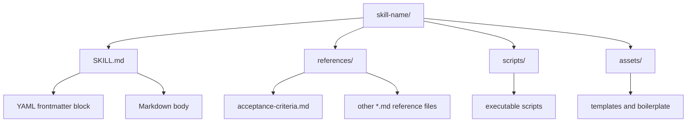
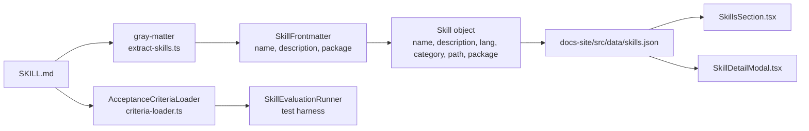
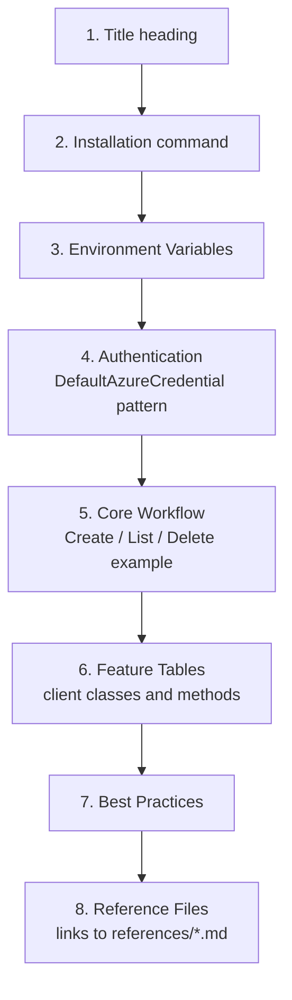
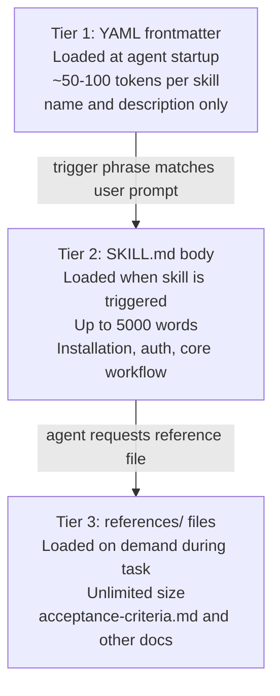
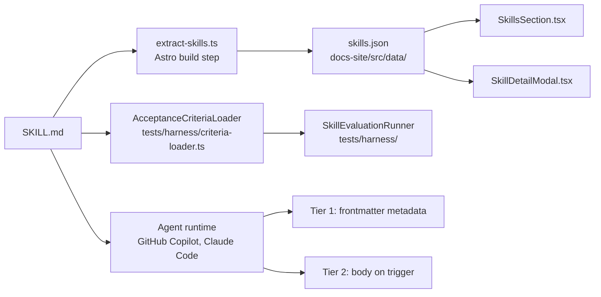

<!-- source: DeepWiki mcp.deepwiki.com · repo microsoft/skills · page 2.3 SKILL.md Format Specification · fetched 2026-10-30 -->

# SKILL.md Format Specification

<details>
<summary>Relevant source files</summary>

The following files were used as context for generating this wiki page:

- [.github/agents/scaffolder.agent.md](.github/agents/scaffolder.agent.md)
- [.github/copilot-instructions.md](.github/copilot-instructions.md)
- [.github/docs/agent-integration.md](.github/docs/agent-integration.md)
- [.github/plugins/azure-sdk-python/skills/azure-ai-language-conversations-py/SKILL.md](.github/plugins/azure-sdk-python/skills/azure-ai-language-conversations-py/SKILL.md)
- [.github/plugins/azure-sdk-python/skills/azure-ai-language-conversations-py/references/acceptance-criteria.md](.github/plugins/azure-sdk-python/skills/azure-ai-language-conversations-py/references/acceptance-criteria.md)
- [.github/plugins/deep-wiki/.claude-plugin/plugin.json](.github/plugins/deep-wiki/.claude-plugin/plugin.json)
- [.github/plugins/deep-wiki/README.md](.github/plugins/deep-wiki/README.md)
- [.github/plugins/deep-wiki/commands/ado.md](.github/plugins/deep-wiki/commands/ado.md)
- [.github/plugins/deep-wiki/commands/crisp.md](.github/plugins/deep-wiki/commands/crisp.md)
- [.github/plugins/deep-wiki/skills/wiki-ado-convert/SKILL.md](.github/plugins/deep-wiki/skills/wiki-ado-convert/SKILL.md)
- [.github/prompts/scaffold-foundry-app.prompt.md](.github/prompts/scaffold-foundry-app.prompt.md)
- [.github/skills/skill-creator/references/acceptance-criteria.md](.github/skills/skill-creator/references/acceptance-criteria.md)
- [.gitignore](.gitignore)
- [Agents.md](Agents.md)
- [README.md](README.md)
- [context7.json](context7.json)
- [docs-site/src/components/HookCard.astro](docs-site/src/components/HookCard.astro)
- [docs-site/src/data/hooks.json](docs-site/src/data/hooks.json)
- [docs-site/src/pages/index.astro](docs-site/src/pages/index.astro)
- [docs/_astro/index.CktZY-PF.css](docs/_astro/index.CktZY-PF.css)
- [docs/index.html](docs/index.html)
- [tests/harness/criteria-loader.ts](tests/harness/criteria-loader.ts)
- [tests/scenarios/skill-creator/scenarios.yaml](tests/scenarios/skill-creator/scenarios.yaml)

</details>


This page specifies the exact format of a `SKILL.md` file: the required YAML frontmatter fields, the prescribed Markdown body section order for Azure SDK skills, and the optional bundled resource directories that make up a complete skill package.

For information on how agents discover and load skills at runtime, see [Agent Integration](#6.2). For a step-by-step walkthrough of creating a new skill from scratch, see [Creating New Skills](#2.4). For how skills are displayed in the Skill Explorer website, see [Browsing and Discovering Skills](#2.2).

---

## File and Directory Layout

Each skill occupies its own directory under `.github/skills/` or `.github/plugins/<plugin>/skills/`. The directory must contain a `SKILL.md` file. All other subdirectories are optional.

```
<skill-name>/
├── SKILL.md                         (required)
├── references/
│   ├── acceptance-criteria.md       (required for test harness)
│   └── *.md                         (additional reference docs)
├── scripts/
│   └── *.sh / *.py / *.js
└── assets/
    └── templates, boilerplate files
```

**Skill Directory Structure**



Sources: [.github/skills/skill-creator/SKILL.md:66-76](), [docs-site/scripts/extract-skills.ts:18-31]()

---

## YAML Frontmatter

Every `SKILL.md` begins with a YAML block delimited by `---`. This is the only portion loaded into the agent's context at startup. The Markdown body is ignored until the skill is triggered.

### Required Fields

| Field | Type | Purpose |
|-------|------|---------|
| `name` | string | Unique skill identifier. Must match the directory naming convention. |
| `description` | string | Primary trigger mechanism for agent activation. Should include trigger phrases. |

### Optional Fields

| Field | Type | Purpose |
|-------|------|---------|
| `package` | string | The pip/npm/Maven package name (e.g., `azure-ai-projects`, `@azure/ai-projects`). Displayed in the Skill Explorer UI. |

> **Note on `@`-prefixed packages:** The `preprocessYamlFrontmatter` function in `extract-skills.ts` automatically quotes package values beginning with `@` to prevent YAML parse errors.

Sources: [docs-site/scripts/extract-skills.ts:5-16](), [docs-site/scripts/extract-skills.ts:27-31]()

### Frontmatter Examples

**Multi-line description with trigger phrases** — preferred for Azure SDK skills:

```yaml
---
name: azure-ai-agents-py
description: |
  Azure AI Agents SDK for Python. Use for creating agents with tools,
  managing threads, streaming responses, and function calling.
  Triggers: "create agent", "azure agents", "function calling", "streaming agents".
package: azure-ai-agents
---
```

**Single-line description** — acceptable for simpler or cross-language skills:

```yaml
---
name: pydantic-models-py
description: Pydantic v2 model patterns for FastAPI. Use for request/response models, validation, and serialization.
package: pydantic
---
```

Sources: [.github/skills/skill-creator/references/acceptance-criteria.md:92-128]()

### The `description` Field as a Trigger Mechanism

The `description` is the only text an agent reads before deciding to load a skill. The Markdown body is not available at selection time, so all trigger information must appear in `description`.

**Rules:**
- Must be present; a missing `description` is a validation error.
- Should include `Triggers:`, `Use when:`, or `USE FOR:` language listing phrases that appear in user prompts.
- May include `DO NOT USE FOR:` anti-trigger phrases to reduce false activations.
- Should exceed 150 characters to reach the Medium quality threshold in the test harness scoring system.
- Must not rely on the Markdown body for triggering — that content loads only after activation.

**Common mistakes:**

| Mistake | Example |
|---------|---------|
| Missing `description` | `name: my-skill` only |
| No trigger phrases | `description: Azure Search SDK for Python.` |
| Triggers placed in the body instead of `description` | `**When to use:** Use this skill when you need X` in the body |

Sources: [.github/skills/skill-creator/references/acceptance-criteria.md:115-138](), [.github/docs/agent-integration.md:25-37](), [README.md:657-665]()

---

## Frontmatter Parsing Pipeline

The `extract-skills.ts` build script reads all `SKILL.md` files and transforms them into a `skills.json` catalog consumed by the Skill Explorer website.

**Frontmatter Parsing and Data Flow**



The `lang` field is **not** set in the frontmatter. It is inferred by the `extract-skills.ts` script from:
- The plugin directory name (e.g., `azure-sdk-python` → `py`) via `PLUGIN_LANG_MAP`
- The skill name suffix (e.g., `-ts` → `ts`) via `SUFFIX_MAP` for core skills in `.github/skills/`

Similarly, the `category` field is **not** in the frontmatter. It is derived from the symlink structure under `skills/<language>/<category>/` at build time.

Sources: [docs-site/scripts/extract-skills.ts:33-57](), [docs-site/scripts/extract-skills.ts:96-103](), [docs-site/scripts/extract-skills.ts:144-203](), [tests/harness/criteria-loader.ts:51-100]()

---

## Markdown Body Structure

The Markdown body is the second tier of progressive disclosure — loaded only after the agent selects the skill. For Azure SDK skills, a prescribed section order applies across all skills in the catalog.

### Prescribed Section Order

| # | Section Heading | Content |
|---|-----------------|---------|
| 1 | `# SDK Name` | Title matching the exact SDK or service name |
| 2 | `## Installation` | Package install command (`pip install`, `npm install`, etc.) |
| 3 | `## Environment Variables` | Required environment variable names and format |
| 4 | `## Authentication` | Client construction using `DefaultAzureCredential` |
| 5 | `## Core Workflow` | Minimal viable code example (create, list, delete) |
| 6 | `## Feature Tables` | Client classes, methods, and tools in tabular form |
| 7 | `## Best Practices` | Numbered list of do's and don'ts |
| 8 | `## Reference Files` | Table of links to `references/*.md` |

**Azure SDK Skill Body Section Flow**



Sources: [.github/skills/skill-creator/SKILL.md:99-110](), [.github/skills/skill-creator/references/acceptance-criteria.md:1-68]()

### Body Length Limit

The body must stay under **500 lines**. Content approaching this limit should be extracted into `references/*.md` files and linked from the Reference Files section. This keeps the Tier 2 payload concise enough to be useful in context when combined with other loaded skills.

Sources: [.github/skills/skill-creator/SKILL.md:61-62]()

---

## Bundled Resource Directories

Resource directories sit alongside `SKILL.md`. They are not loaded automatically — the agent or the body's Reference Files section must explicitly reference them.

| Directory | Purpose | Typical Contents |
|-----------|---------|-----------------|
| `references/` | Reference documentation loaded on demand | `acceptance-criteria.md`, `tools.md`, `streaming.md`, `azure-sdk-patterns.md` |
| `scripts/` | Deterministic operations that would otherwise be rewritten repeatedly | Shell scripts, Python utilities, Node.js helpers |
| `assets/` | Output resources and boilerplate the agent should emit | Bicep templates, code scaffolds, config file stubs |

**Do not include:** `README.md`, `CHANGELOG.md`, or general installation guides. These are not bundled resource types and inflate context unnecessarily.

The `references/acceptance-criteria.md` file is functionally required for any skill participating in the test harness. The `AcceptanceCriteriaLoader` class looks for it at the path `SKILLS_DIR/<skill-name>/references/acceptance-criteria.md`, where `SKILLS_DIR` defaults to `.github/skills`.

Sources: [.github/skills/skill-creator/SKILL.md:82-91](), [tests/harness/criteria-loader.ts:26-29](), [tests/harness/criteria-loader.ts:63-79]()

---

## Progressive Disclosure Loading

**Three-Tier Progressive Disclosure**



At startup, agents scan `.github/skills/` directories for `SKILL.md` files and parse only the frontmatter block. The `name` and `description` fields from all discovered skills are loaded as shallow metadata into the context window. The body and all bundled resources remain unread.

Sources: [.github/skills/skill-creator/SKILL.md:54-62](), [.github/docs/agent-integration.md:6-37](), [.github/docs/agent-integration.md:59-75]()

---

## Skill Naming Convention

Skill names follow the pattern `azure-<service>-<subservice>-<language>`. The language suffix is the mechanism by which `extract-skills.ts` assigns the `lang` field on the `Skill` object via the `SUFFIX_MAP` constant.

| Language | Suffix | Example Skill Names |
|----------|--------|-------------------|
| Python | `-py` | `azure-ai-agents-py`, `azure-cosmos-db-py` |
| .NET / C# | `-dotnet` | `azure-ai-projects-dotnet`, `azure-eventhub-dotnet` |
| TypeScript | `-ts` | `azure-storage-blob-ts`, `azure-ai-projects-ts` |
| Java | `-java` | `azure-cosmos-java`, `azure-eventhub-java` |
| Rust | `-rust` | `azure-keyvault-secrets-rust`, `azure-cosmos-rust` |
| Core (no language) | *(none)* | `mcp-builder`, `skill-creator`, `copilot-sdk` |

The `SUFFIX_MAP` is defined at [docs-site/scripts/extract-skills.ts:43-48]() and `PLUGIN_LANG_MAP` at [docs-site/scripts/extract-skills.ts:96-103]().

Sources: [docs-site/scripts/extract-skills.ts:33-57](), [.github/copilot-instructions.md:107-119]()

---

## Frontmatter Compliance Scoring

The test harness evaluates frontmatter quality and produces a compliance score. This scoring is used when running the Ralph Loop (iterative improvement). See [Scoring Algorithm and Pattern Matching](#4.6) for the full scoring implementation.

| Score Level | Requirements |
|-------------|-------------|
| Low | `description` present with basic text only |
| Medium | `description` > 150 characters; contains trigger keywords |
| Medium-High | Has `"USE FOR:"` or `"Triggers:"` AND `"DO NOT USE FOR:"` anti-triggers |
| High | Triggers + anti-triggers + `compatibility` field |

Sources: [README.md:657-665]()

---

## Relationship to System Components

**SKILL.md as a Multi-Consumer Data Source**



The `SKILL.md` file serves three independent consumers at different lifecycle stages:

1. **Skill Explorer build** — `extract-skills.ts` reads frontmatter at Astro build time and writes `skills.json`. `SkillsSection` and `SkillDetailModal` render from this data at runtime.

2. **Test harness** — `AcceptanceCriteriaLoader` reads `references/acceptance-criteria.md` to extract correct and incorrect code patterns for evaluation by `SkillEvaluationRunner`.

3. **Agent runtime** — Copilot, Claude Code, and other agents scan for `SKILL.md` at session start, parse frontmatter into context, and load the body when a trigger is matched.

Sources: [docs-site/scripts/extract-skills.ts:144-203](), [tests/harness/criteria-loader.ts:51-100](), [.github/docs/agent-integration.md:1-40](), [docs-site/src/components/SkillDetailModal.tsx:62-66]()

---

