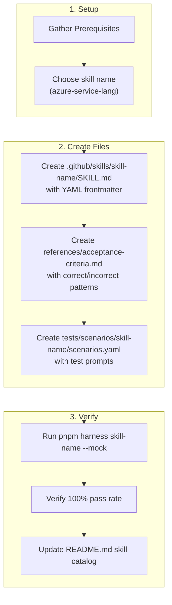
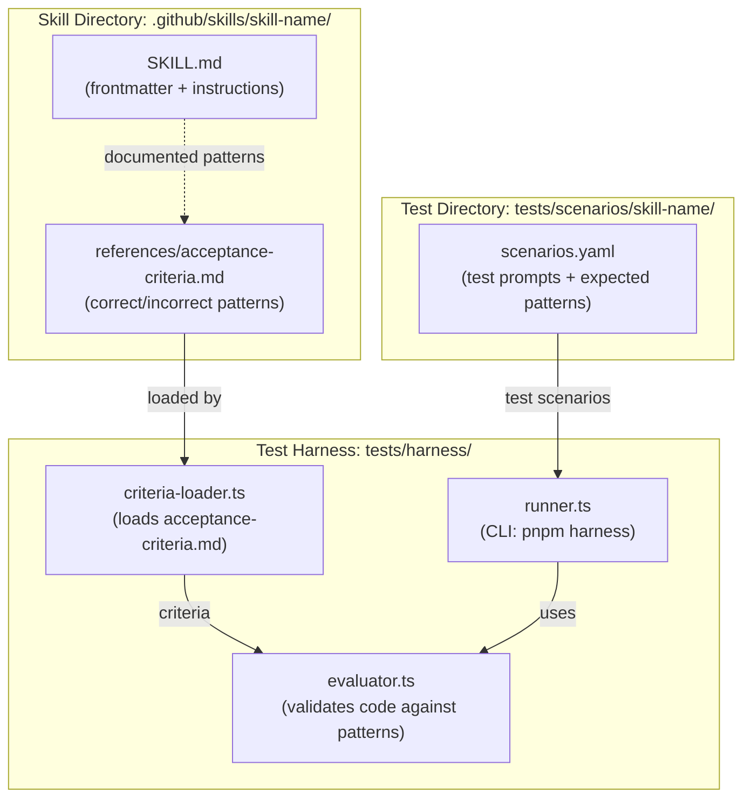
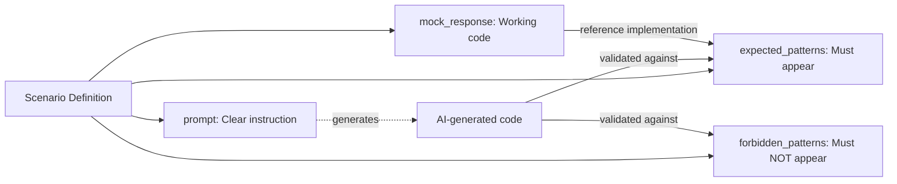
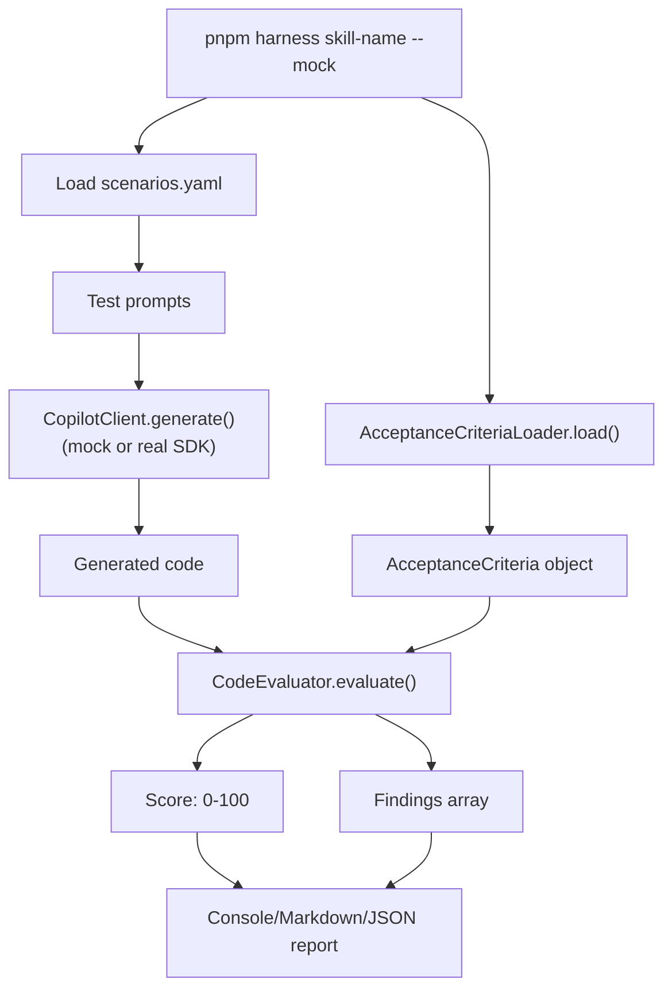

<!-- source: DeepWiki mcp.deepwiki.com · repo microsoft/skills · page 2.4 Creating New Skills · fetched 2026-10-30 -->

# Creating New Skills

<details>
<summary>Relevant source files</summary>

The following files were used as context for generating this wiki page:

- [.github/agents/scaffolder.agent.md](.github/agents/scaffolder.agent.md)
- [.github/copilot-instructions.md](.github/copilot-instructions.md)
- [.github/docs/agent-integration.md](.github/docs/agent-integration.md)
- [.github/plugins/deep-wiki/.claude-plugin/plugin.json](.github/plugins/deep-wiki/.claude-plugin/plugin.json)
- [.github/plugins/deep-wiki/README.md](.github/plugins/deep-wiki/README.md)
- [.github/plugins/deep-wiki/commands/ado.md](.github/plugins/deep-wiki/commands/ado.md)
- [.github/plugins/deep-wiki/commands/crisp.md](.github/plugins/deep-wiki/commands/crisp.md)
- [.github/plugins/deep-wiki/skills/wiki-ado-convert/SKILL.md](.github/plugins/deep-wiki/skills/wiki-ado-convert/SKILL.md)
- [.github/prompts/scaffold-foundry-app.prompt.md](.github/prompts/scaffold-foundry-app.prompt.md)
- [.github/skills/skill-creator/references/acceptance-criteria.md](.github/skills/skill-creator/references/acceptance-criteria.md)
- [Agents.md](Agents.md)
- [README.md](README.md)
- [context7.json](context7.json)
- [docs-site/src/pages/index.astro](docs-site/src/pages/index.astro)
- [docs/index.html](docs/index.html)
- [tests/AGENTS.md](tests/AGENTS.md)
- [tests/README.md](tests/README.md)
- [tests/harness/criteria-loader.ts](tests/harness/criteria-loader.ts)
- [tests/scenarios/skill-creator/scenarios.yaml](tests/scenarios/skill-creator/scenarios.yaml)

</details>


This page provides step-by-step instructions for creating new skills in the repository. Skills are domain-specific knowledge packages that AI coding agents load to implement features using specific SDKs or frameworks. Each skill consists of a `SKILL.md` file with YAML frontmatter, acceptance criteria documenting correct/incorrect patterns, and test scenarios for automated validation.

For information about the skill format specification, see [SKILL.md Format Specification](#2.3). For examples of complete skills with tests, see [Example Skills Deep Dive](#2.5).

---

## Prerequisites

Before creating a skill, gather the following information from the user or documentation:

| Required Information | Example | Purpose |
|---------------------|---------|---------|
| SDK package name | `azure-ai-projects`, `Azure.AI.OpenAI` | Installation instructions |
| Documentation URL | Microsoft Learn page or GitHub repo | Reference material for patterns |
| Target language | `py`, `dotnet`, `ts`, `java` | Naming convention suffix |
| Core use cases | "Create agents", "vector search" | Trigger phrases in description |

**Sources:** [README.md:675-679](), [Agents.md:182-186]()

---

## Skill Creation Workflow



**Diagram:** Skill creation workflow showing the three phases: setup, file creation, and verification

**Sources:** [README.md:670-696](), [Agents.md:176-210](), [tests/README.md:120-146]()

---

## File Structure and Locations



**Diagram:** File locations and relationships between skill definition, acceptance criteria, and test harness components

**Sources:** [tests/README.md:26-49](), [tests/harness/criteria-loader.ts:1-100]()

---

## Step 1: Create SKILL.md with Frontmatter

Create `.github/skills/<skill-name>/SKILL.md` with YAML frontmatter and structured sections.

### Naming Convention

| Language | Suffix | Example |
|----------|--------|---------|
| Python | `-py` | `azure-cosmos-db-py` |
| .NET | `-dotnet` | `azure-ai-openai-dotnet` |
| TypeScript | `-ts` | `azure-storage-blob-ts` |
| Java | `-java` | `azure-cosmos-java` |
| Cross-language | (none) | `mcp-builder`, `skill-creator` |

**Sources:** [README.md:675](), [.github/copilot-instructions.md:109-118]()

### YAML Frontmatter Structure

The frontmatter must include `name` and `description` with trigger phrases:

```yaml
---
name: azure-example-py
description: |
  Azure Example SDK for Python. Use for creating and managing examples.
  Triggers: "create example", "list examples", "azure example sdk".
---
```

**Key elements:**
- `name`: Must match directory name
- `description`: What the skill does + when to use + trigger phrases
- Trigger phrases: Keywords that activate skill loading

**Sources:** [.github/skills/skill-creator/references/acceptance-criteria.md:93-104]()

### Standard Sections

The `SKILL.md` body should include these sections in order:

| Section | Content | Required |
|---------|---------|----------|
| Installation | Package installation commands | ✅ |
| Environment Variables | Required environment variables | ✅ |
| Authentication | `DefaultAzureCredential` pattern | ✅ |
| Core Workflow | Basic usage examples | ✅ |
| Features | Tables of capabilities | Optional |
| Best Practices | Common patterns | Optional |
| Reference Files | Links to bundled resources | If applicable |

**Sources:** [.github/skills/skill-creator/references/acceptance-criteria.md:201-267]()

---

## Step 2: Create Acceptance Criteria

Create `.github/skills/<skill-name>/references/acceptance-criteria.md` documenting correct and incorrect code patterns.

### Structure

```markdown
# Acceptance Criteria: skill-name

## Section Name (e.g., Imports, Authentication)

### ✅ Correct
```python
from azure.module import Client
credential = DefaultAzureCredential()
```

### ❌ Incorrect
```python
from wrong.module import Client  # Wrong import path
api_key = "hardcoded-key"  # Never hardcode credentials
```
```

**Sources:** [tests/README.md:123-141](), [tests/AGENTS.md:27-52]()

### Pattern Categories

The `AcceptanceCriteriaLoader` extracts patterns into two categories:

| Category | Purpose | Matching Strategy |
|----------|---------|-------------------|
| `correctPatterns` | Expected usage | Flexible substring matching |
| `incorrectPatterns` | Anti-patterns | Import-only vs mixed patterns |

**Import-only patterns** flag wrong import paths where the import itself is the error:

```python
# WRONG - clients are in azure.ai.contentsafety, not models
from azure.ai.contentsafety.models import ContentSafetyClient
```

**Mixed patterns** show valid imports used incorrectly (requires both import AND misuse):

```python
# WRONG - AnalyzeTextOptions is for text, not images
from azure.ai.contentsafety.models import AnalyzeTextOptions
request = AnalyzeTextOptions(text="image.jpg")
response = client.analyze_image(request)  # The actual error
```

**Sources:** [tests/harness/criteria-loader.ts:105-176](), [tests/AGENTS.md:324-420]()

---

## Step 3: Create Test Scenarios

Create `tests/scenarios/<skill-name>/scenarios.yaml` with test scenarios that validate skill usage.

### Scenario YAML Structure

```yaml
config:
  model: gpt-4
  max_tokens: 2000
  temperature: 0.3

scenarios:
  - name: basic_usage
    prompt: |
      Create a basic example using the SDK.
      Include authentication with DefaultAzureCredential.
    expected_patterns:
      - "DefaultAzureCredential"
      - "from azure.example import"
    forbidden_patterns:
      - "hardcoded.*key"
      - "api_key.*="
    tags:
      - basic
      - auth
    mock_response: |
      from azure.identity import DefaultAzureCredential
      from azure.example import ExampleClient
      # Complete working code that passes validation
```

**Sources:** [tests/README.md:142-165](), [tests/AGENTS.md:57-91]()

### Scenario Design Principles



**Diagram:** Scenario components and their relationships in the validation flow

**Key principles:**
- Each scenario tests ONE specific pattern
- `expected_patterns` are substring matches (flexible)
- `forbidden_patterns` are exact matches (strict)
- `mock_response` is a complete, passing example
- Tags enable filtering (`basic`, `async`, `streaming`, etc.)

**Sources:** [tests/AGENTS.md:83-91](), [tests/scenarios/skill-creator/scenarios.yaml:1-20]()

---

## Step 4: Verification with Test Harness

The test harness validates generated code against acceptance criteria using the Copilot SDK or mock responses.

### Evaluation Flow



**Diagram:** Test harness evaluation flow from CLI command to final report

**Sources:** [tests/README.md:26-49](), [tests/harness/runner.ts]()

### Running Tests Locally

```bash
# Install dependencies
cd tests
pnpm install

# List skills with test coverage
pnpm harness --list

# Run all scenarios in mock mode (fast, deterministic)
pnpm harness azure-ai-projects-py --mock --verbose

# Run specific scenario by name or tag
pnpm harness azure-ai-projects-py --mock --filter basic

# Run unit tests
pnpm test
```

**Sources:** [tests/README.md:3-11](), [tests/AGENTS.md:178-201]()

### Scoring Algorithm

The `CodeEvaluator` starts at 100 points and applies penalties/bonuses:

| Factor | Impact | Severity |
|--------|--------|----------|
| Syntax error | -100 | Error |
| Incorrect pattern found | -15 each | Error |
| Error finding | -20 each | Error |
| Warning finding | -5 each | Warning |
| Correct pattern matched | +5 each | Bonus |

A result **passes** if it has no error-severity findings.

**Sources:** [tests/README.md:174-184]()

---

## Step 5: Update README.md

Add the new skill to the appropriate language section in `README.md`:

```markdown
### Python

> 42 skills • suffix: `-py`

| Skill | Description |
|-------|-------------|
| [azure-example-py](.github/skills/azure-example-py/) | Azure Example SDK — create and manage examples. |
```

Update the skill count in the table of contents.

**Sources:** [README.md:71-83](), [README.md:104-217]()

---

## Validation Checklist

Before submitting a skill, verify:

- [ ] `SKILL.md` has YAML frontmatter with `name` and `description`
- [ ] Description includes trigger phrases
- [ ] Standard sections present (Installation, Environment, Authentication, Core Workflow)
- [ ] Uses `DefaultAzureCredential`, not hardcoded credentials
- [ ] `references/acceptance-criteria.md` has correct/incorrect patterns
- [ ] `tests/scenarios/<skill>/scenarios.yaml` exists with scenarios
- [ ] `mock_response` in each scenario is complete working code
- [ ] All scenarios pass: `pnpm harness <skill> --mock --verbose`
- [ ] README.md updated with new skill entry
- [ ] Skill count updated in README.md

**Sources:** [README.md:670-696](), [tests/README.md:107-113]()

---

## Common Patterns to Test

For Azure SDK skills, ensure acceptance criteria and scenarios cover:

| Pattern | What to Check |
|---------|---------------|
| **Imports** | Correct module paths (e.g., `azure.ai.agents` vs `azure.ai.projects`) |
| **Authentication** | `DefaultAzureCredential`, not hardcoded credentials |
| **Client creation** | Context managers (`with client:`) for resource cleanup |
| **Async variants** | Correct `.aio` imports for async code |
| **Models** | Import from correct module (varies by SDK) |
| **Environment variables** | `os.environ` or `os.getenv`, not hardcoded values |

**Sources:** [tests/AGENTS.md:150-172](), [.github/skills/skill-creator/references/acceptance-criteria.md:270-340]()

---

## Example: Minimal Skill

A complete minimal skill structure:

```
.github/skills/azure-example-py/
├── SKILL.md
└── references/
    └── acceptance-criteria.md

tests/scenarios/azure-example-py/
└── scenarios.yaml
```

**SKILL.md frontmatter:**
```yaml
---
name: azure-example-py
description: Azure Example SDK for Python. Use for creating examples. Triggers on "create example", "azure example".
---
```

**acceptance-criteria.md sections:**
- Imports (correct/incorrect)
- Authentication (correct/incorrect)
- Core operations (correct/incorrect)

**scenarios.yaml:**
- 2-3 scenarios covering basic usage, authentication, error handling
- Each with `expected_patterns`, `forbidden_patterns`, `mock_response`

**Sources:** [.github/skills/skill-creator/references/acceptance-criteria.md:1-68](), [tests/scenarios/skill-creator/scenarios.yaml:10-89]()

---

## Files Created

| File Path | Purpose |
|-----------|---------|
| `.github/skills/<skill-name>/SKILL.md` | Skill definition with frontmatter |
| `.github/skills/<skill-name>/references/acceptance-criteria.md` | Correct/incorrect patterns |
| `tests/scenarios/<skill-name>/scenarios.yaml` | Test scenarios |
| Updated `README.md` | Skill catalog entry |

**Sources:** [README.md:513-541](), [tests/README.md:117-147]()

---

