<!-- source: DeepWiki mcp.deepwiki.com · repo microsoft/skills · page 2.5 Example Skills Deep Dive · fetched 2026-10-30 -->

# Example Skills Deep Dive

<details>
<summary>Relevant source files</summary>

The following files were used as context for generating this wiki page:

- [.github/plugins/azure-sdk-python/skills/azure-ai-language-conversations-py/SKILL.md](.github/plugins/azure-sdk-python/skills/azure-ai-language-conversations-py/SKILL.md)
- [.github/plugins/azure-sdk-python/skills/azure-ai-language-conversations-py/references/acceptance-criteria.md](.github/plugins/azure-sdk-python/skills/azure-ai-language-conversations-py/references/acceptance-criteria.md)
- [.github/skills/continual-learning/SKILL.md](.github/skills/continual-learning/SKILL.md)
- [.gitignore](.gitignore)
- [docs-site/scripts/extract-skills.ts](docs-site/scripts/extract-skills.ts)
- [docs-site/src/components/HookCard.astro](docs-site/src/components/HookCard.astro)
- [docs-site/src/components/SkillDetailModal.tsx](docs-site/src/components/SkillDetailModal.tsx)
- [docs-site/src/components/SkillsSection.tsx](docs-site/src/components/SkillsSection.tsx)
- [docs-site/src/data/hooks.json](docs-site/src/data/hooks.json)
- [docs-site/src/data/skills.json](docs-site/src/data/skills.json)
- [docs/_astro/SkillsSection.DSKr3JQZ.js](docs/_astro/SkillsSection.DSKr3JQZ.js)
- [docs/_astro/index.CktZY-PF.css](docs/_astro/index.CktZY-PF.css)
- [hooks/continual-learning/README.md](hooks/continual-learning/README.md)
- [hooks/continual-learning/hooks.json](hooks/continual-learning/hooks.json)
- [hooks/continual-learning/learn.sh](hooks/continual-learning/learn.sh)
- [tests/scenarios/azure-search-documents-py/scenarios.yaml](tests/scenarios/azure-search-documents-py/scenarios.yaml)

</details>


This page examines three representative Azure SDK Python skills—`azure-ai-language-conversations-py`, `azure-cosmos-db-py`, and `azure-ai-projects-py`—to illustrate real-world skill structure, acceptance criteria patterns, test scenarios, and implementation patterns. These examples demonstrate different complexity levels: from focused API wrappers to production-grade service patterns. For the formal SKILL.md specification, see page 2.3. For instructions on creating new skills, see page 2.4.

## Azure AI Language Conversations Python Skill Deep Dive

The `azure-ai-language-conversations-py` skill demonstrates Conversational Language Understanding (CLU) patterns for analyzing conversation intent and entities using the Azure AI Language SDK.

### Directory Structure

**azure-ai-language-conversations-py skill structure:**

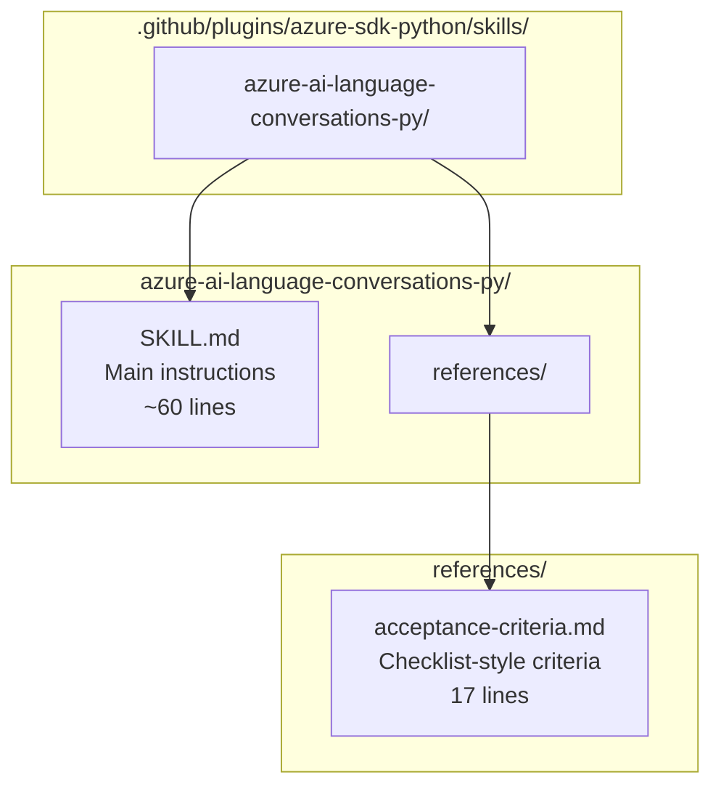

**Sources:** [.github/plugins/azure-sdk-python/skills/azure-ai-language-conversations-py/SKILL.md:1-61](), [.github/plugins/azure-sdk-python/skills/azure-ai-language-conversations-py/references/acceptance-criteria.md:1-17]()

### SKILL.md Key Patterns

The skill teaches agents to implement Conversational Language Understanding using the `ConversationAnalysisClient`:

| Pattern | Code Entity | Purpose |
|---------|-------------|---------|
| Client creation | `ConversationAnalysisClient(endpoint, AzureKeyCredential(key))` | Initialize CLU client |
| Conversation payload | `task["analysisInput"]["conversationItem"]` | Structure user utterance |
| Participant mapping | `"participantId": "1", "id": "1"` | Track conversation flow |
| Intent extraction | `result["result"]["prediction"]["topIntent"]` | Parse top-ranked intent |
| Environment variables | `os.environ["AZURE_CONVERSATIONS_ENDPOINT"]` | Configuration management |

**Example payload structure from SKILL.md:**

```python
task = {
    "kind": "Conversation",
    "analysisInput": {
        "conversationItem": {
            "participantId": "1",
            "id": "1",
            "modality": "text",
            "language": "en",
            "text": query
        },
        "isLoggingEnabled": False
    },
    "parameters": {
        "projectName": project_name,
        "deploymentName": deployment_name,
        "verbose": True
    }
}
```

**Sources:** [.github/plugins/azure-sdk-python/skills/azure-ai-language-conversations-py/SKILL.md:26-59]()

### Acceptance Criteria Pattern

The acceptance criteria file uses a checklist format organized by functional areas:

**Diagram: Acceptance Criteria Structure**

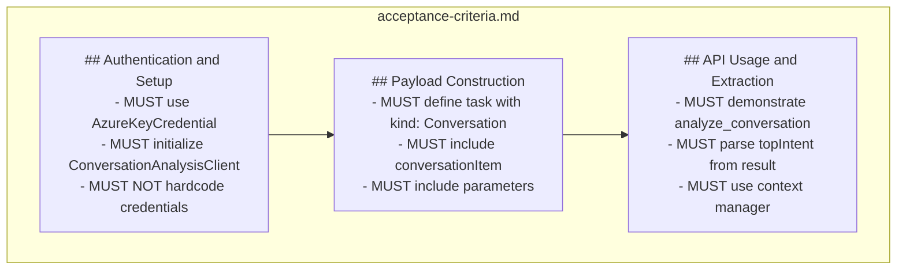

**Checklist criteria breakdown:**

| Category | Requirement | Validation |
|----------|-------------|------------|
| Authentication | Use `AzureKeyCredential` | ✅ Correct: `AzureKeyCredential(key)` |
| Authentication | Initialize `ConversationAnalysisClient` | ✅ Correct: `ConversationAnalysisClient(endpoint, credential)` |
| Authentication | No hardcoded keys | ❌ Incorrect: `key = "abc123..."` |
| Payload | Define `task` with `"kind": "Conversation"` | ✅ Correct: `task["kind"] == "Conversation"` |
| Payload | Include `conversationItem` with id/participantId | ✅ Correct: `{"participantId": "1", "id": "1"}` |
| API Usage | Call `analyze_conversation` | ✅ Correct: `client.analyze_conversation(task)` |
| API Usage | Use context manager | ✅ Correct: `with client:` |

**Sources:** [.github/plugins/azure-sdk-python/skills/azure-ai-language-conversations-py/references/acceptance-criteria.md:1-17]()

### Implementation Pattern

The skill demonstrates a focused API wrapper pattern with minimal abstraction:

**Diagram: Conversation Analysis Flow**

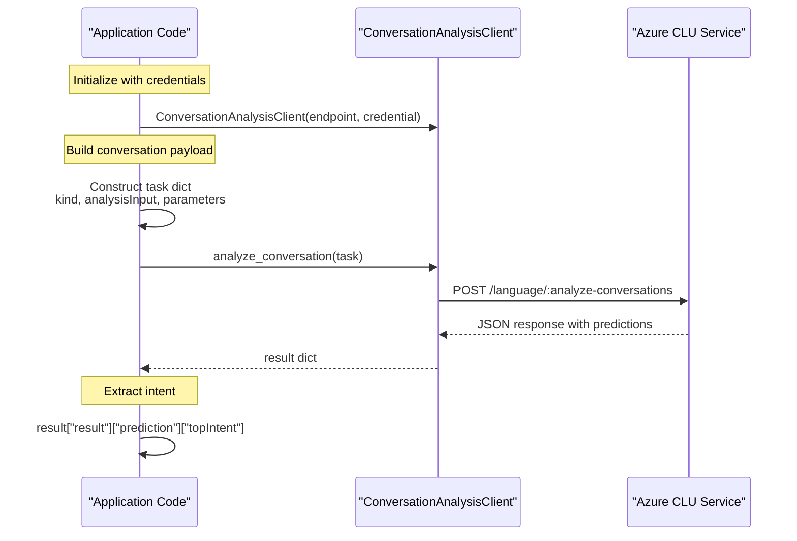

**Sources:** [.github/plugins/azure-sdk-python/skills/azure-ai-language-conversations-py/SKILL.md:26-60]()

## Azure Cosmos DB Python Skill Deep Dive

The `azure-cosmos-db-py` skill demonstrates production-grade NoSQL database patterns with dual authentication support and service layer architecture.

### Skill Overview

**Diagram: Cosmos DB Skill Architecture**

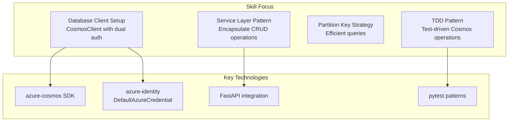

**Sources:** [docs-site/src/data/skills.json:314-320]()

### Key Implementation Patterns

The skill teaches production patterns for Cosmos DB integration:

| Pattern | Code Entity | Purpose |
|---------|-------------|---------|
| Dual authentication | `DefaultAzureCredential()` + emulator support | Production and local development |
| Service layer | `CosmosService` class | Encapsulate database operations |
| Partition keys | Query with `partition_key=` parameter | Efficient cross-partition queries |
| Parameterized queries | `query_items(query, parameters)` | SQL injection prevention |
| TDD patterns | `@pytest.fixture` for Cosmos setup | Test-driven development |

**Example service layer pattern:**

```python
class CosmosService:
    def __init__(self, endpoint: str, credential, database_name: str, container_name: str):
        self.client = CosmosClient(endpoint, credential=credential)
        self.database = self.client.get_database_client(database_name)
        self.container = self.database.get_container_client(container_name)
    
    def get_item(self, item_id: str, partition_key: str):
        return self.container.read_item(item=item_id, partition_key=partition_key)
    
    def query_items(self, query: str, parameters: list):
        return list(self.container.query_items(
            query=query,
            parameters=parameters,
            enable_cross_partition_query=True
        ))
```

**Sources:** [docs-site/src/data/skills.json:314-320]()

### Authentication Strategy

The skill emphasizes dual authentication for production and development:

**Diagram: Dual Authentication Flow**

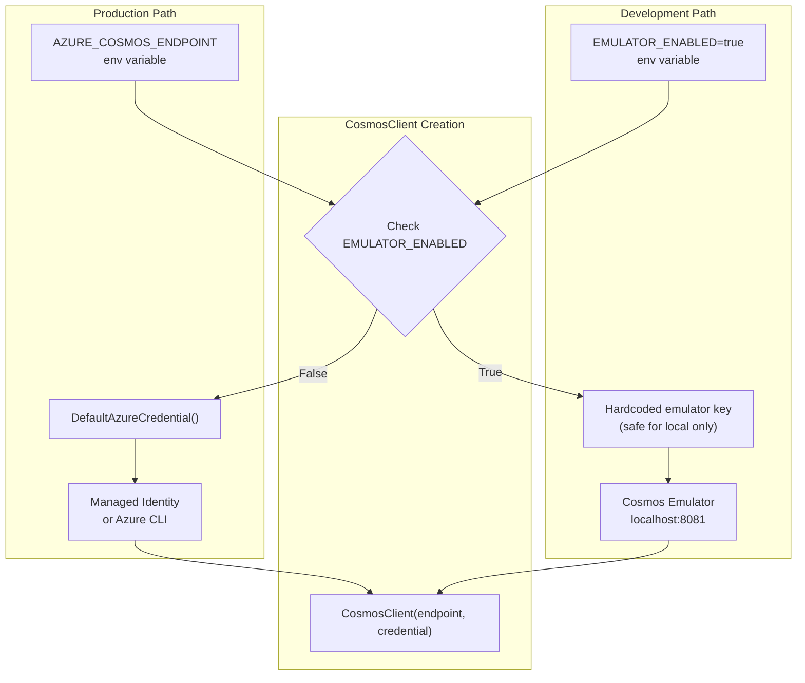

**Sources:** [docs-site/src/data/skills.json:314-320]()

### Trigger Phrases

The skill activates on specific phrases in the description:

| Trigger Type | Phrases | Example Context |
|--------------|---------|-----------------|
| Service type | "Cosmos DB", "NoSQL database", "document store" | "I need a NoSQL database for my API" |
| Operation | "add persistence", "database service layer" | "Add persistence to this FastAPI app" |
| SDK-specific | "Python Cosmos SDK" | "Use the Python Cosmos SDK" |
| Pattern | "partition key strategies" | "How do I design partition keys?" |

**Sources:** [docs-site/src/data/skills.json:314-320]()

## Acceptance Criteria Patterns Across Skills

Acceptance criteria files follow structured patterns that the test harness parses to validate generated code. The three example skills demonstrate different approaches.

### Comparison: Checklist vs Pattern-Based Criteria

**Diagram: Two Acceptance Criteria Formats**

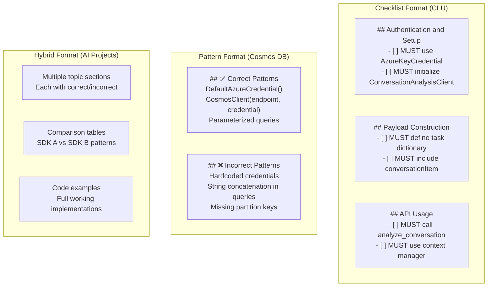

**Sources:** [.github/plugins/azure-sdk-python/skills/azure-ai-language-conversations-py/references/acceptance-criteria.md:1-17]()

### Pattern Classification by AcceptanceCriteriaLoader

The test harness loader determines pattern correctness by scanning for markers:

| Marker Type | Keywords | Pattern Classification | Example Skill |
|-------------|----------|------------------------|---------------|
| Correct | `✅`, `Correct`, `DO:`, `MUST use`, `Good` | `isCorrect: true` | azure-cosmos-db-py |
| Incorrect | `❌`, `Incorrect`, `DON'T:`, `MUST NOT`, `Bad`, `Anti-pattern` | `isCorrect: false` | azure-ai-language-conversations-py |
| Checklist | `- [ ]`, `MUST`, `SHOULD`, `MAY` | Parsed as requirements | azure-ai-language-conversations-py |

**Code entity: Pattern extraction from `AcceptanceCriteriaLoader`:**

```typescript
// From tests/harness/criteria-loader.ts
function isCorrectSection(sectionContent: string): boolean | null {
  const correctMarkers = ["✅", "Correct", "DO:", "Good"];
  const incorrectMarkers = ["❌", "Incorrect", "DON'T:", "Bad"];
  
  const correctCount = correctMarkers.filter(m => 
    sectionContent.includes(m)
  ).length;
  const incorrectCount = incorrectMarkers.filter(m => 
    sectionContent.includes(m)
  ).length;
  
  if (correctCount > incorrectCount) return true;
  if (incorrectCount > correctCount) return false;
  return null; // Mixed or unclear
}
```

**Sources:** [tests/harness/criteria-loader.ts:180-202]()

### Language Conversations Checklist Format

The CLU skill uses checklist-style criteria that read like a validation specification:

**Example criteria breakdown:**

| Section | Requirement | Validation Type |
|---------|-------------|-----------------|
| Authentication | `MUST use AzureKeyCredential` | Type check |
| Authentication | `MUST initialize ConversationAnalysisClient` | Class presence |
| Authentication | `MUST NOT hardcode API keys` | Pattern scan for literals |
| Payload | `MUST define task with "kind": "Conversation"` | Dictionary structure |
| Payload | `MUST include conversationItem with id/participantId` | Required fields |
| API Usage | `MUST demonstrate analyze_conversation` | Method call presence |
| API Usage | `MUST use context manager (with client:)` | Context manager detection |

**Sources:** [.github/plugins/azure-sdk-python/skills/azure-ai-language-conversations-py/references/acceptance-criteria.md:1-17]()

### Common Anti-Patterns

The three skills identify similar anti-patterns:

| Anti-Pattern | CLU Example | Cosmos Example | AI Projects Example |
|--------------|-------------|----------------|---------------------|
| Hardcoded credentials | `key = "abc123..."` | `credential = "AccountKey..."` | `api_key = "sk-..."` |
| Missing error handling | No try/except | No exception catching | No status checks |
| Incorrect imports | Wrong package name | Missing azure-identity | Deprecated SDK imports |
| Poor structure | Flat code | No service layer | Mixed concerns |
| Configuration issues | Hardcoded endpoint | Hardcoded connection strings | Inline configuration |

**Sources:** [.github/plugins/azure-sdk-python/skills/azure-ai-language-conversations-py/references/acceptance-criteria.md:4-7]()

## Test Scenarios Architecture

Test scenarios define expected behavior, forbidden patterns, and mock responses for validating skill quality. The `scenarios.yaml` format is consistent across all skills.

### scenarios.yaml Format

**Diagram: Scenario File Structure**

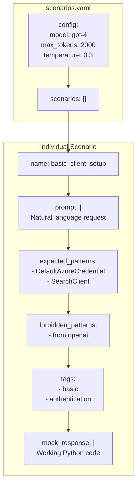

**Sources:** [tests/scenarios/azure-search-documents-py/scenarios.yaml:1-30]()

### Expected vs Forbidden Patterns from Azure Search

The azure-search-documents-py scenarios demonstrate comprehensive pattern coverage:

**Pattern examples by scenario category:**

| Scenario | Expected Patterns | Forbidden Patterns | Purpose |
|----------|-------------------|-------------------|---------|
| `basic_client_setup` | `DefaultAzureCredential`, `SearchClient`, `from azure.search.documents import` | `from openai` | Validate correct SDK imports |
| `vector_search_basic` | `VectorizedQuery`, `vector=`, `k_nearest_neighbors=`, `fields=` | (none) | Check vector search API |
| `semantic_ranking` | `QueryType.SEMANTIC`, `query_type=`, `semantic_configuration_name=` | `semantic_search=True` | Prevent deprecated parameters |
| `document_upload` | `upload_documents`, `merge_or_upload_documents` | `insert_or_update` | Ensure correct method names |
| `error_handling` | `try:`, `except`, `ResourceNotFoundError`, `HttpResponseError` | `except Exception:` | Validate specific exception handling |

**Sources:** [tests/scenarios/azure-search-documents-py/scenarios.yaml:10-496]()

### Mock Response Pattern

Each scenario includes a `mock_response` with working code:

**Example: Azure Search basic client setup mock response**

```yaml
mock_response: |
  import os
  from azure.identity import DefaultAzureCredential
  from azure.search.documents import SearchClient
  
  endpoint = os.environ["SEARCH_ENDPOINT"]
  index_name = os.environ["SEARCH_INDEX_NAME"]
  
  client = SearchClient(
      endpoint=endpoint,
      index_name=index_name,
      credential=DefaultAzureCredential(),
  )
  
  results = client.search(search_text="python programming")
  
  for result in results:
      print(f"Score: {result['@search.score']}")
      print(f"Title: {result['title']}")
```

**Key elements in mock responses:**

| Element | Purpose | Example |
|---------|---------|---------|
| Environment variables | Configuration externalization | `os.environ["SEARCH_ENDPOINT"]` |
| Credential pattern | Authentication best practice | `DefaultAzureCredential()` |
| Client instantiation | SDK initialization | `SearchClient(endpoint, index_name, credential)` |
| Operation example | Demonstrate API usage | `client.search(search_text="...")` |
| Result processing | Show data extraction | `result['@search.score']` |

**Sources:** [tests/scenarios/azure-search-documents-py/scenarios.yaml:26-44]()

### Scenario Organization by Tags

Scenarios use tags for filtering and organization:

**Tag taxonomy from Azure Search scenarios:**

| Tag Category | Tag Values | Usage |
|--------------|------------|-------|
| Complexity | `basic`, `advanced` | Skill level targeting |
| Feature | `vector-search`, `semantic-ranking`, `hybrid-search` | Feature coverage |
| Operation | `search`, `indexing`, `infrastructure` | Operation type |
| Cross-cutting | `authentication`, `error-handling`, `async` | Pattern type |
| Development | `production` | Deployment context |

**Sources:** [tests/scenarios/azure-search-documents-py/scenarios.yaml:22-25]()

## Azure AI Projects Python Skill Pattern

The `azure-ai-projects-py` skill demonstrates progressive disclosure with extensive reference files and executable scripts. This is the most comprehensive example skill in the repository.

### Skill Scope and High-Level SDK

The AI Projects SDK is the high-level Foundry SDK covering project management, agents, connections, evaluations, datasets, and indexes:

**Diagram: AI Projects SDK Coverage**

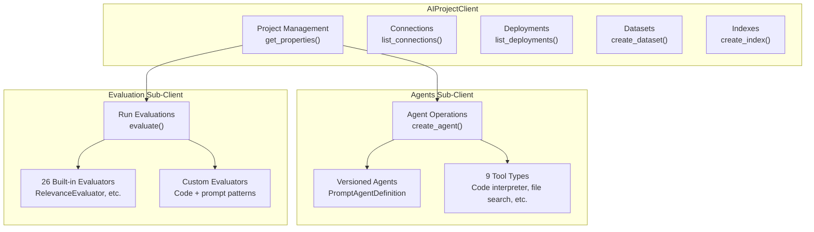

**Sources:** [docs-site/src/data/skills.json:131-137]()

### Progressive Disclosure Implementation

The skill uses a three-tier loading strategy optimized for context window management:

**Diagram: Three-Phase Context Loading**

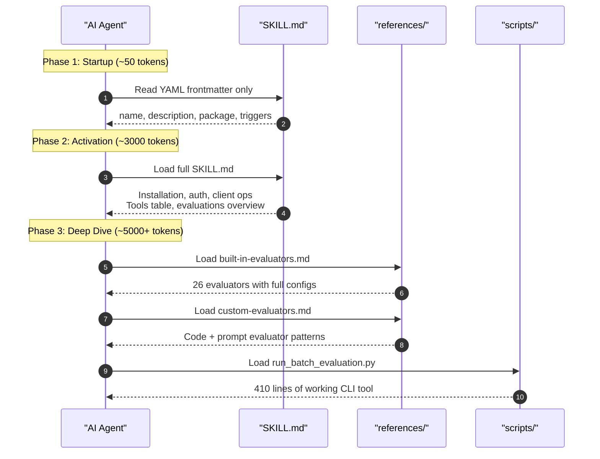

**Token budget by phase:**

| Phase | Content Loaded | Typical Token Count | When Triggered |
|-------|----------------|---------------------|----------------|
| Startup | Frontmatter only | ~50 tokens | Agent initialization |
| Activation | Full SKILL.md | ~3,000 tokens | Task matches description/triggers |
| Deep dive | Single reference file | ~5,000 tokens | Specific question about topic |
| Implementation | Script file | ~1,500 tokens | Request for working tool |

**Sources:** [docs-site/src/data/skills.json:131-137]()

### Directory Structure

The skill organizes content across 9 reference files and 1 executable script:

| Directory | File | Lines | Purpose |
|-----------|------|-------|---------|
| `references/` | `agents.md` | ~300 | `PromptAgentDefinition`, `ImageBasedHostedAgentDefinition` patterns |
| | `tools.md` | ~400 | All 9 tool types: code interpreter, file search, Bing, Azure AI Search, MCP, etc. |
| | `evaluation.md` | ~350 | Evaluation operations, dataset management, scoring |
| | `built-in-evaluators.md` | 428 | 26 built-in evaluators with configuration tables |
| | `custom-evaluators.md` | 451 | Code evaluators, prompt evaluators, custom logic |
| | `connections.md` | ~200 | Connection types, authentication patterns |
| | `deployments.md` | ~150 | Model deployment enumeration |
| | `datasets-indexes.md` | ~250 | Data operations, vector index management |
| | `api-reference.md` | ~800 | 373 SDK exports with type signatures |
| `scripts/` | `run_batch_evaluation.py` | 410 | Complete CLI tool for batch evaluations |

**Total content:** ~3,800 lines across 10 files, enabling deep expertise without context overflow.

**Sources:** [docs-site/src/data/skills.json:131-137]()

### Reference Cross-Linking Pattern

The SKILL.md uses forward references to guide agents to detailed documentation:

**Diagram: Information Architecture**

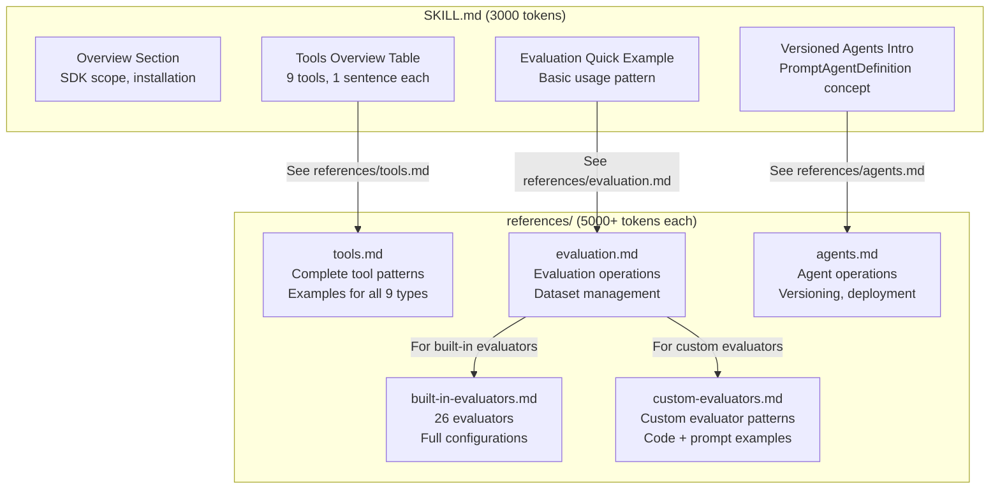

**Example forward reference pattern from SKILL.md:**

```markdown
## Tools Overview

The SDK supports 9 tool types. See `references/tools.md` for complete patterns.

| Tool | Purpose |
|------|---------|
| Code Interpreter | Execute Python code in sandboxed environment |
| File Search | RAG over uploaded files |
| ... | ... |
```

**Sources:** [docs-site/src/data/skills.json:131-137]()

## Skills, Acceptance Criteria, and Tests Integration

The three components—SKILL.md, acceptance criteria, and test scenarios—work together in the quality assurance pipeline to validate skill quality.

### End-to-End Quality Pipeline

**Diagram: Quality Assurance Architecture**

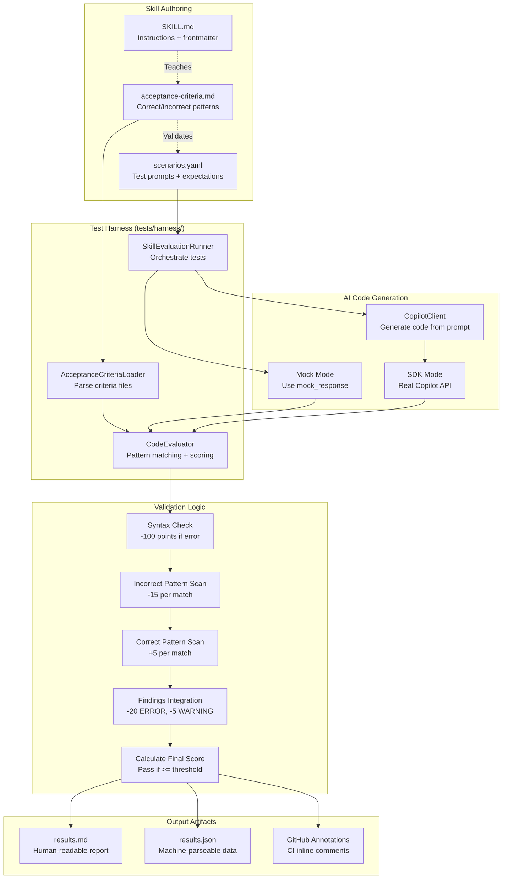

**Sources:** [tests/harness/criteria-loader.ts:1-436](), [tests/scenarios/azure-search-documents-py/scenarios.yaml:1-496]()

### Workflow Example: Language Conversations Skill

**Step 1: Author SKILL.md**

Create skill with frontmatter, system prompt, and examples:

```yaml
---
name: azure-ai-language-conversations-py
description: Implement CLU using azure-ai-language-conversations SDK...
---
```

**Step 2: Define Acceptance Criteria**

Create checklist-style requirements in `references/acceptance-criteria.md`:

| Section | Requirements |
|---------|--------------|
| Authentication | Use `AzureKeyCredential`, initialize `ConversationAnalysisClient`, no hardcoded keys |
| Payload | Define `task` with `"kind": "Conversation"`, include `conversationItem`, include `parameters` |
| API Usage | Call `analyze_conversation`, parse `topIntent`, use context manager |

**Step 3: Create Test Scenarios**

Define prompts and expected patterns in `tests/scenarios/azure-ai-language-conversations-py/scenarios.yaml`:

```yaml
scenarios:
  - name: basic_conversation_analysis
    prompt: |
      Create a basic CLU client and analyze a conversation
    expected_patterns:
      - "ConversationAnalysisClient"
      - "AzureKeyCredential"
      - "analyze_conversation"
    forbidden_patterns:
      - "hardcoded.*key"
    mock_response: |
      # Working code example
```

**Step 4: Run Test Harness**

Execute with mock mode for fast iteration:

```bash
cd tests
pnpm harness azure-ai-language-conversations-py --mock --verbose
```

**Step 5: CodeEvaluator Validates**

The evaluator checks the generated code:

| Check | Action | Points |
|-------|--------|--------|
| Syntax validation | Parse Python AST | -100 if error |
| Forbidden pattern scan | Check for hardcoded keys | -15 per match |
| Expected pattern scan | Verify `ConversationAnalysisClient` | +5 per match |
| Findings integration | Process linter errors | -20 ERROR, -5 WARNING |
| Final score | Calculate total | Pass if score > threshold |

**Step 6: Review Results**

The harness outputs three formats:

- `results.md`: Human-readable with scenario outcomes
- `results.json`: Machine-parseable with scores and patterns
- GitHub annotations: Inline comments on PR

**Sources:** [.github/plugins/azure-sdk-python/skills/azure-ai-language-conversations-py/SKILL.md:1-61](), [.github/plugins/azure-sdk-python/skills/azure-ai-language-conversations-py/references/acceptance-criteria.md:1-17]()

## Common Patterns Across Skills

### Directory Structure Pattern

| Directory | Purpose | Typical Contents |
|-----------|---------|------------------|
| `.github/skills/{skill-name}/` | Root skill directory | `SKILL.md` (required) |
| `references/` | Deep-dive documentation | 5-10 markdown files, 2000-5000 tokens each |
| `scripts/` | Executable tools | Python/TypeScript/shell scripts |
| `examples/` | Sample code | Working code snippets |

### File Naming Conventions

| Pattern | Example | Purpose |
|---------|---------|---------|
| `{topic}.md` | `agents.md`, `evaluation.md` | Topical reference docs |
| `{pattern}-{language}.md` | `async-patterns.md` | Implementation patterns |
| `{sdk-feature}.md` | `built-in-evaluators.md` | SDK feature documentation |
| `api-reference.md` | `api-reference.md` | Complete API surface |
| `run_{operation}.py` | `run_batch_evaluation.py` | CLI tools |

### Table Usage Patterns

Skills use tables for maximum information density:

| Table Type | Use Case | Example |
|------------|----------|---------|
| Operations mapping | Client methods → purposes | Client Operations Overview table |
| Feature comparison | SDK A vs SDK B | `azure-ai-projects` vs `azure-ai-agents` |
| Tool/evaluator catalog | List available tools | Tools Overview, Built-in Evaluators |
| Data mapping | Input fields → output | Data Mapping Reference |
| Pattern examples | Show variations | Agent Evaluators, Custom Evaluators |

**Sources:** [.github/skills/azure-ai-projects-py/SKILL.md:38-295](), [.github/skills/azure-ai-projects-py/references/built-in-evaluators.md:1-428](), [.github/skills/azure-ai-projects-py/references/evaluation.md:1-350]()

## Context Loading Strategy

Agents load skill content progressively based on task requirements:

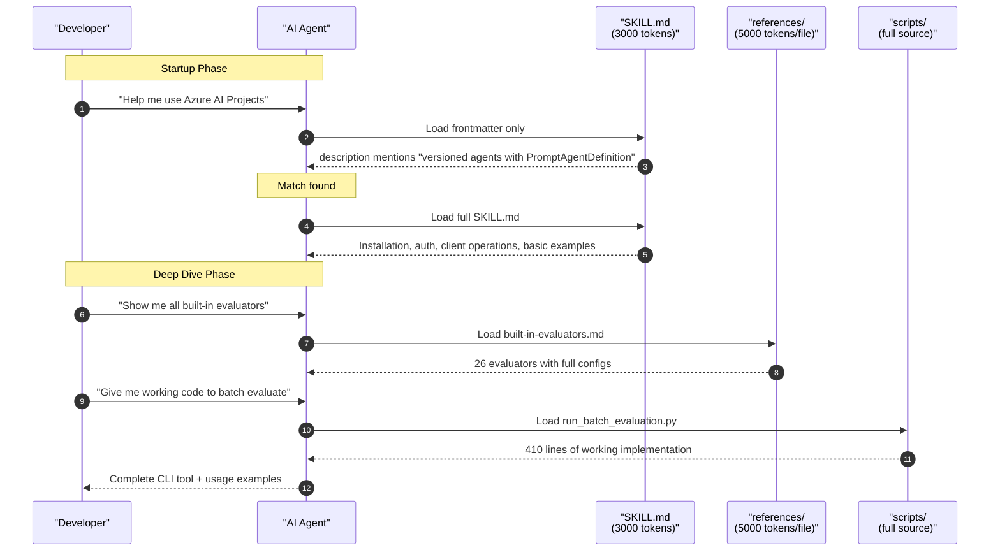

**Token budget breakdown:**

| Phase | Content Loaded | Token Count | When |
|-------|----------------|-------------|------|
| Startup | Frontmatter only | ~50 tokens | Agent initialization |
| Activation | Full SKILL.md | ~3,000 tokens | Task matches description |
| Deep dive | 1 reference file | ~5,000 tokens | Specific question about topic |
| Implementation | 1 script file | ~1,500 tokens | Request for working code |

**Sources:** [.github/skills/azure-ai-projects-py/SKILL.md:1-296](), [.github/skills/azure-ai-projects-py/references/built-in-evaluators.md:1-428](), [.github/skills/azure-ai-projects-py/scripts/run_batch_evaluation.py:1-410]()

---

