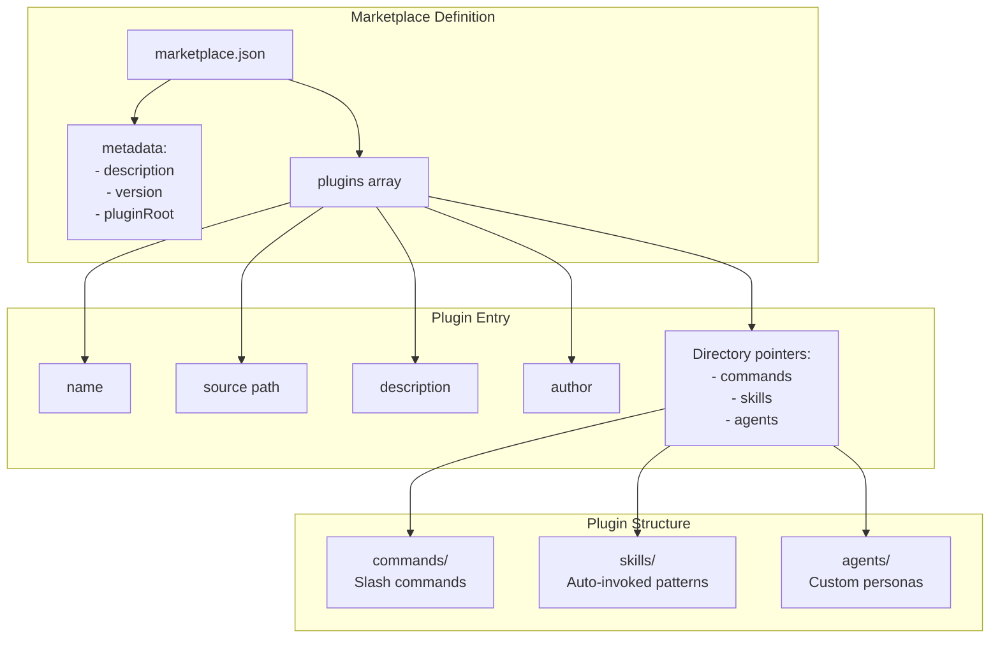
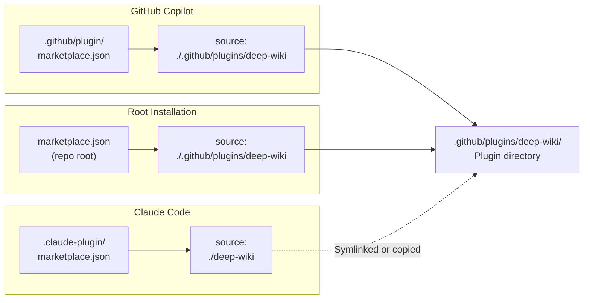
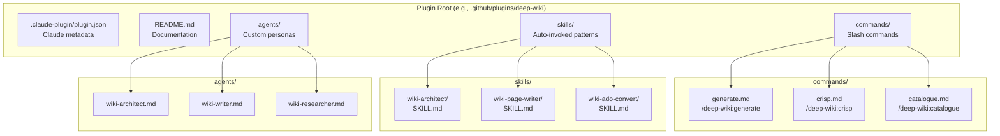
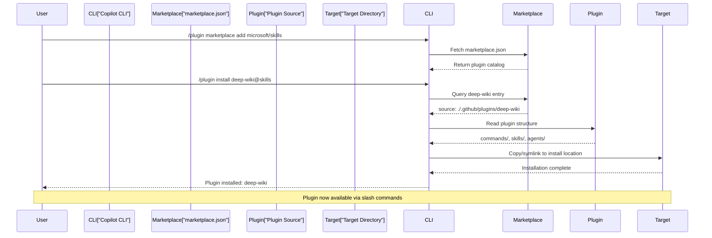
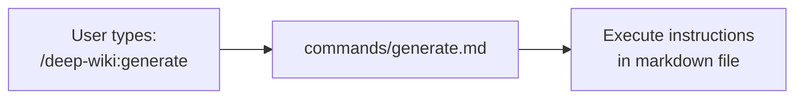
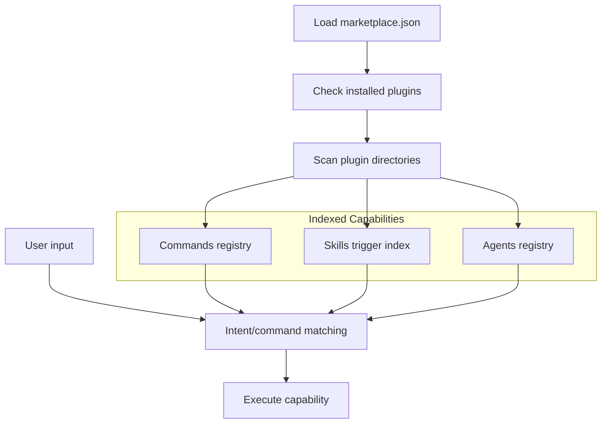

<!-- source: DeepWiki mcp.deepwiki.com · repo microsoft/skills · page 2.6 Plugin Marketplace Architecture · fetched 2026-10-30 -->

# Plugin Marketplace Architecture

<details>
<summary>Relevant source files</summary>

The following files were used as context for generating this wiki page:

- [.claude-plugin/marketplace.json](.claude-plugin/marketplace.json)
- [.github/plugin/marketplace.json](.github/plugin/marketplace.json)
- [.github/plugins/deep-wiki/.claude-plugin/plugin.json](.github/plugins/deep-wiki/.claude-plugin/plugin.json)
- [.github/plugins/deep-wiki/README.md](.github/plugins/deep-wiki/README.md)
- [.github/plugins/deep-wiki/commands/ado.md](.github/plugins/deep-wiki/commands/ado.md)
- [.github/plugins/deep-wiki/commands/crisp.md](.github/plugins/deep-wiki/commands/crisp.md)
- [.github/plugins/deep-wiki/skills/wiki-ado-convert/SKILL.md](.github/plugins/deep-wiki/skills/wiki-ado-convert/SKILL.md)
- [README.md](README.md)
- [docs-site/src/pages/index.astro](docs-site/src/pages/index.astro)
- [docs/index.html](docs/index.html)
- [marketplace.json](marketplace.json)

</details>


This document describes the plugin marketplace system defined in `marketplace.json` files, which enables discovery, installation, and management of plugin packages. Each plugin can expose commands (slash commands), skills (auto-invoked patterns), and agents (custom personas).

For information about individual skills within plugins, see [SKILL.md Format Specification](#2.3). For creating new plugins, this document covers the structural requirements.

---

## Overview

The marketplace system provides a catalog of installable plugin packages. A marketplace is defined by a `marketplace.json` file containing metadata about available plugins, their locations, and capabilities. The repository supports three deployment contexts, each with its own `marketplace.json` file with context-specific source paths.



**Sources:** [marketplace.json:1-126](), [.github/plugin/marketplace.json:1-126](), [.claude-plugin/marketplace.json:1-129]()

---

## Marketplace Schema

A `marketplace.json` file contains three top-level sections:

| Field | Type | Purpose |
|-------|------|---------|
| `name` | string | Marketplace identifier (e.g., `"skills"`) |
| `owner` | object | Owner metadata with `name` and `url` |
| `metadata` | object | Marketplace-level settings |
| `plugins` | array | List of plugin definitions |

### Metadata Object

| Field | Type | Description |
|-------|------|-------------|
| `description` | string | Human-readable marketplace description |
| `version` | string | Semantic version (e.g., `"1.0.0"`) |
| `pluginRoot` | string | Base path for resolving plugin sources (e.g., `"./.github/plugins"`) |

**Example:**

```json
{
  "name": "skills",
  "owner": {
    "name": "microsoft",
    "url": "https://github.com/microsoft"
  },
  "metadata": {
    "description": "Skills, agents, and plugins for AI coding agents",
    "version": "1.0.0",
    "pluginRoot": "./.github/plugins"
  },
  "plugins": [...]
}
```

**Sources:** [marketplace.json:2-11](), [.github/plugin/marketplace.json:2-11]()

---

## Plugin Metadata Schema

Each plugin entry in the `plugins` array defines:

| Field | Required | Type | Description |
|-------|----------|------|-------------|
| `name` | Yes | string | Plugin identifier (e.g., `"deep-wiki"`) |
| `source` | Yes | string | Path to plugin directory |
| `description` | Yes | string | Plugin description |
| `version` | No | string | Plugin version |
| `author` | No | object | Author with `name` and optional `url` |
| `homepage` | No | string | Documentation URL |
| `repository` | No | string | Source repository URL |
| `license` | No | string | License identifier (e.g., `"MIT"`) |
| `keywords` | No | array | Search keywords |
| `category` | No | string | Plugin category (e.g., `"documentation"`, `"sdk"`) |
| `tags` | No | array | Additional tags |
| `commands` | No | string | Path to commands directory (relative to `source`) |
| `skills` | No | string | Path to skills directory (relative to `source`) |
| `agents` | No | string | Path to agents directory (relative to `source`) |
| `strict` | No | boolean | Enable strict validation |

**Example from deep-wiki plugin:**

```json
{
  "name": "deep-wiki",
  "source": "./.github/plugins/deep-wiki",
  "description": "AI-powered wiki generator...",
  "version": "1.0.0",
  "author": {
    "name": "thegovind",
    "url": "https://github.com/thegovind"
  },
  "homepage": "https://github.com/microsoft/skills/tree/main/.github/plugins/deep-wiki",
  "repository": "https://github.com/microsoft/skills",
  "license": "MIT",
  "keywords": ["wiki", "documentation", "mermaid"],
  "category": "documentation",
  "tags": ["deep-wiki", "diagrams", "citations"],
  "commands": "commands/",
  "skills": "skills/",
  "agents": "agents/",
  "strict": true
}
```

**Sources:** [marketplace.json:13-31](), [.github/plugin/marketplace.json:13-31]()

---

## Three Deployment Contexts

The repository maintains three `marketplace.json` files with different `source` paths to support different installation contexts:



**Sources:** [marketplace.json:14](), [.github/plugin/marketplace.json:14](), [.claude-plugin/marketplace.json:15]()

### Context-Specific Source Paths

| Context | File Location | Deep Wiki Source Path |
|---------|--------------|----------------------|
| GitHub | `.github/plugin/marketplace.json` | `./.github/plugins/deep-wiki` |
| Root | `marketplace.json` | `./.github/plugins/deep-wiki` |
| Claude | `.claude-plugin/marketplace.json` | `./deep-wiki` |

The Claude context uses a different path structure because plugins in `.claude-plugin/` are typically siblings of the marketplace file, requiring relative paths like `./deep-wiki` instead of `./.github/plugins/deep-wiki`.

**Sources:** [.github/plugin/marketplace.json:14](), [marketplace.json:15](), [.claude-plugin/marketplace.json:15]()

---

## Plugin Directory Structure

Each plugin follows a standard directory layout with optional components:



**Sources:** [.github/plugins/deep-wiki/README.md:168-211]()

### Commands Directory

Commands are slash commands invoked by users. Each command is a markdown file with:
- YAML frontmatter with `description`
- Instruction content for the AI agent
- Optional `$ARGUMENTS` placeholder for command arguments

Example structure:
```
commands/
├── generate.md     # /deep-wiki:generate
├── crisp.md        # /deep-wiki:crisp
├── catalogue.md    # /deep-wiki:catalogue
└── page.md         # /deep-wiki:page
```

**Sources:** [.github/plugins/deep-wiki/README.md:172-185]()

### Skills Directory

Skills are auto-invoked based on user intent. Each skill is a subdirectory containing `SKILL.md`:
```
skills/
├── wiki-architect/
│   └── SKILL.md
├── wiki-page-writer/
│   └── SKILL.md
└── wiki-ado-convert/
    └── SKILL.md
```

The `SKILL.md` file includes YAML frontmatter with `name`, `description`, and optional `triggers` keywords that determine when the skill activates.

**Sources:** [.github/plugins/deep-wiki/README.md:186-206]()

### Agents Directory

Custom agent personas with specialized behaviors:
```
agents/
├── wiki-architect.md
├── wiki-writer.md
└── wiki-researcher.md
```

Agents define role-specific instructions and can be referenced or activated during plugin usage.

**Sources:** [.github/plugins/deep-wiki/README.md:207-210]()

---

## Plugin Installation Flow



**Sources:** [README.md:547-554](), [.github/plugins/deep-wiki/README.md:9-19]()

### Installation Commands

```bash
# Install via Copilot CLI
/plugin marketplace add microsoft/skills
/plugin install deep-wiki@skills

# Or use the plugin directly
copilot --plugin-dir ./deep-wiki
```

**Sources:** [.github/plugins/deep-wiki/README.md:9-19]()

---

## Plugin Capabilities Exposure

Plugins expose three types of capabilities:

### 1. Commands (User-Invoked)

Slash commands that users explicitly call:
- Format: `/plugin-name:command-name`
- Defined in `commands/*.md`
- Example: `/deep-wiki:generate`, `/deep-wiki:crisp`



**Sources:** [.github/plugins/deep-wiki/README.md:22-37]()

### 2. Skills (Auto-Invoked)

Skills activate automatically based on user intent:
- Triggered by keywords in skill `description` or explicit `triggers` field
- Defined in `skills/*/SKILL.md`
- Example: `wiki-architect` activates when user asks to "create a wiki" or "document a repo"


**Sources:** [.github/plugins/deep-wiki/README.md:49-62]()

### 3. Agents (Custom Personas)

Specialized agent roles with distinct behaviors:
- Defined in `agents/*.md`
- Can be referenced explicitly or invoked by skills
- Example: `wiki-architect` agent for analysis, `wiki-writer` for page generation

**Sources:** [.github/plugins/deep-wiki/README.md:39-47]()

---

## Directory Pointer Fields

The marketplace schema uses directory pointers to specify where plugin capabilities are located:

| Field | Type | Purpose | Default |
|-------|------|---------|---------|
| `commands` | string | Path to commands directory | `"commands/"` |
| `skills` | string | Path to skills directory | `"skills/"` |
| `agents` | string | Path to agents directory | `"agents/"` |

These paths are **relative to the plugin's `source` directory**.

Example from deep-wiki plugin entry:
```json
{
  "name": "deep-wiki",
  "source": "./.github/plugins/deep-wiki",
  "commands": "commands/",
  "skills": "skills/",
  "agents": "agents/"
}
```

Resolved paths:
- Commands: `./.github/plugins/deep-wiki/commands/`
- Skills: `./.github/plugins/deep-wiki/skills/`
- Agents: `./.github/plugins/deep-wiki/agents/`

**Sources:** [marketplace.json:28-30](), [.github/plugin/marketplace.json:28-30]()

---

## Plugin Metadata File (Claude Context)

Plugins intended for Claude Code include a `.claude-plugin/plugin.json` file with simplified metadata:

```json
{
  "name": "deep-wiki",
  "description": "AI-powered wiki generator...",
  "version": "2.0.0",
  "author": {
    "name": "thegovind"
  },
  "homepage": "https://github.com/microsoft/skills/tree/main/.github/plugins/deep-wiki",
  "repository": "https://github.com/microsoft/skills",
  "license": "MIT"
}
```

This file is **separate from** the marketplace entry. The marketplace entry references the plugin; the `plugin.json` contains plugin-specific metadata.

**Sources:** [.github/plugins/deep-wiki/.claude-plugin/plugin.json:1-11]()

---

## Available Plugins in Marketplace

The `microsoft/skills` marketplace includes the following plugins:

| Plugin Name | Category | Description | Source Path |
|-------------|----------|-------------|-------------|
| `deep-wiki` | documentation | AI-powered wiki generator with Mermaid diagrams | `./.github/plugins/deep-wiki` |
| `azure-skills` | orchestration | Azure MCP integration for cloud resource management | `./.github/plugins/azure-skills` |
| `azure-sdk-python` | sdk | Azure SDK patterns for Python developers | `./.github/plugins/azure-sdk-python` |
| `azure-sdk-dotnet` | sdk | Azure SDK patterns for .NET developers | `./.github/plugins/azure-sdk-dotnet` |
| `azure-sdk-typescript` | sdk | Azure SDK patterns for TypeScript/Node.js developers | `./.github/plugins/azure-sdk-typescript` |
| `azure-sdk-java` | sdk | Azure SDK patterns for Java developers | `./.github/plugins/azure-sdk-java` |
| `azure-sdk-rust` | sdk | Azure SDK patterns for Rust developers | `./.github/plugins/azure-sdk-rust` |

**Sources:** [marketplace.json:12-124](), [.github/plugin/marketplace.json:12-124]()

### Plugin Categories

Plugins are organized into categories:

| Category | Purpose | Plugins |
|----------|---------|---------|
| `documentation` | Documentation generation and management | `deep-wiki` |
| `orchestration` | Infrastructure and deployment orchestration | `azure-skills` |
| `sdk` | SDK-specific patterns and best practices | All `azure-sdk-*` plugins |

**Sources:** [marketplace.json:26](), [marketplace.json:45](), [marketplace.json:58]()

---

## Skills-Only Plugins

The SDK plugins (`azure-sdk-python`, `azure-sdk-dotnet`, etc.) are skills-only plugins — they do not expose commands or agents:

```json
{
  "name": "azure-sdk-python",
  "source": "./.github/plugins/azure-sdk-python",
  "version": "1.0.0",
  "skills": "skills/"
}
```

These plugins only specify a `skills` directory pointer. Installation copies skill directories to the target environment, making them available for auto-invocation based on intent matching.

**Sources:** [marketplace.json:46-60](), [.github/plugin/marketplace.json:46-60]()

---

## Discovery and Loading

AI coding agents discover plugins through the marketplace system:

1. **Marketplace Registration**: Agent loads `marketplace.json` to enumerate available plugins
2. **Plugin Indexing**: For installed plugins, agent scans `commands/`, `skills/`, and `agents/` directories
3. **Command Discovery**: Slash commands become available in CLI autocomplete
4. **Skill Activation**: Skills activate automatically when user intent matches trigger keywords
5. **Agent Selection**: Custom agents can be explicitly invoked or auto-selected by skills



**Sources:** [README.md:545-560](), [.github/plugins/deep-wiki/README.md:49-62]()

---

## Strict Validation Flag

The optional `strict` field enables stricter validation:

```json
{
  "name": "deep-wiki",
  "strict": true
}
```

When `strict: true`, the plugin loader enforces:
- All directory pointers must exist
- Command files must have valid frontmatter
- Skill files must have valid YAML frontmatter with required fields
- Agent files must be valid markdown

This flag is **not used** by SDK plugins, which have simpler validation requirements.

**Sources:** [marketplace.json:31](), [.github/plugin/marketplace.json:31]()

---

## Summary Table

| Component | File/Location | Purpose |
|-----------|--------------|---------|
| `marketplace.json` | Repository root, `.github/plugin/`, `.claude-plugin/` | Plugin catalog definition |
| `plugin.json` | `.claude-plugin/plugin.json` inside each plugin | Claude-specific plugin metadata |
| `commands/*.md` | Plugin directory | User-invoked slash commands |
| `skills/*/SKILL.md` | Plugin directory | Auto-invoked patterns |
| `agents/*.md` | Plugin directory | Custom agent personas |
| `pluginRoot` | Marketplace metadata | Base path for resolving plugin sources |
| `source` | Plugin entry | Path to plugin directory (context-specific) |

**Sources:** [marketplace.json:1-126](), [.github/plugin/marketplace.json:1-126](), [.claude-plugin/marketplace.json:1-129](), [.github/plugins/deep-wiki/.claude-plugin/plugin.json:1-11]()

---

