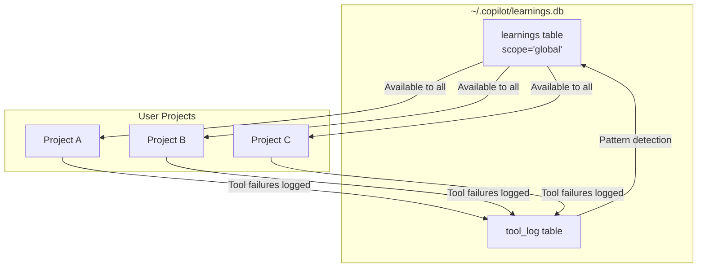
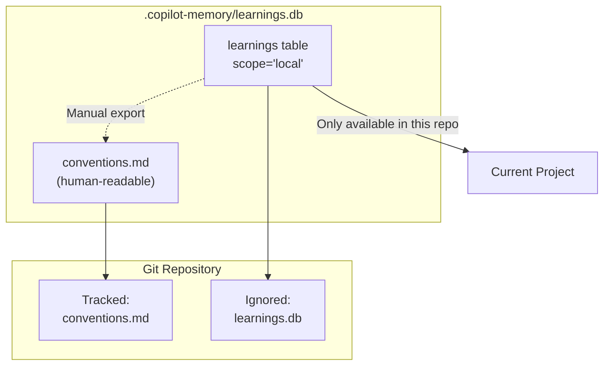
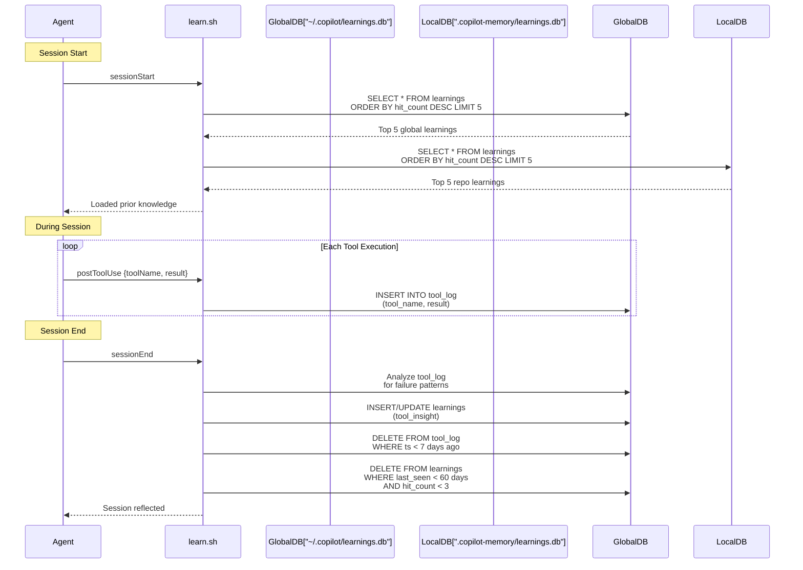
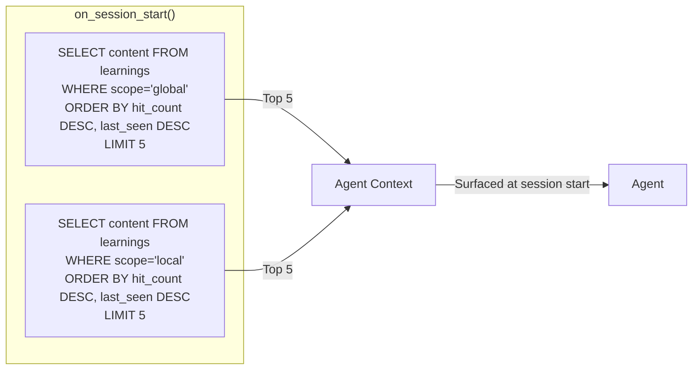
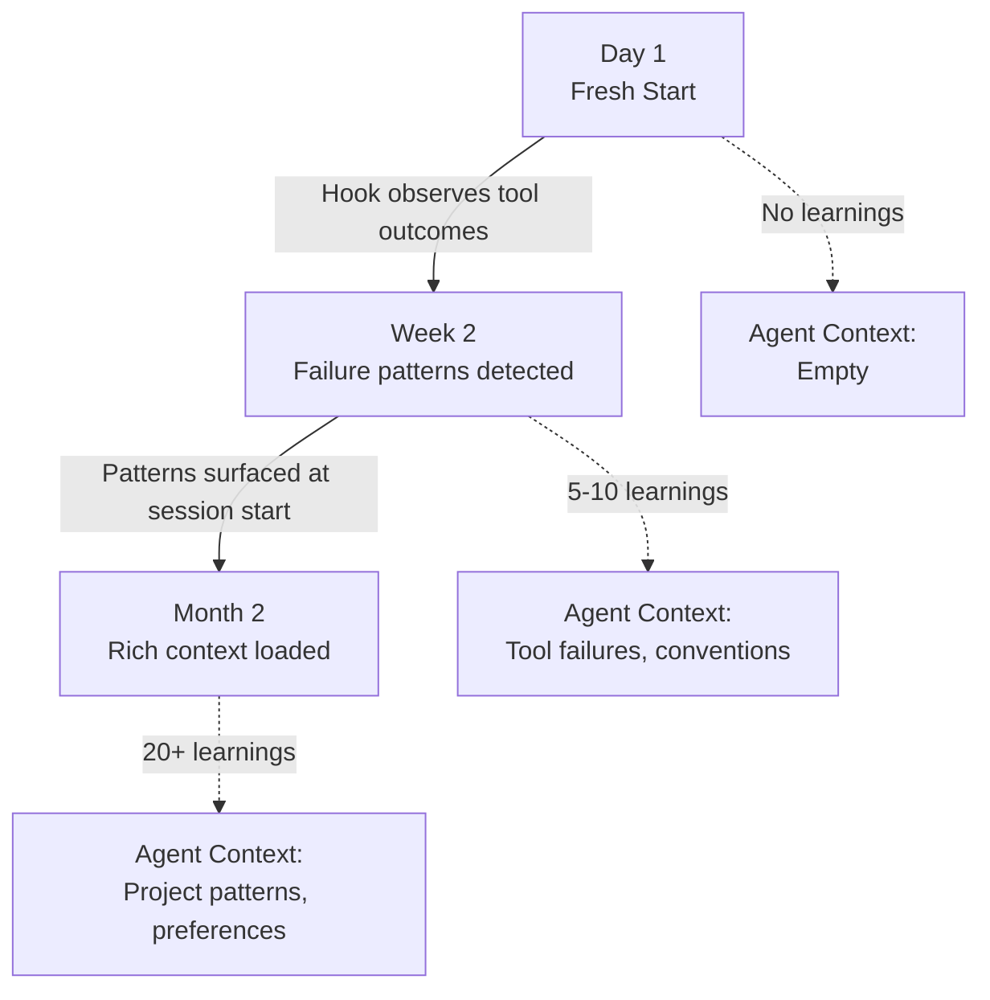

<!-- source: DeepWiki mcp.deepwiki.com · repo microsoft/skills · page 2.7 Hooks and Continual Learning · fetched 2026-10-30 -->

# Hooks and Continual Learning

<details>
<summary>Relevant source files</summary>

The following files were used as context for generating this wiki page:

- [.github/agents/scaffolder.agent.md](.github/agents/scaffolder.agent.md)
- [.github/copilot-instructions.md](.github/copilot-instructions.md)
- [.github/docs/agent-integration.md](.github/docs/agent-integration.md)
- [.github/plugins/azure-sdk-python/skills/azure-ai-language-conversations-py/SKILL.md](.github/plugins/azure-sdk-python/skills/azure-ai-language-conversations-py/SKILL.md)
- [.github/plugins/azure-sdk-python/skills/azure-ai-language-conversations-py/references/acceptance-criteria.md](.github/plugins/azure-sdk-python/skills/azure-ai-language-conversations-py/references/acceptance-criteria.md)
- [.github/prompts/scaffold-foundry-app.prompt.md](.github/prompts/scaffold-foundry-app.prompt.md)
- [.github/skills/continual-learning/SKILL.md](.github/skills/continual-learning/SKILL.md)
- [.github/skills/skill-creator/references/acceptance-criteria.md](.github/skills/skill-creator/references/acceptance-criteria.md)
- [.gitignore](.gitignore)
- [Agents.md](Agents.md)
- [context7.json](context7.json)
- [docs-site/src/components/HookCard.astro](docs-site/src/components/HookCard.astro)
- [docs-site/src/data/hooks.json](docs-site/src/data/hooks.json)
- [docs-site/src/data/skills.json](docs-site/src/data/skills.json)
- [docs/_astro/index.CktZY-PF.css](docs/_astro/index.CktZY-PF.css)
- [hooks/continual-learning/README.md](hooks/continual-learning/README.md)
- [hooks/continual-learning/hooks.json](hooks/continual-learning/hooks.json)
- [hooks/continual-learning/learn.sh](hooks/continual-learning/learn.sh)
- [tests/harness/criteria-loader.ts](tests/harness/criteria-loader.ts)
- [tests/scenarios/skill-creator/scenarios.yaml](tests/scenarios/skill-creator/scenarios.yaml)

</details>


This page documents the continual learning system that enables AI coding agents to persist knowledge across sessions. The system uses lifecycle hooks to capture tool execution outcomes, detect failure patterns, and surface accumulated learnings at session start. This creates a compound learning effect where agents improve with each interaction.

For information about creating and structuring skills, see [Understanding Skills and Progressive Disclosure](#2.1). For agent integration patterns, see [Agent Integration](#6.2).

---

## Overview

The continual learning system consists of three components:

| Component | Location | Purpose |
|-----------|----------|---------|
| **Hooks Definition** | `hooks/continual-learning/hooks.json` | Lifecycle event bindings |
| **Learning Engine** | `hooks/continual-learning/learn.sh` | SQLite operations, pattern detection |
| **Memory Stores** | `~/.copilot/learnings.db` (global)<br/>`.copilot-memory/learnings.db` (local) | Persistent knowledge databases |

Sources: [hooks/continual-learning/README.md:1-76](), [hooks/continual-learning/hooks.json:1-29]()

---

## Two-Tier Memory Architecture

### Global Memory: Cross-Project Knowledge



**Database Schema: `~/.copilot/learnings.db`**

The global database tracks tool patterns and cross-project insights:

```sql
CREATE TABLE learnings (
    id INTEGER PRIMARY KEY AUTOINCREMENT,
    scope TEXT NOT NULL,          -- 'global' or 'local'
    category TEXT NOT NULL,       -- 'pattern', 'mistake', 'preference', 'tool_insight'
    content TEXT NOT NULL,
    source TEXT,                  -- repo name, session id, etc.
    created_at TEXT DEFAULT (datetime('now')),
    last_seen TEXT DEFAULT (datetime('now')),
    hit_count INTEGER DEFAULT 1
);

CREATE TABLE tool_log (
    id INTEGER PRIMARY KEY AUTOINCREMENT,
    tool_name TEXT,
    result TEXT,
    ts TEXT DEFAULT (datetime('now'))
);
```

Sources: [hooks/continual-learning/learn.sh:20-45]()

### Local Memory: Project-Specific Knowledge



**Storage Decisions**

| File | Location | Version Controlled | Purpose |
|------|----------|-------------------|---------|
| `learnings.db` | `.copilot-memory/` | No (in `.gitignore`) | Auto-captured learnings |
| `conventions.md` | `.copilot-memory/` | Yes | Human-readable conventions |

Sources: [hooks/continual-learning/learn.sh:17-18](), [hooks/continual-learning/README.md:26-34](), [.gitignore:302]()

---

## Hooks Lifecycle Integration

### Hook Definitions

The `hooks.json` file binds shell commands to agent lifecycle events:

```json
{
  "version": 1,
  "hooks": {
    "sessionStart": [{
      "type": "command",
      "bash": ".github/hooks/continual-learning/learn.sh sessionStart",
      "cwd": ".",
      "timeoutSec": 5
    }],
    "postToolUse": [{
      "type": "command",
      "bash": ".github/hooks/continual-learning/learn.sh postToolUse",
      "cwd": ".",
      "timeoutSec": 3
    }],
    "sessionEnd": [{
      "type": "command",
      "bash": ".github/hooks/continual-learning/learn.sh sessionEnd",
      "cwd": ".",
      "timeoutSec": 10
    }]
  }
}
```

Sources: [hooks/continual-learning/hooks.json:1-29]()

### Session Lifecycle Flow



Sources: [hooks/continual-learning/learn.sh:54-152]()

---

## Learning Capture Mechanisms

### Automatic: Tool Outcome Tracking

The `postToolUse` hook logs every tool execution:

```bash
# Extract tool name and result from JSON input
tool_name=$(echo "$INPUT" | jq -r '.toolName // empty')
result=$(echo "$INPUT" | jq -r '.toolResult.resultType // "unknown"')

# Log to global database
sqlite3 "$GLOBAL_DB" \
  "INSERT INTO tool_log (tool_name, result) VALUES ('$tool_name','$result');"
```

Sources: [hooks/continual-learning/learn.sh:92-106]()

**Pattern Detection at Session End**

When the session ends, the script analyzes recent tool logs for repeated failures:

```bash
# Find tools that failed more than twice in the last 4 hours
fail_tools=$(sqlite3 "$GLOBAL_DB" \
  "SELECT tool_name FROM tool_log
   WHERE result='failure' AND ts > datetime('now','-4 hours')
   GROUP BY tool_name HAVING COUNT(*) > 2;")

# Store failure pattern as a learning
for tool in $fail_tools; do
  sqlite3 "$GLOBAL_DB" \
    "INSERT INTO learnings (scope, category, content, source)
     SELECT 'global','tool_insight','Tool \"$tool\" frequently fails — check usage pattern','auto'
     WHERE NOT EXISTS (SELECT 1 FROM learnings WHERE content LIKE '%$tool%frequently fails%');
     UPDATE learnings SET hit_count = hit_count + 1, last_seen = datetime('now')
     WHERE content LIKE '%$tool%frequently fails%';"
done
```

Sources: [hooks/continual-learning/learn.sh:112-139]()

### Manual: Agent-Native Storage

Agents can write learnings directly using SQL:

```sql
-- Store a project-specific convention
INSERT INTO learnings (scope, category, content, source)
VALUES ('local', 'convention', 'This project uses Result<T> not exceptions', 'user_correction');

-- Store a successful pattern
INSERT INTO learnings (scope, category, content, source)
VALUES ('local', 'pattern', 'Use semantic_configuration_name= not semantic_configuration=', 'agent_discovery');
```

Sources: [.github/skills/continual-learning/SKILL.md:49-53]()

### Human-Readable: Markdown Files

For version-controlled knowledge:

```markdown
# .copilot-memory/conventions.md
- Use DefaultAzureCredential for all Azure auth
- Parameter is semantic_configuration_name=, not semantic_configuration=
- Always close clients with context managers
```

Sources: [.github/skills/continual-learning/SKILL.md:57-63]()

---

## Learning Categories

Each learning has a `category` field that determines its usage context:

| Category | Scope | Example | When Used |
|----------|-------|---------|-----------|
| `tool_insight` | Global | "Tool 'bash' frequently fails — check usage pattern" | Auto-detected from tool logs |
| `pattern` | Local | "Use `create_or_update_*` for idempotent operations" | Successful approaches |
| `mistake` | Local | "Use `semantic_configuration_name=` not `semantic_configuration=`" | User corrections |
| `preference` | Local | "This project uses Ruff for linting, not Flake8" | Team conventions |

Sources: [hooks/continual-learning/learn.sh:28](), [.github/skills/continual-learning/SKILL.md:55]()

---

## Learning Retrieval at Session Start

### Query Execution



**Output Format**

The script outputs learnings in human-readable format:

```
🧠 Continual learning — loaded prior knowledge

Global learnings (23 total):
• [tool_insight] Tool "bash" frequently fails — check usage pattern
• [pattern] Use DefaultAzureCredential for all Azure SDK auth
• [tool_insight] Tool "github-create_pull_request" blocked by enterprise token

Repo learnings for agent-skills (12 total):
• [convention] Use semantic_configuration_name= not semantic_configuration=
• [pattern] Always use with client: for Azure SDK clients
• [mistake] Don't use gh CLI inside GitHub Actions — use GITHUB_TOKEN directly
```

Sources: [hooks/continual-learning/learn.sh:54-90]()

---

## Compaction and Decay

### Time-Based Pruning

To prevent unbounded database growth, the `sessionEnd` hook removes stale data:

```bash
# Remove tool logs older than 7 days
sqlite3 "$GLOBAL_DB" "DELETE FROM tool_log WHERE ts < datetime('now','-7 days');"

# Remove learnings older than 60 days with low engagement
sqlite3 "$GLOBAL_DB" \
  "DELETE FROM learnings WHERE last_seen < datetime('now','-60 days') AND hit_count < 3;"

# Same for local database
[[ -f "$LOCAL_DB" ]] && sqlite3 "$LOCAL_DB" \
  "DELETE FROM learnings WHERE last_seen < datetime('now','-60 days') AND hit_count < 3;"
```

**Decay Rules**

| Condition | Action | Rationale |
|-----------|--------|-----------|
| `tool_log.ts` > 7 days | Delete | Raw logs are for recent pattern detection only |
| `learnings.last_seen` > 60 days AND `hit_count` < 3 | Delete | Low-value learnings decay |
| `learnings.hit_count` >= 3 | Keep indefinitely | High-value learnings persist |

Sources: [hooks/continual-learning/learn.sh:141-148](), [.github/skills/continual-learning/SKILL.md:66-72]()

---

## Database Initialization

### Auto-Init on First Run

The `init_db()` function creates tables if they don't exist:

```bash
init_db() {
  local db="$1"
  mkdir -p "$(dirname "$db")"
  command -v sqlite3 &>/dev/null || return 0
  sqlite3 "$db" <<'SQL'
CREATE TABLE IF NOT EXISTS learnings (
    id INTEGER PRIMARY KEY AUTOINCREMENT,
    scope TEXT NOT NULL,
    category TEXT NOT NULL,
    content TEXT NOT NULL,
    source TEXT,
    created_at TEXT DEFAULT (datetime('now')),
    last_seen TEXT DEFAULT (datetime('now')),
    hit_count INTEGER DEFAULT 1
);
CREATE TABLE IF NOT EXISTS tool_log (
    id INTEGER PRIMARY KEY AUTOINCREMENT,
    tool_name TEXT,
    result TEXT,
    ts TEXT DEFAULT (datetime('now'))
);
CREATE INDEX IF NOT EXISTS idx_learnings_scope ON learnings(scope);
CREATE INDEX IF NOT EXISTS idx_learnings_category ON learnings(category);
SQL
}

# Initialize both databases
init_db "$GLOBAL_DB"
[[ -d ".git" ]] && init_db "$LOCAL_DB"  # Only create local DB in git repos
```

Sources: [hooks/continual-learning/learn.sh:20-48]()

---

## Installation and Usage

### One-Step Installation

```bash
# Copy hook to your project
cp -r hooks/continual-learning .github/hooks/

# No configuration needed - auto-initializes on first session
```

Sources: [hooks/continual-learning/README.md:11-17]()

### Directory Structure After Installation

```
your-project/
├── .github/
│   └── hooks/
│       └── continual-learning/
│           ├── hooks.json          # Hook definitions
│           ├── learn.sh            # Learning engine
│           └── README.md           # Documentation
├── .copilot-memory/                # Created on first session
│   ├── learnings.db                # Local learnings (gitignored)
│   └── conventions.md              # Human-readable (tracked)
└── ~/.copilot/                     # User home directory
    └── learnings.db                # Global learnings
```

Sources: [hooks/continual-learning/README.md:1-76]()

### Disabling the System

```bash
# Temporary disable
export SKIP_CONTINUAL_LEARNING=true

# Permanent disable
rm -rf .github/hooks/continual-learning
```

Sources: [hooks/continual-learning/learn.sh:10](), [hooks/continual-learning/README.md:66-70]()

---

## Integration with Skills System

The continual learning hook is also exposed as a skill for agent discovery:

```yaml
---
name: continual-learning
description: Guide for implementing continual learning in AI coding agents — hooks, memory scoping, reflection patterns. Use when setting up learning infrastructure for agents.
---
```

**Skill Location**: `.github/skills/continual-learning/SKILL.md`

This allows agents to learn about the continual learning system itself and recommend it to users.

Sources: [.github/skills/continual-learning/SKILL.md:1-80]()

---

## Compound Learning Effect

### Learning Accumulation Over Time



**Example Progression**

| Session | Learnings Available | Agent Behavior |
|---------|---------------------|----------------|
| 1 | 0 | Explores freely, makes mistakes |
| 10 | 5 global, 3 local | Avoids known tool failures |
| 50 | 15 global, 12 local | Follows project conventions automatically |

Sources: [hooks/continual-learning/README.md:36-44]()

---

## Dependencies

| Dependency | Required | Fallback Behavior |
|------------|----------|-------------------|
| `sqlite3` | Yes | Hook outputs message but doesn't persist learnings |
| `jq` | No | Tool name extraction uses simpler parsing |

The system gracefully degrades when dependencies are missing:

```bash
has_sqlite() { command -v sqlite3 &>/dev/null; }
has_jq() { command -v jq &>/dev/null; }

# If no sqlite, exit early but report status
has_sqlite || { echo "🧠 Continual learning active"; exit 0; }
```

Sources: [hooks/continual-learning/learn.sh:50-51](), [hooks/continual-learning/README.md:72-74]()

---

