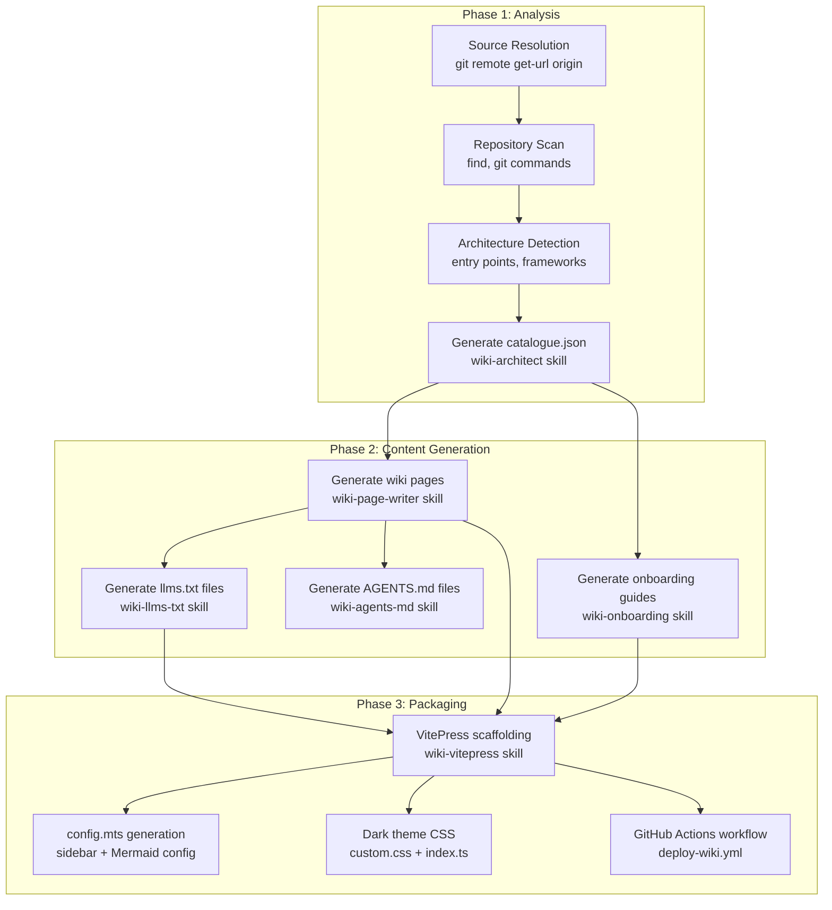
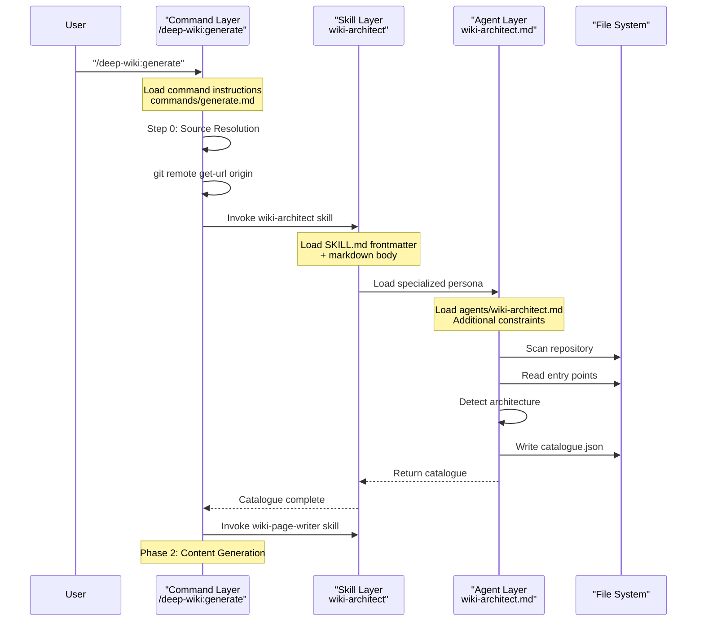

<!-- source: DeepWiki mcp.deepwiki.com · repo microsoft/skills · page 3.1 Plugin Overview and Architecture · fetched 2026-10-30 -->

# Plugin Overview and Architecture

<details>
<summary>Relevant source files</summary>

The following files were used as context for generating this wiki page:

- [.github/agents/scaffolder.agent.md](.github/agents/scaffolder.agent.md)
- [.github/copilot-instructions.md](.github/copilot-instructions.md)
- [.github/docs/agent-integration.md](.github/docs/agent-integration.md)
- [.github/plugins/deep-wiki/.claude-plugin/plugin.json](.github/plugins/deep-wiki/.claude-plugin/plugin.json)
- [.github/plugins/deep-wiki/README.md](.github/plugins/deep-wiki/README.md)
- [.github/plugins/deep-wiki/commands/ado.md](.github/plugins/deep-wiki/commands/ado.md)
- [.github/plugins/deep-wiki/commands/agents.md](.github/plugins/deep-wiki/commands/agents.md)
- [.github/plugins/deep-wiki/commands/build.md](.github/plugins/deep-wiki/commands/build.md)
- [.github/plugins/deep-wiki/commands/crisp.md](.github/plugins/deep-wiki/commands/crisp.md)
- [.github/plugins/deep-wiki/commands/deploy.md](.github/plugins/deep-wiki/commands/deploy.md)
- [.github/plugins/deep-wiki/commands/generate.md](.github/plugins/deep-wiki/commands/generate.md)
- [.github/plugins/deep-wiki/commands/onboard.md](.github/plugins/deep-wiki/commands/onboard.md)
- [.github/plugins/deep-wiki/skills/wiki-ado-convert/SKILL.md](.github/plugins/deep-wiki/skills/wiki-ado-convert/SKILL.md)
- [.github/plugins/deep-wiki/skills/wiki-agents-md/SKILL.md](.github/plugins/deep-wiki/skills/wiki-agents-md/SKILL.md)
- [.github/plugins/deep-wiki/skills/wiki-onboarding/SKILL.md](.github/plugins/deep-wiki/skills/wiki-onboarding/SKILL.md)
- [.github/prompts/scaffold-foundry-app.prompt.md](.github/prompts/scaffold-foundry-app.prompt.md)
- [.github/skills/skill-creator/references/acceptance-criteria.md](.github/skills/skill-creator/references/acceptance-criteria.md)
- [Agents.md](Agents.md)
- [README.md](README.md)
- [context7.json](context7.json)
- [docs-site/src/pages/index.astro](docs-site/src/pages/index.astro)
- [docs/index.html](docs/index.html)
- [tests/harness/criteria-loader.ts](tests/harness/criteria-loader.ts)
- [tests/scenarios/skill-creator/scenarios.yaml](tests/scenarios/skill-creator/scenarios.yaml)

</details>


This document details the Deep Wiki plugin architecture, explaining how its three-layer design (commands, skills, agents) coordinates to generate comprehensive documentation wikis from codebases. The plugin operates through a three-phase pipeline: analysis, content generation, and packaging.

## Purpose and Scope

The `deep-wiki` plugin is a GitHub Copilot CLI plugin located at [.github/plugins/deep-wiki/]() that generates AI-powered documentation wikis for code repositories. The plugin provides 13 slash commands, 10 auto-invoked skills, and 3 specialized agents that work together to analyze codebases and produce structured, citation-rich documentation with dark-mode Mermaid diagrams.

The plugin is designed for distribution via the GitHub Copilot CLI plugin marketplace and operates on any codebase, not just the microsoft/skills repository itself. It follows the `.claude-plugin` specification for plugin packaging.

**Sources:** [.github/plugins/deep-wiki/README.md:1-6](), [.github/plugins/deep-wiki/.claude-plugin/plugin.json:1-11]()
</thinking>

## Three-Layer Architecture

The Deep Wiki plugin separates concerns across three distinct layers:

| Layer | Entity Count | Activation | Purpose |
|-------|-------------|-----------|---------|
| **Command Layer** | 13 commands | User invokes via `/deep-wiki:<name>` | Entry point, orchestrates workflows |
| **Skill Layer** | 10 skills | Auto-invoked by context/intent | Implements generation logic |
| **Agent Layer** | 3 agents | Invoked by skills for complex workflows | Specialized personas with constraints |

The command layer provides user-facing slash commands that orchestrate multi-step workflows. The skill layer contains reusable generation logic that can be triggered automatically based on user intent. The agent layer provides specialized personas with detailed instructions for complex generation tasks.

**Sources:** [.github/plugins/deep-wiki/README.md:39-62](), [.github/plugins/deep-wiki/README.md:166-212]()

## Three-Phase Pipeline

All wiki generation workflows follow a three-phase pipeline implemented across the command and skill layers:

| Phase | Purpose | Primary Skills | Output |
|-------|---------|---------------|--------|
| **Phase 1: Analysis** | Scan repository structure, identify architectural patterns | `wiki-architect` | `catalogue.json` — hierarchical TOC |
| **Phase 2: Content Generation** | Generate markdown pages with Mermaid diagrams and citations | `wiki-page-writer`, `wiki-onboarding` | `wiki/**/*.md` pages |
| **Phase 3: Packaging** | Package content as VitePress site or alternative format | `wiki-vitepress`, `wiki-ado-convert` | `.vitepress/` config and theme |

Commands orchestrate this pipeline by invoking skills in sequence. For example, `/deep-wiki:generate` executes all three phases, while `/deep-wiki:catalogue` stops after Phase 1.

**Sources:** [.github/plugins/deep-wiki/commands/generate.md:10-150](), [.github/plugins/deep-wiki/README.md:101-131]()

### Pipeline Flow Diagram



**Sources:** [.github/plugins/deep-wiki/commands/generate.md:13-150](), [.github/plugins/deep-wiki/commands/build.md:1-150]()

## Layer Interaction Pattern

The three layers interact through a specific invocation pattern:

### Command → Skill → Agent Flow



This pattern shows how a command orchestrates skills, which may optionally load agent personas for additional context. Not all skills invoke agents—only those requiring complex multi-step workflows (like `wiki-architect`, `wiki-page-writer`, and `wiki-researcher`).

**Sources:** [.github/plugins/deep-wiki/commands/generate.md:10-150](), [.github/plugins/deep-wiki/skills/wiki-architect/SKILL.md:1-200]()

### Architecture Component Diagram

```mermaid
graph TB
    subgraph "Command Layer (.github/plugins/deep-wiki/commands/)"
        generate_md["generate.md<br/>/deep-wiki:generate"]
        crisp_md["crisp.md<br/>/deep-wiki:crisp"]
        catalogue_md["catalogue.md<br/>/deep-wiki:catalogue"]
        page_md["page.md<br/>/deep-wiki:page"]
        build_md["build.md<br/>/deep-wiki:build"]
        deploy_md["deploy.md<br/>/deep-wiki:deploy"]
        onboard_md["onboard.md<br/>/deep-wiki:onboard"]
        agents_md["agents.md<br/>/deep-wiki:agents"]
        llms_md["llms.md<br/>/deep-wiki:llms"]
        ado_md["ado.md<br/>/deep-wiki:ado"]
        research_md["research.md<br/>/deep-wiki:research"]
        ask_md["ask.md<br/>/deep-wiki:ask"]
        changelog_md["changelog.md<br/>/deep-wiki:changelog"]
    end
    
    subgraph "Skill Layer (.github/plugins/deep-wiki/skills/)"
        architect_skill["wiki-architect/SKILL.md"]
        writer_skill["wiki-page-writer/SKILL.md"]
        vitepress_skill["wiki-vitepress/SKILL.md"]
        onboard_skill["wiki-onboarding/SKILL.md"]
        agents_skill["wiki-agents-md/SKILL.md"]
        llms_skill["wiki-llms-txt/SKILL.md"]
        ado_skill["wiki-ado-convert/SKILL.md"]
        researcher_skill["wiki-researcher/SKILL.md"]
        qa_skill["wiki-qa/SKILL.md"]
        changelog_skill["wiki-changelog/SKILL.md"]
    end
    
    subgraph "Agent Layer (.github/plugins/deep-wiki/agents/)"
        architect_agent["wiki-architect.md"]
        writer_agent["wiki-writer.md"]
        researcher_agent["wiki-researcher.md"]
    end
    
    subgraph "Output Artifacts"
        catalogue_json["catalogue.json"]
        wiki_pages["wiki/**/*.md"]
        vitepress_dir["wiki/.vitepress/"]
        onboarding_dir["onboarding/*.md"]
        llms_txt["llms.txt"]
        agents_files["AGENTS.md files"]
        ado_script["scripts/build-ado-wiki.js"]
    end
    
    generate_md --> architect_skill
    generate_md --> writer_skill
    generate_md --> onboard_skill
    generate_md --> agents_skill
    generate_md --> llms_skill
    generate_md --> vitepress_skill
    
    crisp_md --> architect_skill
    crisp_md --> writer_skill
    
    catalogue_md --> architect_skill
    page_md --> writer_skill
    build_md --> vitepress_skill
    deploy_md --> vitepress_skill
    onboard_md --> onboard_skill
    agents_md --> agents_skill
    llms_md --> llms_skill
    ado_md --> ado_skill
    research_md --> researcher_skill
    ask_md --> qa_skill
    changelog_md --> changelog_skill
    
    architect_skill --> architect_agent
    writer_skill --> writer_agent
    researcher_skill --> researcher_agent
    
    architect_skill --> catalogue_json
    writer_skill --> wiki_pages
    vitepress_skill --> vitepress_dir
    onboard_skill --> onboarding_dir
    llms_skill --> llms_txt
    agents_skill --> agents_files
    ado_skill --> ado_script
```



**Sources:** [.github/plugins/deep-wiki/README.md:166-212]()

## Commands vs Skills vs Agents

The plugin uses three distinct entity types with different activation models and purposes:

### Entity Type Comparison

| Entity Type | Activation | Location | Contents | Purpose | Example |
|-------------|-----------|----------|----------|---------|---------|
| **Command** | User invokes `/deep-wiki:<name>` | `commands/*.md` | YAML frontmatter + workflow steps | Entry point, orchestrates pipeline phases | `/deep-wiki:generate` |
| **Skill** | Auto-invoked by command or user intent | `skills/*/SKILL.md` | YAML frontmatter + implementation instructions | Reusable generation logic | `wiki-architect` |
| **Agent** | Invoked by skill for complex workflows | `agents/*.md` | Persona definition + detailed constraints | Specialized context for multi-step tasks | `wiki-architect` (agent) |

### Commands (User-Facing Entry Points)

Commands are markdown files in [.github/plugins/deep-wiki/commands/]() that define slash command behavior. Each command file contains:

- YAML frontmatter with `description` field
- Workflow steps organized by phase
- Skill invocation sequence
- Error handling and validation rules

Example command structure from [.github/plugins/deep-wiki/commands/generate.md:1-10]():

```markdown
---
description: Generate a complete wiki — catalogue + pages + onboarding + VitePress
---

# Deep Wiki: Full Generation

## Process

### Step 0: Source Repository Resolution (MUST DO FIRST)
...
### Step 1: Repository Scan
...
```

Commands do not contain generation logic—they delegate to skills.

**Sources:** [.github/plugins/deep-wiki/commands/generate.md:1-150](), [.github/plugins/deep-wiki/README.md:21-37]()

### Skills (Reusable Generation Logic)

Skills follow the SKILL.md specification detailed in section 2.3. They contain both:

1. **YAML frontmatter**: Metadata for auto-discovery (name, description with triggers)
2. **Markdown body**: Implementation instructions loaded only when skill activates

Skills can be invoked two ways:
- Explicitly by commands during workflow orchestration
- Automatically by the Copilot CLI when user intent matches the skill's trigger phrases

Example from [.github/plugins/deep-wiki/skills/wiki-architect/SKILL.md:1-10]():

```markdown
---
name: wiki-architect
description: Analyzes repos, generates structured catalogues + onboarding architecture. Triggers when user asks to "create a wiki", "document a repo", "map a codebase".
---

# Wiki Architect

Generate hierarchical wiki catalogues...
```

**Sources:** [.github/plugins/deep-wiki/skills/wiki-architect/SKILL.md:1-200](), [.github/plugins/deep-wiki/README.md:49-62]()

### Agents (Specialized Personas)

Agents are specialized personas defined in [.github/plugins/deep-wiki/agents/]() that provide additional context for complex workflows. An agent file contains:

- Role definition and responsibilities
- Detailed constraints and requirements
- Output format specifications
- Quality principles and anti-patterns

Agents share names with skills (e.g., both `wiki-architect` skill and agent exist). The skill contains generation instructions; the agent adds persona constraints.

Example invocation pattern: The `wiki-architect` skill at [.github/plugins/deep-wiki/skills/wiki-architect/SKILL.md]() loads the `wiki-architect` agent from [.github/plugins/deep-wiki/agents/wiki-architect.md]() for additional context about catalogue structure requirements.

**Sources:** [.github/plugins/deep-wiki/agents/wiki-architect.md:1-100](), [.github/plugins/deep-wiki/README.md:39-47]()

## Plugin Directory Structure

```mermaid
graph TB
    ROOT["deep-wiki/"]
    
    subgraph Metadata["Plugin Metadata"]
        PLUGIN_JSON[".claude-plugin/plugin.json<br/>name, version, description"]
        README["README.md<br/>Documentation"]
    end
    
    subgraph Commands["commands/<br/>11 Slash Commands"]
        GENERATE_MD["generate.md"]
        CRISP_MD["crisp.md"]
        CATALOGUE_MD["catalogue.md"]
        PAGE_MD["page.md"]
        CHANGELOG_MD["changelog.md"]
        RESEARCH_MD["research.md"]
        ASK_MD["ask.md"]
        ONBOARD_MD["onboard.md"]
        AGENTS_MD["agents.md"]
        LLMS_MD["llms.md"]
        DEPLOY_MD["deploy.md"]
        ADO_MD["ado.md"]
        BUILD_MD["build.md"]
    end
    
    subgraph Skills["skills/<br/>10 Auto-Invoked Skills"]
        ARCH_DIR["wiki-architect/SKILL.md"]
        WRITER_DIR["wiki-page-writer/SKILL.md"]
        CHANGELOG_DIR["wiki-changelog/SKILL.md"]
        RESEARCHER_DIR["wiki-researcher/SKILL.md"]
        QA_DIR["wiki-qa/SKILL.md"]
        VITEPRESS_DIR["wiki-vitepress/SKILL.md"]
        ONBOARD_DIR["wiki-onboarding/SKILL.md"]
        AGENTS_DIR["wiki-agents-md/SKILL.md"]
        LLMS_DIR["wiki-llms-txt/SKILL.md"]
        ADO_DIR["wiki-ado-convert/SKILL.md"]
    end
    
    subgraph Agents["agents/<br/>3 Specialized Personas"]
        ARCHITECT_AGENT["wiki-architect.md"]
        WRITER_AGENT["wiki-writer.md"]
        RESEARCHER_AGENT["wiki-researcher.md"]
    end
    
    ROOT --> PLUGIN_JSON
    ROOT --> README
    ROOT --> GENERATE_MD
    ROOT --> CRISP_MD
    ROOT --> CATALOGUE_MD
    ROOT --> PAGE_MD
    ROOT --> ARCH_DIR
    ROOT --> WRITER_DIR
    ROOT --> ADO_DIR
    ROOT --> ARCHITECT_AGENT
    ROOT --> WRITER_AGENT
    ROOT --> RESEARCHER_AGENT
```



**Sources:** [.github/plugins/deep-wiki/README.md:166-212]()

## Command Catalog

The plugin provides 13 slash commands organized by pipeline phase:

### Phase 1: Analysis Commands

| Command | File | Description | Primary Skills |
|---------|------|-------------|---------------|
| `/deep-wiki:catalogue` | `commands/catalogue.md` | Generate hierarchical wiki structure as JSON | `wiki-architect` |

### Phase 2: Content Generation Commands

| Command | File | Description | Primary Skills |
|---------|------|-------------|---------------|
| `/deep-wiki:page <topic>` | `commands/page.md` | Generate single wiki page with dark-mode Mermaid diagrams | `wiki-page-writer` |
| `/deep-wiki:onboard` | `commands/onboard.md` | Generate 4 audience-tailored onboarding guides | `wiki-onboarding` |
| `/deep-wiki:agents` | `commands/agents.md` | Generate AGENTS.md files for pertinent folders | `wiki-agents-md` |
| `/deep-wiki:llms` | `commands/llms.md` | Generate llms.txt and llms-full.txt | `wiki-llms-txt` |
| `/deep-wiki:changelog` | `commands/changelog.md` | Generate structured changelog from git commits | `wiki-changelog` |

### Phase 3: Packaging Commands

| Command | File | Description | Primary Skills |
|---------|------|-------------|---------------|
| `/deep-wiki:build` | `commands/build.md` | Package wiki as VitePress site with dark theme | `wiki-vitepress` |
| `/deep-wiki:ado` | `commands/ado.md` | Generate Node.js script to convert to Azure DevOps format | `wiki-ado-convert` |
| `/deep-wiki:deploy` | `commands/deploy.md` | Generate GitHub Actions workflow for GitHub Pages | `wiki-vitepress` |

### Research and Query Commands

| Command | File | Description | Primary Skills |
|---------|------|-------------|---------------|
| `/deep-wiki:research <topic>` | `commands/research.md` | Multi-turn deep investigation with evidence | `wiki-researcher` |
| `/deep-wiki:ask <question>` | `commands/ask.md` | Ask question about the repository | `wiki-qa` |

### Full Pipeline Commands

| Command | File | Description | Primary Skills |
|---------|------|-------------|---------------|
| `/deep-wiki:generate` | `commands/generate.md` | Full pipeline — all 3 phases + onboarding | `wiki-architect`, `wiki-page-writer`, `wiki-onboarding`, `wiki-vitepress`, `wiki-agents-md`, `wiki-llms-txt` |
| `/deep-wiki:crisp` | `commands/crisp.md` | Fast wiki — 5-8 pages, parallelized, no build | `wiki-architect`, `wiki-page-writer` |

**Sources:** [.github/plugins/deep-wiki/README.md:21-37]()

## Skill Catalog

The plugin includes 10 auto-invoked skills that implement core wiki generation capabilities:

| Skill | Directory | Triggers When | Output |
|-------|-----------|--------------|--------|
| `wiki-architect` | `skills/wiki-architect/` | User asks to create a wiki, document a repo, or map a codebase | `catalogue.json` — hierarchical TOC |
| `wiki-page-writer` | `skills/wiki-page-writer/` | User asks to document a component or generate a technical deep-dive | Markdown pages with dark-mode Mermaid + citations |
| `wiki-changelog` | `skills/wiki-changelog/` | User asks about recent changes or wants a changelog | `CHANGELOG.md` — categorized git commits |
| `wiki-researcher` | `skills/wiki-researcher/` | User wants in-depth investigation across multiple files | Research report with 5-iteration evidence gathering |
| `wiki-qa` | `skills/wiki-qa/` | User asks a question about how something works in the repo | Answer grounded in source code citations |
| `wiki-vitepress` | `skills/wiki-vitepress/` | User asks to build a site or package wiki as VitePress | `wiki/.vitepress/` — dark theme config + sidebar |
| `wiki-onboarding` | `skills/wiki-onboarding/` | User asks for onboarding docs or getting-started guides | 4 guides: Contributor, Staff Engineer, Executive, PM |
| `wiki-agents-md` | `skills/wiki-agents-md/` | User asks to generate AGENTS.md files for coding agent context | `AGENTS.md` files in pertinent folders |
| `wiki-llms-txt` | `skills/wiki-llms-txt/` | User asks to generate llms.txt or make docs LLM-friendly | `llms.txt` + `llms-full.txt` at repo root |
| `wiki-ado-convert` | `skills/wiki-ado-convert/` | User asks to export wiki for Azure DevOps or convert markdown | `scripts/build-ado-wiki.js` — conversion script |

**Sources:** [.github/plugins/deep-wiki/README.md:49-62](), [.github/plugins/deep-wiki/skills/wiki-ado-convert/SKILL.md:1-4]()

## Agent Catalog

The plugin defines 3 specialized agent personas that provide additional context for complex workflows:

| Agent | File | Role | Used By Skills |
|-------|------|------|---------------|
| `wiki-architect` | `agents/wiki-architect.md` | Analyzes repos, generates structured catalogues + onboarding architecture | `wiki-architect` skill |
| `wiki-writer` | `agents/wiki-writer.md` | Generates pages with dark-mode Mermaid diagrams and deep citations | `wiki-page-writer` skill |
| `wiki-researcher` | `agents/wiki-researcher.md` | Deep research with zero tolerance for shallow analysis — evidence-first | `wiki-researcher` skill |

Agents are invoked by their corresponding skills when multi-step workflows require additional constraints. For example, the `wiki-page-writer` skill loads [agents/wiki-writer.md]() to access detailed instructions about dark-mode Mermaid generation, citation format, and diagram requirements.

**Sources:** [.github/plugins/deep-wiki/README.md:39-47]()

## Plugin Manifest and Packaging

The plugin follows the `.claude-plugin` specification for packaging. The manifest at [.github/plugins/deep-wiki/.claude-plugin/plugin.json:1-11]() defines metadata for marketplace discovery:

```json
{
  "name": "deep-wiki",
  "description": "AI-powered wiki generator for code repositories...",
  "version": "2.0.0",
  "author": { "name": "thegovind" },
  "homepage": "https://github.com/microsoft/skills/tree/main/.github/plugins/deep-wiki",
  "repository": "https://github.com/microsoft/skills",
  "license": "MIT"
}
```

The plugin directory structure follows a standard layout that the Copilot CLI expects:

```
.github/plugins/deep-wiki/
├── .claude-plugin/
│   └── plugin.json           # Manifest (marketplace metadata)
├── commands/                 # Slash command implementations (13 files)
├── skills/                   # Auto-invoked skills (10 directories)
├── agents/                   # Specialized personas (3 files)
└── README.md                 # User documentation
```

This structure enables automatic discovery and registration when the plugin is installed.

**Sources:** [.github/plugins/deep-wiki/.claude-plugin/plugin.json:1-11](), [.github/plugins/deep-wiki/README.md:166-212]()

## Installation and Discovery

The plugin is installed via the GitHub Copilot CLI plugin marketplace:

```bash
# Inside Copilot CLI, run these slash commands:
/plugin marketplace add microsoft/skills
/plugin install deep-wiki@skills
```

Once installed, the Copilot CLI:
1. Scans the `commands/` directory to register slash commands
2. Scans the `skills/` directory to register auto-invoked skills
3. Scans the `agents/` directory to make agent personas available

Users can view available agents by typing `/agents` in the Copilot CLI.

**Sources:** [.github/plugins/deep-wiki/README.md:7-19](), [.github/plugins/deep-wiki/README.md:47]()

## Design Principles

The plugin enforces 12 core design principles across all generated documentation:

| Principle | Implementation | Enforcement |
|-----------|---------------|-------------|
| **Source-linked citations** | All claims cite `[file:line](REPO_URL/blob/BRANCH/file#Lline)` | Mandatory first step: source repository resolution |
| **Structure-first** | Always generate TOC/catalogue before page content | `wiki-architect` runs before `wiki-page-writer` |
| **Evidence-based** | Every claim cites `file_path:line_number` with clickable links | `wiki-researcher` uses 5-iteration evidence gathering |
| **Diagram-rich** | Minimum 3-5 dark-mode Mermaid diagrams per page | `wiki-page-writer` validation checklist |
| **Table-driven** | Prefer tables over prose for structured information | Command outputs include summary tables |
| **Progressive disclosure** | Big picture first, then drill into details | TOC hierarchy: Systems → Subsystems → Components |
| **Hierarchical depth** | Max 4 levels for component-level granularity | `catalogue.json` structure enforced |
| **Systems thinking** | Architecture → Subsystems → Components → Methods | `wiki-architect` analysis workflow |
| **Never invent** | All content derived from actual code | `wiki-researcher` requires file:line citations |
| **Dark-mode native** | All output designed for dark-theme rendering | VitePress dark theme + Mermaid dark-mode |
| **Depth before breadth** | Trace actual code paths, never guess from file names | `wiki-researcher` multi-file tracing |
| **Agent-discoverable** | Output at standard paths (llms.txt, AGENTS.md) | `wiki-llms-txt` and `wiki-agents-md` skills |

**Sources:** [.github/plugins/deep-wiki/README.md:132-146]()

## Output Artifacts

The plugin generates multiple output artifact types depending on which commands are invoked:

| Artifact | Path | Generated By | Purpose |
|----------|------|-------------|---------|
| Catalogue JSON | `catalogue.json` | `wiki-architect` | Hierarchical table of contents |
| Wiki pages | `wiki/**/*.md` | `wiki-page-writer` | Main documentation content |
| Onboarding guides | `onboarding/*.md` | `wiki-onboarding` | Audience-tailored getting-started docs |
| VitePress site | `wiki/.vitepress/` | `wiki-vitepress` | Dark theme + sidebar + click-to-zoom |
| llms.txt | `./llms.txt` | `wiki-llms-txt` | Concise LLM-friendly project summary |
| llms-full.txt | `wiki/llms-full.txt` | `wiki-llms-txt` | Full inlined documentation content |
| AGENTS.md files | `AGENTS.md` (multiple locations) | `wiki-agents-md` | Coding agent context for key folders |
| ADO conversion script | `scripts/build-ado-wiki.js` | `wiki-ado-convert` | Azure DevOps Wiki export tool |
| GitHub Actions workflow | `.github/workflows/deploy-wiki.yml` | `wiki-vitepress` | Automated deployment to GitHub Pages |

**Sources:** [.github/plugins/deep-wiki/README.md:101-117]()

## Source Repository Resolution

All wiki generation commands enforce a mandatory first step: **Source Repository Resolution**. This determines whether citations should link to remote URLs or use local file paths.

The resolution workflow (implemented in commands like [.github/plugins/deep-wiki/commands/ado.md:9-17]() and [.github/plugins/deep-wiki/skills/wiki-ado-convert/SKILL.md:10-18]()):

1. **Check for git remote**: Execute `git remote get-url origin`
2. **Ask the user**: "Is this a local-only repository, or do you have a source repository URL?"
   - Remote URL → Store as `REPO_URL`, generate linked citations `[file:line](URL)`
   - Local → Generate local citations `(file:line)` without URLs
3. **Block execution** until resolved

This ensures all generated documentation has properly formatted citations that work in the target environment.

**Sources:** [.github/plugins/deep-wiki/README.md:134](), [.github/plugins/deep-wiki/commands/ado.md:9-17](), [.github/plugins/deep-wiki/skills/wiki-ado-convert/SKILL.md:10-18]()

## ADO Wiki Conversion

The `wiki-ado-convert` skill ([.github/plugins/deep-wiki/skills/wiki-ado-convert/SKILL.md]()) generates a Node.js build script that transforms VitePress/GFM markdown to Azure DevOps Wiki-compatible format. Key transformations:

| Issue | VitePress/GFM | ADO Wiki | Transform |
|-------|--------------|----------|-----------|
| Mermaid fences | ` ```mermaid ` ... ` ``` ` | `::: mermaid` ... `:::` | Convert opening/closing fences |
| `flowchart` keyword | `flowchart TD` | `graph TD` | Replace with `graph` (preserve direction) |
| `<br>` in Mermaid | `Node[Label<br>Text]` | Breaks rendering | Strip all `<br>` variants |
| Long arrows | `A ---->B` (4+ dashes) | Not supported | Replace with `-->` |
| YAML front matter | `---` ... `---` | Rendered as raw text | Strip entirely |
| Parent-relative links | `[text](../../src/file.cs)` | Broken path | Convert to plain text |
| VitePress containers | `::: tip` / `::: warning` | Not supported | Convert to `> [!TIP]` / `> [!WARNING]` |

The generated script ([scripts/build-ado-wiki.js]()) uses zero external dependencies—only Node.js builtins (`node:fs/promises`, `node:path`, `node:url`).

**Sources:** [.github/plugins/deep-wiki/skills/wiki-ado-convert/SKILL.md:24-56](), [.github/plugins/deep-wiki/commands/ado.md:14-51]()

## Agent and MCP Integration

Generated output is designed for discoverability by coding agents using the GitHub MCP Server or any MCP-compatible tool:

| File | Path | Discovery Method |
|------|------|-----------------|
| `llms.txt` | Repo root (`./llms.txt`) | Standard llms.txt spec location — agents check via `get_file_contents` |
| `llms-full.txt` | `wiki/llms-full.txt` | Full inlined docs — comprehensive context |
| `AGENTS.md` | Root + key folders | Standard agent instructions — references wiki in Documentation section |
| Wiki pages | `wiki/**/*.md` | Searchable via `search_code` — all pages contain source-linked citations |

MCP integration workflow:
1. Agent calls `get_file_contents` on `llms.txt` → gets project summary + links to wiki pages
2. Agent calls `get_file_contents` on specific wiki pages → gets full documentation with citations
3. Agent calls `search_code` with patterns → finds relevant wiki sections
4. Agent reads `AGENTS.md` → Documentation section points to wiki and onboarding guides

**Sources:** [.github/plugins/deep-wiki/README.md:147-165]()

---

