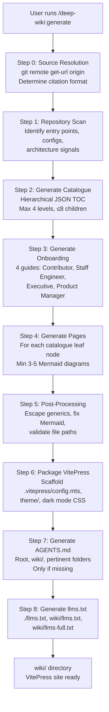
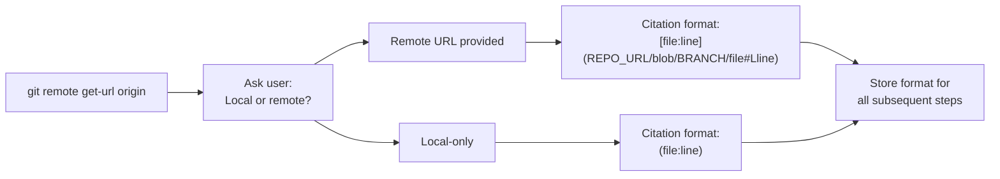
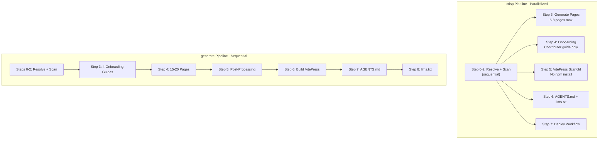
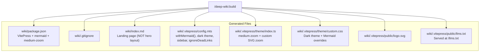
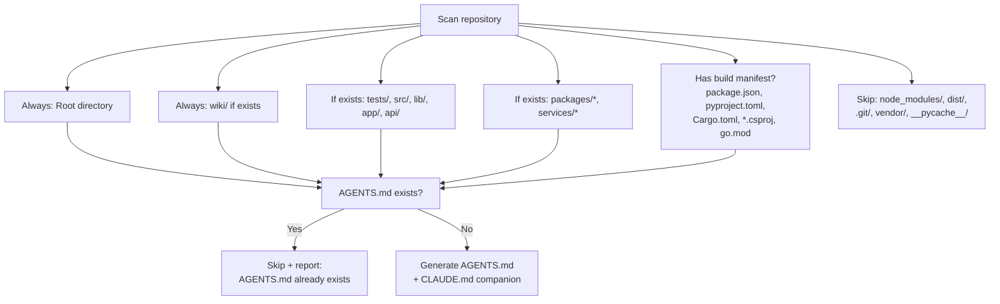
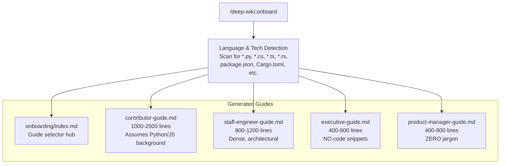
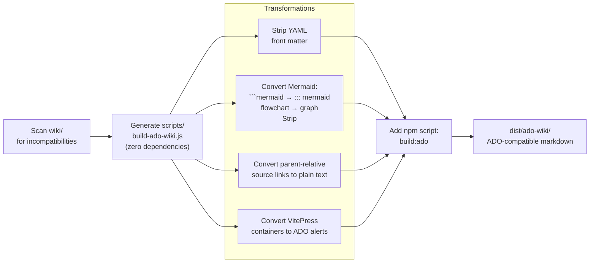
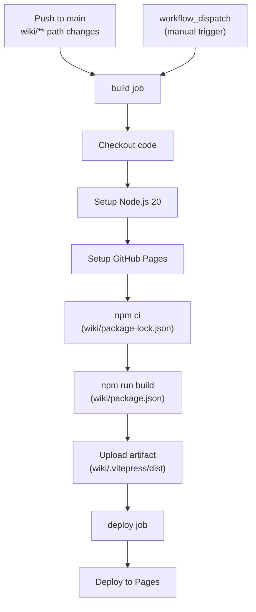
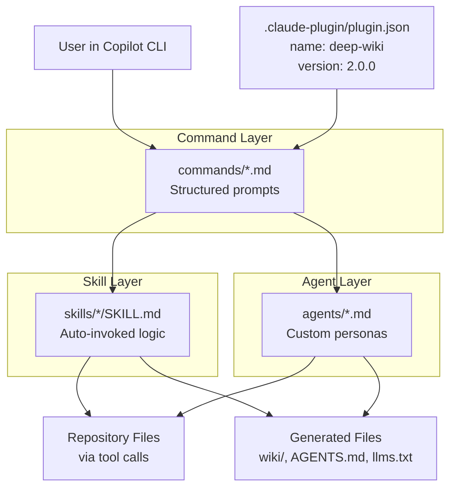

<!-- source: DeepWiki mcp.deepwiki.com · repo microsoft/skills · page 3.2 Wiki Generation Commands · fetched 2026-10-30 -->

# Wiki Generation Commands

<details>
<summary>Relevant source files</summary>

The following files were used as context for generating this wiki page:

- [.github/plugins/deep-wiki/.claude-plugin/plugin.json](.github/plugins/deep-wiki/.claude-plugin/plugin.json)
- [.github/plugins/deep-wiki/README.md](.github/plugins/deep-wiki/README.md)
- [.github/plugins/deep-wiki/commands/ado.md](.github/plugins/deep-wiki/commands/ado.md)
- [.github/plugins/deep-wiki/commands/agents.md](.github/plugins/deep-wiki/commands/agents.md)
- [.github/plugins/deep-wiki/commands/build.md](.github/plugins/deep-wiki/commands/build.md)
- [.github/plugins/deep-wiki/commands/crisp.md](.github/plugins/deep-wiki/commands/crisp.md)
- [.github/plugins/deep-wiki/commands/deploy.md](.github/plugins/deep-wiki/commands/deploy.md)
- [.github/plugins/deep-wiki/commands/generate.md](.github/plugins/deep-wiki/commands/generate.md)
- [.github/plugins/deep-wiki/commands/onboard.md](.github/plugins/deep-wiki/commands/onboard.md)
- [.github/plugins/deep-wiki/skills/wiki-ado-convert/SKILL.md](.github/plugins/deep-wiki/skills/wiki-ado-convert/SKILL.md)
- [.github/plugins/deep-wiki/skills/wiki-agents-md/SKILL.md](.github/plugins/deep-wiki/skills/wiki-agents-md/SKILL.md)
- [.github/plugins/deep-wiki/skills/wiki-onboarding/SKILL.md](.github/plugins/deep-wiki/skills/wiki-onboarding/SKILL.md)
- [README.md](README.md)
- [docs-site/src/pages/index.astro](docs-site/src/pages/index.astro)
- [docs/index.html](docs/index.html)

</details>


This document describes the command-line interface (CLI) for the Deep Wiki plugin, which provides slash commands for generating AI-powered technical documentation. The commands transform source code repositories into comprehensive wikis with Mermaid diagrams, onboarding guides, and LLM-friendly discovery files.

For information about the underlying skills that power these commands, see the Specialized Wiki Agents and Skills page (3.3). For details on the VitePress site structure generated by these commands, see VitePress Site Generation (3.4).

## Command Overview

The Deep Wiki plugin exposes 13 slash commands that can be invoked from the Copilot CLI. Each command corresponds to a markdown file in [.github/plugins/deep-wiki/commands/]() that defines the command's behavior through structured prompts.

```mermaid
graph TB
    USER["User in Copilot CLI"]
    
    subgraph "Core Generation Commands"
        GENERATE["/deep-wiki:generate<br/>Full wiki generation"]
        CRISP["/deep-wiki:crisp<br/>Fast wiki generation"]
        CATALOGUE["/deep-wiki:catalogue<br/>Structure only"]
        PAGE["/deep-wiki:page<br/>Single page"]
    end
    
    subgraph "Content Commands"
        ONBOARD["/deep-wiki:onboard<br/>Onboarding guides"]
        AGENTS_CMD["/deep-wiki:agents<br/>AGENTS.md files"]
        LLMS["/deep-wiki:llms<br/>llms.txt files"]
        CHANGELOG["/deep-wiki:changelog<br/>Git changelog"]
    end
    
    subgraph "Research Commands"
        RESEARCH["/deep-wiki:research<br/>Deep investigation"]
        ASK["/deep-wiki:ask<br/>Q&A"]
    end
    
    subgraph "Packaging Commands"
        BUILD["/deep-wiki:build<br/>VitePress site"]
        ADO["/deep-wiki:ado<br/>ADO Wiki export"]
        DEPLOY["/deep-wiki:deploy<br/>GitHub Pages"]
    end
    
    USER --> GENERATE
    USER --> CRISP
    USER --> CATALOGUE
    USER --> PAGE
    USER --> ONBOARD
    USER --> AGENTS_CMD
    USER --> LLMS
    USER --> CHANGELOG
    USER --> RESEARCH
    USER --> ASK
    USER --> BUILD
    USER --> ADO
    USER --> DEPLOY
```



**Command Structure Diagram**: Shows all 13 Deep Wiki slash commands organized by functional category

Sources: [.github/plugins/deep-wiki/README.md:22-37](), [.github/plugins/deep-wiki/commands/](), [docs-site/src/pages/index.astro:90-144]()

## Command Catalog

| Command | File | Purpose | Output Location |
|---------|------|---------|-----------------|
| `/deep-wiki:generate` | [commands/generate.md]() | Full wiki with all pages, onboarding guides, VitePress site, AGENTS.md, llms.txt | `wiki/` |
| `/deep-wiki:crisp` | [commands/crisp.md]() | Fast, concise wiki (5-8 pages, rate-limit-friendly) | `wiki/` |
| `/deep-wiki:catalogue` | [commands/catalogue.md]() | Hierarchical JSON table of contents only | `wiki/catalogue.json` |
| `/deep-wiki:page` | [commands/page.md]() | Single wiki page with dark-mode Mermaid diagrams | `wiki/{section}/{page}.md` |
| `/deep-wiki:onboard` | [commands/onboard.md]() | Four audience-tailored onboarding guides | `onboarding/` |
| `/deep-wiki:agents` | [commands/agents.md]() | AGENTS.md files for coding agent context | `./AGENTS.md`, `wiki/AGENTS.md` |
| `/deep-wiki:llms` | [commands/llms.md]() | llms.txt and llms-full.txt for LLM discovery | `./llms.txt`, `wiki/llms.txt`, `wiki/llms-full.txt` |
| `/deep-wiki:changelog` | [commands/changelog.md]() | Structured changelog from git commits | `wiki/changelog.md` |
| `/deep-wiki:research` | [commands/research.md]() | Multi-turn deep investigation (5 iterations) | Terminal output |
| `/deep-wiki:ask` | [commands/ask.md]() | Q&A about repository, grounded in source code | Terminal output |
| `/deep-wiki:build` | [commands/build.md]() | Package wiki as VitePress site with dark theme | `wiki/.vitepress/` |
| `/deep-wiki:ado` | [commands/ado.md]() | Generate Node.js script to convert wiki to ADO format | `scripts/build-ado-wiki.js` |
| `/deep-wiki:deploy` | [commands/deploy.md]() | Generate GitHub Actions workflow for Pages deployment | `.github/workflows/deploy-wiki.yml` |

Sources: [.github/plugins/deep-wiki/README.md:22-37](), [.github/plugins/deep-wiki/commands/]()

## Full Generation Pipeline

The `/deep-wiki:generate` command executes an 8-step pipeline that produces a complete documentation site. Each step is defined in [.github/plugins/deep-wiki/commands/generate.md:9-148]().



**Full Generation Pipeline**: Shows the sequential execution flow of `/deep-wiki:generate` through 8 steps from source resolution to final output

Sources: [.github/plugins/deep-wiki/commands/generate.md:9-148]()

### Step 0: Source Repository Resolution

Every generation command begins with source resolution to determine citation format. This is implemented in [.github/plugins/deep-wiki/commands/generate.md:13-27]().



**Source Resolution Flow**: Determines whether to use linked GitHub citations or local file paths

The citation format is stored and used consistently across all generated content:
- **Linked citations**: `[src/auth.ts:42](https://github.com/org/repo/blob/main/src/auth.ts#L42)`
- **Local citations**: `(src/auth.ts:42)`
- **Mermaid source comments**: `<!-- Sources: file_path:line, file_path:line -->`

Sources: [.github/plugins/deep-wiki/commands/generate.md:13-27](), [.github/plugins/deep-wiki/skills/wiki-ado-convert/SKILL.md:10-18]()

## Crisp vs Full Generation

The `/deep-wiki:crisp` command provides a speed-optimized alternative to full generation, designed to minimize tool calls and avoid rate limits.

| Aspect | `/deep-wiki:generate` | `/deep-wiki:crisp` |
|--------|----------------------|-------------------|
| **Pages** | 15-20 pages | 5-8 pages |
| **Diagrams per page** | 3-5 diagrams | 1-2 diagrams |
| **Onboarding guides** | 4 guides (all audiences) | 1 guide (contributor only) |
| **Repository scanning** | Multiple passes | Single pass |
| **Build step** | Runs `npm install` and `npm run build` | Scaffolds files only, no build |
| **Parallelization** | Sequential steps | Steps 3-7 parallelized |
| **Use case** | Comprehensive documentation | Fast preview, CI environments |



**Crisp vs Generate Pipelines**: Crisp parallelizes steps 3-7 and generates fewer artifacts for speed

Sources: [.github/plugins/deep-wiki/commands/crisp.md:8-20](), [.github/plugins/deep-wiki/commands/crisp.md:52-145]()

## VitePress Site Packaging

The `/deep-wiki:build` command scaffolds a complete VitePress project with dark theme, Mermaid support, and click-to-zoom for diagrams. The structure is defined in [.github/plugins/deep-wiki/commands/build.md:13-149]().



**VitePress Build Artifacts**: Files created by `/deep-wiki:build` command

### Landing Page Requirements

The `wiki/index.md` file generated by the build command must be a developer-focused wiki home page, not a marketing landing page. This requirement is specified in [.github/plugins/deep-wiki/commands/build.md:46-119]().

**Required sections in `index.md`**:
- Project title and brief technical description
- Quick Start with actual runnable commands
- Architecture Overview diagram with source citations
- Documentation Map table linking to all wiki sections
- Key Files table with source citations
- Tech Stack summary table

**Prohibited content**:
- VitePress `hero:` frontmatter blocks
- Marketing copy ("powerful", "blazing fast", "enterprise-grade")
- Call-to-action buttons
- Feature highlight cards

Sources: [.github/plugins/deep-wiki/commands/build.md:46-119]()

## AGENTS.md Generation

The `/deep-wiki:agents` command generates coding agent instruction files for pertinent folders. The generation logic is defined in [.github/plugins/deep-wiki/commands/agents.md]() and [.github/plugins/deep-wiki/skills/wiki-agents-md/SKILL.md]().

### Pertinent Folder Detection



**AGENTS.md Folder Detection**: Determines which folders should have AGENTS.md files and checks for existing files before generating

### Six Core Areas

Every generated `AGENTS.md` file covers six areas, as defined in [.github/plugins/deep-wiki/skills/wiki-agents-md/SKILL.md:66-174]():

| Area | Content | Example |
|------|---------|---------|
| **Build & Run** (first) | Exact commands with flags | `npm install`, `npm run dev`, `npm run build` |
| **Testing** | Test commands, framework, coverage | `pytest tests/ -v`, `pytest -k "test_login"` |
| **Project Structure** | Annotated directory tree, entry points | `src/api/` — FastAPI route handlers |
| **Code Style** | Real code examples from project | Snake_case functions, PascalCase classes |
| **Git Workflow** | Branch naming, commit format, PR process | `feature/`, `fix/`, conventional commits |
| **Boundaries** | Three-tier rules | ✅ Always, ⚠️ Ask first, 🚫 Never |

Sources: [.github/plugins/deep-wiki/skills/wiki-agents-md/SKILL.md:66-174]()

### CLAUDE.md Companion Files

For every `AGENTS.md` generated, a `CLAUDE.md` companion file is also created with standardized content that redirects to `AGENTS.md`. This is specified in [.github/plugins/deep-wiki/skills/wiki-agents-md/SKILL.md:334-350]().

```markdown
# CLAUDE.md

<!-- Generated for repository development workflows. Do not edit directly. -->

Before beginning work in this repository, read `AGENTS.md` and follow all scoped AGENTS guidance.
```

Sources: [.github/plugins/deep-wiki/skills/wiki-agents-md/SKILL.md:334-350]()

## llms.txt Generation

The `/deep-wiki:llms` command generates three LLM-friendly discovery files following the [llms.txt specification](https://llmstxt.org/). The generation logic is defined in [.github/plugins/deep-wiki/commands/generate.md:122-130]().

| File | Location | Purpose | Format |
|------|----------|---------|--------|
| `llms.txt` | Repository root | Standard discovery location | H1 project name, blockquote summary, H2 sections with links |
| `llms.txt` | `wiki/llms.txt` | Wiki-relative paths for VitePress | Same structure, wiki-relative links |
| `llms-full.txt` | `wiki/llms-full.txt` | Full inlined content | `<doc title="..." path="...">` blocks with stripped frontmatter |

### Section Order in llms.txt

The files organize content in this priority order:
1. **Onboarding** — Contributor, Staff Engineer, Executive, Product Manager guides
2. **Architecture** — System design and component overview
3. **Getting Started** — Setup and installation
4. **Deep Dive** — Detailed technical documentation
5. **Optional** — Changelog, contributing (can be skipped for shorter context windows)

Sources: [.github/plugins/deep-wiki/commands/generate.md:122-130]()

## Onboarding Guide Generation

The `/deep-wiki:onboard` command generates four audience-tailored guides in an `onboarding/` folder. Each guide is optimized for a different stakeholder. The generation process is defined in [.github/plugins/deep-wiki/commands/onboard.md]() and [.github/plugins/deep-wiki/skills/wiki-onboarding/SKILL.md]().



**Onboarding Guide Generation**: Creates four guides tailored to different audiences

### Guide Characteristics

| Guide | Audience | Length | Key Features | Code Examples |
|-------|----------|--------|--------------|---------------|
| **Contributor** | New engineers | 1000-2500 lines | Progressive depth, cross-language comparisons, 5+ diagrams | In primary language |
| **Staff Engineer** | Senior engineers | 800-1200 lines | Pseudocode in different language, decision log, architectural insight | Pseudocode only |
| **Executive** | VP/director | 400-800 lines | Capability map, risk assessment, cost model, team topology | None |
| **Product Manager** | PMs, stakeholders | 400-800 lines | User journeys, feature map, constraints, FAQ | None |

Sources: [.github/plugins/deep-wiki/skills/wiki-onboarding/SKILL.md:61-104](), [.github/plugins/deep-wiki/skills/wiki-onboarding/SKILL.md:106-141](), [.github/plugins/deep-wiki/skills/wiki-onboarding/SKILL.md:143-172](), [.github/plugins/deep-wiki/skills/wiki-onboarding/SKILL.md:174-212]()

## Azure DevOps Wiki Export

The `/deep-wiki:ado` command generates a Node.js build script that converts VitePress markdown to Azure DevOps Wiki-compatible format. The conversion logic is defined in [.github/plugins/deep-wiki/commands/ado.md]() and [.github/plugins/deep-wiki/skills/wiki-ado-convert/SKILL.md]().

### ADO Incompatibilities Addressed

| Issue | VitePress/GFM | ADO Wiki | Transformation |
|-------|--------------|----------|----------------|
| Mermaid fences | ` ```mermaid ` | `::: mermaid` | Convert opening/closing fences |
| `flowchart` keyword | `flowchart TD` | `graph TD` | Replace with `graph` |
| `<br>` in Mermaid | `Node[A<br>B]` | Not supported | Strip (replace with space) |
| Long arrows | `---->` (4+ dashes) | Not supported | Replace with `-->` |
| YAML front matter | `---`...`---` | Rendered as text | Strip entirely |
| Parent-relative links | `[text](../../src/file.cs)` | Broken | Convert to plain text |
| VitePress containers | `::: tip` | Not supported | Convert to `> [!TIP]` |



**ADO Wiki Export Pipeline**: Generates a build script that applies targeted transformations for Azure DevOps compatibility

### Generated Script Structure

The script generated at `scripts/build-ado-wiki.js` is an ESM module using only Node.js built-ins (`node:fs/promises`, `node:path`, `node:url`). It defines transformation functions as specified in [.github/plugins/deep-wiki/skills/wiki-ado-convert/SKILL.md:71-179]():

- `stripFrontMatter()` — Removes `---` delimited YAML blocks
- `convertMermaidBlocks()` — Line-by-line Mermaid syntax conversion
- `convertSourceLinks()` — Converts `[text](../path)` to plain text
- `convertContainerDirectives()` — Converts `::: tip` to `> [!TIP]`

Sources: [.github/plugins/deep-wiki/commands/ado.md:57-106](), [.github/plugins/deep-wiki/skills/wiki-ado-convert/SKILL.md:67-179]()

## GitHub Pages Deployment

The `/deep-wiki:deploy` command generates a GitHub Actions workflow at `.github/workflows/deploy-wiki.yml`. The workflow configuration is defined in [.github/plugins/deep-wiki/commands/deploy.md:28-91]().

### Deployment Workflow Structure



**GitHub Pages Deployment Workflow**: Two-job workflow for building and deploying VitePress wiki

### Base Path Configuration

The command detects whether the site is a user/org site or project site and sets the VitePress `base` configuration accordingly, as defined in [.github/plugins/deep-wiki/commands/deploy.md:105-127]():

- **User/org site** (`username.github.io`): `base: '/'` (default)
- **Project site** (`username.github.io/repo-name`): `base: '/repo-name/'`

The detection uses git commands:
```bash
REPO_NAME=$(basename $(git remote get-url origin) .git)
OWNER=$(git remote get-url origin | sed -E 's|.*[:/]([^/]+)/[^/]+\.git|\1|')
```

Sources: [.github/plugins/deep-wiki/commands/deploy.md:28-91](), [.github/plugins/deep-wiki/commands/deploy.md:105-127]()

## Command Execution Context

All Deep Wiki commands execute within the Copilot CLI environment and have access to repository files through tool calls. The plugin manifest defines metadata in [.github/plugins/deep-wiki/.claude-plugin/plugin.json]().



**Command Execution Architecture**: Shows how commands invoke skills and agents to interact with repository files

### Mermaid Diagram Rules

All generated Mermaid diagrams across all commands follow consistent dark-mode color rules specified in [.github/plugins/deep-wiki/commands/generate.md:133-142]():

| Element | Color | Variable |
|---------|-------|----------|
| Node fills | `#2d333b` | `primaryColor` |
| Node borders | `#6d5dfc` | `primaryBorderColor` |
| Node text | `#e6edf3` | `primaryTextColor` |
| Subgraph backgrounds | `#161b22` | `tertiaryColor` |
| Subgraph borders | `#30363d` | `tertiaryBorderColor` |
| Lines | `#8b949e` | `lineColor` |

All `sequenceDiagram` blocks must include `autonumber` directive. `<br/>` tags are forbidden; use `<br>` or line breaks instead.

Sources: [.github/plugins/deep-wiki/commands/generate.md:133-142](), [.github/plugins/deep-wiki/commands/build.md:165-210]()

## Integration with Plugin Marketplace

The Deep Wiki plugin can be installed from the microsoft/skills marketplace using Copilot CLI commands documented in [README.md:548-558]():

```bash
# Inside Copilot CLI:
/plugin marketplace add microsoft/skills
/plugin install deep-wiki@skills
```

The plugin is also listed on the documentation site at [docs-site/src/pages/index.astro:54-61]() as one of the featured plugins.

Sources: [README.md:548-558](), [docs-site/src/pages/index.astro:54-61](), [.github/plugins/deep-wiki/README.md:8-19]()

---

