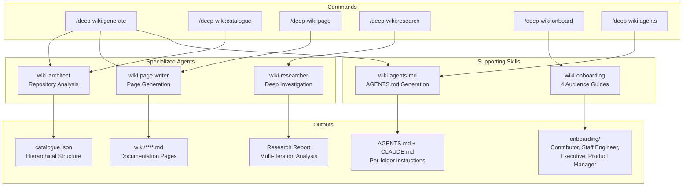
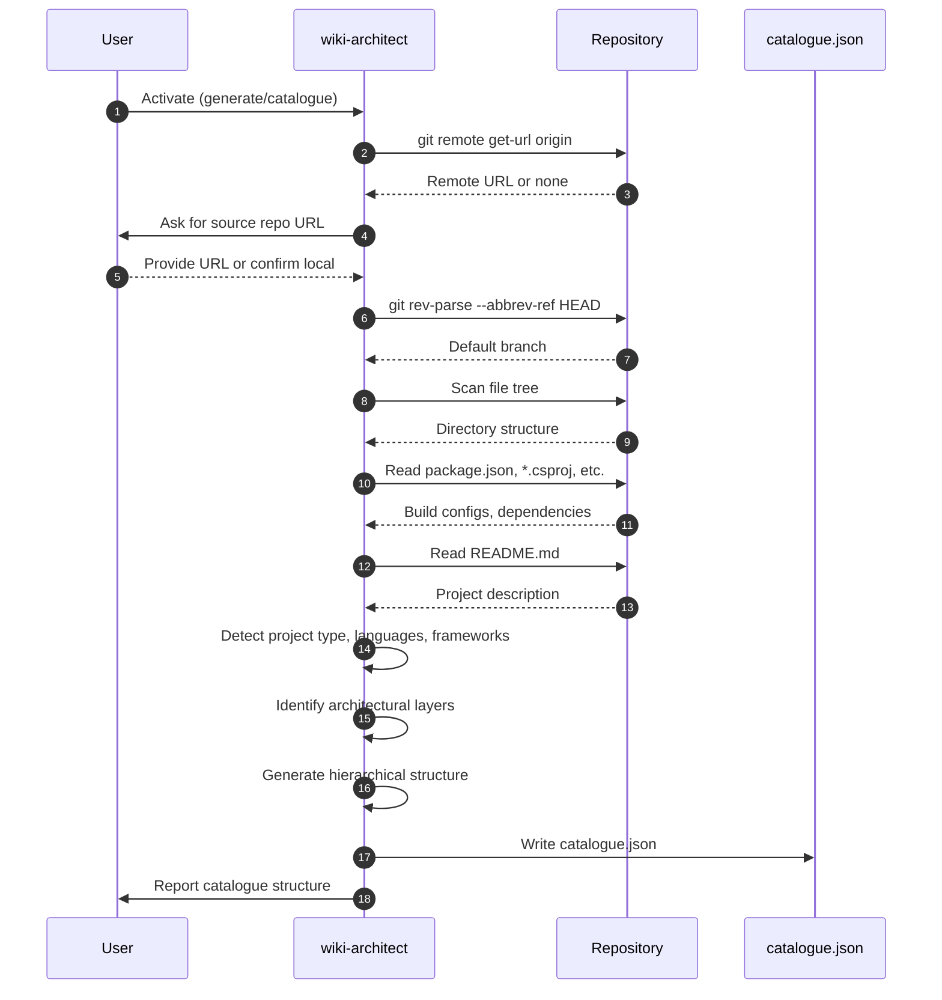
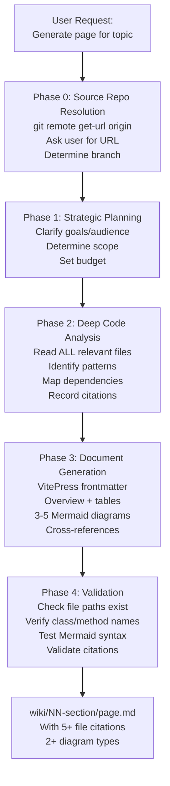
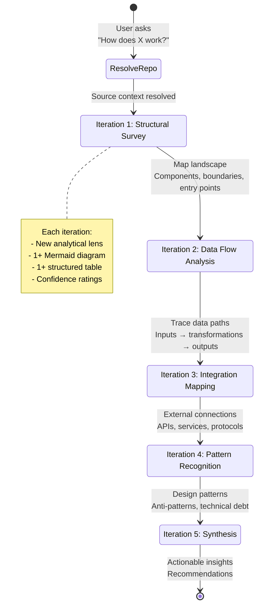
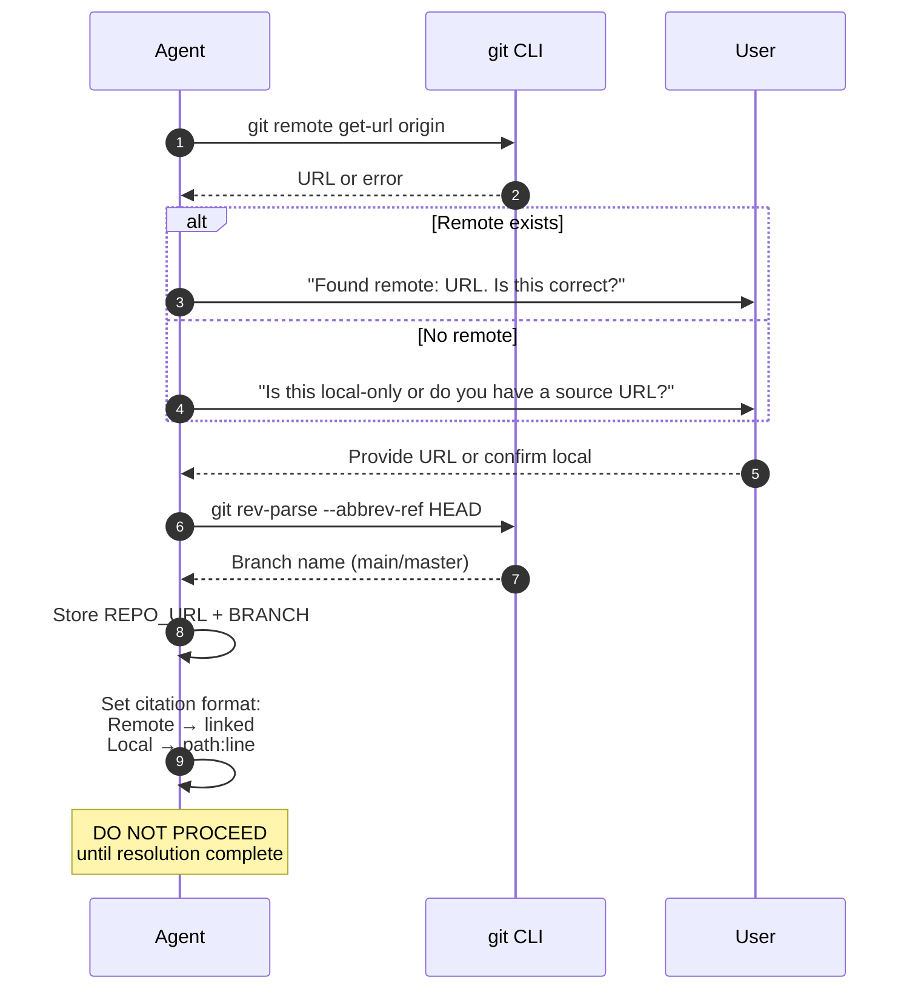

<!-- source: DeepWiki mcp.deepwiki.com · repo microsoft/skills · page 3.3 Specialized Wiki Agents and Skills · fetched 2026-10-30 -->

# Specialized Wiki Agents and Skills

<details>
<summary>Relevant source files</summary>

The following files were used as context for generating this wiki page:

- [.github/agents/scaffolder.agent.md](.github/agents/scaffolder.agent.md)
- [.github/copilot-instructions.md](.github/copilot-instructions.md)
- [.github/docs/agent-integration.md](.github/docs/agent-integration.md)
- [.github/plugins/deep-wiki/.claude-plugin/plugin.json](.github/plugins/deep-wiki/.claude-plugin/plugin.json)
- [.github/plugins/deep-wiki/README.md](.github/plugins/deep-wiki/README.md)
- [.github/plugins/deep-wiki/commands/ado.md](.github/plugins/deep-wiki/commands/ado.md)
- [.github/plugins/deep-wiki/commands/agents.md](.github/plugins/deep-wiki/commands/agents.md)
- [.github/plugins/deep-wiki/commands/build.md](.github/plugins/deep-wiki/commands/build.md)
- [.github/plugins/deep-wiki/commands/crisp.md](.github/plugins/deep-wiki/commands/crisp.md)
- [.github/plugins/deep-wiki/commands/deploy.md](.github/plugins/deep-wiki/commands/deploy.md)
- [.github/plugins/deep-wiki/commands/generate.md](.github/plugins/deep-wiki/commands/generate.md)
- [.github/plugins/deep-wiki/commands/onboard.md](.github/plugins/deep-wiki/commands/onboard.md)
- [.github/plugins/deep-wiki/skills/wiki-ado-convert/SKILL.md](.github/plugins/deep-wiki/skills/wiki-ado-convert/SKILL.md)
- [.github/plugins/deep-wiki/skills/wiki-agents-md/SKILL.md](.github/plugins/deep-wiki/skills/wiki-agents-md/SKILL.md)
- [.github/plugins/deep-wiki/skills/wiki-onboarding/SKILL.md](.github/plugins/deep-wiki/skills/wiki-onboarding/SKILL.md)
- [.github/prompts/scaffold-foundry-app.prompt.md](.github/prompts/scaffold-foundry-app.prompt.md)
- [.github/skills/skill-creator/references/acceptance-criteria.md](.github/skills/skill-creator/references/acceptance-criteria.md)
- [Agents.md](Agents.md)
- [README.md](README.md)
- [context7.json](context7.json)
- [docs-site/src/pages/index.astro](docs-site/src/pages/index.astro)
- [docs/index.html](docs/index.html)
- [tests/harness/criteria-loader.ts](tests/harness/criteria-loader.ts)
- [tests/scenarios/skill-creator/scenarios.yaml](tests/scenarios/skill-creator/scenarios.yaml)

</details>


The Deep Wiki plugin employs three specialized agents and two supporting skills that work together to generate comprehensive technical documentation. The agents handle content generation: `wiki-architect` analyzes repository structure and generates documentation catalogues, `wiki-writer` produces individual documentation pages with rich diagrams, and `wiki-researcher` conducts deep investigative analysis of specific topics. The supporting skills extend this pipeline: `wiki-agents-md` generates AGENTS.md files for repository folders, and `wiki-onboarding` produces audience-tailored onboarding guides. These agents and skills are invoked automatically by various Deep Wiki commands and can also be used directly for targeted documentation tasks.

For information about the Deep Wiki command system that orchestrates these agents and skills, see page [3.2](#3.2). For VitePress site generation details, see page [3.4](#3.4).

## Architecture Overview

The Deep Wiki system combines three specialized agents with two supporting skills to form a complete documentation generation pipeline with distinct responsibilities and activation patterns.

**Agent and Skill Coordination**



Sources: [.github/plugins/deep-wiki/commands/generate.md:1-150](), [.github/plugins/deep-wiki/agents/wiki-architect.md:1-70](), [.github/plugins/deep-wiki/agents/wiki-writer.md:1-123](), [.github/plugins/deep-wiki/agents/wiki-researcher.md:1-90](), [.github/plugins/deep-wiki/skills/wiki-agents-md/SKILL.md:1-370](), [.github/plugins/deep-wiki/skills/wiki-onboarding/SKILL.md:1-230]()

**Agents and Skills Summary**

| Component | Type | Primary Responsibility | Activation Triggers | Key Outputs |
|-----------|------|----------------------|---------------------|-------------|
| `wiki-architect` | Agent | Repository structure analysis, documentation planning | `/deep-wiki:generate`, `/deep-wiki:catalogue` | `catalogue.json` |
| `wiki-page-writer` | Agent | Individual page generation with diagrams, citations, and cross-references | `/deep-wiki:generate`, `/deep-wiki:page` | Wiki pages with 3-5 Mermaid diagrams per page |
| `wiki-researcher` | Agent | Multi-turn deep investigation with evidence-based analysis | `/deep-wiki:research` | Research reports with 5 progressive iterations |
| `wiki-agents-md` | Skill | AGENTS.md file generation for repository folders | `/deep-wiki:generate` Step 7, `/deep-wiki:agents` | `AGENTS.md` + `CLAUDE.md` files per pertinent folder |
| `wiki-onboarding` | Skill | Four audience-tailored onboarding guides | `/deep-wiki:generate` Step 3, `/deep-wiki:onboard` | `onboarding/contributor-guide.md`, `staff-engineer-guide.md`, `executive-guide.md`, `product-manager-guide.md` |

Sources: [.github/plugins/deep-wiki/agents/wiki-architect.md:4](), [.github/plugins/deep-wiki/agents/wiki-writer.md:4](), [.github/plugins/deep-wiki/agents/wiki-researcher.md:4](), [.github/plugins/deep-wiki/skills/wiki-agents-md/SKILL.md:1-10](), [.github/plugins/deep-wiki/skills/wiki-onboarding/SKILL.md:1-10]()

## wiki-architect Agent

The `wiki-architect` agent is a technical documentation architect that analyzes repository structure and generates hierarchical documentation plans. It scans the codebase to detect architectural patterns, technology stacks, and natural decomposition boundaries, then produces a structured catalogue that guides the documentation generation process.

**Repository Analysis Workflow**



Sources: [.github/plugins/deep-wiki/agents/wiki-architect.md:19-50](), [.github/plugins/deep-wiki/skills/wiki-architect/SKILL.md:17-38]()

### Core Capabilities

The `wiki-architect` agent implements several key capabilities:

1. **Language and Framework Detection**: Scans for build files (`package.json`, `*.csproj`, `Cargo.toml`, `pyproject.toml`, `go.mod`, `pom.xml`) to determine primary language and select appropriate comparison language for cross-language explanations.

2. **Architectural Layer Identification**: Analyzes directory structure and file organization to identify presentation layer, business logic, data access, and infrastructure components.

3. **Hierarchical Catalogue Generation**: Produces JSON structure with maximum 4 nesting levels and maximum 8 children per section. Includes two top-level modules: "Getting Started" and "Deep Dive" (Deep Dive omitted for repos with ≤10 files).

4. **Onboarding Guide Architecture**: Generates four audience-specific onboarding guides in `onboarding/` folder.

Sources: [.github/plugins/deep-wiki/agents/wiki-architect.md:43-70](), [.github/plugins/deep-wiki/skills/wiki-architect/SKILL.md:39-81]()

**Onboarding Guide Structure**

| Guide File | Target Audience | Length | Key Sections | Diagrams Required |
|-----------|----------------|--------|--------------|-------------------|
| `contributor-guide.md` | New contributors (assumes Python/JS) | 1000–2500 lines | Part I: Foundations (cross-language comparisons), Part II: Codebase architecture, Part III: Setup and workflow | Minimum 5 (architecture, ER, sequence, flowchart, state) |
| `staff-engineer-guide.md` | Staff/principal engineers | 800–1200 lines | Core architectural insight, system diagrams, decision log, design tradeoffs | Minimum 5 (architecture, ER, class, sequence, state/flowchart) |
| `executive-guide.md` | VP/director-level leaders | 400–800 lines | Capability map, risk assessment, technology investment thesis, cost model | Minimum 3 (architecture, dependency map, capability map) |
| `product-manager-guide.md` | Product managers, non-technical stakeholders | 400–800 lines | User journey maps, feature capability map, limitations, data/privacy | Minimum 3 (user journey, data model, feature map) |

Sources: [.github/plugins/deep-wiki/agents/wiki-architect.md:54-61](), [.github/plugins/deep-wiki/skills/wiki-onboarding/SKILL.md:28-201]()

### Catalogue Schema and Constraints

The `wiki-architect` generates a JSON catalogue following specific structural rules:

- **Max nesting depth**: 4 levels to prevent overwhelming complexity
- **Max children per section**: 8 to ensure navigability
- **Required prompt citations**: Every section's `prompt` field must reference specific files using resolved citation format
- **Small repo handling**: For repositories with ≤10 files, only "Getting Started" module is generated (Deep Dive skipped, but onboarding guides still included)
- **Title derivation**: All titles must be derived from actual repository content—never use generic placeholders

Sources: [.github/plugins/deep-wiki/agents/wiki-architect.md:66-70](), [.github/plugins/deep-wiki/commands/generate.md:42-52]()

## wiki-writer Agent

The `wiki-writer` agent is a senior documentation engineer that generates comprehensive wiki pages with rich dark-mode Mermaid diagrams, deep code citations, and cross-references. It follows a mandatory three-phase process: strategic planning, deep code analysis, and document generation.

**Page Generation Process**



Sources: [.github/plugins/deep-wiki/agents/wiki-writer.md:41-50](), [.github/plugins/deep-wiki/commands/page.md:32-55]()

### Mandatory Requirements

The `wiki-writer` enforces strict quality requirements for every page:

**Diagram Requirements**

- **Minimum quantity**: 3-5 Mermaid diagrams per page (scaled by scope)
- **Diagram variety**: Must use at least 2 different diagram types (never repeat same type exclusively)
- **Dark-mode colors**: All diagrams use dark palette (node fills `#2d333b`, borders `#6d5dfc`, text `#e6edf3`)
- **Source comments**: Every diagram followed by `<!-- Sources: file_path:line, file_path:line -->` comment block
- **`sequenceDiagram` numbering**: All sequence diagrams must use `autonumber`

**Citation Requirements**

- **Minimum citations**: 5 different source files per page
- **Citation format**: Uses resolved format based on source repo context (remote URL → linked citations, local → path:line)
- **Linked citations**: `[src/auth.ts:42](https://github.com/org/repo/blob/main/src/auth.ts#L42)` for remote repos
- **Local citations**: `(src/auth.ts:42)` for local-only repos
- **Table citations**: Include "Source" column with linked citations when listing components, APIs, or configurations

Sources: [.github/plugins/deep-wiki/agents/wiki-writer.md:51-72](), [.github/plugins/deep-wiki/skills/wiki-page-writer/SKILL.md:52-72]()

### Diagram Selection Strategy

The `wiki-writer` selects diagram types strategically based on the content being documented:

**Diagram Type Selection Matrix**

| Diagram Type | Use Case | When to Use | Example Application |
|--------------|----------|-------------|---------------------|
| `graph TB/LR` | System architecture, component relationships, dependency graphs | Structural overviews | Module connections, layer architecture |
| `sequenceDiagram` | API flows, multi-step processes, request lifecycles | Behavioral interactions | User login flow, data processing pipeline |
| `classDiagram` | Class hierarchies, interfaces, type relationships | Domain models | OOP structure, interface contracts |
| `stateDiagram-v2` | State machines, lifecycle, workflow states | Status transitions | Order processing states, entity lifecycle |
| `erDiagram` | Database schema, entities, table relationships | Data models | Database tables, entity relationships |
| `flowchart` | Data pipelines, decision trees, conditional logic | Error handling paths | Exception handling, branching logic |

Sources: [.github/plugins/deep-wiki/agents/wiki-writer.md:61-74](), [.github/plugins/deep-wiki/commands/page.md:82-90]()

### Table Formatting Standards

The `wiki-writer` uses tables extensively to make documentation scannable:

- **Aggressive table use**: Prefer tables over prose for any structured information (APIs, configs, components, comparisons, parameters)
- **Descriptive headers**: Use specific column names like "Component", "Responsibility", "Key File", "Source" instead of generic "Name", "Description"
- **Source column**: Always include when listing code artifacts
- **Summary tables**: Start each major section with at-a-glance summary table before diving into details
- **Comparison tables**: When introducing technologies, patterns, or alternatives, always compare side-by-side

Sources: [.github/plugins/deep-wiki/agents/wiki-writer.md:76-86](), [.github/plugins/deep-wiki/skills/wiki-page-writer/SKILL.md:73-82]()

### Cross-Reference System

The `wiki-writer` implements a bidirectional cross-reference system:

1. **Inline links**: When mentioning a concept, component, or pattern covered on another wiki page, link to it inline using relative Markdown links: `[Component Name](../NN-section/page-name.md)`

2. **Anchor links**: Link to specific sections with kebab-case heading anchors: `[error handling](../02-architecture/overview.md#error-handling)`

3. **Related Pages section**: Every page ends with a "Related Pages" table listing connected wiki pages with one-line relationship descriptions

4. **Bidirectional linking**: If page A links to page B, page B should link back to page A where relevant

Sources: [.github/plugins/deep-wiki/skills/wiki-page-writer/SKILL.md:83-98](), [.github/plugins/deep-wiki/commands/page.md:68]()

## wiki-researcher Agent

The `wiki-researcher` agent is an expert code analyst that conducts systematic, multi-turn research investigations with zero tolerance for shallow analysis. Unlike the other agents that generate documentation artifacts, `wiki-researcher` produces understanding, maps, explanations, and actionable insights through iterative deep dives.

**5-Iteration Research Cycle**



Sources: [.github/plugins/deep-wiki/agents/wiki-researcher.md:63-72](), [.github/plugins/deep-wiki/commands/research.md:32-69]()

### Core Invariants (Non-Negotiable)

The `wiki-researcher` enforces strict research standards:

**Zero Tolerance Rules**

| If Agent Says... | Required Response |
|-----------------|-------------------|
| "This likely handles..." | **UNACCEPTABLE**. Read the code and state what it ACTUALLY does. |
| "Based on the naming convention..." | **INSUFFICIENT**. Names lie. Verify the implementation. |
| "This is probably similar to..." | **UNACCEPTABLE**. Don't map to stereotypes. Read THIS codebase. |
| "The standard approach would be..." | **IRRELEVANT**. Tell me what THIS code does, not what's conventional. |
| "I assume this connects to..." | **UNACCEPTABLE**. Trace the actual dependency/call. |

Sources: [.github/plugins/deep-wiki/agents/wiki-researcher.md:40-50](), [.github/plugins/deep-wiki/skills/wiki-researcher/SKILL.md:34-39]()

**Evidence Standards**

| Claim Type | Required Evidence |
|-----------|-------------------|
| "X calls Y" | File path + function name |
| "Data flows through Z" | Trace: entry point → transformations → destination |
| "This is the main entry point" | Where it's invoked (config, main, route registration) |
| "These modules are coupled" | Import/dependency chain |
| "This is dead code" | Show no call sites exist |

Sources: [.github/plugins/deep-wiki/skills/wiki-researcher/SKILL.md:42-49]()

### Iteration Structure

Each of the 5 research iterations follows a structured format:

**Iteration-Specific Focus**

1. **Iteration 1 - Structural Survey**: Map landscape, identify components and boundaries, locate entry points. Include `graph TB` architecture diagram.

2. **Iteration 2 - Data Flow Analysis**: Trace data through the system—inputs, transformations, outputs, storage. Include `sequenceDiagram` and/or `stateDiagram-v2`.

3. **Iteration 3 - Integration Mapping**: External connections, API contracts, third-party services. Include dependency graph and integration table.

4. **Iteration 4 - Pattern Recognition**: Design patterns, anti-patterns, architectural decisions, technical debt, risks. Use tables to catalogue patterns and rank risks.

5. **Iteration 5 - Synthesis**: Combine all findings, provide mental model ("Here's how to think about this"), highlight surprising findings, provide actionable insights.

Sources: [.github/plugins/deep-wiki/commands/research.md:36-69](), [.github/plugins/deep-wiki/skills/wiki-researcher/SKILL.md:51-59]()

### Running Knowledge Map

The `wiki-researcher` maintains a structured knowledge map throughout all iterations:

```markdown
## Explored ✅
- [component/area]: [1-line summary] — confidence: HIGH/MED/LOW

## Partially Explored 🔶
- [component/area]: [what we know, what's still unknown]

## Unexplored ❓
- [component/area]: [why it might matter]

## Key Findings 🔍
- [finding]: [1-line summary] — [risk/importance]

## Open Questions ❔
- [question]: [what we'd need to trace to answer it]
```

Sources: [.github/plugins/deep-wiki/commands/research.md:72-89]()

### Finding Documentation Format

For every significant finding, the `wiki-researcher` follows a five-part structure:

1. **State the finding**: One clear sentence summarizing the discovery
2. **Show the evidence**: File paths, code references, call chains with citations
3. **Explain the implication**: Why this matters for the system
4. **Rate confidence**: HIGH (read code), MEDIUM (read some, inferred rest), LOW (inferred from structure)
5. **Flag open questions**: What needs tracing next to complete understanding

Sources: [.github/plugins/deep-wiki/agents/wiki-researcher.md:74-79](), [.github/plugins/deep-wiki/skills/wiki-researcher/SKILL.md:63-69]()

## Common Agent Protocols

All three specialized agents share common behaviors and protocols that ensure consistency across the Deep Wiki system.

### Source Repository Resolution Protocol

Every agent must execute source repository resolution as the mandatory first step before any analysis or generation:

**Resolution Sequence**



Sources: [.github/plugins/deep-wiki/agents/wiki-architect.md:19-30](), [.github/plugins/deep-wiki/agents/wiki-writer.md:19-29](), [.github/plugins/deep-wiki/agents/wiki-researcher.md:17-29]()

**Citation Format Resolution**

| Source Context | Citation Format | Example |
|---------------|----------------|---------|
| Remote repository | `[file_path:line](REPO_URL/blob/BRANCH/file_path#Lline)` | `[src/auth.ts:42](https://github.com/org/repo/blob/main/src/auth.ts#L42)` |
| Remote range | `[file_path:start-end](REPO_URL/blob/BRANCH/file_path#Lstart-Lend)` | `[src/auth.ts:42-58](https://github.com/org/repo/blob/main/src/auth.ts#L42-L58)` |
| Local repository | `(file_path:line_number)` | `(src/auth.ts:42)` |
| Approximate location | `[file_path:~ClassName](REPO_URL/blob/BRANCH/file_path)` | `[src/auth.ts:~TokenValidator](...)` |
| Unknown source | `(Unknown – verify in path/to/check)` | Used when evidence is missing |

Sources: [.github/plugins/deep-wiki/agents/wiki-writer.md:31-40](), [.github/plugins/deep-wiki/commands/page.md:99-107]()

### Dark-Mode Mermaid Standards

All agents generate Mermaid diagrams using a consistent dark-mode color palette for VitePress compatibility:

**Color Palette**

| Element | Fill Color | Border/Stroke Color | Text Color |
|---------|-----------|-------------------|-----------|
| Primary nodes | `#2d333b` | `#6d5dfc` | `#e6edf3` |
| Subgraph backgrounds | `#161b22` | `#30363d` | `#e6edf3` |
| Lines/arrows | — | `#8b949e` | — |
| Secondary surfaces | `#1c2333` | `#6d5dfc` | `#e6edf3` |
| Cluster backgrounds | `#161b22` | `#30363d` | — |

**Prohibited Elements**

- `<br/>` tags in labels (use `<br>` or line breaks instead—Vue compatibility issue)
- Light-mode colors in inline `style` directives
- Hex colors with 4 or 5 digits (must be 3 or 6 digits)

Sources: [.github/plugins/deep-wiki/commands/generate.md:133-141](), [.github/plugins/deep-wiki/agents/wiki-writer.md:87-103]()

### Depth Requirements (Non-Negotiable)

All three agents enforce the same depth requirements:

1. **TRACE ACTUAL CODE PATHS**: Do not guess from file names. Read the implementation. If function A calls B calls C, follow it all the way.

2. **EVERY CLAIM NEEDS A SOURCE**: File path + function/class name for every architectural claim. No exceptions.

3. **DISTINGUISH FACT FROM INFERENCE**: If you read the code, say so explicitly. If inferring from structure, mark it clearly.

4. **FIRST PRINCIPLES**: Explain WHY something exists before explaining what it does.

5. **NO HAND-WAVING**: Don't say "this likely handles..." or "this probably..."—read the code and state what it ACTUALLY does.

Sources: [.github/plugins/deep-wiki/commands/generate.md:142-148](), [.github/plugins/deep-wiki/agents/wiki-researcher.md:28-38]()

## Agent Invocation Patterns

The specialized agents can be invoked directly or orchestrated by commands:

**Command-to-Agent Mapping**

| Command | Invoked Agents | Execution Order | Purpose |
|---------|---------------|----------------|---------|
| `/deep-wiki:generate` | `wiki-architect`, `wiki-writer` | 1. Architect generates catalogue<br/>2. Writer generates pages for each leaf node | Full wiki generation pipeline |
| `/deep-wiki:catalogue` | `wiki-architect` | Single invocation | Generate documentation structure only |
| `/deep-wiki:page` | `wiki-writer` | Single invocation | Generate single page for specified topic |
| `/deep-wiki:research` | `wiki-researcher` | 5 iterations with user continuation | Deep investigation of specific topic |
| `/deep-wiki:onboard` | `wiki-architect` | Single invocation (onboarding mode) | Generate 4 audience-specific onboarding guides |

Sources: [.github/plugins/deep-wiki/commands/generate.md:10-81](), [.github/plugins/deep-wiki/commands/page.md:1-130](), [.github/plugins/deep-wiki/commands/research.md:1-99]()

### Direct Agent Usage

Agents can also be referenced directly in user prompts or custom workflows:

- **Activate `wiki-architect`**: When user asks to "create a wiki", "document this repo", or "generate docs"
- **Activate `wiki-writer`**: When user asks to "document a specific component", wants "technical deep-dive with diagrams", or needs to generate content for a catalogue section
- **Activate `wiki-researcher`**: When user asks "how does X work" with expectation of depth, wants to understand a complex system spanning many files, or asks for architectural analysis

Sources: [.github/plugins/deep-wiki/skills/wiki-architect/SKILL.md:10-15](), [.github/plugins/deep-wiki/skills/wiki-page-writer/SKILL.md:10-14](), [.github/plugins/deep-wiki/skills/wiki-researcher/SKILL.md:10-14]()

---

