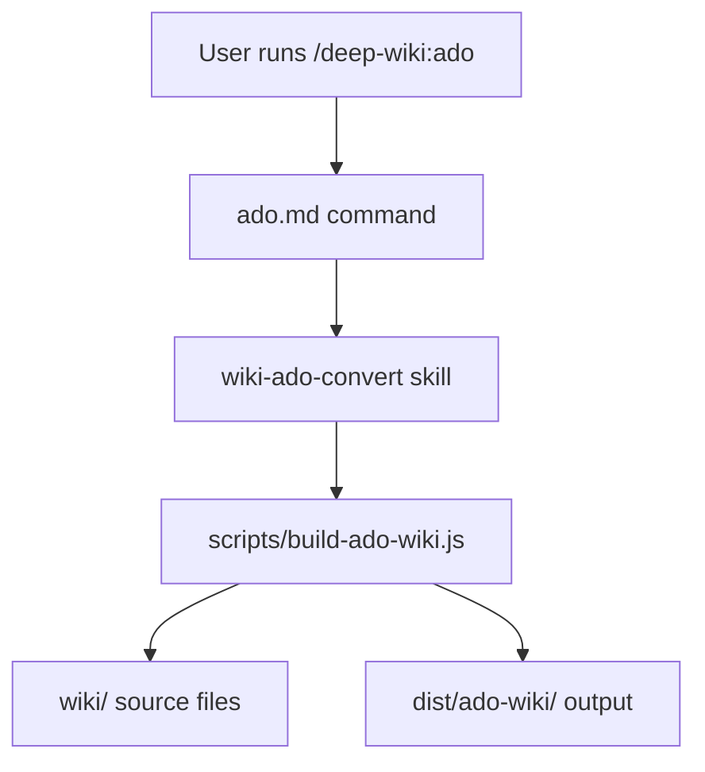
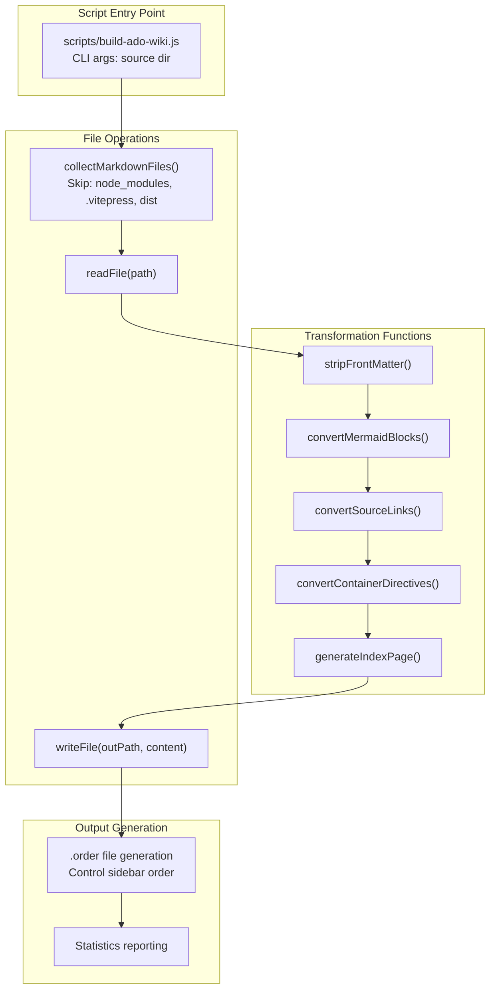
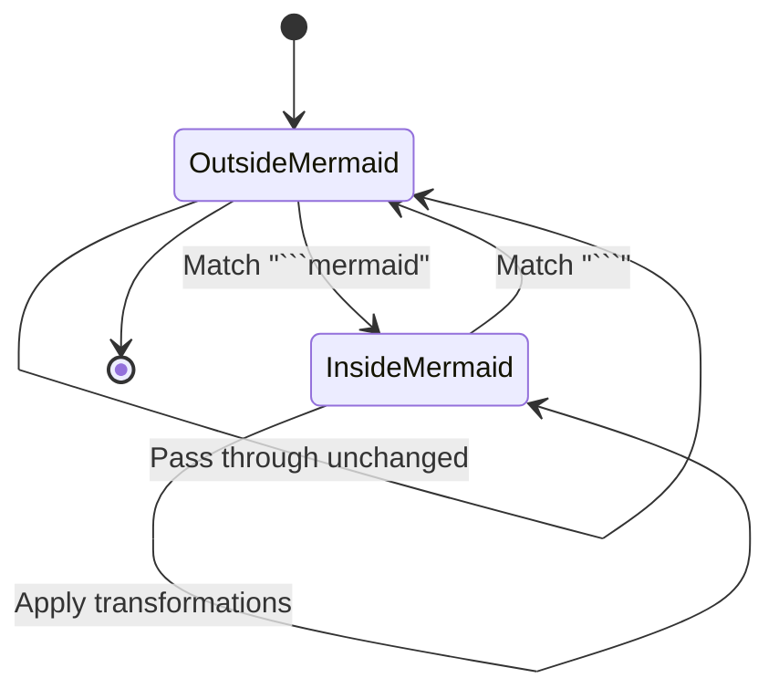
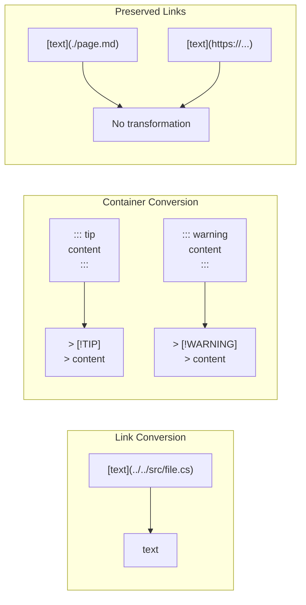
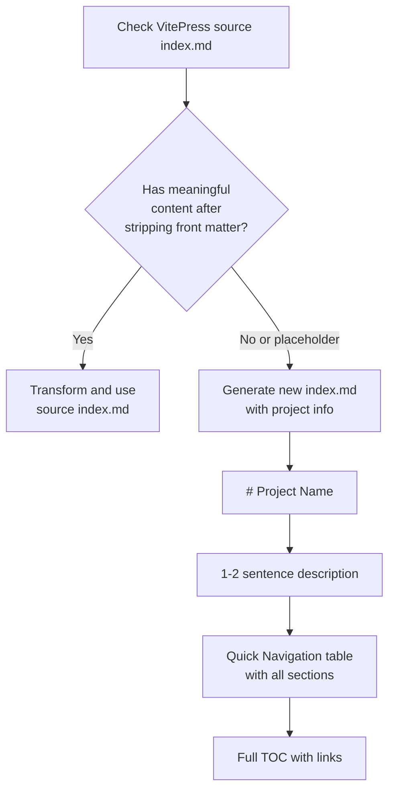
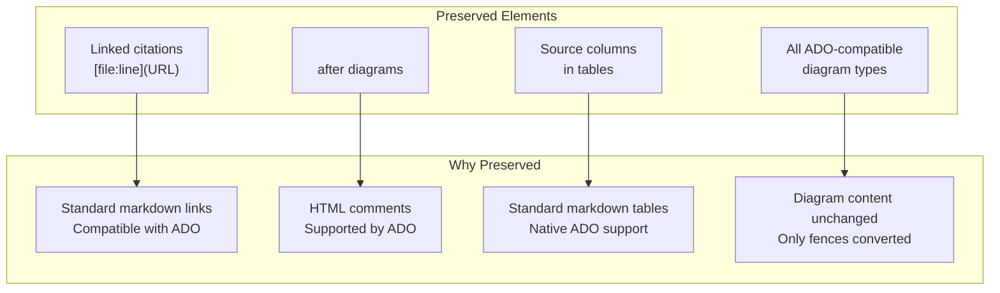
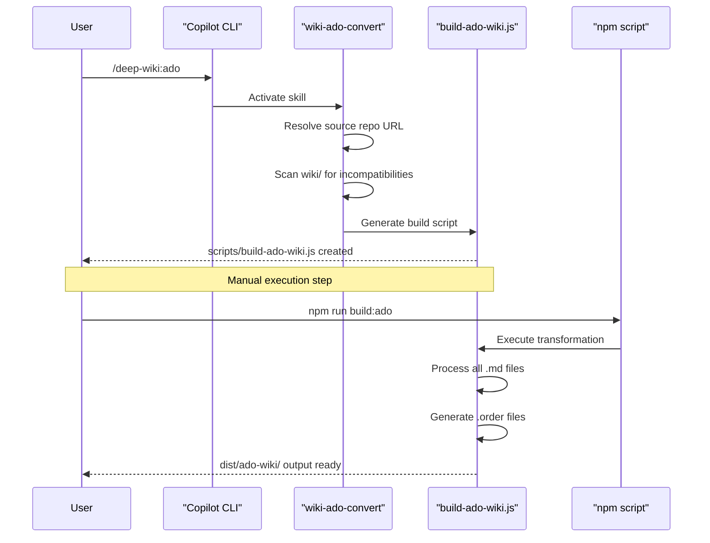
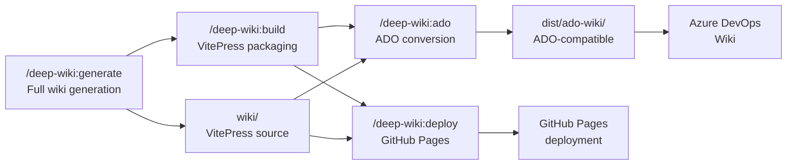

<!-- source: DeepWiki mcp.deepwiki.com · repo microsoft/skills · page 3.5 Azure DevOps Wiki Export · fetched 2026-10-30 -->

# Azure DevOps Wiki Export

<details>
<summary>Relevant source files</summary>

The following files were used as context for generating this wiki page:

- [.github/plugins/deep-wiki/.claude-plugin/plugin.json](.github/plugins/deep-wiki/.claude-plugin/plugin.json)
- [.github/plugins/deep-wiki/README.md](.github/plugins/deep-wiki/README.md)
- [.github/plugins/deep-wiki/commands/ado.md](.github/plugins/deep-wiki/commands/ado.md)
- [.github/plugins/deep-wiki/commands/agents.md](.github/plugins/deep-wiki/commands/agents.md)
- [.github/plugins/deep-wiki/commands/build.md](.github/plugins/deep-wiki/commands/build.md)
- [.github/plugins/deep-wiki/commands/crisp.md](.github/plugins/deep-wiki/commands/crisp.md)
- [.github/plugins/deep-wiki/commands/deploy.md](.github/plugins/deep-wiki/commands/deploy.md)
- [.github/plugins/deep-wiki/commands/generate.md](.github/plugins/deep-wiki/commands/generate.md)
- [.github/plugins/deep-wiki/commands/onboard.md](.github/plugins/deep-wiki/commands/onboard.md)
- [.github/plugins/deep-wiki/skills/wiki-ado-convert/SKILL.md](.github/plugins/deep-wiki/skills/wiki-ado-convert/SKILL.md)
- [.github/plugins/deep-wiki/skills/wiki-agents-md/SKILL.md](.github/plugins/deep-wiki/skills/wiki-agents-md/SKILL.md)
- [.github/plugins/deep-wiki/skills/wiki-onboarding/SKILL.md](.github/plugins/deep-wiki/skills/wiki-onboarding/SKILL.md)
- [README.md](README.md)
- [docs-site/src/pages/index.astro](docs-site/src/pages/index.astro)
- [docs/index.html](docs/index.html)

</details>


The Azure DevOps Wiki Export system generates a Node.js build script that converts VitePress/GitHub Flavored Markdown documentation into Azure DevOps (ADO) Wiki-compatible format. This transformation addresses critical markdown dialect differences between VitePress and ADO Wikis while preserving citations, diagrams, and documentation quality.

For information about the VitePress site generation that precedes ADO export, see [VitePress Site Generation](#3.4). For the full Deep Wiki generation pipeline, see [Wiki Generation Commands](#3.2).

## Purpose and Scope

The ADO export system solves the problem of publishing Deep Wiki documentation to Azure DevOps Wikis, which use a markdown dialect incompatible with standard GFM and VitePress. The system:

- Generates `scripts/build-ado-wiki.js` — a zero-dependency Node.js transformation script
- Reads VitePress wiki markdown files and produces ADO-compatible copies in `dist/ado-wiki/`
- Never modifies source files — operates on copies only
- Preserves linked citations, source comment blocks, and diagram content
- Ensures proper landing pages and sidebar ordering for ADO

**Sources:** [.github/plugins/deep-wiki/commands/ado.md:1-9](), [.github/plugins/deep-wiki/skills/wiki-ado-convert/SKILL.md:1-8]()

## Command Entry Points



**Command invocation flow from user request to generated build script**

The `/deep-wiki:ado` command activates the `wiki-ado-convert` skill, which generates the build script. Users can then run `npm run build:ado` to execute the transformation.

**Sources:** [.github/plugins/deep-wiki/commands/ado.md:1-9](), [.github/plugins/deep-wiki/skills/wiki-ado-convert/SKILL.md:1-4]()

## ADO Wiki Markdown Incompatibilities

Azure DevOps Wikis diverge from GFM in several critical ways that break rendering if not addressed:

| Issue | VitePress/GFM | ADO Wiki | Impact | Transform |
|-------|---------------|----------|--------|-----------|
| Mermaid fences | ` ```mermaid ` | `::: mermaid` | Diagrams not rendered | Convert fence syntax |
| `flowchart` keyword | `flowchart TD` | `graph TD` | Diagram syntax error | Replace keyword, preserve direction |
| `<br>` in Mermaid | `Node[Label<br>Text]` | Not supported | Diagram breaks | Strip all `<br>` variants |
| Long arrows | `---->` (4+ dashes) | Not supported | Arrow rendering fails | Replace with `-->` |
| YAML front matter | `---` ... `---` | Rendered as visible text | Raw YAML exposed to users | Strip entirely |
| Parent-relative links | `[text](../../src/file)` | Broken path | Dead links | Convert to plain text |
| Container directives | `::: tip` / `::: warning` | Not supported | Raw directive text | Convert to `> [!TIP]` / `> [!WARNING]` |

**Critical incompatibilities requiring transformation**

Compatible features that pass through unchanged include: tables, standard markdown links, external URLs, fenced code blocks, inline code, bold/italic/strikethrough, lists, headings, blockquotes, horizontal rules, and emoji.

**Sources:** [.github/plugins/deep-wiki/commands/ado.md:50-126](), [.github/plugins/deep-wiki/skills/wiki-ado-convert/SKILL.md:24-55]()

## Build Script Architecture



**Build script transformation pipeline**

The script is a Node.js ESM module using only built-in modules (`node:fs/promises`, `node:path`, `node:url`) with zero external dependencies. It processes files in order: strip YAML → convert Mermaid → fix links → convert containers → generate index → write output.

**Sources:** [.github/plugins/deep-wiki/skills/wiki-ado-convert/SKILL.md:67-180](), [.github/plugins/deep-wiki/commands/ado.md:56-111]()

## Transformation Implementations

### Mermaid Block Conversion

The Mermaid conversion processes files line-by-line, tracking block state:

| Transformation | Pattern | Replacement | Context |
|----------------|---------|-------------|---------|
| Opening fence | ` ```mermaid ` | `::: mermaid` | Exact match on trimmed line |
| Closing fence | ` ``` ` (after opening) | `:::` | Only when inside mermaid block |
| flowchart keyword | `flowchart TD` / `LR` / etc | `graph TD` / `LR` / etc | Preserves direction (TD/LR/TB/RL/BT) |
| Line breaks | `<br>`, `<br/>`, `<br />` | ` ` (space) | All variants stripped |
| Long arrows | `---->` (4+ dashes) | `-->` | Normalize to standard arrow |

The implementation in `convertMermaidBlocks()` uses a state machine:



**State machine for Mermaid block detection and transformation**

**Sources:** [.github/plugins/deep-wiki/skills/wiki-ado-convert/SKILL.md:86-130](), [.github/plugins/deep-wiki/commands/ado.md:64-74]()

### YAML Front Matter Stripping

VitePress pages contain YAML front matter delimited by `---` at file start. ADO renders this as visible raw text. The `stripFrontMatter()` function:

1. Checks if file starts with `---`
2. Finds closing `---` delimiter
3. Removes entire block plus trailing newline
4. Returns remaining content

**Sources:** [.github/plugins/deep-wiki/skills/wiki-ado-convert/SKILL.md:71-84](), [.github/plugins/deep-wiki/commands/ado.md:61-64]()

### Link and Container Conversions



**Link and container transformation logic**

Parent-relative links (`../` paths) are converted to plain text because ADO Wikis are separate from source repositories. Same-directory markdown links and external URLs pass through unchanged. Container directives map: `::: tip` → `> [!TIP]`, `::: warning` → `> [!WARNING]`, `::: danger` → `> [!CAUTION]`, `::: info` → `> [!NOTE]`.

**Sources:** [.github/plugins/deep-wiki/skills/wiki-ado-convert/SKILL.md:132-156](), [.github/plugins/deep-wiki/commands/ado.md:72-77]()

## Index Page Generation

The script ensures `dist/ado-wiki/index.md` is a proper wiki landing page, not a generic placeholder:



**Index page generation decision tree**

The generated index must include:
- Project title as H1 heading (from `package.json`, README, or repo name)
- Brief technical description
- Quick Navigation table with Section, Description columns
- Links to all onboarding guides
- Full table of contents linking to all wiki pages

VitePress hero/features blocks are stripped. If the remaining content is only whitespace or placeholder text (`TODO:`, `Give a short introduction`), the script generates a complete landing page from the template.

**Sources:** [.github/plugins/deep-wiki/commands/ado.md:141-177](), [.github/plugins/deep-wiki/skills/wiki-ado-convert/SKILL.md:209-230]()

## ADO Page Ordering

ADO Wikis use `.order` files to control sidebar page ordering. The build script generates these files in each directory:

| File | Purpose | Content Format |
|------|---------|----------------|
| `dist/ado-wiki/.order` | Root page order | `index`, `onboarding`, numbered sections |
| `dist/ado-wiki/onboarding/.order` | Onboarding guides order | `index`, `contributor-guide`, `staff-engineer-guide`, `executive-guide`, `product-manager-guide` |
| `dist/ado-wiki/NN-section/.order` | Section page order | List of page names without `.md` extension |

Each `.order` file contains page names (without `.md` extension), one per line, defining the sidebar display order. Onboarding guides appear first, then numbered sections in order.

**Sources:** [.github/plugins/deep-wiki/commands/ado.md:196-204](), [.github/plugins/deep-wiki/skills/wiki-ado-convert/SKILL.md:223-226]()

## Citation and Quality Preservation

The ADO conversion preserves all documentation quality markers:



**Quality preservation mechanisms**

The script does NOT strip or modify:
- `[file:line](REPO_URL/blob/BRANCH/file#Lline)` citation links (standard markdown)
- `<!-- Sources: file:line, file:line -->` comment blocks after diagrams (HTML comments work in ADO)
- Tables with "Source" columns containing linked citations
- Mermaid diagram content, structure, or types (only fence syntax changes)

Supported ADO diagram types: `graph`, `sequenceDiagram`, `gantt`, `classDiagram`, `stateDiagram`, `stateDiagram-v2`, `journey`, `pie`, `erDiagram`, `requirementDiagram`, `gitGraph`, `timeline`. Unsupported types: `mindmap`, `sankey`, `quadrantChart`, `xychart`, `block`.

**Sources:** [.github/plugins/deep-wiki/commands/ado.md:186-195](), [.github/plugins/deep-wiki/skills/wiki-ado-convert/SKILL.md:232-241]()

## Usage Workflow



**End-to-end workflow from command to ADO-compatible output**

Workflow steps:
1. User runs `/deep-wiki:ado` in Copilot CLI
2. Skill resolves source repository URL (for citation format)
3. Skill scans wiki for incompatibilities and reports findings
4. Skill generates `scripts/build-ado-wiki.js` with zero dependencies
5. Skill adds `"build:ado": "node scripts/build-ado-wiki.js"` to `wiki/package.json`
6. User runs `npm run build:ado` to execute transformation
7. Script outputs transformed files to `dist/ado-wiki/`
8. User publishes `dist/ado-wiki/` to Azure DevOps Wiki

**Sources:** [.github/plugins/deep-wiki/commands/ado.md:5-37](), [.github/plugins/deep-wiki/skills/wiki-ado-convert/SKILL.md:9-19](), [.github/plugins/deep-wiki/commands/ado.md:89-99]()

## Script Configuration and Validation

The build script provides configuration and validation features:

| Feature | Implementation | Purpose |
|---------|----------------|---------|
| Source directory detection | Auto-detect `wiki/` or accept CLI arg | Flexible input path |
| Output directory | Fixed `dist/ado-wiki/` | Consistent output location |
| Skip patterns | `node_modules/`, `.vitepress/`, `.git/`, `dist/` | Avoid processing build artifacts |
| Transformation statistics | Count of each transformation type | Transparency and debugging |
| Exit codes | 0 on success, 1 on error | CI/CD integration |
| Verification checks | File count, fence syntax, keywords | Quality assurance |

Post-execution verification checklist:
1. File count matches source (minus skipped directories)
2. Zero ` ```mermaid ` fences remaining
3. Zero `flowchart` keywords in Mermaid blocks
4. No YAML front matter in output files
5. Parent-relative links converted to plain text
6. Same-directory `.md` links preserved
7. Directory structure preserved
8. `index.md` exists at root and is proper landing page

**Sources:** [.github/plugins/deep-wiki/commands/ado.md:79-113](), [.github/plugins/deep-wiki/skills/wiki-ado-convert/SKILL.md:195-207]()

## Integration with Deep Wiki Pipeline

The ADO export fits into the larger Deep Wiki generation workflow:



**ADO export as an alternative deployment target in the Deep Wiki pipeline**

The ADO export operates on the VitePress source files generated by `/deep-wiki:generate` or `/deep-wiki:build`, producing an alternative output format for Azure DevOps Wikis. This runs independently of GitHub Pages deployment.

**Sources:** [.github/plugins/deep-wiki/README.md:102-117](), [.github/plugins/deep-wiki/commands/ado.md:1-9]()

---

