<!-- source: DeepWiki mcp.deepwiki.com · repo microsoft/skills · page 4.1 Test Harness Architecture · fetched 2026-10-30 -->

# Test Harness Architecture

<details>
<summary>Relevant source files</summary>

The following files were used as context for generating this wiki page:

- [.github/agents/scaffolder.agent.md](.github/agents/scaffolder.agent.md)
- [.github/copilot-instructions.md](.github/copilot-instructions.md)
- [.github/docs/agent-integration.md](.github/docs/agent-integration.md)
- [.github/prompts/scaffold-foundry-app.prompt.md](.github/prompts/scaffold-foundry-app.prompt.md)
- [.github/skills/skill-creator/references/acceptance-criteria.md](.github/skills/skill-creator/references/acceptance-criteria.md)
- [.github/workflows/skill-evaluation.yml](.github/workflows/skill-evaluation.yml)
- [.github/workflows/test-harness.yml](.github/workflows/test-harness.yml)
- [Agents.md](Agents.md)
- [context7.json](context7.json)
- [docs-site/integration-filter-test.png](docs-site/integration-filter-test.png)
- [docs-site/public/og-image.png](docs-site/public/og-image.png)
- [tests/.gitignore](tests/.gitignore)
- [tests/AGENTS.md](tests/AGENTS.md)
- [tests/README.md](tests/README.md)
- [tests/harness/criteria-loader.ts](tests/harness/criteria-loader.ts)
- [tests/harness/evaluator.ts](tests/harness/evaluator.ts)
- [tests/scenarios/skill-creator/scenarios.yaml](tests/scenarios/skill-creator/scenarios.yaml)

</details>


The test harness is a TypeScript-based evaluation system that validates AI-generated code against acceptance criteria defined for each skill. It provides automated quality gates for skill development through both fast mock-based testing (for PRs) and accurate SDK-based evaluation (for nightly quality measurements).

**Scope**: This document covers the core evaluation architecture, component responsibilities, scoring algorithms, and integration with GitHub Actions. For information about writing acceptance criteria, see [4.2](#4.2). For test scenario format, see [4.3](#4.3). For running evaluations, see [4.4](#4.4). For the Ralph Loop iterative improvement system, see [4.5](#4.5).

---

## System Overview

The test harness implements a pipeline architecture where acceptance criteria and test scenarios flow through multiple components to produce evaluation results with scores, findings, and pass/fail status.

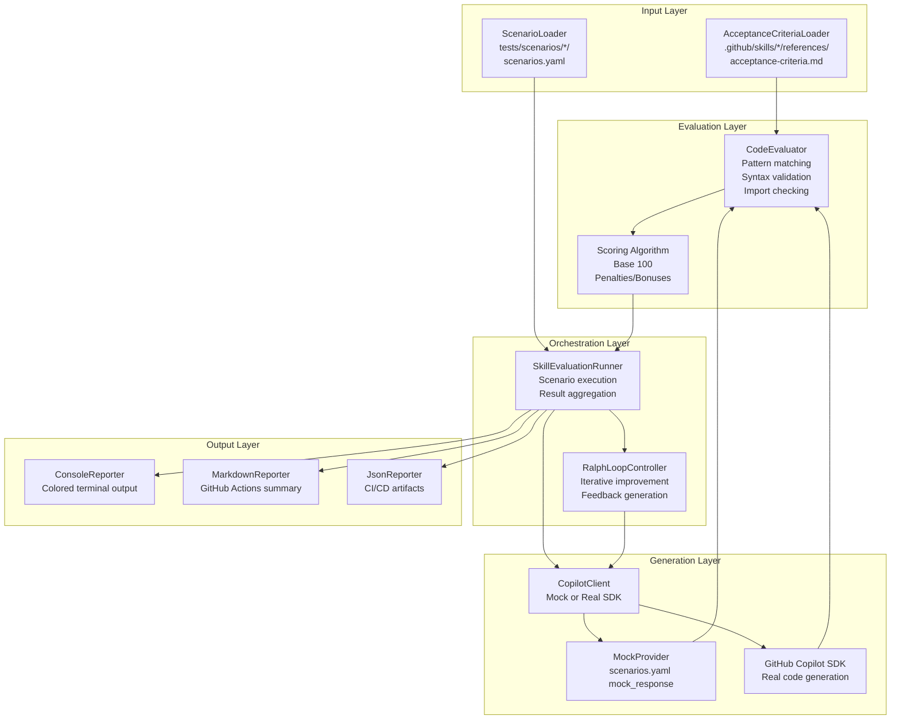

**Sources**: [tests/README.md:24-49](), [tests/AGENTS.md:118-141]()

---

## Component Architecture

### Type System

All components share a common type system defined in `tests/harness/types.ts`:

| Type | Purpose |
|------|---------|
| `AcceptanceCriteria` | Parsed correct/incorrect patterns from markdown |
| `CodePattern` | Individual code snippet with metadata |
| `ValidationRule` | Section-level validation logic |
| `EvaluationResult` | Score, findings, matched patterns |
| `Finding` | Individual issue (error/warning) |
| `ScenarioConfig` | Test scenario definition |

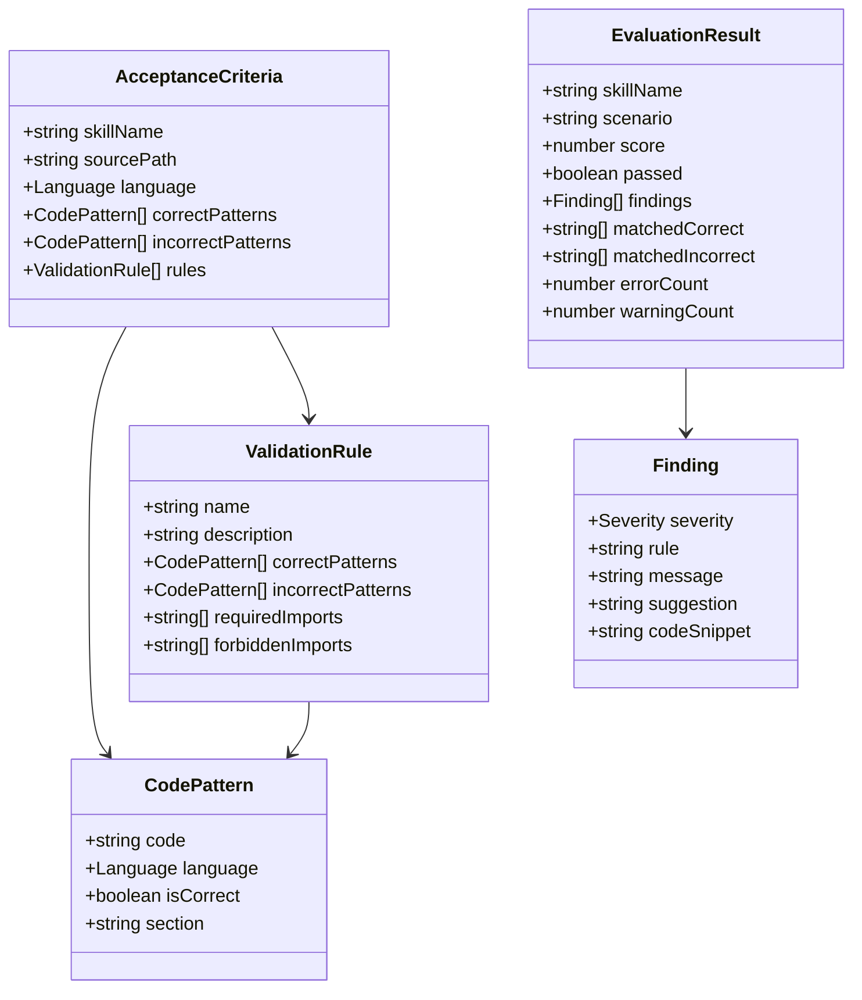

**Sources**: [tests/harness/types.ts](), [tests/harness/evaluator.ts:7-16]()

---

## AcceptanceCriteriaLoader

The `AcceptanceCriteriaLoader` class parses markdown acceptance criteria files into structured validation rules. It extracts correct and incorrect code patterns from markdown sections marked with ✅ and ❌.

### Key Methods

| Method | Responsibility |
|--------|---------------|
| `listSkillsWithCriteria()` | Scan `.github/skills/` for criteria files |
| `load(skillName)` | Parse criteria markdown into structured format |
| `extractCodePatterns()` | Extract code blocks with correct/incorrect context |
| `extractRules()` | Build validation rules per section |

### Parsing Algorithm

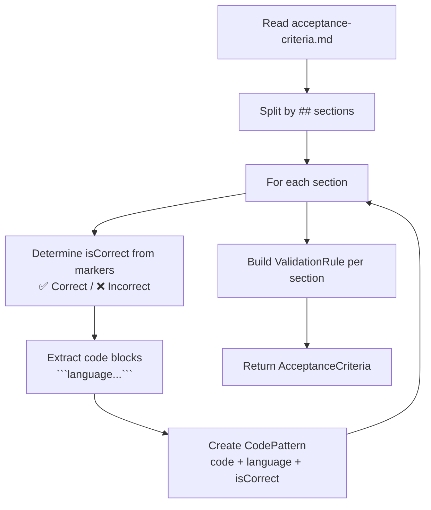

The loader implements **contextual pattern detection**: it examines the 200 characters preceding each code block to determine if the pattern is correct or incorrect based on emoji markers (✅/❌) and keywords ("Correct"/"Incorrect").

**Sources**: [tests/harness/criteria-loader.ts:34-100](), [tests/harness/criteria-loader.ts:136-176](), [tests/harness/criteria-loader.ts:206-236]()

---

## CodeEvaluator

The `CodeEvaluator` class validates generated code against acceptance criteria using pattern matching, syntax checking, and import validation. It implements asymmetric matching strategies: flexible for correct patterns, strict for incorrect patterns.

### Architecture

```mermaid
graph TB
    subgraph "CodeEvaluator"
        COMPILE["compilePatterns()<br/>Pre-compile regex patterns"]
        EVALUATE["evaluate(code, scenario)<br/>Main entry point"]
        SYNTAX["checkSyntax()<br/>Language-specific validation"]
        IMPORTS["checkImports()<br/>Import combination validation"]
        INCORRECT["checkIncorrectPatterns()<br/>Strict exact matching"]
        CORRECT["checkCorrectPatterns()<br/>Flexible fuzzy matching"]
        RULES["checkRule()<br/>Rule-specific validation"]
        SCORE["calculateScore()<br/>Base 100 with penalties"]
    end
    
    COMPILE --> EVALUATE
    EVALUATE --> SYNTAX
    SYNTAX --> IMPORTS
    IMPORTS --> INCORRECT
    INCORRECT --> CORRECT
    CORRECT --> RULES
    RULES --> SCORE
```

### Syntax Validation by Language

| Language | Method | Validation Strategy |
|----------|--------|-------------------|
| TypeScript | `checkTypeScriptSyntax()` | `ts.transpileModule()` with syntax-only checking |
| Python | `checkBracketBalance()` | Parentheses, brackets, braces counting |
| C#/Java | `checkBracketBalance()` | Same bracket balance check |

The TypeScript validator uses the TypeScript compiler API with `isolatedModules: true` to perform syntax-only checking without module resolution, preventing false errors from Azure SDK imports.

**Sources**: [tests/harness/evaluator.ts:40-146](), [tests/harness/evaluator.ts:150-251](), [tests/harness/evaluator.ts:257-295]()

### Import Validation

Import checking implements **combination detection**: for incorrect patterns with multiple import lines, ALL imports must be present together before flagging as incorrect. This prevents false positives where a valid import appears in code but isn't actually being misused.

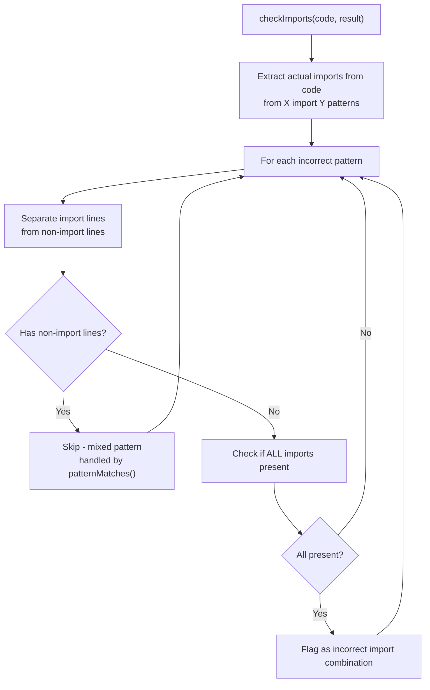

**Critical fix**: Lines [tests/harness/evaluator.ts:365-372]() implement the check that skips mixed patterns (import + misuse) in import validation, allowing them to be handled by `patternMatches()` which correctly requires all parts to match.

**Sources**: [tests/harness/evaluator.ts:298-389](), [tests/AGENTS.md:325-419]()

### Pattern Matching Strategy

The evaluator implements **asymmetric matching**:

| Pattern Type | Matching Strategy | Reason |
|-------------|------------------|---------|
| Correct patterns | FLEXIBLE - allows variations | Documentation examples may differ in formatting |
| Incorrect patterns | EXACT - requires all lines | Must match complete anti-pattern to avoid false positives |
| Import-only incorrect | ALL imports must match | Catches wrong import combinations |
| Mixed patterns (import + misuse) | BOTH parts must match | Prevents flagging valid imports used correctly |

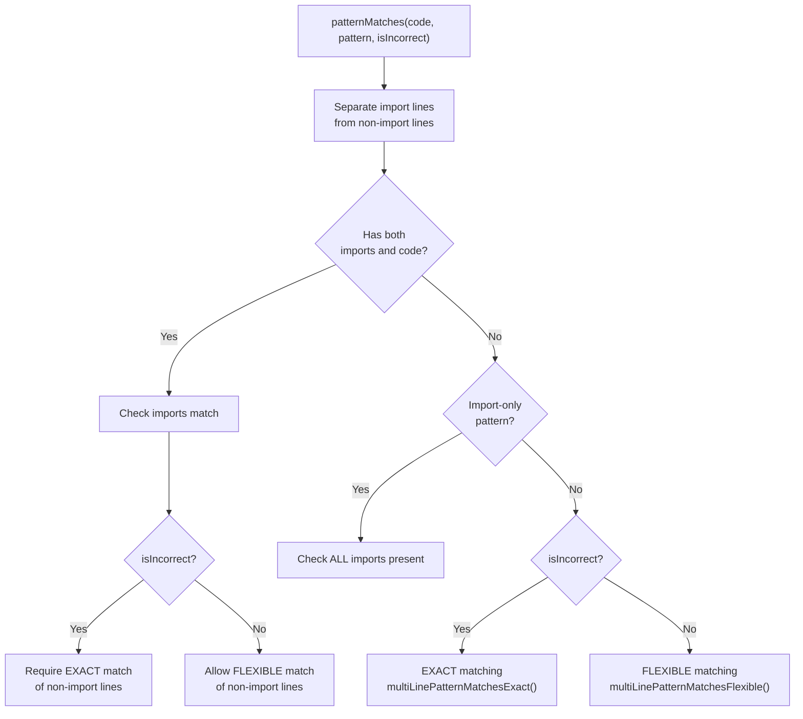

**Sources**: [tests/harness/evaluator.ts:474-536](), [tests/harness/evaluator.ts:609-645](), [tests/harness/evaluator.ts:647-692]()

---

## CopilotClient

The `CopilotClient` class abstracts code generation with dual-mode support: mock responses (fast, deterministic) and real GitHub Copilot SDK (accurate, rate-limited).

### Mode Selection

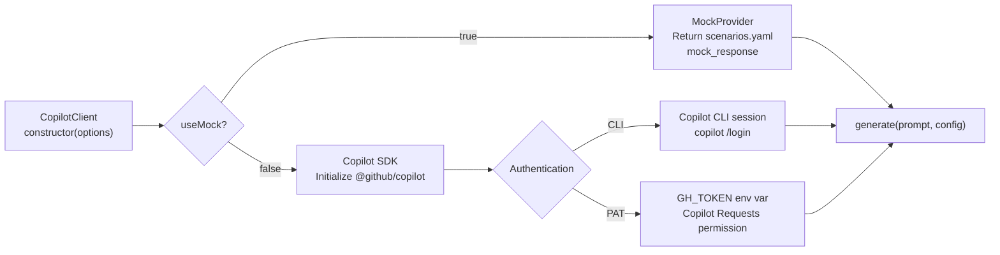

### Authentication Methods

| Environment | Method | Configuration |
|------------|--------|---------------|
| Local development | Copilot CLI | User runs `copilot /login` |
| CI/CD (GitHub Actions) | Personal Access Token | `GH_TOKEN` or `GITHUB_TOKEN` with "Copilot Requests" permission |
| PR smoke tests | Mock mode | No authentication needed |

**Sources**: [tests/README.md:212-231](), [.github/workflows/skill-evaluation.yml:32-57]()

---

## SkillEvaluationRunner

The `SkillEvaluationRunner` orchestrates the complete evaluation pipeline: loading scenarios, generating code, evaluating results, and producing reports.

### Execution Flow

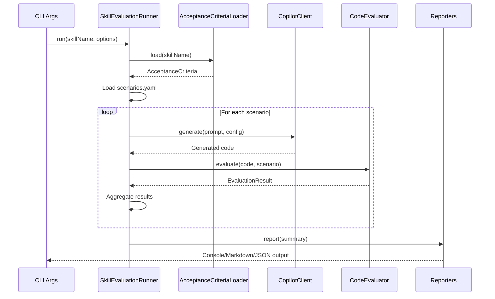

### CLI Options

| Flag | Purpose | Default |
|------|---------|---------|
| `--mock` | Use mock responses instead of Copilot SDK | false |
| `--verbose` | Show detailed output | false |
| `--filter <pattern>` | Filter scenarios by name/tag | none |
| `--output <format>` | Output format: text/markdown/json | text |
| `--output-file <path>` | Write results to file | none |
| `--ralph` | Enable Ralph Loop iterative improvement | false |
| `--max-iterations <n>` | Max Ralph Loop iterations | 5 |
| `--threshold <n>` | Quality threshold for Ralph Loop | 80 |

**Sources**: [tests/README.md:52-70](), [tests/harness/runner.ts]()

---

## Dual-Track Testing Strategy

The test harness implements two distinct testing modes with different trade-offs:

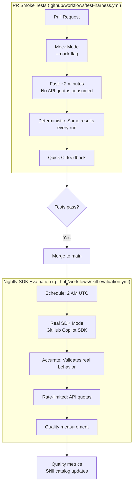

### Mode Comparison

| Aspect | Mock Mode | Real SDK Mode |
|--------|-----------|---------------|
| **Speed** | ~2 minutes for all skills | ~15-30 minutes |
| **Accuracy** | Validates criteria logic | Validates Copilot behavior |
| **Determinism** | Identical results | May vary by model/temperature |
| **API Quota** | Zero | Consumed per generation |
| **Use Case** | PR validation, development | Quality measurement, regression detection |
| **Trigger** | Every PR/push | Nightly, manual dispatch |

### Mock Response Design

Mock responses in `scenarios.yaml` files are hand-crafted to:

1. **Pass all checks**: Contain all expected patterns, avoid forbidden patterns
2. **Be realistic**: Represent what a well-configured agent would generate
3. **Cover edge cases**: Include correct syntax, imports, cleanup

**Sources**: [tests/README.md:4-10](), [.github/workflows/test-harness.yml:1-4](), [.github/workflows/skill-evaluation.yml:1-27]()

---

## Scoring Algorithm

The evaluation scoring system starts with a base of 100 points and applies penalties and bonuses based on findings and pattern matches.

### Penalty System

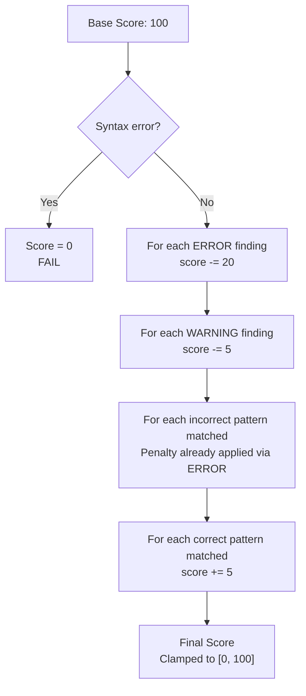

### Scoring Table

| Factor | Impact | Severity |
|--------|--------|----------|
| Syntax error | Score = 0 | FAIL |
| Incorrect pattern found | -20 (via ERROR finding) | ERROR |
| Missing import requirement | -20 | ERROR |
| Forbidden import used | -20 | ERROR |
| Warning finding | -5 | WARNING |
| Correct pattern matched | +5 | BONUS |

### Pass/Fail Determination

A result **passes** if and only if:
- `result.findings` contains no findings with `severity === Severity.ERROR`
- Syntax is valid
- No incorrect patterns are present

Score value is informational but does not determine pass/fail. A result can have score 65 and still pass if all findings are warnings, not errors.

**Sources**: [tests/harness/evaluator.ts:694-713](), [tests/README.md:175-185]()

---

## GitHub Actions Integration

### Workflow: test-harness.yml (PR Smoke Tests)

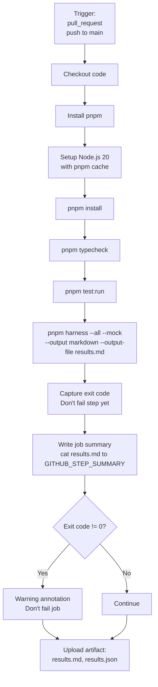

The smoke test workflow runs in **informational mode**: it reports failures as warnings but doesn't block PRs. This allows development to continue while surfacing quality issues.

**Sources**: [.github/workflows/test-harness.yml:1-96]()

### Workflow: skill-evaluation.yml (Nightly SDK Tests)

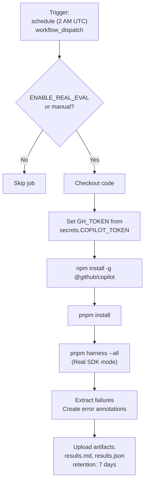

This workflow validates skills against real Copilot SDK behavior, providing accurate quality metrics but consuming API quotas.

**Inputs**:
- `skill`: Optional skill name (leave empty for all)
- `ralph`: Enable Ralph Loop
- `threshold`: Quality threshold (0-100)
- `max_iterations`: Max Ralph Loop iterations

**Sources**: [.github/workflows/skill-evaluation.yml:1-169]()

---

## Reporter System

The harness supports multiple output formats for different consumers:

### ConsoleReporter

Colored terminal output with pass/fail indicators, scores, and findings.

```
✓ azure-ai-projects-py: basic_usage (Score: 100.0) PASS
✗ azure-cosmos-db-py: async_operations (Score: 65.0) FAIL
  ERROR: Incorrect import combination: from azure.cosmos import CosmosClient
  WARNING: Missing recommended pattern: async with client:
```

### MarkdownReporter

GitHub-flavored markdown for Actions job summaries:

```markdown
## Evaluation Results

| Skill | Passed | Failed | Score |
|-------|--------|--------|-------|
| azure-ai-projects-py | 12 | 0 | 95.5 |
| azure-cosmos-db-py | 8 | 4 | 73.2 |

### Failed Scenarios

#### azure-cosmos-db-py: async_operations (Score: 65.0)
- ❌ ERROR: Incorrect import combination
- ⚠️ WARNING: Missing context manager
```

### JsonReporter

Machine-readable format for CI/CD integration:

```json
{
  "summary": {
    "totalSkills": 2,
    "totalScenarios": 16,
    "passed": 20,
    "failed": 4,
    "averageScore": 84.35
  },
  "skills": [
    {
      "skill_name": "azure-ai-projects-py",
      "results": [...]
    }
  ]
}
```

**Sources**: [tests/harness/reporters/console.ts](), [tests/harness/reporters/markdown.ts](), [tests/README.md:32-40]()

---

## Test Coverage

Current test coverage across the skill catalog:

| Language | Skills | Scenarios | Coverage |
|----------|--------|-----------|----------|
| Core | 5 | 51 | 100% |
| Python | 41 | 333 | ~90% |
| .NET | 28 | 286 | ~85% |
| TypeScript | 23 | 249 | ~80% |
| Java | 26 | 195 | ~75% |
| **Total** | **123** | **1114** | **~85%** |

Skills have acceptance criteria in `.github/skills/<skill>/references/acceptance-criteria.md` and test scenarios in `tests/scenarios/<skill>/scenarios.yaml`.

**Sources**: [tests/README.md:187-200]()

---

