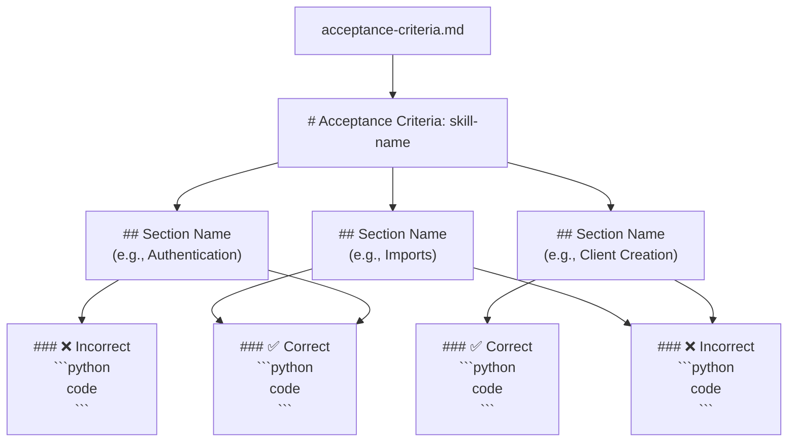
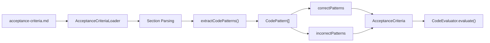
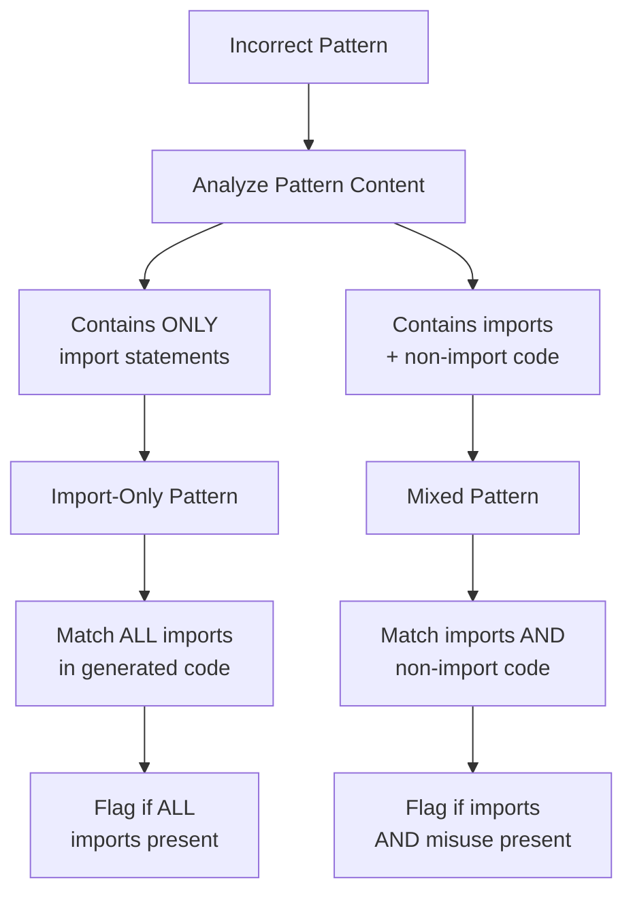
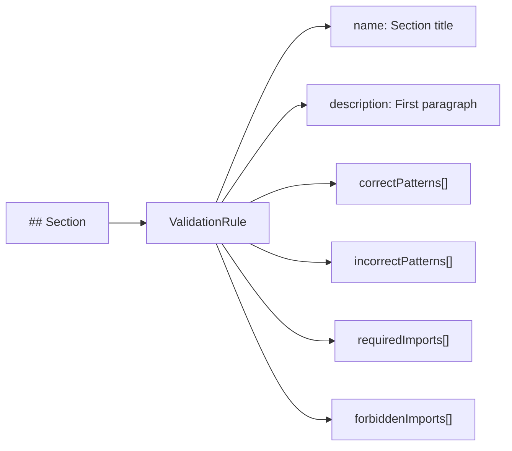

<!-- source: DeepWiki mcp.deepwiki.com · repo microsoft/skills · page 4.2 Acceptance Criteria Format · fetched 2026-10-30 -->

# Acceptance Criteria Format

<details>
<summary>Relevant source files</summary>

The following files were used as context for generating this wiki page:

- [.github/agents/scaffolder.agent.md](.github/agents/scaffolder.agent.md)
- [.github/copilot-instructions.md](.github/copilot-instructions.md)
- [.github/docs/agent-integration.md](.github/docs/agent-integration.md)
- [.github/plugins/azure-sdk-python/skills/azure-ai-language-conversations-py/SKILL.md](.github/plugins/azure-sdk-python/skills/azure-ai-language-conversations-py/SKILL.md)
- [.github/plugins/azure-sdk-python/skills/azure-ai-language-conversations-py/references/acceptance-criteria.md](.github/plugins/azure-sdk-python/skills/azure-ai-language-conversations-py/references/acceptance-criteria.md)
- [.github/prompts/scaffold-foundry-app.prompt.md](.github/prompts/scaffold-foundry-app.prompt.md)
- [.github/skills/skill-creator/references/acceptance-criteria.md](.github/skills/skill-creator/references/acceptance-criteria.md)
- [.gitignore](.gitignore)
- [Agents.md](Agents.md)
- [context7.json](context7.json)
- [docs-site/src/components/HookCard.astro](docs-site/src/components/HookCard.astro)
- [docs-site/src/data/hooks.json](docs-site/src/data/hooks.json)
- [docs/_astro/index.CktZY-PF.css](docs/_astro/index.CktZY-PF.css)
- [tests/AGENTS.md](tests/AGENTS.md)
- [tests/README.md](tests/README.md)
- [tests/harness/criteria-loader.ts](tests/harness/criteria-loader.ts)
- [tests/scenarios/skill-creator/scenarios.yaml](tests/scenarios/skill-creator/scenarios.yaml)

</details>


This document defines the structure and syntax of `acceptance-criteria.md` files, which specify validation patterns for AI-generated code in the test harness. These files document correct SDK usage patterns and common anti-patterns, enabling automated quality evaluation through pattern matching.

For information about creating test scenarios that reference these criteria, see [Test Scenarios YAML Format](#4.3). For details on how the evaluator uses these patterns, see [Scoring Algorithm and Pattern Matching](#4.6).

---

## Purpose and Scope

Acceptance criteria files serve as machine-readable API documentation that defines:

- **Correct patterns**: Expected SDK usage (imports, authentication, client creation)
- **Incorrect patterns**: Anti-patterns and common mistakes (wrong import paths, hardcoded credentials)
- **Import distinctions**: Module path differences critical for multi-package SDKs
- **Validation rules**: Structured requirements that feed the `CodeEvaluator`

These files are parsed by `AcceptanceCriteriaLoader` and used by `CodeEvaluator` to score generated code on a 0-100 scale.

**Sources:** [tests/README.md:122-140](), [tests/harness/criteria-loader.ts:1-10]()

---

## File Location and Naming

Acceptance criteria files must be located at:

```
.github/skills/<skill-name>/references/acceptance-criteria.md
```

The filename is fixed (`acceptance-criteria.md`) and must exist in the `references/` subdirectory of a skill folder for the test harness to discover it.

**Example paths:**
- `.github/skills/azure-ai-projects-py/references/acceptance-criteria.md`
- `.github/skills/azure-cosmos-db-py/references/acceptance-criteria.md`
- `.github/skills/fastapi-router-py/references/acceptance-criteria.md`

**Sources:** [tests/harness/criteria-loader.ts:27-28](), [tests/AGENTS.md:28-54]()

---

## File Structure



**Title Format**

The first line must be an H1 header:

```markdown
# Acceptance Criteria: <skill-name>
```

**Section Format**

Each section uses an H2 header (`##`) followed by subsections for correct and incorrect patterns:

```markdown
## Section Name

### ✅ Correct
```language
# correct code
```

### ❌ Incorrect
```language
# incorrect code
```
```

**Sources:** [tests/harness/criteria-loader.ts:36-49](), [.github/skills/skill-creator/references/acceptance-criteria.md:1-17]()

---

## Pattern Extraction Process



The `AcceptanceCriteriaLoader.parseCriteria()` method processes the markdown file:

1. **Split by sections**: Content is divided at `## ` boundaries
2. **Extract code blocks**: Regex `/```(\w+)?\n([\s\S]*?)```/g` captures fenced code
3. **Determine correctness**: Context markers (`✅`, `❌`, "Correct", "Incorrect") classify each pattern
4. **Create CodePattern objects**: Each code block becomes a structured pattern with metadata

**Sources:** [tests/harness/criteria-loader.ts:103-131](), [tests/harness/criteria-loader.ts:133-176]()

---

## CodePattern Type Structure

Each extracted pattern is represented by a `CodePattern` object:

| Field | Type | Description |
|-------|------|-------------|
| `code` | `string` | The code content from the fenced block |
| `language` | `Language` | Programming language (`python`, `typescript`, etc.) |
| `isCorrect` | `boolean` | `true` for correct patterns, `false` for incorrect |
| `section` | `string` | The section name (H2 header text) |

**Sources:** [tests/harness/types.ts](), [tests/harness/criteria-loader.ts:168-173]()

---

## Correct Patterns

Correct patterns document expected usage. They are matched **flexibly** by the evaluator — the generated code doesn't need to match exactly, but should contain the key elements.

### Format

```markdown
## Authentication

### ✅ Correct
```python
from azure.identity import DefaultAzureCredential
from azure.ai.projects import AIProjectClient

credential = DefaultAzureCredential()
client = AIProjectClient(
    endpoint=os.environ["PROJECT_ENDPOINT"],
    credential=credential
)
```
```

### Matching Behavior

The evaluator checks if the generated code contains the pattern's key elements:
- Import statements (module paths and names)
- Key class/function names (`DefaultAzureCredential`, `AIProjectClient`)
- Method calls and parameters

**Bonus scoring**: Each matched correct pattern adds **+5 points** to the evaluation score.

**Sources:** [tests/harness/evaluator.ts](), [tests/README.md:175-183]()

---

## Incorrect Patterns: Import-Only vs Mixed

The evaluator distinguishes between two types of incorrect patterns based on their content. This distinction prevents false positives when imports are valid in one context but misused in another.



### Import-Only Patterns

These show **wrong import paths** where the import itself is the error:

```markdown
### ❌ Incorrect: Wrong import path
```python
# WRONG - clients are in azure.ai.contentsafety, not models
from azure.ai.contentsafety.models import ContentSafetyClient
```
```

**Matching logic**: If **ALL** imports in the pattern are present in the generated code, it's flagged as incorrect. No non-import code needs to match.

**Implementation**: The evaluator's `hasOnlyImports()` function checks if the pattern contains only `import` or `from...import` statements.

### Mixed Patterns

These show a **valid import being misused**:

```markdown
### ❌ Incorrect: Using text models for image analysis
```python
# WRONG - AnalyzeTextOptions is for text, not images
from azure.ai.contentsafety.models import AnalyzeTextOptions

request = AnalyzeTextOptions(text="image.jpg")
response = client.analyze_image(request)  # <-- The actual error
```
```

**Matching logic**: **BOTH** the imports **AND** the non-import code (showing the misuse) must be present. This prevents false positives when the import is used correctly.

**Rationale**: Without this distinction, valid code like this would be incorrectly flagged:

```python
from azure.ai.contentsafety.models import AnalyzeTextOptions
request = AnalyzeTextOptions(text="Hello")
response = client.analyze_text(request)  # CORRECT usage
```

**Sources:** [tests/AGENTS.md:324-390](), [tests/AGENTS.md:392-420]()

---

## Pattern Matching Implementation

The evaluator implements asymmetric matching strategies in `CodeEvaluator.evaluate()`:

### For Correct Patterns (Flexible Matching)

```typescript
// From evaluator.ts
for (const pattern of correctPatterns) {
  if (patternMatches(code, pattern, { flexible: true })) {
    score += 5;
    findings.push({
      type: 'bonus',
      message: `Matched correct pattern: ${pattern.section}`,
      pattern: pattern.code
    });
  }
}
```

Flexible matching allows variations in:
- Whitespace and formatting
- Variable names
- Order of statements (within reason)

### For Incorrect Patterns (Strict Matching)

```typescript
// Import-only patterns
if (hasOnlyImports(pattern)) {
  if (checkImports(code, pattern, { requireAll: true })) {
    score -= 15;
    findings.push({
      severity: 'error',
      message: `Incorrect import pattern found`,
      pattern: pattern.code
    });
  }
}
// Mixed patterns
else {
  if (checkImports(code, pattern, { requireAll: true }) && 
      containsNonImportCode(code, pattern)) {
    score -= 15;
    findings.push({
      severity: 'error',
      message: `Incorrect usage pattern found`,
      pattern: pattern.code
    });
  }
}
```

**Penalty**: Each matched incorrect pattern deducts **-15 points**.

**Sources:** [tests/README.md:175-183](), [tests/AGENTS.md:425-429]()

---

## Integration with Validation Rules

The `AcceptanceCriteriaLoader` also extracts structured `ValidationRule` objects from sections:



### ValidationRule Fields

| Field | Type | Source | Purpose |
|-------|------|--------|---------|
| `name` | `string` | H2 header text | Rule identifier |
| `description` | `string` | First paragraph after header | Human-readable explanation |
| `correctPatterns` | `CodePattern[]` | All `✅ Correct` blocks in section | Expected patterns |
| `incorrectPatterns` | `CodePattern[]` | All `❌ Incorrect` blocks in section | Anti-patterns |
| `requiredImports` | `string[]` | Extracted from correct patterns | Must-have imports |
| `forbiddenImports` | `string[]` | Extracted from incorrect patterns | Must-not-have imports |

**Sources:** [tests/harness/types.ts](), [tests/harness/criteria-loader.ts:238-282]()

---

## Example: Complete Acceptance Criteria File

Here's a minimal but complete example showing the format:

```markdown
# Acceptance Criteria: azure-cosmos-db-py

## Imports

### ✅ Correct
```python
from azure.cosmos import CosmosClient
from azure.identity import DefaultAzureCredential
```

### ❌ Incorrect: Wrong import path
```python
# WRONG - CosmosClient is not in models
from azure.cosmos.models import CosmosClient
```

## Authentication

### ✅ Correct
```python
from azure.identity import DefaultAzureCredential
from azure.cosmos import CosmosClient
import os

credential = DefaultAzureCredential()
client = CosmosClient(
    url=os.environ["COSMOS_ENDPOINT"],
    credential=credential
)
```

### ❌ Incorrect: Hardcoded credentials
```python
# NEVER hardcode connection strings
client = CosmosClient(
    url="https://my-account.documents.azure.com:443/",
    credential="hardcoded-key"
)
```

## Container Operations

### ✅ Correct
```python
database = client.get_database_client("my-database")
container = database.get_container_client("items")

# Upsert with partition key
item = {"id": "1", "category": "test", "name": "example"}
container.upsert_item(item)
```

### ❌ Incorrect: Missing partition key
```python
# WRONG - partition_key is required for deletes
container.delete_item(item="1")  # Missing partition_key parameter
```
```

**This file demonstrates:**
- Import-only incorrect pattern (wrong module path)
- Mixed incorrect pattern (valid imports + hardcoded credentials)
- Multiple sections organized by feature area
- Comments explaining why each pattern is incorrect

**Sources:** [.github/skills/skill-creator/references/acceptance-criteria.md:1-68](), [.github/plugins/azure-sdk-python/skills/azure-ai-language-conversations-py/references/acceptance-criteria.md]()

---

## Writing Guidelines

### Section Organization

Organize sections by feature area, not by correctness:

✅ **Do this:**
```
## Authentication
  ✅ Correct
  ❌ Incorrect

## Client Creation
  ✅ Correct
  ❌ Incorrect
```

❌ **Don't do this:**
```
## Correct Patterns
  Authentication
  Client Creation

## Incorrect Patterns
  Authentication
  Client Creation
```

### Pattern Specificity

**Import-only patterns** should show **only** the incorrect import:

```markdown
### ❌ Incorrect
```python
from azure.ai.agents.models import Agent  # WRONG - Agent is in main module
```
```

**Mixed patterns** should show **complete context** with the misuse:

```markdown
### ❌ Incorrect
```python
from azure.ai.contentsafety.models import AnalyzeTextOptions

# WRONG - text options used for image analysis
request = AnalyzeTextOptions(text="image.jpg")
response = client.analyze_image(request)
```
```

### Comments in Patterns

Always include comments explaining **why** something is incorrect:

```python
# WRONG - clients are in azure.ai.contentsafety, not models submodule
from azure.ai.contentsafety.models import ContentSafetyClient
```

This helps both human readers and serves as documentation for the pattern.

**Sources:** [.github/skills/skill-creator/references/acceptance-criteria.md:69-89](), [tests/AGENTS.md:392-420]()

---

## Common Pitfalls

| Pitfall | Impact | Solution |
|---------|--------|----------|
| Missing `✅`/`❌` markers | Loader can't determine correctness | Always prefix subsections with emoji markers |
| Import + misuse shown separately | False positives for valid uses | Show complete context in one code block |
| Empty incorrect sections | No validation occurs | Document at least one anti-pattern per section |
| Too many patterns in one section | Difficult to debug failures | Split into multiple focused sections |
| Language mismatch in code blocks | Parser skips blocks | Ensure ` ```python ` matches skill language |
| Missing comments in incorrect patterns | Unclear why pattern is wrong | Always explain with `# WRONG - ...` comments |

**Sources:** [tests/AGENTS.md:422-429]()

---

## Files and Functions Reference

### Key Files

| File | Role |
|------|------|
| [tests/harness/criteria-loader.ts]() | Parses acceptance-criteria.md files |
| [tests/harness/evaluator.ts]() | Evaluates code against patterns |
| [tests/harness/types.ts]() | Type definitions for `AcceptanceCriteria`, `CodePattern`, `ValidationRule` |
| [.github/skills/*/references/acceptance-criteria.md]() | Individual skill criteria files |

### Key Functions

| Function | Location | Purpose |
|----------|----------|---------|
| `AcceptanceCriteriaLoader.load()` | [criteria-loader.ts:91-100]() | Load criteria for a skill |
| `AcceptanceCriteriaLoader.parseCriteria()` | [criteria-loader.ts:105-131]() | Parse markdown into structured criteria |
| `AcceptanceCriteriaLoader.extractCodePatterns()` | [criteria-loader.ts:136-176]() | Extract code blocks with context |
| `AcceptanceCriteriaLoader.determineCorrectness()` | [criteria-loader.ts:207-236]() | Classify pattern as correct/incorrect |
| `CodeEvaluator.evaluate()` | [evaluator.ts]() | Score code against patterns |

**Sources:** [tests/harness/criteria-loader.ts:1-436](), [tests/README.md:90-118]()

---

