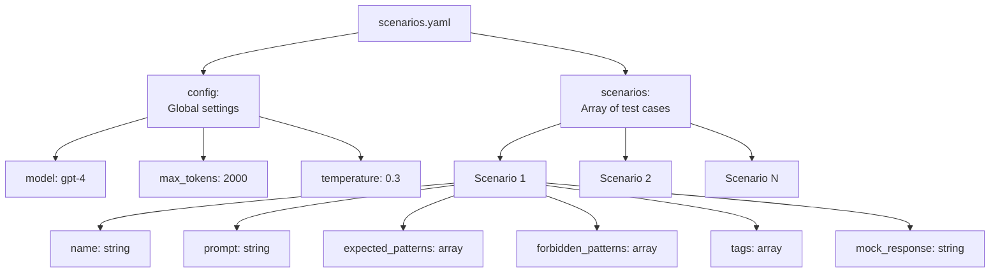
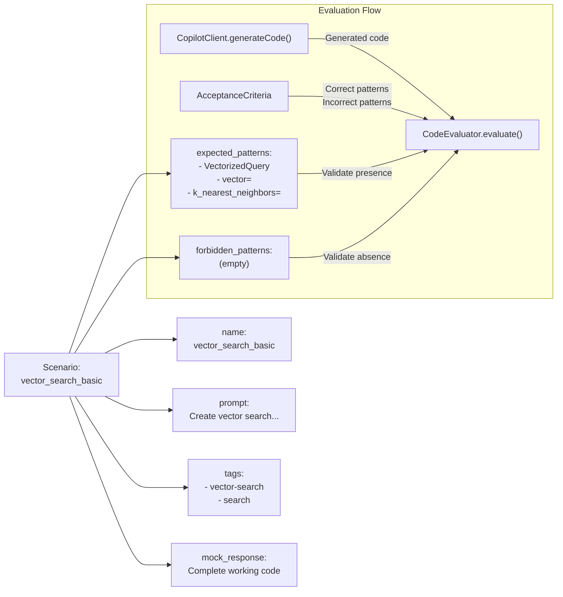
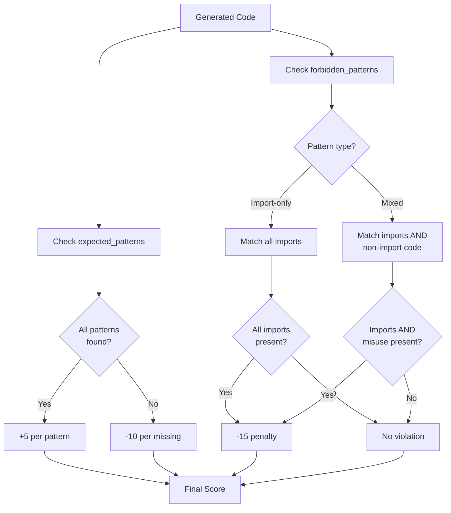
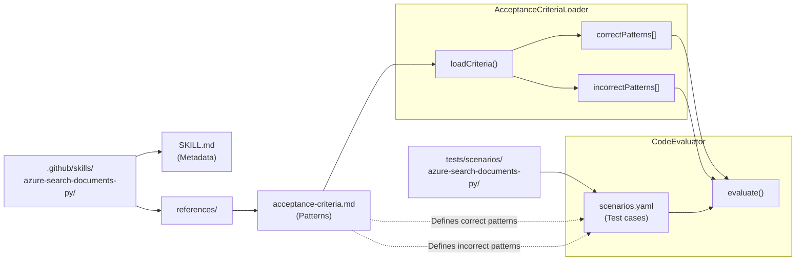
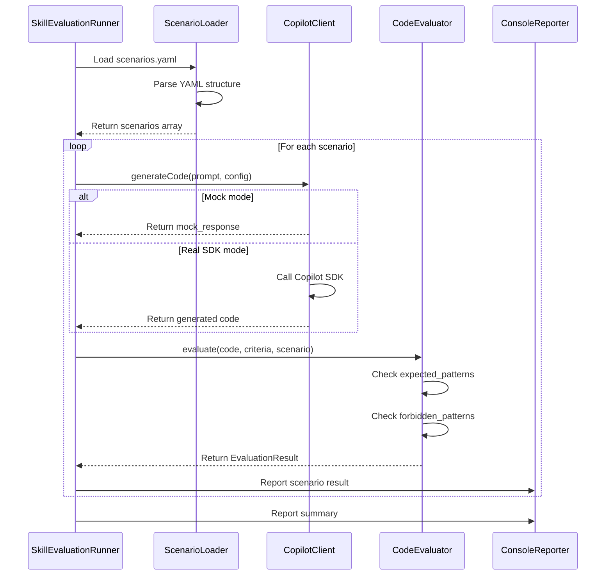

<!-- source: DeepWiki mcp.deepwiki.com · repo microsoft/skills · page 4.3 Test Scenarios YAML Format · fetched 2026-10-30 -->

# Test Scenarios YAML Format

<details>
<summary>Relevant source files</summary>

The following files were used as context for generating this wiki page:

- [.github/plugins/azure-sdk-python/skills/azure-ai-language-conversations-py/SKILL.md](.github/plugins/azure-sdk-python/skills/azure-ai-language-conversations-py/SKILL.md)
- [.github/plugins/azure-sdk-python/skills/azure-ai-language-conversations-py/references/acceptance-criteria.md](.github/plugins/azure-sdk-python/skills/azure-ai-language-conversations-py/references/acceptance-criteria.md)
- [.gitignore](.gitignore)
- [docs-site/scripts/extract-skills.ts](docs-site/scripts/extract-skills.ts)
- [docs-site/src/components/HookCard.astro](docs-site/src/components/HookCard.astro)
- [docs-site/src/components/SkillDetailModal.tsx](docs-site/src/components/SkillDetailModal.tsx)
- [docs-site/src/components/SkillsSection.tsx](docs-site/src/components/SkillsSection.tsx)
- [docs-site/src/data/hooks.json](docs-site/src/data/hooks.json)
- [docs/_astro/SkillsSection.DSKr3JQZ.js](docs/_astro/SkillsSection.DSKr3JQZ.js)
- [docs/_astro/index.CktZY-PF.css](docs/_astro/index.CktZY-PF.css)
- [tests/AGENTS.md](tests/AGENTS.md)
- [tests/README.md](tests/README.md)
- [tests/scenarios/azure-search-documents-py/scenarios.yaml](tests/scenarios/azure-search-documents-py/scenarios.yaml)

</details>


## Purpose and Scope

This document defines the structure and requirements for `scenarios.yaml` files used by the test harness to evaluate AI-generated code against acceptance criteria. Each scenarios file contains prompts, expected patterns, forbidden patterns, and mock responses for testing a specific skill. For information about the acceptance criteria that scenarios validate against, see [Acceptance Criteria Format](#4.2). For executing scenarios, see [Running Evaluations](#4.4).

Sources: [tests/README.md:1-246](), [tests/AGENTS.md:1-444]()

---

## File Location and Naming

Scenario files are located at `tests/scenarios/<skill-name>/scenarios.yaml`, where `<skill-name>` matches the corresponding skill directory in `.github/skills/` or `.github/plugins/*/skills/`.

**Directory structure:**
```
tests/scenarios/
├── azure-ai-projects-py/
│   └── scenarios.yaml
├── azure-search-documents-py/
│   └── scenarios.yaml
└── <skill-name>/
    └── scenarios.yaml
```

The harness discovers scenarios by matching skill names. If `acceptance-criteria.md` exists for a skill at `.github/skills/<skill-name>/references/acceptance-criteria.md`, the runner will look for scenarios at `tests/scenarios/<skill-name>/scenarios.yaml`.

Sources: [tests/README.md:23-49](), [tests/AGENTS.md:58-62]()

---

## YAML Structure Overview

Each `scenarios.yaml` file contains two top-level keys: `config` and `scenarios`.



Sources: [tests/scenarios/azure-search-documents-py/scenarios.yaml:1-496](), [tests/AGENTS.md:60-90]()

---

## Config Section

The `config` section defines global settings for all scenarios in the file.

**Schema:**

| Field | Type | Required | Description |
|-------|------|----------|-------------|
| `model` | string | Yes | LLM model identifier (e.g., `gpt-4`, `gpt-4o`) |
| `max_tokens` | integer | Yes | Maximum tokens in generated response |
| `temperature` | float | Yes | Sampling temperature (0.0-1.0) |

**Example:**
```yaml
config:
  model: gpt-4
  max_tokens: 2000
  temperature: 0.3
```

**Usage in harness:**
- The `CopilotClient` class passes these values to the Copilot SDK when generating code
- In mock mode (`--mock` flag), these values are logged but not used
- Lower temperature (0.1-0.3) produces more deterministic output suitable for testing

Sources: [tests/scenarios/azure-search-documents-py/scenarios.yaml:4-7](), [tests/README.md:62-70]()

---

## Scenarios Array

The `scenarios` array contains individual test cases. Each scenario prompts code generation and validates the output.

### Scenario Fields

| Field | Type | Required | Description |
|-------|------|----------|-------------|
| `name` | string | Yes | Unique identifier for the scenario (lowercase, underscores) |
| `prompt` | string | Yes | Instruction for the code generator |
| `expected_patterns` | array[string] | Yes | Patterns that MUST appear in generated code |
| `forbidden_patterns` | array[string] | No | Patterns that must NOT appear in generated code |
| `tags` | array[string] | No | Categories for filtering (e.g., `basic`, `async`, `advanced`) |
| `mock_response` | string | Yes | Pre-written code used in mock mode |

Sources: [tests/AGENTS.md:68-90]()

### Field Details

#### `name`

Unique identifier within the scenarios file. Used for:
- CLI filtering: `pnpm harness <skill> --filter <name>`
- Test result reporting
- Debugging and tracing

**Conventions:**
- Use lowercase with underscores: `basic_client_setup`, `vector_search_basic`
- Descriptive of the feature being tested
- No spaces or special characters

Sources: [tests/scenarios/azure-search-documents-py/scenarios.yaml:11-45]()

#### `prompt`

Natural language instruction for the code generator. The prompt should:
- Be clear and specific about requirements
- Include context about what to build
- Mention key classes, methods, or patterns to use
- Use block scalar (`|`) for multi-line prompts

**Example:**
```yaml
prompt: |
  Create a basic Azure AI Search client using SearchClient with proper
  authentication. Include connecting to an existing search index and
  executing a simple search query.
```

Sources: [tests/scenarios/azure-search-documents-py/scenarios.yaml:12-15](), [tests/AGENTS.md:69-71]()

#### `expected_patterns`

Array of strings that MUST appear in the generated code. Patterns are matched:
- Case-sensitively
- Using substring matching (flexible)
- Against the entire generated code

**Pattern types:**
- Import statements: `"from azure.search.documents import SearchClient"`
- Class usage: `"SearchClient"`, `"DefaultAzureCredential"`
- Method calls: `"client.search"`, `"upload_documents"`
- Variable patterns: `"endpoint="`, `"credential="`

**Example:**
```yaml
expected_patterns:
  - "DefaultAzureCredential"
  - "SearchClient"
  - "from azure.search.documents import SearchClient"
```

Sources: [tests/scenarios/azure-search-documents-py/scenarios.yaml:16-19](), [tests/AGENTS.md:85-87]()

#### `forbidden_patterns`

Array of strings that must NOT appear in the generated code. Used to prevent:
- Wrong imports
- Deprecated methods
- Anti-patterns
- Incorrect authentication

The evaluator applies asymmetric matching:
- **Import-only patterns**: All imports must match to trigger violation
- **Mixed patterns**: Both imports AND non-import code must match

**Example:**
```yaml
forbidden_patterns:
  - "from openai"  # Wrong SDK
  - "semantic_search=True"  # Deprecated syntax
```

Sources: [tests/scenarios/azure-search-documents-py/scenarios.yaml:20-21](), [tests/AGENTS.md:337-390]()

#### `tags`

Array of strings for categorizing scenarios. Common tags:

| Tag | Purpose |
|-----|---------|
| `basic` | Fundamental usage patterns |
| `advanced` | Complex features |
| `async` | Asynchronous operations |
| `authentication` | Auth patterns |
| `client-setup` | Client initialization |
| `error-handling` | Exception handling |
| `production` | Production-ready patterns |
| `search`, `vector-search`, `hybrid-search` | Search types |
| `indexing`, `infrastructure` | Index operations |

**Usage:**
```bash
# Run only basic scenarios
pnpm harness azure-search-documents-py --filter basic --mock

# Run scenarios matching a tag or name
pnpm harness azure-search-documents-py --filter async --mock
```

Sources: [tests/scenarios/azure-search-documents-py/scenarios.yaml:22-25](), [tests/README.md:60-70]()

#### `mock_response`

Complete, working code example used when running in mock mode. This code:
- MUST pass all acceptance criteria
- MUST contain all `expected_patterns`
- MUST NOT contain any `forbidden_patterns`
- Should demonstrate best practices
- Should be production-quality

**Purpose:**
1. Fast deterministic testing during development
2. Validation that criteria are achievable
3. Reference implementation for the scenario

**Example:**
```yaml
mock_response: |
  import os
  from azure.identity import DefaultAzureCredential
  from azure.search.documents import SearchClient
  
  endpoint = os.environ["SEARCH_ENDPOINT"]
  index_name = os.environ["SEARCH_INDEX_NAME"]
  
  client = SearchClient(
      endpoint=endpoint,
      index_name=index_name,
      credential=DefaultAzureCredential(),
  )
  
  results = client.search(search_text="python programming")
  
  for result in results:
      print(f"Score: {result['@search.score']}")
      print(f"Title: {result['title']}")
```

Sources: [tests/scenarios/azure-search-documents-py/scenarios.yaml:26-45](), [tests/AGENTS.md:79-82]()

---

## Complete Scenario Example



Sources: [tests/scenarios/azure-search-documents-py/scenarios.yaml:47-93]()

**Full YAML:**
```yaml
- name: vector_search_basic
  prompt: |
    Create a vector search example using Azure AI Search.
    Generate embeddings for a query and search using VectorizedQuery.
    Include proper vector configuration and search parameters.
  expected_patterns:
    - "VectorizedQuery"
    - "vector="
    - "k_nearest_neighbors="
    - "fields="
  forbidden_patterns: []
  tags:
    - vector-search
    - search
  mock_response: |
    import os
    from azure.identity import DefaultAzureCredential
    from azure.search.documents import SearchClient
    from azure.search.documents.models import VectorizedQuery
    
    endpoint = os.environ["SEARCH_ENDPOINT"]
    index_name = os.environ["SEARCH_INDEX_NAME"]
    
    client = SearchClient(
        endpoint=endpoint,
        index_name=index_name,
        credential=DefaultAzureCredential(),
    )
    
    # Assume you have embeddings from Azure OpenAI or similar
    query_embedding = [0.1, 0.2, 0.3, 0.4]  # Your vector
    
    search_query = VectorizedQuery(
        vector=query_embedding,
        k_nearest_neighbors=5,
        fields="content_vector"
    )
    
    results = client.search(
        search_text=None,
        vector_queries=[search_query],
    )
    
    for result in results:
        print(f"Score: {result['@search.score']}")
        print(result)
```

Sources: [tests/scenarios/azure-search-documents-py/scenarios.yaml:47-93]()

---

## Pattern Matching Behavior



### Expected Pattern Matching

The `CodeEvaluator` checks each `expected_patterns` entry using flexible substring matching:

1. Pattern is treated as a literal string
2. Code is searched for the exact substring
3. Each match adds +5 points
4. Each missing pattern adds -10 points

**Example:**
- Pattern: `"DefaultAzureCredential"`
- Matches: `from azure.identity import DefaultAzureCredential`
- Matches: `credential = DefaultAzureCredential()`
- Does not match: `default_azure_credential` (case-sensitive)

Sources: [tests/AGENTS.md:325-390]()

### Forbidden Pattern Matching

The evaluator distinguishes between two types of incorrect patterns:

**1. Import-Only Patterns (Pure Import Errors):**
```python
# Pattern in acceptance-criteria.md:
from azure.ai.contentsafety.models import ContentSafetyClient
```
- Violation occurs if ALL imports in the pattern are present
- Ignores other code context

**2. Mixed Patterns (Import + Misuse):**
```python
# Pattern in acceptance-criteria.md:
from azure.ai.contentsafety.models import AnalyzeTextOptions

request = AnalyzeTextOptions(text="image.jpg")
response = client.analyze_image(request)  # Misuse
```
- Violation occurs ONLY if BOTH imports AND non-import code are present
- Prevents false positives when import is valid but used correctly

Each violation adds -15 points.

Sources: [tests/AGENTS.md:337-390]()

---

## Linking to Acceptance Criteria

Scenarios validate against patterns defined in `acceptance-criteria.md` for the same skill.



### Pattern Derivation

**Scenario patterns should be derived from acceptance criteria:**

1. **expected_patterns**: Extract from "Correct" sections
   ```markdown
   ## Correct Import Path
   ```python
   from azure.search.documents import SearchClient
   ```
   ```
   
   Becomes:
   ```yaml
   expected_patterns:
     - "from azure.search.documents import SearchClient"
     - "SearchClient"
   ```

2. **forbidden_patterns**: Extract from "Incorrect" sections
   ```markdown
   ## Incorrect: Deprecated syntax
   ```python
   results = client.search(semantic_search=True)  # Old API
   ```
   ```
   
   Becomes:
   ```yaml
   forbidden_patterns:
     - "semantic_search=True"
   ```

Sources: [tests/AGENTS.md:26-55](), [tests/README.md:121-173]()

---

## Scenario Design Principles

### One Feature Per Scenario

Each scenario should test a single, well-defined feature or pattern:

**Good:**
```yaml
- name: basic_client_setup
  prompt: Create a basic SearchClient with DefaultAzureCredential
  
- name: vector_search_basic  
  prompt: Create a vector search using VectorizedQuery
```

**Bad:**
```yaml
- name: everything_test
  prompt: Create a client, do vector search, hybrid search, and indexing
```

### Progressive Complexity

Order scenarios from simple to complex within tags:

| Scenario | Complexity | Tags |
|----------|------------|------|
| `basic_client_setup` | Simple | `basic`, `authentication` |
| `vector_search_basic` | Medium | `vector-search` |
| `hybrid_search` | Medium-High | `hybrid-search`, `advanced` |
| `index_creation_vector` | High | `infrastructure`, `advanced` |

Sources: [tests/scenarios/azure-search-documents-py/scenarios.yaml:10-258]()

### Clear Prompts

Prompts should be specific and actionable:

**Good:**
```yaml
prompt: |
  Create a vector search example using Azure AI Search.
  Generate embeddings for a query and search using VectorizedQuery.
  Include proper vector configuration and search parameters.
```

**Bad:**
```yaml
prompt: |
  Do a search thing with vectors or whatever.
```

### Meaningful Forbidden Patterns

Forbidden patterns should catch real mistakes, not arbitrary restrictions:

**Good:**
```yaml
forbidden_patterns:
  - "from openai import"  # Wrong SDK entirely
  - "semantic_search=True"  # Deprecated parameter
```

**Bad:**
```yaml
forbidden_patterns:
  - "print"  # Arbitrary restriction
```

Sources: [tests/AGENTS.md:84-90]()

---

## Usage in Test Harness



### CLI Execution

```bash
# Load and run all scenarios
pnpm harness azure-search-documents-py --mock

# Filter by scenario name or tag
pnpm harness azure-search-documents-py --filter vector --mock

# Verbose output shows pattern matching
pnpm harness azure-search-documents-py --mock --verbose
```

### Integration Points

| Component | File | Role |
|-----------|------|------|
| `SkillEvaluationRunner` | [tests/harness/runner.ts]() | Orchestrates scenario execution |
| `ScenarioLoader` | [tests/harness/runner.ts]() | Parses `scenarios.yaml` files |
| `CopilotClient` | [tests/harness/copilot-client.ts]() | Generates code (mock or real) |
| `CodeEvaluator` | [tests/harness/evaluator.ts]() | Validates against patterns |
| `AcceptanceCriteriaLoader` | [tests/harness/criteria-loader.ts]() | Loads acceptance criteria |

Sources: [tests/README.md:23-49](), [tests/README.md:90-118]()

---

## Complete File Example

```yaml
# Test scenarios for azure-search-documents-py skill evaluation
# Each scenario tests a specific usage pattern against acceptance criteria

config:
  model: gpt-4
  max_tokens: 2000
  temperature: 0.3

scenarios:
  # Basic Client Setup
  - name: basic_client_setup
    prompt: |
      Create a basic Azure AI Search client using SearchClient with proper
      authentication. Include connecting to an existing search index and
      executing a simple search query.
    expected_patterns:
      - "DefaultAzureCredential"
      - "SearchClient"
      - "from azure.search.documents import SearchClient"
    forbidden_patterns:
      - "from openai"
    tags:
      - basic
      - authentication
      - client-setup
    mock_response: |
      import os
      from azure.identity import DefaultAzureCredential
      from azure.search.documents import SearchClient
      
      endpoint = os.environ["SEARCH_ENDPOINT"]
      index_name = os.environ["SEARCH_INDEX_NAME"]
      
      client = SearchClient(
          endpoint=endpoint,
          index_name=index_name,
          credential=DefaultAzureCredential(),
      )
      
      results = client.search(search_text="python programming")
      
      for result in results:
          print(f"Score: {result['@search.score']}")
          print(f"Title: {result['title']}")

  # Async Client Usage
  - name: async_client_usage
    prompt: |
      Create async versions of search operations using SearchClient from
      azure.search.documents.aio. Include async context managers and await calls.
    expected_patterns:
      - "from azure.search.documents.aio import SearchClient"
      - "async with"
      - "await"
    forbidden_patterns: []
    tags:
      - async
      - advanced
    mock_response: |
      import os
      import asyncio
      from azure.identity.aio import DefaultAzureCredential
      from azure.search.documents.aio import SearchClient
      
      async def search_async():
          endpoint = os.environ["SEARCH_ENDPOINT"]
          index_name = os.environ["SEARCH_INDEX_NAME"]
          
          credential = DefaultAzureCredential()
          
          async with SearchClient(
              endpoint=endpoint,
              index_name=index_name,
              credential=credential,
          ) as client:
              results = await client.search(search_text="python")
              
              async for result in results:
                  print(f"Score: {result['@search.score']}")
                  print(f"Title: {result['title']}")
      
      asyncio.run(search_async())
```

Sources: [tests/scenarios/azure-search-documents-py/scenarios.yaml:1-456]()

---

## Best Practices

### Pattern Design

| Practice | Rationale |
|----------|-----------|
| Use specific class names | `"SearchClient"` better than `"client"` |
| Include import statements | Catches wrong module paths |
| Match full method signatures | `"client.search("` vs `"search"` |
| Escape regex characters | Patterns are literal strings |

### Mock Response Quality

**Requirements:**
- Passes all `expected_patterns`
- Avoids all `forbidden_patterns`
- Uses environment variables for configuration
- Includes error handling when appropriate
- Follows SDK best practices

**Example structure:**
```python
import os
from azure.identity import DefaultAzureCredential
from azure.sdk.module import Client

# Configuration from environment
endpoint = os.environ["ENV_VAR"]

# Client initialization with context manager
client = Client(endpoint=endpoint, credential=DefaultAzureCredential())

with client:
    # Core operation
    result = client.operation(...)
    
    # Result processing
    print(result)
```

Sources: [tests/scenarios/azure-search-documents-py/scenarios.yaml:26-45]()

### Comprehensive Coverage

Ensure scenarios cover:
- Basic usage (authentication, client setup)
- Common operations (CRUD, queries)
- Advanced features (async, streaming, batch)
- Error handling patterns
- Production-ready code

### Validation During Development

```bash
# Step 1: Write scenario
vim tests/scenarios/my-skill/scenarios.yaml

# Step 2: Verify mock response passes
pnpm harness my-skill --mock --verbose --filter my_scenario

# Step 3: Check all scenarios
pnpm harness my-skill --mock

# Step 4: Verify real SDK (if available)
pnpm harness my-skill --verbose --filter my_scenario
```

Sources: [tests/AGENTS.md:92-108]()

---

## Common Mistakes

### Overly Broad Patterns

**Problem:**
```yaml
expected_patterns:
  - "client"  # Too generic
```

**Solution:**
```yaml
expected_patterns:
  - "SearchClient"  # Specific class name
  - "client = SearchClient("  # Full initialization
```

### Missing Context in Forbidden Patterns

**Problem:**
```yaml
# Flags valid usage
forbidden_patterns:
  - "from azure.ai.contentsafety.models import AnalyzeTextOptions"
```

**Solution:**
```yaml
# Only flags when misused with analyze_image
forbidden_patterns:
  - |
    from azure.ai.contentsafety.models import AnalyzeTextOptions
    
    request = AnalyzeTextOptions(text="image.jpg")
    response = client.analyze_image(request)
```

### Mock Response Doesn't Pass Criteria

**Problem:**
Mock response fails evaluation, causing test failures.

**Solution:**
Run mock mode to validate:
```bash
pnpm harness skill-name --mock --verbose
```

### Unclear Prompts

**Problem:**
```yaml
prompt: "Do the thing with the SDK"
```

**Solution:**
```yaml
prompt: |
  Create a SearchClient with DefaultAzureCredential authentication.
  Connect to an existing search index and execute a simple text query.
  Print the search results with scores.
```

Sources: [tests/AGENTS.md:423-436]()

---

## Testing Scenarios

### Unit Testing Pattern

Scenarios themselves should be validated:

```bash
# Verify all scenarios load without YAML errors
pnpm harness --list

# Test each scenario in mock mode (fast)
pnpm harness azure-search-documents-py --mock

# Test specific scenario
pnpm harness azure-search-documents-py --filter basic_client_setup --mock --verbose
```

### Integration with CI/CD

| Workflow | File | Mode | Purpose |
|----------|------|------|---------|
| PR smoke tests | `.github/workflows/test-harness.yml` | Mock | Fast validation |
| Nightly evaluation | `.github/workflows/skill-evaluation.yml` | Real SDK | Quality measurement |

**Mock mode advantages:**
- Deterministic results
- No API quota consumption
- Fast execution (~2 minutes for full suite)
- Works without credentials

**Real SDK mode advantages:**
- Validates against actual API behavior
- Catches SDK changes
- Measures true code generation quality

Sources: [tests/README.md:233-245]()

---

