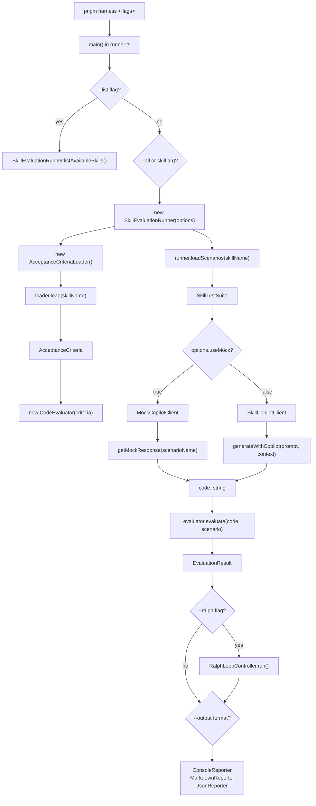
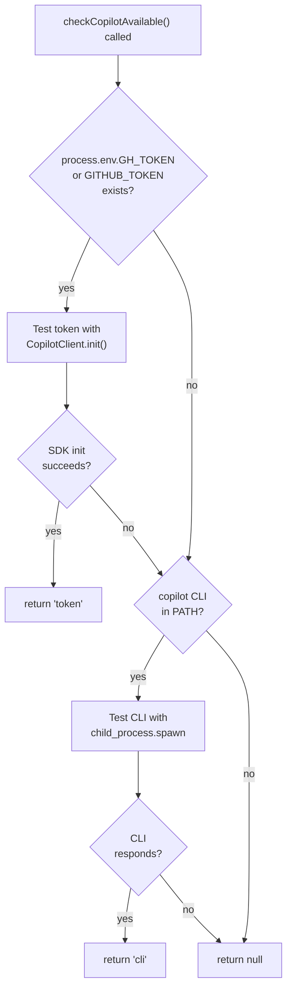
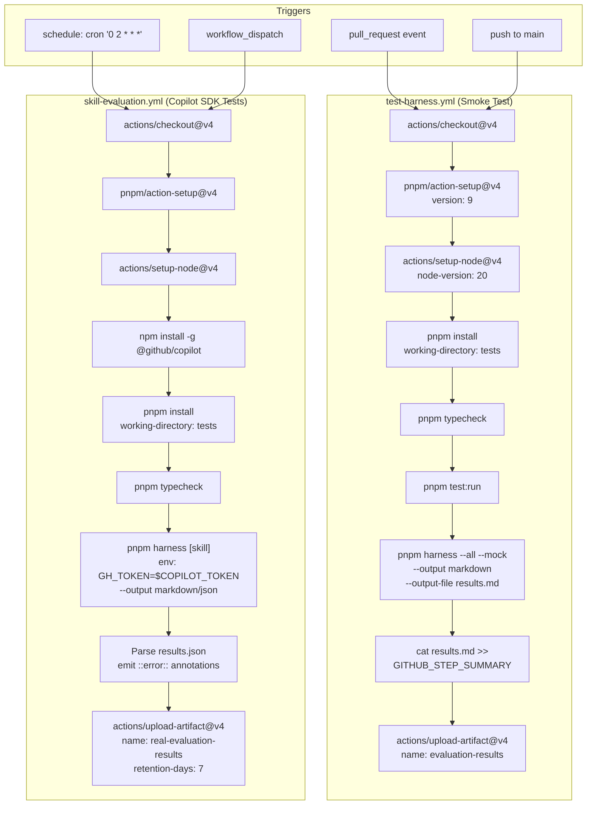

<!-- source: DeepWiki mcp.deepwiki.com · repo microsoft/skills · page 4.4 Running Evaluations · fetched 2026-10-30 -->

# Running Evaluations

<details>
<summary>Relevant source files</summary>

The following files were used as context for generating this wiki page:

- [.github/workflows/skill-evaluation.yml](.github/workflows/skill-evaluation.yml)
- [.github/workflows/test-harness.yml](.github/workflows/test-harness.yml)
- [docs-site/integration-filter-test.png](docs-site/integration-filter-test.png)
- [docs-site/public/og-image.png](docs-site/public/og-image.png)
- [tests/.gitignore](tests/.gitignore)
- [tests/AGENTS.md](tests/AGENTS.md)
- [tests/README.md](tests/README.md)
- [tests/harness/evaluator.ts](tests/harness/evaluator.ts)

</details>


This page explains how to execute the skill evaluation harness — both locally from the command line and automatically in CI via GitHub Actions. It covers all CLI flags, authentication modes, and the two GitHub Actions workflows.

For background on how scoring works, see [Scoring Algorithm and Pattern Matching](#4.6). For how the Ralph Loop iterative improvement mode operates, see [Ralph Loop Iterative Improvement](#4.5). For information on writing the test scenarios that evaluations run against, see [Test Scenarios YAML Format](#4.3).

---

## How Evaluation Works

The harness runs from the `tests/` directory using `pnpm harness`. It coordinates three steps for each skill:

1. Load acceptance criteria from `.github/skills/<skill>/references/acceptance-criteria.md`
2. Load test scenarios from `tests/scenarios/<skill>/scenarios.yaml`
3. For each scenario: generate code (via Copilot SDK or mock), evaluate against criteria, report results

**Entry point:** `tests/harness/runner.ts` — the `main()` function parses CLI flags and dispatches to `SkillEvaluationRunner`.

**Diagram: Harness Execution Flow (Code Entity Mapping)**



Sources: [tests/harness/runner.ts:795-870](), [tests/harness/copilot-client.ts:27-70](), [tests/harness/copilot-client.ts:188-233](), [tests/harness/evaluator.ts:40-146]()

---

## Prerequisites

```bash
cd tests
pnpm install
```

Requires Node.js ≥ 20.0.0 and pnpm 9. The `pnpm harness` script is an alias for `tsx harness/runner.ts`.

Sources: [tests/package.json:1-33]()

---

## CLI Flags Reference

All `pnpm harness` invocations run from the `tests/` directory.

| Flag | Type | Default | Description |
|------|------|---------|-------------|
| `[skill]` | positional | — | Skill name to evaluate (e.g., `azure-ai-projects-py`) |
| `--list` | boolean | false | List all skills that have both criteria and scenarios |
| `--all` | boolean | false | Run evaluation on every available skill |
| `--filter <pattern>` | string | — | Filter scenarios by name or tag substring |
| `--mock` | boolean | false | Use `mock_response` fields; skip Copilot SDK |
| `-v, --verbose` | boolean | false | Print per-scenario findings and pattern matches |
| `--output <format>` | string | `text` | Output format: `text`, `json`, or `markdown` |
| `--output-file <file>` | string | — | Write results to a file instead of stdout |
| `--ralph` | boolean | false | Enable Ralph Loop iterative improvement |
| `--max-iterations <n>` | integer | 5 | Maximum Ralph Loop iterations per scenario |
| `--threshold <n>` | integer | 80 | Quality score threshold to stop iterating |

Sources: [tests/harness/runner.ts:798-811](), [tests/README.md:54-70]()

### Common invocations

```bash
# List all skills with test coverage
pnpm harness --list

# Run one skill in mock mode with verbose output
pnpm harness azure-ai-projects-py --mock --verbose

# Run a filtered subset of scenarios
pnpm harness azure-ai-projects-py --mock --filter basic

# Run all skills and write results to files
pnpm harness --all --mock --output markdown --output-file results.md
pnpm harness --all --mock --output json --output-file results.json

# Run with Ralph Loop (real SDK)
pnpm harness azure-ai-projects-py --ralph --max-iterations 5 --threshold 85

# TypeScript type-check only
pnpm typecheck

# Run unit tests (vitest)
pnpm test:run
```

Sources: [tests/README.md:6-11](), [tests/AGENTS.md:94-109]()

---

## Mock Mode vs. Real SDK

### Mock mode (`--mock`)

When `--mock` is passed (or when no Copilot authentication is detected), `SkillCopilotClient` delegates to `MockCopilotClient`. For each scenario, the harness looks up the `mock_response` field from `scenarios.yaml` by scenario name and returns it directly — no network calls occur.

If a scenario has no `mock_response`, the fallback is:
```
# No mock response configured for this prompt
pass
```

Mock mode is **deterministic and fast** — suitable for development iteration and CI smoke tests.

Sources: [tests/harness/copilot-client.ts:27-70](), [tests/harness/copilot-client.ts:158-163]()

### Real SDK mode

When `--mock` is not passed and authentication is available, `SkillCopilotClient.generateWithCopilot()` is invoked. The code generation flow:

**Step-by-step execution:**

| Step | Function | Action |
|------|----------|--------|
| 1 | `loadSkillContext(skillName)` | Read `SKILL.md` + `references/*.md`, concatenate into context string |
| 2 | `generateWithCopilot(prompt, skillName)` | Construct full prompt with `<skill-context>` tags |
| 3 | `CopilotClient.init(clientOptions)` | Initialize Copilot SDK session from `@github/copilot-sdk` |
| 4 | `session.sendAndWait(message, options)` | Send prompt with 120-second timeout |
| 5 | `extractCodeBlocks(response.message.content)` | Parse markdown code fences from response |

**Authentication Flow (`checkCopilotAvailable()`):**



| Auth Method | Detection | Priority | Source |
|-------------|-----------|----------|--------|
| PAT token | `GH_TOKEN` or `GITHUB_TOKEN` env var with "Copilot Requests" scope | First | `process.env.GH_TOKEN \|\| process.env.GITHUB_TOKEN` |
| Copilot CLI | `copilot` binary in `PATH`, authenticated via `/login` command | Fallback | `which copilot` → `spawn('copilot', ['--version'])` |

If `checkCopilotAvailable()` returns `null` and `--mock` is not passed, the harness logs a warning and automatically falls back to `MockCopilotClient`.

Sources: [tests/harness/copilot-client.ts:188-233](), [tests/harness/copilot-client.ts:309-338](), [tests/harness/copilot-client.ts:85-100]()

### Local setup for real SDK

**Option A — Copilot CLI:**
```bash
npm install -g @github/copilot
copilot   # then /login to authenticate
pnpm harness azure-ai-projects-py --verbose
```

**Option B — PAT token:**
```bash
export GH_TOKEN="ghp_your_token_with_copilot_requests"
pnpm harness azure-ai-projects-py --verbose
```

Sources: [tests/README.md:214-231]()

---

## Output Formats

The harness supports three output formats selected via `--output <format>`:

| Format | Flag | Reporter Class | Use Case |
|--------|------|----------------|----------|
| `text` | default | `ConsoleReporter` | Interactive terminal with colors, pass/fail icons |
| `json` | `--output json` | (runner.ts direct) | Machine-readable `AllSkillsSummary` for automation |
| `markdown` | `--output markdown` | `MarkdownReporter` | GitHub-flavored Markdown for `$GITHUB_STEP_SUMMARY` |

### File Output

With `--output-file <path>`, results write to a file. Without it, output goes to stdout. Both `json` and `markdown` formats write to the file and stdout simultaneously.

**Code locations:**
- `ConsoleReporter.reportAll()` [tests/harness/reporters/console.ts:13-78]()
- `MarkdownReporter.generateReport()` [tests/harness/reporters/markdown.ts:13-106]()
- JSON serialization [tests/harness/runner.ts:628-641]()

### JSON Schema Reference

**Top-level object (`AllSkillsSummary`):**

```typescript
{
  total_skills: number,
  passed_skills: number,
  failed_skills: number,
  total_scenarios: number,
  passed_scenarios: number,
  failed_scenarios: number,
  avg_score: number,
  duration_ms: number,
  mode: "mock" | "real",
  skills: EvaluationSummary[]
}
```

**Per-skill object (`EvaluationSummary`):**

```typescript
{
  skill_name: string,
  total_scenarios: number,
  passed: number,
  failed: number,
  pass_rate: number,
  avg_score: number,
  duration_ms: number,
  results: EvaluationResult[]
}
```

**Per-scenario object (`EvaluationResult`):**

```typescript
{
  skill_name: string,
  scenario: string,
  passed: boolean,
  score: number,
  error_count: number,
  warning_count: number,
  matched_correct: string[],
  matched_incorrect: string[],
  findings: Finding[]
}
```

**Finding object:**

```typescript
{
  severity: "error" | "warning" | "info",
  rule: string,
  message: string,
  line?: number,
  suggestion?: string,
  code_snippet?: string
}
```

Sources: [tests/harness/types.ts:1-100](), [tests/harness/runner.ts:595-641](), [tests/harness/reporters/console.ts:13-78](), [tests/harness/reporters/markdown.ts:13-106]()

---

## GitHub Actions Workflows

Two workflows govern automated evaluation.

**Diagram: GitHub Actions Workflow Architecture (Step-by-Step)**



Sources: [.github/workflows/test-harness.yml:6-96](), [.github/workflows/skill-evaluation.yml:3-169]()

### `test-harness.yml` — Smoke Test

**File:** [.github/workflows/test-harness.yml:1-96]()

| Property | Value |
|----------|-------|
| Name | Smoke Test |
| Triggers | `pull_request`, `push` to `main` |
| Mode | Mock (`--mock`) |
| Scope | All skills (`--all`) |
| Fails job? | No — exits 0, emits `::warning::` annotation |

**Execution Steps:**

| Step Name | Command/Action | Purpose |
|-----------|----------------|---------|
| Checkout | `actions/checkout@v4` | Clone repository |
| Setup pnpm | `pnpm/action-setup@v4` with `version: 9` | Install pnpm package manager |
| Setup Node | `actions/setup-node@v4` with `node-version: '20'` | Install Node.js runtime |
| Install dependencies | `pnpm install` in `tests/` directory | Install test harness dependencies |
| TypeScript check | `pnpm typecheck` | Verify TypeScript types without compilation |
| Run unit tests | `pnpm test:run` | Execute vitest unit test suite |
| Run skill evaluations | `pnpm harness --all --mock --output markdown --output-file results.md` | Evaluate all skills with mock responses |
| Generate JSON output | `pnpm harness --all --mock --output json --output-file results.json` | Create machine-readable results |
| Write job summary | `cat results.md >> $GITHUB_STEP_SUMMARY` | Display results in GitHub UI |
| Check evaluation results | Exit code check with `::warning::` | Warn on failures without failing job |
| Upload results | `actions/upload-artifact@v4` | Store `results.md` and `results.json` |

**Exit Code Handling:**

The "Run skill evaluations" step captures the harness exit code via `set +e` and stores it in `$GITHUB_OUTPUT` as `exit_code`, but always exits 0 to allow the summary step to run. The "Check evaluation results" step emits `::warning::` if `exit_code != 0` but does not fail the job. Line 85 contains a commented `exit 1` that could be uncommented to enforce passing evaluations.

Sources: [.github/workflows/test-harness.yml:14-86]()

### `skill-evaluation.yml` — Copilot SDK Tests

**File:** [.github/workflows/skill-evaluation.yml:1-169]()

| Property | Value |
|----------|-------|
| Name | Copilot SDK Tests |
| Triggers | `schedule` (cron `'0 2 * * *'`), `workflow_dispatch` |
| Mode | Real Copilot SDK |
| Condition | `vars.ENABLE_REAL_EVAL == 'true'` OR `workflow_dispatch` |
| Auth | `secrets.COPILOT_TOKEN` → `GH_TOKEN` env var |

**Manual dispatch inputs (`workflow_dispatch.inputs`):**

| Input | Type | Default | Description |
|-------|------|---------|-------------|
| `skill` | string | (empty = all) | Specific skill to evaluate |
| `ralph` | boolean | false | Enable Ralph Loop iterative improvement |
| `threshold` | number | 60 | Quality threshold (0-100) for Ralph Loop |
| `max_iterations` | number | 2 | Maximum Ralph Loop iterations per scenario |

**Execution Steps:**

| Step Name | Command/Action | Purpose |
|-----------|----------------|---------|
| Checkout | `actions/checkout@v4` | Clone repository |
| Setup pnpm | `pnpm/action-setup@v4` | Install pnpm |
| Setup Node | `actions/setup-node@v4` | Install Node.js 20 |
| Install Copilot CLI | `npm install -g @github/copilot` | Install SDK authentication tool |
| Verify Copilot CLI | `copilot --version` | Confirm installation |
| Install test dependencies | `pnpm install` in `tests/` | Install harness dependencies |
| TypeScript check | `pnpm typecheck` | Verify types |
| Run skill evaluations | `pnpm harness [skill] [--ralph] --verbose --output markdown/json` | Execute evaluations with real SDK |
| Write job summary | `cat results.md >> $GITHUB_STEP_SUMMARY` | Display results |
| Upload results | `actions/upload-artifact@v4` with `retention-days: 7` | Store results for 7 days |
| Add failure annotations | Node.js script parsing `results.json` | Emit `::error::` for top 3 findings per failed scenario |

**Dynamic Command Construction:**

The workflow builds the harness command dynamically from inputs (lines 72-91):

```bash
SKILL_ARG="${{ inputs.skill }}"
RALPH_FLAG=""
if [ "${{ inputs.ralph }}" = "true" ]; then
  RALPH_FLAG="--ralph --threshold $THRESHOLD --max-iterations $MAX_ITER"
fi

if [ -n "$SKILL_ARG" ]; then
  pnpm harness "$SKILL_ARG" $RALPH_FLAG --verbose --output markdown
else
  pnpm harness --all $RALPH_FLAG --verbose --output markdown
fi
```

**Failure Annotation Script:**

Lines 144-167 contain an inline Node.js script that parses `results.json` and emits `::error::` annotations for each failing scenario, showing the top 3 findings with suggestions.

Sources: [.github/workflows/skill-evaluation.yml:1-169]()

### Enabling real evaluation in CI

1. Create a fine-grained PAT at `github.com/settings/personal-access-tokens/new` with the **"Copilot Requests"** permission scope.
2. Add it as repository secret `COPILOT_TOKEN`.
3. Set repository variable `ENABLE_REAL_EVAL=true` (allows the nightly cron to run).
4. Or trigger immediately via the Actions tab → Copilot SDK Tests → Run workflow.

Sources: [tests/README.md:233-244](), [.github/workflows/skill-evaluation.yml:33-37]()

---

## Workflow Comparison

| Aspect | `test-harness.yml` | `skill-evaluation.yml` |
|--------|--------------------|------------------------|
| Trigger | Every PR / push to main | Nightly 2 AM UTC + manual |
| SDK mode | Mock | Real Copilot SDK |
| Auth required | None | `COPILOT_TOKEN` secret |
| Ralph Loop | No | Optional (via dispatch input) |
| Job fails on errors | No (warning only) | No (warning only) |
| Artifact retention | Default | 7 days |
| Annotation type | `::warning::` | `::warning::` + `::error::` |
| Purpose | Fast, deterministic feedback | Actual LLM quality measurement |

Sources: [.github/workflows/test-harness.yml:1-96](), [.github/workflows/skill-evaluation.yml:1-169](), [tests/README.md:235-238]()

---

## Result Files

Both workflows produce two artifact files written by the harness:

| File | Content |
|------|---------|
| `tests/results.md` | Markdown table of all skills, scenarios, pass/fail, score, failed scenario details |
| `tests/results.json` | `AllSkillsSummary` JSON — machine-readable, used for annotations |

These files are listed in `tests/.gitignore` and are never committed.

The `AllSkillsSummary` top-level structure:

```
{
  total_skills, passed_skills, failed_skills,
  total_scenarios, passed_scenarios, failed_scenarios,
  avg_score, duration_ms, mode,
  skills: EvaluationSummary[]
}
```

Sources: [tests/harness/runner.ts:628-641](), [tests/harness/runner.ts:646-731](), [tests/.gitignore:7-11]()

---

## Troubleshooting

| Symptom | Cause | Fix |
|---------|-------|-----|
| Skill not found by `--list` | Missing `acceptance-criteria.md` or `scenarios.yaml` | Confirm both files exist at expected paths |
| Mock mode used unexpectedly | No `GH_TOKEN`/`GITHUB_TOKEN` and no `copilot` CLI | Set token or add `--mock` explicitly |
| `No mock response configured` returned | Scenario has no `mock_response` field | Add `mock_response` to the scenario in `scenarios.yaml` |
| YAML parse error | Bad indentation or unquoted special chars | Validate with `pnpm harness <skill> --mock --verbose` |
| Pattern not matching | Regex escaping issue | Check `evaluator.ts` `codeToRegex()` for how patterns are compiled |
| `COPILOT_TOKEN` not used in nightly run | `ENABLE_REAL_EVAL` variable not set | Set repository variable `ENABLE_REAL_EVAL=true` |

Sources: [tests/README.md:202-210](), [tests/AGENTS.md:204-210](), [tests/harness/copilot-client.ts:309-338]()

---

