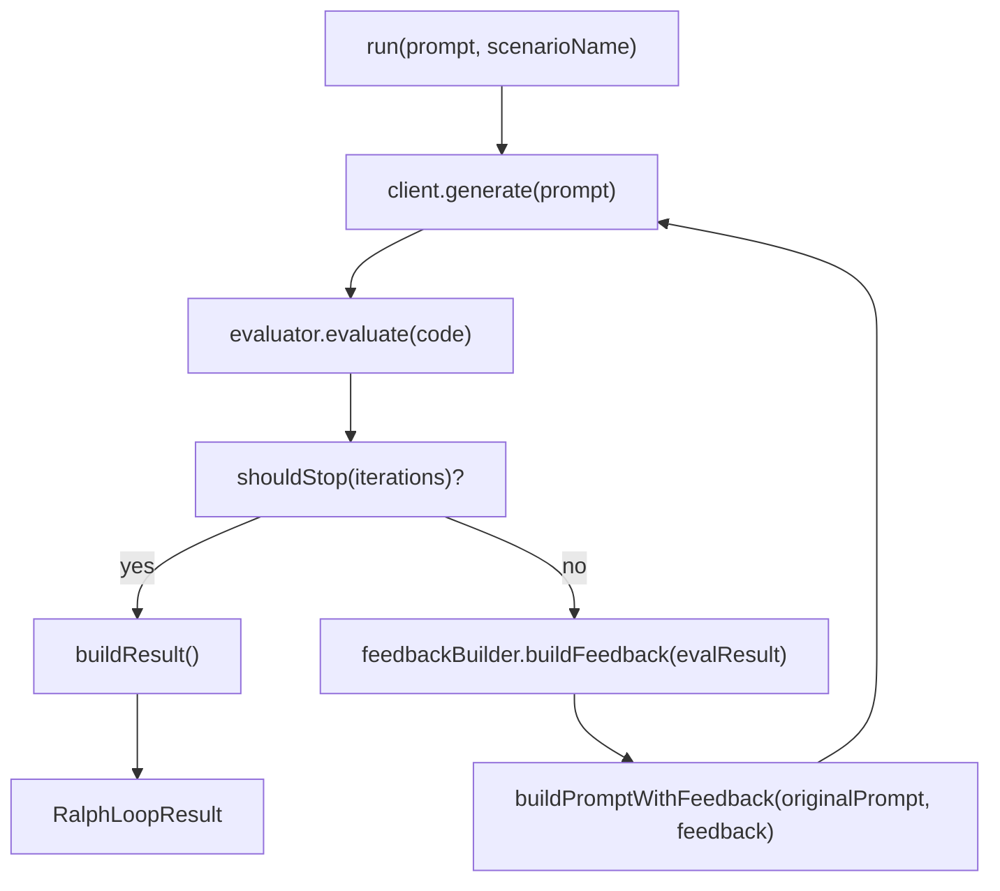
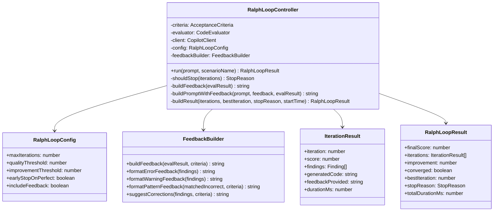
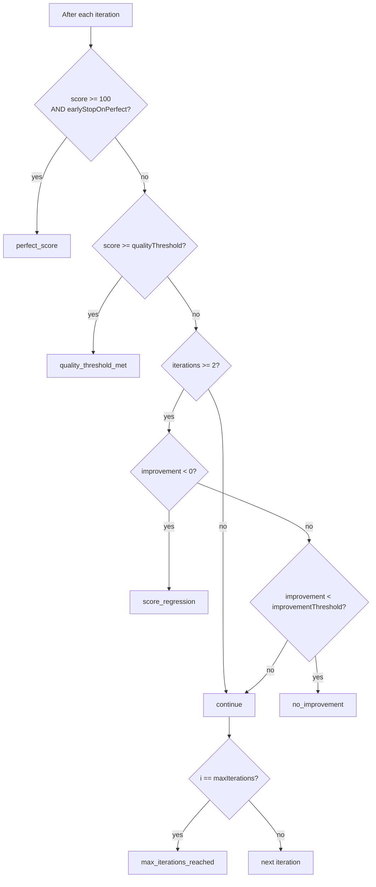
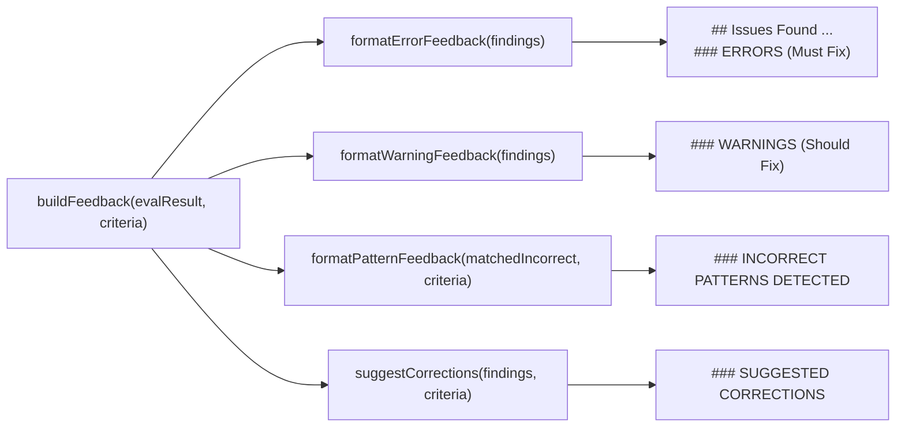

<!-- source: DeepWiki mcp.deepwiki.com · repo microsoft/skills · page 4.5 Ralph Loop Iterative Improvement · fetched 2026-10-30 -->

# Ralph Loop Iterative Improvement

<details>
<summary>Relevant source files</summary>

The following files were used as context for generating this wiki page:

- [.github/workflows/skill-evaluation.yml](.github/workflows/skill-evaluation.yml)
- [.github/workflows/test-harness.yml](.github/workflows/test-harness.yml)
- [docs-site/integration-filter-test.png](docs-site/integration-filter-test.png)
- [docs-site/public/og-image.png](docs-site/public/og-image.png)
- [tests/.gitignore](tests/.gitignore)
- [tests/AGENTS.md](tests/AGENTS.md)
- [tests/README.md](tests/README.md)
- [tests/harness/evaluator.ts](tests/harness/evaluator.ts)

</details>


This page documents the Ralph Loop: an iterative code generation and quality improvement mechanism built into the test harness. It covers the `RalphLoopController` class, configuration parameters, all five stop conditions, the `FeedbackBuilder` subsystem, and how results are structured.

For the broader test harness architecture (runner, evaluator, reporters), see [Test Harness Architecture](#4.1). For the scoring algorithm that produces the scores the Ralph Loop reacts to, see [Scoring Algorithm and Pattern Matching](#4.6). For instructions on running evaluations from the CLI or CI, see [Running Evaluations](#4.4).

---

## Overview

The Ralph Loop wraps the standard evaluate-and-report flow with a generate-evaluate-feedback cycle. Instead of running each scenario once, it re-generates code with structured feedback until a quality threshold is met or a stopping condition fires.

The technique is attributed to Shayne Boyer's Sensei iterative quality improvement patterns from the GitHub Copilot for Azure extension. The core insight: LLMs improve significantly when given structured feedback about what went wrong and specific guidance on how to fix it.

**Core flow:**



Sources: [tests/harness/ralph-loop.ts:157-220]()

---

## Key Types

**Architecture diagram — code entities:**



Sources: [tests/harness/ralph-loop.ts:39-109](), [tests/harness/feedback-builder.ts:25-227]()

---

## RalphLoopConfig Parameters

All parameters have defaults defined in `DEFAULT_RALPH_CONFIG` [tests/harness/ralph-loop.ts:55-61]().

| Parameter | Type | Default | Description |
|-----------|------|---------|-------------|
| `maxIterations` | `number` | `5` | Hard cap on iterations before stopping |
| `qualityThreshold` | `number` | `80` | Score (0–100) at which the loop considers quality met |
| `improvementThreshold` | `number` | `5` | Minimum score gain between iterations; below this triggers `no_improvement` |
| `earlyStopOnPerfect` | `boolean` | `true` | Immediately stop when score reaches 100 |
| `includeFeedback` | `boolean` | `true` | Append structured feedback to the re-generation prompt |

Sources: [tests/harness/ralph-loop.ts:39-61]()

---

## Stop Conditions

The `shouldStop` method [tests/harness/ralph-loop.ts:225-259]() is evaluated after each iteration. It returns a `[boolean, StopReason]` tuple. The `StopReason` type is a discriminated union [tests/harness/ralph-loop.ts:84-89]().

**Decision logic:**



| `StopReason` | `converged` | Description |
|---|---|---|
| `quality_threshold_met` | `true` | Score met or exceeded `qualityThreshold` |
| `perfect_score` | `true` | Score hit 100 and `earlyStopOnPerfect` is set |
| `max_iterations_reached` | `false` | Loop exhausted all allowed iterations |
| `no_improvement` | `false` | Score delta between last two iterations was below `improvementThreshold` |
| `score_regression` | `false` | Score decreased from the previous iteration |

Sources: [tests/harness/ralph-loop.ts:84-89](), [tests/harness/ralph-loop.ts:225-259](), [tests/harness/ralph-loop.ts:306-313]()

---

## FeedbackBuilder

`FeedbackBuilder` [tests/harness/feedback-builder.ts:25-227]() transforms an `EvaluationResult` into a structured markdown string that is appended to the re-generation prompt. It is instantiated once inside `RalphLoopController`'s constructor via `createFeedbackBuilder()` [tests/harness/ralph-loop.ts:147]().

### Feedback Structure

The `buildFeedback` method assembles four sections in priority order:



| Section | Source | Severity filter |
|---|---|---|
| `### ERRORS (Must Fix)` | `Finding[]` filtered to `Severity.ERROR` | Blocks pass; listed with code snippet + suggestion |
| `### WARNINGS (Should Fix)` | `Finding[]` filtered to `Severity.WARNING` | Listed with suggestion |
| `### INCORRECT PATTERNS DETECTED` | `EvaluationResult.matchedIncorrect[]` | Names of sections from acceptance criteria where incorrect patterns matched |
| `### SUGGESTED CORRECTIONS` | Deduplicated from `Finding.suggestion` + `AcceptanceCriteria.correctPatterns[].description` | Concrete replacements |

- Code snippets in errors are truncated to 100 characters [tests/harness/feedback-builder.ts:102-105]().
- Suggestions are deduplicated via a `Set<string>` [tests/harness/feedback-builder.ts:194]().
- Returns an empty string if there are no findings and no matched incorrect patterns [tests/harness/feedback-builder.ts:37-39](), which suppresses feedback injection for already-passing iterations.

Sources: [tests/harness/feedback-builder.ts:36-72](), [tests/harness/feedback-builder.ts:83-226]()

---

## Prompt Construction

When `includeFeedback` is `true` and there is non-empty feedback, `buildPromptWithFeedback` constructs the next iteration's prompt [tests/harness/ralph-loop.ts:274-291]():

```
<original prompt>

---

## Feedback from Previous Attempt

Your previous attempt scored <score>/100. Please address the following issues:

<feedback from FeedbackBuilder>

Generate improved code that fixes these issues while maintaining the original requirements.
```

The original prompt is always preserved verbatim at the top, ensuring the original task requirements are never lost.

Sources: [tests/harness/ralph-loop.ts:274-291]()

---

## RalphLoopResult

The `run` method returns a `RalphLoopResult` [tests/harness/ralph-loop.ts:94-109]() after the loop ends for any reason.

| Field | Type | Description |
|---|---|---|
| `finalScore` | `number` | Score from the last iteration |
| `iterations` | `IterationResult[]` | Full record of every iteration (score, findings, code, feedback, timing) |
| `improvement` | `number` | `lastScore - firstScore` (can be negative on regression) |
| `converged` | `boolean` | `true` only if `stopReason` is `quality_threshold_met` or `perfect_score` |
| `bestIteration` | `number` | 1-indexed iteration number with the highest score |
| `stopReason` | `StopReason` | One of the five stop condition identifiers |
| `totalDurationMs` | `number` | Wall-clock time across all iterations |

Sources: [tests/harness/ralph-loop.ts:94-109](), [tests/harness/ralph-loop.ts:296-315]()

---

## Factory Functions

Two factory functions simplify construction [tests/harness/ralph-loop.ts:322-341]():

| Function | Returns | Description |
|---|---|---|
| `createRalphConfig(partial)` | `RalphLoopConfig` | Merges `partial` over `DEFAULT_RALPH_CONFIG` |
| `createRalphLoopController(criteria, client, config?)` | `RalphLoopController` | Creates a `CodeEvaluator` internally and wires everything together |

`createRalphLoopController` is the primary entry point for programmatic use. The runner's `runWithLoop` method uses these internally.

Sources: [tests/harness/ralph-loop.ts:325-341]()

---

## CLI Usage

The `--ralph` flag on the `pnpm harness` command enables the Ralph Loop for all scenarios in a run.

```
pnpm harness <skill-name> --ralph [--max-iterations N] [--threshold N] [--mock] [--verbose]
```

| Flag | Maps to | Default |
|---|---|---|
| `--ralph` | Enables `runWithLoop` instead of `run` | off |
| `--max-iterations N` | `RalphLoopConfig.maxIterations` | `5` |
| `--threshold N` | `RalphLoopConfig.qualityThreshold` | `80` |

Sources: [tests/README.md:65-70](), [tests/AGENTS.md:190-192]()

---

## CI Integration

The `skill-evaluation.yml` workflow exposes Ralph Loop parameters as `workflow_dispatch` inputs [.github/workflows/skill-evaluation.yml:13-27]():

| Input | Type | Default | Description |
|---|---|---|---|
| `ralph` | `boolean` | `false` | Enable Ralph Loop |
| `threshold` | `number` | `60` | Quality threshold |
| `max_iterations` | `number` | `2` | Max iterations per scenario |

When `ralph` is `true`, the harness command becomes:

```
pnpm harness [skill] --ralph --threshold <threshold> --max-iterations <max_iterations>
```

Note: CI defaults use a lower threshold (`60`) and fewer iterations (`2`) compared to the programmatic defaults (`80` / `5`) to keep nightly run time reasonable.

The smoke test workflow (`test-harness.yml`) does not use the Ralph Loop — it runs with `--mock` only for fast deterministic feedback on PRs.

Sources: [.github/workflows/skill-evaluation.yml:13-27](), [.github/workflows/skill-evaluation.yml:77-91](), [.github/workflows/test-harness.yml:43-46]()

---

