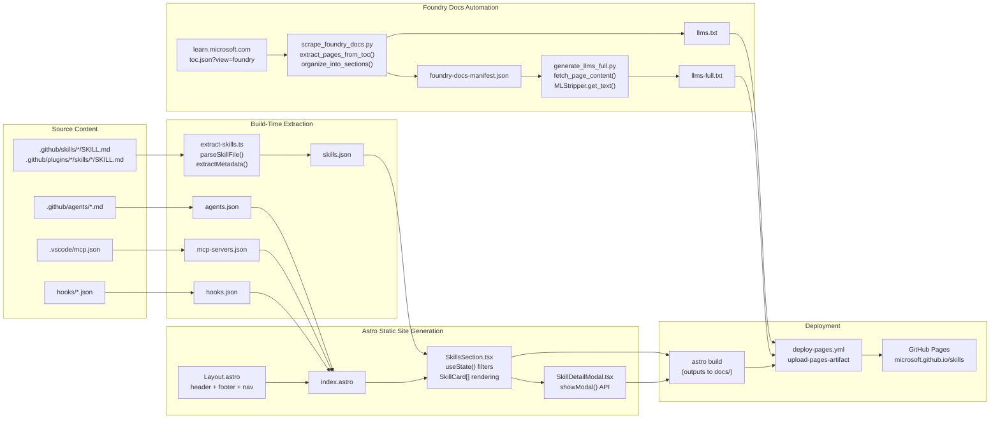
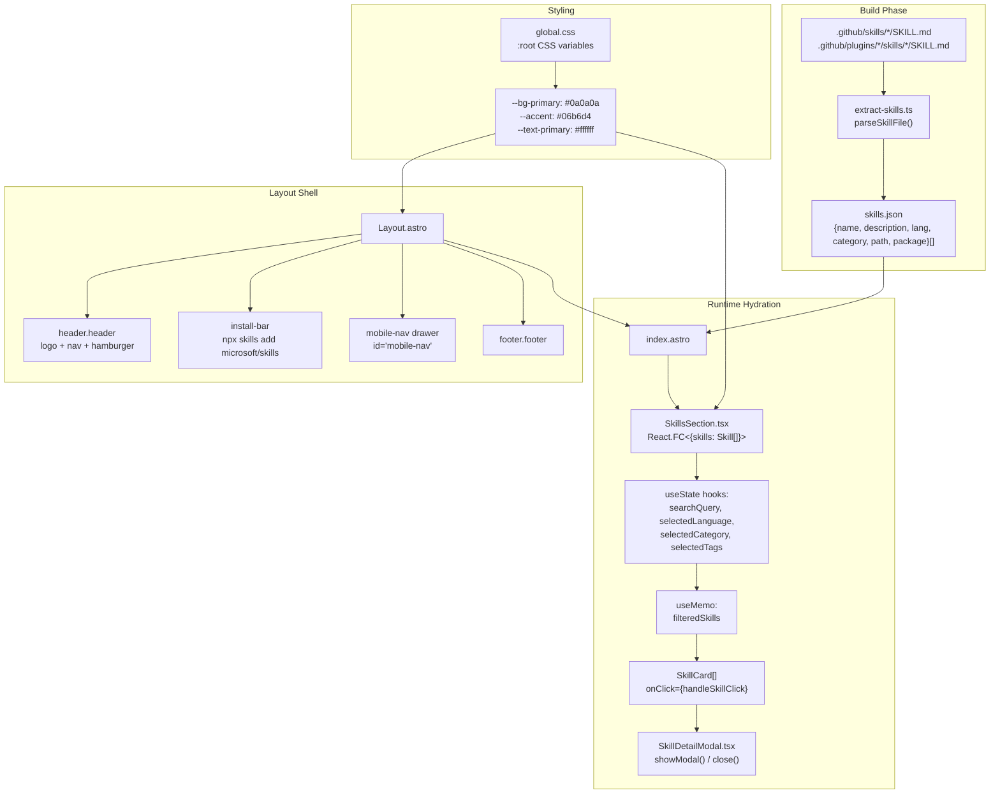
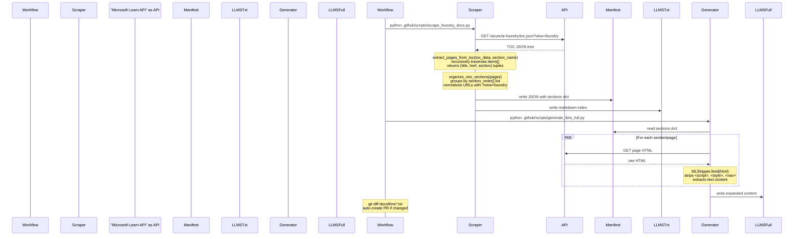
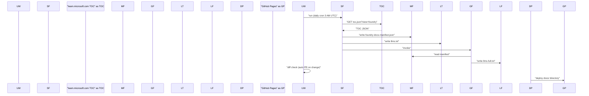

<!-- source: DeepWiki mcp.deepwiki.com · repo microsoft/skills · page 5 Documentation Systems · fetched 2026-10-30 -->

# Documentation Systems

<details>
<summary>Relevant source files</summary>

The following files were used as context for generating this wiki page:

- [.github/plugins/deep-wiki/.claude-plugin/plugin.json](.github/plugins/deep-wiki/.claude-plugin/plugin.json)
- [.github/plugins/deep-wiki/README.md](.github/plugins/deep-wiki/README.md)
- [.github/plugins/deep-wiki/commands/ado.md](.github/plugins/deep-wiki/commands/ado.md)
- [.github/plugins/deep-wiki/commands/crisp.md](.github/plugins/deep-wiki/commands/crisp.md)
- [.github/plugins/deep-wiki/skills/wiki-ado-convert/SKILL.md](.github/plugins/deep-wiki/skills/wiki-ado-convert/SKILL.md)
- [.github/scripts/generate_llms_full.py](.github/scripts/generate_llms_full.py)
- [.github/scripts/scrape_foundry_docs.py](.github/scripts/scrape_foundry_docs.py)
- [.github/workflows/deploy-pages.yml](.github/workflows/deploy-pages.yml)
- [README.md](README.md)
- [docs-site/public/favicon.svg](docs-site/public/favicon.svg)
- [docs-site/src/layouts/Layout.astro](docs-site/src/layouts/Layout.astro)
- [docs-site/src/pages/index.astro](docs-site/src/pages/index.astro)
- [docs-site/src/styles/global.css](docs-site/src/styles/global.css)
- [docs/.nojekyll](docs/.nojekyll)
- [docs/favicon.svg](docs/favicon.svg)
- [docs/foundry-docs-manifest.json](docs/foundry-docs-manifest.json)
- [docs/index.html](docs/index.html)
- [docs/llms-full.txt](docs/llms-full.txt)
- [docs/llms.txt](docs/llms.txt)

</details>


The repository maintains multiple documentation systems that serve different consumers: a static website for humans to browse skills, and programmatically-generated text files for LLMs to consume. This page documents the architecture, data flow, and automation of these systems.

---

## Overview

Three distinct documentation systems operate in parallel:

| System | Entry Point | Key Outputs | Primary Consumer |
|---|---|---|---|
| **Skill Explorer Website** | `docs-site/src/pages/index.astro` | Static HTML at `docs/index.html` | Human users via browser |
| **Foundry Docs Pipeline** | `.github/scripts/scrape_foundry_docs.py` | `docs/llms.txt`, `docs/llms-full.txt`, `docs/foundry-docs-manifest.json` | LLMs, Context7 MCP server |
| **Skill Metadata Extraction** | `docs-site/src/scripts/extract-skills.ts` | `docs-site/src/data/skills.json` | Astro components at build time |

All three systems output to the `docs/` directory (Astro builds to `docs/`, Python scripts write directly to `docs/`), which is deployed as a single GitHub Pages site at `microsoft.github.io/skills`.

**Build Triggers**

| System | Trigger | Workflow |
|---|---|---|
| Skill Explorer | Push to `main` affecting `docs/**` | `.github/workflows/deploy-pages.yml` |
| Foundry Docs | Daily cron at 03:00 UTC + workflow dispatch | `.github/workflows/update-llms-txt.yml` |
| Skill Metadata | Astro build process (local or CI) | N/A (runs via `astro build`) |

Sources: [docs-site/src/pages/index.astro:1-13](), [.github/scripts/scrape_foundry_docs.py:1-40](), [docs-site/src/scripts/extract-skills.ts:1](), [.github/workflows/deploy-pages.yml:1-38]()

---

## Documentation System Architecture

**Documentation Pipeline — File Dependencies and Data Flow**



Sources: [docs-site/src/scripts/extract-skills.ts:1](), [docs-site/src/pages/index.astro:1-326](), [docs-site/src/components/SkillsSection.tsx:1](), [.github/scripts/scrape_foundry_docs.py:80-120](), [.github/scripts/generate_llms_full.py:80-150](), [.github/workflows/deploy-pages.yml:22-38]()

**Key Code Entities by Role**

| Role | File | Key Functions/Components |
|---|---|---|
| Skill metadata parsing | `extract-skills.ts` | `parseSkillFile()`, `extractMetadata()`, `extractTriggers()` |
| Interactive skill browsing | `SkillsSection.tsx` | `useState()` for filters, `useMemo()` for filtered skills, `handleSkillClick()` |
| Skill detail display | `SkillDetailModal.tsx` | `showModal()` API, install command rendering |
| Page layout | `Layout.astro` | Header component, mobile nav drawer, footer |
| Foundry TOC extraction | `scrape_foundry_docs.py` | `extract_pages_from_toc()`, `organize_into_sections()` |
| Content fetching | `generate_llms_full.py` | `fetch_page_content()`, `MLStripper` HTML parser class |
| Deployment | `deploy-pages.yml` | `actions/upload-pages-artifact@v3`, `actions/deploy-pages@v4` |

Sources: [docs-site/src/scripts/extract-skills.ts:1](), [docs-site/src/components/SkillsSection.tsx:1](), [.github/scripts/scrape_foundry_docs.py:80-120](), [.github/scripts/generate_llms_full.py:33-78]()

---

## Skill Explorer Website

The Skill Explorer is an Astro static site at `docs-site/` that renders to `docs/index.html`. It uses React components for client-side interactivity (filtering, modal display) while the page shell is server-rendered by Astro.

**Component Hierarchy and Data Flow**



Sources: [docs-site/src/pages/index.astro:1-326](), [docs-site/src/components/SkillsSection.tsx:1](), [docs-site/src/layouts/Layout.astro:1-155](), [docs-site/src/styles/global.css:1-81]()

**Key Interactive Features**

| Feature | Implementation | DOM Selector / API |
|---|---|---|
| Skill search | `searchQuery` state, filters `name` and `description` fields | `input.skill-search` |
| Language filter | `selectedLanguage` state, filters `lang` field | `CategoryTabs` component |
| Category filter | `selectedCategory` state, filters `category` field | `button.category-tab` |
| Skill detail modal | `<dialog>` element with `showModal()` API | `SkillDetailModal` class, `dialog#skill-detail-modal` |
| Install command copy | `navigator.clipboard.writeText()` | `button.install-copy-btn` |
| Mobile navigation | Slide-in drawer with overlay, toggled by hamburger | `nav#mobile-nav`, `div#mobile-nav-overlay` |
| Deep linking | URL hash routing `#skill=<name>` opens modal on load | `window.location.hash` parsing |
| GitHub star count | `fetch('https://api.github.com/repos/microsoft/skills')` | `span#star-count` |

For complete details on the Astro site architecture, component props, and styling system, see [Documentation Website Architecture](#5.1).

Sources: [docs-site/src/components/SkillsSection.tsx:1](), [docs-site/src/components/SkillDetailModal.tsx:1](), [docs-site/src/layouts/Layout.astro:156-220]()

---

## Foundry Documentation Pipeline

The Foundry documentation pipeline scrapes Microsoft Learn and generates three files: `llms.txt` (compact link index), `llms-full.txt` (expanded with content snippets), and `foundry-docs-manifest.json` (structured metadata for downstream tools).

**Script Execution Flow**



Sources: [.github/scripts/scrape_foundry_docs.py:80-120](), [.github/scripts/generate_llms_full.py:33-78](), [.github/workflows/update-llms-txt.yml:1]()

**Key Functions and Data Structures**

| Component | File | Implementation |
|---|---|---|
| TOC parsing | `scrape_foundry_docs.py` | `extract_pages_from_toc(toc_data: dict, section_name: str) -> list[tuple[str, str, str]]` — recursive traversal |
| URL normalization | `scrape_foundry_docs.py` | `normalize_url(href: str, base_path: str) -> str` — adds `?view=foundry` param |
| Section organization | `scrape_foundry_docs.py` | `organize_into_sections(pages: list[tuple]) -> dict[str, list[DocPage]]` — groups by `section_order` |
| llms.txt generation | `scrape_foundry_docs.py` | `generate_llms_txt()` — writes markdown with `##` headers and `- [title](url)` bullets |
| HTML stripping | `generate_llms_full.py` | `MLStripper(HTMLParser)` class — `feed()`, `handle_starttag()`, `get_text()` |
| Content fetching | `generate_llms_full.py` | `async fetch_page_content(session, url)` — aiohttp with rate limiting |
| Manifest schema | Both scripts | `DocPage(title, href, url, section, content, summary)` dataclass |

Sources: [.github/scripts/scrape_foundry_docs.py:80-120](), [.github/scripts/generate_llms_full.py:33-78]()

**Output File Structure**

| File | Lines | Structure | Consumer |
|---|---|---|---|
| `llms.txt` | ~350 | Markdown header + 23 sections with link bullets | LLMs (low-bandwidth), Context7 indexer |
| `llms-full.txt` | ~360 | Same structure + code snippets in header + summaries per page | LLMs (high-bandwidth), RAG systems |
| `foundry-docs-manifest.json` | ~800 | JSON with `sections` dict mapping section names to page objects | Downstream automation, analytics |

**Section Coverage** (as defined in `section_order` list):

```python
section_order = [
    "General", "Get started", "Agent development", "Agent tools & integration",
    "Model catalog", "Model capabilities", "Fine-tuning", "Manage agents, models, & tools",
    "Observability, evaluation, & tracing", "Responsible AI", "Connections & auth",
    "Data", "Compute & infrastructure", "Deployments", "Security & governance",
    "Azure OpenAI", "Azure AI Services", "Azure AI Speech", "SDK reference",
    "API reference", "CLI reference", "FAQ & troubleshooting", "What's new"
]
```

For details on the content and usage of these files, see [Microsoft Foundry Documentation](#5.2).

Sources: [.github/scripts/scrape_foundry_docs.py:300-364](), [.github/scripts/generate_llms_full.py:245-389](), [docs/llms.txt:1-350](), [docs/llms-full.txt:1-360]()

---

## Automation and Deployment

**Documentation Pipeline — Data Flow**



Sources: [.github/workflows/deploy-pages.yml:1-38](), [.github/scripts/scrape_foundry_docs.py:300-364](), [.github/scripts/generate_llms_full.py:245-389]()

### `deploy-pages.yml`

The deployment workflow at [.github/workflows/deploy-pages.yml:1-38]() triggers on:
- Any push to `main` that modifies `docs/**`
- Successful completion of the `"Update Foundry llms.txt Documentation"` workflow
- Manual `workflow_dispatch`

It uploads the entire `docs/` directory as a GitHub Pages artifact and deploys it. This means the Skill Explorer website, `llms.txt`, `llms-full.txt`, and `foundry-docs-manifest.json` are all served from the same GitHub Pages deployment.

For the full automated update pipeline description including the daily cron schedule, diff detection, and auto-PR creation, see [Automated Documentation Update Workflow](#5.3).

For information on how `llms.txt` integrates with the `llms.txt` specification and how Context7 indexes these files, see [LLM Discovery and Context7 Integration](#5.4).

---

