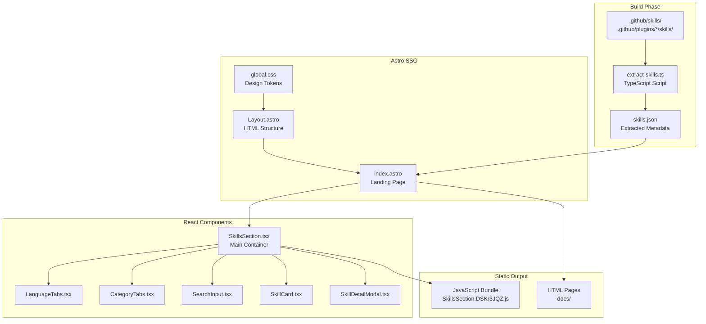
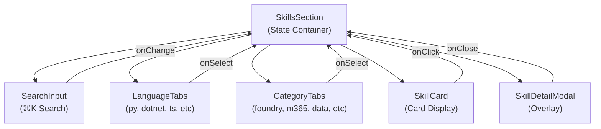

<!-- source: DeepWiki mcp.deepwiki.com · repo microsoft/skills · page 5.1 Documentation Website Architecture · fetched 2026-10-30 -->

# Documentation Website Architecture

<details>
<summary>Relevant source files</summary>

The following files were used as context for generating this wiki page:

- [docs-site/public/favicon.svg](docs-site/public/favicon.svg)
- [docs-site/scripts/extract-skills.ts](docs-site/scripts/extract-skills.ts)
- [docs-site/src/components/CategoryTabs.tsx](docs-site/src/components/CategoryTabs.tsx)
- [docs-site/src/components/SkillDetailModal.tsx](docs-site/src/components/SkillDetailModal.tsx)
- [docs-site/src/components/SkillsSection.tsx](docs-site/src/components/SkillsSection.tsx)
- [docs-site/src/layouts/Layout.astro](docs-site/src/layouts/Layout.astro)
- [docs-site/src/styles/global.css](docs-site/src/styles/global.css)
- [docs/_astro/SkillsSection.DSKr3JQZ.js](docs/_astro/SkillsSection.DSKr3JQZ.js)
- [docs/favicon.svg](docs/favicon.svg)
- [tests/scenarios/azure-search-documents-py/scenarios.yaml](tests/scenarios/azure-search-documents-py/scenarios.yaml)

</details>


## Purpose and Scope

This document describes the architecture of the Astro-based static documentation website that serves as the public interface for browsing and discovering skills at https://microsoft.github.io/skills. The site implements a build-time data extraction pipeline that parses skill metadata from YAML frontmatter, generates a searchable catalog, and provides interactive filtering through React components.

For information about the Microsoft Foundry documentation integration, see [Microsoft Foundry Documentation](#5.2). For details on LLM-friendly discovery mechanisms, see [LLM Discovery and Context7 Integration](#5.4).

---

## System Architecture Overview

The documentation website follows a hybrid static-interactive architecture where data extraction occurs at build time, static HTML is generated via Astro, and client-side interactivity is provided through React islands.



**Sources:** [docs-site/scripts/extract-skills.ts:1-224](), [docs-site/src/layouts/Layout.astro:1-637](), [docs-site/src/components/SkillsSection.tsx:1-293]()

---

## Build-Time Data Extraction Pipeline

The `extract-skills.ts` script executes during the build phase to parse skill metadata from YAML frontmatter in `SKILL.md` files across multiple directories.

### Extraction Process

| Phase | Function | Description |
|-------|----------|-------------|
| Preprocessing | `preprocessYamlFrontmatter` | Escapes `@` symbols in package names to fix YAML parsing |
| Source Scanning | `extractSkills` | Scans `.github/plugins/*/skills/` and `.github/skills/` |
| Symlink Resolution | `findSymlinkInfo` | Determines language and category from `skills/` symlink structure |
| Language Inference | `inferLangFromName` | Extracts language from skill name suffix (`-py`, `-dotnet`, etc.) |
| Metadata Extraction | `extractSkillFromDir` | Parses frontmatter using `gray-matter` library |

### Skill Interface

```typescript
interface Skill {
  name: string;
  description: string;
  package?: string;
  lang: "py" | "dotnet" | "ts" | "java" | "rust" | "core";
  category: string;
  path: string;
}
```

The extraction logic prioritizes plugin bundles over core skills to avoid duplicates. Language mapping uses two strategies:

1. **Explicit plugin mapping:** `PLUGIN_LANG_MAP` maps plugin directory names like `azure-sdk-python` to `py`
2. **Suffix inference:** `SUFFIX_MAP` extracts language from skill name endings

**Sources:** [docs-site/scripts/extract-skills.ts:1-224](), [docs-site/scripts/extract-skills.ts:18-25](), [docs-site/scripts/extract-skills.ts:33-57](), [docs-site/scripts/extract-skills.ts:96-102](), [docs-site/scripts/extract-skills.ts:144-204]()

---

## Static Site Generation with Astro

Astro generates static HTML with selective client-side hydration for React components. The build process compiles `.astro` files to HTML and bundles React components with the `client:load` directive.

### Layout Structure

The `Layout.astro` component defines the page shell with meta tags, header, footer, and slot insertion for page content.

**Key sections:**

- **Meta tags:** [docs-site/src/layouts/Layout.astro:15-36]() — Open Graph, Twitter Card, favicon links
- **Header:** [docs-site/src/layouts/Layout.astro:41-82]() — Logo, navigation, GitHub star count, hamburger menu
- **Install bar:** [docs-site/src/layouts/Layout.astro:84-101]() — Full-width command with copy button
- **Mobile navigation:** [docs-site/src/layouts/Layout.astro:104-136]() — Slide-out drawer with overlay
- **Footer:** [docs-site/src/layouts/Layout.astro:143-153]() — License and GitHub links

### Client-Side Scripts

The layout includes inline scripts for:

1. **Star count fetching:** [docs-site/src/layouts/Layout.astro:157-169]() — Async GitHub API call
2. **Copy functionality:** [docs-site/src/layouts/Layout.astro:171-195]() — Clipboard API with visual feedback
3. **Mobile navigation:** [docs-site/src/layouts/Layout.astro:197-240]() — Open/close drawer, escape key, click-outside handling

**Sources:** [docs-site/src/layouts/Layout.astro:1-637]()

---

## React Component Architecture

The `SkillsSection` component orchestrates filtering, search, and display of skills through a composition of specialized sub-components.



### State Management

The `SkillsSection` component manages five pieces of state:

| State Variable | Type | Purpose |
|----------------|------|---------|
| `selectedLang` | `Language` | Active language filter (`'all'` or language code) |
| `selectedCategory` | `Category` | Active category filter (`'all'` or category name) |
| `searchQuery` | `string` | Search input text |
| `selectedSkill` | `Skill \| null` | Currently opened skill detail modal |
| `isExpanded` | `boolean` | Whether "Show More" button has been clicked |

### Filtering Logic

The filtering implementation uses `useMemo` hooks to compute derived state efficiently:

```typescript
// Language counts across all skills
const langCounts = useMemo(() => {
  return skills.reduce((acc, skill) => {
    acc[skill.lang] = (acc[skill.lang] || 0) + 1;
    return acc;
  }, {} as Record<string, number>);
}, [skills]);

// Category counts within selected language
const categoryCounts = useMemo(() => {
  const filtered = selectedLang === 'all' 
    ? skills 
    : skills.filter(s => s.lang === selectedLang);
  
  return filtered.reduce((acc, skill) => {
    acc[skill.category] = (acc[skill.category] || 0) + 1;
    return acc;
  }, {} as Record<string, number>);
}, [skills, selectedLang]);

// Filtered skills matching all criteria
const filteredSkills = useMemo(() => {
  const query = searchQuery.toLowerCase().trim();
  return skills.filter(skill => {
    const langMatch = selectedLang === 'all' || skill.lang === selectedLang;
    const catMatch = selectedCategory === 'all' || skill.category === selectedCategory;
    const searchMatch = !query || 
      skill.name.toLowerCase().includes(query) || 
      skill.description.toLowerCase().includes(query);
    return langMatch && catMatch && searchMatch;
  });
}, [skills, selectedLang, selectedCategory, searchQuery]);
```

**Sources:** [docs-site/src/components/SkillsSection.tsx:81-109]()

### Progressive Disclosure

The grid implements a collapsible view that shows only 8 skills (2 rows × 4 columns) initially:

```typescript
const COLLAPSED_ROWS = 2;
const ITEMS_PER_ROW_DESKTOP = 4;
const MAX_VISIBLE_COLLAPSED = COLLAPSED_ROWS * ITEMS_PER_ROW_DESKTOP;
const CARD_HEIGHT_ESTIMATE = 200;
const GRID_GAP = 24;
const COLLAPSED_HEIGHT = (CARD_HEIGHT_ESTIMATE * COLLAPSED_ROWS) + (GRID_GAP * (COLLAPSED_ROWS - 1)) + 40;
```

A gradient overlay appears at the bottom when collapsed, and a "Show More" button reveals additional skills. [docs-site/src/components/SkillsSection.tsx:69-80](), [docs-site/src/components/SkillsSection.tsx:170-263]()

**Sources:** [docs-site/src/components/SkillsSection.tsx:1-293]()

---

## Component Library

### LanguageTabs Component

Renders language filters with color-coded dots and skill counts. The `LANG_DISPLAY` mapping provides human-readable labels:

```typescript
const LANG_DISPLAY: Record<string, string> = {
  py: 'Python',
  dotnet: '.NET',
  ts: 'TypeScript',
  java: 'Java',
  rust: 'Rust',
  core: 'Core',
};
```

Each tab displays a colored dot (defined by CSS variable), label, and count. The active tab receives accent styling and an underline indicator. [docs-site/src/components/SkillsSection.tsx:21-28]()

**Sources:** [docs-site/src/components/SkillsSection.tsx:21-28](), Implementation in bundled output [docs/_astro/SkillsSection.DSKr3JQZ.js:1-10]()

### CategoryTabs Component

Pill-shaped category buttons with counts. The `CATEGORY_ORDER` array defines display order:

```typescript
const CATEGORY_ORDER = [
  'all', 'foundry', 'm365', 'general', 'data', 'messaging',
  'entra', 'monitoring', 'integration', 'compute', 'communication',
  'frontend', 'partner'
];
```

Only categories with non-zero counts are rendered. Selected categories receive accent border and glow background. [docs-site/src/components/CategoryTabs.tsx:5-19]()

**Sources:** [docs-site/src/components/CategoryTabs.tsx:1-111]()

### SearchInput Component

Implements keyboard shortcut `⌘K` to focus the search input and `Escape` to clear it. The component displays a search icon, text input, and either a clear button (when text is present) or a `⌘K` badge.

```typescript
useEffect(() => {
  const handleKeydown = (e: KeyboardEvent) => {
    if (e.key === 'k' && (e.metaKey || e.ctrlKey)) {
      e.preventDefault();
      inputRef.current?.focus();
    }
    if (e.key === 'Escape' && document.activeElement === inputRef.current) {
      inputRef.current?.blur();
      onChange('');
    }
  };
  document.addEventListener('keydown', handleKeydown);
  return () => document.removeEventListener('keydown', handleKeydown);
}, [onChange]);
```

**Sources:** Implementation in bundled output [docs/_astro/SkillsSection.DSKr3JQZ.js:1-10]()

### SkillCard Component

Displays individual skill cards with language badge, name, description (clamped to 3 lines), category, and copy button. The card uses inline hover styles for interactive feedback.

**Language badge styling:**

```typescript
const LANG_STYLES = {
  py: { bg: "rgba(96, 165, 250, 0.15)", text: "#60a5fa", border: "rgba(96, 165, 250, 0.3)" },
  dotnet: { bg: "rgba(167, 139, 250, 0.15)", text: "#a78bfa", border: "rgba(167, 139, 250, 0.3)" },
  ts: { bg: "rgba(250, 204, 21, 0.15)", text: "#facc15", border: "rgba(250, 204, 21, 0.3)" },
  java: { bg: "rgba(248, 113, 113, 0.15)", text: "#f87171", border: "rgba(248, 113, 113, 0.3)" },
  rust: { bg: "rgba(251, 146, 60, 0.15)", text: "#fb923c", border: "rgba(251, 146, 60, 0.3)" },
  core: { bg: "rgba(156, 163, 175, 0.15)", text: "#9ca3af", border: "rgba(156, 163, 175, 0.3)" }
};
```

The copy button copies the installation command: `npx skills add microsoft/skills --skill ${skill.name}`. [Implementation in bundled output]

**Sources:** Implementation in bundled output [docs/_astro/SkillsSection.DSKr3JQZ.js:1-10]()

### SkillDetailModal Component

Full-screen modal overlay that displays:

1. **Install command section:** Copy button with success feedback
2. **Skill metadata:** Name, language badge, description
3. **Action buttons:** "View Full Skill" (GitHub link), "Share" (copy URL)
4. **Test references:** Links to acceptance criteria, test scenarios, tests folder

The modal supports:
- Keyboard `Escape` to close
- Click-outside to close
- Deep linking via URL hash (`#skill=skillname`)

When opened, the modal updates the URL hash for shareable links. [docs-site/src/components/SkillDetailModal.tsx:1-471]()

**Sources:** [docs-site/src/components/SkillDetailModal.tsx:1-471]()

---

## Design System and Styling

The site uses a comprehensive design token system defined in `global.css` with CSS custom properties.

### Color Palette

| Token | Value | Usage |
|-------|-------|-------|
| `--bg-primary` | `#0a0a0a` | Main background |
| `--bg-secondary` | `#111111` | Secondary surfaces |
| `--bg-tertiary` | `#1a1a1a` | Tertiary surfaces |
| `--bg-card` | `#0f0f0f` | Card backgrounds |
| `--bg-card-hover` | `#161616` | Card hover state |
| `--text-primary` | `#ffffff` | Primary text |
| `--text-secondary` | `#a1a1a1` | Secondary text |
| `--text-muted` | `#9ca3af` | Muted text (WCAG AA: 5.0:1 contrast) |
| `--accent` | `#06b6d4` | Accent cyan |
| `--accent-hover` | `#0891b2` | Accent hover |
| `--accent-glow` | `rgba(6, 182, 212, 0.15)` | Accent with transparency |
| `--border-primary` | `#262626` | Primary borders |
| `--border-hover` | `#404040` | Hover borders |

### Typography Scale

```css
--text-xs: 0.75rem;
--text-sm: 0.875rem;
--text-base: 1rem;
--text-lg: 1.125rem;
--text-xl: 1.25rem;
--text-2xl: 1.5rem;
--text-3xl: 1.875rem;
--text-4xl: 2.25rem;
--text-5xl: 3rem;
```

Font stack: `'Inter', -apple-system, BlinkMacSystemFont, 'Segoe UI', Roboto, sans-serif`

### Spacing System

The spacing scale follows an exponential progression:

```css
--space-xs: 0.25rem;
--space-sm: 0.5rem;
--space-md: 1rem;
--space-lg: 1.5rem;
--space-xl: 2rem;
--space-2xl: 3rem;
--space-3xl: 4rem;
```

### Border Radius

```css
--radius-sm: 0.375rem;
--radius-md: 0.5rem;
--radius-lg: 0.75rem;
--radius-xl: 1rem;
```

**Sources:** [docs-site/src/styles/global.css:1-392](), [docs-site/src/styles/global.css:4-81]()

---

## Responsive Design Implementation

The site implements a mobile-first responsive design with specific breakpoints.

### Grid Breakpoints

The `.skills-grid` class uses CSS Grid with responsive column counts:

| Breakpoint | Columns | CSS |
|------------|---------|-----|
| Desktop (>1024px) | 4 | `grid-template-columns: repeat(4, minmax(0, 1fr))` |
| Tablet (768-1024px) | 3 | `grid-template-columns: repeat(3, minmax(0, 1fr))` |
| Mobile landscape (640-768px) | 2 | `grid-template-columns: repeat(2, minmax(0, 1fr))` |
| Mobile portrait (<640px) | 1 | `grid-template-columns: minmax(0, 1fr)` |

[docs-site/src/styles/global.css:369-391]()

### Mobile Navigation

The header implements a hamburger menu for screens <768px:

1. **Hamburger button:** [docs-site/src/layouts/Layout.astro:74-79]() — Three horizontal lines, hidden on desktop
2. **Mobile drawer:** [docs-site/src/layouts/Layout.astro:104-136]() — Slide-in from right with `transform: translateX(100%)`
3. **Overlay:** [docs-site/src/layouts/Layout.astro:137]() — Semi-transparent backdrop with blur
4. **Animation:** CSS transitions for `transform` and `opacity` properties

**Open/close logic:**

```javascript
function openMobileNav() {
  mobileNav?.classList.add('open');
  mobileNavOverlay?.classList.add('open');
  hamburgerBtn?.setAttribute('aria-expanded', 'true');
  document.body.style.overflow = 'hidden';
}

function closeMobileNav() {
  mobileNav?.classList.remove('open');
  mobileNavOverlay?.classList.remove('open');
  hamburgerBtn?.setAttribute('aria-expanded', 'false');
  document.body.style.overflow = '';
}
```

The drawer closes on:
- Close button click
- Escape key press
- Click outside drawer
- Link navigation

[docs-site/src/layouts/Layout.astro:197-240]()

**Sources:** [docs-site/src/layouts/Layout.astro:74-240](), [docs-site/src/styles/global.css:369-391]()

---

## Interactive Features

### Deep Linking

The site supports shareable URLs with skill-specific hash fragments: `#skill={skillName}`.

**Implementation:**

1. **Hash parsing:** [docs-site/src/components/SkillsSection.tsx:30-37]()
   ```typescript
   function getSkillFromHash(): string | null {
     if (typeof window === 'undefined') return null;
     const hash = window.location.hash;
     if (hash.startsWith('#skill=')) {
       return decodeURIComponent(hash.slice('#skill='.length));
     }
     return null;
   }
   ```

2. **Mount effect:** [docs-site/src/components/SkillsSection.tsx:46-67]() — Checks hash on mount and `hashchange` events
3. **Modal open:** [docs-site/src/components/SkillsSection.tsx:192-195]() — Updates hash when opening modal
4. **Modal close:** [docs-site/src/components/SkillsSection.tsx:283-286]() — Clears hash when closing modal

### Copy Functionality

Multiple copy-to-clipboard implementations:

| Location | Element | Text Copied |
|----------|---------|-------------|
| Install bar | [docs-site/src/layouts/Layout.astro:92-97]() | `npx skills add microsoft/skills` |
| Skill card | Card copy button | `npx skills add microsoft/skills --skill {name}` |
| Modal install | [docs-site/src/components/SkillDetailModal.tsx:125-204]() | Full install command |
| Modal share | [docs-site/src/components/SkillDetailModal.tsx:288-336]() | Shareable URL with hash |

All implementations use the Clipboard API with visual feedback (icon change to checkmark, green color, 2-second timeout).

### Keyboard Shortcuts

| Shortcut | Action | Implementation |
|----------|--------|----------------|
| `⌘K` or `Ctrl+K` | Focus search input | Search component keyboard listener |
| `Escape` (search focused) | Clear search and blur | Search component keyboard listener |
| `Escape` (modal open) | Close modal | [docs-site/src/components/SkillDetailModal.tsx:14-25]() |

**Sources:** [docs-site/src/components/SkillsSection.tsx:30-67](), [docs-site/src/components/SkillsSection.tsx:192-195](), [docs-site/src/components/SkillsSection.tsx:283-286](), [docs-site/src/components/SkillDetailModal.tsx:1-471](), [docs-site/src/layouts/Layout.astro:171-195]()

---

## Accessibility Features

The site implements multiple accessibility patterns:

1. **Skip link:** [docs-site/src/layouts/Layout.astro:39]() — Hidden link that appears on focus to skip to main content
2. **ARIA attributes:** `aria-label`, `aria-expanded`, `aria-controls` on interactive elements
3. **Focus-visible:** CSS outlines on keyboard navigation [docs-site/src/styles/global.css:314-317]()
4. **Semantic HTML:** `<header>`, `<nav>`, `<main>`, `<footer>` landmarks
5. **Color contrast:** WCAG AA compliant text colors (minimum 4.5:1 contrast ratio)
6. **Keyboard navigation:** All interactive elements are keyboard accessible

**Sources:** [docs-site/src/layouts/Layout.astro:39](), [docs-site/src/styles/global.css:314-317](), [docs-site/src/styles/global.css:15]()

---

## Build and Deployment

The site is built with Astro's static site generator and deployed to GitHub Pages:

1. **Data extraction:** `pnpm run extract` executes [docs-site/scripts/extract-skills.ts:1-224]()
2. **Static build:** `astro build` generates HTML, CSS, and JavaScript to `docs/` directory
3. **Output:** Static files served from `docs/` on GitHub Pages at `https://microsoft.github.io/skills/`

The build process:
- Extracts metadata from ~133 skills
- Generates `skills.json` with all skill data
- Compiles React components to optimized JavaScript bundles
- Outputs static HTML with hydration islands
- Copies public assets (favicon, images)

**Sources:** [docs-site/scripts/extract-skills.ts:206-223]()

---

