<!-- source: DeepWiki mcp.deepwiki.com · repo microsoft/skills · page 5.2 Microsoft Foundry Documentation · fetched 2026-10-30 -->

# Microsoft Foundry Documentation

<details>
<summary>Relevant source files</summary>

The following files were used as context for generating this wiki page:

- [.github/plugins/deep-wiki/.claude-plugin/plugin.json](.github/plugins/deep-wiki/.claude-plugin/plugin.json)
- [.github/plugins/deep-wiki/README.md](.github/plugins/deep-wiki/README.md)
- [.github/plugins/deep-wiki/commands/ado.md](.github/plugins/deep-wiki/commands/ado.md)
- [.github/plugins/deep-wiki/commands/crisp.md](.github/plugins/deep-wiki/commands/crisp.md)
- [.github/plugins/deep-wiki/skills/wiki-ado-convert/SKILL.md](.github/plugins/deep-wiki/skills/wiki-ado-convert/SKILL.md)
- [.github/scripts/generate_llms_full.py](.github/scripts/generate_llms_full.py)
- [.github/scripts/scrape_foundry_docs.py](.github/scripts/scrape_foundry_docs.py)
- [.github/workflows/deploy-pages.yml](.github/workflows/deploy-pages.yml)
- [README.md](README.md)
- [docs-site/src/pages/index.astro](docs-site/src/pages/index.astro)
- [docs/.nojekyll](docs/.nojekyll)
- [docs/foundry-docs-manifest.json](docs/foundry-docs-manifest.json)
- [docs/index.html](docs/index.html)
- [docs/llms-full.txt](docs/llms-full.txt)
- [docs/llms.txt](docs/llms.txt)

</details>


## Overview

Microsoft Foundry (formerly Azure AI Foundry) is a unified Azure platform-as-a-service for enterprise AI operations, model builders, and application development. It provides comprehensive AI capabilities for building agents, deploying models, and developing generative AI applications with built-in enterprise features including tracing, monitoring, evaluations, and safety controls.

The platform documentation is hosted on Microsoft Learn and organized into 17 major sections covering 221 pages across concepts, how-to guides, agent development, model catalog, and Azure OpenAI integration.

**Portal:** https://ai.azure.com  
**Documentation Base:** https://learn.microsoft.com/en-us/azure/ai-foundry/  
**View Parameter:** `?view=foundry` (required for all documentation URLs)

**Sources:** [docs/llms-full.txt:1-5](), [docs/llms.txt:1-12](), [docs/foundry-docs-manifest.json:1-5]()

---

## Platform Architecture

Microsoft Foundry consolidates multiple AI services under a unified management structure:

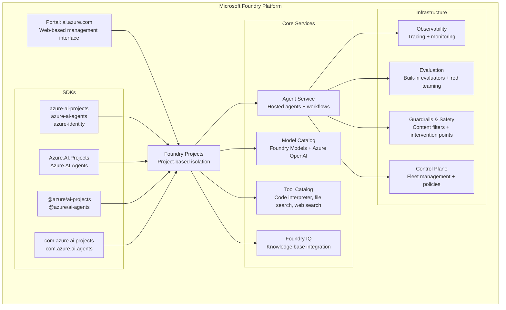

**Sources:** [docs/llms-full.txt:6-32](), [docs/foundry-docs-manifest.json:164-444]()

---

## Documentation Structure

The Microsoft Foundry documentation is organized into 17 hierarchical sections with consistent URL patterns. The structure is defined in `foundry-docs-manifest.json`:

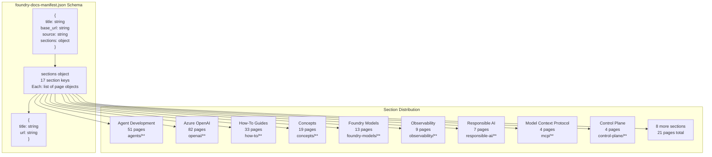

### Manifest JSON Schema

The `foundry-docs-manifest.json` file structure:

```json
{
  "title": "Microsoft Foundry",
  "base_url": "https://learn.microsoft.com/en-us/azure/ai-foundry/",
  "source": "https://raw.githubusercontent.com/MicrosoftDocs/azure-ai-docs/main/articles/foundry/toc.yml",
  "sections": {
    "Agent development": [
      {
        "title": "Agent development overview",
        "url": "https://learn.microsoft.com/en-us/azure/ai-foundry/agents/overview?view=foundry"
      }
    ]
  }
}
```

### Section Mapping

The documentation follows path-based categorization defined in `section_mappings` dictionary:

| URL Path Prefix | Section Name | Page Count | Mapping Source |
|----------------|--------------|------------|----------------|
| `agents/` | Agent Development | 51 | [.github/scripts/scrape_foundry_docs.py:131]() |
| `openai/` | Azure OpenAI | 82 | [.github/scripts/scrape_foundry_docs.py:133]() |
| `how-to/` | How-To Guides | 33 | [.github/scripts/scrape_foundry_docs.py:134]() |
| `concepts/` | Concepts | 19 | [.github/scripts/scrape_foundry_docs.py:135]() |
| `foundry-models/` | Foundry Models | 13 | [.github/scripts/scrape_foundry_docs.py:132]() |
| `observability/` | Observability & Evaluation | 9 | [.github/scripts/scrape_foundry_docs.py:138]() |
| `mcp/` | Model Context Protocol | 4 | [.github/scripts/scrape_foundry_docs.py:144]() |
| `control-plane/` | Control Plane | 4 | [.github/scripts/scrape_foundry_docs.py:139]() |

**Sources:** [docs/foundry-docs-manifest.json:1-10](), [.github/scripts/scrape_foundry_docs.py:126-144]()

---

## SDK Patterns and Authentication

### Standard Authentication Pattern

All Foundry SDKs use `DefaultAzureCredential` from the `azure-identity` package for unified authentication:

```python
from azure.identity import DefaultAzureCredential
from azure.ai.projects import AIProjectClient

credential = DefaultAzureCredential()
client = AIProjectClient(
    endpoint="https://<resource>.services.ai.azure.com/api/projects/<project>",
    credential=credential
)
```

This pattern is embedded in `llms-full.txt` at lines 14-24 as a quick reference code block.

### Required Environment Variables

```bash
AZURE_AI_PROJECT_ENDPOINT=https://<resource>.services.ai.azure.com/api/projects/<project>
AZURE_AI_MODEL_DEPLOYMENT_NAME=gpt-4o-mini
```

These variables are documented in `llms-full.txt` at lines 27-30.

### Multi-Language SDK Support

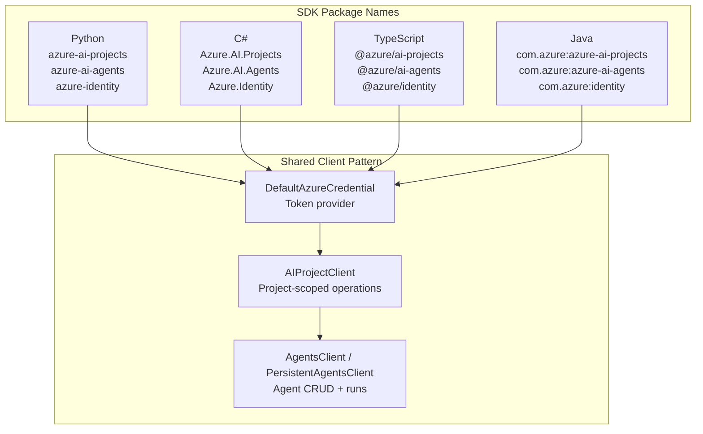

**Sources:** [docs/llms-full.txt:10-30](), [.github/scripts/generate_llms_full.py:287-319]()

---

## API Endpoints and Service Architecture

Microsoft Foundry exposes multiple API versions and service categories. The documentation structure reflects this organization:

### API Version Categorization

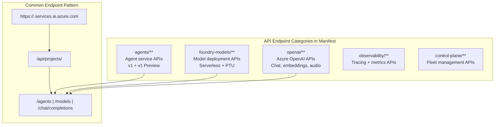

### Agent Service Endpoints

The agent service provides both v1 (stable) and v1 Preview (new features) endpoints:

| Endpoint Category | API Version | Documentation Path |
|-------------------|-------------|-------------------|
| **Agent CRUD** | v1, v1 Preview | `agents/how-to/deploy-hosted-agent` |
| **Agent Runs** | v1, v1 Preview | `agents/concepts/runtime-components` |
| **Tool Catalog** | v1 Preview | `agents/concepts/tool-catalog` |
| **Vector Stores** | v1, v1 Preview | `agents/concepts/vector-stores` |
| **Memory API** | v1 Preview | `agents/how-to/memory-usage` |

### Model Catalog Endpoints

| Endpoint Category | API Type | Documentation Path |
|-------------------|----------|-------------------|
| **Model Deployments** | REST | `foundry-models/how-to/create-model-deployments` |
| **Responses API** | Unified | `foundry-models/how-to/generate-responses` |
| **Model Router** | Load balancer | `openai/how-to/model-router` |

### OpenAI Service Endpoints

| Endpoint | HTTP Method | Documentation Path |
|----------|-------------|-------------------|
| `/chat/completions` | POST | `openai/how-to/chatgpt` |
| `/responses` | POST | `openai/how-to/responses` |
| `/embeddings` | POST | `openai/how-to/embeddings` |
| `/audio/speech` | POST | `openai/audio-completions-quickstart` |
| `/audio/transcriptions` | POST | `openai/whisper-quickstart` |
| `/images/generations` | POST | `openai/how-to/dall-e` |
| `/batch` | POST | `openai/how-to/batch` |

**Sources:** [docs/foundry-docs-manifest.json:164-677](), [docs/llms.txt:24-117]()

---

## Agent Development Services

The Agent Development section comprises 51 pages covering the complete agent lifecycle:

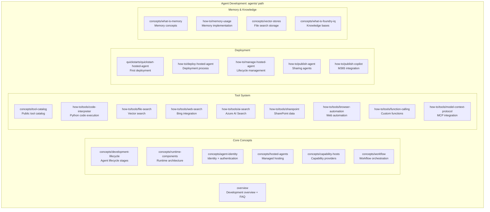

### Agent Runtime Components

The agent runtime consists of three primary components:

| Component | Purpose | Documentation Path |
|-----------|---------|-------------------|
| **Agent Identity** | Authentication and authorization | `agents/concepts/agent-identity` |
| **Hosted Agents** | Managed agent hosting on Azure | `agents/concepts/hosted-agents` |
| **Capability Hosts** | Extensible tool providers | `agents/concepts/capability-hosts` |

**Sources:** [docs/foundry-docs-manifest.json:164-444](), [docs/llms-full.txt:55-132]()

---

## Model Catalog

Microsoft Foundry provides access to multiple model categories through the Foundry Models system:

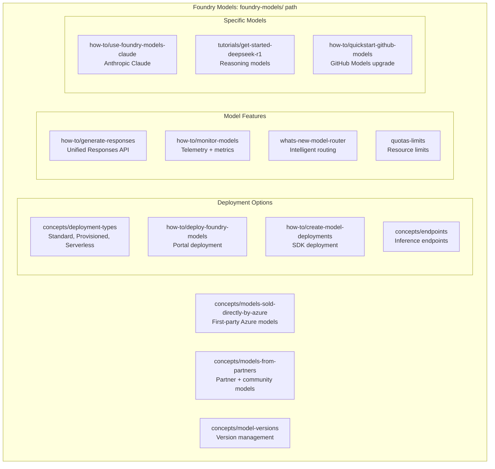

### Deployment Types

| Type | Description | Use Case |
|------|-------------|----------|
| **Standard** | Pay-per-token pricing | Development, variable workloads |
| **Provisioned** | Dedicated capacity (PTU) | Production, predictable costs |
| **Serverless** | Managed scaling | Quick experimentation |

**Sources:** [docs/foundry-docs-manifest.json:445-525](), [docs/llms-full.txt:114-152]()

---

## Azure OpenAI Integration

The Azure OpenAI section comprises 82 pages covering the complete OpenAI service integration:

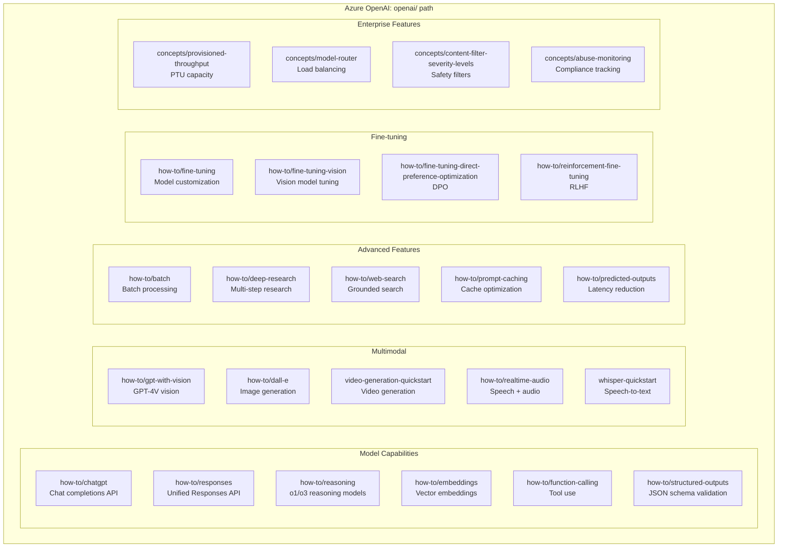

### Key OpenAI Service Patterns

| Feature | API Endpoint | Documentation Path |
|---------|--------------|-------------------|
| **Chat Completions** | `/chat/completions` | `openai/how-to/chatgpt` |
| **Responses API** | `/responses` | `openai/how-to/responses` |
| **Embeddings** | `/embeddings` | `openai/how-to/embeddings` |
| **Realtime Audio** | WebSocket | `openai/how-to/realtime-audio` |
| **Batch Processing** | `/batch` | `openai/how-to/batch` |

**Sources:** [docs/foundry-docs-manifest.json:446-677](), [docs/llms-full.txt:134-236]()

---

## Observability and Evaluation

The platform provides comprehensive monitoring and evaluation capabilities:

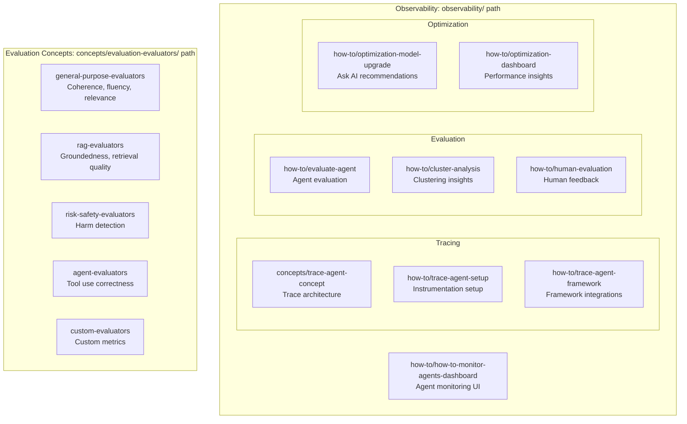

### Built-in Evaluator Categories

| Category | Metrics | Use Case |
|----------|---------|----------|
| **General Purpose** | Coherence, Fluency, Relevance | Quality assessment |
| **RAG** | Groundedness, Retrieval Relevance | Search accuracy |
| **Safety** | Hate, Violence, Self-harm, Sexual | Content moderation |
| **Agent** | Tool Selection, Parameter Accuracy | Agent correctness |
| **Custom** | User-defined functions | Domain-specific |

**Sources:** [docs/foundry-docs-manifest.json:1147-1233](), [docs/llms-full.txt:274-288](), [docs/llms.txt:36-44]()

---

## Documentation Access Methods

The Microsoft Foundry documentation can be accessed through multiple channels:

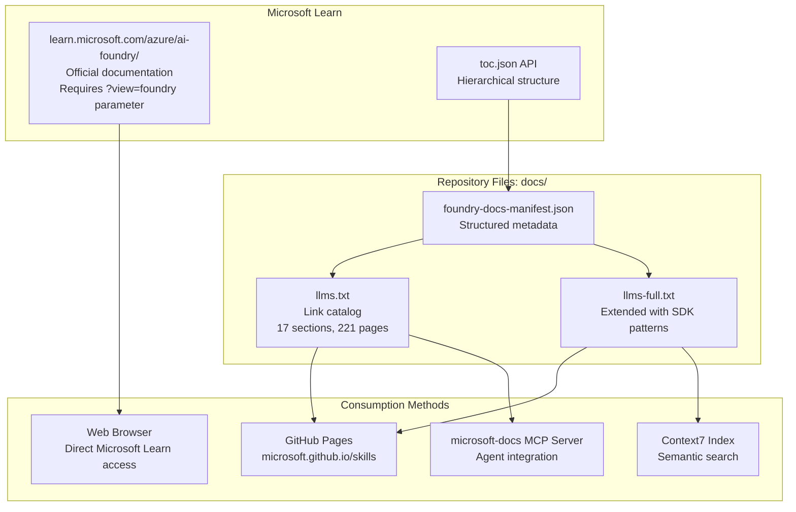

### Access Patterns by Consumer

| Consumer | File Used | Method | Update Frequency |
|----------|-----------|--------|------------------|
| **Human developers** | Microsoft Learn | Direct browser access | Real-time |
| **GitHub Copilot** | `llms.txt` via MCP | microsoft-docs server | Daily sync |
| **Claude Code** | `llms-full.txt` | Context7 indexing | Daily sync |
| **Custom agents** | All files | HTTP GET from GitHub Pages | Daily sync |
| **Web UI** | `foundry-docs-manifest.json` | JSON parsing | Daily sync |

**Sources:** [docs/llms.txt:1-5](), [docs/llms-full.txt:1-5](), [docs/foundry-docs-manifest.json:1-10]()

---

## Generation Pipeline

The documentation files are generated through a two-stage scraping process using async Python with `aiohttp`:

### Pipeline Architecture with Code Entities

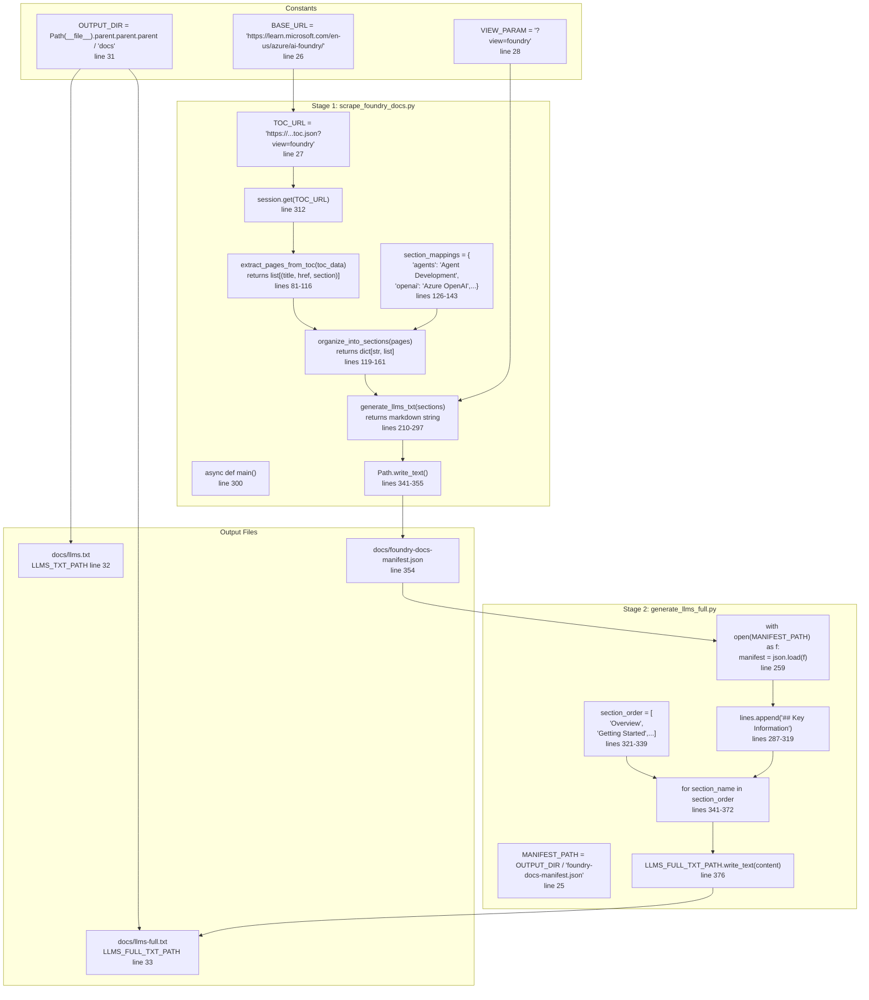

**Sources:** [.github/scripts/scrape_foundry_docs.py:25-33](), [.github/scripts/scrape_foundry_docs.py:81-116](), [.github/scripts/scrape_foundry_docs.py:119-161](), [.github/scripts/scrape_foundry_docs.py:210-297](), [.github/scripts/generate_llms_full.py:24-27](), [.github/scripts/generate_llms_full.py:287-376]()
</thinking>

### Key Constants and Data Structures

The scraping scripts define all paths and configuration as module-level constants:

```python
# scrape_foundry_docs.py lines 25-33
BASE_URL = "https://learn.microsoft.com/en-us/azure/ai-foundry/"
TOC_URL = "https://learn.microsoft.com/en-us/azure/ai-foundry/toc.json?view=foundry"
VIEW_PARAM = "?view=foundry"

OUTPUT_DIR = Path(__file__).parent.parent.parent / "docs"
LLMS_TXT_PATH = OUTPUT_DIR / "llms.txt"
LLMS_FULL_TXT_PATH = OUTPUT_DIR / "llms-full.txt"
```

The `section_mappings` dictionary at lines 126-143 defines URL-to-section categorization:

```python
section_mappings = {
    "what-is": "Overview",
    "quickstarts": "Getting Started",
    "tutorials": "Tutorials",
    "agents": "Agent Development",
    "foundry-models": "Foundry Models",
    "openai": "Azure OpenAI",
    "how-to": "How-To Guides",
    "concepts": "Concepts",
    "reference": "Reference",
    "responsible-ai": "Responsible AI",
    "observability": "Observability & Evaluation",
    "control-plane": "Control Plane",
    "guardrails": "Guardrails & Safety",
    "configuration": "Configuration",
    "fine-tuning": "Fine-tuning",
    "mcp": "Model Context Protocol",
}
```

The `section_order` list in `generate_llms_full.py` at lines 321-339 defines rendering order:

```python
section_order = [
    "Overview",
    "Getting Started",
    "Tutorials",
    "Concepts",
    "Agent Development",
    "Foundry Models",
    "Azure OpenAI",
    "How-To Guides",
    "Observability & Evaluation",
    "Fine-tuning",
    "Model Context Protocol",
    "Control Plane",
    "Guardrails & Safety",
    "Configuration",
    "Responsible AI",
    "Reference",
    "General",
]
```

**Sources:** [.github/scripts/scrape_foundry_docs.py:25-33](), [.github/scripts/scrape_foundry_docs.py:126-143](), [.github/scripts/generate_llms_full.py:321-339]()

---

## Scraping Implementation

### Stage 1: TOC Processing

The `scrape_foundry_docs.py` script implements hierarchical TOC extraction:

#### Key Functions

| Function | Purpose | Lines |
|----------|---------|-------|
| `normalize_url(href, base_path)` | Convert relative paths to absolute URLs with view parameter | [56-78]() |
| `extract_pages_from_toc(toc_data, section_name)` | Recursively extract all pages from TOC JSON | [81-116]() |
| `organize_into_sections(pages)` | Categorize pages by URL path prefix | [119-161]() |
| `generate_llms_txt(sections)` | Format markdown output | [210-297]() |

#### Section Mapping Logic with Data Structures

The `organize_into_sections()` function uses path-based categorization:

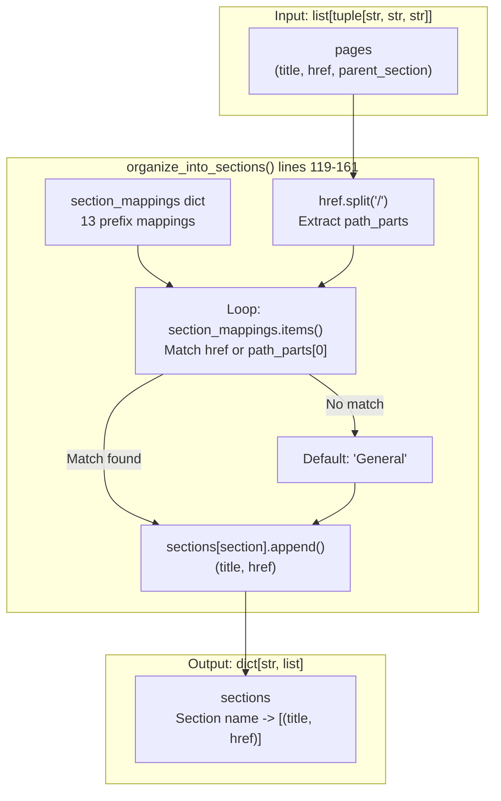

Implementation details:

```python
# lines 126-143: section_mappings definition
section_mappings = {
    "what-is": "Overview",
    "quickstarts": "Getting Started",
    "tutorials": "Tutorials",
    "agents": "Agent Development",
    "foundry-models": "Foundry Models",
    "openai": "Azure OpenAI",
    "how-to": "How-To Guides",
    "concepts": "Concepts",
    "observability": "Observability & Evaluation",
    "control-plane": "Control Plane",
    "guardrails": "Guardrails & Safety",
    "configuration": "Configuration",
    "fine-tuning": "Fine-tuning",
    "mcp": "Model Context Protocol",
}

# lines 146-161: categorization loop
for title, href, parent_section in pages:
    path_parts = href.split("/")
    section = "General"
    
    for prefix, sec_name in section_mappings.items():
        if href.startswith(prefix) or (len(path_parts) > 0 and path_parts[0] == prefix):
            section = sec_name
            break
    
    if section not in sections:
        sections[section] = []
    sections[section].append((title, href))
```

**Sources:** [.github/scripts/scrape_foundry_docs.py:119-161]()

### Stage 2: Extended Content Generation

The `generate_llms_full.py` script adds structured content blocks through list-based string building:

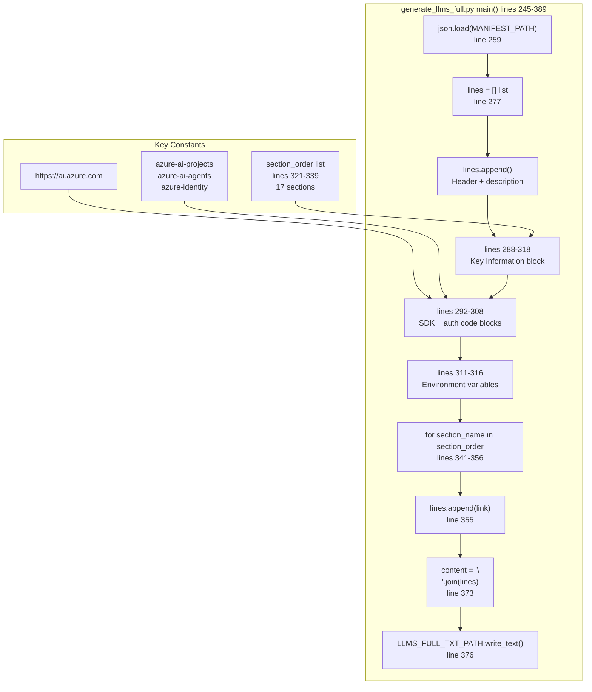

#### Key Information Block Construction

The script programmatically builds the Key Information section:

```python
# lines 288-289: Section header
lines.append("## Key Information")
lines.append("")

# lines 290-291: Portal URL
lines.append("**Portal**: https://ai.azure.com")
lines.append("")

# lines 292-296: SDK Installation
lines.append("**SDK Installation**:")
lines.append("```bash")
lines.append("pip install azure-ai-projects azure-ai-agents azure-identity")
lines.append("```")
lines.append("")

# lines 297-309: Authentication Pattern
lines.append("**Authentication Pattern**:")
lines.append("```python")
lines.append("from azure.identity import DefaultAzureCredential")
lines.append("from azure.ai.projects import AIProjectClient")
lines.append("")
lines.append("credential = DefaultAzureCredential()")
lines.append("client = AIProjectClient(")
lines.append('    endpoint="https://<resource>.services.ai.azure.com/api/projects/<project>",')
lines.append("    credential=credential")
lines.append(")")
lines.append("```")
lines.append("")

# lines 311-317: Environment Variables
lines.append("**Environment Variables**:")
lines.append("```bash")
lines.append("AZURE_AI_PROJECT_ENDPOINT=https://<resource>.services.ai.azure.com/api/projects/<project>")
lines.append("AZURE_AI_MODEL_DEPLOYMENT_NAME=gpt-4o-mini")
lines.append("```")
lines.append("")
```

**Sources:** [.github/scripts/generate_llms_full.py:287-319](), [.github/scripts/generate_llms_full.py:321-339](), [.github/scripts/generate_llms_full.py:373-376]()

---

## Automation Workflow

The generation process is triggered by the `update-llms-txt.yml` workflow with specific GitHub Actions configuration:

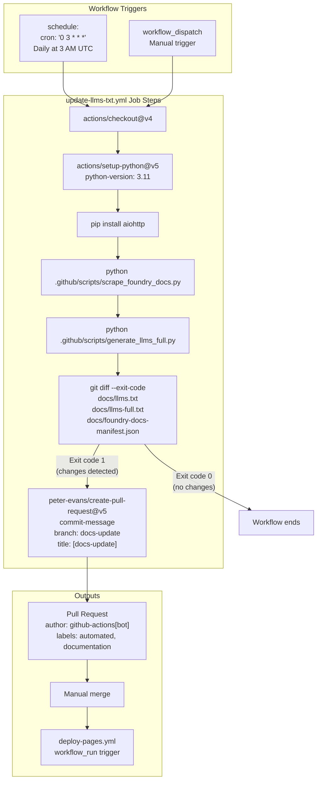

### Workflow File Structure

The `update-llms-txt.yml` workflow automates daily documentation synchronization:

```yaml
# .github/workflows/update-llms-txt.yml
name: Update Foundry llms.txt Documentation

on:
  schedule:
    - cron: '0 3 * * *'  # Daily at 3 AM UTC
  workflow_dispatch:     # Manual trigger

permissions:
  contents: write
  pull-requests: write

jobs:
  update-docs:
    runs-on: ubuntu-latest
    steps:
      - name: Checkout repository
        uses: actions/checkout@v4
        
      - name: Set up Python 3.11
        uses: actions/setup-python@v5
        with:
          python-version: '3.11'
          
      - name: Install dependencies
        run: pip install aiohttp
        
      - name: Run scraper (Stage 1)
        run: python .github/scripts/scrape_foundry_docs.py
        
      - name: Generate full content (Stage 2)
        run: python .github/scripts/generate_llms_full.py
        
      - name: Check for changes
        id: diff
        run: |
          git diff --exit-code docs/llms.txt docs/llms-full.txt docs/foundry-docs-manifest.json
        continue-on-error: true
        
      - name: Create Pull Request
        if: steps.diff.outcome == 'failure'
        uses: peter-evans/create-pull-request@v5
        with:
          commit-message: "docs: update Foundry documentation"
          branch: docs-update-${{ github.run_number }}
          title: "[docs-update] Update Microsoft Foundry documentation"
          body: |
            Automated update from Microsoft Learn
            
            Changes detected in:
            - docs/llms.txt
            - docs/llms-full.txt
            - docs/foundry-docs-manifest.json
          labels: automated, documentation
          delete-branch: true
```

The workflow only creates a PR if `git diff --exit-code` returns non-zero (changes detected).

### Deployment Chain

```mermaid
graph LR
    UpdateWorkflow["update-llms-txt.yml<br/>Generates files"]
    PR["Pull Request<br/>docs-update branch"]
    Main["main branch<br/>Merge event"]
    DeployWorkflow["deploy-pages.yml<br/>workflow_run trigger"]
    ConfigurePages["actions/configure-pages@v4"]
    UploadArtifact["actions/upload-pages-artifact@v3<br/>path: docs"]
    DeployPages["actions/deploy-pages@v4"]
    GitHubPages["GitHub Pages<br/>microsoft.github.io/skills"]
    
    UpdateWorkflow --> PR
    PR --> Main
    Main --> DeployWorkflow
    DeployWorkflow --> ConfigurePages
    ConfigurePages --> UploadArtifact
    UploadArtifact --> DeployPages
    DeployPages --> GitHubPages
```

**Sources:** [.github/workflows/deploy-pages.yml:1-38]()

---

## Rate Limiting and Async Configuration

### Concurrent Request Management

The scraping scripts use `asyncio.Semaphore` for rate limiting:

```python
# generate_llms_full.py lines 28-30
MAX_CONCURRENT_REQUESTS = 10
REQUEST_DELAY = 0.1  # seconds between batches

# Implementation in fetch_page_content() lines 100-130
async def fetch_page_content(
    session: aiohttp.ClientSession, url: str, semaphore: asyncio.Semaphore
) -> tuple[str, str]:
    async with semaphore:
        try:
            headers = {
                "User-Agent": "Mozilla/5.0 (compatible; LLMsTxtGenerator/1.0)",
                "Accept": "text/html,application/xhtml+xml",
            }
            async with session.get(url, headers=headers, timeout=30) as response:
                # ... process response
```

### Batch Processing Flow

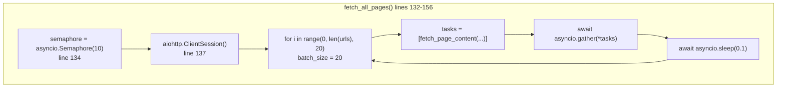

**Sources:** [.github/scripts/generate_llms_full.py:28-31](), [.github/scripts/generate_llms_full.py:100-156]()

---

## Section Organization Details

### URL Normalization Logic

All documentation URLs must include the `?view=foundry` query parameter to access the new Foundry documentation version. The `normalize_url()` function implements this logic:

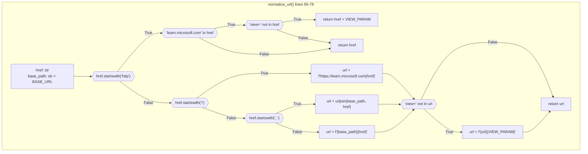

Complete implementation:

```python
# scrape_foundry_docs.py lines 56-78
def normalize_url(href: str, base_path: str = BASE_URL) -> str:
    """Convert relative href to full URL with view parameter."""
    if href.startswith("http"):
        # External URL - don't modify
        if "learn.microsoft.com" in href and "view=" not in href:
            return f"{href}{VIEW_PARAM}"
        return href

    if href.startswith("/"):
        # Absolute path within learn.microsoft.com
        url = f"https://learn.microsoft.com{href}"
    elif href.startswith(".."):
        # Relative path going up - handle azure/ai-services context
        url = urljoin(base_path, href)
    else:
        # Relative path within ai-foundry
        url = f"{base_path}{href}"

    # Add view parameter if not present
    if "view=" not in url:
        url = f"{url}{VIEW_PARAM}"

    return url
```

The `VIEW_PARAM` constant is defined as `"?view=foundry"` at line 28.

**Sources:** [.github/scripts/scrape_foundry_docs.py:25-28](), [.github/scripts/scrape_foundry_docs.py:56-78]()

### Section Ordering

Sections are rendered in a predefined order for consistency:

```python
section_order = [
    "Overview",
    "Getting Started",
    "Tutorials",
    "Concepts",
    "Agent Development",
    "Foundry Models",
    "Azure OpenAI",
    "How-To Guides",
    "Observability & Evaluation",
    "Fine-tuning",
    "Model Context Protocol",
    "Control Plane",
    "Guardrails & Safety",
    "Configuration",
    "Responsible AI",
    "Reference",
    "General",
]
```

This ordering prioritizes foundational content (Overview, Getting Started) before diving into specific features.

**Sources:** [.github/scripts/scrape_foundry_docs.py:245-263]()

---

## Consumption Patterns

The generated documentation files are consumed through multiple channels:

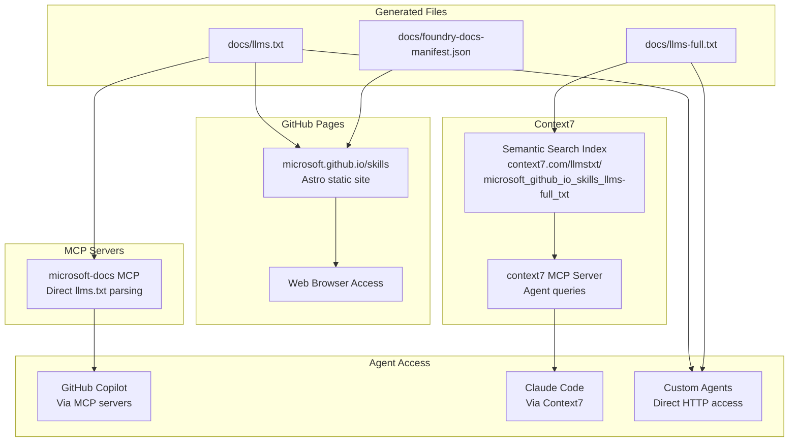

### Access Methods

| Method | File Used | Access Pattern | Use Case |
|--------|-----------|----------------|----------|
| GitHub Pages | `llms.txt`, `manifest.json` | HTTP GET via CDN | Human browsing, documentation reference |
| Context7 | `llms-full.txt` | Indexed + semantic search | Agent semantic queries |
| microsoft-docs MCP | `llms.txt` | Direct parsing | Agent tool calling |
| Direct download | Both files | Raw HTTP GET | Custom integrations |

**Sources:** [.github/docs/blog.wordpress.xml:75-88](), [context7.json:1-13]()

---

## File Size and Performance

### Generation Performance

The scraping process respects rate limits:

```python
MAX_CONCURRENT_REQUESTS = 10
REQUEST_DELAY = 0.1  # seconds between batches
```

Typical execution time:
- Stage 1 (scrape): ~30 seconds for 221 pages
- Stage 2 (generate): <1 second

### Output Sizes

| File | Lines | Bytes | Compression |
|------|-------|-------|-------------|
| `llms.txt` | ~300 | ~18,000 | Gzip: ~5KB |
| `llms-full.txt` | ~450 | ~26,000 | Gzip: ~7KB |
| `foundry-docs-manifest.json` | ~3,000 | ~60,000 | Gzip: ~8KB |

The files are optimized for:
- **Fast downloads**: Small file sizes enable quick loading
- **LLM context windows**: Entire file fits within most context limits
- **Incremental updates**: Git diffs are minimal when pages change

**Sources:** [.github/scripts/generate_llms_full.py:28-31](), [docs/llms.txt:1](), [docs/llms-full.txt:1]()

---

## Error Handling

### HTTP Request Failures

The scraper implements resilient error handling:

```python
async def fetch_page_content(
    session: aiohttp.ClientSession, url: str, semaphore: asyncio.Semaphore
) -> tuple[str, str]:
    async with semaphore:
        try:
            async with session.get(url, headers=headers, timeout=30) as response:
                if response.status == 200:
                    return (url, content)
                else:
                    print(f"  Warning: {url} returned {response.status}")
                    return (url, "")
        except asyncio.TimeoutError:
            print(f"  Timeout: {url}")
            return (url, "")
        except Exception as e:
            print(f"  Error fetching {url}: {e}")
            return (url, "")
```

Failed requests return empty content rather than crashing the entire process.

### Validation

The workflow checks for actual content changes before creating a PR:

```bash
git diff --exit-code docs/llms.txt docs/llms-full.txt docs/foundry-docs-manifest.json
```

If no changes are detected, the workflow exits without creating a PR.

**Sources:** [.github/scripts/generate_llms_full.py:100-130](), [.github/workflows/update-llms-txt.md:43-50]()

---

## Integration Points

### GitHub Pages Deployment

Changes to documentation files trigger the deployment workflow:

```yaml
on:
  push:
    branches: [main]
    paths: [docs/**]
  workflow_run:
    workflows: ["Update Foundry llms.txt Documentation"]
    types: [completed]
    branches: [main]
```

The `deploy-pages.yml` workflow deploys the entire `docs/` directory to `github-pages` environment.

### Context7 Indexing

Context7 automatically indexes the published files:

**URLs indexed:**
- `https://microsoft.github.io/skills/llms.txt`
- `https://microsoft.github.io/skills/llms-full.txt`

The indexed content is available at:
```
https://context7.com/llmstxt/microsoft_github_io_skills_llms-full_txt
```

### MCP Server Access

The `microsoft-docs` MCP server provides programmatic access:

```json
{
  "mcpServers": {
    "microsoft-docs": {
      "type": "stdio",
      "command": "node",
      "args": ["path/to/microsoft-docs-mcp-server"],
      "env": {
        "LLMS_TXT_URL": "https://microsoft.github.io/skills/llms.txt"
      }
    }
  }
}
```

**Sources:** [.github/workflows/deploy-pages.yml:1-38](), [context7.json:1-13](), [.github/docs/blog.wordpress.xml:75-88]()

---

