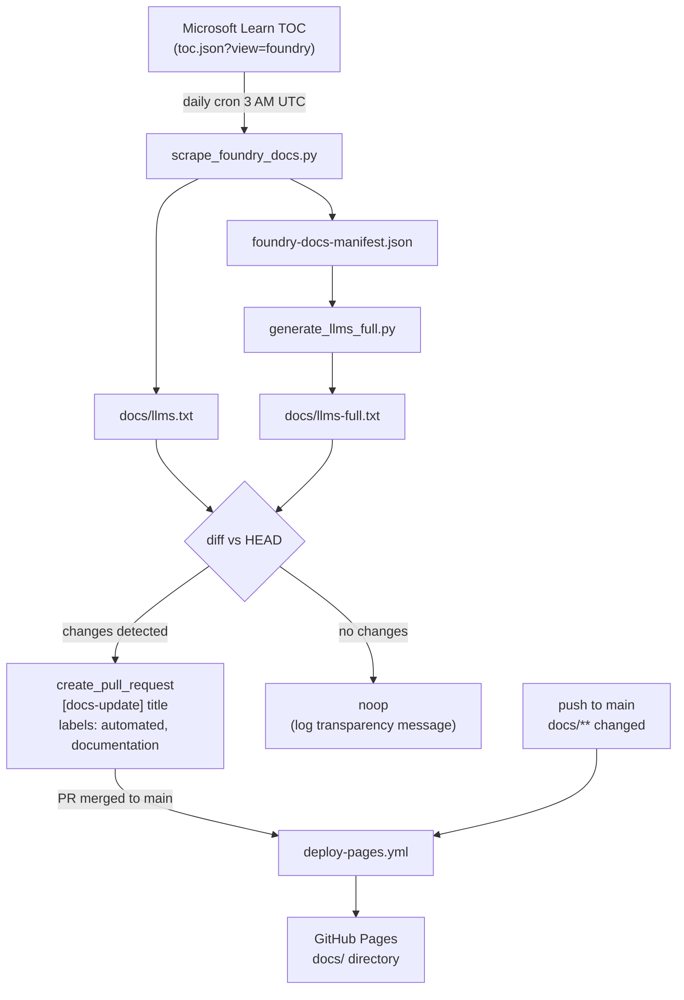
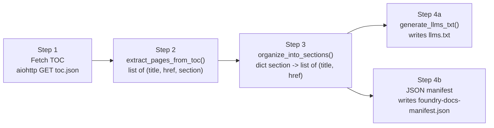
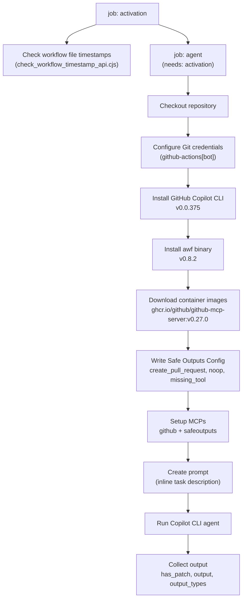
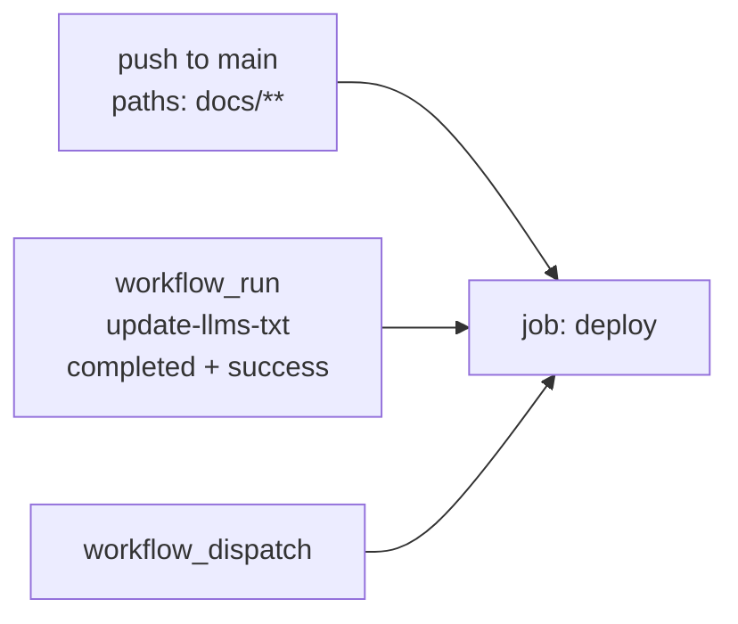

<!-- source: DeepWiki mcp.deepwiki.com · repo microsoft/skills · page 5.3 Automated Documentation Update Workflow · fetched 2026-10-30 -->

# Automated Documentation Update Workflow

<details>
<summary>Relevant source files</summary>

The following files were used as context for generating this wiki page:

- [.gitattributes](.gitattributes)
- [.github/aw/actions-lock.json](.github/aw/actions-lock.json)
- [.github/scripts/generate_llms_full.py](.github/scripts/generate_llms_full.py)
- [.github/scripts/scrape_foundry_docs.py](.github/scripts/scrape_foundry_docs.py)
- [.github/workflows/deploy-pages.yml](.github/workflows/deploy-pages.yml)
- [.github/workflows/update-llms-txt.md](.github/workflows/update-llms-txt.md)
- [docs/.nojekyll](docs/.nojekyll)
- [docs/foundry-docs-manifest.json](docs/foundry-docs-manifest.json)
- [docs/llms-full.txt](docs/llms-full.txt)
- [docs/llms.txt](docs/llms.txt)

</details>


This page documents the full pipeline that keeps the Microsoft Foundry documentation index current. The pipeline scrapes the live Microsoft Learn table of contents, produces two output files (`llms.txt` and `llms-full.txt`), and deploys them to GitHub Pages — all automatically, on a daily schedule.

For what `llms.txt` and `llms-full.txt` contain and their role as LLM-readable documentation, see [Microsoft Foundry Documentation](#5.2). For how Context7 consumes these files and how agents use them at runtime, see [LLM Discovery and Context7 Integration](#5.4).

---

## Pipeline Overview

The pipeline is composed of two Python scripts, one GitHub Actions agentic workflow, and one deployment workflow.

**Pipeline: End-to-end documentation refresh**



Sources: [.github/workflows/update-llms-txt.md](), [.github/workflows/update-llms-txt.lock.yml:23-37](), [.github/workflows/deploy-pages.yml:1-12]()

---

## Script 1: `scrape_foundry_docs.py`

**File:** [.github/scripts/scrape_foundry_docs.py]()

This script fetches the live Foundry documentation TOC and produces `docs/llms.txt` and `docs/foundry-docs-manifest.json`.

### Key Constants

| Constant | Value |
|---|---|
| `BASE_URL` | `https://learn.microsoft.com/en-us/azure/ai-foundry/` |
| `TOC_URL` | `https://learn.microsoft.com/en-us/azure/ai-foundry/toc.json?view=foundry` |
| `VIEW_PARAM` | `?view=foundry` |
| `OUTPUT_DIR` | `docs/` (resolved relative to script location) |

Sources: [.github/scripts/scrape_foundry_docs.py:26-33]()

### Data Structures

```
DocPage
  title: str
  href: str
  url: str
  section: str
  content: str
  summary: str

DocSection
  title: str
  pages: list[DocPage]
```

Sources: [.github/scripts/scrape_foundry_docs.py:37-54]()

### Four-Step Execution in `main()`

**Data flow through `scrape_foundry_docs.py`**



Sources: [.github/scripts/scrape_foundry_docs.py:300-361]()

### `extract_pages_from_toc()`

Recursively walks the TOC JSON structure. Each node may have `toc_title`, `href`, and `children`. The function skips hrefs that:
- Start with `http` (external links)
- Start with `/azure/ai-services` (cross-references to a different product area)
- Start with `../` (relative parent traversal)

[.github/scripts/scrape_foundry_docs.py:81-116]()

### `organize_into_sections()`

Maps each page's `href` to a named section by prefix matching against `section_mappings`. Pages that match no prefix fall into the `"General"` section.

| URL Prefix | Section Name |
|---|---|
| `what-is` | Overview |
| `quickstarts` | Getting Started |
| `tutorials` | Tutorials |
| `agents` | Agent Development |
| `foundry-models` | Foundry Models |
| `openai` | Azure OpenAI |
| `how-to` | How-To Guides |
| `concepts` | Concepts |
| `reference` | Reference |
| `responsible-ai` | Responsible AI |
| `observability` | Observability & Evaluation |
| `control-plane` | Control Plane |
| `guardrails` | Guardrails & Safety |
| `configuration` | Configuration |
| `fine-tuning` | Fine-tuning |
| `mcp` | Model Context Protocol |

Sources: [.github/scripts/scrape_foundry_docs.py:119-161]()

### `generate_llms_txt()`

Assembles the output file in this fixed order: header block → important notes → sections in `section_order` → `## Optional` block (Azure Security Baseline, Azure Compliance, SLA).

Each page is formatted as a markdown link: `- [title](full_url)`.

`normalize_url()` is called on each `href` to prepend `BASE_URL` and append `VIEW_PARAM` as needed.

Sources: [.github/scripts/scrape_foundry_docs.py:210-297]()

### Manifest Output

In addition to `llms.txt`, the script writes `docs/foundry-docs-manifest.json` — a structured JSON representation that `generate_llms_full.py` reads as its input. The manifest includes `title`, `base_url`, `view_param`, a `sections` map, `total_pages`, and `generated_at`.

[.github/scripts/scrape_foundry_docs.py:339-356]()

---

## Script 2: `generate_llms_full.py`

**File:** [.github/scripts/generate_llms_full.py]()

This script reads `docs/foundry-docs-manifest.json` and writes `docs/llms-full.txt`. The design includes infrastructure for fetching live page content, but the current `main()` generates a structured link-only version to avoid hitting rate limits.

### Key Constants

| Constant | Value |
|---|---|
| `MAX_CONCURRENT_REQUESTS` | `10` |
| `REQUEST_DELAY` | `0.1` seconds between batches |
| `MANIFEST_PATH` | `docs/foundry-docs-manifest.json` |
| `LLMS_FULL_TXT_PATH` | `docs/llms-full.txt` |

Sources: [.github/scripts/generate_llms_full.py:23-31]()

### Content Fetching Infrastructure (available but not used in default run)

The script contains a full async page-fetching pipeline that can be activated if needed:

- `MLStripper` — `HTMLParser` subclass that skips `<script>`, `<style>`, and `<nav>` tags to extract readable text
- `strip_html()` — cleans up whitespace after stripping
- `extract_article_content()` — tries to find `<main>`, `<article>`, or `#main-content` before falling back to full HTML stripping
- `fetch_page_content()` — async fetch guarded by `asyncio.Semaphore`
- `fetch_all_pages()` — batches of 20 URLs with `REQUEST_DELAY` between batches

Sources: [.github/scripts/generate_llms_full.py:33-156]()

### Current `main()` Behavior

The default run [.github/scripts/generate_llms_full.py:245-385]() follows four steps:

1. Load `foundry-docs-manifest.json`
2. Build the `llms-full.txt` content in-memory (same `section_order` as `scrape_foundry_docs.py`)
3. Prepend a **Key Information** block containing:
   - Portal URL (`https://ai.azure.com`)
   - SDK installation snippet (`pip install azure-ai-projects azure-ai-agents azure-identity`)
   - `DefaultAzureCredential` / `AIProjectClient` authentication pattern
   - Required environment variables
4. Write `docs/llms-full.txt`

---

## Workflow: `update-llms-txt`

**Source definition:** [.github/workflows/update-llms-txt.md]()  
**Compiled lockfile:** [.github/workflows/update-llms-txt.lock.yml]()

This workflow is generated by `gh-aw` (GitHub Agentic Workflows). The `.md` file is the human-authored source; the `.lock.yml` is compiled from it and should not be edited directly.

### Trigger Schedule

| Trigger | Details |
|---|---|
| `schedule` | `0 3 * * *` (3:00 AM UTC, 7 PM PST) |
| `workflow_dispatch` | Manual trigger via GitHub UI |

Sources: [.github/workflows/update-llms-txt.md:2-3](), [.github/workflows/update-llms-txt.lock.yml:24-27]()

### Permissions and Network

```
permissions:
  contents: read
  issues: read
  pull-requests: read

allowed network domains:
  - defaults
  - learn.microsoft.com
  - pypi.org
  - files.pythonhosted.org
```

The `awf` (Agentic Workflow Firewall) binary enforces the network allowlist at runtime.

Sources: [.github/workflows/update-llms-txt.md:6-14](), [.github/workflows/update-llms-txt.lock.yml:396-401]()

### Job Structure

**Jobs and steps in `update-llms-txt.lock.yml`**



Sources: [.github/workflows/update-llms-txt.lock.yml:40-80]()

### Safe Outputs Schema

The workflow uses the `safeoutputs` MCP server to constrain what the Copilot CLI agent can do. Three tools are available:

| Tool | Max Calls | Purpose |
|---|---|---|
| `create_pull_request` | 1 | Open a PR with updated docs |
| `noop` | 1 | Log that no changes were needed |
| `missing_tool` | 20 | Report if a required tool is unavailable |

PR titles are automatically prefixed with `[docs-update] ` and labeled `automated documentation`.

Sources: [.github/workflows/update-llms-txt.lock.yml:157-239]()

### Agent Prompt Steps

The inline prompt instructs the Copilot CLI agent to:

1. Install `aiohttp`: `pip install aiohttp`
2. Run `python .github/scripts/scrape_foundry_docs.py`
3. Run `python .github/scripts/generate_llms_full.py`
4. Check for file diffs
5. If changed: call `create_pull_request` with a summary of what changed (new pages, removed pages, section changes)
6. If unchanged: call `noop`

Sources: [.github/workflows/update-llms-txt.lock.yml:426-460](), [.github/workflows/update-llms-txt.md:28-56]()

---

## Workflow: `deploy-pages.yml`

**File:** [.github/workflows/deploy-pages.yml]()

Deploys the `docs/` directory to GitHub Pages.

### Trigger Conditions



The `workflow_run` trigger ensures that when a PR from the update workflow is merged, the pages are redeployed automatically. The guard condition `github.event.workflow_run.conclusion == 'success'` prevents deployment if the upstream workflow failed.

Sources: [.github/workflows/deploy-pages.yml:3-25]()

### Deploy Job Steps

| Step | Action |
|---|---|
| Checkout | `actions/checkout@v4` |
| Configure Pages | `actions/configure-pages@v4` |
| Upload artifact | `actions/upload-pages-artifact@v3` with `path: docs` |
| Deploy | `actions/deploy-pages@v4` |

The job runs in the `github-pages` environment. The `pages: write` and `id-token: write` permissions are required for OIDC-based deployment.

Sources: [.github/workflows/deploy-pages.yml:14-38]()

---

## File Inventory

| File | Role |
|---|---|
| `.github/scripts/scrape_foundry_docs.py` | Fetches live TOC, writes `llms.txt` and `foundry-docs-manifest.json` |
| `.github/scripts/generate_llms_full.py` | Reads manifest, writes `llms-full.txt` |
| `.github/workflows/update-llms-txt.md` | Human-authored agentic workflow source |
| `.github/workflows/update-llms-txt.lock.yml` | Compiled GitHub Actions YAML (do not edit directly) |
| `.github/workflows/deploy-pages.yml` | GitHub Pages deployment workflow |
| `docs/foundry-docs-manifest.json` | Intermediate JSON representation of all TOC pages |
| `docs/llms.txt` | LLM-friendly documentation index (link list) |
| `docs/llms-full.txt` | Expanded documentation index with Key Information block |
| `docs/.nojekyll` | Disables Jekyll processing on GitHub Pages |

Sources: [.github/scripts/scrape_foundry_docs.py:24-34](), [.github/scripts/generate_llms_full.py:23-27](), [.github/workflows/deploy-pages.yml:35-37](), [docs/.nojekyll]()

---

## Concurrency and Rate Limiting

The `update-llms-txt` workflow uses a `concurrency` group (`gh-aw-copilot-${{ github.workflow }}`) so that only one agent run executes at a time. This prevents parallel runs from racing on the same output files.

Within `scrape_foundry_docs.py`, `fetch_page_content()` uses `asyncio.Semaphore` to cap simultaneous HTTP requests. `generate_llms_full.py` sets `MAX_CONCURRENT_REQUESTS = 10` and processes URLs in batches of 20 with a `REQUEST_DELAY = 0.1` seconds pause between batches when live content fetching is enabled.

Sources: [.github/workflows/update-llms-txt.lock.yml:34-36](), [.github/workflows/update-llms-txt.lock.yml:70-72](), [.github/scripts/generate_llms_full.py:29-30](), [.github/scripts/generate_llms_full.py:132-156]()

---

