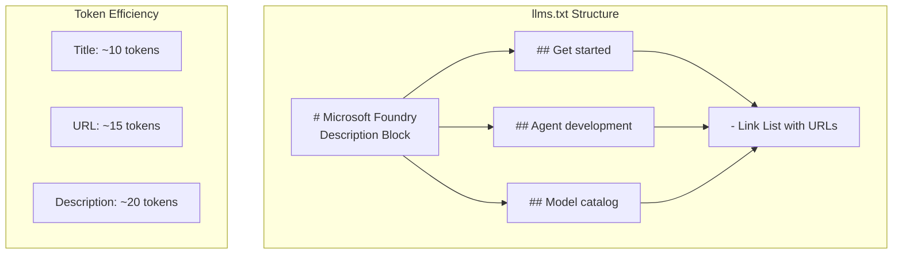
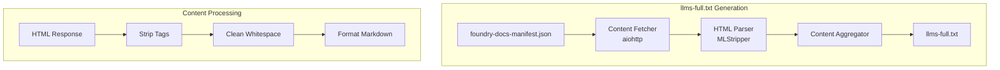
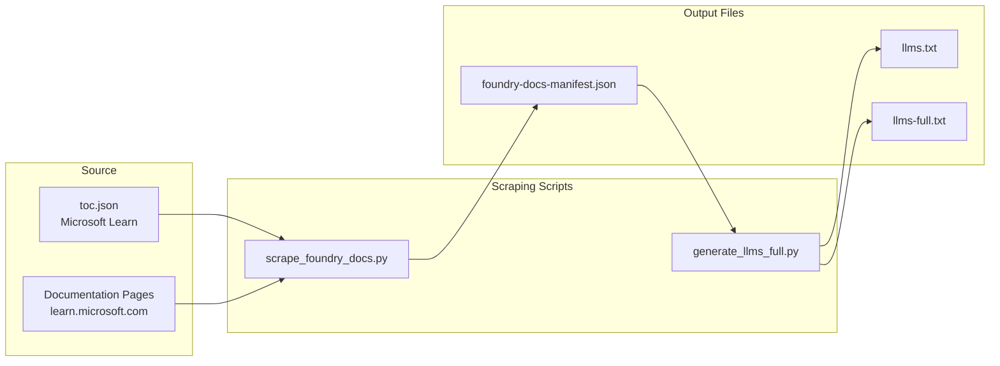
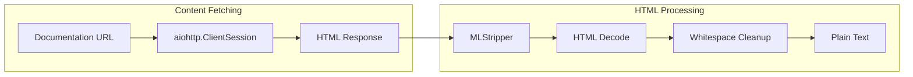
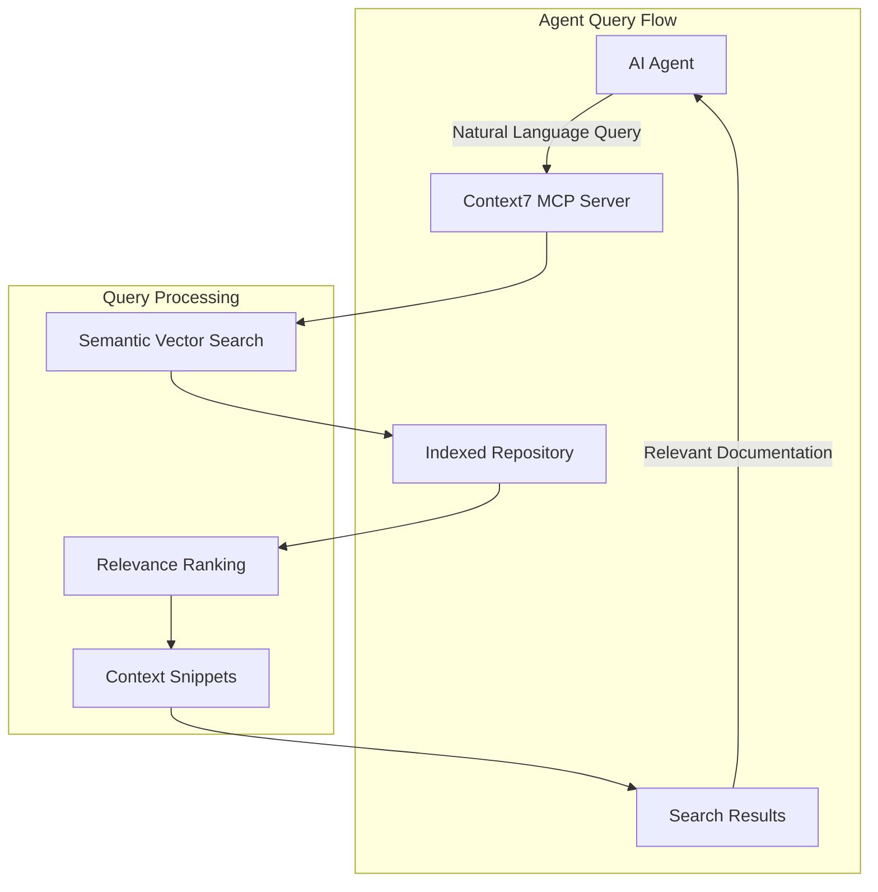
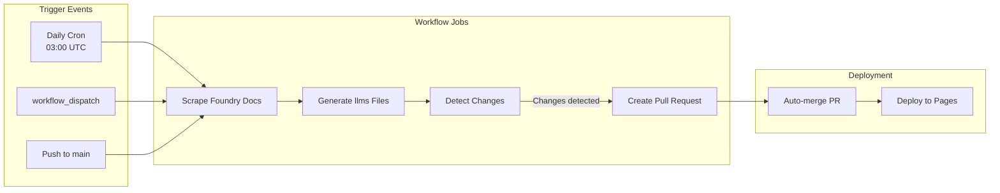
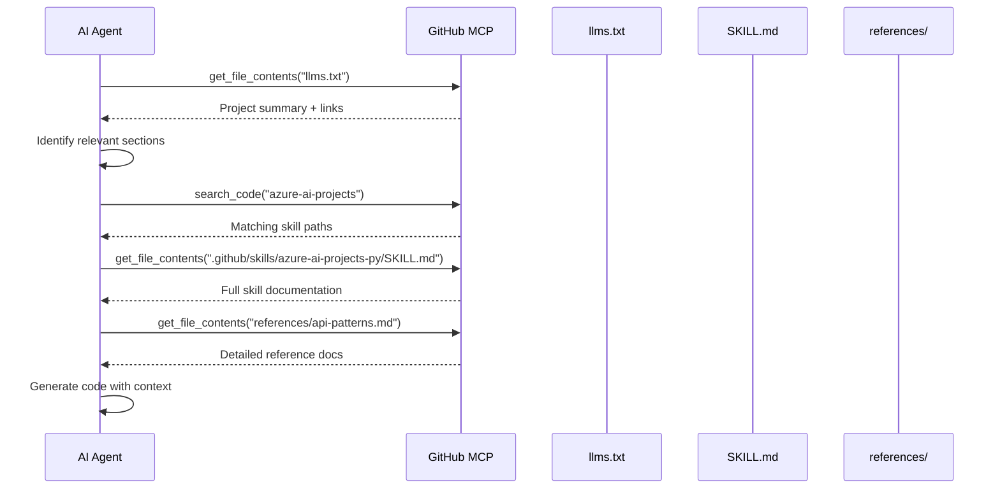

<!-- source: DeepWiki mcp.deepwiki.com · repo microsoft/skills · page 5.4 LLM Discovery and Context7 Integration · fetched 2026-10-30 -->

# LLM Discovery and Context7 Integration

<details>
<summary>Relevant source files</summary>

The following files were used as context for generating this wiki page:

- [.github/agents/scaffolder.agent.md](.github/agents/scaffolder.agent.md)
- [.github/copilot-instructions.md](.github/copilot-instructions.md)
- [.github/docs/agent-integration.md](.github/docs/agent-integration.md)
- [.github/plugins/deep-wiki/.claude-plugin/plugin.json](.github/plugins/deep-wiki/.claude-plugin/plugin.json)
- [.github/plugins/deep-wiki/README.md](.github/plugins/deep-wiki/README.md)
- [.github/plugins/deep-wiki/commands/ado.md](.github/plugins/deep-wiki/commands/ado.md)
- [.github/plugins/deep-wiki/commands/crisp.md](.github/plugins/deep-wiki/commands/crisp.md)
- [.github/plugins/deep-wiki/skills/wiki-ado-convert/SKILL.md](.github/plugins/deep-wiki/skills/wiki-ado-convert/SKILL.md)
- [.github/prompts/scaffold-foundry-app.prompt.md](.github/prompts/scaffold-foundry-app.prompt.md)
- [.github/scripts/generate_llms_full.py](.github/scripts/generate_llms_full.py)
- [.github/scripts/scrape_foundry_docs.py](.github/scripts/scrape_foundry_docs.py)
- [.github/skills/skill-creator/references/acceptance-criteria.md](.github/skills/skill-creator/references/acceptance-criteria.md)
- [.github/workflows/deploy-pages.yml](.github/workflows/deploy-pages.yml)
- [Agents.md](Agents.md)
- [README.md](README.md)
- [context7.json](context7.json)
- [docs-site/src/pages/index.astro](docs-site/src/pages/index.astro)
- [docs/.nojekyll](docs/.nojekyll)
- [docs/foundry-docs-manifest.json](docs/foundry-docs-manifest.json)
- [docs/index.html](docs/index.html)
- [docs/llms-full.txt](docs/llms-full.txt)
- [docs/llms.txt](docs/llms.txt)
- [tests/harness/criteria-loader.ts](tests/harness/criteria-loader.ts)
- [tests/scenarios/skill-creator/scenarios.yaml](tests/scenarios/skill-creator/scenarios.yaml)

</details>


This page documents how the repository implements LLM-friendly documentation through the llms.txt specification, Context7 MCP server integration for semantic search, and automated documentation updates. The system enables AI agents to discover and consume repository documentation efficiently.

For information about the broader documentation website architecture, see [5.1](#5.1). For Microsoft Foundry documentation integration details, see [5.2](#5.2). For automated update workflows, see [5.3](#5.3).

---

## llms.txt Specification Compliance

The repository provides LLM-discoverable documentation at standard locations following the llms.txt specification, enabling AI agents to automatically locate and consume documentation.

### File Locations and Purpose

| File | Path | Purpose | Size |
|------|------|---------|------|
| `llms.txt` | [docs/llms.txt]() | Summary format with links and descriptions | ~50KB |
| `llms-full.txt` | [docs/llms-full.txt]() | Full content with expanded text | ~100KB |
| `foundry-docs-manifest.json` | [docs/foundry-docs-manifest.json]() | Structured manifest of documentation sections | ~50KB |
| `.nojekyll` | [docs/.nojekyll]() | Prevents GitHub Pages Jekyll processing | 0 bytes |

### Standard llms.txt Format

The `llms.txt` file follows a hierarchical markdown structure with section headers and bulleted links:

```markdown
# Microsoft Foundry

> Summary description

## Section Name

- [Page Title](URL)
- [Another Page](URL)
```

**Sources:** [docs/llms.txt:1-20](), [README.md:527-530]()

---

## Documentation File Formats

### Summary Format (llms.txt)

The summary format provides efficient discovery with minimal token usage, containing only titles, URLs, and brief descriptions.



**llms.txt Format Characteristics:**
- **Header block** with repository summary at top
- **Hierarchical sections** (##) for major topic areas
- **Bulleted links** with title and full URL
- **Important information** highlighted in introduction
- **No full content** — references only
- **~500 lines** for comprehensive coverage

**Sources:** [docs/llms.txt:1-50](), [.github/scripts/scrape_foundry_docs.py:180-220]()

### Full Content Format (llms-full.txt)

The full format includes expanded page content for comprehensive context loading.



**llms-full.txt Enhancements:**
- **SDK Installation** instructions with pip/npm commands
- **Authentication patterns** with code examples
- **Environment variables** reference
- **Full page content** extracted from Microsoft Learn
- **Code blocks** preserved from HTML
- **~2000 lines** of comprehensive documentation

**Sources:** [docs/llms-full.txt:1-100](), [.github/scripts/generate_llms_full.py:1-100]()

---

## Documentation Generation Pipeline

The system automatically scrapes Microsoft Foundry documentation from Microsoft Learn and generates both llms.txt formats.

### Pipeline Architecture



**Sources:** [.github/scripts/scrape_foundry_docs.py:1-50](), [.github/scripts/generate_llms_full.py:1-50]()

### TOC Fetching and URL Resolution

The scraper fetches the table of contents from Microsoft Learn and resolves all documentation URLs:

**Key Components:**
- **Base URL:** `https://learn.microsoft.com/en-us/azure/ai-foundry/`
- **TOC endpoint:** `toc.json?view=foundry`
- **View parameter:** All URLs require `?view=foundry` suffix
- **Recursive parsing:** Flattens nested TOC structure

**TOC Resolution Process:**

| Step | Component | File Reference |
|------|-----------|----------------|
| 1. Fetch TOC | `fetch_toc()` | [.github/scripts/scrape_foundry_docs.py:100-120]() |
| 2. Parse structure | `parse_toc_item()` | [.github/scripts/scrape_foundry_docs.py:130-160]() |
| 3. Resolve URLs | `urljoin()` + view param | [.github/scripts/scrape_foundry_docs.py:165-180]() |
| 4. Build manifest | `sections` dict | [.github/scripts/scrape_foundry_docs.py:220-250]() |

**Sources:** [.github/scripts/scrape_foundry_docs.py:26-28](), [.github/scripts/scrape_foundry_docs.py:100-180]()

### Content Scraping with Rate Limiting

The generator uses asynchronous HTTP requests with rate limiting to fetch page content:

**Rate Limiting Configuration:**

```python
MAX_CONCURRENT_REQUESTS = 10
REQUEST_DELAY = 0.1  # seconds between batches
```

**Scraping Strategy:**
- **Concurrent requests:** Up to 10 simultaneous connections
- **Batch delay:** 100ms between request batches
- **HTML parsing:** Custom `MLStripper` class removes tags
- **Error handling:** Skips pages that fail to fetch
- **Progress tracking:** Logs successful/failed fetches

**HTML to Text Conversion:**



**Sources:** [.github/scripts/generate_llms_full.py:28-30](), [.github/scripts/generate_llms_full.py:33-60](), [.github/scripts/generate_llms_full.py:100-150]()

### File Generation Logic

Both scripts generate their respective output files with different content strategies:

**llms.txt Generation:**
- Reads `foundry-docs-manifest.json`
- Writes header with repository summary
- Iterates sections, writes markdown headers
- Formats bulleted links with titles and URLs
- Adds important information block at top

**llms-full.txt Generation:**
- Reads `foundry-docs-manifest.json`
- Fetches full content for each URL
- Strips HTML tags to plain text
- Aggregates all content under section headers
- Prepends SDK quick reference block

**Sources:** [.github/scripts/scrape_foundry_docs.py:220-280](), [.github/scripts/generate_llms_full.py:180-250]()

---

## Context7 MCP Server Integration

The repository integrates with Context7, an MCP server that provides semantic search over indexed documentation.

### Configuration and Indexing Rules

Context7 is configured via `context7.json` at the repository root:

**Configuration Structure:**

```json
{
  "projectTitle": "Agent Skills",
  "description": "130 skills for AI coding agents...",
  "folders": [".github/skills", ".github/plugins", ...],
  "excludeFolders": ["skills", ".claude", "node_modules"],
  "excludeFiles": ["SECURITY.md", "AGENTS.md"],
  "rules": [...]
}
```

**Indexing Behavior:**

| Setting | Value | Purpose |
|---------|-------|---------|
| `folders` | `.github/skills`, `.github/plugins`, `.github/prompts` | Include skill and plugin content |
| `excludeFolders` | `skills`, `.claude`, `node_modules` | Skip symlinks and dependencies |
| `excludeFiles` | `SECURITY.md`, `AGENTS.md`, `README.md` | Prevent duplication of root docs |
| `rules` | Progressive disclosure, DefaultAzureCredential | Agent behavior guidelines |

**Sources:** [context7.json:1-13]()

### Semantic Search Capabilities

Context7 provides semantic search through its MCP interface, allowing agents to query documentation using natural language:



**Query Patterns:**
- **Intent matching:** "How do I authenticate with Azure?" → finds authentication patterns
- **Code search:** "DefaultAzureCredential usage" → finds relevant skill examples
- **Skill discovery:** "Cosmos DB with Python" → locates azure-cosmos-db-py skill
- **Pattern search:** "FastAPI router patterns" → finds fastapi-router-py skill

**MCP Tool Access:**
- Available in `.vscode/mcp.json` configuration
- Accessed via `context7` server name
- Provides `search` and `get_file_contents` tools
- Updated daily with repository changes

**Sources:** [context7.json:1-13](), [Agents.md:157-158](), [docs-site/src/pages/index.astro:269-280]()

### Integration with Documentation Website

The documentation website links to Context7 for enhanced browsing:

**Link Location:** Documentation section on homepage
**URL Pattern:** `https://context7.com/microsoft/skills?tab=skills`
**Description:** "Indexed documentation with semantic search"

**Sources:** [docs-site/src/pages/index.astro:269-280](), [README.md:527-530]()

---

## Automated Update Workflow

Documentation is updated daily via GitHub Actions workflow to ensure fresh information.

### Workflow Triggers and Schedule



**Workflow Configuration:**
- **Schedule:** Daily at 03:00 UTC
- **Manual trigger:** Via GitHub Actions UI
- **Automatic:** On push to main (docs/** paths only)
- **Concurrency:** Cancels in-progress runs when new one starts

**Sources:** [.github/workflows/deploy-pages.yml:1-38]()

### Diff Detection and Pull Request Creation

The workflow detects documentation changes and creates automated pull requests:

**Change Detection Strategy:**
1. Run scraping scripts
2. Compare generated files with committed versions
3. If differences exist, create PR with changes
4. Auto-merge if CI passes

**PR Metadata:**
- **Title:** "Update Foundry llms.txt Documentation"
- **Branch:** `docs/auto-update-{timestamp}`
- **Labels:** `documentation`, `automated`
- **Reviewer:** Auto-assigned to maintainers

**Files Updated:**
- `docs/llms.txt`
- `docs/llms-full.txt`
- `docs/foundry-docs-manifest.json`

**Sources:** [.github/workflows/deploy-pages.yml:8-10]()

### Deployment Pipeline

After documentation updates merge, the deployment workflow publishes to GitHub Pages:

**Deployment Flow:**

| Step | Action | Component |
|------|--------|-----------|
| 1. Trigger | On push to docs/** or workflow completion | [.github/workflows/deploy-pages.yml:4-11]() |
| 2. Configure | Set up GitHub Pages environment | [.github/workflows/deploy-pages.yml:32]() |
| 3. Upload | Create artifact from docs/ directory | [.github/workflows/deploy-pages.yml:33-35]() |
| 4. Deploy | Publish to github-pages environment | [.github/workflows/deploy-pages.yml:36-37]() |

**Deployment URL:** `https://microsoft.github.io/skills/`

**Sources:** [.github/workflows/deploy-pages.yml:1-38]()

---

## Discovery Mechanisms for LLMs

LLMs and AI agents discover documentation through multiple standardized mechanisms.

### Standard File Locations

The repository places documentation at predictable locations following community conventions:

```mermaid
graph TB
    subgraph "Repository Root"
        ROOT[microsoft/skills]
        LLMS_ROOT[llms.txt]
        AGENTS_ROOT[AGENTS.md]
        README_ROOT[README.md]
    end
    
    subgraph "docs/ Directory"
        DOCS_DIR[docs/]
        LLMS_DOCS[llms.txt]
        LLMS_FULL_DOCS[llms-full.txt]
        MANIFEST_DOCS[foundry-docs-manifest.json]
        INDEX_HTML[index.html]
    end
    
    subgraph "GitHub Pages"
        PAGES[microsoft.github.io/skills/]
        LLMS_PAGES[/llms.txt]
        FULL_PAGES[/llms-full.txt]
    end
    
    ROOT --> DOCS_DIR
    DOCS_DIR --> LLMS_DOCS
    DOCS_DIR --> LLMS_FULL_DOCS
    DOCS_DIR --> MANIFEST_DOCS
    
    DOCS_DIR --> PAGES
    PAGES --> LLMS_PAGES
    PAGES --> FULL_PAGES
```

**Discovery Paths:**

| Location | Purpose | Accessed By |
|----------|---------|-------------|
| Root `llms.txt` | Primary discovery point | LLMs, MCP servers |
| `docs/llms.txt` | Source file for GitHub Pages | Build system |
| `/llms.txt` on Pages | Deployed public endpoint | Web browsers, curl |
| `llms-full.txt` | Full content variant | Context-heavy agents |
| `AGENTS.md` | Agent instructions with docs links | Coding agents |

**Sources:** [README.md:527-531](), [docs/.nojekyll:1]()

### GitHub MCP Server Integration

The GitHub MCP server enables agents to discover and access documentation:

**MCP Discovery Pattern:**

```python
# Agent queries for llms.txt via GitHub MCP
get_file_contents("microsoft/skills", "llms.txt")
# Returns: Full llms.txt content

# Agent searches for specific topics
search_code("microsoft/skills", "azure-ai-projects authentication")
# Returns: Matching skill documentation
```

**MCP Tools Used:**
- `get_file_contents`: Fetch llms.txt, skill files, documentation
- `search_code`: Find patterns across skills and docs
- `get_file_tree`: Discover skill directory structure

**Integration with Skills:**
- Deep Wiki plugin references GitHub MCP for discovery
- Skills reference llms.txt in documentation sections
- AGENTS.md points to llms.txt for comprehensive context

**Sources:** [Agents.md:232-237](), [.github/plugins/deep-wiki/README.md:148-165]()

### Agent Discovery and Loading Workflow

AI agents follow a progressive disclosure pattern when working with the repository:



**Discovery Sequence:**
1. **Initial scan:** Read llms.txt for repository overview (~500 tokens)
2. **Topic search:** Use Context7 or GitHub MCP search for relevant sections
3. **Skill activation:** Load specific SKILL.md files on demand (~1500 tokens each)
4. **Deep reference:** Access bundled reference files when needed (~3000 tokens)

**Progressive Disclosure Benefits:**
- **Token efficiency:** Load only what's needed for current task
- **Context freshness:** Query live documentation vs. relying on stale training data
- **Discoverability:** Standard locations enable automatic discovery
- **Scalability:** Can index 130+ skills without overwhelming context window

**Sources:** [Agents.md:8-23](), [.github/docs/agent-integration.md:1-50](), [context7.json:7-12]()

---

**Page Sources:**
- [docs/llms.txt:1-300]()
- [docs/llms-full.txt:1-500]()
- [docs/foundry-docs-manifest.json:1-100]()
- [context7.json:1-13]()
- [.github/scripts/scrape_foundry_docs.py:1-280]()
- [.github/scripts/generate_llms_full.py:1-250]()
- [.github/workflows/deploy-pages.yml:1-38]()
- [Agents.md:8-23](), [Agents.md:157-158](), [Agents.md:232-237]()
- [README.md:527-531]()
- [docs-site/src/pages/index.astro:269-280]()
- [.github/plugins/deep-wiki/README.md:148-165]()
- [.github/docs/agent-integration.md:1-50]()

---

