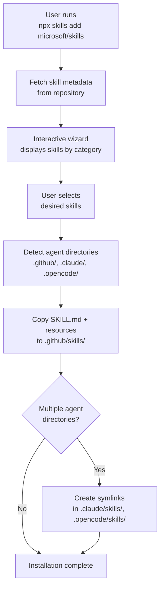
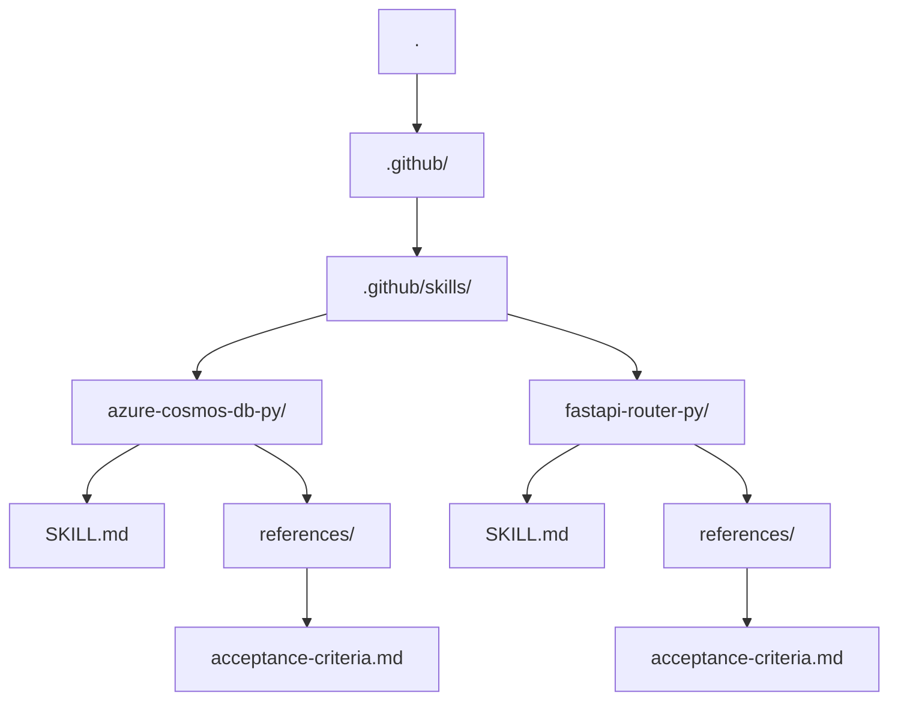
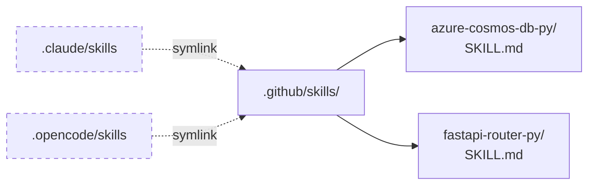
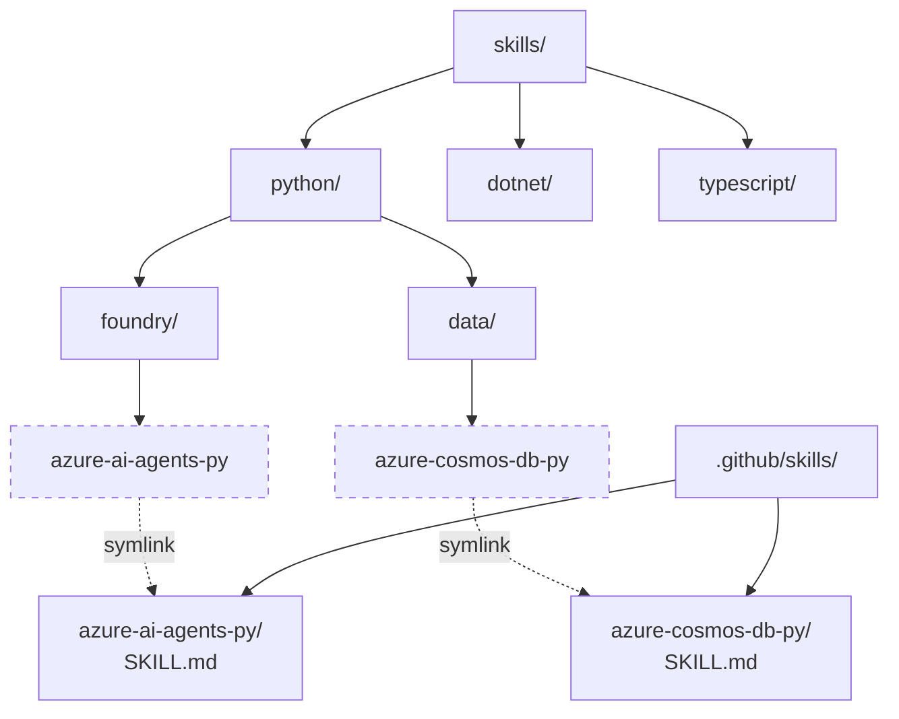
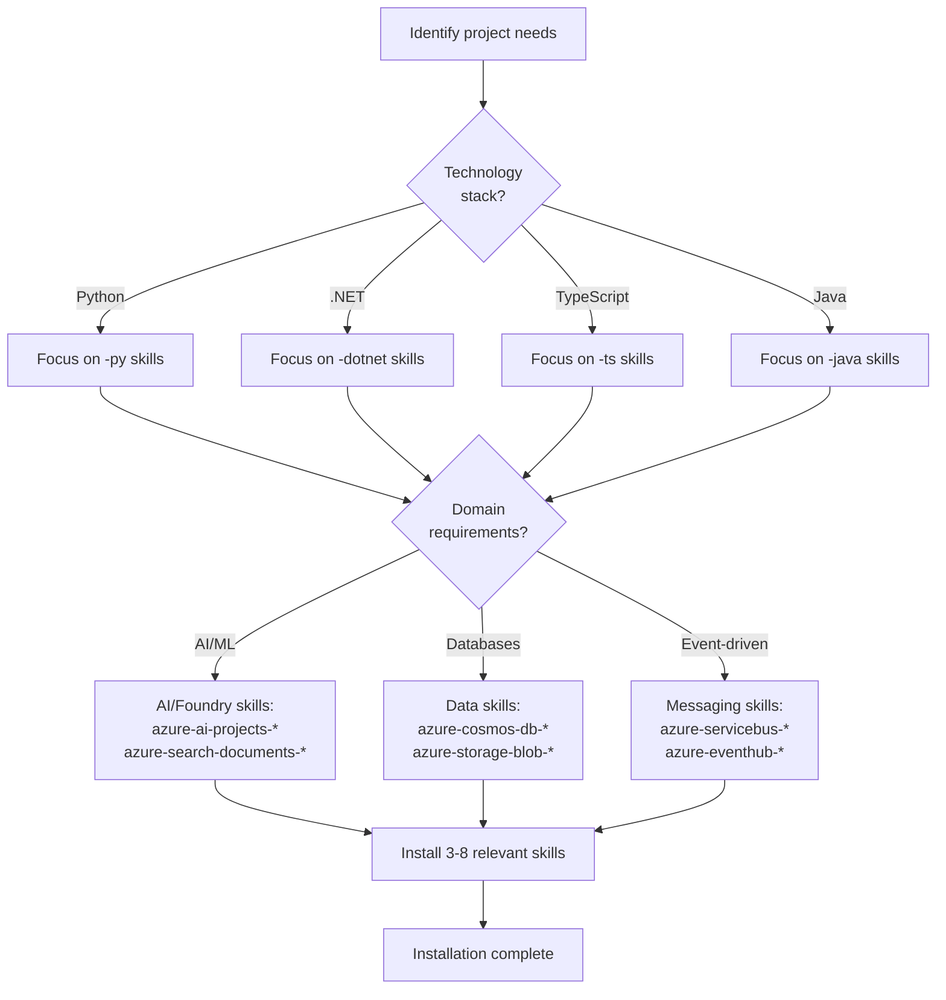

<!-- source: DeepWiki mcp.deepwiki.com · repo microsoft/skills · page 6.1 Installing Skills · fetched 2026-10-30 -->

# Installing Skills

<details>
<summary>Relevant source files</summary>

The following files were used as context for generating this wiki page:

- [.github/agents/scaffolder.agent.md](.github/agents/scaffolder.agent.md)
- [.github/copilot-instructions.md](.github/copilot-instructions.md)
- [.github/docs/agent-integration.md](.github/docs/agent-integration.md)
- [.github/plugins/deep-wiki/.claude-plugin/plugin.json](.github/plugins/deep-wiki/.claude-plugin/plugin.json)
- [.github/plugins/deep-wiki/README.md](.github/plugins/deep-wiki/README.md)
- [.github/plugins/deep-wiki/commands/ado.md](.github/plugins/deep-wiki/commands/ado.md)
- [.github/plugins/deep-wiki/commands/crisp.md](.github/plugins/deep-wiki/commands/crisp.md)
- [.github/plugins/deep-wiki/skills/wiki-ado-convert/SKILL.md](.github/plugins/deep-wiki/skills/wiki-ado-convert/SKILL.md)
- [.github/prompts/scaffold-foundry-app.prompt.md](.github/prompts/scaffold-foundry-app.prompt.md)
- [.github/skills/skill-creator/references/acceptance-criteria.md](.github/skills/skill-creator/references/acceptance-criteria.md)
- [Agents.md](Agents.md)
- [README.md](README.md)
- [context7.json](context7.json)
- [docs-site/src/pages/index.astro](docs-site/src/pages/index.astro)
- [docs/index.html](docs/index.html)
- [tests/harness/criteria-loader.ts](tests/harness/criteria-loader.ts)
- [tests/scenarios/skill-creator/scenarios.yaml](tests/scenarios/skill-creator/scenarios.yaml)

</details>


This page documents the installation methods for adding skills from the microsoft/skills repository to your project. It covers the primary `npx skills add` command, manual installation via git, symlink management for multi-agent setups, and the resulting directory structure. For information about how agents discover and use installed skills, see [Agent Integration](#6.2).

## Installation Methods

Skills can be installed using three methods: the interactive CLI wizard (recommended), manual git clone with selective copying, or symlink-based sharing for advanced setups.

### Primary Method: npx skills add

The recommended installation method uses an interactive wizard that allows selective skill installation:

```bash
npx skills add microsoft/skills
```

This command presents an interactive selection interface where you can choose which skills to install. Skills are copied to `.github/skills/` by default, with optional symlinks for multi-agent configurations.

**Sources:** [README.md:17-23]()

### Installation Flow



**Sources:** [README.md:17-23](), [README.md:32-41]()

### Manual Installation via Git Clone

For manual control over which skills to install, clone the repository and copy specific skill directories:

```bash
# Clone the repository
git clone https://github.com/microsoft/skills.git

# Copy specific skills
cp -r skills/.github/skills/azure-cosmos-db-py your-project/.github/skills/
cp -r skills/.github/skills/fastapi-router-py your-project/.github/skills/
```

This method is useful when you need only one or two skills, or when integrating skills into a custom build process.

**Sources:** [README.md:28-34]()

### Symlink-Based Installation

For multi-project or multi-agent setups, symlinks allow sharing skills across directories without duplication:

```bash
# Symlink from a central skills repository
ln -s /path/to/skills/.github/skills/mcp-builder /path/to/your-project/.github/skills/mcp-builder

# Share skills across different agent configs in the same repo
ln -s ../.github/skills .opencode/skills
ln -s ../.github/skills .claude/skills
```

This approach is beneficial when:
- Multiple projects use the same skill set
- Skills are frequently updated from the source repository
- Different agent configurations (.github, .claude, .opencode) in the same repository should reference identical skills

**Sources:** [README.md:35-40](), [.github/docs/agent-integration.md:130-136]()

## Directory Structure After Installation

The `npx skills add` command creates the following structure in your project:

### Default Installation Structure



Each skill directory contains:
- `SKILL.md` — YAML frontmatter with name/description, followed by markdown instructions
- `references/` — Supporting documentation like acceptance criteria, API references, streaming patterns
- `scripts/` (optional) — Helper scripts or templates
- `assets/` (optional) — Diagrams or other binary resources

**Sources:** [README.md:513-541](), [tests/harness/criteria-loader.ts:28]()

### Multi-Agent Configuration with Symlinks

When multiple agent configurations exist (.github, .claude, .opencode), the installer creates symlinks to avoid duplication:



This ensures all agent configurations reference the same skill files. Updates to skills in `.github/skills/` are automatically visible to agents using .claude or .opencode configurations.

**Sources:** [README.md:38-40]()

## Language-Specific Organization

Skills use language suffixes for discoverability. The repository includes backward-compatible symlinks organized by language:

### Repository Structure with Language Symlinks



The `skills/` directory contains language-organized symlinks pointing to `.github/skills/`. This structure is for repository browsing convenience and backward compatibility. When installing skills via `npx skills add`, skills are copied directly to `.github/skills/` without the language subdirectories.

**Sources:** [README.md:532-538](), [Agents.md:153]()

## Skill Naming Conventions

Skills follow a consistent naming pattern for automatic categorization:

| Language | Suffix | Example Skills |
|----------|--------|---------------|
| Python | `-py` | `azure-cosmos-db-py`, `fastapi-router-py`, `pydantic-models-py` |
| .NET/C# | `-dotnet` | `azure-ai-inference-dotnet`, `azure-resource-manager-cosmosdb-dotnet` |
| TypeScript/JavaScript | `-ts` | `azure-ai-agents-ts`, `react-flow-node-ts`, `zustand-store-ts` |
| Java | `-java` | `azure-cosmos-java`, `azure-ai-projects-java` |
| Rust | `-rust` | `azure-identity-rust`, `azure-cosmos-rust` |
| Core (cross-language) | (none) | `mcp-builder`, `skill-creator`, `copilot-sdk` |

This naming convention allows agents to filter skills based on the project's technology stack. The suffix is part of the skill directory name and the `name` field in the YAML frontmatter.

**Sources:** [README.md:74-83](), [.github/copilot-instructions.md:109-118](), [.github/docs/agent-integration.md:138-149]()

## Selective Installation Best Practice

The repository contains 133 skills across multiple languages and domains. **Do not install all skills** — this causes context rot where agents have diluted attention across unrelated patterns.

### Installation Decision Tree



**Example for a Python FastAPI + Azure Cosmos DB project:**
- Install: `azure-cosmos-db-py`, `fastapi-router-py`, `pydantic-models-py`, `azure-identity-py`
- Skip: All .NET, TypeScript, Java skills, and unrelated Azure service skills

**Sources:** [README.md:48-51](), [Agents.md:174-176](), [.github/docs/agent-integration.md:100-117]()

## Verifying Installation

After installation, verify skills are correctly installed and discoverable:

```bash
# List installed skills
ls -la .github/skills/

# Verify a skill's structure
cat .github/skills/azure-cosmos-db-py/SKILL.md | head -20

# Check for symlinks (multi-agent setup)
ls -la .claude/skills/ 2>/dev/null
ls -la .opencode/skills/ 2>/dev/null
```

Each skill directory should contain at minimum:
- `SKILL.md` with YAML frontmatter (lines starting with `---`, followed by `name:` and `description:`)
- Markdown body with installation, authentication, and core workflow sections

**Sources:** [tests/harness/criteria-loader.ts:28](), [tests/scenarios/skill-creator/scenarios.yaml:10-88]()

## Skill Directory Structure Details

A complete skill directory follows this structure:

| Component | Path | Purpose | Required |
|-----------|------|---------|----------|
| Skill definition | `SKILL.md` | YAML frontmatter + markdown instructions | ✅ Yes |
| Acceptance criteria | `references/acceptance-criteria.md` | Correct/incorrect code patterns for validation | Recommended |
| Test scenarios | `tests/scenarios/<skill-name>/scenarios.yaml` | Automated evaluation scenarios | Recommended |
| API reference | `references/*.md` | Deep-dive documentation on specific features | Optional |
| Helper scripts | `scripts/*.sh` or `scripts/*.py` | Automation or scaffolding tools | Optional |
| Assets | `assets/*.png` or `assets/*.svg` | Diagrams or images | Optional |

When using `npx skills add`, the entire skill directory with all components is copied. When manually copying, ensure you include at minimum the `SKILL.md` file.

**Sources:** [.github/skills/skill-creator/references/acceptance-criteria.md:1-68](), [tests/harness/criteria-loader.ts:1-22]()

## Post-Installation Configuration

After installing skills, agents automatically discover them through directory scanning. No additional configuration is required for basic usage. However, for customized agent behavior:

### Optional: Agent Instructions

Create or update `.github/copilot-instructions.md` to guide skill selection:

```markdown
## Project-Specific Skills

For Cosmos DB operations, load: azure-cosmos-db-py
For API endpoints, load: fastapi-router-py
For data models, load: pydantic-models-py
```

This file is automatically read by GitHub Copilot and similar agents.

**Sources:** [.github/copilot-instructions.md:101-145](), [.github/docs/agent-integration.md:46-56]()

### Optional: Custom Agent Personas

Define role-specific agents in `.github/agents/` that reference specific skills:

```markdown
---
name: Backend Developer
skills: ["azure-cosmos-db-py", "fastapi-router-py", "pydantic-models-py"]
---
```

This pattern is used by agent frameworks that support persona-based skill loading.

**Sources:** [README.md:580-589](), [Agents.md:148-164]()

---

**Sources:** [README.md:17-51](), [README.md:513-541](), [.github/docs/agent-integration.md:1-150](), [.github/copilot-instructions.md:70-145](), [tests/harness/criteria-loader.ts:1-58](), [.github/skills/skill-creator/references/acceptance-criteria.md:1-68]()

---

