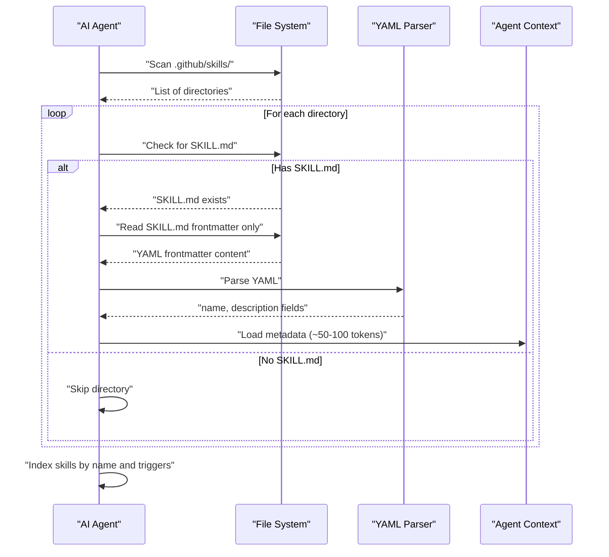
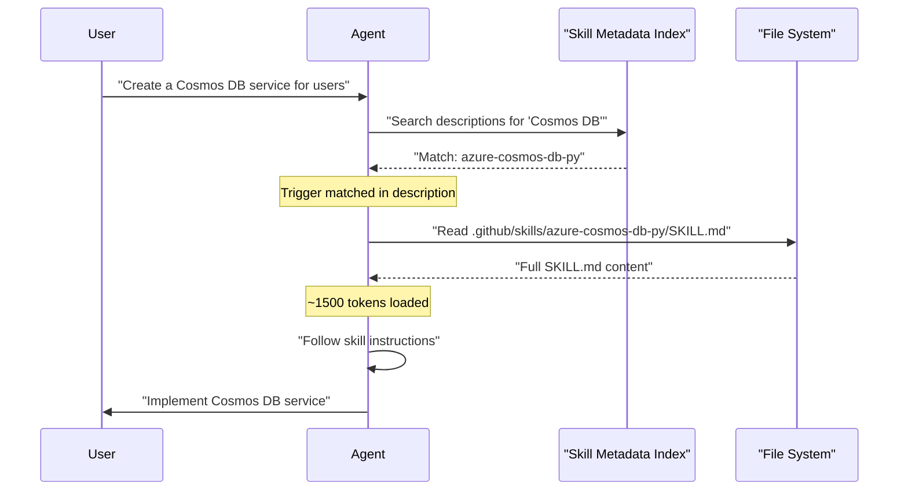
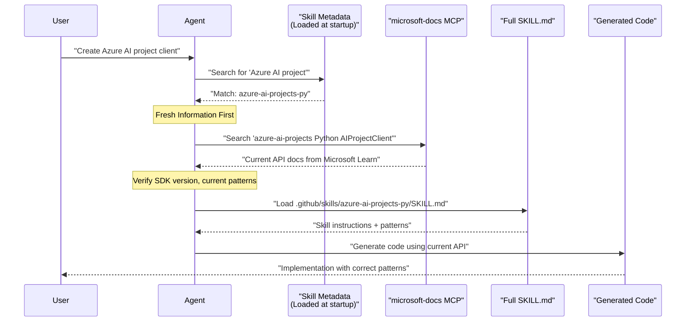

<!-- source: DeepWiki mcp.deepwiki.com · repo microsoft/skills · page 6.2 Agent Integration · fetched 2026-10-30 -->

# Agent Integration

<details>
<summary>Relevant source files</summary>

The following files were used as context for generating this wiki page:

- [.github/agents/scaffolder.agent.md](.github/agents/scaffolder.agent.md)
- [.github/copilot-instructions.md](.github/copilot-instructions.md)
- [.github/docs/agent-integration.md](.github/docs/agent-integration.md)
- [.github/plugins/deep-wiki/.claude-plugin/plugin.json](.github/plugins/deep-wiki/.claude-plugin/plugin.json)
- [.github/plugins/deep-wiki/README.md](.github/plugins/deep-wiki/README.md)
- [.github/plugins/deep-wiki/commands/ado.md](.github/plugins/deep-wiki/commands/ado.md)
- [.github/plugins/deep-wiki/commands/crisp.md](.github/plugins/deep-wiki/commands/crisp.md)
- [.github/plugins/deep-wiki/skills/wiki-ado-convert/SKILL.md](.github/plugins/deep-wiki/skills/wiki-ado-convert/SKILL.md)
- [.github/prompts/scaffold-foundry-app.prompt.md](.github/prompts/scaffold-foundry-app.prompt.md)
- [.github/skills/continual-learning/SKILL.md](.github/skills/continual-learning/SKILL.md)
- [.github/skills/skill-creator/references/acceptance-criteria.md](.github/skills/skill-creator/references/acceptance-criteria.md)
- [Agents.md](Agents.md)
- [README.md](README.md)
- [context7.json](context7.json)
- [docs-site/src/data/skills.json](docs-site/src/data/skills.json)
- [docs-site/src/pages/index.astro](docs-site/src/pages/index.astro)
- [docs/index.html](docs/index.html)
- [hooks/continual-learning/README.md](hooks/continual-learning/README.md)
- [hooks/continual-learning/hooks.json](hooks/continual-learning/hooks.json)
- [hooks/continual-learning/learn.sh](hooks/continual-learning/learn.sh)
- [tests/harness/criteria-loader.ts](tests/harness/criteria-loader.ts)
- [tests/scenarios/skill-creator/scenarios.yaml](tests/scenarios/skill-creator/scenarios.yaml)

</details>


This page explains how AI coding agents discover and use skills from this repository. It covers the startup discovery process, progressive disclosure loading, the role of `AGENTS.md` as the primary entry point, `context7.json` indexing rules, and the Fresh Information First principle with MCP server queries.

For information about installing skills into your project, see [Installing Skills](#6.1). For MCP server configuration details, see [MCP Server Configuration](#6.3). For platform-specific integration details, see [GitHub Copilot and Claude Integration](#6.4).

---

## Skill Discovery at Startup

AI coding agents discover skills through a two-phase process when a session begins.

### Discovery Flow



**Sources:** [.github/docs/agent-integration.md:9-35](), [Agents.md:146-177](), [README.md:513-541]()

### Phase 1: Directory Scanning

Agents scan configured skill directories for folders containing a `SKILL.md` file. The default location is `.github/skills/`, with plugin-specific locations like `.github/plugins/azure-sdk-python/skills/`.

Valid skill structure:
```
.github/skills/
├── azure-cosmos-db-py/
│   └── SKILL.md                  # Valid - has SKILL.md
├── fastapi-router-py/
│   └── SKILL.md                  # Valid - has SKILL.md
└── some-folder/
    └── README.md                 # Invalid - no SKILL.md
```

**Sources:** [.github/docs/agent-integration.md:9-23](), [README.md:513-541]()

### Phase 2: Metadata Extraction

For each discovered skill, agents parse only the YAML frontmatter at the top of `SKILL.md`:

```yaml
---
name: azure-cosmos-db-py
description: Build Azure Cosmos DB NoSQL services with Python/FastAPI following production-grade patterns.
---
```

This metadata is indexed using approximately 50-100 tokens per skill. The full markdown body is NOT loaded at this phase.

**Sources:** [.github/docs/agent-integration.md:26-36](), [Agents.md:149-151](), [.github/copilot-instructions.md:103-106]()

---

## Progressive Disclosure Architecture

Skills implement a three-tier loading strategy to prevent context rot while maintaining access to deep domain knowledge.

### Three-Tier Loading Model

```mermaid
graph TD
    Startup["Session Start"]
    Scan["Scan .github/skills/"]
    LoadMeta["Load Metadata<br/>(Tier 1)<br/>~50-100 tokens/skill"]
    UserRequest["User Request"]
    Match["Match Request to Skill Triggers"]
    LoadFull["Load Full SKILL.md<br/>(Tier 2)<br/>~500-2000 tokens"]
    NeedRef{"Need<br/>References?"}
    LoadRes["Load References/<br/>(Tier 3)<br/>Variable tokens"]
    Execute["Execute Task"]
    
    Startup-->Scan
    Scan-->LoadMeta
    LoadMeta-->UserRequest
    UserRequest-->Match
    Match-->LoadFull
    LoadFull-->NeedRef
    NeedRef-->|Yes|LoadRes
    NeedRef-->|No|Execute
    LoadRes-->Execute
    
    style LoadMeta fill:#2d333b,stroke:#6d5dfc
    style LoadFull fill:#2d333b,stroke:#6d5dfc
    style LoadRes fill:#2d333b,stroke:#6d5dfc
```



**Sources:** [.github/docs/agent-integration.md:59-77](), [README.md:45-51]()

### Tier Specifications

| Tier | Content | When Loaded | Token Cost | Location |
|------|---------|-------------|------------|----------|
| **1. Metadata** | `name` + `description` from YAML frontmatter | At session startup | ~50-100 per skill | Top of `SKILL.md` |
| **2. Instructions** | Full markdown body of `SKILL.md` | When skill is activated by user request | ~500-2000 | `SKILL.md` body |
| **3. Resources** | Additional reference files | On demand when agent needs specific info | Variable | `references/`, `scripts/`, `assets/` |

**Sources:** [.github/docs/agent-integration.md:59-77](), [Agents.md:146-177]()

### Activation Example



**Sources:** [.github/docs/agent-integration.md:66-77]()

---

## AGENTS.md as Entry Point

The `AGENTS.md` file serves as the primary instruction file for AI coding agents, providing structured guidance on project conventions, available skills, and development principles.

### AGENTS.md Structure

```mermaid
graph TB
    AgentsMD["AGENTS.md<br/>(Root)"]
    
    FreshInfo["Fresh Information First<br/>⚠️ Query MCP servers before coding"]
    Principles["Core Principles<br/>Think, Simplicity, Surgical, Goal-Driven"]
    CleanArch["Clean Architecture<br/>Layer boundaries"]
    
    SDK["SDK Quick Reference<br/>Authentication patterns"]
    Skills["Skills Section<br/>Location: .github/skills/"]
    SkillCatalog["Skill Catalog<br/>By language/category"]
    
    MCP["MCP Servers<br/>microsoft-docs, context7, etc."]
    Conventions["Conventions<br/>Code style, Git, Testing"]
    Workflow["Workflow<br/>Adding features (TDD)"]
    
    AgentsMD-->FreshInfo
    AgentsMD-->Principles
    AgentsMD-->CleanArch
    AgentsMD-->SDK
    AgentsMD-->Skills
    AgentsMD-->MCP
    AgentsMD-->Conventions
    AgentsMD-->Workflow
    
    Skills-->SkillCatalog
    
    style AgentsMD fill:#2d333b,stroke:#6d5dfc
    style FreshInfo fill:#2d333b,stroke:#da3633
    style Skills fill:#2d333b,stroke:#6d5dfc
```



**Sources:** [Agents.md:1-354](), [.github/copilot-instructions.md:1-306]()

### Key Sections in AGENTS.md

| Section | Lines | Purpose |
|---------|-------|---------|
| Fresh Information First | [Agents.md:5-24]() | Critical warning to query MCP servers before coding |
| Core Principles | [Agents.md:26-87]() | Think Before Coding, Simplicity First, Surgical Changes, Goal-Driven |
| Clean Architecture | [Agents.md:89-112]() | Layered boundaries for features |
| SDK Quick Reference | [Agents.md:114-145]() | Authentication patterns, environment variables |
| Skills | [Agents.md:147-223]() | Location (`.github/skills/`), catalog, selection principles |
| MCP Servers | [Agents.md:227-256]() | Documentation search, development tools, utilities |
| Conventions | [Agents.md:258-303]() | Code style, Git/GitHub, testing patterns |
| Workflow | [Agents.md:305-320]() | TDD-based feature addition process |

**Sources:** [Agents.md:1-354]()

### AGENTS.md Discovery Mechanisms

Agents discover `AGENTS.md` through multiple paths:

1. **Standard location check**: Agents look for `./AGENTS.md` at repository root
2. **VS Code Copilot**: Reads `.github/copilot-instructions.md` (mirrors `AGENTS.md`)
3. **llms.txt reference**: The `llms.txt` file links to `AGENTS.md` in its documentation section
4. **Deep Wiki generation**: The `/deep-wiki:agents` command generates `AGENTS.md` files for folders

**Sources:** [Agents.md:1](), [.github/copilot-instructions.md:1](), [.github/plugins/deep-wiki/README.md:148-165]()

---

## Context7 Indexing Rules

The `context7.json` file configures which folders and files are indexed for semantic search by Context7 MCP server and similar tools.

### context7.json Structure

```mermaid
graph LR
    C7["context7.json"]
    
    Meta["projectTitle<br/>description"]
    Include["folders[]<br/>.github/skills<br/>.github/plugins<br/>.github/prompts"]
    Exclude["excludeFolders[]<br/>node_modules<br/>skills (symlinks)"]
    ExcludeFiles["excludeFiles[]<br/>SECURITY.md<br/>README.md"]
    Rules["rules[]<br/>Load skills selectively<br/>Use DefaultAzureCredential<br/>Search microsoft-docs MCP"]
    
    C7-->Meta
    C7-->Include
    C7-->Exclude
    C7-->ExcludeFiles
    C7-->Rules
    
    style C7 fill:#2d333b,stroke:#6d5dfc
```



**Sources:** [context7.json:1-13]()

### Configuration Fields

| Field | Purpose | Example Values |
|-------|---------|----------------|
| `projectTitle` | Short project name | `"Agent Skills"` |
| `description` | One-line summary | `"130 skills for AI coding agents working with Azure SDKs..."` |
| `folders` | Directories to index | `[".github/skills", ".github/plugins", ".github/agents"]` |
| `excludeFolders` | Directories to skip | `["node_modules", "skills"]` (symlinks to avoid duplication) |
| `excludeFiles` | Specific files to skip | `["SECURITY.md", "README.md"]` (indexed separately) |
| `rules` | Agent guidance principles | See rules section below |

**Sources:** [context7.json:1-13]()

### Indexing Rules

The `rules` array in [context7.json:7-12]() provides agent-level guidance:

1. **"Load skills selectively - only those relevant to current task to avoid context rot"**  
   Prevents loading all 133 skills simultaneously

2. **"Always use DefaultAzureCredential for Azure SDK authentication"**  
   Enforces security best practice

3. **"Search microsoft-docs MCP before implementing Azure SDK code"**  
   Implements Fresh Information First principle

4. **"Skills use progressive disclosure: metadata at startup, full instructions on activation"**  
   Documents the three-tier loading model

**Sources:** [context7.json:7-12](), [README.md:45-51]()

---

## Fresh Information First with MCP Servers

The **Fresh Information First** principle requires agents to query MCP servers for current documentation before implementing code, preventing the use of outdated patterns from training data.

### MCP Query Flow



**Sources:** [Agents.md:5-24](), [.github/copilot-instructions.md:7-18]()

### Fresh Information First Mandate

From [Agents.md:5-24]():

> **Azure SDKs and Foundry APIs change constantly. Never work with stale knowledge.**
>
> Before implementing anything with Azure/Foundry SDKs:
> 1. Search official docs first — Use the Microsoft Docs MCP (`microsoft-docs`) to get current API signatures, parameters, and patterns
> 2. Verify SDK versions — Check `pip show <package>` for installed versions; APIs differ between versions
> 3. Don't trust cached knowledge — Your training data is outdated. The SDK you "know" may have breaking changes.

**Why this matters:** AI models are trained on historical data. Azure SDK APIs change frequently with breaking changes across versions. Relying on training data produces broken code.

**Sources:** [Agents.md:5-24](), [.github/copilot-instructions.md:7-18]()

### MCP Server Priority

The [.vscode/mcp.json]() file (referenced in [Agents.md:227-256]()) configures these MCP servers:

| MCP Server | Purpose | Priority | Usage Pattern |
|------------|---------|----------|---------------|
| `microsoft-docs` | Search Microsoft Learn for official Azure/Foundry docs | **Primary** | Query BEFORE implementing Azure SDK code |
| `context7` | Semantic search of indexed Foundry documentation | Secondary | When `microsoft-docs` lacks specific info |
| `deepwiki` | Ask questions about GitHub repositories | Tertiary | For understanding repo structure |

**Sources:** [Agents.md:227-256](), [.github/copilot-instructions.md:149-177](), [README.md:562-573]()

---

## Skill Selection Principle

**Never load all skills at once.** Loading all 133 skills causes context rot through diluted attention, wasted tokens, and conflated patterns.

### Context Rot Diagram

```mermaid
graph TB
    subgraph "❌ Bad: Load All Skills"
        AllSkills["Load all 133 skills<br/>~6650-13300 tokens"]
        Diluted["Diluted attention<br/>across unrelated domains"]
        Wasted["Wasted tokens<br/>on irrelevant SDKs"]
        Conflated["Conflated patterns<br/>Cosmos DB + Storage + AI"]
        AllSkills-->Diluted
        AllSkills-->Wasted
        AllSkills-->Conflated
    end
    
    subgraph "✅ Good: Selective Loading"
        Request["Task: Add blob storage endpoint"]
        Identify["Identify domains:<br/>Azure Storage + API"]
        LoadTwo["Load 2 skills:<br/>azure-storage-blob-py<br/>fastapi-router-py"]
        Focused["Focused context<br/>~1000-2000 tokens"]
        Request-->Identify
        Identify-->LoadTwo
        LoadTwo-->Focused
    end
    
    style AllSkills fill:#2d333b,stroke:#da3633
    style LoadTwo fill:#2d333b,stroke:#6d5dfc
```



**Sources:** [README.md:45-51](), [Agents.md:172-177](), [.github/docs/agent-integration.md:100-117]()

### Selective Loading Example

From [.github/docs/agent-integration.md:108-117]():

```
User request: "Add a blob storage endpoint"

Agent should:
1. Identify task domain: Azure Storage + API endpoint
2. Load ONLY: azure-storage-blob-py, fastapi-router-py
3. Ignore: azure-cosmos-db-py, react-flow-node-ts, etc.
```

**Sources:** [.github/docs/agent-integration.md:100-117](), [Agents.md:172-177]()

---

## Integration by Agent Type

Different AI coding agents use different mechanisms to discover and load skills based on their capabilities.

### Agent Type Comparison

| Agent Type | Skill Discovery | Loading Mechanism | Configuration File |
|------------|-----------------|-------------------|-------------------|
| **GitHub Copilot (VS Code)** | Workspace scan of `.github/skills/` | Filesystem read | `.github/copilot-instructions.md` |
| **Copilot CLI** | Directory scan | Shell command: `cat .github/skills/*/SKILL.md` | `AGENTS.md` |
| **Claude (Desktop/API)** | Plugin manifest | `.claude-plugin/` structure | `.claude/` directory |
| **Tool-based agents** | Skill loading tool | Custom tool: `load_skill(name)` | Agent-specific |

**Sources:** [.github/docs/agent-integration.md:81-98](), [README.md:513-541]()

### GitHub Copilot / VS Code Discovery

```mermaid
graph LR
    VSCode["VS Code Workspace"]
    CopilotInst[".github/copilot-instructions.md"]
    SkillsDir[".github/skills/"]
    AgentPersona[".github/agents/*.agent.md"]
    Copilot["GitHub Copilot Extension"]
    
    VSCode-->CopilotInst
    VSCode-->SkillsDir
    VSCode-->AgentPersona
    
    CopilotInst-->Copilot
    SkillsDir-->Copilot
    AgentPersona-->Copilot
    
    Copilot-->Discovery["Auto-discover skills"]
    
    style SkillsDir fill:#2d333b,stroke:#6d5dfc
    style CopilotInst fill:#2d333b,stroke:#6d5dfc
```



**Sources:** [.github/docs/agent-integration.md:38-56](), [.github/copilot-instructions.md:1-306]()

### Copilot CLI / Filesystem-Based Agents

From [.github/docs/agent-integration.md:81-90]():

Filesystem-based agents load skills via shell commands:

```bash
cat /path/to/skills/azure-cosmos-db-py/SKILL.md
```

The `AGENTS.md` file provides the skill catalog with locations. Agents read the metadata, then load full skill content on demand.

**Sources:** [.github/docs/agent-integration.md:81-90](), [Agents.md:147-223]()

### Claude Integration

Claude discovers skills through `.claude-plugin/plugin.json` manifests in plugin directories. The marketplace integration is documented in [README.md:545-560]():

```bash
/plugin marketplace add microsoft/skills
/plugin install deep-wiki@skills
```

**Sources:** [README.md:545-560](), [.github/plugins/deep-wiki/.claude-plugin/plugin.json:1-11]()

### Tool-Based Agents

Agents without filesystem access use dedicated tools, as shown in [.github/docs/agent-integration.md:92-98]():

```python
# Agent calls a skill-loading tool
result = load_skill("azure-cosmos-db-py")
```

This is implementation-specific and depends on the agent framework.

**Sources:** [.github/docs/agent-integration.md:92-98]()

---

## Repository Structure for Agent Discovery

The repository structure is designed for agent discoverability at multiple levels.

### File System Layout

```mermaid
graph TB
    Root["Repository Root"]
    
    AgentsMD["AGENTS.md<br/>(Primary entry point)"]
    ClaudeMD["CLAUDE.md<br/>(Companion file)"]
    LLMsTxt["llms.txt<br/>(LLM-friendly index)"]
    Context7["context7.json<br/>(Indexing rules)"]
    
    GitHub[".github/"]
    CopilotInst[".github/copilot-instructions.md"]
    Skills[".github/skills/"]
    Plugins[".github/plugins/"]
    Agents[".github/agents/"]
    Prompts[".github/prompts/"]
    
    SkillPy["azure-cosmos-db-py/<br/>SKILL.md"]
    SkillTs["azure-ai-projects-ts/<br/>SKILL.md"]
    
    PluginDeepWiki[".github/plugins/deep-wiki/"]
    PluginAzure[".github/plugins/azure-sdk-python/"]
    
    VSCodeMCP[".vscode/mcp.json"]
    
    Root-->AgentsMD
    Root-->ClaudeMD
    Root-->LLMsTxt
    Root-->Context7
    Root-->GitHub
    Root-->VSCodeMCP
    
    GitHub-->CopilotInst
    GitHub-->Skills
    GitHub-->Plugins
    GitHub-->Agents
    GitHub-->Prompts
    
    Skills-->SkillPy
    Skills-->SkillTs
    
    Plugins-->PluginDeepWiki
    Plugins-->PluginAzure
    
    style AgentsMD fill:#2d333b,stroke:#6d5dfc
    style Skills fill:#2d333b,stroke:#6d5dfc
    style Context7 fill:#2d333b,stroke:#6d5dfc
```



**Sources:** [README.md:513-541](), [Agents.md:1](), [.github/copilot-instructions.md:70-99]()

### Discovery Entry Points

| File | Purpose | Consumers |
|------|---------|-----------|
| `AGENTS.md` | Primary agent instructions | Copilot CLI, generic agents |
| `.github/copilot-instructions.md` | VS Code Copilot configuration | GitHub Copilot in VS Code |
| `llms.txt` | LLM-friendly documentation index | LLMs, MCP tools, semantic search |
| `context7.json` | Indexing and search rules | Context7 MCP server |
| `.vscode/mcp.json` | MCP server configurations | MCP-compatible agents |
| `.github/skills/` | Skill directory | All agents (auto-scanned) |

**Sources:** [README.md:513-541](), [.github/plugins/deep-wiki/README.md:148-165](), [context7.json:1-13]()

---

**Sources:** [.github/docs/agent-integration.md:1-164](), [Agents.md:1-354](), [.github/copilot-instructions.md:1-306](), [context7.json:1-13](), [README.md:1-700](), [.github/plugins/deep-wiki/README.md:1-217]()

---

