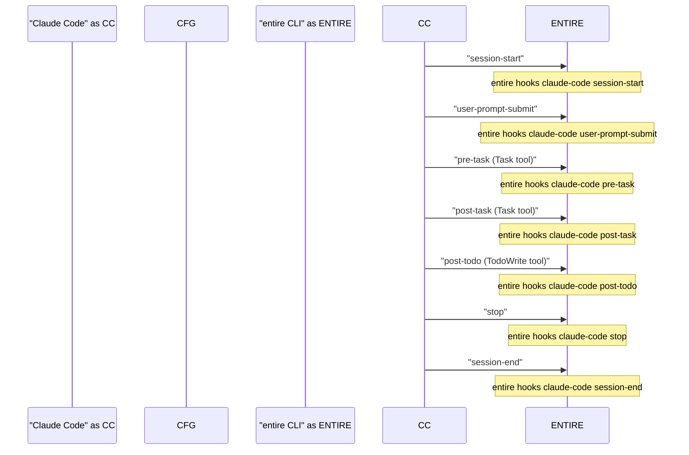
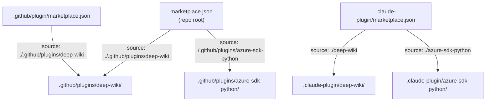
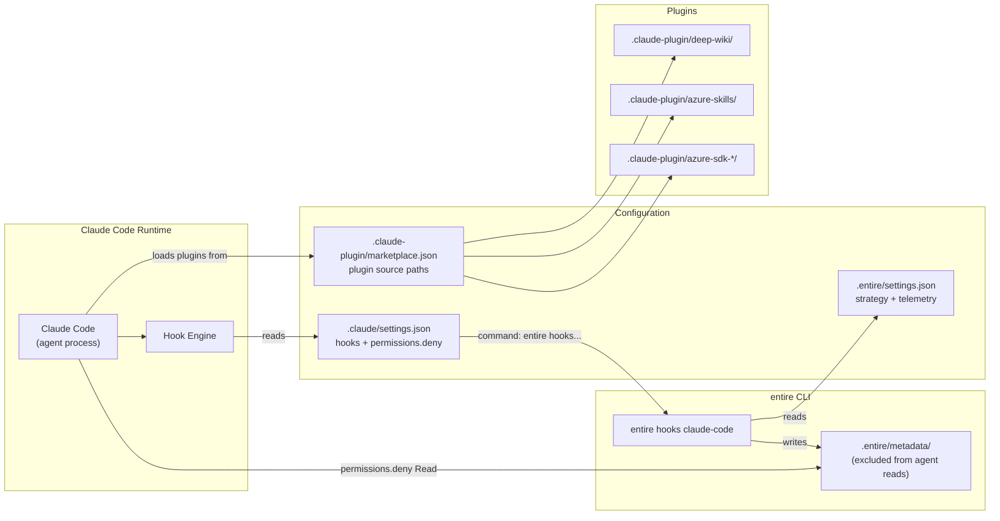

<!-- source: DeepWiki mcp.deepwiki.com · repo microsoft/skills · page 6.4 GitHub Copilot and Claude Integration · fetched 2026-10-30 -->

# Claude Code Integration

<details>
<summary>Relevant source files</summary>

The following files were used as context for generating this wiki page:

- [.claude-plugin/marketplace.json](.claude-plugin/marketplace.json)
- [.github/agents/scaffolder.agent.md](.github/agents/scaffolder.agent.md)
- [.github/copilot-instructions.md](.github/copilot-instructions.md)
- [.github/docs/agent-integration.md](.github/docs/agent-integration.md)
- [.github/plugin/marketplace.json](.github/plugin/marketplace.json)
- [.github/plugins/deep-wiki/.claude-plugin/plugin.json](.github/plugins/deep-wiki/.claude-plugin/plugin.json)
- [.github/plugins/deep-wiki/README.md](.github/plugins/deep-wiki/README.md)
- [.github/plugins/deep-wiki/commands/ado.md](.github/plugins/deep-wiki/commands/ado.md)
- [.github/plugins/deep-wiki/commands/crisp.md](.github/plugins/deep-wiki/commands/crisp.md)
- [.github/plugins/deep-wiki/skills/wiki-ado-convert/SKILL.md](.github/plugins/deep-wiki/skills/wiki-ado-convert/SKILL.md)
- [.github/prompts/scaffold-foundry-app.prompt.md](.github/prompts/scaffold-foundry-app.prompt.md)
- [.github/skills/skill-creator/references/acceptance-criteria.md](.github/skills/skill-creator/references/acceptance-criteria.md)
- [Agents.md](Agents.md)
- [README.md](README.md)
- [context7.json](context7.json)
- [docs-site/src/pages/index.astro](docs-site/src/pages/index.astro)
- [docs/index.html](docs/index.html)
- [marketplace.json](marketplace.json)
- [tests/harness/criteria-loader.ts](tests/harness/criteria-loader.ts)
- [tests/scenarios/skill-creator/scenarios.yaml](tests/scenarios/skill-creator/scenarios.yaml)

</details>


This page documents how the `microsoft/skills` repository is configured specifically for use with **Claude Code** (Anthropic's agentic CLI coding tool). It covers the hook lifecycle configuration in `.claude/settings.json`, the `entire` system settings in `.entire/settings.json`, and the `.claude-plugin/marketplace.json` variant with adjusted plugin source paths.

For general skill installation methods including `npx skills add` and Copilot CLI plugin commands, see [6.1](#6.1). For MCP server configuration shared across editors, see [6.3](#6.3). For the hook system used with continual learning, see [2.7](#2.7).

---

## Overview

Claude Code supports a hook system that fires shell commands at specific points in the agent's lifecycle. The repository wires these hooks to a tool called `entire`, which manages session lifecycle events externally. Separately, the `.claude-plugin/` directory holds a Claude Code-specific variant of the plugin marketplace with paths resolved relative to that directory rather than the repository root.

The three primary configuration files are:

| File | Purpose |
|------|---------|
| `.claude/settings.json` | Hook bindings and file-read permissions |
| `.entire/settings.json` | `entire` tool runtime configuration |
| `.claude-plugin/marketplace.json` | Claude Code-specific plugin source path variant |

---

## Hook Configuration (`.claude/settings.json`)

The file [.claude/settings.json:1-84]() registers seven hooks across six Claude Code lifecycle events.

### Lifecycle Events and Commands

**Diagram: Claude Code Hook Lifecycle**



Sources: [.claude/settings.json:1-84]()

### Hook Definitions

Each hook entry has two fields: `matcher` (a tool name filter, or `""` for all) and `command` (a shell command to execute).

| Event | Matcher | Command |
|-------|---------|---------|
| `SessionStart` | `""` (all) | `entire hooks claude-code session-start` |
| `SessionEnd` | `""` (all) | `entire hooks claude-code session-end` |
| `UserPromptSubmit` | `""` (all) | `entire hooks claude-code user-prompt-submit` |
| `Stop` | `""` (all) | `entire hooks claude-code stop` |
| `PreToolUse` | `Task` | `entire hooks claude-code pre-task` |
| `PostToolUse` | `Task` | `entire hooks claude-code post-task` |
| `PostToolUse` | `TodoWrite` | `entire hooks claude-code post-todo` |

The `PreToolUse` and `PostToolUse` hooks use a `matcher` field to scope them to specific tool invocations. `Task` fires when Claude Code spawns a sub-agent task; `TodoWrite` fires when the agent writes to its todo list.

Sources: [.claude/settings.json:1-84]()

### Permissions

[.claude/settings.json:79-83]() adds a `deny` permission entry:

```
Read(./.entire/metadata/**)
```

This prevents Claude Code from reading the `.entire/metadata/` directory, which contains internal `entire` state (logs, session metadata) that should not be included in the agent's context.

Sources: [.claude/settings.json:79-83](), [.entire/.gitignore:1-5]()

---

## `entire` System Configuration (`.entire/settings.json`)

The `entire` tool reads its configuration from [.entire/settings.json:1-5]():

| Field | Value | Meaning |
|-------|-------|---------|
| `strategy` | `"manual-commit"` | Git commits are not created automatically; the user controls when to commit |
| `enabled` | `true` | The `entire` integration is active |
| `telemetry` | `false` | No usage data is sent externally |

The `.entire/` directory itself uses a `.gitignore` [.entire/.gitignore:1-5]() to exclude:

- `tmp/` — Temporary working files
- `settings.local.json` — Local overrides (machine-specific, not committed)
- `metadata/` — Session metadata written by `entire` hooks
- `logs/` — Hook execution logs

Sources: [.entire/settings.json:1-5](), [.entire/.gitignore:1-5]()

---

## `.claude-plugin/` Marketplace Variant

The repository contains three `marketplace.json` files:

| File | `source` path style | Context |
|------|--------------------|---------||
| `marketplace.json` | `./.github/plugins/<name>` | Default / Copilot CLI |
| `.github/plugin/marketplace.json` | `./.github/plugins/<name>` | GitHub Copilot plugin system |
| `.claude-plugin/marketplace.json` | `./<name>` | Claude Code plugin system |

**Diagram: Marketplace Variant Source Path Resolution**



Sources: [.claude-plugin/marketplace.json:1-129](), [marketplace.json:1-126](), [.github/plugin/marketplace.json:1-126]()

### Path Adjustment

The only structural difference is the `source` field. All three files declare the same `pluginRoot` of `./.github/plugins`, but `.claude-plugin/marketplace.json` resolves plugin `source` paths relative to the `.claude-plugin/` directory itself rather than the repository root.

**Example comparison for `deep-wiki`:**

| File | `source` value |
|------|---------------|
| `marketplace.json` | `./.github/plugins/deep-wiki` |
| `.claude-plugin/marketplace.json` | `./deep-wiki` |

Sources: [.claude-plugin/marketplace.json:14-31](), [marketplace.json:14-31]()

### Differences in Plugin Metadata

The `.claude-plugin/marketplace.json` also carries some additional metadata for the `azure-skills` plugin not present in the root `marketplace.json`:

| Field | Present in root `marketplace.json` | Present in `.claude-plugin/marketplace.json` |
|-------|------------------------------------|---------------------------------------------|
| `version` | ❌ | ✅ `"1.0.0"` |
| `keywords` | ❌ | ✅ `["azure", "cloud", "infrastructure", ...]` |
| `category` | ❌ | ✅ `"orchestration"` |

The `deep-wiki` plugin entry in `.claude-plugin/marketplace.json` omits the `tags` array that appears in the root `marketplace.json`.

Sources: [.claude-plugin/marketplace.json:32-47](), [marketplace.json:32-44]()

---

## Wiring: How the Pieces Connect

**Diagram: Claude Code Integration Component Map**



Sources: [.claude/settings.json:1-84](), [.entire/settings.json:1-5](), [.claude-plugin/marketplace.json:1-129]()

### Summary of Design Decisions

- **`manual-commit` strategy**: The `entire` tool does not auto-create git commits. Developers retain full control over the commit history, which is consistent with the repository's emphasis on surgical, intentional changes (see `Agents.md` [Agents.md:53-65]()).
- **`telemetry: false`**: No data leaves the machine via the `entire` tool.
- **Metadata exclusion**: The `permissions.deny` rule in `.claude/settings.json` prevents Claude Code from accidentally ingesting internal `entire` session state, keeping hook metadata out of the agent's working context.
- **Separate `.claude-plugin/` directory**: Claude Code's plugin resolution uses paths relative to the directory containing `marketplace.json`, so a separate file with `./deep-wiki`-style paths is needed rather than the `./.github/plugins/deep-wiki` paths used by Copilot CLI.

Sources: [.claude/settings.json:79-83](), [.entire/settings.json:1-5](), [Agents.md:53-65]()

---

