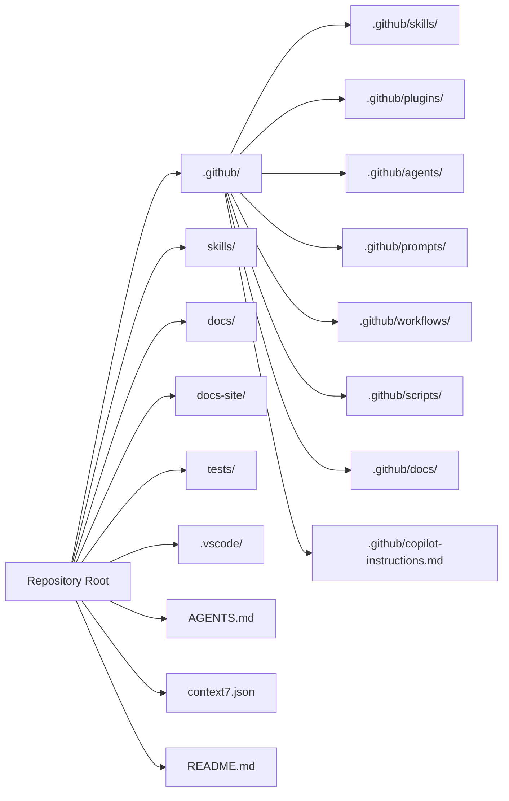
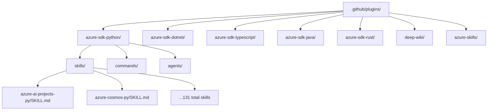
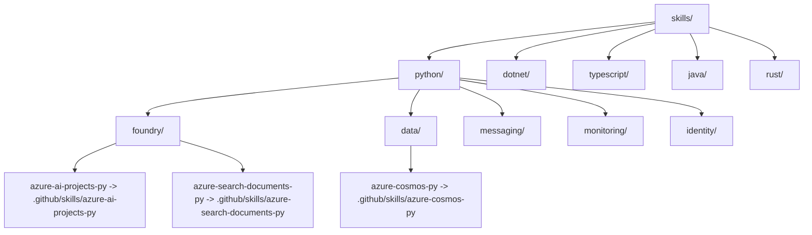
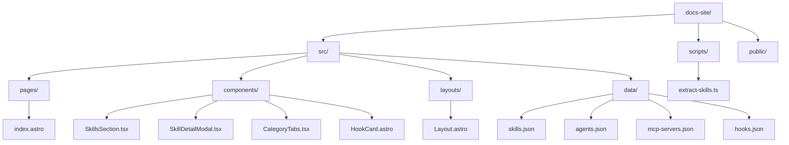
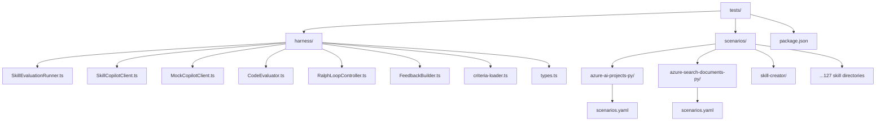
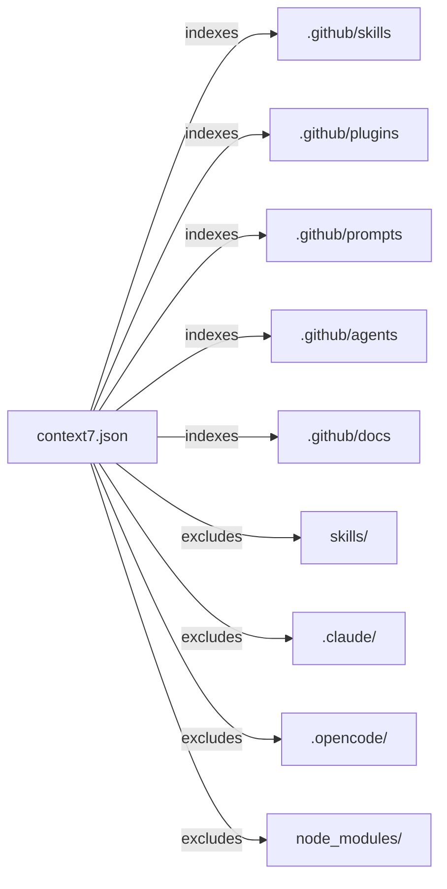

<!-- source: DeepWiki mcp.deepwiki.com · repo microsoft/skills · page 7.1 Repository Structure · fetched 2026-10-30 -->

# Repository Structure

<details>
<summary>Relevant source files</summary>

The following files were used as context for generating this wiki page:

- [.github/agents/scaffolder.agent.md](.github/agents/scaffolder.agent.md)
- [.github/copilot-instructions.md](.github/copilot-instructions.md)
- [.github/docs/agent-integration.md](.github/docs/agent-integration.md)
- [.github/plugins/azure-sdk-python/skills/azure-ai-language-conversations-py/SKILL.md](.github/plugins/azure-sdk-python/skills/azure-ai-language-conversations-py/SKILL.md)
- [.github/plugins/azure-sdk-python/skills/azure-ai-language-conversations-py/references/acceptance-criteria.md](.github/plugins/azure-sdk-python/skills/azure-ai-language-conversations-py/references/acceptance-criteria.md)
- [.github/plugins/deep-wiki/.claude-plugin/plugin.json](.github/plugins/deep-wiki/.claude-plugin/plugin.json)
- [.github/plugins/deep-wiki/README.md](.github/plugins/deep-wiki/README.md)
- [.github/plugins/deep-wiki/commands/ado.md](.github/plugins/deep-wiki/commands/ado.md)
- [.github/plugins/deep-wiki/commands/crisp.md](.github/plugins/deep-wiki/commands/crisp.md)
- [.github/plugins/deep-wiki/skills/wiki-ado-convert/SKILL.md](.github/plugins/deep-wiki/skills/wiki-ado-convert/SKILL.md)
- [.github/prompts/scaffold-foundry-app.prompt.md](.github/prompts/scaffold-foundry-app.prompt.md)
- [.github/skills/skill-creator/references/acceptance-criteria.md](.github/skills/skill-creator/references/acceptance-criteria.md)
- [.gitignore](.gitignore)
- [Agents.md](Agents.md)
- [README.md](README.md)
- [context7.json](context7.json)
- [docs-site/src/components/HookCard.astro](docs-site/src/components/HookCard.astro)
- [docs-site/src/data/hooks.json](docs-site/src/data/hooks.json)
- [docs-site/src/pages/index.astro](docs-site/src/pages/index.astro)
- [docs/_astro/index.CktZY-PF.css](docs/_astro/index.CktZY-PF.css)
- [docs/index.html](docs/index.html)
- [tests/harness/criteria-loader.ts](tests/harness/criteria-loader.ts)
- [tests/scenarios/skill-creator/scenarios.yaml](tests/scenarios/skill-creator/scenarios.yaml)

</details>


This page documents the directory layout of the `microsoft/skills` repository and explains the purpose of each major directory and root-level file. It covers only the physical organization of the codebase — for conceptual information about how skills work, see [Understanding Skills and Progressive Disclosure](#2.1); for plugin architecture, see [Plugin Marketplace Architecture](#2.6); for the test harness, see [Test Harness Architecture](#4.1).

---

## Overview

The repository is organized into several distinct areas: agent-facing content under `.github/`, test infrastructure under `tests/`, the documentation website source under `docs-site/`, the generated GitHub Pages content under `docs/`, and a backward-compatibility symlink tree under `skills/`.

**Repository Root Directory Layout**



Sources: [README.md:512-540](), [.github/copilot-instructions.md:72-99]()

---

## `.github/` Directory

The `.github/` directory contains all content consumed directly by AI coding agents and the GitHub platform. The five subdirectories most relevant to agents are `skills/`, `plugins/`, `agents/`, `prompts/`, and `workflows/`.

### `.github/skills/`

This is the primary skill directory that AI agents scan at startup. Each subdirectory contains a `SKILL.md` file with YAML frontmatter and a markdown body.

The directory holds two types of entries:

| Entry Type | Description |
|---|---|
| **Real directories** | Core/language-agnostic skills (e.g., `mcp-builder/`, `skill-creator/`, `copilot-sdk/`, `aspire-ts/`) |
| **Symlinks or copies** | Language-specific skills that originate in `.github/plugins/*/skills/` |

> **Note on duplication:** Skills in `.github/skills/` are currently duplicated (not symlinked) from `.github/plugins/*/skills/` to support `npx skills add microsoft/skills` installation. The plugin directories are the canonical source. See [Agents.md:153-154]().

Each skill directory can optionally contain a `references/` subdirectory. The `AcceptanceCriteriaLoader` class in the test harness reads from `.github/skills/<skill-name>/references/acceptance-criteria.md` using the constant `SKILLS_DIR = ".github/skills"` defined at [tests/harness/criteria-loader.ts:26-27]().

**Typical skill directory layout:**

```
.github/skills/
└── azure-ai-projects-py/
    ├── SKILL.md                          # Required: frontmatter + body
    └── references/
        └── acceptance-criteria.md        # Optional: test evaluation rules
```

Sources: [.github/copilot-instructions.md:76-78](), [tests/harness/criteria-loader.ts:26-27](), [Agents.md:153-154]()

---

### `.github/plugins/`

Plugin bundles are the canonical home for language-specific SDK skills. Each bundle follows the naming pattern `azure-sdk-<language>` and contains three subdirectories.

**Plugin Bundle Internal Structure**



The `extract-skills.ts` build script uses the `PLUGIN_LANG_MAP` constant at [docs-site/scripts/extract-skills.ts:96-103]() to map each plugin bundle name to its language code:

| Plugin Bundle | Language Code | Suffix |
|---|---|---|
| `azure-sdk-python` | `py` | `-py` |
| `azure-sdk-dotnet` | `dotnet` | `-dotnet` |
| `azure-sdk-typescript` | `ts` | `-ts` |
| `azure-sdk-java` | `java` | `-java` |
| `azure-sdk-rust` | `rust` | `-rust` |

`deep-wiki` and `azure-skills` are non-SDK plugins with their own `plugin.json` definitions. For details on plugin structure and `marketplace.json`, see [Plugin Marketplace Architecture](#2.6).

Sources: [docs-site/scripts/extract-skills.ts:96-103](), [README.md:519-521]()

---

### `.github/agents/`

Contains agent persona definition files. Each file configures an agent's expertise, available tools, and which skills to load.

| File | Role |
|---|---|
| `backend.agent.md` | FastAPI, Pydantic, Cosmos DB, Azure services |
| `frontend.agent.md` | React, TypeScript, React Flow, Zustand, Tailwind |
| `infrastructure.agent.md` | Bicep, Azure CLI, Container Apps |
| `planner.agent.md` | Task decomposition, architecture decisions |
| `presenter.agent.md` | Documentation, demos, technical writing |
| `scaffolder.agent.md` | Full-stack Azure AI Foundry application scaffolding |

The `scaffolder.agent.md` agent explicitly references the `scaffold-foundry-app.prompt.md` prompt and the `frontend-ui-dark-ts`, `fastapi-router-py`, and `pydantic-models-py` skills. See [.github/agents/scaffolder.agent.md:42-46]().

Sources: [README.md:579-590](), [.github/agents/scaffolder.agent.md:1-10]()

---

### `.github/prompts/`

Reusable prompt template files (`.prompt.md`) for common coding tasks. These are used by agents directly via agent configuration.

| File | Purpose |
|---|---|
| `code-review.prompt.md` | Structured code review checks |
| `create-store.prompt.md` | Zustand store creation |
| `create-node.prompt.md` | React Flow custom node creation |
| `add-endpoint.prompt.md` | FastAPI endpoint creation |
| `scaffold-foundry-app.prompt.md` | Full-stack project scaffolding |

Sources: [README.md:593-600](), [.github/prompts/scaffold-foundry-app.prompt.md:1-5]()

---

### `.github/workflows/`

GitHub Actions workflow files. Key workflows:

| Workflow | Trigger | Purpose |
|---|---|---|
| `test-harness.yml` | PR / push to `main` | Smoke tests using `--mock` mode |
| `skill-evaluation.yml` | Nightly | Full evaluation with real Copilot SDK |
| `update-llms-txt.lock.yml` | Daily cron (`0 3 * * *`) | Scrapes Foundry docs and updates `docs/llms.txt` |
| `deploy-pages.yml` | Push to `main` | Deploys `docs-site/` to GitHub Pages |

For CI details, see [Running Evaluations](#4.4). For the documentation update pipeline, see [Automated Documentation Update Workflow](#5.3).

Sources: [.github/workflows/update-llms-txt.lock.yml:24-27]()

---

### `.github/scripts/`

Python automation scripts used by the documentation update workflows:

| Script | Purpose |
|---|---|
| `scrape_foundry_docs.py` | Scrapes Microsoft Foundry documentation TOC and sections |
| `generate_llms_full.py` | Generates `docs/llms-full.txt` from scraped content |

Sources: [README.md:523](), [.github/copilot-instructions.md:83]()

---

### `.github/docs/`

Internal documentation files included in the Context7 indexing configuration (`context7.json` lists `.github/docs` as a folder). Contains files such as `agent-integration.md` (agent discovery documentation) and `blog.wordpress.xml` (the Context-Driven Development blog post source).

Sources: [context7.json:4](), [.github/docs/agent-integration.md:1-10]()

---

### `.github/copilot-instructions.md`

The GitHub Copilot workspace configuration file. Loaded automatically by GitHub Copilot in VS Code for every session. Defines core development principles, the repository structure summary, skill naming conventions, MCP server reference, and code conventions. See [.github/copilot-instructions.md:1-5]().

---

## `skills/` (Root-Level Backward Compatibility Tree)

The root-level `skills/` directory contains a nested symlink structure used for skill categorization and backward compatibility. It is **not** where agents look for skills — that is `.github/skills/`.

**Symlink Tree Structure**



The `findSymlinkInfo()` function in `extract-skills.ts` traverses this tree to resolve the `category` field for each skill by matching symlink targets to skill directory names. See [docs-site/scripts/extract-skills.ts:59-94]().

**Category values** derived from this tree:

| Category | Skill Domain |
|---|---|
| `foundry` | AI agents, projects, inference, search |
| `data` | Storage, Cosmos DB, Tables |
| `messaging` | Event Hubs, Service Bus, Event Grid |
| `monitoring` | OpenTelemetry, App Insights |
| `entra` | Authentication, credentials, Key Vault |
| `integration` | API Management, App Configuration |
| `communication` | ACS Chat, SMS, Call Automation |
| `frontend` | UI frameworks |
| `m365` | Microsoft 365 Agents SDK |

Sources: [docs-site/scripts/extract-skills.ts:59-94](), [README.md:531-537]()

---

## `docs/`

GitHub Pages–hosted output directory. Contains the generated LLM-friendly documentation files and the compiled Astro site (HTML, CSS, JS assets).

| File/Directory | Purpose |
|---|---|
| `llms.txt` | LLM-friendly index: links and per-section summaries |
| `llms-full.txt` | Complete Foundry documentation content |
| `index.html` | Compiled Astro documentation website entry point |
| `_astro/` | Bundled JavaScript and CSS assets from Astro build |

The `docs/` directory is committed to the repository and served via GitHub Pages. The `update-llms-txt.lock.yml` workflow updates `llms.txt` and `llms-full.txt` on a daily schedule. See [LLM Discovery and Context7 Integration](#5.4).

Sources: [README.md:527-530](), [docs/index.html:1]()

---

## `docs-site/`

The Astro-based documentation website source. This is the build input that compiles to `docs/`.

**`docs-site/` Internal Structure**



The `extract-skills.ts` build script populates `src/data/skills.json` by scanning the plugin and skill directories. Its `extractSkills()` function is the authoritative source for the `Skill` interface (name, description, lang, category, path, package) used throughout the site. See [docs-site/scripts/extract-skills.ts:144-203]().

The `SkillsSection` React component at [docs-site/src/components/SkillsSection.tsx:39-290]() renders the filterable skill catalog using this JSON data. For full documentation website architecture, see [Documentation Website Architecture](#5.1).

Sources: [docs-site/src/pages/index.astro:1-11](), [docs-site/scripts/extract-skills.ts:144-203]()

---

## `tests/`

The TypeScript/pnpm test harness for evaluating AI-generated code quality against skill acceptance criteria.

**`tests/` Internal Structure**



Test scenarios live in `tests/scenarios/<skill-name>/scenarios.yaml`. The `AcceptanceCriteriaLoader` class in `criteria-loader.ts` looks for `references/acceptance-criteria.md` under `.github/skills/<skill-name>/`. See [tests/harness/criteria-loader.ts:51-100]().

To run tests:
```bash
cd tests
pnpm install
pnpm harness azure-ai-projects-py --mock --verbose
```

For architecture details, see [Test Harness Architecture](#4.1).

Sources: [tests/harness/criteria-loader.ts:51-100](), [tests/scenarios/azure-search-documents-py/scenarios.yaml:1-10]()

---

## `.vscode/`

Contains `mcp.json`, which defines pre-configured Model Context Protocol (MCP) server connections for use with VS Code and compatible agents.

| Category | Servers Defined |
|---|---|
| Documentation | `microsoft-docs`, `context7`, `deepwiki` |
| Development | `github`, `playwright`, `terraform`, `eslint` |
| Utilities | `sequentialthinking`, `memory`, `markitdown` |

For full MCP configuration documentation, see [MCP Server Configuration](#6.3).

Sources: [README.md:562-571](), [.github/copilot-instructions.md:150-176]()

---

## Root-Level Files

| File | Purpose |
|---|---|
| `AGENTS.md` | Agent configuration template; defines core development principles, skill catalog summary, SDK quick reference, MCP server reference, and coding conventions. Loaded by agents (e.g., Codex, Claude Code) that use `AGENTS.md` for project configuration. |
| `context7.json` | Context7 indexing configuration; specifies which folders to index (`".github/skills"`, `".github/plugins"`, `".github/prompts"`, `".github/agents"`, `".github/docs"`), folders to exclude, and indexing rules. |
| `README.md` | Human-facing repository overview with the full skill catalog, installation instructions, and contribution guide. |

**`context7.json` directory scope:**



The root-level `skills/` symlink tree is explicitly excluded from Context7 indexing to avoid duplicate indexing of the same skill content that already appears under `.github/`. See [context7.json:4-6]().

Sources: [context7.json:1-13](), [Agents.md:1-20]()

---

