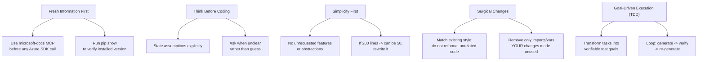
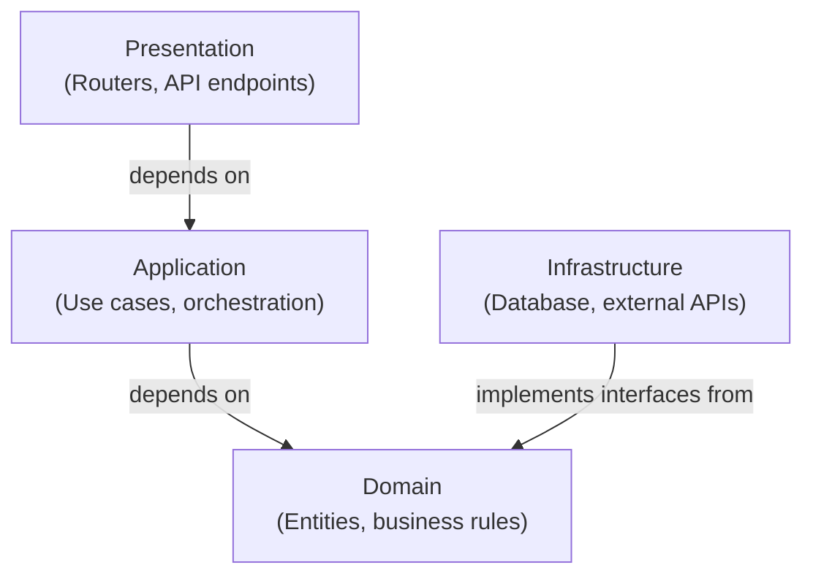
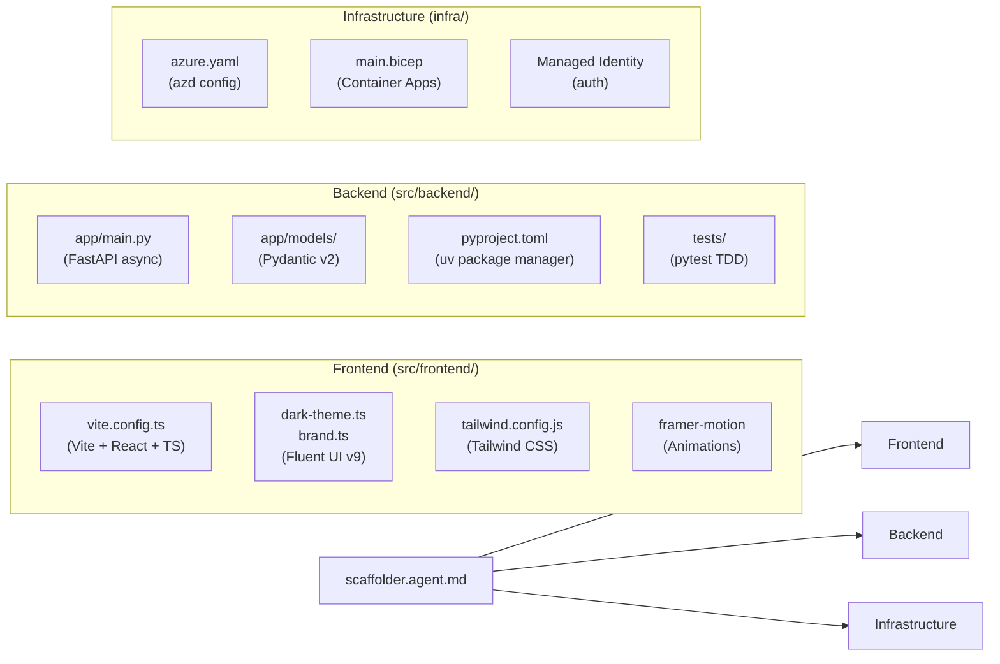
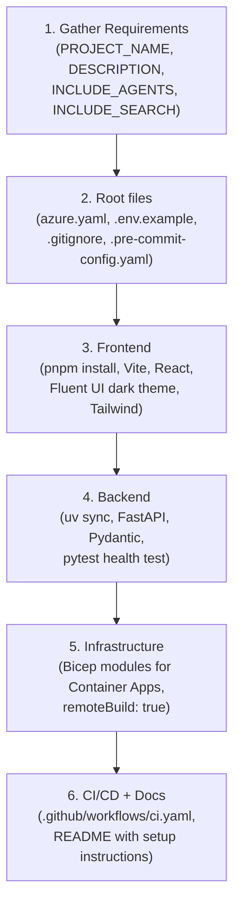

<!-- source: DeepWiki mcp.deepwiki.com · repo microsoft/skills · page 7.2 Development Principles and Core Guidelines · fetched 2026-10-30 -->

# Development Principles and Agents

<details>
<summary>Relevant source files</summary>

The following files were used as context for generating this wiki page:

- [.github/agents/scaffolder.agent.md](.github/agents/scaffolder.agent.md)
- [.github/copilot-instructions.md](.github/copilot-instructions.md)
- [.github/docs/agent-integration.md](.github/docs/agent-integration.md)
- [.github/plugins/deep-wiki/.claude-plugin/plugin.json](.github/plugins/deep-wiki/.claude-plugin/plugin.json)
- [.github/plugins/deep-wiki/README.md](.github/plugins/deep-wiki/README.md)
- [.github/plugins/deep-wiki/commands/ado.md](.github/plugins/deep-wiki/commands/ado.md)
- [.github/plugins/deep-wiki/commands/crisp.md](.github/plugins/deep-wiki/commands/crisp.md)
- [.github/plugins/deep-wiki/skills/wiki-ado-convert/SKILL.md](.github/plugins/deep-wiki/skills/wiki-ado-convert/SKILL.md)
- [.github/prompts/scaffold-foundry-app.prompt.md](.github/prompts/scaffold-foundry-app.prompt.md)
- [.github/skills/skill-creator/references/acceptance-criteria.md](.github/skills/skill-creator/references/acceptance-criteria.md)
- [Agents.md](Agents.md)
- [README.md](README.md)
- [context7.json](context7.json)
- [docs-site/src/pages/index.astro](docs-site/src/pages/index.astro)
- [docs/index.html](docs/index.html)
- [tests/harness/criteria-loader.ts](tests/harness/criteria-loader.ts)
- [tests/scenarios/skill-creator/scenarios.yaml](tests/scenarios/skill-creator/scenarios.yaml)

</details>


This page documents the behavioral rules and development principles that govern how AI agents work within the `microsoft/skills` repository, the Azure SDK authentication quick reference baked into those rules, and the specialized **scaffolder agent** for bootstrapping full-stack Foundry applications.

For how to contribute new skills or run the test harness, see [Contributing Guidelines (7.3)](#7.3). For the directory layout that this page refers to, see [Repository Structure (7.1)](#7.1).

---

## Purpose

The `Agents.md` and `.github/copilot-instructions.md` files define the behavioral contract for any AI agent working in this repository. Both files share the same content and serve different agent ecosystems:

| File | Read by |
|------|---------|
| `Agents.md` | Claude Code, OpenCode, and other agents that scan project root |
| `.github/copilot-instructions.md` | GitHub Copilot (scans `.github/`) |

Sources: [Agents.md:1-10](), [.github/copilot-instructions.md:1-10]()

---

## The Five Core Principles

**Principle diagram — from natural language rule to code-level behavior:**



Sources: [Agents.md:5-86](), [.github/copilot-instructions.md:7-67]()

### Principle 1 — Fresh Information First

Azure SDKs change constantly. Before implementing any Azure or Foundry SDK code:

1. Search Microsoft Learn via the `microsoft-docs` MCP server
2. Check Context7 for indexed Foundry documentation (updated daily)
3. Verify the installed package version with `pip show <package>`

> Skipping this step and using cached training knowledge will produce broken code.

Sources: [Agents.md:5-23](), [.github/copilot-instructions.md:7-18]()

---

### Principle 2 — Think Before Coding

| Situation | Required action |
|-----------|----------------|
| Multiple valid interpretations exist | Present them; do not pick silently |
| A simpler approach exists | Say so; push back if warranted |
| Something is unclear | Stop. Name what's confusing. Ask. |
| Assumption made | State it explicitly |

Sources: [Agents.md:32-38](), [.github/copilot-instructions.md:24-31]()

---

### Principle 3 — Simplicity First

Write the minimum code that solves the problem. Nothing speculative.

- No features beyond what was asked
- No abstractions for single-use code
- No "flexibility" or "configurability" that wasn't requested
- No error handling for impossible scenarios

**The test:** Would a senior engineer say this is overcomplicated? If yes, simplify.

Sources: [Agents.md:40-49](), [.github/copilot-instructions.md:33-42]()

---

### Principle 4 — Surgical Changes

When editing existing code:

- Do not "improve" adjacent code, comments, or formatting
- Do not refactor things that aren't broken
- Match existing style, even if you'd do it differently
- If you notice unrelated dead code, mention it — do not delete it
- Remove imports, variables, and functions that **your** changes made unused
- Do not remove pre-existing dead code unless asked

**The test:** Every changed line should trace directly to the user's request.

Sources: [Agents.md:53-66](), [.github/copilot-instructions.md:44-56]()

---

### Principle 5 — Goal-Driven Execution (TDD)

Transform tasks into verifiable goals before writing code.

| Instead of… | Transform to… |
|-------------|---------------|
| "Add validation" | "Write tests for invalid inputs, then make them pass" |
| "Fix the bug" | "Write a test that reproduces it, then make it pass" |
| "Refactor X" | "Ensure tests pass before and after" |

For multi-step tasks, state a plan:

```
1. [Step] → verify: [check]
2. [Step] → verify: [check]
3. [Step] → verify: [check]
```

Sources: [Agents.md:68-86](), [.github/copilot-instructions.md:58-67]()

---

## Clean Architecture Layers

All feature work follows a layered architecture with inward-pointing dependencies:

**Architecture diagram — layer names to dependency rules:**



Rules:
- Dependencies point inward — outer layers depend on inner layers
- The **Domain** layer has no external dependencies
- **Infrastructure** implements interfaces defined in inner layers
- Each layer should be testable in isolation

Sources: [Agents.md:91-110]()

---

## Azure SDK Quick Reference

This section is embedded directly in `Agents.md` and `.github/copilot-instructions.md` so agents have it immediately available without loading a separate skill.

### Key Packages

| Package | Purpose | Install |
|---------|---------|---------|
| `azure-ai-projects` | Foundry project client, agents, evals, connections | `pip install azure-ai-projects` |
| `azure-ai-agents` | Standalone agents client (use via projects SDK) | `pip install azure-ai-agents` |
| `azure-search-documents` | Azure AI Search SDK | `pip install azure-search-documents` |
| `azure-identity` | Authentication — `DefaultAzureCredential` | `pip install azure-identity` |

Sources: [Agents.md:114-122](), [.github/copilot-instructions.md:183-190]()

### Authentication Pattern

The canonical authentication pattern for all Azure SDK clients:

```python
from azure.identity import DefaultAzureCredential
from azure.ai.projects import AIProjectClient

credential = DefaultAzureCredential()
client = AIProjectClient(
    endpoint="https://<resource>.services.ai.azure.com/api/projects/<project>",
    credential=credential
)
```

Never hardcode credentials or API keys. Never suppress type errors with `# type: ignore` or `as any`.

Sources: [Agents.md:123-137](), [.github/copilot-instructions.md:193-210]()

### Required Environment Variables

```bash
AZURE_AI_PROJECT_ENDPOINT=https://<resource>.services.ai.azure.com/api/projects/<project>
AZURE_AI_MODEL_DEPLOYMENT_NAME=gpt-4o-mini
```

Sources: [Agents.md:139-143](), [.github/copilot-instructions.md:207-210]()

---

## Code and Git Conventions

### Code Style

| Rule | Detail |
|------|--------|
| Async I/O | Use `async/await` for all Azure SDK calls |
| Context managers | `with client:` or `async with client:` |
| Idempotent ops | Use `create_or_update_*` pattern |
| Typing | Type hints on all function signatures |

### Git & GitHub

- Always use `gh` CLI for GitHub operations (`gh pr create`, `gh issue create`)
- Never use the MCP `github-create_pull_request` tool for write operations — enterprise token restrictions apply

### Clean Code Checklist

Before completing any code change:

- [ ] Functions do one thing
- [ ] Names are descriptive and intention-revealing
- [ ] No magic numbers or strings (use constants)
- [ ] Error handling is explicit (no empty catch blocks)
- [ ] No commented-out code
- [ ] Tests cover the change

Sources: [Agents.md:262-298](), [.github/copilot-instructions.md:215-254]()

---

## Agent Personas

Role-specific agent definitions live in `.github/agents/`. Each file follows the agent persona format (YAML frontmatter + Markdown body).

| File | Agent Name | Expertise |
|------|-----------|-----------|
| `backend.agent.md` | Backend Engineer | FastAPI, Pydantic, Cosmos DB, Azure services |
| `frontend.agent.md` | Frontend Engineer | React, TypeScript, React Flow, Zustand, Tailwind |
| `infrastructure.agent.md` | Infrastructure Engineer | Bicep, Azure CLI, Container Apps, networking |
| `planner.agent.md` | Planner | Task decomposition, architecture decisions |
| `presenter.agent.md` | Presenter | Documentation, demos, technical writing |
| `scaffolder.agent.md` | Project Scaffolder | Full-stack Foundry app generation |

Sources: [README.md:579-589](), [.github/agents/scaffolder.agent.md:1-6]()

---

## The Scaffolder Agent

The **scaffolder agent** (`scaffolder.agent.md`) is a purpose-built agent for creating production-ready full-stack Azure AI Foundry applications from scratch. It orchestrates a fixed tech stack and follows a strict scaffolding workflow.

### Tech Stack

**Scaffolder agent — file names and tool names wired to the tech stack:**



Sources: [.github/agents/scaffolder.agent.md:9-27](), [.github/prompts/scaffold-foundry-app.prompt.md:1-95]()

### Scaffolding Workflow

The agent follows a fixed six-step order:



Sources: [.github/agents/scaffolder.agent.md:104-137]()

### Skills Referenced by the Scaffolder

The scaffolder agent declares explicit skill dependencies in its frontmatter body:

| Skill | Purpose |
|-------|---------|
| `frontend-ui-dark-ts` | Dark theme patterns with Tailwind CSS, Framer Motion, glassmorphism |
| `fastapi-router-py` | FastAPI routers with CRUD, auth dependencies |
| `pydantic-models-py` | Pydantic v2 multi-model pattern (Base, Create, Update, Response, InDB) |

And one prompt template:

| Prompt file | Purpose |
|-------------|---------|
| `scaffold-foundry-app.prompt.md` | Complete full-stack project scaffolding template |

Sources: [.github/agents/scaffolder.agent.md:32-48]()

### Key Patterns in Generated Projects

The scaffolder generates several fixed patterns that differ from a generic starter:

**`azure.yaml` uses `remoteBuild: true`** — images are built in Azure Container Registry rather than locally. This is required for CI environments without Docker.

**Fluent UI dark theme** is wired through two files:
- `src/frontend/src/theme/brand.ts` — defines the `brandVariants` color scale for `BrandVariants`
- `src/frontend/src/theme/dark-theme.ts` — calls `createDarkTheme(brandVariants)` and overrides background tokens

**FastAPI settings** use `pydantic_settings.BaseSettings` reading from a `.env` file, with `AZURE_AI_PROJECT_ENDPOINT` and `AZURE_AI_MODEL_DEPLOYMENT_NAME` as required variables.

**Container App Bicep module** sets `identity: { type: 'SystemAssigned' }` for Managed Identity — no secrets stored.

Sources: [.github/agents/scaffolder.agent.md:141-241](), [.github/prompts/scaffold-foundry-app.prompt.md:103-130](), [.github/prompts/scaffold-foundry-app.prompt.md:267-308]()

### Verification Steps

After scaffolding, the agent verifies the setup:

```bash
# Frontend
cd src/frontend && pnpm install && pnpm dev      # must start on :5173

# Backend
cd src/backend && uv sync
uv run fastapi dev app/main.py                    # must start on :8000
curl http://localhost:8000/api/health             # must return 200
```

Sources: [.github/agents/scaffolder.agent.md:122-137]()

---

## Do's and Don'ts Summary

| ✅ Do | ❌ Don't |
|-------|---------|
| Use `DefaultAzureCredential` for all Azure auth | Hardcode credentials or endpoints |
| Use `async/await` for all Azure SDK I/O | Suppress type errors (`as any`, `# type: ignore`) |
| Write tests before or alongside implementation | Leave empty exception handlers |
| Keep functions small and focused | Refactor unrelated code while fixing bugs |
| Use `gh` CLI for GitHub operations | Use GitHub MCP tools for write operations |
| Match existing patterns in the codebase | Add dependencies without justification |

Sources: [Agents.md:325-342](), [.github/copilot-instructions.md:277-294]()

---

