# Page: Overview

# Overview

<details>
<summary>Relevant source files</summary>

The following files were used as context for generating this wiki page:

- [.claude-plugin/marketplace.json](.claude-plugin/marketplace.json)
- [.github/agents/scaffolder.agent.md](.github/agents/scaffolder.agent.md)
- [.github/copilot-instructions.md](.github/copilot-instructions.md)
- [.github/docs/agent-integration.md](.github/docs/agent-integration.md)
- [.github/plugin/marketplace.json](.github/plugin/marketplace.json)
- [.github/plugins/deep-wiki/.claude-plugin/plugin.json](.github/plugins/deep-wiki/.claude-plugin/plugin.json)
- [.github/plugins/deep-wiki/README.md](.github/plugins/deep-wiki/README.md)
- [.github/plugins/deep-wiki/commands/ado.md](.github/plugins/deep-wiki/commands/ado.md)
- [.github/plugins/deep-wiki/commands/crisp.md](.github/plugins/deep-wiki/commands/crisp.md)
- [.github/plugins/deep-wiki/skills/wiki-ado-convert/SKILL.md](.github/plugins/deep-wiki/skills/wiki-ado-convert/SKILL.md)
- [.github/prompts/scaffold-foundry-app.prompt.md](.github/prompts/scaffold-foundry-app.prompt.md)
- [.github/skills/skill-creator/references/acceptance-criteria.md](.github/skills/skill-creator/references/acceptance-criteria.md)
- [Agents.md](Agents.md)
- [README.md](README.md)
- [context7.json](context7.json)
- [docs-site/src/pages/index.astro](docs-site/src/pages/index.astro)
- [docs/index.html](docs/index.html)
- [marketplace.json](marketplace.json)
- [tests/harness/criteria-loader.ts](tests/harness/criteria-loader.ts)
- [tests/scenarios/skill-creator/scenarios.yaml](tests/scenarios/skill-creator/scenarios.yaml)

</details>


The `microsoft/skills` repository is a catalog of **133 agent skills** — domain-specific knowledge modules that specialize AI coding agents for Azure SDK and Microsoft AI Foundry development. The repository provides five major components:

1. **Skills Catalog** — 133 skills covering Python, .NET, TypeScript, Java, and Rust Azure SDKs
2. **Deep Wiki Plugin** — AI-powered documentation generator with Mermaid diagrams and source citations
3. **Test Harness** — Quality validation system with acceptance criteria and scenario-based evaluation
4. **Documentation Site** — Astro-based skill explorer at [microsoft.github.io/skills](https://microsoft.github.io/skills)
5. **Continual Learning System** — Hooks for persistent agent memory across sessions

This page introduces the repository's architecture and how these components interact. For installation, see [Installation and Usage](#6). For skill structure, see [Agent Skills System](#2). For quality validation, see [Quality Assurance System](#4).

---

## Context-Driven Development

The premise is that frontier LLMs already encode Azure SDK patterns from pretraining. Skills provide **activation context** — targeted domain knowledge injected into an agent's context window — to reliably surface those latent patterns. This idea is articulated in [README.md:47-52]() and [.github/docs/blog.wordpress.xml:3-4]().

The critical constraint is **selective loading**. Loading all skills simultaneously causes **context rot**: diluted attention, wasted tokens, and conflated patterns from different frameworks. Only skills relevant to the current task should be loaded.

> "High signal-to-noise ratio is everything." — [.github/docs/blog.wordpress.xml:35]()

Skills use a three-tier **progressive disclosure** strategy to minimize context cost until a skill is actually needed. See [Understanding Skills and Progressive Disclosure](#2.1) for the full model.

Sources: [README.md:47-52](), [Agents.md:176-177](), [.github/docs/blog.wordpress.xml:3-35]()

---

## Repository Anatomy

**Repository Architecture: Four Primary Subsystems**

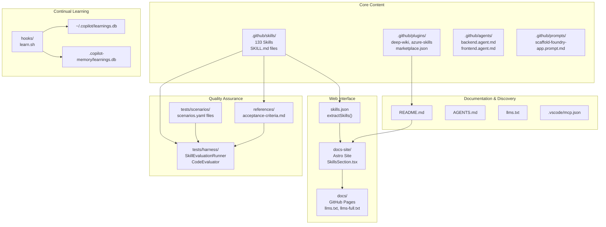

Sources: [README.md:512-540](), [.github/copilot-instructions.md:72-99](), [.github/plugins/deep-wiki/README.md:1-6](), [docs-site/scripts/extract-skills.ts:1-10](), [tests/harness/criteria-loader.ts:1-10]()

---

## What's Inside

| Resource | Location | Description |
|----------|----------|-------------|
| **Skills** | `.github/plugins/*/skills/`, `.github/skills/` | 133 `SKILL.md` knowledge modules for Azure SDKs |
| **Plugins** | `.github/plugins/` | Installable bundles: `deep-wiki`, `azure-skills`, `azure-sdk-*` |
| **Agent Personas** | `.github/agents/` | Role-specific agents: `backend.agent.md`, `frontend.agent.md`, `infrastructure.agent.md`, `planner.agent.md`, `presenter.agent.md`, `scaffolder.agent.md` |
| **AGENTS.md** | `AGENTS.md` | Template for configuring agent behavior in user projects |
| **Prompts** | `.github/prompts/` | Reusable prompt templates: `code-review.prompt.md`, `scaffold-foundry-app.prompt.md` |
| **MCP Configs** | `.vscode/mcp.json` | Pre-configured MCP server definitions: `microsoft-docs`, `context7`, `github`, `playwright` |
| **Foundry Docs** | `docs/llms.txt`, `docs/llms-full.txt` | LLM-friendly Microsoft Foundry documentation (updated daily via `.github/workflows/update-llms-txt.yml`) |
| **Skill Explorer** | `docs-site/` | Astro + React website with `SkillsSection.tsx` and `SkillDetailModal.tsx` components |
| **Test Harness** | `tests/harness/`, `tests/scenarios/` | `SkillEvaluationRunner`, `CodeEvaluator`, `AcceptanceCriteriaLoader` for quality validation |
| **Continual Learning** | `hooks/` | `learn.sh` script with SQLite-based session memory in `~/.copilot/learnings.db` and `.copilot-memory/learnings.db` |

Sources: [README.md:59-68](), [Agents.md:149-165](), [.github/plugins/deep-wiki/README.md:1-217](), [tests/harness/criteria-loader.ts:1-10]()

---

## Skill Catalog Summary

Skills are stored in language-specific plugin bundles under `.github/plugins/` and symlinked into `.github/skills/` for backward compatibility. Each skill name uses a language suffix for automatic discovery.

| Language | Count | Suffix | Plugin Bundle Directory |
|----------|-------|--------|------------------------|
| Core (language-agnostic) | 8 | — | `.github/skills/` (direct) |
| Python | 41 | `-py` | `.github/plugins/azure-sdk-python/skills/` |
| .NET | 28 | `-dotnet` | `.github/plugins/azure-sdk-dotnet/skills/` |
| TypeScript | 25 | `-ts` | `.github/plugins/azure-sdk-typescript/skills/` |
| Java | 25 | `-java` | `.github/plugins/azure-sdk-java/skills/` |
| Rust | 6 | `-rust` | `.github/plugins/azure-sdk-rust/skills/` |

**Total: 133 skills**

Skills are further categorized by domain: `foundry`, `data`, `messaging`, `monitoring`, `entra`, `integration`, `compute`, `communication`, `frontend`, `partner`, `m365`.

The `extractSkills()` function in `docs-site/scripts/extract-skills.ts` reads all `SKILL.md` frontmatter from plugin bundles and core skill directories, using the `PLUGIN_LANG_MAP` constant to assign language tags, and queries `skills/` symlinks via `findSymlinkInfo()` to assign category tags. The output is `docs-site/src/data/skills.json`, which powers the Skill Explorer website.

Sources: [README.md:75-83](), [docs-site/scripts/extract-skills.ts:96-203]()

---

## Main Subsystems

| Subsystem | Key Paths | Wiki Page |
|-----------|-----------|-----------|
| **Agent Skills** | `.github/plugins/`, `.github/skills/`, `SKILL.md` | [Agent Skills System](#2) |
| **Deep Wiki Plugin** | `.github/plugins/deep-wiki/` | [Deep Wiki Plugin](#3) |
| **Quality Assurance** | `tests/harness/`, `tests/scenarios/` | [Quality Assurance System](#4) |
| **Documentation Systems** | `docs-site/`, `docs/`, `.github/scripts/` | [Documentation Systems](#5) |
| **Installation and Usage** | `npx skills add`, `/plugin` CLI, `.vscode/mcp.json` | [Installation and Usage](#6) |
| **Development Guide** | `AGENTS.md`, `.github/copilot-instructions.md` | [Development Guide](#7) |

**Component Interaction: Skills Flow Through All Systems**

```mermaid
graph LR
    subgraph "Authoring"
        author["Developer<br/>writes SKILL.md"]
        criteria["writes acceptance-criteria.md"]
        scenario["writes scenarios.yaml"]
    end
    
    subgraph "Quality Gate"
        harness["SkillEvaluationRunner"]
        evaluator["CodeEvaluator"]
        ralph["RalphLoopController"]
    end
    
    subgraph "Publication"
        extract["extract-skills.ts<br/>extractSkills()"]
        website["Skill Explorer<br/>SkillsSection.tsx"]
        llms["llms.txt generation"]
    end
    
    subgraph "Runtime"
        agent["AI Agent"]
        tier1["Tier 1: frontmatter<br/>(50 tokens)"]
        tier2["Tier 2: SKILL.md body<br/>(500-2000 tokens)"]
        memory["Continual Learning<br/>learn.sh → learnings.db"]
    end
    
    author --> criteria
    author --> scenario
    criteria --> harness
    scenario --> harness
    harness --> evaluator
    evaluator --> ralph
    
    ralph -->|"passes quality"| extract
    extract --> website
    extract --> llms
    
    llms --> agent
    agent --> tier1
    tier1 -->|"activates"| tier2
    tier2 --> memory
```

Sources: [README.md:544-571](), [context7.json:1-13](), [tests/harness/criteria-loader.ts:1-10](), [docs-site/scripts/extract-skills.ts:1-10]()

---

## Installation

Three methods are available for adding skills to a project.

| Method | Command | Notes |
|--------|---------|-------|
| **npx CLI wizard** | `npx skills add microsoft/skills` | Interactive; selects and copies specific skills |
| **Copilot CLI plugin** | `/plugin marketplace add microsoft/skills` then `/plugin install deep-wiki@skills` | Installs as Copilot CLI plugin with slash commands |
| **Manual clone** | `git clone …` then `cp -r` or `ln -s` | Copy or symlink specific skill directories |

For multi-agent setups (Copilot, Claude Code, OpenCode in the same repo), a single symlink can share skills across all agent configuration directories:

```bash
ln -s ../.github/skills .opencode/skills
ln -s ../.github/skills .claude/skills
```

For full details including `plugin.json` structure and Claude Code-specific hook configuration, see [Installing Skills](#6.1) and [Claude Code Integration](#6.4).

Sources: [README.md:17-43](), [.github/docs/blog.wordpress.xml:40-65]()

---

## Progressive Disclosure

Each skill is a directory containing a `SKILL.md` file with two parts: a **YAML frontmatter** block (always loaded at startup) and a **Markdown body** (loaded only when the skill activates).

**Three-Tier Loading Strategy**

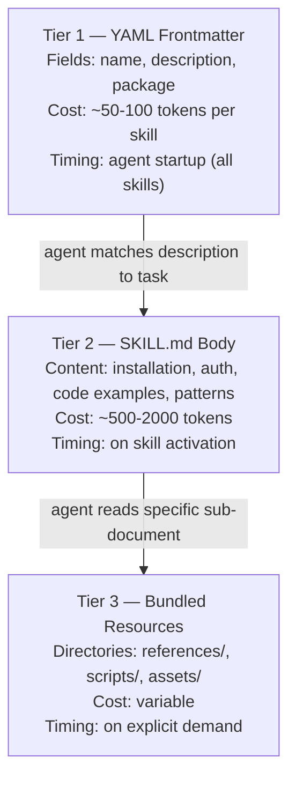

Sources: [.github/docs/agent-integration.md:59-78](), [Agents.md:149-154]()

The `AcceptanceCriteriaLoader` class in `tests/harness/criteria-loader.ts` uses the constant `CRITERIA_FILENAME = "references/acceptance-criteria.md"` to locate Tier 3 resource files for evaluation. See [Acceptance Criteria Format](#4.2).

---

## SKILL.md Data Flow Across Systems

The following diagram shows how a single `SKILL.md` file — and its companion test files — flows through every major system in the repository.

**SKILL.md Lifecycle: From Authoring to Agent Use**

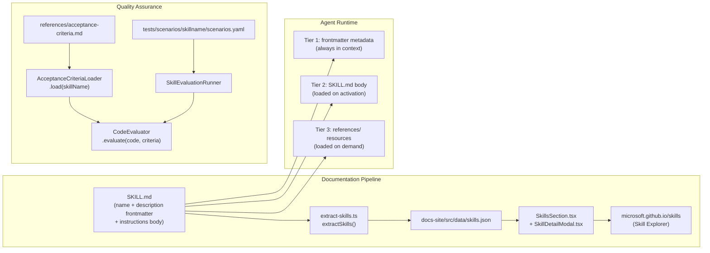

Sources: [docs-site/scripts/extract-skills.ts:144-214](), [docs-site/src/components/SkillsSection.tsx:1-10](), [tests/harness/criteria-loader.ts:24-28](), [.github/docs/agent-integration.md:7-78]()

---

## Core Agent Principles

`AGENTS.md` and `.github/copilot-instructions.md` ship as templates for configuring agent behavior in any project. Both define five principles applied to every coding task:

| Principle | Practical Rule |
|-----------|---------------|
| **Fresh Information First** | Use `microsoft-docs` MCP to look up current API signatures before writing Azure SDK code |
| **Think Before Coding** | State assumptions explicitly; ask when ambiguous rather than guessing |
| **Simplicity First** | Write minimum code that solves the problem; no speculative abstractions |
| **Surgical Changes** | Touch only lines required by the request; match existing style |
| **Goal-Driven Execution** | Define verifiable success criteria before implementation; use TDD |

The authentication pattern repeated across all Azure SDK skills follows from these principles: always use `DefaultAzureCredential` from `azure-identity`, never hardcode credentials.

Sources: [Agents.md:28-86](), [.github/copilot-instructions.md:24-67]()

---

# Page: Agent Skills System

# Agent Skills System

<details>
<summary>Relevant source files</summary>

The following files were used as context for generating this wiki page:

- [.github/agents/scaffolder.agent.md](.github/agents/scaffolder.agent.md)
- [.github/copilot-instructions.md](.github/copilot-instructions.md)
- [.github/docs/agent-integration.md](.github/docs/agent-integration.md)
- [.github/plugins/deep-wiki/.claude-plugin/plugin.json](.github/plugins/deep-wiki/.claude-plugin/plugin.json)
- [.github/plugins/deep-wiki/README.md](.github/plugins/deep-wiki/README.md)
- [.github/plugins/deep-wiki/commands/ado.md](.github/plugins/deep-wiki/commands/ado.md)
- [.github/plugins/deep-wiki/commands/crisp.md](.github/plugins/deep-wiki/commands/crisp.md)
- [.github/plugins/deep-wiki/skills/wiki-ado-convert/SKILL.md](.github/plugins/deep-wiki/skills/wiki-ado-convert/SKILL.md)
- [.github/prompts/scaffold-foundry-app.prompt.md](.github/prompts/scaffold-foundry-app.prompt.md)
- [.github/skills/skill-creator/references/acceptance-criteria.md](.github/skills/skill-creator/references/acceptance-criteria.md)
- [Agents.md](Agents.md)
- [README.md](README.md)
- [context7.json](context7.json)
- [docs-site/src/pages/index.astro](docs-site/src/pages/index.astro)
- [docs/index.html](docs/index.html)
- [tests/harness/criteria-loader.ts](tests/harness/criteria-loader.ts)
- [tests/scenarios/skill-creator/scenarios.yaml](tests/scenarios/skill-creator/scenarios.yaml)

</details>


This document describes the core skill system that provides domain-specific knowledge packages for AI agents working with Azure SDKs and Microsoft AI Foundry. It covers the skill file format, directory organization, progressive disclosure architecture, and how agents discover and load skills.

For information about creating new skills, see [Creating New Skills](#2.4). For browsing available skills through the web interface, see [Browsing and Discovering Skills](#2.2). For the Deep Wiki plugin architecture, see [Plugin Marketplace Architecture](#2.6).

---

## Architecture Overview

The Agent Skills System is a file-based knowledge distribution mechanism that packages SDK expertise, code patterns, and best practices into structured markdown documents. The system is designed to minimize context window usage through progressive disclosure while maintaining access to deep domain knowledge when needed.

### System Components

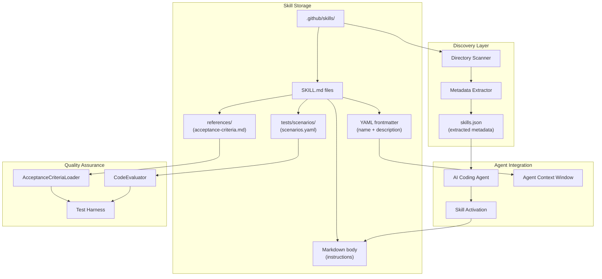

**Sources:** [README.md:1-70](), [Agents.md:147-164](), [.github/copilot-instructions.md:102-119]()

### Core Design Principles

| Principle | Implementation | Token Cost |
|-----------|----------------|------------|
| **Progressive Disclosure** | Load metadata at startup, full instructions on demand | ~50 tokens/skill (metadata), ~1500 tokens (full) |
| **Selective Loading** | Agents load only task-relevant skills to avoid context rot | Variable (2-5 skills per task) |
| **Source-Linked** | All patterns cite file paths and line numbers for verification | N/A |
| **Language-Aware** | Suffix-based categorization (`-py`, `-dotnet`, `-ts`, `-java`, `-rust`) | Automatic filtering |
| **Test-Driven** | Acceptance criteria and test scenarios validate skill quality | Enforced by CI/CD |

**Sources:** [README.md:47-51](), [Agents.md:149-177](), [.github/docs/agent-integration.md:59-77]()

---

## Skill File Structure

### SKILL.md Format

Each skill is a directory containing a `SKILL.md` file with YAML frontmatter and structured markdown content.

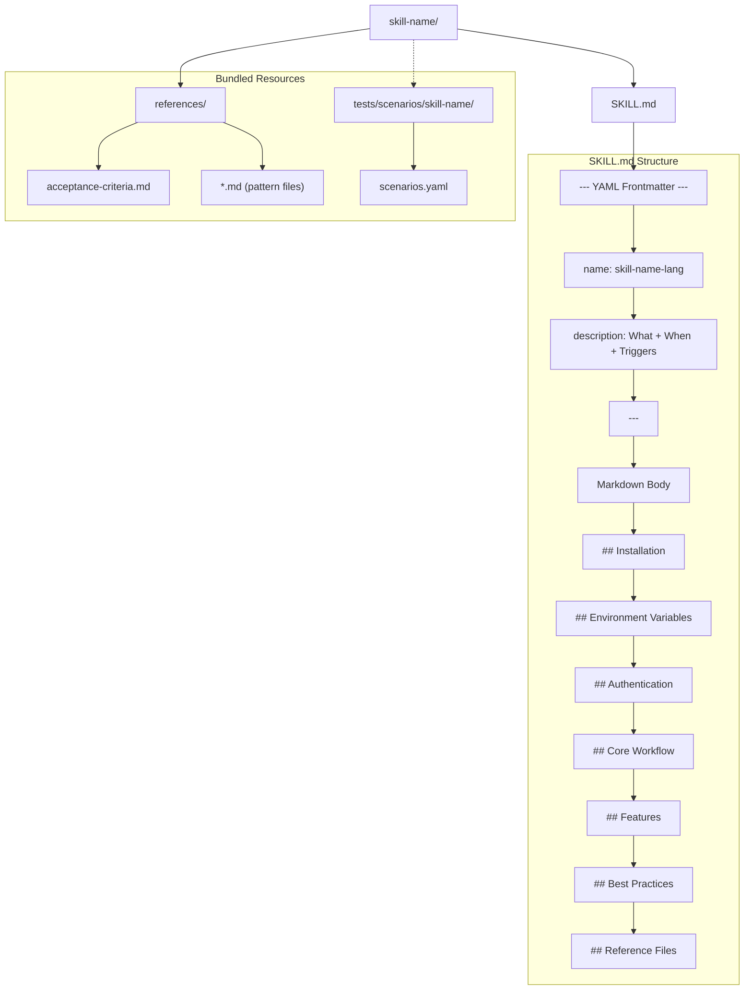

**Sources:** [.github/skills/skill-creator/references/acceptance-criteria.md:9-68](), [Agents.md:149-151](), [tests/scenarios/skill-creator/scenarios.yaml:10-89]()

### YAML Frontmatter Schema

The frontmatter contains metadata that agents scan at startup without loading the full skill content.

| Field | Type | Purpose | Required |
|-------|------|---------|----------|
| `name` | string | Skill identifier (matches directory name) | Yes |
| `description` | string | What the skill does + when to use + trigger phrases | Yes |

**Example frontmatter:**

```yaml
---
name: azure-cosmos-db-py
description: |
  Azure Cosmos DB SDK for Python. Use for NoSQL database operations,
  document CRUD, queries, and container management.
  Triggers: "cosmos db", "nosql", "document database", "azure cosmos".
---
```

**Sources:** [.github/skills/skill-creator/references/acceptance-criteria.md:94-105](), [tests/scenarios/skill-creator/scenarios.yaml:17-22]()

### Markdown Body Sections

The body follows a standard structure optimized for Azure SDK skills:

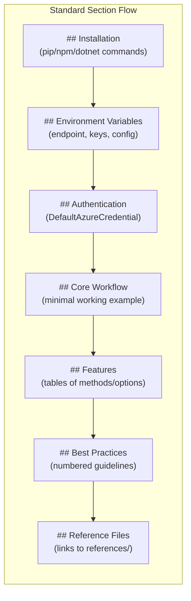

**Sources:** [.github/skills/skill-creator/references/acceptance-criteria.md:201-229](), [tests/scenarios/skill-creator/scenarios.yaml:90-186]()

---

## Progressive Disclosure Architecture

The system uses a three-tier loading strategy to balance context efficiency with access to deep knowledge.

### Three-Tier Loading Model

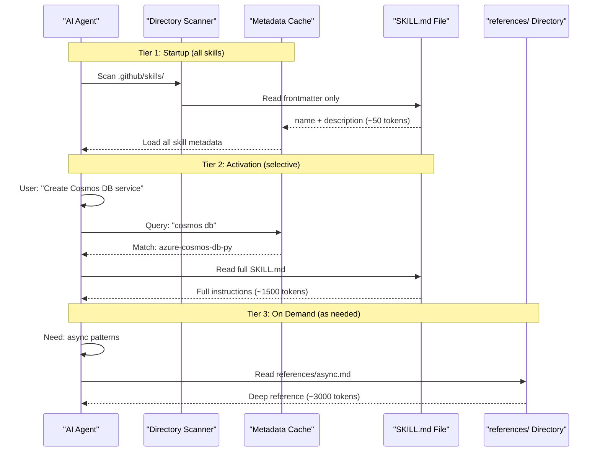

**Sources:** [.github/docs/agent-integration.md:59-77](), [README.md:47-51]()

### Token Cost Analysis

| Tier | Content | When Loaded | Token Cost | Skills in Context |
|------|---------|-------------|------------|-------------------|
| **Metadata** | `name` + `description` from YAML | Agent startup | ~50-100 per skill | All 133 skills (~6,650 tokens) |
| **Instructions** | Full `SKILL.md` markdown body | Skill activation | ~500-2000 per skill | 2-5 active skills (~3,000 tokens) |
| **Resources** | Files in `references/`, `scripts/`, `assets/` | On-demand reference | Variable (500-3000) | 0-2 reference files (~2,000 tokens) |

**Total context usage:** ~11,650 tokens maximum (vs. ~300,000 if all skills loaded fully at startup)

**Sources:** [.github/docs/agent-integration.md:59-67](), [Agents.md:175-177]()

### Context Rot Prevention

Loading all skills simultaneously causes three critical failures:

1. **Diluted Attention**: Agent cannot distinguish between Azure Cosmos DB patterns and Azure Storage patterns
2. **Wasted Tokens**: 98% of loaded content is irrelevant to current task
3. **Conflated Patterns**: Agent mixes authentication patterns from different SDKs

**Correct approach:**

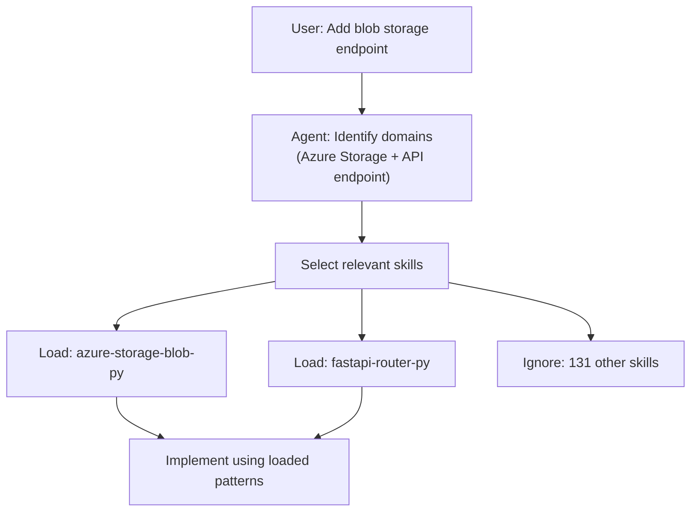

**Sources:** [README.md:47-51](), [Agents.md:175-177](), [.github/docs/agent-integration.md:100-117]()

---

## Discovery and Activation

### Directory Scanning Process

Agents discover skills through filesystem inspection at startup.

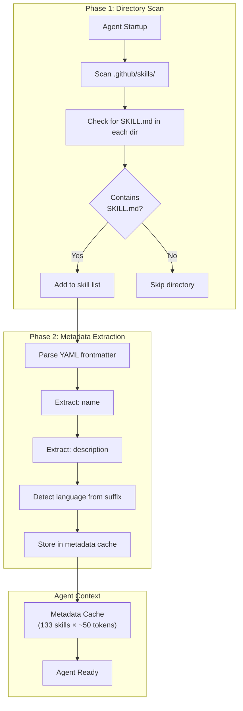

**Sources:** [.github/docs/agent-integration.md:6-35](), [tests/harness/criteria-loader.ts:63-86]()

### Skill Activation Flow

When an agent determines a skill is relevant, it loads the full content.

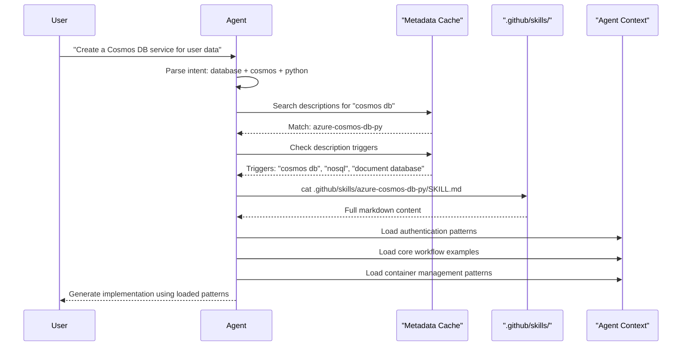

**Sources:** [.github/docs/agent-integration.md:66-77](), [.github/docs/agent-integration.md:87-98]()

### Agent-Specific Discovery

| Agent Type | Discovery Method | Configuration |
|------------|------------------|---------------|
| **VS Code / GitHub Copilot** | Workspace scanning + `.github/copilot-instructions.md` | Automatic when skills in `.github/skills/` |
| **Copilot CLI** | Directory scanning + context from `Agents.md` | Loaded from workspace root |
| **Claude Desktop** | `.claude/skills/` symlinks + `CLAUDE.md` pointer | Manual symlink setup |
| **Tool-Based Agents** | `load_skill(name)` tool function | Custom tool implementation |

**Sources:** [.github/docs/agent-integration.md:36-55](), [Agents.md:156-164]()

---

## Skill Organization

### Directory Structure

```
.github/
├── skills/                         # Backward-compatible symlinks (deprecated)
│   ├── azure-cosmos-db-py/         # Symlink → ../plugins/azure-sdk-python/skills/azure-cosmos-db-py
│   ├── azure-ai-projects-py/       # Symlink → ../plugins/azure-sdk-python/skills/azure-ai-projects-py
│   └── mcp-builder/                # Core skill (no symlink, owned by root)
│
├── plugins/                        # Canonical source (plugin bundles)
│   ├── azure-sdk-python/
│   │   ├── marketplace.json        # Plugin metadata
│   │   ├── skills/
│   │   │   ├── azure-cosmos-db-py/
│   │   │   │   ├── SKILL.md
│   │   │   │   ├── references/
│   │   │   │   │   └── acceptance-criteria.md
│   │   │   │   └── scripts/
│   │   │   └── azure-ai-projects-py/
│   │   │       └── SKILL.md
│   │   ├── commands/
│   │   └── agents/
│   │
│   ├── azure-sdk-dotnet/
│   ├── azure-sdk-typescript/
│   ├── azure-sdk-java/
│   └── deep-wiki/
│
└── prompts/                        # Reusable templates

tests/
└── scenarios/
    ├── azure-cosmos-db-py/
    │   └── scenarios.yaml          # Test scenarios for skill validation
    └── azure-ai-projects-py/
        └── scenarios.yaml
```

**Sources:** [README.md:513-541](), [Agents.md:149-154]()

### Naming Convention

Skills use language suffixes for automatic categorization and filtering.

| Language | Suffix | Count | Examples |
|----------|--------|-------|----------|
| **Core** (cross-language) | — | 8 | `mcp-builder`, `skill-creator`, `copilot-sdk`, `cloud-solution-architect` |
| **Python** | `-py` | 41 | `azure-cosmos-db-py`, `azure-ai-projects-py`, `fastapi-router-py` |
| **.NET** | `-dotnet` | 28 | `azure-ai-openai-dotnet`, `azure-identity-dotnet` |
| **TypeScript** | `-ts` | 25 | `azure-ai-projects-ts`, `zustand-store-ts`, `react-flow-node-ts` |
| **Java** | `-java` | 25 | `azure-cosmos-java`, `azure-ai-projects-java` |
| **Rust** | `-rust` | 7 | `azure-identity-rust`, `azure-cosmos-rust` |

**Pattern:** `azure-<service>-<language>` or `<domain>-<language>`

**Sources:** [README.md:72-83](), [Agents.md:166-173](), [.github/docs/agent-integration.md:140-149]()

### Skill Categories

Skills are logically grouped by product area for organizational clarity.

```mermaid
graph TD
    subgraph "Foundry & AI"
        foundry_skills["azure-ai-projects-*<br/>azure-ai-agents-*<br/>azure-search-documents-*<br/>azure-ai-voicelive-*"]
    end
    
    subgraph "Data & Storage"
        data_skills["azure-cosmos-*<br/>azure-storage-blob-*<br/>azure-data-tables-*"]
    end
    
    subgraph "Messaging & Events"
        messaging_skills["azure-eventhub-*<br/>azure-servicebus-*<br/>azure-eventgrid-*"]
    end
    
    subgraph "Monitoring"
        monitoring_skills["azure-monitor-*<br/>azure-applicationinsights-*"]
    end
    
    subgraph "Identity & Security"
        identity_skills["azure-identity-*<br/>azure-keyvault-*"]
    end
    
    subgraph "Integration"
        integration_skills["azure-appconfiguration-*<br/>azure-apimanagement-*"]
    end
    
    subgraph "Patterns & Frameworks"
        pattern_skills["fastapi-router-py<br/>pydantic-models-py<br/>zustand-store-ts<br/>react-flow-node-ts"]
    end
```

**Sources:** [README.md:86-216](), [Agents.md:213-223]()

---

## Plugin Marketplace Architecture

Skills can be bundled into installable plugins that combine skills, commands, and agents.

### Plugin Structure

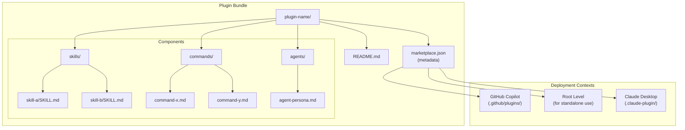

**Sources:** [README.md:545-559](), [.github/plugins/deep-wiki/.claude-plugin/plugin.json:1-11]()

### marketplace.json Schema

Plugin metadata defines name, version, components, and deployment contexts.

```json
{
  "name": "deep-wiki",
  "version": "2.0.0",
  "description": "AI-powered wiki generator",
  "skills": [
    "wiki-architect",
    "wiki-page-writer",
    "wiki-researcher"
  ],
  "commands": [
    "/deep-wiki:generate",
    "/deep-wiki:crisp",
    "/deep-wiki:page"
  ],
  "agents": [
    "wiki-architect",
    "wiki-writer"
  ]
}
```

**Sources:** [.github/plugins/deep-wiki/.claude-plugin/plugin.json:1-11](), [README.md:556-559]()

### Installation Methods

| Method | Command | Target Directory |
|--------|---------|------------------|
| **NPX Installer** | `npx skills add microsoft/skills` | `.github/skills/` |
| **Copilot CLI Plugin** | `/plugin install deep-wiki@skills` | Plugin-managed |
| **Manual Copy** | `cp -r agent-skills/.github/skills/<name> .` | Custom path |
| **Symlink** | `ln -s /path/to/skill .github/skills/<name>` | Custom path |

**Sources:** [README.md:17-43](), [Agents.md:156-160]()

---

## Quality Assurance System

Each skill includes acceptance criteria and test scenarios to validate generated code quality.

### Acceptance Criteria Structure

The `references/acceptance-criteria.md` file defines correct and incorrect code patterns.

```mermaid
graph TD
    subgraph "acceptance-criteria.md"
        sections["## Sections (e.g., Authentication, Core Workflow)"]
        
        subgraph "Per Section"
            correct_h3["### ✅ Correct"]
            correct_code["```python<br/>correct pattern<br/>```"]
            
            incorrect_h3["### ❌ Incorrect"]
            incorrect_code["```python<br/>anti-pattern<br/>```"]
        end
    end
    
    subgraph "AcceptanceCriteriaLoader"
        loader["AcceptanceCriteriaLoader.load()"]
        parse["Parse markdown sections"]
        extract_patterns["Extract code blocks"]
        categorize["Categorize as correct/incorrect"]
        rules["Generate ValidationRule objects"]
    end
    
    subgraph "Output"
        criteria_obj["AcceptanceCriteria Object"]
        correct_patterns["correctPatterns: CodePattern[]"]
        incorrect_patterns["incorrectPatterns: CodePattern[]"]
        validation_rules["rules: ValidationRule[]"]
    end
    
    sections --> correct_h3
    correct_h3 --> correct_code
    sections --> incorrect_h3
    incorrect_h3 --> incorrect_code
    
    correct_code --> loader
    incorrect_code --> loader
    loader --> parse
    parse --> extract_patterns
    extract_patterns --> categorize
    categorize --> rules
    
    rules --> criteria_obj
    criteria_obj --> correct_patterns
    criteria_obj --> incorrect_patterns
    criteria_obj --> validation_rules
```

**Sources:** [tests/harness/criteria-loader.ts:33-131](), [.github/skills/skill-creator/references/acceptance-criteria.md:1-7]()

### Test Scenario Format

The `tests/scenarios/<skill>/scenarios.yaml` file defines prompts and expected patterns.

```yaml
config:
  model: gpt-4
  max_tokens: 2000
  temperature: 0.3

scenarios:
  - name: scenario_identifier
    prompt: |
      Task description for the agent
    expected_patterns:
      - "pattern that must appear"
      - "import statement"
      - "DefaultAzureCredential"
    forbidden_patterns:
      - "hardcoded credential"
      - "api_key.*=.*sk-"
    tags:
      - category
    mock_response: |
      Expected generated code
```

**Sources:** [tests/scenarios/skill-creator/scenarios.yaml:1-11]()

### Test Harness Classes

| Class | Purpose | Key Methods |
|-------|---------|-------------|
| `AcceptanceCriteriaLoader` | Parse `acceptance-criteria.md` into structured rules | `load(skillName)`, `parseCriteria()` |
| `CodeEvaluator` | Validate generated code against patterns | `evaluate(code, criteria)` |
| `SkillEvaluationRunner` | Run scenarios and compute scores | `runScenario(scenario)` |
| `RalphLoopController` | Iterative improvement loop | `runWithFeedback()` |
| `CopilotClient` | Interface to Copilot SDK (mock/real) | `generateCode(prompt)` |

**Sources:** [tests/harness/criteria-loader.ts:51-100]()

### Evaluation Workflow

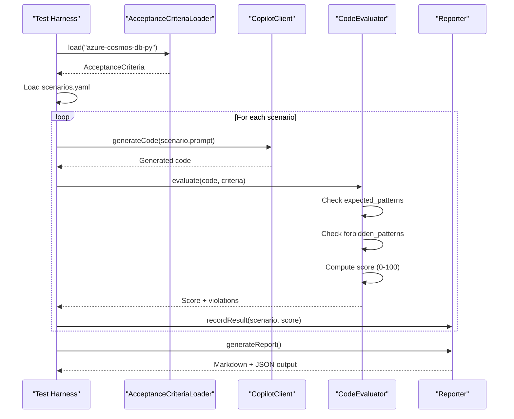

**Sources:** [tests/harness/criteria-loader.ts:88-100](), [README.md:610-631]()

---

## Web Interface Integration

The repository includes a documentation website that extracts skill metadata for browsing and filtering.

### Data Extraction Pipeline

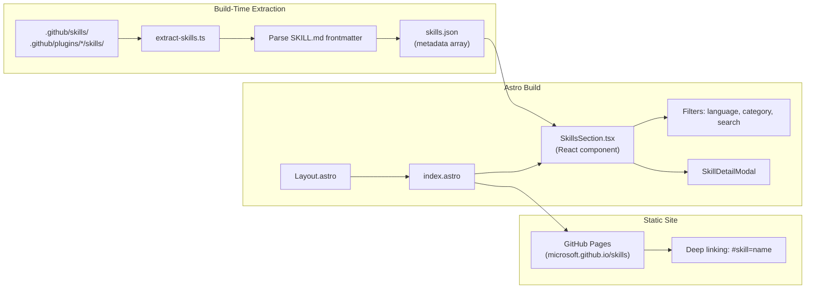

**Sources:** [docs-site/src/pages/index.astro:1-16](), [README.md:15]()

### Skill Metadata Schema

```typescript
interface Skill {
  name: string;           // e.g., "azure-cosmos-db-py"
  description: string;    // Full description with triggers
  lang: string;           // "py" | "dotnet" | "ts" | "java" | "rust" | "core"
  category: string;       // "foundry" | "data" | "messaging" | etc.
  path: string;           // ".github/skills/azure-cosmos-db-py"
  package: string;        // NPM/PyPI/NuGet package name
}
```

**Sources:** [docs-site/src/pages/index.astro:7]()

---

## Integration with Fresh Information First

The skill system implements the "Fresh Information First" principle for Azure SDK knowledge.

### Stale Knowledge Problem

AI agent training data becomes outdated as SDKs evolve. Skills address this through:

1. **MCP Server Integration**: Skills instruct agents to query `microsoft-docs` MCP server before using cached knowledge
2. **Daily Documentation Updates**: Automated workflows scrape Microsoft Learn and update `llms.txt` files
3. **Version-Specific Patterns**: Skills include version checks and compatibility notes

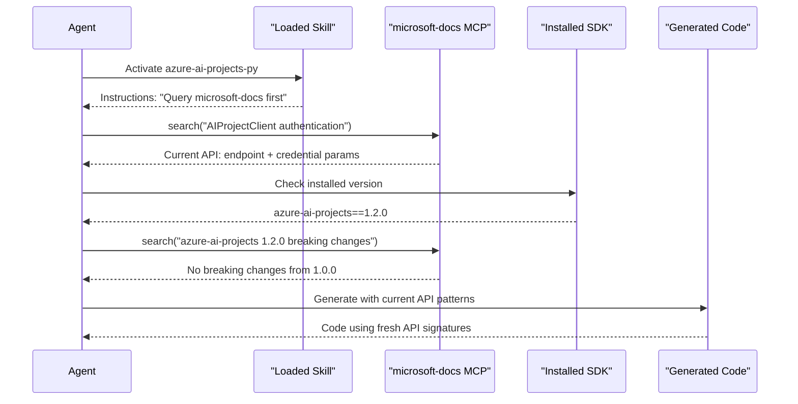

**Sources:** [Agents.md:6-23](), [.github/copilot-instructions.md:8-17]()

### Verification Commands

Skills include verification steps to prevent stale patterns:

```bash
# Always do this first (from skill instructions)
1. Search Microsoft Learn for current docs
2. Check Context7 for indexed Foundry documentation (updated daily)
3. Verify against actual installed package version
```

**Sources:** [Agents.md:16-20]()

---

## Summary

The Agent Skills System provides a scalable, context-efficient mechanism for distributing domain-specific knowledge to AI coding agents. Key architectural decisions include:

| Design Choice | Rationale | Impact |
|---------------|-----------|--------|
| **Progressive Disclosure** | Load metadata at startup, full content on activation | 98% reduction in context usage vs. loading all skills |
| **File-Based Storage** | No runtime dependencies, works with any filesystem-aware agent | Universal compatibility (VS Code, CLI, Claude) |
| **YAML Frontmatter** | Structured metadata separate from instructions | Enables metadata scanning without parsing markdown |
| **Language Suffixes** | Automatic categorization by target language | Agents can filter irrelevant skills before loading |
| **Test-Driven Validation** | Acceptance criteria + scenarios for each skill | Enforced quality gates in CI/CD pipeline |
| **Plugin Bundles** | Group related skills for domain-specific installation | Users install only relevant skill sets |

**Sources:** [README.md:1-70](), [Agents.md:147-177](), [.github/docs/agent-integration.md:1-150]()

---

# Page: Understanding Skills and Progressive Disclosure

# Understanding Skills and Progressive Disclosure

<details>
<summary>Relevant source files</summary>

The following files were used as context for generating this wiki page:

- [.github/agents/scaffolder.agent.md](.github/agents/scaffolder.agent.md)
- [.github/copilot-instructions.md](.github/copilot-instructions.md)
- [.github/docs/agent-integration.md](.github/docs/agent-integration.md)
- [.github/prompts/scaffold-foundry-app.prompt.md](.github/prompts/scaffold-foundry-app.prompt.md)
- [.github/skills/continual-learning/SKILL.md](.github/skills/continual-learning/SKILL.md)
- [.github/skills/skill-creator/references/acceptance-criteria.md](.github/skills/skill-creator/references/acceptance-criteria.md)
- [Agents.md](Agents.md)
- [context7.json](context7.json)
- [docs-site/src/data/skills.json](docs-site/src/data/skills.json)
- [hooks/continual-learning/README.md](hooks/continual-learning/README.md)
- [hooks/continual-learning/hooks.json](hooks/continual-learning/hooks.json)
- [hooks/continual-learning/learn.sh](hooks/continual-learning/learn.sh)
- [tests/harness/criteria-loader.ts](tests/harness/criteria-loader.ts)
- [tests/scenarios/skill-creator/scenarios.yaml](tests/scenarios/skill-creator/scenarios.yaml)

</details>


## Purpose and Scope

This document explains the three-tier progressive disclosure architecture used by skills in the microsoft/skills repository. Progressive disclosure prevents context rot by loading minimal skill metadata at agent startup (~50 tokens per skill), activating full skill instructions only when relevant (~1500 tokens), and loading detailed reference files on-demand (~3000 tokens). This architecture enables agents to maintain awareness of 133 skills while consuming minimal context tokens.

For information about browsing and discovering skills through the web interface and discovery mechanisms, see [Browsing and Discovering Skills](#2.2). For the SKILL.md format specification, see [SKILL.md Format Specification](#2.3).

---

## The Problem: Context Rot

Loading all available skill instructions at agent startup causes **context rot**:

| Problem | Impact | Example |
|---------|--------|---------|
| **Diluted Attention** | Agent spreads focus across irrelevant domains | Loading React patterns when working on FastAPI backend |
| **Token Waste** | Unnecessary instructions consume context window | 133 skills × 1500 tokens = 199,500 tokens wasted |
| **Pattern Conflation** | Similar patterns from different SDKs interfere | Mixing Azure Storage blob patterns with Cosmos DB document patterns |
| **Stale Activation** | All skills loaded regardless of task relevance | Loading Java skills when writing Python code |

The repository contains 133 skills across 4 languages (Python, .NET, TypeScript, Java). Loading all skill instructions would consume the entire context window before any actual work begins.

**Sources:** [Agents.md:174-176](), [context7.json:8-11]()

---

## The Solution: Progressive Disclosure

Progressive disclosure loads skills in three tiers, activating each tier only when needed:

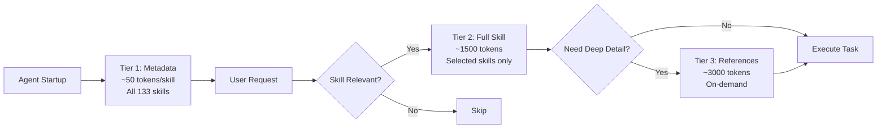

**Three-Tier Architecture**

This approach enables **selective loading**: only skills relevant to the current task consume significant context tokens. An agent working on Azure Cosmos DB might load 2-3 skills (~4500 tokens) instead of all 133 skills (~199,500 tokens).

**Sources:** [Agents.md:147-153](), [.github/docs/agent-integration.md:59-77]()

---

## Tier 1: Metadata (Frontmatter)

### What Is Loaded

At agent startup, only the **YAML frontmatter** from each `SKILL.md` file is loaded:

```yaml
---
name: azure-cosmos-db-py
description: Build Azure Cosmos DB NoSQL services with Python/FastAPI following production-grade patterns. Use when implementing database client setup with dual auth (DefaultAzureCredential + emulator), service layer classes with CRUD operations, partition key strategies, parameterized queries, or TDD patterns for Cosmos. Triggers on phrases like "Cosmos DB", "NoSQL database", "document store", "add persistence", "database service layer", or "Python Cosmos SDK".
---
```

The markdown body below the frontmatter is **not loaded** at this stage.

**Sources:** [Agents.md:149-151](), [.github/skills/skill-creator/references/acceptance-criteria.md:93-104]()

### Token Cost

- **~50-100 tokens per skill**
- 133 skills × 75 tokens (average) = **~10,000 tokens total**

This fits comfortably in the context window while providing enough information for activation decisions.

**Sources:** [.github/docs/agent-integration.md:62]()

### Directory Structure

Skills are discovered by scanning for `SKILL.md` files:

```
.github/skills/
├── azure-cosmos-db-py/
│   └── SKILL.md           ← Tier 1: frontmatter loaded at startup
├── azure-ai-agents-py/
│   └── SKILL.md           ← Tier 1: frontmatter loaded at startup
└── fastapi-router-py/
    └── SKILL.md           ← Tier 1: frontmatter loaded at startup
```

**Sources:** [Agents.md:149](), [.github/docs/agent-integration.md:9-23]()

### Activation Triggers

The `description` field includes **trigger phrases** that help agents identify relevant skills:

```yaml
description: |
  Azure Cosmos DB SDK for Python. Use for NoSQL database operations,
  document CRUD, queries, and container management.
  Triggers: "cosmos db", "nosql", "document database", "azure cosmos".
```

When a user request contains matching phrases, the agent activates the skill (loads Tier 2).

**Sources:** [tests/scenarios/skill-creator/scenarios.yaml:16-22](), [.github/skills/skill-creator/references/acceptance-criteria.md:167-173]()

---

## Tier 2: Full Skill (Markdown Body)

### What Is Loaded

When a skill is activated, the **entire markdown body** of `SKILL.md` is loaded:

```markdown
# Azure Cosmos DB SDK

## Installation

```bash
pip install azure-cosmos
```

## Environment Variables

```bash
AZURE_COSMOS_ENDPOINT=https://<account>.documents.azure.com:443/
AZURE_COSMOS_DATABASE=my-database
```

## Authentication

```python
from azure.identity import DefaultAzureCredential
from azure.cosmos import CosmosClient
import os

credential = DefaultAzureCredential()
client = CosmosClient(
    url=os.environ["AZURE_COSMOS_ENDPOINT"],
    credential=credential
)
```

## Core Workflow

[... implementation patterns ...]
```

**Sources:** [tests/scenarios/skill-creator/scenarios.yaml:38-88]()

### Token Cost

- **~500-2000 tokens per activated skill**
- Typical activation: 2-3 skills = **~3000-4500 tokens**

This provides sufficient implementation guidance without overwhelming the context window.

**Sources:** [.github/docs/agent-integration.md:62]()

### Activation Flow

```mermaid
sequenceDiagram
    participant User
    participant Agent
    participant Metadata["Metadata Cache<br/>(Tier 1)"]
    participant FS["Filesystem<br/>(.github/skills/)"]
    
    User->>Agent: "Create a Cosmos DB service for user data"
    Agent->>Metadata: Scan loaded metadata for triggers
    Metadata-->>Agent: Match: "azure-cosmos-db-py"<br/>Triggers: "Cosmos DB", "NoSQL database"
    Agent->>FS: Read .github/skills/azure-cosmos-db-py/SKILL.md
    FS-->>Agent: Full markdown body (Tier 2)
    Agent->>Agent: Follow implementation patterns
    Agent-->>User: Implementation code
```

**Sources:** [.github/docs/agent-integration.md:68-77]()

### Section Structure

Skills follow a standard section order optimized for progressive reading:

| Section | Purpose | Required |
|---------|---------|----------|
| **Installation** | Package install commands | Yes |
| **Environment Variables** | Required configuration | Yes |
| **Authentication** | `DefaultAzureCredential` pattern | Yes |
| **Core Workflow** | Minimal working example | Yes |
| **Features** | API methods, clients, options | Optional |
| **Best Practices** | Numbered recommendations | Optional |
| **Reference Files** | Links to Tier 3 resources | Optional |

**Sources:** [.github/skills/skill-creator/references/acceptance-criteria.md:205-229]()

---

## Tier 3: References (Separate Files)

### What Is Loaded

Detailed documentation stored in the `references/` subdirectory:

```
azure-ai-agents-py/
├── SKILL.md              ← Tier 2 (500-2000 tokens)
└── references/           ← Tier 3 (on-demand)
    ├── tools.md          ← ~1000 tokens (loaded when agent needs tool details)
    ├── streaming.md      ← ~1000 tokens (loaded when agent needs streaming patterns)
    ├── async.md          ← ~1000 tokens (loaded when agent needs async patterns)
    └── acceptance-criteria.md  ← Used by test harness, not agents
```

**Sources:** [.github/skills/skill-creator/references/acceptance-criteria.md:315-325]()

### Token Cost

- **~500-1500 tokens per reference file**
- Loaded **only when agent explicitly needs deep detail**

For example, an agent implementing streaming responses would:
1. Load `azure-ai-agents-py/SKILL.md` (Tier 2: ~1500 tokens)
2. Read reference to `references/streaming.md` in the main skill
3. Load `references/streaming.md` (Tier 3: ~1000 tokens)

**Sources:** [.github/docs/agent-integration.md:62]()

### Progressive Disclosure in Practice

The main `SKILL.md` links to reference files rather than including all content:

```markdown
## Streaming

For streaming patterns, see [references/streaming.md](references/streaming.md).

## Reference Files

| File | Contents |
|------|----------|
| [references/tools.md](references/tools.md) | Tool configurations |
| [references/streaming.md](references/streaming.md) | Event streaming patterns |
| [references/async.md](references/async.md) | Async/await patterns |
```

This keeps the main skill under 500 lines while maintaining access to detailed documentation.

**Sources:** [tests/scenarios/skill-creator/scenarios.yaml:250-267](), [.github/skills/skill-creator/references/acceptance-criteria.md:350-387]()

---

## Complete Activation Example

### Scenario: User Request

**User:** "Create a Cosmos DB service layer for storing user profiles with partition by user_id"

### Step 1: Metadata Scan (Tier 1)

Agent scans loaded metadata for relevant skills:

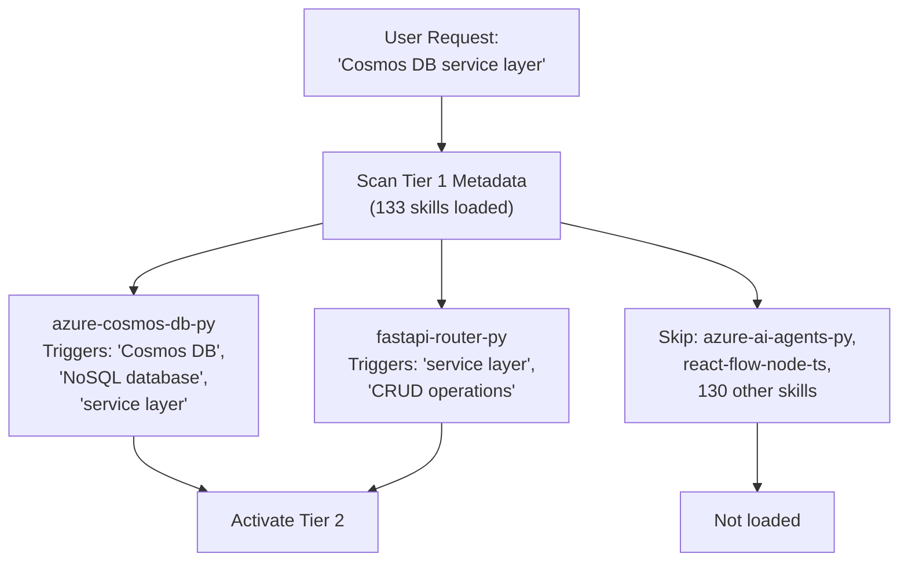

**Sources:** [.github/docs/agent-integration.md:68-77]()

### Step 2: Load Full Skills (Tier 2)

Agent reads complete `SKILL.md` files:

```bash
# Agent filesystem operations
cat .github/skills/azure-cosmos-db-py/SKILL.md
cat .github/skills/fastapi-router-py/SKILL.md
```

**Token cost:** ~1500 tokens (Cosmos DB) + ~1000 tokens (FastAPI) = **2500 tokens**

**Sources:** [.github/docs/agent-integration.md:83-88]()

### Step 3: Load References (Tier 3 - If Needed)

If agent needs detailed service layer patterns:

```bash
# On-demand reference loading
cat .github/skills/azure-cosmos-db-py/references/service-patterns.md
```

**Token cost:** ~1000 tokens (only loaded if agent explicitly needs deeper patterns)

### Total Token Budget

| Phase | Content | Tokens |
|-------|---------|--------|
| **Startup** | All 133 skill metadata | ~10,000 |
| **Activation** | 2 full skills | ~2,500 |
| **References** | 1 reference file (optional) | ~1,000 |
| **Total** | | **~13,500 tokens** |

Compare to loading all 133 skills fully: **~199,500 tokens** (15× more)

**Sources:** [.github/docs/agent-integration.md:62]()

---

## Token Economics

### Cost Comparison

```mermaid
graph LR
    subgraph "Progressive Disclosure"
        PD1["Tier 1<br/>133 skills<br/>10,000 tokens"]
        PD2["Tier 2<br/>2-3 skills<br/>3,000 tokens"]
        PD3["Tier 3<br/>0-2 files<br/>1,000 tokens"]
        PD1 --> PD2 --> PD3
        PD3 --> PDTotal["Total:<br/>~14,000 tokens"]
    end
    
    subgraph "Load All Skills"
        LA1["All Skills<br/>133 × 1,500<br/>199,500 tokens"]
        LA1 --> LATotal["Total:<br/>199,500 tokens"]
    end
    
    PDTotal -.->|"14× more efficient"| LATotal
```

### Selective Loading Strategies

Agents should load skills based on task context:

| Task Type | Skills to Load | Tier 2 Tokens |
|-----------|---------------|---------------|
| **Azure Cosmos DB API** | `azure-cosmos-db-py`, `fastapi-router-py` | ~2,500 |
| **Azure AI Agents** | `azure-ai-agents-py`, `azure-ai-projects-py` | ~3,000 |
| **Frontend UI** | `frontend-ui-dark-ts`, `react-flow-node-ts` | ~2,000 |
| **MCP Server** | `mcp-builder`, `skill-creator` | ~2,500 |

**Never load all skills.** Always use Tier 1 metadata to select only relevant skills.

**Sources:** [Agents.md:174-176](), [.github/docs/agent-integration.md:100-117]()

---

## Discovery and Directory Scanning

### Filesystem Structure

Skills are organized in `.github/skills/` with optional language-specific symlinks:

```
.github/
├── skills/                     ← Primary skill location
│   ├── azure-cosmos-db-py/
│   │   ├── SKILL.md           ← Frontmatter + body
│   │   └── references/
│   │       ├── service-patterns.md
│   │       └── acceptance-criteria.md
│   ├── azure-ai-agents-py/
│   │   └── SKILL.md
│   └── mcp-builder/           ← Cross-language skill (no suffix)
│       └── SKILL.md
│
└── plugins/                    ← Plugin bundles (canonical source)
    ├── azure-sdk-python/
    │   └── skills/
    │       ├── azure-cosmos-db-py/
    │       └── azure-ai-agents-py/
    └── azure-sdk-dotnet/
        └── skills/
            └── azure-ai-agents-dotnet/
```

**Note:** Skills in `.github/skills/` are duplicated from `.github/plugins/*/skills/` to support the `npx skills add microsoft/skills` installation workflow. The plugin directories remain the canonical source.

**Sources:** [Agents.md:149-154](), [.github/copilot-instructions.md:76-99]()

### Discovery Algorithm

Agents discover skills using this process:

```mermaid
flowchart TD
    Start["Agent Startup"] --> ScanDir["Scan .github/skills/"]
    ScanDir --> CheckEntry{"For each entry"}
    CheckEntry --> IsDir{"Is directory or<br/>symlink?"}
    IsDir -->|Yes| HasSkill{"Has SKILL.md?"}
    IsDir -->|No| CheckEntry
    HasSkill -->|Yes| Parse["Parse YAML frontmatter"]
    HasSkill -->|No| CheckEntry
    Parse --> ExtractMeta["Extract name + description"]
    ExtractMeta --> StoreCache["Store in metadata cache"]
    StoreCache --> CheckEntry
    CheckEntry -->|Done| Ready["Agent Ready<br/>(Tier 1 loaded)"]
```

**Sources:** [tests/harness/criteria-loader.ts:60-86](), [.github/docs/agent-integration.md:9-36]()

### Naming Convention

Skills use language suffixes for automatic categorization:

| Suffix | Language | Example |
|--------|----------|---------|
| `-py` | Python | `azure-cosmos-db-py` |
| `-dotnet` | .NET/C# | `azure-ai-inference-dotnet` |
| `-ts` | TypeScript/JavaScript | `azure-ai-agents-ts` |
| `-java` | Java | `azure-cosmos-java` |
| (none) | Cross-language | `mcp-builder`, `skill-creator` |

This allows agents to filter skills by project technology stack during Tier 1 scanning.

**Sources:** [.github/copilot-instructions.md:109-119](), [.github/docs/agent-integration.md:138-150]()

---

## Best Practices

### For Skill Authors

1. **Keep SKILL.md under 500 lines** - Use references for detailed content
2. **Include trigger phrases in description** - Help agents identify when to activate
3. **Link to references explicitly** - Use `[references/tools.md](references/tools.md)` syntax
4. **Follow section order** - Installation → Environment → Authentication → Core → References

**Sources:** [.github/skills/skill-creator/references/acceptance-criteria.md:205-229](), [.github/skills/skill-creator/references/acceptance-criteria.md:473-499]()

### For Agent Integration

1. **Never load all skills** - Always use selective loading based on task context
2. **Check metadata first** - Use Tier 1 triggers to determine relevance
3. **Load Tier 2 on activation** - Read full SKILL.md only when skill is relevant
4. **Load Tier 3 on-demand** - Access references only when deep detail is needed

**Sources:** [Agents.md:174-176](), [.github/docs/agent-integration.md:100-117]()

### Preventing Context Rot

| Anti-Pattern | Consequence | Solution |
|--------------|-------------|----------|
| Load all skills at startup | 199,500 tokens wasted | Use three-tier loading |
| Load full skill without checking triggers | Irrelevant content loaded | Check Tier 1 metadata first |
| Include everything in SKILL.md | File too large, Tier 2 inefficient | Move details to references/ |
| No trigger phrases in description | Skills don't activate correctly | Add "Use when...", "Triggers:" |

**Sources:** [.github/docs/agent-integration.md:100-117](), [.github/skills/skill-creator/references/acceptance-criteria.md:458-469]()

---

## Summary

Progressive disclosure enables agents to maintain awareness of 133 skills while consuming only ~10,000 tokens at startup. By loading full skill instructions only when relevant (~1,500 tokens) and detailed references on-demand (~1,000 tokens), the architecture prevents context rot while maintaining access to deep domain knowledge.

**Key Metrics:**
- **Tier 1 (Metadata):** ~50 tokens/skill × 133 skills = 10,000 tokens
- **Tier 2 (Full Skill):** ~1,500 tokens × 2-3 skills = 3,000-4,500 tokens  
- **Tier 3 (References):** ~1,000 tokens × 0-2 files = 0-2,000 tokens
- **Total:** ~13,000-16,500 tokens (vs. 199,500 if loading all skills fully)

This 14× token efficiency enables agents to work effectively across multiple domains without exhausting their context window.

**Sources:** [Agents.md:147-176](), [.github/docs/agent-integration.md:59-77](), [context7.json:8-11]()

---

# Page: Browsing and Discovering Skills

# Browsing and Discovering Skills

<details>
<summary>Relevant source files</summary>

The following files were used as context for generating this wiki page:

- [.github/plugins/deep-wiki/.claude-plugin/plugin.json](.github/plugins/deep-wiki/.claude-plugin/plugin.json)
- [.github/plugins/deep-wiki/README.md](.github/plugins/deep-wiki/README.md)
- [.github/plugins/deep-wiki/commands/ado.md](.github/plugins/deep-wiki/commands/ado.md)
- [.github/plugins/deep-wiki/commands/crisp.md](.github/plugins/deep-wiki/commands/crisp.md)
- [.github/plugins/deep-wiki/skills/wiki-ado-convert/SKILL.md](.github/plugins/deep-wiki/skills/wiki-ado-convert/SKILL.md)
- [README.md](README.md)
- [docs-site/scripts/extract-skills.ts](docs-site/scripts/extract-skills.ts)
- [docs-site/src/components/CategoryTabs.tsx](docs-site/src/components/CategoryTabs.tsx)
- [docs-site/src/components/SkillDetailModal.tsx](docs-site/src/components/SkillDetailModal.tsx)
- [docs-site/src/components/SkillsSection.tsx](docs-site/src/components/SkillsSection.tsx)
- [docs-site/src/pages/index.astro](docs-site/src/pages/index.astro)
- [docs/_astro/SkillsSection.DSKr3JQZ.js](docs/_astro/SkillsSection.DSKr3JQZ.js)
- [docs/index.html](docs/index.html)
- [tests/scenarios/azure-search-documents-py/scenarios.yaml](tests/scenarios/azure-search-documents-py/scenarios.yaml)

</details>


This page documents the discovery mechanisms that enable users and AI agents to find and explore the 132+ skills in the repository. It covers the web interface, LLM-friendly discovery files, agent integration, and the metadata extraction pipeline.

For information about how skills implement progressive disclosure to prevent context rot, see [Understanding Skills and Progressive Disclosure](#2.1). For creating new skills, see [Creating New Skills](#2.4).

---

## Discovery Mechanisms Overview

The repository provides three discovery paths optimized for different consumers:

```mermaid
graph TB
    subgraph "Human Users"
        WEB["Web Interface<br/>microsoft.github.io/skills"]
        GITHUB["GitHub Repository<br/>Browse .github/skills/"]
    end
    
    subgraph "AI Agents"
        AGENTS["AGENTS.md<br/>Entry point instructions"]
        DIRSCAN["Directory Scanning<br/>.github/skills/ + .github/plugins/"]
    end
    
    subgraph "LLMs & MCP Tools"
        LLMS["llms.txt<br/>LLM-friendly index"]
        LLMSFULL["llms-full.txt<br/>Full content"]
        CONTEXT7["Context7 MCP<br/>Semantic search"]
    end
    
    subgraph "Metadata Pipeline"
        FRONTMATTER["SKILL.md<br/>YAML frontmatter"]
        EXTRACT["extract-skills.ts<br/>Metadata extraction"]
        JSON["skills.json<br/>Structured data"]
    end
    
    FRONTMATTER --> EXTRACT
    EXTRACT --> JSON
    JSON --> WEB
    
    WEB --> |Deep links| GITHUB
    AGENTS --> DIRSCAN
    LLMS --> LLMSFULL
    CONTEXT7 --> LLMSFULL
    
    style WEB fill:#2d333b,stroke:#58a6ff
    style AGENTS fill:#2d333b,stroke:#6d5dfc
    style LLMS fill:#2d333b,stroke:#f97316
    style JSON fill:#2d333b,stroke:#06b6d4
```

Sources: [README.md:1-80](), [docs-site/src/pages/index.astro:1-327](), [docs-site/scripts/extract-skills.ts:1-224]()

---

## Web Interface Discovery

The documentation site at `microsoft.github.io/skills` provides an interactive skill browser for human users.

### Skill Metadata Structure

Each skill exposes metadata through YAML frontmatter in its `SKILL.md` file:

| Field | Type | Purpose | Example |
|-------|------|---------|---------|
| `name` | string | Unique skill identifier | `azure-ai-projects-py` |
| `description` | string | Full skill description with triggers | `Build AI applications using the Azure AI Projects Python SDK...` |
| `package` | string (optional) | SDK package name | `azure-ai-projects` |

Derived fields added during extraction:

| Field | Source | Logic |
|-------|--------|-------|
| `lang` | Filename suffix or directory | `-py` → `py`, `-dotnet` → `dotnet`, etc. |
| `category` | Symlink structure in `skills/` | `skills/py/foundry/` → `foundry` |
| `path` | File location | `.github/plugins/azure-sdk-python/skills/azure-ai-projects-py` |

Sources: [docs-site/scripts/extract-skills.ts:18-25](), [docs-site/scripts/extract-skills.ts:42-57]()

### Extraction Pipeline

```mermaid
graph LR
    subgraph "Source Directories"
        PLUGINS[".github/plugins/<br/>azure-sdk-*/skills/"]
        CORE[".github/skills/<br/>Core skills"]
        SYMLINKS["skills/<br/>Language symlinks"]
    end
    
    subgraph "extract-skills.ts"
        SCAN["collectMarkdownFiles()<br/>Scan SKILL.md files"]
        PARSE["preprocessYamlFrontmatter()<br/>Fix @-prefixed packages"]
        MATTER["gray-matter<br/>Parse frontmatter"]
        INFER["inferLangFromName()<br/>Detect language"]
        LOOKUP["findSymlinkInfo()<br/>Read category from symlinks"]
    end
    
    subgraph "Output"
        JSON["skills.json<br/>Array of Skill objects"]
    end
    
    PLUGINS --> SCAN
    CORE --> SCAN
    SCAN --> PARSE
    PARSE --> MATTER
    MATTER --> INFER
    SYMLINKS --> LOOKUP
    INFER --> JSON
    LOOKUP --> JSON
    
    style SCAN fill:#2d333b,stroke:#f97316
    style JSON fill:#2d333b,stroke:#06b6d4
```

Sources: [docs-site/scripts/extract-skills.ts:144-204](), [docs-site/scripts/extract-skills.ts:96-103]()

The extraction script runs at build time:

1. **Scan plugin bundles** (`.github/plugins/azure-sdk-*/skills/`) using `PLUGIN_LANG_MAP` to determine language
2. **Scan core skills** (`.github/skills/`) using suffix inference (`-py`, `-dotnet`, etc.)
3. **Parse frontmatter** with `gray-matter` after preprocessing to fix `@`-prefixed package names
4. **Infer categories** by reading symlink targets in `skills/py/`, `skills/dotnet/`, etc.
5. **Write `skills.json`** for consumption by the web interface

Sources: [docs-site/scripts/extract-skills.ts:154-179](), [docs-site/scripts/extract-skills.ts:5-16]()

### Filtering System

The web interface provides three filtering dimensions implemented in React components:

```mermaid
graph TB
    subgraph "SkillsSection Component"
        STATE["useState hooks<br/>selectedLang, selectedCategory, searchQuery"]
        MEMO["useMemo<br/>filteredSkills computation"]
    end
    
    subgraph "Filter Components"
        LANGTABS["LanguageTabs.tsx<br/>All, Core, Python, .NET, TypeScript, Java, Rust"]
        CATTABS["CategoryTabs.tsx<br/>All, Foundry, M365, Data, Messaging, etc."]
        SEARCH["SearchInput.tsx<br/>Debounced search with ⌘K shortcut"]
    end
    
    subgraph "Results"
        GRID["SkillCard grid<br/>Collapsed to 8 items, expand button"]
        MODAL["SkillDetailModal<br/>Install command, GitHub links, tests"]
    end
    
    STATE --> LANGTABS
    STATE --> CATTABS
    STATE --> SEARCH
    
    LANGTABS --> MEMO
    CATTABS --> MEMO
    SEARCH --> MEMO
    
    MEMO --> GRID
    GRID --> MODAL
    
    style STATE fill:#2d333b,stroke:#6d5dfc
    style MEMO fill:#2d333b,stroke:#f97316
    style GRID fill:#2d333b,stroke:#06b6d4
```

Sources: [docs-site/src/components/SkillsSection.tsx:39-126](), [docs-site/src/components/LanguageTabs.tsx:1-50](), [docs-site/src/components/CategoryTabs.tsx:1-111]()

#### Language Filter

The `LanguageTabs` component maps language codes to display labels and colors:

| Value | Label | Color Variable | Count Source |
|-------|-------|----------------|--------------|
| `all` | All | `--text-secondary` | Sum of all counts |
| `core` | Core | `--lang-core` | `langCounts.core` |
| `py` | Python | `--lang-python` | `langCounts.py` |
| `dotnet` | .NET | `--lang-dotnet` | `langCounts.dotnet` |
| `ts` | TypeScript | `--lang-typescript` | `langCounts.ts` |
| `java` | Java | `--lang-java` | `langCounts.java` |
| `rust` | Rust | `--lang-rust` | `langCounts.rust` |

Languages with zero skills are hidden from the UI. Selecting a language resets the category filter to "all" and collapses the expanded view.

Sources: [docs-site/src/components/LanguageTabs.tsx:5-18](), [docs-site/src/components/SkillsSection.tsx:111-115]()

#### Category Filter

The `CategoryTabs` component displays categories in a predefined order, showing only categories with skills in the current language filter:

```typescript
const CATEGORY_ORDER = [
  'all', 'foundry', 'm365', 'general', 'data', 'messaging',
  'entra', 'monitoring', 'integration', 'compute', 
  'communication', 'frontend', 'partner',
];
```

Category counts are computed dynamically based on the selected language using `useMemo` to prevent unnecessary recalculation.

Sources: [docs-site/src/components/CategoryTabs.tsx:5-19](), [docs-site/src/components/SkillsSection.tsx:88-97]()

#### Search Filter

The `SearchInput` component provides case-insensitive substring matching against both `name` and `description` fields:

```typescript
const searchMatch = !query || 
  skill.name.toLowerCase().includes(query) || 
  skill.description.toLowerCase().includes(query);
```

Features:
- **Keyboard shortcut**: `⌘K` (Mac) or `Ctrl+K` (Windows) focuses the input
- **Clear button**: Appears when query is non-empty
- **Escape key**: Clears search and blurs input

Sources: [docs-site/src/components/SearchInput.tsx:1-70](), [docs-site/src/components/SkillsSection.tsx:99-109]()

### Deep Linking

The site supports shareable URLs with skill deep links using URL hash fragments:

```
https://microsoft.github.io/skills/#skill=azure-ai-projects-py
```

Implementation:

1. **On mount**: `useEffect` hook calls `getSkillFromHash()` to parse `window.location.hash`
2. **On hash change**: Event listener updates `selectedSkill` state
3. **On card click**: Updates hash with `window.history.replaceState()` and opens modal
4. **Share button**: Copies full URL with hash to clipboard

Sources: [docs-site/src/components/SkillsSection.tsx:30-37](), [docs-site/src/components/SkillsSection.tsx:46-67](), [docs-site/src/components/SkillDetailModal.tsx:45-55]()

### Skill Detail Modal

The `SkillDetailModal` component displays full skill information:

| Section | Content | Source |
|---------|---------|--------|
| Install Command | `npx skills add microsoft/skills --skill {name}` | Constructed string |
| Skill Name | Displayed with language badge | `skill.name`, `skill.language` |
| Description | Full text from frontmatter | `skill.description` |
| View Full Skill | Link to GitHub `SKILL.md` | `skill.path` |
| Acceptance Criteria | Link to `references/acceptance-criteria.md` | `skill.path` |
| Test Scenarios | Link to `tests/scenarios/{name}/scenarios.yaml` | `skill.name` |

The modal includes one-click copy buttons for the install command and shareable URL.

Sources: [docs-site/src/components/SkillDetailModal.tsx:10-56](), [docs-site/src/components/SkillDetailModal.tsx:62-65]()

---

## LLM Discovery Files

The repository provides LLM-friendly documentation indexes following the `llms.txt` specification.

### llms.txt Format

The root `llms.txt` file provides a summary and links to all skills:

```
# microsoft/skills

Skills, custom agents, AGENTS.md templates, and MCP configurations for AI coding agents...

## Quick Links

- Repository: https://github.com/microsoft/skills
- Documentation: https://microsoft.github.io/skills/
- Skills: https://github.com/microsoft/skills/tree/main/.github/skills

## Skills by Language

### Python (41 skills)
- azure-ai-projects-py: https://github.com/microsoft/skills/blob/main/.github/plugins/...
...
```

Generated by automated workflow that scrapes Microsoft Learn documentation and skill metadata.

Sources: [docs/llms.txt:1-100](), [.github/workflows/update-llms-txt.yml:1-50]()

### llms-full.txt Format

The `llms-full.txt` file includes full skill content inlined in `<doc>` blocks for deep context:

```xml
<doc path=".github/plugins/azure-sdk-python/skills/azure-ai-projects-py/SKILL.md">
---
name: azure-ai-projects-py
description: Build AI applications using the Azure AI Projects Python SDK...
---

# Azure AI Projects Python SDK

[Full SKILL.md content here]
</doc>
```

This allows LLMs to load complete skill documentation without additional file reads.

Sources: [docs/llms-full.txt:1-100]()

### Context7 MCP Integration

The Context7 MCP server provides semantic search over the `llms-full.txt` index:

| Operation | MCP Method | Purpose |
|-----------|------------|---------|
| Skill search | `search_code` | Find skills by semantic query |
| Full skill load | `get_file_contents` | Retrieve complete SKILL.md |
| Documentation | `get_file_contents` on `llms.txt` | Get project summary |

Configuration in `.vscode/mcp.json` points to the indexed repository.

Sources: [.vscode/mcp.json:1-100](), [README.md:564-573]()

---

## Agent Discovery via AGENTS.md

The `AGENTS.md` file serves as the entry point for AI coding agents, providing a documentation map:

```markdown
# Agent Instructions

## Skills

Skills are located in `.github/skills/` organized by language:

- **Python**: `.github/plugins/azure-sdk-python/skills/` (41 skills)
- **.NET**: `.github/plugins/azure-sdk-dotnet/skills/` (28 skills)
- **TypeScript**: `.github/plugins/azure-sdk-typescript/skills/` (25 skills)
...

Load skills selectively based on task requirements.
```

Agents scan the `Documentation` section to discover:
- Skill directory structure
- Language organization
- Link to web interface for browsing
- Reference to `llms.txt` for bulk loading

Sources: [AGENTS.md:1-100]()

### Directory Scanning Pattern

Agents discover skills by scanning the file system:

```mermaid
graph TB
    SCAN["readdir('.github/skills/')"]
    FILTER["Filter directories with SKILL.md"]
    FRONTMATTER["Read YAML frontmatter"]
    MATCH["Match triggers to task"]
    LOAD["Load full skill if match"]
    
    SCAN --> FILTER
    FILTER --> FRONTMATTER
    FRONTMATTER --> MATCH
    MATCH --> |Trigger match| LOAD
    MATCH --> |No match| SCAN
    
    style SCAN fill:#2d333b,stroke:#6d5dfc
    style MATCH fill:#2d333b,stroke:#f97316
```

Sources: [README.md:47-51](), [.github/plugins/deep-wiki/README.md:149-165]()

The progressive disclosure model ensures agents:
1. **Scan** skill directories to get names
2. **Read** frontmatter to get descriptions and triggers (~50 tokens each)
3. **Activate** full SKILL.md only when triggers match (~1500 tokens)
4. **Load** references only when deep knowledge needed (~3000 tokens)

This prevents context rot by loading only relevant information.

Sources: High-level diagrams section "Diagram 2: AI Agent Interaction Model"

---

## Skill Metadata Schema

The canonical skill metadata structure used across all discovery mechanisms:

| Field | Type | Required | Source | Example |
|-------|------|----------|--------|---------|
| `name` | string | Yes | Frontmatter `name` | `azure-ai-projects-py` |
| `description` | string | Yes | Frontmatter `description` | `Build AI applications using...` |
| `lang` | enum | Yes | Filename suffix or directory | `py`, `dotnet`, `ts`, `java`, `rust`, `core` |
| `category` | string | Yes | Symlink directory structure | `foundry`, `data`, `messaging` |
| `path` | string | Yes | Repository file path | `.github/plugins/azure-sdk-python/skills/...` |
| `package` | string | No | Frontmatter `package` | `azure-ai-projects` |

### Language Inference Logic

```typescript
// Suffix-based inference
const SUFFIX_MAP = {
  "-py": "py",
  "-dotnet": "dotnet",
  "-ts": "ts",
  "-java": "java",
  "-rust": "rust",
};

function inferLangFromName(skillName: string): Lang {
  for (const [suffix, lang] of Object.entries(SUFFIX_MAP)) {
    if (skillName.endsWith(suffix)) return lang;
  }
  return "core";
}
```

Sources: [docs-site/scripts/extract-skills.ts:42-57]()

### Category Inference Logic

Categories are determined by reading symlink targets in the `skills/` directory:

```
skills/
├── py/
│   ├── foundry/
│   │   └── azure-ai-projects-py -> ../../../.github/plugins/azure-sdk-python/skills/azure-ai-projects-py
│   ├── data/
│   │   └── azure-cosmos-db-py -> ...
```

The extraction script follows symlinks to determine which category a skill belongs to.

Sources: [docs-site/scripts/extract-skills.ts:59-94](), [README.md:532-541]()

---

## Filtering Performance Optimization

The `SkillsSection` component uses React performance optimizations to handle 132+ skills:

### Memoization Strategy

```typescript
// Recompute only when dependencies change
const langCounts = useMemo(() => {
  return skills.reduce((acc, skill) => {
    acc[skill.lang] = (acc[skill.lang] || 0) + 1;
    return acc;
  }, {} as Record<string, number>);
}, [skills]);

const filteredSkills = useMemo(() => {
  return skills.filter(skill => {
    const langMatch = selectedLang === 'all' || skill.lang === selectedLang;
    const catMatch = selectedCategory === 'all' || skill.category === selectedCategory;
    const searchMatch = !query || /* substring matching */;
    return langMatch && catMatch && searchMatch;
  });
}, [skills, selectedLang, selectedCategory, searchQuery]);
```

Sources: [docs-site/src/components/SkillsSection.tsx:81-109]()

### Collapsed View with Expansion

To improve initial page load performance, the skill grid collapses to show only the first 8 skills (2 rows × 4 columns on desktop):

```typescript
const COLLAPSED_ROWS = 2;
const ITEMS_PER_ROW_DESKTOP = 4;
const MAX_VISIBLE_COLLAPSED = COLLAPSED_ROWS * ITEMS_PER_ROW_DESKTOP;

<div style={{
  maxHeight: isExpanded ? 'none' : `${COLLAPSED_HEIGHT}px`,
  overflow: 'hidden',
}}>
  {filteredSkills.map(skill => <SkillCard />)}
</div>
```

The "Show More" button appears when `filteredSkills.length > MAX_VISIBLE_COLLAPSED`.

Sources: [docs-site/src/components/SkillsSection.tsx:70-80](), [docs-site/src/components/SkillsSection.tsx:201-263]()

---

## Discovery Workflow Comparison

| Mechanism | Consumer | Entry Point | Metadata | Full Content | Search |
|-----------|----------|-------------|----------|--------------|--------|
| Web Interface | Human users | `microsoft.github.io/skills` | `skills.json` | Click through to GitHub | Language, category, text |
| llms.txt | LLMs, MCP tools | `/llms.txt` or `/llms-full.txt` | Inline summaries | `<doc>` blocks in full variant | Line-by-line scan or MCP search |
| AGENTS.md | AI agents | `AGENTS.md` Documentation section | Directory listing | Load `SKILL.md` on demand | Directory scan + trigger match |
| Directory Scan | CLI tools, scripts | `.github/skills/` or `.github/plugins/` | Frontmatter parse | Read full file | Filesystem operations |

Sources: [README.md:564-606](), [docs-site/src/pages/index.astro:1-327](), [.github/plugins/deep-wiki/README.md:149-165]()

---

# Page: SKILL.md Format Specification

# SKILL.md Format Specification

<details>
<summary>Relevant source files</summary>

The following files were used as context for generating this wiki page:

- [.github/agents/scaffolder.agent.md](.github/agents/scaffolder.agent.md)
- [.github/copilot-instructions.md](.github/copilot-instructions.md)
- [.github/docs/agent-integration.md](.github/docs/agent-integration.md)
- [.github/plugins/azure-sdk-python/skills/azure-ai-language-conversations-py/SKILL.md](.github/plugins/azure-sdk-python/skills/azure-ai-language-conversations-py/SKILL.md)
- [.github/plugins/azure-sdk-python/skills/azure-ai-language-conversations-py/references/acceptance-criteria.md](.github/plugins/azure-sdk-python/skills/azure-ai-language-conversations-py/references/acceptance-criteria.md)
- [.github/plugins/deep-wiki/.claude-plugin/plugin.json](.github/plugins/deep-wiki/.claude-plugin/plugin.json)
- [.github/plugins/deep-wiki/README.md](.github/plugins/deep-wiki/README.md)
- [.github/plugins/deep-wiki/commands/ado.md](.github/plugins/deep-wiki/commands/ado.md)
- [.github/plugins/deep-wiki/commands/crisp.md](.github/plugins/deep-wiki/commands/crisp.md)
- [.github/plugins/deep-wiki/skills/wiki-ado-convert/SKILL.md](.github/plugins/deep-wiki/skills/wiki-ado-convert/SKILL.md)
- [.github/prompts/scaffold-foundry-app.prompt.md](.github/prompts/scaffold-foundry-app.prompt.md)
- [.github/skills/skill-creator/references/acceptance-criteria.md](.github/skills/skill-creator/references/acceptance-criteria.md)
- [.gitignore](.gitignore)
- [Agents.md](Agents.md)
- [README.md](README.md)
- [context7.json](context7.json)
- [docs-site/src/components/HookCard.astro](docs-site/src/components/HookCard.astro)
- [docs-site/src/data/hooks.json](docs-site/src/data/hooks.json)
- [docs-site/src/pages/index.astro](docs-site/src/pages/index.astro)
- [docs/_astro/index.CktZY-PF.css](docs/_astro/index.CktZY-PF.css)
- [docs/index.html](docs/index.html)
- [tests/harness/criteria-loader.ts](tests/harness/criteria-loader.ts)
- [tests/scenarios/skill-creator/scenarios.yaml](tests/scenarios/skill-creator/scenarios.yaml)

</details>


This page specifies the exact format of a `SKILL.md` file: the required YAML frontmatter fields, the prescribed Markdown body section order for Azure SDK skills, and the optional bundled resource directories that make up a complete skill package.

For information on how agents discover and load skills at runtime, see [Agent Integration](#6.2). For a step-by-step walkthrough of creating a new skill from scratch, see [Creating New Skills](#2.4). For how skills are displayed in the Skill Explorer website, see [Browsing and Discovering Skills](#2.2).

---

## File and Directory Layout

Each skill occupies its own directory under `.github/skills/` or `.github/plugins/<plugin>/skills/`. The directory must contain a `SKILL.md` file. All other subdirectories are optional.

```
<skill-name>/
├── SKILL.md                         (required)
├── references/
│   ├── acceptance-criteria.md       (required for test harness)
│   └── *.md                         (additional reference docs)
├── scripts/
│   └── *.sh / *.py / *.js
└── assets/
    └── templates, boilerplate files
```

**Skill Directory Structure**

```mermaid
graph TD
    skilldir["skill-name/"] --> skillmd["SKILL.md"]
    skilldir --> refs["references/"]
    skilldir --> scripts["scripts/"]
    skilldir --> assets["assets/"]
    skillmd --> fm["YAML frontmatter block"]
    skillmd --> body["Markdown body"]
    refs --> ac["acceptance-criteria.md"]
    refs --> refdocs["other *.md reference files"]
    scripts --> exec["executable scripts"]
    assets --> tmpl["templates and boilerplate"]
```

Sources: [.github/skills/skill-creator/SKILL.md:66-76](), [docs-site/scripts/extract-skills.ts:18-31]()

---

## YAML Frontmatter

Every `SKILL.md` begins with a YAML block delimited by `---`. This is the only portion loaded into the agent's context at startup. The Markdown body is ignored until the skill is triggered.

### Required Fields

| Field | Type | Purpose |
|-------|------|---------|
| `name` | string | Unique skill identifier. Must match the directory naming convention. |
| `description` | string | Primary trigger mechanism for agent activation. Should include trigger phrases. |

### Optional Fields

| Field | Type | Purpose |
|-------|------|---------|
| `package` | string | The pip/npm/Maven package name (e.g., `azure-ai-projects`, `@azure/ai-projects`). Displayed in the Skill Explorer UI. |

> **Note on `@`-prefixed packages:** The `preprocessYamlFrontmatter` function in `extract-skills.ts` automatically quotes package values beginning with `@` to prevent YAML parse errors.

Sources: [docs-site/scripts/extract-skills.ts:5-16](), [docs-site/scripts/extract-skills.ts:27-31]()

### Frontmatter Examples

**Multi-line description with trigger phrases** — preferred for Azure SDK skills:

```yaml
---
name: azure-ai-agents-py
description: |
  Azure AI Agents SDK for Python. Use for creating agents with tools,
  managing threads, streaming responses, and function calling.
  Triggers: "create agent", "azure agents", "function calling", "streaming agents".
package: azure-ai-agents
---
```

**Single-line description** — acceptable for simpler or cross-language skills:

```yaml
---
name: pydantic-models-py
description: Pydantic v2 model patterns for FastAPI. Use for request/response models, validation, and serialization.
package: pydantic
---
```

Sources: [.github/skills/skill-creator/references/acceptance-criteria.md:92-128]()

### The `description` Field as a Trigger Mechanism

The `description` is the only text an agent reads before deciding to load a skill. The Markdown body is not available at selection time, so all trigger information must appear in `description`.

**Rules:**
- Must be present; a missing `description` is a validation error.
- Should include `Triggers:`, `Use when:`, or `USE FOR:` language listing phrases that appear in user prompts.
- May include `DO NOT USE FOR:` anti-trigger phrases to reduce false activations.
- Should exceed 150 characters to reach the Medium quality threshold in the test harness scoring system.
- Must not rely on the Markdown body for triggering — that content loads only after activation.

**Common mistakes:**

| Mistake | Example |
|---------|---------|
| Missing `description` | `name: my-skill` only |
| No trigger phrases | `description: Azure Search SDK for Python.` |
| Triggers placed in the body instead of `description` | `**When to use:** Use this skill when you need X` in the body |

Sources: [.github/skills/skill-creator/references/acceptance-criteria.md:115-138](), [.github/docs/agent-integration.md:25-37](), [README.md:657-665]()

---

## Frontmatter Parsing Pipeline

The `extract-skills.ts` build script reads all `SKILL.md` files and transforms them into a `skills.json` catalog consumed by the Skill Explorer website.

**Frontmatter Parsing and Data Flow**

```mermaid
graph LR
    skillmd["SKILL.md"] --> gm["gray-matter\nextract-skills.ts"]
    gm --> sf["SkillFrontmatter\nname, description, package"]
    sf --> skill["Skill object\nname, description, lang, category, path, package"]
    skill --> json["docs-site/src/data/skills.json"]
    json --> ss["SkillsSection.tsx"]
    json --> sdm["SkillDetailModal.tsx"]
    skillmd --> acl["AcceptanceCriteriaLoader\ncriteria-loader.ts"]
    acl --> ser["SkillEvaluationRunner\ntest harness"]
```

The `lang` field is **not** set in the frontmatter. It is inferred by the `extract-skills.ts` script from:
- The plugin directory name (e.g., `azure-sdk-python` → `py`) via `PLUGIN_LANG_MAP`
- The skill name suffix (e.g., `-ts` → `ts`) via `SUFFIX_MAP` for core skills in `.github/skills/`

Similarly, the `category` field is **not** in the frontmatter. It is derived from the symlink structure under `skills/<language>/<category>/` at build time.

Sources: [docs-site/scripts/extract-skills.ts:33-57](), [docs-site/scripts/extract-skills.ts:96-103](), [docs-site/scripts/extract-skills.ts:144-203](), [tests/harness/criteria-loader.ts:51-100]()

---

## Markdown Body Structure

The Markdown body is the second tier of progressive disclosure — loaded only after the agent selects the skill. For Azure SDK skills, a prescribed section order applies across all skills in the catalog.

### Prescribed Section Order

| # | Section Heading | Content |
|---|-----------------|---------|
| 1 | `# SDK Name` | Title matching the exact SDK or service name |
| 2 | `## Installation` | Package install command (`pip install`, `npm install`, etc.) |
| 3 | `## Environment Variables` | Required environment variable names and format |
| 4 | `## Authentication` | Client construction using `DefaultAzureCredential` |
| 5 | `## Core Workflow` | Minimal viable code example (create, list, delete) |
| 6 | `## Feature Tables` | Client classes, methods, and tools in tabular form |
| 7 | `## Best Practices` | Numbered list of do's and don'ts |
| 8 | `## Reference Files` | Table of links to `references/*.md` |

**Azure SDK Skill Body Section Flow**

```mermaid
flowchart TD
    h1["1. Title heading"] --> install["2. Installation command"]
    install --> env["3. Environment Variables"]
    env --> auth["4. Authentication\nDefaultAzureCredential pattern"]
    auth --> core["5. Core Workflow\nCreate / List / Delete example"]
    core --> feat["6. Feature Tables\nclient classes and methods"]
    feat --> bp["7. Best Practices"]
    bp --> ref["8. Reference Files\nlinks to references/*.md"]
```

Sources: [.github/skills/skill-creator/SKILL.md:99-110](), [.github/skills/skill-creator/references/acceptance-criteria.md:1-68]()

### Body Length Limit

The body must stay under **500 lines**. Content approaching this limit should be extracted into `references/*.md` files and linked from the Reference Files section. This keeps the Tier 2 payload concise enough to be useful in context when combined with other loaded skills.

Sources: [.github/skills/skill-creator/SKILL.md:61-62]()

---

## Bundled Resource Directories

Resource directories sit alongside `SKILL.md`. They are not loaded automatically — the agent or the body's Reference Files section must explicitly reference them.

| Directory | Purpose | Typical Contents |
|-----------|---------|-----------------|
| `references/` | Reference documentation loaded on demand | `acceptance-criteria.md`, `tools.md`, `streaming.md`, `azure-sdk-patterns.md` |
| `scripts/` | Deterministic operations that would otherwise be rewritten repeatedly | Shell scripts, Python utilities, Node.js helpers |
| `assets/` | Output resources and boilerplate the agent should emit | Bicep templates, code scaffolds, config file stubs |

**Do not include:** `README.md`, `CHANGELOG.md`, or general installation guides. These are not bundled resource types and inflate context unnecessarily.

The `references/acceptance-criteria.md` file is functionally required for any skill participating in the test harness. The `AcceptanceCriteriaLoader` class looks for it at the path `SKILLS_DIR/<skill-name>/references/acceptance-criteria.md`, where `SKILLS_DIR` defaults to `.github/skills`.

Sources: [.github/skills/skill-creator/SKILL.md:82-91](), [tests/harness/criteria-loader.ts:26-29](), [tests/harness/criteria-loader.ts:63-79]()

---

## Progressive Disclosure Loading

**Three-Tier Progressive Disclosure**

```mermaid
graph TD
    tier1["Tier 1: YAML frontmatter\nLoaded at agent startup\n~50-100 tokens per skill\nname and description only"]
    tier2["Tier 2: SKILL.md body\nLoaded when skill is triggered\nUp to 5000 words\nInstallation, auth, core workflow"]
    tier3["Tier 3: references/ files\nLoaded on demand during task\nUnlimited size\nacceptance-criteria.md and other docs"]
    tier1 -->|"trigger phrase matches user prompt"| tier2
    tier2 -->|"agent requests reference file"| tier3
```

At startup, agents scan `.github/skills/` directories for `SKILL.md` files and parse only the frontmatter block. The `name` and `description` fields from all discovered skills are loaded as shallow metadata into the context window. The body and all bundled resources remain unread.

Sources: [.github/skills/skill-creator/SKILL.md:54-62](), [.github/docs/agent-integration.md:6-37](), [.github/docs/agent-integration.md:59-75]()

---

## Skill Naming Convention

Skill names follow the pattern `azure-<service>-<subservice>-<language>`. The language suffix is the mechanism by which `extract-skills.ts` assigns the `lang` field on the `Skill` object via the `SUFFIX_MAP` constant.

| Language | Suffix | Example Skill Names |
|----------|--------|-------------------|
| Python | `-py` | `azure-ai-agents-py`, `azure-cosmos-db-py` |
| .NET / C# | `-dotnet` | `azure-ai-projects-dotnet`, `azure-eventhub-dotnet` |
| TypeScript | `-ts` | `azure-storage-blob-ts`, `azure-ai-projects-ts` |
| Java | `-java` | `azure-cosmos-java`, `azure-eventhub-java` |
| Rust | `-rust` | `azure-keyvault-secrets-rust`, `azure-cosmos-rust` |
| Core (no language) | *(none)* | `mcp-builder`, `skill-creator`, `copilot-sdk` |

The `SUFFIX_MAP` is defined at [docs-site/scripts/extract-skills.ts:43-48]() and `PLUGIN_LANG_MAP` at [docs-site/scripts/extract-skills.ts:96-103]().

Sources: [docs-site/scripts/extract-skills.ts:33-57](), [.github/copilot-instructions.md:107-119]()

---

## Frontmatter Compliance Scoring

The test harness evaluates frontmatter quality and produces a compliance score. This scoring is used when running the Ralph Loop (iterative improvement). See [Scoring Algorithm and Pattern Matching](#4.6) for the full scoring implementation.

| Score Level | Requirements |
|-------------|-------------|
| Low | `description` present with basic text only |
| Medium | `description` > 150 characters; contains trigger keywords |
| Medium-High | Has `"USE FOR:"` or `"Triggers:"` AND `"DO NOT USE FOR:"` anti-triggers |
| High | Triggers + anti-triggers + `compatibility` field |

Sources: [README.md:657-665]()

---

## Relationship to System Components

**SKILL.md as a Multi-Consumer Data Source**

```mermaid
graph LR
    skillmd["SKILL.md"] --> extractscript["extract-skills.ts\nAstro build step"]
    extractscript --> skillsjson["skills.json\ndocs-site/src/data/"]
    skillsjson --> skillssection["SkillsSection.tsx"]
    skillsjson --> skilldetailmodal["SkillDetailModal.tsx"]

    skillmd --> acloader["AcceptanceCriteriaLoader\ntests/harness/criteria-loader.ts"]
    acloader --> evalrunner["SkillEvaluationRunner\ntests/harness/"]

    skillmd --> agentruntime["Agent runtime\nGitHub Copilot, Claude Code"]
    agentruntime --> tier1["Tier 1: frontmatter metadata"]
    agentruntime --> tier2["Tier 2: body on trigger"]
```

The `SKILL.md` file serves three independent consumers at different lifecycle stages:

1. **Skill Explorer build** — `extract-skills.ts` reads frontmatter at Astro build time and writes `skills.json`. `SkillsSection` and `SkillDetailModal` render from this data at runtime.

2. **Test harness** — `AcceptanceCriteriaLoader` reads `references/acceptance-criteria.md` to extract correct and incorrect code patterns for evaluation by `SkillEvaluationRunner`.

3. **Agent runtime** — Copilot, Claude Code, and other agents scan for `SKILL.md` at session start, parse frontmatter into context, and load the body when a trigger is matched.

Sources: [docs-site/scripts/extract-skills.ts:144-203](), [tests/harness/criteria-loader.ts:51-100](), [.github/docs/agent-integration.md:1-40](), [docs-site/src/components/SkillDetailModal.tsx:62-66]()

---

# Page: Creating New Skills

# Creating New Skills

<details>
<summary>Relevant source files</summary>

The following files were used as context for generating this wiki page:

- [.github/agents/scaffolder.agent.md](.github/agents/scaffolder.agent.md)
- [.github/copilot-instructions.md](.github/copilot-instructions.md)
- [.github/docs/agent-integration.md](.github/docs/agent-integration.md)
- [.github/plugins/deep-wiki/.claude-plugin/plugin.json](.github/plugins/deep-wiki/.claude-plugin/plugin.json)
- [.github/plugins/deep-wiki/README.md](.github/plugins/deep-wiki/README.md)
- [.github/plugins/deep-wiki/commands/ado.md](.github/plugins/deep-wiki/commands/ado.md)
- [.github/plugins/deep-wiki/commands/crisp.md](.github/plugins/deep-wiki/commands/crisp.md)
- [.github/plugins/deep-wiki/skills/wiki-ado-convert/SKILL.md](.github/plugins/deep-wiki/skills/wiki-ado-convert/SKILL.md)
- [.github/prompts/scaffold-foundry-app.prompt.md](.github/prompts/scaffold-foundry-app.prompt.md)
- [.github/skills/skill-creator/references/acceptance-criteria.md](.github/skills/skill-creator/references/acceptance-criteria.md)
- [Agents.md](Agents.md)
- [README.md](README.md)
- [context7.json](context7.json)
- [docs-site/src/pages/index.astro](docs-site/src/pages/index.astro)
- [docs/index.html](docs/index.html)
- [tests/AGENTS.md](tests/AGENTS.md)
- [tests/README.md](tests/README.md)
- [tests/harness/criteria-loader.ts](tests/harness/criteria-loader.ts)
- [tests/scenarios/skill-creator/scenarios.yaml](tests/scenarios/skill-creator/scenarios.yaml)

</details>


This page provides step-by-step instructions for creating new skills in the repository. Skills are domain-specific knowledge packages that AI coding agents load to implement features using specific SDKs or frameworks. Each skill consists of a `SKILL.md` file with YAML frontmatter, acceptance criteria documenting correct/incorrect patterns, and test scenarios for automated validation.

For information about the skill format specification, see [SKILL.md Format Specification](#2.3). For examples of complete skills with tests, see [Example Skills Deep Dive](#2.5).

---

## Prerequisites

Before creating a skill, gather the following information from the user or documentation:

| Required Information | Example | Purpose |
|---------------------|---------|---------|
| SDK package name | `azure-ai-projects`, `Azure.AI.OpenAI` | Installation instructions |
| Documentation URL | Microsoft Learn page or GitHub repo | Reference material for patterns |
| Target language | `py`, `dotnet`, `ts`, `java` | Naming convention suffix |
| Core use cases | "Create agents", "vector search" | Trigger phrases in description |

**Sources:** [README.md:675-679](), [Agents.md:182-186]()

---

## Skill Creation Workflow

```mermaid
graph TB
    subgraph "1. Setup"
        A["Gather Prerequisites"]
        B["Choose skill name<br/>(azure-service-lang)"]
    end
    
    subgraph "2. Create Files"
        C["Create .github/skills/skill-name/SKILL.md<br/>with YAML frontmatter"]
        D["Create references/acceptance-criteria.md<br/>with correct/incorrect patterns"]
        E["Create tests/scenarios/skill-name/scenarios.yaml<br/>with test prompts"]
    end
    
    subgraph "3. Verify"
        F["Run pnpm harness skill-name --mock"]
        G["Verify 100% pass rate"]
        H["Update README.md skill catalog"]
    end
    
    A --> B
    B --> C
    C --> D
    D --> E
    E --> F
    F --> G
    G --> H
```

**Diagram:** Skill creation workflow showing the three phases: setup, file creation, and verification

**Sources:** [README.md:670-696](), [Agents.md:176-210](), [tests/README.md:120-146]()

---

## File Structure and Locations

```mermaid
graph TB
    subgraph "Skill Directory: .github/skills/skill-name/"
        SKILL["SKILL.md<br/>(frontmatter + instructions)"]
        REF["references/acceptance-criteria.md<br/>(correct/incorrect patterns)"]
    end
    
    subgraph "Test Directory: tests/scenarios/skill-name/"
        SCENARIOS["scenarios.yaml<br/>(test prompts + expected patterns)"]
    end
    
    subgraph "Test Harness: tests/harness/"
        LOADER["criteria-loader.ts<br/>(loads acceptance-criteria.md)"]
        EVALUATOR["evaluator.ts<br/>(validates code against patterns)"]
        RUNNER["runner.ts<br/>(CLI: pnpm harness)"]
    end
    
    SKILL -.->|"documented patterns"| REF
    REF -->|"loaded by"| LOADER
    SCENARIOS -->|"test scenarios"| RUNNER
    LOADER -->|"criteria"| EVALUATOR
    RUNNER -->|"uses"| EVALUATOR
```

**Diagram:** File locations and relationships between skill definition, acceptance criteria, and test harness components

**Sources:** [tests/README.md:26-49](), [tests/harness/criteria-loader.ts:1-100]()

---

## Step 1: Create SKILL.md with Frontmatter

Create `.github/skills/<skill-name>/SKILL.md` with YAML frontmatter and structured sections.

### Naming Convention

| Language | Suffix | Example |
|----------|--------|---------|
| Python | `-py` | `azure-cosmos-db-py` |
| .NET | `-dotnet` | `azure-ai-openai-dotnet` |
| TypeScript | `-ts` | `azure-storage-blob-ts` |
| Java | `-java` | `azure-cosmos-java` |
| Cross-language | (none) | `mcp-builder`, `skill-creator` |

**Sources:** [README.md:675](), [.github/copilot-instructions.md:109-118]()

### YAML Frontmatter Structure

The frontmatter must include `name` and `description` with trigger phrases:

```yaml
---
name: azure-example-py
description: |
  Azure Example SDK for Python. Use for creating and managing examples.
  Triggers: "create example", "list examples", "azure example sdk".
---
```

**Key elements:**
- `name`: Must match directory name
- `description`: What the skill does + when to use + trigger phrases
- Trigger phrases: Keywords that activate skill loading

**Sources:** [.github/skills/skill-creator/references/acceptance-criteria.md:93-104]()

### Standard Sections

The `SKILL.md` body should include these sections in order:

| Section | Content | Required |
|---------|---------|----------|
| Installation | Package installation commands | ✅ |
| Environment Variables | Required environment variables | ✅ |
| Authentication | `DefaultAzureCredential` pattern | ✅ |
| Core Workflow | Basic usage examples | ✅ |
| Features | Tables of capabilities | Optional |
| Best Practices | Common patterns | Optional |
| Reference Files | Links to bundled resources | If applicable |

**Sources:** [.github/skills/skill-creator/references/acceptance-criteria.md:201-267]()

---

## Step 2: Create Acceptance Criteria

Create `.github/skills/<skill-name>/references/acceptance-criteria.md` documenting correct and incorrect code patterns.

### Structure

```markdown
# Acceptance Criteria: skill-name

## Section Name (e.g., Imports, Authentication)

### ✅ Correct
```python
from azure.module import Client
credential = DefaultAzureCredential()
```

### ❌ Incorrect
```python
from wrong.module import Client  # Wrong import path
api_key = "hardcoded-key"  # Never hardcode credentials
```
```

**Sources:** [tests/README.md:123-141](), [tests/AGENTS.md:27-52]()

### Pattern Categories

The `AcceptanceCriteriaLoader` extracts patterns into two categories:

| Category | Purpose | Matching Strategy |
|----------|---------|-------------------|
| `correctPatterns` | Expected usage | Flexible substring matching |
| `incorrectPatterns` | Anti-patterns | Import-only vs mixed patterns |

**Import-only patterns** flag wrong import paths where the import itself is the error:

```python
# WRONG - clients are in azure.ai.contentsafety, not models
from azure.ai.contentsafety.models import ContentSafetyClient
```

**Mixed patterns** show valid imports used incorrectly (requires both import AND misuse):

```python
# WRONG - AnalyzeTextOptions is for text, not images
from azure.ai.contentsafety.models import AnalyzeTextOptions
request = AnalyzeTextOptions(text="image.jpg")
response = client.analyze_image(request)  # The actual error
```

**Sources:** [tests/harness/criteria-loader.ts:105-176](), [tests/AGENTS.md:324-420]()

---

## Step 3: Create Test Scenarios

Create `tests/scenarios/<skill-name>/scenarios.yaml` with test scenarios that validate skill usage.

### Scenario YAML Structure

```yaml
config:
  model: gpt-4
  max_tokens: 2000
  temperature: 0.3

scenarios:
  - name: basic_usage
    prompt: |
      Create a basic example using the SDK.
      Include authentication with DefaultAzureCredential.
    expected_patterns:
      - "DefaultAzureCredential"
      - "from azure.example import"
    forbidden_patterns:
      - "hardcoded.*key"
      - "api_key.*="
    tags:
      - basic
      - auth
    mock_response: |
      from azure.identity import DefaultAzureCredential
      from azure.example import ExampleClient
      # Complete working code that passes validation
```

**Sources:** [tests/README.md:142-165](), [tests/AGENTS.md:57-91]()

### Scenario Design Principles

```mermaid
graph LR
    SCENARIO["Scenario Definition"]
    
    SCENARIO --> PROMPT["prompt: Clear instruction"]
    SCENARIO --> EXPECTED["expected_patterns: Must appear"]
    SCENARIO --> FORBIDDEN["forbidden_patterns: Must NOT appear"]
    SCENARIO --> MOCK["mock_response: Working code"]
    
    PROMPT -.->|"generates"| CODE["AI-generated code"]
    CODE -->|"validated against"| EXPECTED
    CODE -->|"validated against"| FORBIDDEN
    MOCK -->|"reference implementation"| EXPECTED
```

**Diagram:** Scenario components and their relationships in the validation flow

**Key principles:**
- Each scenario tests ONE specific pattern
- `expected_patterns` are substring matches (flexible)
- `forbidden_patterns` are exact matches (strict)
- `mock_response` is a complete, passing example
- Tags enable filtering (`basic`, `async`, `streaming`, etc.)

**Sources:** [tests/AGENTS.md:83-91](), [tests/scenarios/skill-creator/scenarios.yaml:1-20]()

---

## Step 4: Verification with Test Harness

The test harness validates generated code against acceptance criteria using the Copilot SDK or mock responses.

### Evaluation Flow

```mermaid
graph TB
    CLI["pnpm harness skill-name --mock"]
    
    CLI --> LOADER["AcceptanceCriteriaLoader.load()"]
    CLI --> SCENARIOS["Load scenarios.yaml"]
    
    LOADER --> CRITERIA["AcceptanceCriteria object"]
    SCENARIOS --> PROMPTS["Test prompts"]
    
    PROMPTS --> COPILOT["CopilotClient.generate()<br/>(mock or real SDK)"]
    COPILOT --> CODE["Generated code"]
    
    CODE --> EVALUATOR["CodeEvaluator.evaluate()"]
    CRITERIA --> EVALUATOR
    
    EVALUATOR --> SCORE["Score: 0-100"]
    EVALUATOR --> FINDINGS["Findings array"]
    
    SCORE --> REPORT["Console/Markdown/JSON report"]
    FINDINGS --> REPORT
```

**Diagram:** Test harness evaluation flow from CLI command to final report

**Sources:** [tests/README.md:26-49](), [tests/harness/runner.ts]()

### Running Tests Locally

```bash
# Install dependencies
cd tests
pnpm install

# List skills with test coverage
pnpm harness --list

# Run all scenarios in mock mode (fast, deterministic)
pnpm harness azure-ai-projects-py --mock --verbose

# Run specific scenario by name or tag
pnpm harness azure-ai-projects-py --mock --filter basic

# Run unit tests
pnpm test
```

**Sources:** [tests/README.md:3-11](), [tests/AGENTS.md:178-201]()

### Scoring Algorithm

The `CodeEvaluator` starts at 100 points and applies penalties/bonuses:

| Factor | Impact | Severity |
|--------|--------|----------|
| Syntax error | -100 | Error |
| Incorrect pattern found | -15 each | Error |
| Error finding | -20 each | Error |
| Warning finding | -5 each | Warning |
| Correct pattern matched | +5 each | Bonus |

A result **passes** if it has no error-severity findings.

**Sources:** [tests/README.md:174-184]()

---

## Step 5: Update README.md

Add the new skill to the appropriate language section in `README.md`:

```markdown
### Python

> 42 skills • suffix: `-py`

| Skill | Description |
|-------|-------------|
| [azure-example-py](.github/skills/azure-example-py/) | Azure Example SDK — create and manage examples. |
```

Update the skill count in the table of contents.

**Sources:** [README.md:71-83](), [README.md:104-217]()

---

## Validation Checklist

Before submitting a skill, verify:

- [ ] `SKILL.md` has YAML frontmatter with `name` and `description`
- [ ] Description includes trigger phrases
- [ ] Standard sections present (Installation, Environment, Authentication, Core Workflow)
- [ ] Uses `DefaultAzureCredential`, not hardcoded credentials
- [ ] `references/acceptance-criteria.md` has correct/incorrect patterns
- [ ] `tests/scenarios/<skill>/scenarios.yaml` exists with scenarios
- [ ] `mock_response` in each scenario is complete working code
- [ ] All scenarios pass: `pnpm harness <skill> --mock --verbose`
- [ ] README.md updated with new skill entry
- [ ] Skill count updated in README.md

**Sources:** [README.md:670-696](), [tests/README.md:107-113]()

---

## Common Patterns to Test

For Azure SDK skills, ensure acceptance criteria and scenarios cover:

| Pattern | What to Check |
|---------|---------------|
| **Imports** | Correct module paths (e.g., `azure.ai.agents` vs `azure.ai.projects`) |
| **Authentication** | `DefaultAzureCredential`, not hardcoded credentials |
| **Client creation** | Context managers (`with client:`) for resource cleanup |
| **Async variants** | Correct `.aio` imports for async code |
| **Models** | Import from correct module (varies by SDK) |
| **Environment variables** | `os.environ` or `os.getenv`, not hardcoded values |

**Sources:** [tests/AGENTS.md:150-172](), [.github/skills/skill-creator/references/acceptance-criteria.md:270-340]()

---

## Example: Minimal Skill

A complete minimal skill structure:

```
.github/skills/azure-example-py/
├── SKILL.md
└── references/
    └── acceptance-criteria.md

tests/scenarios/azure-example-py/
└── scenarios.yaml
```

**SKILL.md frontmatter:**
```yaml
---
name: azure-example-py
description: Azure Example SDK for Python. Use for creating examples. Triggers on "create example", "azure example".
---
```

**acceptance-criteria.md sections:**
- Imports (correct/incorrect)
- Authentication (correct/incorrect)
- Core operations (correct/incorrect)

**scenarios.yaml:**
- 2-3 scenarios covering basic usage, authentication, error handling
- Each with `expected_patterns`, `forbidden_patterns`, `mock_response`

**Sources:** [.github/skills/skill-creator/references/acceptance-criteria.md:1-68](), [tests/scenarios/skill-creator/scenarios.yaml:10-89]()

---

## Files Created

| File Path | Purpose |
|-----------|---------|
| `.github/skills/<skill-name>/SKILL.md` | Skill definition with frontmatter |
| `.github/skills/<skill-name>/references/acceptance-criteria.md` | Correct/incorrect patterns |
| `tests/scenarios/<skill-name>/scenarios.yaml` | Test scenarios |
| Updated `README.md` | Skill catalog entry |

**Sources:** [README.md:513-541](), [tests/README.md:117-147]()

---

# Page: Example Skills Deep Dive

# Example Skills Deep Dive

<details>
<summary>Relevant source files</summary>

The following files were used as context for generating this wiki page:

- [.github/plugins/azure-sdk-python/skills/azure-ai-language-conversations-py/SKILL.md](.github/plugins/azure-sdk-python/skills/azure-ai-language-conversations-py/SKILL.md)
- [.github/plugins/azure-sdk-python/skills/azure-ai-language-conversations-py/references/acceptance-criteria.md](.github/plugins/azure-sdk-python/skills/azure-ai-language-conversations-py/references/acceptance-criteria.md)
- [.github/skills/continual-learning/SKILL.md](.github/skills/continual-learning/SKILL.md)
- [.gitignore](.gitignore)
- [docs-site/scripts/extract-skills.ts](docs-site/scripts/extract-skills.ts)
- [docs-site/src/components/HookCard.astro](docs-site/src/components/HookCard.astro)
- [docs-site/src/components/SkillDetailModal.tsx](docs-site/src/components/SkillDetailModal.tsx)
- [docs-site/src/components/SkillsSection.tsx](docs-site/src/components/SkillsSection.tsx)
- [docs-site/src/data/hooks.json](docs-site/src/data/hooks.json)
- [docs-site/src/data/skills.json](docs-site/src/data/skills.json)
- [docs/_astro/SkillsSection.DSKr3JQZ.js](docs/_astro/SkillsSection.DSKr3JQZ.js)
- [docs/_astro/index.CktZY-PF.css](docs/_astro/index.CktZY-PF.css)
- [hooks/continual-learning/README.md](hooks/continual-learning/README.md)
- [hooks/continual-learning/hooks.json](hooks/continual-learning/hooks.json)
- [hooks/continual-learning/learn.sh](hooks/continual-learning/learn.sh)
- [tests/scenarios/azure-search-documents-py/scenarios.yaml](tests/scenarios/azure-search-documents-py/scenarios.yaml)

</details>


This page examines three representative Azure SDK Python skills—`azure-ai-language-conversations-py`, `azure-cosmos-db-py`, and `azure-ai-projects-py`—to illustrate real-world skill structure, acceptance criteria patterns, test scenarios, and implementation patterns. These examples demonstrate different complexity levels: from focused API wrappers to production-grade service patterns. For the formal SKILL.md specification, see page 2.3. For instructions on creating new skills, see page 2.4.

## Azure AI Language Conversations Python Skill Deep Dive

The `azure-ai-language-conversations-py` skill demonstrates Conversational Language Understanding (CLU) patterns for analyzing conversation intent and entities using the Azure AI Language SDK.

### Directory Structure

**azure-ai-language-conversations-py skill structure:**

```mermaid
graph TB
    subgraph ".github/plugins/azure-sdk-python/skills/"
        SKILL_DIR["azure-ai-language-conversations-py/"]
    end
    
    subgraph "azure-ai-language-conversations-py/"
        SKILL["SKILL.md<br/>Main instructions<br/>~60 lines"]
        REF_DIR["references/"]
    end
    
    subgraph "references/"
        CRITERIA["acceptance-criteria.md<br/>Checklist-style criteria<br/>17 lines"]
    end
    
    SKILL_DIR --> SKILL
    SKILL_DIR --> REF_DIR
    REF_DIR --> CRITERIA
```

**Sources:** [.github/plugins/azure-sdk-python/skills/azure-ai-language-conversations-py/SKILL.md:1-61](), [.github/plugins/azure-sdk-python/skills/azure-ai-language-conversations-py/references/acceptance-criteria.md:1-17]()

### SKILL.md Key Patterns

The skill teaches agents to implement Conversational Language Understanding using the `ConversationAnalysisClient`:

| Pattern | Code Entity | Purpose |
|---------|-------------|---------|
| Client creation | `ConversationAnalysisClient(endpoint, AzureKeyCredential(key))` | Initialize CLU client |
| Conversation payload | `task["analysisInput"]["conversationItem"]` | Structure user utterance |
| Participant mapping | `"participantId": "1", "id": "1"` | Track conversation flow |
| Intent extraction | `result["result"]["prediction"]["topIntent"]` | Parse top-ranked intent |
| Environment variables | `os.environ["AZURE_CONVERSATIONS_ENDPOINT"]` | Configuration management |

**Example payload structure from SKILL.md:**

```python
task = {
    "kind": "Conversation",
    "analysisInput": {
        "conversationItem": {
            "participantId": "1",
            "id": "1",
            "modality": "text",
            "language": "en",
            "text": query
        },
        "isLoggingEnabled": False
    },
    "parameters": {
        "projectName": project_name,
        "deploymentName": deployment_name,
        "verbose": True
    }
}
```

**Sources:** [.github/plugins/azure-sdk-python/skills/azure-ai-language-conversations-py/SKILL.md:26-59]()

### Acceptance Criteria Pattern

The acceptance criteria file uses a checklist format organized by functional areas:

**Diagram: Acceptance Criteria Structure**

```mermaid
graph TB
    subgraph "acceptance-criteria.md"
        AUTH["## Authentication and Setup<br/>- MUST use AzureKeyCredential<br/>- MUST initialize ConversationAnalysisClient<br/>- MUST NOT hardcode credentials"]
        PAYLOAD["## Payload Construction<br/>- MUST define task with kind: Conversation<br/>- MUST include conversationItem<br/>- MUST include parameters"]
        API["## API Usage and Extraction<br/>- MUST demonstrate analyze_conversation<br/>- MUST parse topIntent from result<br/>- MUST use context manager"]
    end
    
    AUTH --> PAYLOAD
    PAYLOAD --> API
```

**Checklist criteria breakdown:**

| Category | Requirement | Validation |
|----------|-------------|------------|
| Authentication | Use `AzureKeyCredential` | ✅ Correct: `AzureKeyCredential(key)` |
| Authentication | Initialize `ConversationAnalysisClient` | ✅ Correct: `ConversationAnalysisClient(endpoint, credential)` |
| Authentication | No hardcoded keys | ❌ Incorrect: `key = "abc123..."` |
| Payload | Define `task` with `"kind": "Conversation"` | ✅ Correct: `task["kind"] == "Conversation"` |
| Payload | Include `conversationItem` with id/participantId | ✅ Correct: `{"participantId": "1", "id": "1"}` |
| API Usage | Call `analyze_conversation` | ✅ Correct: `client.analyze_conversation(task)` |
| API Usage | Use context manager | ✅ Correct: `with client:` |

**Sources:** [.github/plugins/azure-sdk-python/skills/azure-ai-language-conversations-py/references/acceptance-criteria.md:1-17]()

### Implementation Pattern

The skill demonstrates a focused API wrapper pattern with minimal abstraction:

**Diagram: Conversation Analysis Flow**

```mermaid
sequenceDiagram
    participant Code as "Application Code"
    participant Client as "ConversationAnalysisClient"
    participant Azure as "Azure CLU Service"
    
    Note over Code: Initialize with credentials
    Code->>Client: ConversationAnalysisClient(endpoint, credential)
    
    Note over Code: Build conversation payload
    Code->>Code: Construct task dict<br/>kind, analysisInput, parameters
    
    Code->>Client: analyze_conversation(task)
    Client->>Azure: POST /language/:analyze-conversations
    Azure-->>Client: JSON response with predictions
    Client-->>Code: result dict
    
    Note over Code: Extract intent
    Code->>Code: result["result"]["prediction"]["topIntent"]
```

**Sources:** [.github/plugins/azure-sdk-python/skills/azure-ai-language-conversations-py/SKILL.md:26-60]()

## Azure Cosmos DB Python Skill Deep Dive

The `azure-cosmos-db-py` skill demonstrates production-grade NoSQL database patterns with dual authentication support and service layer architecture.

### Skill Overview

**Diagram: Cosmos DB Skill Architecture**

```mermaid
graph TB
    subgraph "Skill Focus"
        DB_CLIENT["Database Client Setup<br/>CosmosClient with dual auth"]
        SERVICE["Service Layer Pattern<br/>Encapsulate CRUD operations"]
        PARTITION["Partition Key Strategy<br/>Efficient queries"]
        TDD["TDD Pattern<br/>Test-driven Cosmos operations"]
    end
    
    subgraph "Key Technologies"
        SDK["azure-cosmos SDK"]
        IDENTITY["azure-identity<br/>DefaultAzureCredential"]
        FASTAPI["FastAPI integration"]
        PYTEST["pytest patterns"]
    end
    
    DB_CLIENT --> SDK
    DB_CLIENT --> IDENTITY
    SERVICE --> FASTAPI
    TDD --> PYTEST
```

**Sources:** [docs-site/src/data/skills.json:314-320]()

### Key Implementation Patterns

The skill teaches production patterns for Cosmos DB integration:

| Pattern | Code Entity | Purpose |
|---------|-------------|---------|
| Dual authentication | `DefaultAzureCredential()` + emulator support | Production and local development |
| Service layer | `CosmosService` class | Encapsulate database operations |
| Partition keys | Query with `partition_key=` parameter | Efficient cross-partition queries |
| Parameterized queries | `query_items(query, parameters)` | SQL injection prevention |
| TDD patterns | `@pytest.fixture` for Cosmos setup | Test-driven development |

**Example service layer pattern:**

```python
class CosmosService:
    def __init__(self, endpoint: str, credential, database_name: str, container_name: str):
        self.client = CosmosClient(endpoint, credential=credential)
        self.database = self.client.get_database_client(database_name)
        self.container = self.database.get_container_client(container_name)
    
    def get_item(self, item_id: str, partition_key: str):
        return self.container.read_item(item=item_id, partition_key=partition_key)
    
    def query_items(self, query: str, parameters: list):
        return list(self.container.query_items(
            query=query,
            parameters=parameters,
            enable_cross_partition_query=True
        ))
```

**Sources:** [docs-site/src/data/skills.json:314-320]()

### Authentication Strategy

The skill emphasizes dual authentication for production and development:

**Diagram: Dual Authentication Flow**

```mermaid
graph TB
    subgraph "Production Path"
        PROD_ENV["AZURE_COSMOS_ENDPOINT<br/>env variable"]
        DEFAULT_CRED["DefaultAzureCredential()"]
        MANAGED_ID["Managed Identity<br/>or Azure CLI"]
    end
    
    subgraph "Development Path"
        EMULATOR_ENV["EMULATOR_ENABLED=true<br/>env variable"]
        EMULATOR_KEY["Hardcoded emulator key<br/>(safe for local only)"]
        LOCAL_COSMOS["Cosmos Emulator<br/>localhost:8081"]
    end
    
    subgraph "CosmosClient Creation"
        CHECK_ENV{"Check EMULATOR_ENABLED"}
        CREATE_CLIENT["CosmosClient(endpoint, credential)"]
    end
    
    PROD_ENV --> CHECK_ENV
    EMULATOR_ENV --> CHECK_ENV
    CHECK_ENV -->|False| DEFAULT_CRED
    CHECK_ENV -->|True| EMULATOR_KEY
    DEFAULT_CRED --> MANAGED_ID
    MANAGED_ID --> CREATE_CLIENT
    EMULATOR_KEY --> LOCAL_COSMOS
    LOCAL_COSMOS --> CREATE_CLIENT
```

**Sources:** [docs-site/src/data/skills.json:314-320]()

### Trigger Phrases

The skill activates on specific phrases in the description:

| Trigger Type | Phrases | Example Context |
|--------------|---------|-----------------|
| Service type | "Cosmos DB", "NoSQL database", "document store" | "I need a NoSQL database for my API" |
| Operation | "add persistence", "database service layer" | "Add persistence to this FastAPI app" |
| SDK-specific | "Python Cosmos SDK" | "Use the Python Cosmos SDK" |
| Pattern | "partition key strategies" | "How do I design partition keys?" |

**Sources:** [docs-site/src/data/skills.json:314-320]()

## Acceptance Criteria Patterns Across Skills

Acceptance criteria files follow structured patterns that the test harness parses to validate generated code. The three example skills demonstrate different approaches.

### Comparison: Checklist vs Pattern-Based Criteria

**Diagram: Two Acceptance Criteria Formats**

```mermaid
graph TB
    subgraph "Checklist Format (CLU)"
        CLU_AUTH["## Authentication and Setup<br/>- [ ] MUST use AzureKeyCredential<br/>- [ ] MUST initialize ConversationAnalysisClient"]
        CLU_PAYLOAD["## Payload Construction<br/>- [ ] MUST define task dictionary<br/>- [ ] MUST include conversationItem"]
        CLU_API["## API Usage<br/>- [ ] MUST call analyze_conversation<br/>- [ ] MUST use context manager"]
    end
    
    subgraph "Pattern Format (Cosmos DB)"
        COSMOS_CORRECT["## ✅ Correct Patterns<br/>DefaultAzureCredential()<br/>CosmosClient(endpoint, credential)<br/>Parameterized queries"]
        COSMOS_INCORRECT["## ❌ Incorrect Patterns<br/>Hardcoded credentials<br/>String concatenation in queries<br/>Missing partition keys"]
    end
    
    subgraph "Hybrid Format (AI Projects)"
        PROJ_SECTIONS["Multiple topic sections<br/>Each with correct/incorrect"]
        PROJ_TABLES["Comparison tables<br/>SDK A vs SDK B patterns"]
        PROJ_EXAMPLES["Code examples<br/>Full working implementations"]
    end
```

**Sources:** [.github/plugins/azure-sdk-python/skills/azure-ai-language-conversations-py/references/acceptance-criteria.md:1-17]()

### Pattern Classification by AcceptanceCriteriaLoader

The test harness loader determines pattern correctness by scanning for markers:

| Marker Type | Keywords | Pattern Classification | Example Skill |
|-------------|----------|------------------------|---------------|
| Correct | `✅`, `Correct`, `DO:`, `MUST use`, `Good` | `isCorrect: true` | azure-cosmos-db-py |
| Incorrect | `❌`, `Incorrect`, `DON'T:`, `MUST NOT`, `Bad`, `Anti-pattern` | `isCorrect: false` | azure-ai-language-conversations-py |
| Checklist | `- [ ]`, `MUST`, `SHOULD`, `MAY` | Parsed as requirements | azure-ai-language-conversations-py |

**Code entity: Pattern extraction from `AcceptanceCriteriaLoader`:**

```typescript
// From tests/harness/criteria-loader.ts
function isCorrectSection(sectionContent: string): boolean | null {
  const correctMarkers = ["✅", "Correct", "DO:", "Good"];
  const incorrectMarkers = ["❌", "Incorrect", "DON'T:", "Bad"];
  
  const correctCount = correctMarkers.filter(m => 
    sectionContent.includes(m)
  ).length;
  const incorrectCount = incorrectMarkers.filter(m => 
    sectionContent.includes(m)
  ).length;
  
  if (correctCount > incorrectCount) return true;
  if (incorrectCount > correctCount) return false;
  return null; // Mixed or unclear
}
```

**Sources:** [tests/harness/criteria-loader.ts:180-202]()

### Language Conversations Checklist Format

The CLU skill uses checklist-style criteria that read like a validation specification:

**Example criteria breakdown:**

| Section | Requirement | Validation Type |
|---------|-------------|-----------------|
| Authentication | `MUST use AzureKeyCredential` | Type check |
| Authentication | `MUST initialize ConversationAnalysisClient` | Class presence |
| Authentication | `MUST NOT hardcode API keys` | Pattern scan for literals |
| Payload | `MUST define task with "kind": "Conversation"` | Dictionary structure |
| Payload | `MUST include conversationItem with id/participantId` | Required fields |
| API Usage | `MUST demonstrate analyze_conversation` | Method call presence |
| API Usage | `MUST use context manager (with client:)` | Context manager detection |

**Sources:** [.github/plugins/azure-sdk-python/skills/azure-ai-language-conversations-py/references/acceptance-criteria.md:1-17]()

### Common Anti-Patterns

The three skills identify similar anti-patterns:

| Anti-Pattern | CLU Example | Cosmos Example | AI Projects Example |
|--------------|-------------|----------------|---------------------|
| Hardcoded credentials | `key = "abc123..."` | `credential = "AccountKey..."` | `api_key = "sk-..."` |
| Missing error handling | No try/except | No exception catching | No status checks |
| Incorrect imports | Wrong package name | Missing azure-identity | Deprecated SDK imports |
| Poor structure | Flat code | No service layer | Mixed concerns |
| Configuration issues | Hardcoded endpoint | Hardcoded connection strings | Inline configuration |

**Sources:** [.github/plugins/azure-sdk-python/skills/azure-ai-language-conversations-py/references/acceptance-criteria.md:4-7]()

## Test Scenarios Architecture

Test scenarios define expected behavior, forbidden patterns, and mock responses for validating skill quality. The `scenarios.yaml` format is consistent across all skills.

### scenarios.yaml Format

**Diagram: Scenario File Structure**

```mermaid
graph TB
    subgraph "scenarios.yaml"
        CONFIG["config:<br/>model: gpt-4<br/>max_tokens: 2000<br/>temperature: 0.3"]
        SCENARIOS["scenarios: []"]
    end
    
    subgraph "Individual Scenario"
        NAME["name: basic_client_setup"]
        PROMPT["prompt: |<br/>Natural language request"]
        EXPECTED["expected_patterns:<br/>- DefaultAzureCredential<br/>- SearchClient"]
        FORBIDDEN["forbidden_patterns:<br/>- from openai"]
        TAGS["tags:<br/>- basic<br/>- authentication"]
        MOCK["mock_response: |<br/>Working Python code"]
    end
    
    CONFIG --> SCENARIOS
    SCENARIOS --> NAME
    NAME --> PROMPT
    PROMPT --> EXPECTED
    EXPECTED --> FORBIDDEN
    FORBIDDEN --> TAGS
    TAGS --> MOCK
```

**Sources:** [tests/scenarios/azure-search-documents-py/scenarios.yaml:1-30]()

### Expected vs Forbidden Patterns from Azure Search

The azure-search-documents-py scenarios demonstrate comprehensive pattern coverage:

**Pattern examples by scenario category:**

| Scenario | Expected Patterns | Forbidden Patterns | Purpose |
|----------|-------------------|-------------------|---------|
| `basic_client_setup` | `DefaultAzureCredential`, `SearchClient`, `from azure.search.documents import` | `from openai` | Validate correct SDK imports |
| `vector_search_basic` | `VectorizedQuery`, `vector=`, `k_nearest_neighbors=`, `fields=` | (none) | Check vector search API |
| `semantic_ranking` | `QueryType.SEMANTIC`, `query_type=`, `semantic_configuration_name=` | `semantic_search=True` | Prevent deprecated parameters |
| `document_upload` | `upload_documents`, `merge_or_upload_documents` | `insert_or_update` | Ensure correct method names |
| `error_handling` | `try:`, `except`, `ResourceNotFoundError`, `HttpResponseError` | `except Exception:` | Validate specific exception handling |

**Sources:** [tests/scenarios/azure-search-documents-py/scenarios.yaml:10-496]()

### Mock Response Pattern

Each scenario includes a `mock_response` with working code:

**Example: Azure Search basic client setup mock response**

```yaml
mock_response: |
  import os
  from azure.identity import DefaultAzureCredential
  from azure.search.documents import SearchClient
  
  endpoint = os.environ["SEARCH_ENDPOINT"]
  index_name = os.environ["SEARCH_INDEX_NAME"]
  
  client = SearchClient(
      endpoint=endpoint,
      index_name=index_name,
      credential=DefaultAzureCredential(),
  )
  
  results = client.search(search_text="python programming")
  
  for result in results:
      print(f"Score: {result['@search.score']}")
      print(f"Title: {result['title']}")
```

**Key elements in mock responses:**

| Element | Purpose | Example |
|---------|---------|---------|
| Environment variables | Configuration externalization | `os.environ["SEARCH_ENDPOINT"]` |
| Credential pattern | Authentication best practice | `DefaultAzureCredential()` |
| Client instantiation | SDK initialization | `SearchClient(endpoint, index_name, credential)` |
| Operation example | Demonstrate API usage | `client.search(search_text="...")` |
| Result processing | Show data extraction | `result['@search.score']` |

**Sources:** [tests/scenarios/azure-search-documents-py/scenarios.yaml:26-44]()

### Scenario Organization by Tags

Scenarios use tags for filtering and organization:

**Tag taxonomy from Azure Search scenarios:**

| Tag Category | Tag Values | Usage |
|--------------|------------|-------|
| Complexity | `basic`, `advanced` | Skill level targeting |
| Feature | `vector-search`, `semantic-ranking`, `hybrid-search` | Feature coverage |
| Operation | `search`, `indexing`, `infrastructure` | Operation type |
| Cross-cutting | `authentication`, `error-handling`, `async` | Pattern type |
| Development | `production` | Deployment context |

**Sources:** [tests/scenarios/azure-search-documents-py/scenarios.yaml:22-25]()

## Azure AI Projects Python Skill Pattern

The `azure-ai-projects-py` skill demonstrates progressive disclosure with extensive reference files and executable scripts. This is the most comprehensive example skill in the repository.

### Skill Scope and High-Level SDK

The AI Projects SDK is the high-level Foundry SDK covering project management, agents, connections, evaluations, datasets, and indexes:

**Diagram: AI Projects SDK Coverage**

```mermaid
graph TB
    subgraph "AIProjectClient"
        PROJECT["Project Management<br/>get_properties()"]
        CONNECTIONS["Connections<br/>list_connections()"]
        DEPLOYMENTS["Deployments<br/>list_deployments()"]
        DATASETS["Datasets<br/>create_dataset()"]
        INDEXES["Indexes<br/>create_index()"]
    end
    
    subgraph "Agents Sub-Client"
        AGENTS["Agent Operations<br/>create_agent()"]
        VERSIONED["Versioned Agents<br/>PromptAgentDefinition"]
        TOOLS["9 Tool Types<br/>Code interpreter, file search, etc."]
    end
    
    subgraph "Evaluation Sub-Client"
        EVALUATIONS["Run Evaluations<br/>evaluate()"]
        BUILTIN["26 Built-in Evaluators<br/>RelevanceEvaluator, etc."]
        CUSTOM["Custom Evaluators<br/>Code + prompt patterns"]
    end
    
    PROJECT --> AGENTS
    PROJECT --> EVALUATIONS
    AGENTS --> VERSIONED
    AGENTS --> TOOLS
    EVALUATIONS --> BUILTIN
    EVALUATIONS --> CUSTOM
```

**Sources:** [docs-site/src/data/skills.json:131-137]()

### Progressive Disclosure Implementation

The skill uses a three-tier loading strategy optimized for context window management:

**Diagram: Three-Phase Context Loading**

```mermaid
sequenceDiagram
    autonumber
    participant Agent as "AI Agent"
    participant SKILL as "SKILL.md"
    participant REF as "references/"
    participant SCRIPT as "scripts/"
    
    Note over Agent: Phase 1: Startup (~50 tokens)
    Agent->>SKILL: Read YAML frontmatter only
    SKILL-->>Agent: name, description, package, triggers
    
    Note over Agent: Phase 2: Activation (~3000 tokens)
    Agent->>SKILL: Load full SKILL.md
    SKILL-->>Agent: Installation, auth, client ops<br/>Tools table, evaluations overview
    
    Note over Agent: Phase 3: Deep Dive (~5000+ tokens)
    Agent->>REF: Load built-in-evaluators.md
    REF-->>Agent: 26 evaluators with full configs
    Agent->>REF: Load custom-evaluators.md
    REF-->>Agent: Code + prompt evaluator patterns
    Agent->>SCRIPT: Load run_batch_evaluation.py
    SCRIPT-->>Agent: 410 lines of working CLI tool
```

**Token budget by phase:**

| Phase | Content Loaded | Typical Token Count | When Triggered |
|-------|----------------|---------------------|----------------|
| Startup | Frontmatter only | ~50 tokens | Agent initialization |
| Activation | Full SKILL.md | ~3,000 tokens | Task matches description/triggers |
| Deep dive | Single reference file | ~5,000 tokens | Specific question about topic |
| Implementation | Script file | ~1,500 tokens | Request for working tool |

**Sources:** [docs-site/src/data/skills.json:131-137]()

### Directory Structure

The skill organizes content across 9 reference files and 1 executable script:

| Directory | File | Lines | Purpose |
|-----------|------|-------|---------|
| `references/` | `agents.md` | ~300 | `PromptAgentDefinition`, `ImageBasedHostedAgentDefinition` patterns |
| | `tools.md` | ~400 | All 9 tool types: code interpreter, file search, Bing, Azure AI Search, MCP, etc. |
| | `evaluation.md` | ~350 | Evaluation operations, dataset management, scoring |
| | `built-in-evaluators.md` | 428 | 26 built-in evaluators with configuration tables |
| | `custom-evaluators.md` | 451 | Code evaluators, prompt evaluators, custom logic |
| | `connections.md` | ~200 | Connection types, authentication patterns |
| | `deployments.md` | ~150 | Model deployment enumeration |
| | `datasets-indexes.md` | ~250 | Data operations, vector index management |
| | `api-reference.md` | ~800 | 373 SDK exports with type signatures |
| `scripts/` | `run_batch_evaluation.py` | 410 | Complete CLI tool for batch evaluations |

**Total content:** ~3,800 lines across 10 files, enabling deep expertise without context overflow.

**Sources:** [docs-site/src/data/skills.json:131-137]()

### Reference Cross-Linking Pattern

The SKILL.md uses forward references to guide agents to detailed documentation:

**Diagram: Information Architecture**

```mermaid
graph TB
    subgraph "SKILL.md (3000 tokens)"
        OVERVIEW["Overview Section<br/>SDK scope, installation"]
        TOOLS_TABLE["Tools Overview Table<br/>9 tools, 1 sentence each"]
        EVAL_QUICK["Evaluation Quick Example<br/>Basic usage pattern"]
        AGENTS_INTRO["Versioned Agents Intro<br/>PromptAgentDefinition concept"]
    end
    
    subgraph "references/ (5000+ tokens each)"
        TOOLS_MD["tools.md<br/>Complete tool patterns<br/>Examples for all 9 types"]
        EVAL_MD["evaluation.md<br/>Evaluation operations<br/>Dataset management"]
        BUILTIN_MD["built-in-evaluators.md<br/>26 evaluators<br/>Full configurations"]
        CUSTOM_MD["custom-evaluators.md<br/>Custom evaluator patterns<br/>Code + prompt examples"]
        AGENTS_MD["agents.md<br/>Agent operations<br/>Versioning, deployment"]
    end
    
    TOOLS_TABLE -->|"See references/tools.md"| TOOLS_MD
    EVAL_QUICK -->|"See references/evaluation.md"| EVAL_MD
    EVAL_MD -->|"For built-in evaluators"| BUILTIN_MD
    EVAL_MD -->|"For custom evaluators"| CUSTOM_MD
    AGENTS_INTRO -->|"See references/agents.md"| AGENTS_MD
```

**Example forward reference pattern from SKILL.md:**

```markdown
## Tools Overview

The SDK supports 9 tool types. See `references/tools.md` for complete patterns.

| Tool | Purpose |
|------|---------|
| Code Interpreter | Execute Python code in sandboxed environment |
| File Search | RAG over uploaded files |
| ... | ... |
```

**Sources:** [docs-site/src/data/skills.json:131-137]()

## Skills, Acceptance Criteria, and Tests Integration

The three components—SKILL.md, acceptance criteria, and test scenarios—work together in the quality assurance pipeline to validate skill quality.

### End-to-End Quality Pipeline

**Diagram: Quality Assurance Architecture**

```mermaid
graph TB
    subgraph "Skill Authoring"
        SKILL_MD["SKILL.md<br/>Instructions + frontmatter"]
        CRITERIA["acceptance-criteria.md<br/>Correct/incorrect patterns"]
        SCENARIOS["scenarios.yaml<br/>Test prompts + expectations"]
    end
    
    subgraph "Test Harness (tests/harness/)"
        LOADER["AcceptanceCriteriaLoader<br/>Parse criteria files"]
        RUNNER["SkillEvaluationRunner<br/>Orchestrate tests"]
        EVALUATOR["CodeEvaluator<br/>Pattern matching + scoring"]
    end
    
    subgraph "AI Code Generation"
        COPILOT["CopilotClient<br/>Generate code from prompt"]
        MOCK["Mock Mode<br/>Use mock_response"]
        REAL["SDK Mode<br/>Real Copilot API"]
    end
    
    subgraph "Validation Logic"
        SYNTAX["Syntax Check<br/>-100 points if error"]
        INCORRECT_CHECK["Incorrect Pattern Scan<br/>-15 per match"]
        CORRECT_CHECK["Correct Pattern Scan<br/>+5 per match"]
        FINDINGS["Findings Integration<br/>-20 ERROR, -5 WARNING"]
        SCORE["Calculate Final Score<br/>Pass if >= threshold"]
    end
    
    subgraph "Output Artifacts"
        RESULTS_MD["results.md<br/>Human-readable report"]
        RESULTS_JSON["results.json<br/>Machine-parseable data"]
        ANNOTATIONS["GitHub Annotations<br/>CI inline comments"]
    end
    
    SKILL_MD -.Teaches.-> CRITERIA
    CRITERIA -.Validates.-> SCENARIOS
    
    SCENARIOS --> RUNNER
    CRITERIA --> LOADER
    LOADER --> EVALUATOR
    
    RUNNER --> COPILOT
    RUNNER --> MOCK
    COPILOT --> REAL
    MOCK --> EVALUATOR
    REAL --> EVALUATOR
    
    EVALUATOR --> SYNTAX
    SYNTAX --> INCORRECT_CHECK
    INCORRECT_CHECK --> CORRECT_CHECK
    CORRECT_CHECK --> FINDINGS
    FINDINGS --> SCORE
    
    SCORE --> RESULTS_MD
    SCORE --> RESULTS_JSON
    SCORE --> ANNOTATIONS
```

**Sources:** [tests/harness/criteria-loader.ts:1-436](), [tests/scenarios/azure-search-documents-py/scenarios.yaml:1-496]()

### Workflow Example: Language Conversations Skill

**Step 1: Author SKILL.md**

Create skill with frontmatter, system prompt, and examples:

```yaml
---
name: azure-ai-language-conversations-py
description: Implement CLU using azure-ai-language-conversations SDK...
---
```

**Step 2: Define Acceptance Criteria**

Create checklist-style requirements in `references/acceptance-criteria.md`:

| Section | Requirements |
|---------|--------------|
| Authentication | Use `AzureKeyCredential`, initialize `ConversationAnalysisClient`, no hardcoded keys |
| Payload | Define `task` with `"kind": "Conversation"`, include `conversationItem`, include `parameters` |
| API Usage | Call `analyze_conversation`, parse `topIntent`, use context manager |

**Step 3: Create Test Scenarios**

Define prompts and expected patterns in `tests/scenarios/azure-ai-language-conversations-py/scenarios.yaml`:

```yaml
scenarios:
  - name: basic_conversation_analysis
    prompt: |
      Create a basic CLU client and analyze a conversation
    expected_patterns:
      - "ConversationAnalysisClient"
      - "AzureKeyCredential"
      - "analyze_conversation"
    forbidden_patterns:
      - "hardcoded.*key"
    mock_response: |
      # Working code example
```

**Step 4: Run Test Harness**

Execute with mock mode for fast iteration:

```bash
cd tests
pnpm harness azure-ai-language-conversations-py --mock --verbose
```

**Step 5: CodeEvaluator Validates**

The evaluator checks the generated code:

| Check | Action | Points |
|-------|--------|--------|
| Syntax validation | Parse Python AST | -100 if error |
| Forbidden pattern scan | Check for hardcoded keys | -15 per match |
| Expected pattern scan | Verify `ConversationAnalysisClient` | +5 per match |
| Findings integration | Process linter errors | -20 ERROR, -5 WARNING |
| Final score | Calculate total | Pass if score > threshold |

**Step 6: Review Results**

The harness outputs three formats:

- `results.md`: Human-readable with scenario outcomes
- `results.json`: Machine-parseable with scores and patterns
- GitHub annotations: Inline comments on PR

**Sources:** [.github/plugins/azure-sdk-python/skills/azure-ai-language-conversations-py/SKILL.md:1-61](), [.github/plugins/azure-sdk-python/skills/azure-ai-language-conversations-py/references/acceptance-criteria.md:1-17]()

## Common Patterns Across Skills

### Directory Structure Pattern

| Directory | Purpose | Typical Contents |
|-----------|---------|------------------|
| `.github/skills/{skill-name}/` | Root skill directory | `SKILL.md` (required) |
| `references/` | Deep-dive documentation | 5-10 markdown files, 2000-5000 tokens each |
| `scripts/` | Executable tools | Python/TypeScript/shell scripts |
| `examples/` | Sample code | Working code snippets |

### File Naming Conventions

| Pattern | Example | Purpose |
|---------|---------|---------|
| `{topic}.md` | `agents.md`, `evaluation.md` | Topical reference docs |
| `{pattern}-{language}.md` | `async-patterns.md` | Implementation patterns |
| `{sdk-feature}.md` | `built-in-evaluators.md` | SDK feature documentation |
| `api-reference.md` | `api-reference.md` | Complete API surface |
| `run_{operation}.py` | `run_batch_evaluation.py` | CLI tools |

### Table Usage Patterns

Skills use tables for maximum information density:

| Table Type | Use Case | Example |
|------------|----------|---------|
| Operations mapping | Client methods → purposes | Client Operations Overview table |
| Feature comparison | SDK A vs SDK B | `azure-ai-projects` vs `azure-ai-agents` |
| Tool/evaluator catalog | List available tools | Tools Overview, Built-in Evaluators |
| Data mapping | Input fields → output | Data Mapping Reference |
| Pattern examples | Show variations | Agent Evaluators, Custom Evaluators |

**Sources:** [.github/skills/azure-ai-projects-py/SKILL.md:38-295](), [.github/skills/azure-ai-projects-py/references/built-in-evaluators.md:1-428](), [.github/skills/azure-ai-projects-py/references/evaluation.md:1-350]()

## Context Loading Strategy

Agents load skill content progressively based on task requirements:

```mermaid
sequenceDiagram
    autonumber
    participant Dev as "Developer"
    participant Agent as "AI Agent"
    participant SKILL as "SKILL.md<br/>(3000 tokens)"
    participant REF as "references/<br/>(5000 tokens/file)"
    participant SCRIPT as "scripts/<br/>(full source)"
    
    Note over Dev,Agent: Startup Phase
    Dev->>Agent: "Help me use Azure AI Projects"
    Agent->>SKILL: Load frontmatter only
    SKILL-->>Agent: description mentions "versioned agents with PromptAgentDefinition"
    
    Note over Agent: Match found
    Agent->>SKILL: Load full SKILL.md
    SKILL-->>Agent: Installation, auth, client operations, basic examples
    
    Note over Dev,Agent: Deep Dive Phase
    Dev->>Agent: "Show me all built-in evaluators"
    Agent->>REF: Load built-in-evaluators.md
    REF-->>Agent: 26 evaluators with full configs
    
    Dev->>Agent: "Give me working code to batch evaluate"
    Agent->>SCRIPT: Load run_batch_evaluation.py
    SCRIPT-->>Agent: 410 lines of working implementation
    Agent-->>Dev: Complete CLI tool + usage examples
```

**Token budget breakdown:**

| Phase | Content Loaded | Token Count | When |
|-------|----------------|-------------|------|
| Startup | Frontmatter only | ~50 tokens | Agent initialization |
| Activation | Full SKILL.md | ~3,000 tokens | Task matches description |
| Deep dive | 1 reference file | ~5,000 tokens | Specific question about topic |
| Implementation | 1 script file | ~1,500 tokens | Request for working code |

**Sources:** [.github/skills/azure-ai-projects-py/SKILL.md:1-296](), [.github/skills/azure-ai-projects-py/references/built-in-evaluators.md:1-428](), [.github/skills/azure-ai-projects-py/scripts/run_batch_evaluation.py:1-410]()

---

# Page: Plugin Marketplace Architecture

# Plugin Marketplace Architecture

<details>
<summary>Relevant source files</summary>

The following files were used as context for generating this wiki page:

- [.claude-plugin/marketplace.json](.claude-plugin/marketplace.json)
- [.github/plugin/marketplace.json](.github/plugin/marketplace.json)
- [.github/plugins/deep-wiki/.claude-plugin/plugin.json](.github/plugins/deep-wiki/.claude-plugin/plugin.json)
- [.github/plugins/deep-wiki/README.md](.github/plugins/deep-wiki/README.md)
- [.github/plugins/deep-wiki/commands/ado.md](.github/plugins/deep-wiki/commands/ado.md)
- [.github/plugins/deep-wiki/commands/crisp.md](.github/plugins/deep-wiki/commands/crisp.md)
- [.github/plugins/deep-wiki/skills/wiki-ado-convert/SKILL.md](.github/plugins/deep-wiki/skills/wiki-ado-convert/SKILL.md)
- [README.md](README.md)
- [docs-site/src/pages/index.astro](docs-site/src/pages/index.astro)
- [docs/index.html](docs/index.html)
- [marketplace.json](marketplace.json)

</details>


This document describes the plugin marketplace system defined in `marketplace.json` files, which enables discovery, installation, and management of plugin packages. Each plugin can expose commands (slash commands), skills (auto-invoked patterns), and agents (custom personas).

For information about individual skills within plugins, see [SKILL.md Format Specification](#2.3). For creating new plugins, this document covers the structural requirements.

---

## Overview

The marketplace system provides a catalog of installable plugin packages. A marketplace is defined by a `marketplace.json` file containing metadata about available plugins, their locations, and capabilities. The repository supports three deployment contexts, each with its own `marketplace.json` file with context-specific source paths.

```mermaid
graph TB
    subgraph "Marketplace Definition"
        MKT["marketplace.json"]
        META["metadata:<br/>- description<br/>- version<br/>- pluginRoot"]
        PLUGINS["plugins array"]
    end
    
    subgraph "Plugin Entry"
        NAME["name"]
        SOURCE["source path"]
        DESC["description"]
        AUTHOR["author"]
        DIRS["Directory pointers:<br/>- commands<br/>- skills<br/>- agents"]
    end
    
    subgraph "Plugin Structure"
        CMDS["commands/<br/>Slash commands"]
        SKILLS["skills/<br/>Auto-invoked patterns"]
        AGENTS["agents/<br/>Custom personas"]
    end
    
    MKT --> META
    MKT --> PLUGINS
    PLUGINS --> NAME
    PLUGINS --> SOURCE
    PLUGINS --> DESC
    PLUGINS --> AUTHOR
    PLUGINS --> DIRS
    
    DIRS --> CMDS
    DIRS --> SKILLS
    DIRS --> AGENTS
```

**Sources:** [marketplace.json:1-126](), [.github/plugin/marketplace.json:1-126](), [.claude-plugin/marketplace.json:1-129]()

---

## Marketplace Schema

A `marketplace.json` file contains three top-level sections:

| Field | Type | Purpose |
|-------|------|---------|
| `name` | string | Marketplace identifier (e.g., `"skills"`) |
| `owner` | object | Owner metadata with `name` and `url` |
| `metadata` | object | Marketplace-level settings |
| `plugins` | array | List of plugin definitions |

### Metadata Object

| Field | Type | Description |
|-------|------|-------------|
| `description` | string | Human-readable marketplace description |
| `version` | string | Semantic version (e.g., `"1.0.0"`) |
| `pluginRoot` | string | Base path for resolving plugin sources (e.g., `"./.github/plugins"`) |

**Example:**

```json
{
  "name": "skills",
  "owner": {
    "name": "microsoft",
    "url": "https://github.com/microsoft"
  },
  "metadata": {
    "description": "Skills, agents, and plugins for AI coding agents",
    "version": "1.0.0",
    "pluginRoot": "./.github/plugins"
  },
  "plugins": [...]
}
```

**Sources:** [marketplace.json:2-11](), [.github/plugin/marketplace.json:2-11]()

---

## Plugin Metadata Schema

Each plugin entry in the `plugins` array defines:

| Field | Required | Type | Description |
|-------|----------|------|-------------|
| `name` | Yes | string | Plugin identifier (e.g., `"deep-wiki"`) |
| `source` | Yes | string | Path to plugin directory |
| `description` | Yes | string | Plugin description |
| `version` | No | string | Plugin version |
| `author` | No | object | Author with `name` and optional `url` |
| `homepage` | No | string | Documentation URL |
| `repository` | No | string | Source repository URL |
| `license` | No | string | License identifier (e.g., `"MIT"`) |
| `keywords` | No | array | Search keywords |
| `category` | No | string | Plugin category (e.g., `"documentation"`, `"sdk"`) |
| `tags` | No | array | Additional tags |
| `commands` | No | string | Path to commands directory (relative to `source`) |
| `skills` | No | string | Path to skills directory (relative to `source`) |
| `agents` | No | string | Path to agents directory (relative to `source`) |
| `strict` | No | boolean | Enable strict validation |

**Example from deep-wiki plugin:**

```json
{
  "name": "deep-wiki",
  "source": "./.github/plugins/deep-wiki",
  "description": "AI-powered wiki generator...",
  "version": "1.0.0",
  "author": {
    "name": "thegovind",
    "url": "https://github.com/thegovind"
  },
  "homepage": "https://github.com/microsoft/skills/tree/main/.github/plugins/deep-wiki",
  "repository": "https://github.com/microsoft/skills",
  "license": "MIT",
  "keywords": ["wiki", "documentation", "mermaid"],
  "category": "documentation",
  "tags": ["deep-wiki", "diagrams", "citations"],
  "commands": "commands/",
  "skills": "skills/",
  "agents": "agents/",
  "strict": true
}
```

**Sources:** [marketplace.json:13-31](), [.github/plugin/marketplace.json:13-31]()

---

## Three Deployment Contexts

The repository maintains three `marketplace.json` files with different `source` paths to support different installation contexts:

```mermaid
graph LR
    subgraph "GitHub Copilot"
        GH_MKT[".github/plugin/<br/>marketplace.json"]
        GH_SRC["source:<br/>./.github/plugins/deep-wiki"]
    end
    
    subgraph "Root Installation"
        ROOT_MKT["marketplace.json<br/>(repo root)"]
        ROOT_SRC["source:<br/>./.github/plugins/deep-wiki"]
    end
    
    subgraph "Claude Code"
        CL_MKT[".claude-plugin/<br/>marketplace.json"]
        CL_SRC["source:<br/>./deep-wiki"]
    end
    
    PLUGIN[".github/plugins/deep-wiki/<br/>Plugin directory"]
    
    GH_MKT --> GH_SRC
    ROOT_MKT --> ROOT_SRC
    CL_MKT --> CL_SRC
    
    GH_SRC --> PLUGIN
    ROOT_SRC --> PLUGIN
    CL_SRC -.->|"Symlinked or copied"| PLUGIN
```

**Sources:** [marketplace.json:14](), [.github/plugin/marketplace.json:14](), [.claude-plugin/marketplace.json:15]()

### Context-Specific Source Paths

| Context | File Location | Deep Wiki Source Path |
|---------|--------------|----------------------|
| GitHub | `.github/plugin/marketplace.json` | `./.github/plugins/deep-wiki` |
| Root | `marketplace.json` | `./.github/plugins/deep-wiki` |
| Claude | `.claude-plugin/marketplace.json` | `./deep-wiki` |

The Claude context uses a different path structure because plugins in `.claude-plugin/` are typically siblings of the marketplace file, requiring relative paths like `./deep-wiki` instead of `./.github/plugins/deep-wiki`.

**Sources:** [.github/plugin/marketplace.json:14](), [marketplace.json:15](), [.claude-plugin/marketplace.json:15]()

---

## Plugin Directory Structure

Each plugin follows a standard directory layout with optional components:

```mermaid
graph TB
    subgraph "Plugin Root (e.g., .github/plugins/deep-wiki)"
        PLUGIN_JSON[".claude-plugin/plugin.json<br/>Claude metadata"]
        README["README.md<br/>Documentation"]
        COMMANDS["commands/<br/>Slash commands"]
        SKILLS["skills/<br/>Auto-invoked patterns"]
        AGENTS["agents/<br/>Custom personas"]
    end
    
    subgraph "commands/"
        CMD1["generate.md<br/>/deep-wiki:generate"]
        CMD2["crisp.md<br/>/deep-wiki:crisp"]
        CMD3["catalogue.md<br/>/deep-wiki:catalogue"]
    end
    
    subgraph "skills/"
        SK1["wiki-architect/<br/>SKILL.md"]
        SK2["wiki-page-writer/<br/>SKILL.md"]
        SK3["wiki-ado-convert/<br/>SKILL.md"]
    end
    
    subgraph "agents/"
        AG1["wiki-architect.md"]
        AG2["wiki-writer.md"]
        AG3["wiki-researcher.md"]
    end
    
    COMMANDS --> CMD1
    COMMANDS --> CMD2
    COMMANDS --> CMD3
    SKILLS --> SK1
    SKILLS --> SK2
    SKILLS --> SK3
    AGENTS --> AG1
    AGENTS --> AG2
    AGENTS --> AG3
```

**Sources:** [.github/plugins/deep-wiki/README.md:168-211]()

### Commands Directory

Commands are slash commands invoked by users. Each command is a markdown file with:
- YAML frontmatter with `description`
- Instruction content for the AI agent
- Optional `$ARGUMENTS` placeholder for command arguments

Example structure:
```
commands/
├── generate.md     # /deep-wiki:generate
├── crisp.md        # /deep-wiki:crisp
├── catalogue.md    # /deep-wiki:catalogue
└── page.md         # /deep-wiki:page
```

**Sources:** [.github/plugins/deep-wiki/README.md:172-185]()

### Skills Directory

Skills are auto-invoked based on user intent. Each skill is a subdirectory containing `SKILL.md`:
```
skills/
├── wiki-architect/
│   └── SKILL.md
├── wiki-page-writer/
│   └── SKILL.md
└── wiki-ado-convert/
    └── SKILL.md
```

The `SKILL.md` file includes YAML frontmatter with `name`, `description`, and optional `triggers` keywords that determine when the skill activates.

**Sources:** [.github/plugins/deep-wiki/README.md:186-206]()

### Agents Directory

Custom agent personas with specialized behaviors:
```
agents/
├── wiki-architect.md
├── wiki-writer.md
└── wiki-researcher.md
```

Agents define role-specific instructions and can be referenced or activated during plugin usage.

**Sources:** [.github/plugins/deep-wiki/README.md:207-210]()

---

## Plugin Installation Flow

```mermaid
sequenceDiagram
    participant User
    participant CLI["Copilot CLI"]
    participant Marketplace["marketplace.json"]
    participant Plugin["Plugin Source"]
    participant Target["Target Directory"]
    
    User->>CLI: /plugin marketplace add microsoft/skills
    CLI->>Marketplace: Fetch marketplace.json
    Marketplace-->>CLI: Return plugin catalog
    
    User->>CLI: /plugin install deep-wiki@skills
    CLI->>Marketplace: Query deep-wiki entry
    Marketplace-->>CLI: source: ./.github/plugins/deep-wiki
    CLI->>Plugin: Read plugin structure
    Plugin-->>CLI: commands/, skills/, agents/
    
    CLI->>Target: Copy/symlink to install location
    Target-->>CLI: Installation complete
    CLI-->>User: Plugin installed: deep-wiki
    
    Note over User,Target: Plugin now available via slash commands
```

**Sources:** [README.md:547-554](), [.github/plugins/deep-wiki/README.md:9-19]()

### Installation Commands

```bash
# Install via Copilot CLI
/plugin marketplace add microsoft/skills
/plugin install deep-wiki@skills

# Or use the plugin directly
copilot --plugin-dir ./deep-wiki
```

**Sources:** [.github/plugins/deep-wiki/README.md:9-19]()

---

## Plugin Capabilities Exposure

Plugins expose three types of capabilities:

### 1. Commands (User-Invoked)

Slash commands that users explicitly call:
- Format: `/plugin-name:command-name`
- Defined in `commands/*.md`
- Example: `/deep-wiki:generate`, `/deep-wiki:crisp`

```mermaid
graph LR
    USER["User types:<br/>/deep-wiki:generate"]
    CMD["commands/generate.md"]
    EXEC["Execute instructions<br/>in markdown file"]
    
    USER --> CMD
    CMD --> EXEC
```

**Sources:** [.github/plugins/deep-wiki/README.md:22-37]()

### 2. Skills (Auto-Invoked)

Skills activate automatically based on user intent:
- Triggered by keywords in skill `description` or explicit `triggers` field
- Defined in `skills/*/SKILL.md`
- Example: `wiki-architect` activates when user asks to "create a wiki" or "document a repo"

```mermaid
graph LR
    USER["User: 'Generate documentation<br/>for this codebase'"]
    MATCH["Intent matching:<br/>keywords in skill descriptions"]
    SKILL["skills/wiki-architect/SKILL.md"]
    EXEC["Auto-invoke skill"]
    
    USER --> MATCH
    MATCH --> SKILL
    SKILL --> EXEC
```

**Sources:** [.github/plugins/deep-wiki/README.md:49-62]()

### 3. Agents (Custom Personas)

Specialized agent roles with distinct behaviors:
- Defined in `agents/*.md`
- Can be referenced explicitly or invoked by skills
- Example: `wiki-architect` agent for analysis, `wiki-writer` for page generation

**Sources:** [.github/plugins/deep-wiki/README.md:39-47]()

---

## Directory Pointer Fields

The marketplace schema uses directory pointers to specify where plugin capabilities are located:

| Field | Type | Purpose | Default |
|-------|------|---------|---------|
| `commands` | string | Path to commands directory | `"commands/"` |
| `skills` | string | Path to skills directory | `"skills/"` |
| `agents` | string | Path to agents directory | `"agents/"` |

These paths are **relative to the plugin's `source` directory**.

Example from deep-wiki plugin entry:
```json
{
  "name": "deep-wiki",
  "source": "./.github/plugins/deep-wiki",
  "commands": "commands/",
  "skills": "skills/",
  "agents": "agents/"
}
```

Resolved paths:
- Commands: `./.github/plugins/deep-wiki/commands/`
- Skills: `./.github/plugins/deep-wiki/skills/`
- Agents: `./.github/plugins/deep-wiki/agents/`

**Sources:** [marketplace.json:28-30](), [.github/plugin/marketplace.json:28-30]()

---

## Plugin Metadata File (Claude Context)

Plugins intended for Claude Code include a `.claude-plugin/plugin.json` file with simplified metadata:

```json
{
  "name": "deep-wiki",
  "description": "AI-powered wiki generator...",
  "version": "2.0.0",
  "author": {
    "name": "thegovind"
  },
  "homepage": "https://github.com/microsoft/skills/tree/main/.github/plugins/deep-wiki",
  "repository": "https://github.com/microsoft/skills",
  "license": "MIT"
}
```

This file is **separate from** the marketplace entry. The marketplace entry references the plugin; the `plugin.json` contains plugin-specific metadata.

**Sources:** [.github/plugins/deep-wiki/.claude-plugin/plugin.json:1-11]()

---

## Available Plugins in Marketplace

The `microsoft/skills` marketplace includes the following plugins:

| Plugin Name | Category | Description | Source Path |
|-------------|----------|-------------|-------------|
| `deep-wiki` | documentation | AI-powered wiki generator with Mermaid diagrams | `./.github/plugins/deep-wiki` |
| `azure-skills` | orchestration | Azure MCP integration for cloud resource management | `./.github/plugins/azure-skills` |
| `azure-sdk-python` | sdk | Azure SDK patterns for Python developers | `./.github/plugins/azure-sdk-python` |
| `azure-sdk-dotnet` | sdk | Azure SDK patterns for .NET developers | `./.github/plugins/azure-sdk-dotnet` |
| `azure-sdk-typescript` | sdk | Azure SDK patterns for TypeScript/Node.js developers | `./.github/plugins/azure-sdk-typescript` |
| `azure-sdk-java` | sdk | Azure SDK patterns for Java developers | `./.github/plugins/azure-sdk-java` |
| `azure-sdk-rust` | sdk | Azure SDK patterns for Rust developers | `./.github/plugins/azure-sdk-rust` |

**Sources:** [marketplace.json:12-124](), [.github/plugin/marketplace.json:12-124]()

### Plugin Categories

Plugins are organized into categories:

| Category | Purpose | Plugins |
|----------|---------|---------|
| `documentation` | Documentation generation and management | `deep-wiki` |
| `orchestration` | Infrastructure and deployment orchestration | `azure-skills` |
| `sdk` | SDK-specific patterns and best practices | All `azure-sdk-*` plugins |

**Sources:** [marketplace.json:26](), [marketplace.json:45](), [marketplace.json:58]()

---

## Skills-Only Plugins

The SDK plugins (`azure-sdk-python`, `azure-sdk-dotnet`, etc.) are skills-only plugins — they do not expose commands or agents:

```json
{
  "name": "azure-sdk-python",
  "source": "./.github/plugins/azure-sdk-python",
  "version": "1.0.0",
  "skills": "skills/"
}
```

These plugins only specify a `skills` directory pointer. Installation copies skill directories to the target environment, making them available for auto-invocation based on intent matching.

**Sources:** [marketplace.json:46-60](), [.github/plugin/marketplace.json:46-60]()

---

## Discovery and Loading

AI coding agents discover plugins through the marketplace system:

1. **Marketplace Registration**: Agent loads `marketplace.json` to enumerate available plugins
2. **Plugin Indexing**: For installed plugins, agent scans `commands/`, `skills/`, and `agents/` directories
3. **Command Discovery**: Slash commands become available in CLI autocomplete
4. **Skill Activation**: Skills activate automatically when user intent matches trigger keywords
5. **Agent Selection**: Custom agents can be explicitly invoked or auto-selected by skills

```mermaid
graph TB
    MKT["Load marketplace.json"]
    INSTALLED["Check installed plugins"]
    SCAN["Scan plugin directories"]
    
    subgraph "Indexed Capabilities"
        CMDS["Commands registry"]
        SKILLS["Skills trigger index"]
        AGENTS["Agents registry"]
    end
    
    USER["User input"]
    MATCH["Intent/command matching"]
    EXEC["Execute capability"]
    
    MKT --> INSTALLED
    INSTALLED --> SCAN
    SCAN --> CMDS
    SCAN --> SKILLS
    SCAN --> AGENTS
    
    USER --> MATCH
    CMDS --> MATCH
    SKILLS --> MATCH
    AGENTS --> MATCH
    MATCH --> EXEC
```

**Sources:** [README.md:545-560](), [.github/plugins/deep-wiki/README.md:49-62]()

---

## Strict Validation Flag

The optional `strict` field enables stricter validation:

```json
{
  "name": "deep-wiki",
  "strict": true
}
```

When `strict: true`, the plugin loader enforces:
- All directory pointers must exist
- Command files must have valid frontmatter
- Skill files must have valid YAML frontmatter with required fields
- Agent files must be valid markdown

This flag is **not used** by SDK plugins, which have simpler validation requirements.

**Sources:** [marketplace.json:31](), [.github/plugin/marketplace.json:31]()

---

## Summary Table

| Component | File/Location | Purpose |
|-----------|--------------|---------|
| `marketplace.json` | Repository root, `.github/plugin/`, `.claude-plugin/` | Plugin catalog definition |
| `plugin.json` | `.claude-plugin/plugin.json` inside each plugin | Claude-specific plugin metadata |
| `commands/*.md` | Plugin directory | User-invoked slash commands |
| `skills/*/SKILL.md` | Plugin directory | Auto-invoked patterns |
| `agents/*.md` | Plugin directory | Custom agent personas |
| `pluginRoot` | Marketplace metadata | Base path for resolving plugin sources |
| `source` | Plugin entry | Path to plugin directory (context-specific) |

**Sources:** [marketplace.json:1-126](), [.github/plugin/marketplace.json:1-126](), [.claude-plugin/marketplace.json:1-129](), [.github/plugins/deep-wiki/.claude-plugin/plugin.json:1-11]()

---

# Page: Hooks and Continual Learning

# Hooks and Continual Learning

<details>
<summary>Relevant source files</summary>

The following files were used as context for generating this wiki page:

- [.github/agents/scaffolder.agent.md](.github/agents/scaffolder.agent.md)
- [.github/copilot-instructions.md](.github/copilot-instructions.md)
- [.github/docs/agent-integration.md](.github/docs/agent-integration.md)
- [.github/plugins/azure-sdk-python/skills/azure-ai-language-conversations-py/SKILL.md](.github/plugins/azure-sdk-python/skills/azure-ai-language-conversations-py/SKILL.md)
- [.github/plugins/azure-sdk-python/skills/azure-ai-language-conversations-py/references/acceptance-criteria.md](.github/plugins/azure-sdk-python/skills/azure-ai-language-conversations-py/references/acceptance-criteria.md)
- [.github/prompts/scaffold-foundry-app.prompt.md](.github/prompts/scaffold-foundry-app.prompt.md)
- [.github/skills/continual-learning/SKILL.md](.github/skills/continual-learning/SKILL.md)
- [.github/skills/skill-creator/references/acceptance-criteria.md](.github/skills/skill-creator/references/acceptance-criteria.md)
- [.gitignore](.gitignore)
- [Agents.md](Agents.md)
- [context7.json](context7.json)
- [docs-site/src/components/HookCard.astro](docs-site/src/components/HookCard.astro)
- [docs-site/src/data/hooks.json](docs-site/src/data/hooks.json)
- [docs-site/src/data/skills.json](docs-site/src/data/skills.json)
- [docs/_astro/index.CktZY-PF.css](docs/_astro/index.CktZY-PF.css)
- [hooks/continual-learning/README.md](hooks/continual-learning/README.md)
- [hooks/continual-learning/hooks.json](hooks/continual-learning/hooks.json)
- [hooks/continual-learning/learn.sh](hooks/continual-learning/learn.sh)
- [tests/harness/criteria-loader.ts](tests/harness/criteria-loader.ts)
- [tests/scenarios/skill-creator/scenarios.yaml](tests/scenarios/skill-creator/scenarios.yaml)

</details>


This page documents the continual learning system that enables AI coding agents to persist knowledge across sessions. The system uses lifecycle hooks to capture tool execution outcomes, detect failure patterns, and surface accumulated learnings at session start. This creates a compound learning effect where agents improve with each interaction.

For information about creating and structuring skills, see [Understanding Skills and Progressive Disclosure](#2.1). For agent integration patterns, see [Agent Integration](#6.2).

---

## Overview

The continual learning system consists of three components:

| Component | Location | Purpose |
|-----------|----------|---------|
| **Hooks Definition** | `hooks/continual-learning/hooks.json` | Lifecycle event bindings |
| **Learning Engine** | `hooks/continual-learning/learn.sh` | SQLite operations, pattern detection |
| **Memory Stores** | `~/.copilot/learnings.db` (global)<br/>`.copilot-memory/learnings.db` (local) | Persistent knowledge databases |

Sources: [hooks/continual-learning/README.md:1-76](), [hooks/continual-learning/hooks.json:1-29]()

---

## Two-Tier Memory Architecture

### Global Memory: Cross-Project Knowledge

```mermaid
graph TB
    subgraph GlobalMemory["~/.copilot/learnings.db"]
        GLOBAL_LEARNINGS["learnings table<br/>scope='global'"]
        TOOL_LOG["tool_log table"]
    end
    
    subgraph Projects["User Projects"]
        PROJECT_A["Project A"]
        PROJECT_B["Project B"]
        PROJECT_C["Project C"]
    end
    
    GLOBAL_LEARNINGS -->|"Available to all"| PROJECT_A
    GLOBAL_LEARNINGS -->|"Available to all"| PROJECT_B
    GLOBAL_LEARNINGS -->|"Available to all"| PROJECT_C
    
    PROJECT_A -->|"Tool failures logged"| TOOL_LOG
    PROJECT_B -->|"Tool failures logged"| TOOL_LOG
    PROJECT_C -->|"Tool failures logged"| TOOL_LOG
    
    TOOL_LOG -->|"Pattern detection"| GLOBAL_LEARNINGS
```

**Database Schema: `~/.copilot/learnings.db`**

The global database tracks tool patterns and cross-project insights:

```sql
CREATE TABLE learnings (
    id INTEGER PRIMARY KEY AUTOINCREMENT,
    scope TEXT NOT NULL,          -- 'global' or 'local'
    category TEXT NOT NULL,       -- 'pattern', 'mistake', 'preference', 'tool_insight'
    content TEXT NOT NULL,
    source TEXT,                  -- repo name, session id, etc.
    created_at TEXT DEFAULT (datetime('now')),
    last_seen TEXT DEFAULT (datetime('now')),
    hit_count INTEGER DEFAULT 1
);

CREATE TABLE tool_log (
    id INTEGER PRIMARY KEY AUTOINCREMENT,
    tool_name TEXT,
    result TEXT,
    ts TEXT DEFAULT (datetime('now'))
);
```

Sources: [hooks/continual-learning/learn.sh:20-45]()

### Local Memory: Project-Specific Knowledge

```mermaid
graph TB
    subgraph LocalMemory[".copilot-memory/learnings.db"]
        LOCAL_LEARNINGS["learnings table<br/>scope='local'"]
        CONVENTIONS_MD["conventions.md<br/>(human-readable)"]
    end
    
    subgraph VersionControl["Git Repository"]
        GIT_TRACKED["Tracked:<br/>conventions.md"]
        GIT_IGNORED["Ignored:<br/>learnings.db"]
    end
    
    LOCAL_LEARNINGS -.->|"Manual export"| CONVENTIONS_MD
    CONVENTIONS_MD --> GIT_TRACKED
    LOCAL_LEARNINGS --> GIT_IGNORED
    
    LOCAL_LEARNINGS -->|"Only available in this repo"| CURRENT_PROJECT["Current Project"]
```

**Storage Decisions**

| File | Location | Version Controlled | Purpose |
|------|----------|-------------------|---------|
| `learnings.db` | `.copilot-memory/` | No (in `.gitignore`) | Auto-captured learnings |
| `conventions.md` | `.copilot-memory/` | Yes | Human-readable conventions |

Sources: [hooks/continual-learning/learn.sh:17-18](), [hooks/continual-learning/README.md:26-34](), [.gitignore:302]()

---

## Hooks Lifecycle Integration

### Hook Definitions

The `hooks.json` file binds shell commands to agent lifecycle events:

```json
{
  "version": 1,
  "hooks": {
    "sessionStart": [{
      "type": "command",
      "bash": ".github/hooks/continual-learning/learn.sh sessionStart",
      "cwd": ".",
      "timeoutSec": 5
    }],
    "postToolUse": [{
      "type": "command",
      "bash": ".github/hooks/continual-learning/learn.sh postToolUse",
      "cwd": ".",
      "timeoutSec": 3
    }],
    "sessionEnd": [{
      "type": "command",
      "bash": ".github/hooks/continual-learning/learn.sh sessionEnd",
      "cwd": ".",
      "timeoutSec": 10
    }]
  }
}
```

Sources: [hooks/continual-learning/hooks.json:1-29]()

### Session Lifecycle Flow

```mermaid
sequenceDiagram
    participant Agent
    participant learn.sh
    participant GlobalDB["~/.copilot/learnings.db"]
    participant LocalDB[".copilot-memory/learnings.db"]
    
    Note over Agent: Session Start
    Agent->>learn.sh: sessionStart
    learn.sh->>GlobalDB: SELECT * FROM learnings<br/>ORDER BY hit_count DESC LIMIT 5
    GlobalDB-->>learn.sh: Top 5 global learnings
    learn.sh->>LocalDB: SELECT * FROM learnings<br/>ORDER BY hit_count DESC LIMIT 5
    LocalDB-->>learn.sh: Top 5 repo learnings
    learn.sh-->>Agent: Loaded prior knowledge
    
    Note over Agent: During Session
    loop Each Tool Execution
        Agent->>learn.sh: postToolUse {toolName, result}
        learn.sh->>GlobalDB: INSERT INTO tool_log<br/>(tool_name, result)
    end
    
    Note over Agent: Session End
    Agent->>learn.sh: sessionEnd
    learn.sh->>GlobalDB: Analyze tool_log<br/>for failure patterns
    learn.sh->>GlobalDB: INSERT/UPDATE learnings<br/>(tool_insight)
    learn.sh->>GlobalDB: DELETE FROM tool_log<br/>WHERE ts < 7 days ago
    learn.sh->>GlobalDB: DELETE FROM learnings<br/>WHERE last_seen < 60 days<br/>AND hit_count < 3
    learn.sh-->>Agent: Session reflected
```

Sources: [hooks/continual-learning/learn.sh:54-152]()

---

## Learning Capture Mechanisms

### Automatic: Tool Outcome Tracking

The `postToolUse` hook logs every tool execution:

```bash
# Extract tool name and result from JSON input
tool_name=$(echo "$INPUT" | jq -r '.toolName // empty')
result=$(echo "$INPUT" | jq -r '.toolResult.resultType // "unknown"')

# Log to global database
sqlite3 "$GLOBAL_DB" \
  "INSERT INTO tool_log (tool_name, result) VALUES ('$tool_name','$result');"
```

Sources: [hooks/continual-learning/learn.sh:92-106]()

**Pattern Detection at Session End**

When the session ends, the script analyzes recent tool logs for repeated failures:

```bash
# Find tools that failed more than twice in the last 4 hours
fail_tools=$(sqlite3 "$GLOBAL_DB" \
  "SELECT tool_name FROM tool_log
   WHERE result='failure' AND ts > datetime('now','-4 hours')
   GROUP BY tool_name HAVING COUNT(*) > 2;")

# Store failure pattern as a learning
for tool in $fail_tools; do
  sqlite3 "$GLOBAL_DB" \
    "INSERT INTO learnings (scope, category, content, source)
     SELECT 'global','tool_insight','Tool \"$tool\" frequently fails — check usage pattern','auto'
     WHERE NOT EXISTS (SELECT 1 FROM learnings WHERE content LIKE '%$tool%frequently fails%');
     UPDATE learnings SET hit_count = hit_count + 1, last_seen = datetime('now')
     WHERE content LIKE '%$tool%frequently fails%';"
done
```

Sources: [hooks/continual-learning/learn.sh:112-139]()

### Manual: Agent-Native Storage

Agents can write learnings directly using SQL:

```sql
-- Store a project-specific convention
INSERT INTO learnings (scope, category, content, source)
VALUES ('local', 'convention', 'This project uses Result<T> not exceptions', 'user_correction');

-- Store a successful pattern
INSERT INTO learnings (scope, category, content, source)
VALUES ('local', 'pattern', 'Use semantic_configuration_name= not semantic_configuration=', 'agent_discovery');
```

Sources: [.github/skills/continual-learning/SKILL.md:49-53]()

### Human-Readable: Markdown Files

For version-controlled knowledge:

```markdown
# .copilot-memory/conventions.md
- Use DefaultAzureCredential for all Azure auth
- Parameter is semantic_configuration_name=, not semantic_configuration=
- Always close clients with context managers
```

Sources: [.github/skills/continual-learning/SKILL.md:57-63]()

---

## Learning Categories

Each learning has a `category` field that determines its usage context:

| Category | Scope | Example | When Used |
|----------|-------|---------|-----------|
| `tool_insight` | Global | "Tool 'bash' frequently fails — check usage pattern" | Auto-detected from tool logs |
| `pattern` | Local | "Use `create_or_update_*` for idempotent operations" | Successful approaches |
| `mistake` | Local | "Use `semantic_configuration_name=` not `semantic_configuration=`" | User corrections |
| `preference` | Local | "This project uses Ruff for linting, not Flake8" | Team conventions |

Sources: [hooks/continual-learning/learn.sh:28](), [.github/skills/continual-learning/SKILL.md:55]()

---

## Learning Retrieval at Session Start

### Query Execution

```mermaid
graph LR
    subgraph SessionStart["on_session_start()"]
        GLOBAL_QUERY["SELECT content FROM learnings<br/>WHERE scope='global'<br/>ORDER BY hit_count DESC, last_seen DESC<br/>LIMIT 5"]
        LOCAL_QUERY["SELECT content FROM learnings<br/>WHERE scope='local'<br/>ORDER BY hit_count DESC, last_seen DESC<br/>LIMIT 5"]
    end
    
    GLOBAL_QUERY -->|"Top 5"| CONTEXT["Agent Context"]
    LOCAL_QUERY -->|"Top 5"| CONTEXT
    
    CONTEXT -->|"Surfaced at session start"| AGENT["Agent"]
```

**Output Format**

The script outputs learnings in human-readable format:

```
🧠 Continual learning — loaded prior knowledge

Global learnings (23 total):
• [tool_insight] Tool "bash" frequently fails — check usage pattern
• [pattern] Use DefaultAzureCredential for all Azure SDK auth
• [tool_insight] Tool "github-create_pull_request" blocked by enterprise token

Repo learnings for agent-skills (12 total):
• [convention] Use semantic_configuration_name= not semantic_configuration=
• [pattern] Always use with client: for Azure SDK clients
• [mistake] Don't use gh CLI inside GitHub Actions — use GITHUB_TOKEN directly
```

Sources: [hooks/continual-learning/learn.sh:54-90]()

---

## Compaction and Decay

### Time-Based Pruning

To prevent unbounded database growth, the `sessionEnd` hook removes stale data:

```bash
# Remove tool logs older than 7 days
sqlite3 "$GLOBAL_DB" "DELETE FROM tool_log WHERE ts < datetime('now','-7 days');"

# Remove learnings older than 60 days with low engagement
sqlite3 "$GLOBAL_DB" \
  "DELETE FROM learnings WHERE last_seen < datetime('now','-60 days') AND hit_count < 3;"

# Same for local database
[[ -f "$LOCAL_DB" ]] && sqlite3 "$LOCAL_DB" \
  "DELETE FROM learnings WHERE last_seen < datetime('now','-60 days') AND hit_count < 3;"
```

**Decay Rules**

| Condition | Action | Rationale |
|-----------|--------|-----------|
| `tool_log.ts` > 7 days | Delete | Raw logs are for recent pattern detection only |
| `learnings.last_seen` > 60 days AND `hit_count` < 3 | Delete | Low-value learnings decay |
| `learnings.hit_count` >= 3 | Keep indefinitely | High-value learnings persist |

Sources: [hooks/continual-learning/learn.sh:141-148](), [.github/skills/continual-learning/SKILL.md:66-72]()

---

## Database Initialization

### Auto-Init on First Run

The `init_db()` function creates tables if they don't exist:

```bash
init_db() {
  local db="$1"
  mkdir -p "$(dirname "$db")"
  command -v sqlite3 &>/dev/null || return 0
  sqlite3 "$db" <<'SQL'
CREATE TABLE IF NOT EXISTS learnings (
    id INTEGER PRIMARY KEY AUTOINCREMENT,
    scope TEXT NOT NULL,
    category TEXT NOT NULL,
    content TEXT NOT NULL,
    source TEXT,
    created_at TEXT DEFAULT (datetime('now')),
    last_seen TEXT DEFAULT (datetime('now')),
    hit_count INTEGER DEFAULT 1
);
CREATE TABLE IF NOT EXISTS tool_log (
    id INTEGER PRIMARY KEY AUTOINCREMENT,
    tool_name TEXT,
    result TEXT,
    ts TEXT DEFAULT (datetime('now'))
);
CREATE INDEX IF NOT EXISTS idx_learnings_scope ON learnings(scope);
CREATE INDEX IF NOT EXISTS idx_learnings_category ON learnings(category);
SQL
}

# Initialize both databases
init_db "$GLOBAL_DB"
[[ -d ".git" ]] && init_db "$LOCAL_DB"  # Only create local DB in git repos
```

Sources: [hooks/continual-learning/learn.sh:20-48]()

---

## Installation and Usage

### One-Step Installation

```bash
# Copy hook to your project
cp -r hooks/continual-learning .github/hooks/

# No configuration needed - auto-initializes on first session
```

Sources: [hooks/continual-learning/README.md:11-17]()

### Directory Structure After Installation

```
your-project/
├── .github/
│   └── hooks/
│       └── continual-learning/
│           ├── hooks.json          # Hook definitions
│           ├── learn.sh            # Learning engine
│           └── README.md           # Documentation
├── .copilot-memory/                # Created on first session
│   ├── learnings.db                # Local learnings (gitignored)
│   └── conventions.md              # Human-readable (tracked)
└── ~/.copilot/                     # User home directory
    └── learnings.db                # Global learnings
```

Sources: [hooks/continual-learning/README.md:1-76]()

### Disabling the System

```bash
# Temporary disable
export SKIP_CONTINUAL_LEARNING=true

# Permanent disable
rm -rf .github/hooks/continual-learning
```

Sources: [hooks/continual-learning/learn.sh:10](), [hooks/continual-learning/README.md:66-70]()

---

## Integration with Skills System

The continual learning hook is also exposed as a skill for agent discovery:

```yaml
---
name: continual-learning
description: Guide for implementing continual learning in AI coding agents — hooks, memory scoping, reflection patterns. Use when setting up learning infrastructure for agents.
---
```

**Skill Location**: `.github/skills/continual-learning/SKILL.md`

This allows agents to learn about the continual learning system itself and recommend it to users.

Sources: [.github/skills/continual-learning/SKILL.md:1-80]()

---

## Compound Learning Effect

### Learning Accumulation Over Time

```mermaid
graph TB
    DAY1["Day 1<br/>Fresh Start"]
    WEEK2["Week 2<br/>Failure patterns detected"]
    MONTH2["Month 2<br/>Rich context loaded"]
    
    DAY1 -->|"Hook observes tool outcomes"| WEEK2
    WEEK2 -->|"Patterns surfaced at session start"| MONTH2
    
    DAY1 -.->|"No learnings"| CONTEXT1["Agent Context:<br/>Empty"]
    WEEK2 -.->|"5-10 learnings"| CONTEXT2["Agent Context:<br/>Tool failures, conventions"]
    MONTH2 -.->|"20+ learnings"| CONTEXT3["Agent Context:<br/>Project patterns, preferences"]
```

**Example Progression**

| Session | Learnings Available | Agent Behavior |
|---------|---------------------|----------------|
| 1 | 0 | Explores freely, makes mistakes |
| 10 | 5 global, 3 local | Avoids known tool failures |
| 50 | 15 global, 12 local | Follows project conventions automatically |

Sources: [hooks/continual-learning/README.md:36-44]()

---

## Dependencies

| Dependency | Required | Fallback Behavior |
|------------|----------|-------------------|
| `sqlite3` | Yes | Hook outputs message but doesn't persist learnings |
| `jq` | No | Tool name extraction uses simpler parsing |

The system gracefully degrades when dependencies are missing:

```bash
has_sqlite() { command -v sqlite3 &>/dev/null; }
has_jq() { command -v jq &>/dev/null; }

# If no sqlite, exit early but report status
has_sqlite || { echo "🧠 Continual learning active"; exit 0; }
```

Sources: [hooks/continual-learning/learn.sh:50-51](), [hooks/continual-learning/README.md:72-74]()

---

# Page: Deep Wiki Plugin

# Deep Wiki Plugin

<details>
<summary>Relevant source files</summary>

The following files were used as context for generating this wiki page:

- [.github/plugins/deep-wiki/.claude-plugin/plugin.json](.github/plugins/deep-wiki/.claude-plugin/plugin.json)
- [.github/plugins/deep-wiki/README.md](.github/plugins/deep-wiki/README.md)
- [.github/plugins/deep-wiki/commands/ado.md](.github/plugins/deep-wiki/commands/ado.md)
- [.github/plugins/deep-wiki/commands/agents.md](.github/plugins/deep-wiki/commands/agents.md)
- [.github/plugins/deep-wiki/commands/build.md](.github/plugins/deep-wiki/commands/build.md)
- [.github/plugins/deep-wiki/commands/crisp.md](.github/plugins/deep-wiki/commands/crisp.md)
- [.github/plugins/deep-wiki/commands/deploy.md](.github/plugins/deep-wiki/commands/deploy.md)
- [.github/plugins/deep-wiki/commands/generate.md](.github/plugins/deep-wiki/commands/generate.md)
- [.github/plugins/deep-wiki/commands/onboard.md](.github/plugins/deep-wiki/commands/onboard.md)
- [.github/plugins/deep-wiki/skills/wiki-ado-convert/SKILL.md](.github/plugins/deep-wiki/skills/wiki-ado-convert/SKILL.md)
- [.github/plugins/deep-wiki/skills/wiki-agents-md/SKILL.md](.github/plugins/deep-wiki/skills/wiki-agents-md/SKILL.md)
- [.github/plugins/deep-wiki/skills/wiki-onboarding/SKILL.md](.github/plugins/deep-wiki/skills/wiki-onboarding/SKILL.md)
- [README.md](README.md)
- [docs-site/src/pages/index.astro](docs-site/src/pages/index.astro)
- [docs/index.html](docs/index.html)

</details>


The Deep Wiki plugin is a GitHub Copilot CLI plugin that generates comprehensive, evidence-based documentation for code repositories. It produces structured wikis with dark-mode VitePress sites, audience-tailored onboarding guides, and Mermaid diagrams with source-linked citations. The plugin is designed for AI-powered documentation generation with support for multiple output formats including VitePress sites and Azure DevOps wikis.

This page documents the plugin's architecture, commands, agents, and workflows. For information about the skills within this plugin that are auto-invoked during documentation generation, see page 2 (Agent Skills System). For the broader documentation system that this plugin integrates with, see page 5 (Documentation System).

## Plugin Architecture

The Deep Wiki plugin follows a three-tier architecture: commands (slash commands for the Copilot CLI), skills (auto-invoked documentation generation capabilities), and agents (specialized personas for different documentation tasks).

```mermaid
graph TB
    subgraph "Command Layer"
        generate["/deep-wiki:generate"]
        crisp["/deep-wiki:crisp"]
        catalogue["/deep-wiki:catalogue"]
        page["/deep-wiki:page"]
        research["/deep-wiki:research"]
        ask["/deep-wiki:ask"]
        onboard["/deep-wiki:onboard"]
        agents_cmd["/deep-wiki:agents"]
        llms_cmd["/deep-wiki:llms"]
        build["/deep-wiki:build"]
        deploy["/deep-wiki:deploy"]
        ado["/deep-wiki:ado"]
        changelog["/deep-wiki:changelog"]
    end
    
    subgraph "Skill Layer"
        skill_arch["wiki-architect skill"]
        skill_writer["wiki-page-writer skill"]
        skill_researcher["wiki-researcher skill"]
        skill_qa["wiki-qa skill"]
        skill_changelog["wiki-changelog skill"]
        skill_vitepress["wiki-vitepress skill"]
        skill_onboarding["wiki-onboarding skill"]
        skill_agents["wiki-agents-md skill"]
        skill_llms["wiki-llms-txt skill"]
        skill_ado["wiki-ado-convert skill"]
    end
    
    subgraph "Agent Layer"
        agent_arch["wiki-architect agent"]
        agent_writer["wiki-writer agent"]
        agent_researcher["wiki-researcher agent"]
    end
    
    generate --> skill_arch
    generate --> skill_writer
    generate --> skill_onboarding
    generate --> skill_agents
    generate --> skill_llms
    generate --> skill_vitepress
    
    crisp --> skill_arch
    crisp --> skill_writer
    
    catalogue --> skill_arch
    page --> skill_writer
    research --> skill_researcher
    ask --> skill_qa
    onboard --> skill_onboarding
    agents_cmd --> skill_agents
    llms_cmd --> skill_llms
    build --> skill_vitepress
    ado --> skill_ado
    changelog --> skill_changelog
    
    skill_arch --> agent_arch
    skill_writer --> agent_writer
    skill_researcher --> agent_researcher
```

**Plugin Architecture Layers**

Sources: [.github/plugins/deep-wiki/README.md:1-217]()

### Directory Structure

The plugin follows the standard Copilot CLI plugin structure with commands, skills, and agents organized into separate directories.

```mermaid
graph TB
    root["deep-wiki/"]
    
    root --> manifest[".claude-plugin/plugin.json"]
    root --> commands_dir["commands/"]
    root --> skills_dir["skills/"]
    root --> agents_dir["agents/"]
    root --> readme["README.md"]
    
    commands_dir --> cmd_generate["generate.md"]
    commands_dir --> cmd_crisp["crisp.md"]
    commands_dir --> cmd_catalogue["catalogue.md"]
    commands_dir --> cmd_page["page.md"]
    commands_dir --> cmd_research["research.md"]
    commands_dir --> cmd_ask["ask.md"]
    commands_dir --> cmd_onboard["onboard.md"]
    commands_dir --> cmd_agents["agents.md"]
    commands_dir --> cmd_llms["llms.md"]
    commands_dir --> cmd_build["build.md"]
    commands_dir --> cmd_deploy["deploy.md"]
    commands_dir --> cmd_ado["ado.md"]
    commands_dir --> cmd_changelog["changelog.md"]
    
    skills_dir --> skill_arch_dir["wiki-architect/"]
    skills_dir --> skill_writer_dir["wiki-page-writer/"]
    skills_dir --> skill_researcher_dir["wiki-researcher/"]
    skills_dir --> skill_qa_dir["wiki-qa/"]
    skills_dir --> skill_changelog_dir["wiki-changelog/"]
    skills_dir --> skill_vitepress_dir["wiki-vitepress/"]
    skills_dir --> skill_onboarding_dir["wiki-onboarding/"]
    skills_dir --> skill_agents_dir["wiki-agents-md/"]
    skills_dir --> skill_llms_dir["wiki-llms-txt/"]
    skills_dir --> skill_ado_dir["wiki-ado-convert/"]
    
    skill_arch_dir --> skill_arch_file["SKILL.md"]
    skill_writer_dir --> skill_writer_file["SKILL.md"]
    skill_agents_dir --> skill_agents_file["SKILL.md"]
    skill_onboarding_dir --> skill_onboarding_file["SKILL.md"]
    skill_ado_dir --> skill_ado_file["SKILL.md"]
    
    agents_dir --> agent_arch["wiki-architect.md"]
    agents_dir --> agent_writer["wiki-writer.md"]
    agents_dir --> agent_researcher["wiki-researcher.md"]
```

**Deep Wiki Plugin Directory Structure**

Sources: [.github/plugins/deep-wiki/README.md:166-212]()

| Component | Path | Purpose |
|-----------|------|---------|
| Plugin manifest | `.claude-plugin/plugin.json` | Metadata (name, version, description) |
| Commands | `commands/*.md` | Slash command definitions for Copilot CLI |
| Skills | `skills/*/SKILL.md` | Auto-invoked documentation generation capabilities |
| Agents | `agents/*.md` | Specialized agent personas |
| Documentation | `README.md` | Plugin overview and quick start |

Sources: [.github/plugins/deep-wiki/.claude-plugin/plugin.json:1-12](), [.github/plugins/deep-wiki/README.md:166-212]()

## Commands vs Skills vs Agents

The plugin uses three distinct concepts that work together:

| Concept | Definition | Invocation | Example |
|---------|------------|------------|---------|
| **Command** | User-facing slash command | Explicit: `/deep-wiki:generate` | User types `/deep-wiki:generate` in Copilot CLI |
| **Skill** | Auto-invoked capability | Implicit: matches user intent | User says "create a wiki" → `wiki-architect` skill activates |
| **Agent** | Specialized persona | Via agent listing: `/agents` | User switches to `wiki-writer` agent for page generation |

Commands are entry points that orchestrate multiple skills. Skills detect when they should activate based on user intent. Agents provide specialized expertise and can be explicitly selected.

Sources: [.github/plugins/deep-wiki/README.md:39-63]()

## Available Commands

The plugin provides 13 slash commands for different documentation tasks.

| Command | Description | Primary Output |
|---------|-------------|----------------|
| `/deep-wiki:generate` | Complete wiki generation pipeline | VitePress site + onboarding + AGENTS.md + llms.txt |
| `/deep-wiki:crisp` | Fast, concise wiki (5-8 pages) | Markdown pages, no build step |
| `/deep-wiki:catalogue` | Hierarchical structure only | JSON table of contents |
| `/deep-wiki:page <topic>` | Single page with diagrams | Markdown with dark-mode Mermaid |
| `/deep-wiki:changelog` | Structured git commit history | Categorized changelog |
| `/deep-wiki:research <topic>` | Multi-turn investigation | Evidence-based analysis (5 iterations) |
| `/deep-wiki:ask <question>` | Q&A about repository | Answer grounded in source code |
| `/deep-wiki:onboard` | Audience-tailored guides | 4 guides (Contributor, Staff Eng, Exec, PM) |
| `/deep-wiki:agents` | Generate AGENTS.md files | Context files for coding agents |
| `/deep-wiki:llms` | LLM-friendly indexes | llms.txt + llms-full.txt |
| `/deep-wiki:ado` | Azure DevOps export script | Node.js conversion script |
| `/deep-wiki:build` | VitePress site packaging | Complete VitePress project |
| `/deep-wiki:deploy` | GitHub Actions workflow | deploy-wiki.yml workflow file |

Sources: [.github/plugins/deep-wiki/README.md:21-37]()

### Command Workflow: `/deep-wiki:generate`

The `generate` command orchestrates an 8-step documentation pipeline that produces a complete wiki with multiple output formats.

```mermaid
sequenceDiagram
    autonumber
    participant User
    participant Command as /deep-wiki:generate
    participant Resolution as Source Repo Resolution
    participant Architect as wiki-architect skill
    participant Writer as wiki-page-writer skill
    participant Onboarding as wiki-onboarding skill
    participant Agents as wiki-agents-md skill
    participant LLMS as wiki-llms-txt skill
    participant VitePress as wiki-vitepress skill
    
    User->>Command: /deep-wiki:generate
    Command->>Resolution: Check git remote
    Resolution->>User: Ask: local or remote URL?
    User->>Resolution: Provide REPO_URL
    Resolution->>Command: Citation format determined
    
    Command->>Architect: Generate catalogue
    Architect->>Command: JSON TOC structure
    
    Command->>Writer: Generate pages from TOC
    Writer->>Command: Markdown pages with diagrams
    
    Command->>Onboarding: Generate 4 guides
    Onboarding->>Command: Contributor, Staff Eng, Exec, PM guides
    
    Command->>Agents: Generate AGENTS.md (only if missing)
    Agents->>Command: Context files for folders
    
    Command->>LLMS: Generate llms.txt files
    LLMS->>Command: llms.txt + llms-full.txt
    
    Command->>VitePress: Package as VitePress site
    VitePress->>Command: wiki/ directory with config
    
    Command->>User: Complete wiki with all artifacts
```

**Full Wiki Generation Workflow**

Sources: [.github/plugins/deep-wiki/commands/generate.md:1-150]()

### Source Repository Resolution

All wiki generation commands **must** resolve the source repository context before generating any content. This determines the citation format used throughout the documentation.

| Repository Type | Citation Format | Example | When Used |
|----------------|-----------------|---------|-----------|
| Remote (GitHub/ADO) | `[file:line](URL/blob/branch/file#Lline)` | `[src/auth.ts:42](https://github.com/org/repo/blob/main/src/auth.ts#L42)` | Remote URL detected or provided |
| Local only | `(file:line)` | `(src/auth.ts:42)` | No remote or user confirms local-only |

The resolution process follows these steps:

1. Run `git remote get-url origin` to detect remote URL
2. Ask user: "Is this a local-only repository, or do you have a source repository URL?"
3. Determine default branch: `git rev-parse --abbrev-ref HEAD`
4. Store citation format for use in all subsequent generation
5. **Block all work until resolved** — this is a hard requirement

Sources: [.github/plugins/deep-wiki/commands/generate.md:13-28](), [.github/plugins/deep-wiki/commands/ado.md:9-18]()

## Specialized Agents

The plugin includes three specialized agent personas that provide expert capabilities for documentation tasks.

| Agent | Role | Core Capabilities | When to Use |
|-------|------|-------------------|-------------|
| `wiki-architect` | Repository analyst | Analyzes structure, generates catalogues, creates onboarding architecture | Structuring documentation, understanding repo layout |
| `wiki-writer` | Technical writer | Generates pages with diagrams, citations, and dark-mode Mermaid | Writing detailed documentation pages |
| `wiki-researcher` | Deep investigator | Multi-turn research with evidence standard (5 iterations) | In-depth analysis requiring code tracing |

Users can switch to these agents using the `/agents` command in Copilot CLI to access specialized documentation expertise.

Sources: [.github/plugins/deep-wiki/README.md:39-47]()

### Agent Responsibilities

```mermaid
graph LR
    subgraph "wiki-architect"
        arch_scan["Scan repository structure"]
        arch_toc["Generate JSON catalogue"]
        arch_onboard["Design onboarding architecture"]
    end
    
    subgraph "wiki-writer"
        writer_page["Generate pages"]
        writer_mermaid["Create dark-mode Mermaid diagrams"]
        writer_cite["Add source citations"]
        writer_validate["Validate content accuracy"]
    end
    
    subgraph "wiki-researcher"
        research_iterate["5-iteration deep dive"]
        research_evidence["Evidence-based analysis"]
        research_trace["Trace code paths"]
        research_verify["Verify claims"]
    end
    
    arch_scan --> arch_toc
    arch_toc --> arch_onboard
    
    writer_page --> writer_mermaid
    writer_page --> writer_cite
    writer_cite --> writer_validate
    
    research_iterate --> research_evidence
    research_evidence --> research_trace
    research_trace --> research_verify
```

**Agent Responsibility Distribution**

Sources: [.github/plugins/deep-wiki/README.md:119-131]()

## Design Principles

The plugin enforces 12 core design principles that ensure high-quality, maintainable documentation.

| Principle | Implementation | Enforcement |
|-----------|----------------|-------------|
| **Source-linked citations** | All citations use `[file:line](URL)` or `(file:line)` format | Source resolution blocks all work |
| **Structure-first** | Always generate TOC/catalogue before pages | Catalogue generation required in all workflows |
| **Evidence-based** | Every claim cites `file_path:line_number` | Validation checks for citations |
| **Diagram-rich** | Minimum 3-5 dark-mode Mermaid diagrams per page | Validation counts diagrams |
| **Table-driven** | Prefer tables over prose for structured info | Summary tables, comparison tables with "Source" columns |
| **Progressive disclosure** | Big picture first, then drill into details | TL;DR at start of each section |
| **Hierarchical depth** | Max 4 levels for component granularity | Catalogue structure enforced |
| **Systems thinking** | Architecture → Subsystems → Components → Methods | Documentation structure |
| **Never invent** | All content derived from actual code | Validation checks file paths, class/method names |
| **Dark-mode native** | All output designed for dark-theme rendering | Dark-mode Mermaid colors enforced |
| **Depth before breadth** | Trace actual code paths, never guess | Code reading required, no file-name inference |
| **Agent-discoverable** | Output at standard paths (`llms.txt`, `AGENTS.md`) | File locations follow specifications |

Sources: [.github/plugins/deep-wiki/README.md:132-146]()

### Citation Format Specification

The plugin uses a strict citation format that enables clickable links to source code.

| Element | Format | Example |
|---------|--------|---------|
| Single line | `[file:line](URL#Lline)` | `[src/auth.ts:42](https://github.com/org/repo/blob/main/src/auth.ts#L42)` |
| Line range | `[file:startLine-endLine](URL#LstartLine-LendLine)` | `[src/auth.ts:42-58](https://github.com/org/repo/blob/main/src/auth.ts#L42-L58)` |
| Local (no URL) | `(file:line)` | `(src/auth.ts:42)` |
| Mermaid diagrams | `<!-- Sources: file:line, file:line -->` comment after diagram | See below |
| Tables | "Source" column with linked citations | Table row with citation in last column |

**Mermaid diagram citation format:**

```markdown
\`\`\`mermaid
graph TB
    A["Component A"] --> B["Component B"]
\`\`\`
<!-- Sources: src/component-a.ts:1-50, src/component-b.ts:1-80 -->
```

Sources: [.github/plugins/deep-wiki/commands/generate.md:23-27]()

## VitePress Site Generation

The `/deep-wiki:build` command packages generated wiki pages into a complete VitePress site with dark theme, dark-mode Mermaid diagrams, and click-to-zoom functionality.

### VitePress Project Structure

```mermaid
graph TB
    wiki["wiki/"]
    
    wiki --> pkg["package.json"]
    wiki --> gitignore[".gitignore"]
    wiki --> agents["AGENTS.md"]
    wiki --> claude["CLAUDE.md"]
    wiki --> index["index.md"]
    wiki --> llms["llms.txt"]
    wiki --> llms_full["llms-full.txt"]
    wiki --> onboarding_dir["onboarding/"]
    wiki --> sections["NN-section-name/"]
    wiki --> vitepress[".vitepress/"]
    
    onboarding_dir --> onboard_index["index.md"]
    onboarding_dir --> contributor["contributor-guide.md"]
    onboarding_dir --> staff["staff-engineer-guide.md"]
    onboarding_dir --> exec["executive-guide.md"]
    onboarding_dir --> pm["product-manager-guide.md"]
    
    vitepress --> config["config.mts"]
    vitepress --> public["public/"]
    vitepress --> theme["theme/"]
    
    public --> logo["logo.svg"]
    public --> llms_pub["llms.txt"]
    public --> llms_full_pub["llms-full.txt"]
    
    theme --> index_ts["index.ts"]
    theme --> custom_css["custom.css"]
```

**VitePress Site Directory Structure**

Sources: [.github/plugins/deep-wiki/commands/build.md:13-44]()

### Dark Theme Implementation

The VitePress site uses a Daytona-inspired dark theme with comprehensive dark-mode styling for all elements including Mermaid diagrams.

| Theme Element | Configuration | Location |
|---------------|---------------|----------|
| Typography | Inter (body), JetBrains Mono (code) | config.mts head links |
| Appearance | Dark-only mode | config.mts `appearance: 'dark'` |
| Color palette | Background `#0d1117`, surface `#161b22`, node `#2d333b` | custom.css variables |
| Mermaid theme | Dark with comprehensive themeVariables | config.mts mermaid config |
| Mermaid CSS overrides | Force dark fills on all SVG shapes | custom.css `.mermaid` selectors |

**Dark-mode color palette:**

| Element | Background | Border | Text |
|---------|-----------|--------|------|
| Page background | `#0d1117` | — | `#e6edf3` |
| Elevated surface | `#161b22` | `#30363d` | `#e6edf3` |
| Card/node | `#2d333b` | `#6d5dfc` | `#e6edf3` |
| Secondary surface | `#1c2333` | `#6d5dfc` | `#e6edf3` |
| Lines/arrows | — | `#8b949e` | — |

Sources: [.github/plugins/deep-wiki/commands/build.md:150-210](), [.github/plugins/deep-wiki/commands/build.md:432-444]()

### Mermaid Dark-Mode Implementation

The plugin implements dark-mode Mermaid rendering through two mechanisms: theme variables in VitePress config and CSS overrides.

**Config.mts theme variables:**

```typescript
mermaid: {
  theme: 'dark',
  themeVariables: {
    darkMode: true,
    background: '#0d1117',
    primaryColor: '#2d333b',
    primaryTextColor: '#e6edf3',
    primaryBorderColor: '#6d5dfc',
    // ... 30+ additional variables
  }
}
```

**CSS overrides (required because theme variables don't cover everything):**

```css
.mermaid .node rect, .mermaid .node circle, .mermaid .node ellipse,
.mermaid .node polygon, .mermaid .node path, .mermaid .label-container {
  fill: #2d333b !important;
  stroke: #6d5dfc !important;
}
.mermaid .nodeLabel, .mermaid .node text, .mermaid text, .mermaid span {
  color: #e6edf3 !important;
  fill: #e6edf3 !important;
}
.mermaid .cluster rect { fill: #161b22 !important; stroke: #30363d !important; }
```

Sources: [.github/plugins/deep-wiki/commands/build.md:162-210](), [.github/plugins/deep-wiki/commands/build.md:461-479]()

### Zoom Implementation

The VitePress site implements two separate zoom systems: medium-zoom for images and a custom SVG overlay for Mermaid diagrams.

| Zoom Type | Technology | Target Elements | Features |
|-----------|-----------|-----------------|----------|
| Image zoom | medium-zoom library | `.vp-doc img:not(.no-zoom)` | Click to expand, dark backdrop |
| Mermaid zoom | Custom SVG overlay | `.mermaid` containers | Fullscreen modal, pan, wheel zoom, keyboard shortcuts |

**Mermaid zoom implementation details:**

The custom zoom system is necessary because Mermaid renders `<svg>` elements, not `` tags, which medium-zoom cannot handle. The implementation includes:

1. **Polling for async-rendered SVGs**: Mermaid diagrams render asynchronously via `vitepress-plugin-mermaid`, so the zoom handler polls up to 20 times with 500ms delays
2. **SVG cloning**: The original SVG is cloned (not moved) to preserve page layout
3. **ViewBox fixing**: Computes viewBox from `getBBox()` if missing to ensure correct scaling
4. **Pan and zoom**: Mouse drag for panning, scroll wheel for zooming, keyboard shortcuts (+/-/0/Esc)
5. **Duplicate handler prevention**: Marks containers with `data-zoom-attached` attribute

Sources: [.github/plugins/deep-wiki/commands/build.md:221-383]()

### Critical VitePress Setup Requirements

The VitePress config and theme setup has several critical implementation requirements that commonly cause bugs if not followed exactly.

| Requirement | Correct Implementation | Common Mistake | Consequence |
|-------------|----------------------|----------------|-------------|
| Zoom handler location | `setup()` with `onMounted` and route watcher | `enhanceApp()` hook | DOM doesn't exist during SSR, handlers don't attach |
| Mermaid SVG polling | Retry up to 20×500ms | Attach immediately on mount | SVGs don't exist yet, zoom never works |
| SVG cloning | Clone with `cloneNode(true)` | Move original SVG | Page layout breaks |
| ViewBox fixing | Compute from `getBBox()` if missing | Assume viewBox exists | Zoom doesn't scale correctly |
| Route change handling | `watch(() => route.path, () => initZoom())` | Only `onMounted` | Zoom breaks on page navigation |
| Handler deduplication | Check `data-zoom-attached` attribute | No check | Duplicate handlers on every route change |

Sources: [.github/plugins/deep-wiki/commands/build.md:386-391]()

### Index Page Requirements

The VitePress `index.md` landing page must be a developer-focused wiki home page, not a marketing landing page.

**Required content:**
- Project title as `#` heading
- Brief 1-2 sentence technical description
- **Quick Start** section with runnable commands
- **Architecture Overview** diagram with source citations
- **Documentation Map** table linking to all wiki sections
- **Key Files** table with source citations
- **Tech Stack** summary table

**Prohibited content:**
- VitePress `hero:` frontmatter blocks
- Marketing copy ("powerful", "blazing fast", "enterprise-grade")
- Feature highlight cards or badges
- "Get Started" call-to-action buttons
- Any content resembling a product landing page

Sources: [.github/plugins/deep-wiki/commands/build.md:46-119]()

## Onboarding Guide Generation

The `/deep-wiki:onboard` command generates four audience-tailored onboarding guides in an `onboarding/` folder, each providing exactly the understanding that audience needs.

| Guide | File | Audience | Length | Focus |
|-------|------|----------|--------|-------|
| Contributor | `contributor-guide.md` | New contributors (assumes Python/JS) | 1000-2500 lines | Progressive learning: foundations → codebase → productivity |
| Staff Engineer | `staff-engineer-guide.md` | Staff/principal engineers | 800-1200 lines | Dense, architectural, why over what |
| Executive | `executive-guide.md` | VP/director-level leaders | 400-800 lines | Capabilities, risks, investment thesis |
| Product Manager | `product-manager-guide.md` | PMs and non-engineering | 400-800 lines | Features, constraints, zero jargon |

Sources: [.github/plugins/deep-wiki/skills/wiki-onboarding/SKILL.md:27-38](), [.github/plugins/deep-wiki/commands/onboard.md:40-46]()

### Contributor Guide Structure

The Contributor Guide uses a three-part progressive structure that builds understanding step by step.

```mermaid
graph TB
    subgraph "Part I: Foundations"
        lang["Primary Language for Python/JS Engineers"]
        framework["Primary Framework Essentials"]
        tech1["Key Technology 1 from First Principles"]
        tech2["Key Technology 2 from First Principles"]
    end
    
    subgraph "Part II: This Codebase"
        bigpic["The Big Picture"]
        domain["Domain Model & Data Flow"]
        patterns["Key Patterns"]
    end
    
    subgraph "Part III: Getting Productive"
        setup["Development Environment Setup"]
        firsttask["Your First Task"]
        workflow["Development Workflow"]
        testing["Running Tests"]
        debugging["Debugging Guide"]
        pitfalls["Common Pitfalls"]
    end
    
    subgraph "Appendices"
        glossary["Glossary (40+ terms)"]
        keyfiles["Key File Reference"]
        quickref["Quick Reference Card"]
    end
    
    lang --> framework
    framework --> tech1
    tech1 --> tech2
    tech2 --> bigpic
    bigpic --> domain
    domain --> patterns
    patterns --> setup
    setup --> firsttask
    firsttask --> workflow
    workflow --> testing
    testing --> debugging
    debugging --> pitfalls
    pitfalls --> glossary
    glossary --> keyfiles
    keyfiles --> quickref
```

**Contributor Guide Progressive Structure**

**Part I** is skipped if the repository uses Python or JavaScript. Otherwise, it provides cross-language comparisons with side-by-side syntax tables, async model comparisons, and framework equivalents.

Sources: [.github/plugins/deep-wiki/skills/wiki-onboarding/SKILL.md:72-98](), [.github/plugins/deep-wiki/commands/onboard.md:60-90]()

### Staff Engineer Guide Requirements

The Staff Engineer Guide is dense, opinionated, and architectural. It uses pseudocode in a **different language** from the repository to explain concepts, ensuring the guide teaches understanding rather than syntax.

**Required sections with diagram types:**

| Section | Diagram Type | Purpose |
|---------|-------------|---------|
| System Architecture | `graph TB` | Full system with load-bearing components |
| Domain Model | `erDiagram` | Core entities with data invariants table |
| Key Abstractions | `classDiagram` | Load-bearing interfaces and abstractions |
| Request Lifecycle | `sequenceDiagram` with `autonumber` | Typical request flow end-to-end |
| State Transitions | `stateDiagram-v2` | Entity lifecycle states |

**Required tables:**

| Table | Columns | Purpose |
|-------|---------|---------|
| Data Invariants | Entity, Invariant, Enforced By, Source | Document what must always be true |
| Decision Log | Decision, Alternatives Considered, Rationale, Source | Explain why choices were made |
| Dependency Rationale | Dependency, Purpose, What It Replaced, Source | Justify external dependencies |
| Technical Debt | Issue, Risk Level, Affected Files, Source | Honest assessment of known problems |

Sources: [.github/plugins/deep-wiki/skills/wiki-onboarding/SKILL.md:106-136](), [.github/plugins/deep-wiki/commands/onboard.md:92-125]()

### Executive and PM Guides

The Executive and Product Manager guides are strategic, concise, and avoid technical implementation details.

**Executive Guide characteristics:**
- **NO code snippets** — focuses on business impact, not implementation
- **Service-level diagrams** — shows deployment units and team boundaries, not classes
- **Business language** — translates technical concepts into reliability, velocity, cost, risk
- Includes capability map, risk assessment, cost/scaling model, technical debt with business impact

**Product Manager Guide characteristics:**
- **ZERO engineering jargon** — no "middleware", "dependency injection", "ORM"
- **User-centric framing** — everything described in terms of user experience
- **Feature capability map** — comprehensive table showing what's Live/Beta/Planned/Not Possible
- Includes user journey maps, known limitations with workarounds, data/privacy overview, FAQ

Sources: [.github/plugins/deep-wiki/skills/wiki-onboarding/SKILL.md:142-201](), [.github/plugins/deep-wiki/commands/onboard.md:127-181]()

## AGENTS.md Generation

The `/deep-wiki:agents` command generates `AGENTS.md` files for pertinent repository folders. These files provide coding agents with project-specific context — build commands, testing instructions, code conventions, and operational boundaries.

### Critical Guard: Only Generate If Missing

The most important rule for AGENTS.md generation: **NEVER overwrite an existing AGENTS.md file**. For every folder:

1. Check if `AGENTS.md` exists (case-sensitive)
2. If YES → skip and report: "✅ AGENTS.md already exists in [folder] — skipping"
3. If NO → generate a new one

This is non-negotiable because existing AGENTS.md files may have been carefully hand-crafted with project-specific knowledge.

Sources: [.github/plugins/deep-wiki/skills/wiki-agents-md/SKILL.md:19-34](), [.github/plugins/deep-wiki/commands/agents.md:15-22]()

### Pertinent Folder Detection

The plugin identifies which folders should have an AGENTS.md file based on their contents and role.

| Category | Detection Criteria | Examples |
|----------|-------------------|----------|
| Always include | Repository root | `./` |
| Top-level code | Exists and contains source files | `tests/`, `src/`, `lib/`, `app/`, `api/` |
| Monorepo packages | Folder matches pattern | `packages/*/`, `apps/*/`, `services/*/` |
| Own build system | Contains package manifest | Has `package.json`, `pyproject.toml`, `Cargo.toml`, `*.csproj`, `go.mod`, `pom.xml`, `Makefile` |
| Generated wiki | VitePress wiki folder | `wiki/` with `package.json` |
| Always skip | Generated/vendor directories | `node_modules/`, `.git/`, `dist/`, `build/`, `vendor/`, `__pycache__/` |

Sources: [.github/plugins/deep-wiki/skills/wiki-agents-md/SKILL.md:36-63](), [.github/plugins/deep-wiki/commands/agents.md:26-49]()

### The Six Core Areas

Every AGENTS.md file covers six core areas, tailored to what actually exists in the folder.

```mermaid
graph TB
    commands["1. Build & Run Commands"]
    testing["2. Testing Instructions"]
    structure["3. Project Structure"]
    style["4. Code Style & Conventions"]
    git["5. Git Workflow"]
    boundaries["6. Boundaries"]
    
    commands --> testing
    testing --> structure
    structure --> style
    style --> git
    git --> boundaries
    
    commands_note["PUT FIRST - agents reference constantly<br/>Exact commands with flags"]
    testing_note["How to run all, one file, one test<br/>Test framework and conventions"]
    structure_note["Key directories, entry points<br/>Where to add new features"]
    style_note["Naming conventions<br/>One real code example from project"]
    git_note["Branch naming, PR format<br/>Pre-commit checks"]
    boundaries_note["✅ Always do<br/>⚠️ Ask first<br/>🚫 Never do"]
    
    commands -.-> commands_note
    testing -.-> testing_note
    structure -.-> structure_note
    style -.-> style_note
    git -.-> git_note
    boundaries -.-> boundaries_note
```

**Six Core Areas of AGENTS.md**

**Build & Run Commands** must come first because agents reference these constantly. The commands section contains exact, copy-pasteable commands with flags, not just tool names.

Sources: [.github/plugins/deep-wiki/skills/wiki-agents-md/SKILL.md:64-179](), [.github/plugins/deep-wiki/commands/agents.md:64-107]()

### Root vs Nested AGENTS.md

The content differs between root and nested AGENTS.md files to avoid duplication.

| File | Scope | Content |
|------|-------|---------|
| Root AGENTS.md | Entire project | Overall tech stack, global conventions, dev environment setup, global boundaries, CI/CD overview |
| Nested AGENTS.md | Specific folder | Folder purpose, folder-specific commands, folder-specific conventions, should NOT repeat root content |
| Wiki AGENTS.md | `wiki/` folder | VitePress commands, wiki structure, content conventions (Mermaid dark-mode, citations, frontmatter), boundaries |

**Example: Root AGENTS.md covers:**
- Tech stack: "TypeScript 5.4, React 18, Vite 5.1, Tailwind CSS 3.4"
- Global conventions: "All function names use camelCase, components use PascalCase"
- Security: "Never commit credentials, use environment variables"

**Example: `tests/` AGENTS.md covers:**
- Testing commands: `cd tests && pnpm test`
- Test framework: "Vitest with React Testing Library"
- Conventions: "Test files mirror source structure, use `.test.ts` suffix"

Sources: [.github/plugins/deep-wiki/skills/wiki-agents-md/SKILL.md:266-333](), [.github/plugins/deep-wiki/commands/agents.md:111-170]()

### CLAUDE.md Companion Files

Whenever an `AGENTS.md` is generated, a `CLAUDE.md` companion file is created in the same folder (only if `CLAUDE.md` doesn't already exist). The content is always exactly:

```markdown
# CLAUDE.md

<!-- Generated for repository development workflows. Do not edit directly. -->

Before beginning work in this repository, read `AGENTS.md` and follow all scoped AGENTS guidance.
```

This ensures Claude Code and similar tools are redirected to the authoritative AGENTS.md instructions.

Sources: [.github/plugins/deep-wiki/skills/wiki-agents-md/SKILL.md:335-350](), [.github/plugins/deep-wiki/commands/agents.md:171-186]()

## Azure DevOps Wiki Export

The `/deep-wiki:ado` command generates a Node.js build script that converts VitePress/GFM markdown to Azure DevOps Wiki-compatible format. The source files remain untouched — the script produces transformed copies in `dist/ado-wiki/`.

### ADO Wiki Incompatibilities

Azure DevOps Wikis use a markdown dialect that differs from GFM and VitePress in several critical ways.

```mermaid
graph TB
    subgraph "CRITICAL Incompatibilities"
        fence["Mermaid code fences<br/>```mermaid → ::: mermaid"]
        flowchart["flowchart keyword<br/>flowchart TD → graph TD"]
        br["<br> in Mermaid labels<br/>Strip entirely"]
        arrows["Long arrows<br/>----> → -->"]
        frontmatter["YAML front matter<br/>Rendered as visible text"]
        links["Parent-relative source links<br/>[](../../src) → plain text"]
        containers["VitePress containers<br/>::: tip → > [!TIP]"]
    end
    
    subgraph "MODERATE Issues"
        style["Mermaid style directives<br/>May be ignored"]
        thick["Thick arrows ==><br/>May work"]
        dotted["Dotted arrows -.-><br/>May work"]
    end
    
    subgraph "Compatible As-Is"
        tables["Tables"]
        quotes["Blockquotes"]
        code["Fenced code blocks"]
        samelinks["Same-directory .md links"]
        external["External HTTP/HTTPS links"]
        formatting["Bold, italic, inline code"]
    end
    
    fence --> must_fix["MUST FIX"]
    flowchart --> must_fix
    br --> must_fix
    arrows --> must_fix
    frontmatter --> must_fix
    links --> must_fix
    containers --> must_fix
    
    style --> may_fix["COSMETIC"]
    thick --> may_fix
    dotted --> may_fix
    
    tables --> no_action["NO ACTION"]
    quotes --> no_action
    code --> no_action
    samelinks --> no_action
    external --> no_action
    formatting --> no_action
```

**Azure DevOps Wiki Compatibility Matrix**

Sources: [.github/plugins/deep-wiki/skills/wiki-ado-convert/SKILL.md:24-56](), [.github/plugins/deep-wiki/commands/ado.md:117-127]()

### Transformation Functions

The build script applies five transformations in a specific order:

| Order | Transformation | Input | Output | Purpose |
|-------|---------------|-------|--------|---------|
| 1 | Strip YAML front matter | `---`...`---` at file start | (removed) | ADO renders as visible text |
| 2 | Convert Mermaid blocks | ` ```mermaid ` ... ` ``` ` | `::: mermaid` ... `:::` | ADO uses different fence syntax |
| 3 | Replace `flowchart` | `flowchart TD` | `graph TD` | ADO doesn't support `flowchart` keyword |
| 4 | Strip `<br>` in Mermaid | `Node[A<br>B]` | `Node[A B]` | ADO doesn't support `<br>` in labels |
| 5 | Fix long arrows | `---->` (4+ dashes) | `-->` | ADO doesn't support multi-dash arrows |
| 6 | Convert parent links | `[text](../../src/file)` | `text` (plain) | Wiki is separate from source tree |
| 7 | Convert containers | `::: tip` | `> [!TIP]` | VitePress syntax → ADO alert blockquotes |

Sources: [.github/plugins/deep-wiki/skills/wiki-ado-convert/SKILL.md:69-157](), [.github/plugins/deep-wiki/commands/ado.md:60-77]()

### Build Script Implementation

The generated script is a Node.js ESM module using only built-in modules (no external dependencies).

**Key implementation details:**

```javascript
// File: scripts/build-ado-wiki.js

import { readFile, writeFile, mkdir } from 'node:fs/promises'
import { join, dirname, relative } from 'node:path'

function stripFrontMatter(content) {
  if (!content.startsWith('---')) return content;
  const endIndex = content.indexOf('\n---', 3);
  if (endIndex === -1) return content;
  return content.slice(endIndex + 4).trimStart();
}

function convertMermaidBlocks(content) {
  const lines = content.split('\n');
  let inMermaid = false;
  const result = [];
  
  for (const line of lines) {
    if (/^```mermaid\s*$/.test(line.trimEnd())) {
      result.push('::: mermaid');
      inMermaid = true;
    } else if (inMermaid && /^```\s*$/.test(line.trimEnd())) {
      result.push(':::');
      inMermaid = false;
    } else if (inMermaid) {
      let fixed = line;
      fixed = fixed.replace(/^(\s*)flowchart(\s+)/, '$1graph$2');
      fixed = fixed.replace(/<br\s*\/?>/gi, ' ');
      fixed = fixed.replace(/-{4,}>/g, '-->');
      result.push(fixed);
    } else {
      result.push(line);
    }
  }
  
  return result.join('\n');
}
```

Sources: [.github/plugins/deep-wiki/skills/wiki-ado-convert/SKILL.md:69-179](), [.github/plugins/deep-wiki/commands/ado.md:82-93]()

### Index Page Generation

The ADO Wiki's `index.md` **must be a proper wiki landing page**, not a generic placeholder.

**Logic:**

1. If VitePress source has `index.md`: Transform it (strip front matter and VitePress hero blocks)
2. If meaningful content remains: Use it
3. If empty after stripping OR contains placeholder text ("TODO:", "Give a short introduction"): Generate proper landing page with:
   - Project title as `#` heading
   - Overview paragraph (from README or wiki overview)
   - Quick Navigation table (Section, Description columns)
   - Links to onboarding guides if they exist

**Generated index template structure:**

```markdown
# [Project Name] — Wiki

[1-2 sentence project description]

## Quick Navigation

| Section | Description |
|---------|-------------|
| [Onboarding Hub](./onboarding/index.md) | Guide selector for all audiences |
| [Contributor Guide](./onboarding/contributor-guide.md) | For new contributors |
| ... | ... |

## Wiki Contents

- [Full table of contents with links]
```

Sources: [.github/plugins/deep-wiki/skills/wiki-ado-convert/SKILL.md:209-237](), [.github/plugins/deep-wiki/commands/ado.md:140-177]()

### Citation and Diagram Preservation

The ADO conversion must maintain documentation quality by preserving evidence-based content.

| Element | VitePress Format | ADO Format | Preservation Strategy |
|---------|-----------------|-----------|----------------------|
| Linked citations | `[file:line](URL)` | `[file:line](URL)` | Preserve as-is (standard markdown) |
| Source comments | `<!-- Sources: ... -->` after Mermaid | `<!-- Sources: ... -->` | Preserve (HTML comments work in ADO) |
| Source columns | Table with "Source" column | Table with "Source" column | Preserve (standard markdown tables) |
| Mermaid diagrams | Multiple types supported | graph, sequenceDiagram, classDiagram, etc. | Preserve diagram content, only convert fences |

The transformation only changes syntax (fences, keywords, `<br>` tags) — the actual diagram structure, content, and citations remain intact.

Sources: [.github/plugins/deep-wiki/skills/wiki-ado-convert/SKILL.md:229-237](), [.github/plugins/deep-wiki/commands/ado.md:188-195]()

## LLM-Friendly Documentation

The `/deep-wiki:llms` command generates two LLM-friendly documentation indexes following the [llms.txt specification](https://llmstxt.org/).

| File | Location | Purpose | Content |
|------|----------|---------|---------|
| `llms.txt` | Repo root (`./llms.txt`) | Quick project summary | H1 title, blockquote summary, H2 sections with links to wiki pages |
| `wiki/llms.txt` | Wiki directory | VitePress-relative version | Same structure but with wiki-relative paths for deployment |
| `llms-full.txt` | `wiki/llms-full.txt` | Full content for LLM context | Inlined page content in `<doc title="..." path="...">` blocks |

**Standard discovery locations:**

Coding agents and tools (GitHub MCP `get_file_contents`, `search_code`) look for `llms.txt` at the repository root first. VitePress sites serve `llms.txt` from `.vitepress/public/llms.txt` at the deployed URL's `/llms.txt` path.

Sources: [.github/plugins/deep-wiki/commands/generate.md:122-130]()

### llms.txt Format Specification

The `llms.txt` file follows a specific structure with semantic sections.

```markdown
# Project Name

> Brief one-paragraph project description

## Onboarding
- [Onboarding Hub](wiki/onboarding/index.md): Guide selector for all audiences
- [Contributor Guide](wiki/onboarding/contributor-guide.md): For new contributors
- [Staff Engineer Guide](wiki/onboarding/staff-engineer-guide.md): Architectural deep-dive
- [Executive Guide](wiki/onboarding/executive-guide.md): Capability and risk overview
- [Product Manager Guide](wiki/onboarding/product-manager-guide.md): Feature-focused guide

## Architecture
- [System Architecture](wiki/02-architecture/overview.md): High-level system design
- [Component Overview](wiki/02-architecture/components.md): Core components
...

## Getting Started
- [Setup Guide](wiki/01-getting-started/setup.md): Development environment
- [First Steps](wiki/01-getting-started/first-steps.md): Your first contribution
...

## Optional
- [Changelog](wiki/changelog.md): Recent changes
- [Contributing](wiki/contributing.md): Contribution guidelines
```

**Section ordering:** Onboarding → Architecture → Getting Started → Deep Dive → Optional. The "Optional" H2 section has special meaning — content there can be skipped for shorter context windows.

Sources: [.github/plugins/deep-wiki/commands/generate.md:122-130]()

### llms-full.txt Format

The `llms-full.txt` file inlines full page content for comprehensive LLM context.

```markdown
# Project Name

> Brief one-paragraph project description

<doc title="Onboarding Hub" path="wiki/onboarding/index.md">
[Full page content here, front matter stripped, Mermaid diagrams and citations preserved]
</doc>

<doc title="Contributor Guide" path="wiki/onboarding/contributor-guide.md">
[Full page content here]
</doc>

...
```

**Processing rules:**
- Strip YAML frontmatter (between `---` delimiters)
- Preserve Mermaid diagrams in full (including dark-mode syntax)
- Preserve all source citations and `<!-- Sources: ... -->` comment blocks
- Preserve table structure including "Source" columns

Sources: [.github/plugins/deep-wiki/commands/generate.md:122-130]()

## Agent and MCP Integration

The generated output is designed to be discoverable by coding agents using the GitHub MCP Server or any MCP-compatible tool.

```mermaid
graph TB
    agent["Coding Agent"]
    mcp["GitHub MCP Server"]
    
    subgraph "Discovery Methods"
        get_file["get_file_contents"]
        search["search_code"]
    end
    
    subgraph "Standard Locations"
        llms_root["./llms.txt"]
        llms_full["wiki/llms-full.txt"]
        agents_root["./AGENTS.md"]
        agents_folders["*/AGENTS.md"]
        wiki_pages["wiki/**/*.md"]
    end
    
    agent --> mcp
    mcp --> get_file
    mcp --> search
    
    get_file --> llms_root
    get_file --> llms_full
    get_file --> agents_root
    get_file --> agents_folders
    
    search --> wiki_pages
    
    llms_root --> summary["Project summary + links to wiki"]
    llms_full --> full_context["Full inlined documentation"]
    agents_root --> global_context["Global project context"]
    agents_folders --> folder_context["Folder-specific context"]
    wiki_pages --> citations["Source-linked documentation"]
```

**Agent Discovery Workflow**

**Discovery sequence:**

1. Agent calls `get_file_contents` on `llms.txt` → gets project summary + links to all wiki pages
2. Agent calls `get_file_contents` on specific wiki pages → gets full documentation with source citations
3. Agent calls `search_code` with patterns → finds relevant wiki sections across the repository
4. Agent reads `AGENTS.md` → Documentation section points to wiki and onboarding guides

Sources: [.github/plugins/deep-wiki/README.md:147-165]()

## Validation and Quality Control

The plugin enforces validation checks before publishing any documentation to ensure accuracy and completeness.

### 13-Point Validation Checklist

| Check | Validation | Purpose |
|-------|-----------|---------|
| 1. File paths exist | Verify all referenced paths in repo | Prevent broken citations |
| 2. Class/method names accurate | Check actual code definitions | No hallucinated APIs |
| 3. Mermaid syntax correct | Parse all diagrams | No rendering failures |
| 4. Generics escaped | Wrap `Task<T>`, `List<T>` in backticks | Vue template compiler errors |
| 5. `<br/>` fixed | Replace with `<br>` in Mermaid | Vue compilation errors |
| 6. Dark-mode colors | Verify all Mermaid uses dark palette | Consistent theming |
| 7. Citation format | All use resolved format (linked/local) | Clickable source links |
| 8. Diagram count | Min 3-5 per page, 2+ types | Diagram-rich documentation |
| 9. Source comments | `<!-- Sources: ... -->` after diagrams | Evidence-based diagrams |
| 10. Table completeness | "Source" columns present | Evidence-based tables |
| 11. VitePress frontmatter | `title` and `description` on all pages | SEO and navigation |
| 12. Cross-references | Links between wiki pages work | Connected documentation |
| 13. Index page quality | Not a placeholder, proper landing page | Professional first impression |

Sources: [.github/plugins/deep-wiki/commands/generate.md:83-90]()

### Post-Processing Fixes

Before building the VitePress site, the plugin applies automated fixes to common markdown issues.

```mermaid
flowchart TB
    markdown["Generated Markdown Files"]
    
    scan["Scan for Issues"]
    
    fix1["Fix Mermaid Inline Styles"]
    fix2["Escape Generics Outside Code Fences"]
    fix3["Fix <br/> in Mermaid"]
    fix4["Validate Hex Colors"]
    
    validate["Validation Checks"]
    
    build["VitePress Build"]
    
    markdown --> scan
    scan --> fix1
    fix1 --> fix2
    fix2 --> fix3
    fix3 --> fix4
    fix4 --> validate
    validate --> build
    
    fix1_note["Light-mode colors → Dark equivalents<br/>#e1f5ff → #1a3a4a, add ,color:#e6edf3"]
    fix2_note["Wrap Task<string>, List<T> in backticks<br/>Vue treats bare < > as HTML tags"]
    fix3_note["Replace <br/> with <br><br/>Self-closing tags break Vue compiler"]
    fix4_note["Check hex colors are 3 or 6 digits<br/>Not 4 or 5 digits"]
    
    fix1 -.-> fix1_note
    fix2 -.-> fix2_note
    fix3 -.-> fix3_note
    fix4 -.-> fix4_note
```

**Post-Processing Pipeline**

**Mermaid inline style conversion:**

| Light-Mode Color | Dark-Mode Equivalent | Context |
|-----------------|---------------------|---------|
| `#e1f5ff` | `#1a3a4a` | Blue backgrounds |
| `#e8f5e9` | `#1a3a20` | Green backgrounds |
| `#fff3e0` | `#3a3020` | Orange backgrounds |
| `#f3e5f5` | `#2a1a3a` | Purple backgrounds |
| `#f5f5f5`, `#ffffff` | `#2d333b` | White/gray backgrounds |

All inline `style` directives must also add `,color:#e6edf3` for text visibility.

Sources: [.github/plugins/deep-wiki/commands/build.md:608-626]()

## Output Artifacts Summary

A complete wiki generation produces multiple output formats and files, each serving different consumption scenarios.

| Artifact | Location | Format | Purpose | Consumers |
|----------|----------|--------|---------|-----------|
| Markdown pages | `wiki/**/*.md` | GFM + VitePress frontmatter | Source-linked documentation | Human readers, text search |
| VitePress site | `wiki/.vitepress/dist/` | Static HTML/CSS/JS | Browsable dark-theme site | Web browsers |
| Onboarding guides | `wiki/onboarding/*.md` | Audience-tailored markdown | 4 guides (Contributor, Staff Eng, Exec, PM) | New team members |
| AGENTS.md files | `./AGENTS.md`, `*/AGENTS.md` | Structured markdown | Coding agent context | AI coding agents |
| llms.txt | `./llms.txt`, `wiki/llms.txt` | llms.txt spec format | Quick project summary + links | LLMs, MCP tools |
| llms-full.txt | `wiki/llms-full.txt` | Inlined docs | Full context for LLMs | LLMs needing comprehensive context |
| ADO wiki script | `scripts/build-ado-wiki.js` | Node.js ESM | Conversion script | Azure DevOps export |
| ADO wiki output | `dist/ado-wiki/` | ADO-compatible markdown | Converted wiki | Azure DevOps Wikis |
| Deploy workflow | `.github/workflows/deploy-wiki.yml` | GitHub Actions YAML | CI/CD for GitHub Pages | GitHub Actions |

Sources: [.github/plugins/deep-wiki/README.md:101-117]()

---

# Page: Plugin Overview and Architecture

# Plugin Overview and Architecture

<details>
<summary>Relevant source files</summary>

The following files were used as context for generating this wiki page:

- [.github/agents/scaffolder.agent.md](.github/agents/scaffolder.agent.md)
- [.github/copilot-instructions.md](.github/copilot-instructions.md)
- [.github/docs/agent-integration.md](.github/docs/agent-integration.md)
- [.github/plugins/deep-wiki/.claude-plugin/plugin.json](.github/plugins/deep-wiki/.claude-plugin/plugin.json)
- [.github/plugins/deep-wiki/README.md](.github/plugins/deep-wiki/README.md)
- [.github/plugins/deep-wiki/commands/ado.md](.github/plugins/deep-wiki/commands/ado.md)
- [.github/plugins/deep-wiki/commands/agents.md](.github/plugins/deep-wiki/commands/agents.md)
- [.github/plugins/deep-wiki/commands/build.md](.github/plugins/deep-wiki/commands/build.md)
- [.github/plugins/deep-wiki/commands/crisp.md](.github/plugins/deep-wiki/commands/crisp.md)
- [.github/plugins/deep-wiki/commands/deploy.md](.github/plugins/deep-wiki/commands/deploy.md)
- [.github/plugins/deep-wiki/commands/generate.md](.github/plugins/deep-wiki/commands/generate.md)
- [.github/plugins/deep-wiki/commands/onboard.md](.github/plugins/deep-wiki/commands/onboard.md)
- [.github/plugins/deep-wiki/skills/wiki-ado-convert/SKILL.md](.github/plugins/deep-wiki/skills/wiki-ado-convert/SKILL.md)
- [.github/plugins/deep-wiki/skills/wiki-agents-md/SKILL.md](.github/plugins/deep-wiki/skills/wiki-agents-md/SKILL.md)
- [.github/plugins/deep-wiki/skills/wiki-onboarding/SKILL.md](.github/plugins/deep-wiki/skills/wiki-onboarding/SKILL.md)
- [.github/prompts/scaffold-foundry-app.prompt.md](.github/prompts/scaffold-foundry-app.prompt.md)
- [.github/skills/skill-creator/references/acceptance-criteria.md](.github/skills/skill-creator/references/acceptance-criteria.md)
- [Agents.md](Agents.md)
- [README.md](README.md)
- [context7.json](context7.json)
- [docs-site/src/pages/index.astro](docs-site/src/pages/index.astro)
- [docs/index.html](docs/index.html)
- [tests/harness/criteria-loader.ts](tests/harness/criteria-loader.ts)
- [tests/scenarios/skill-creator/scenarios.yaml](tests/scenarios/skill-creator/scenarios.yaml)

</details>


This document details the Deep Wiki plugin architecture, explaining how its three-layer design (commands, skills, agents) coordinates to generate comprehensive documentation wikis from codebases. The plugin operates through a three-phase pipeline: analysis, content generation, and packaging.

## Purpose and Scope

The `deep-wiki` plugin is a GitHub Copilot CLI plugin located at [.github/plugins/deep-wiki/]() that generates AI-powered documentation wikis for code repositories. The plugin provides 13 slash commands, 10 auto-invoked skills, and 3 specialized agents that work together to analyze codebases and produce structured, citation-rich documentation with dark-mode Mermaid diagrams.

The plugin is designed for distribution via the GitHub Copilot CLI plugin marketplace and operates on any codebase, not just the microsoft/skills repository itself. It follows the `.claude-plugin` specification for plugin packaging.

**Sources:** [.github/plugins/deep-wiki/README.md:1-6](), [.github/plugins/deep-wiki/.claude-plugin/plugin.json:1-11]()
</thinking>

## Three-Layer Architecture

The Deep Wiki plugin separates concerns across three distinct layers:

| Layer | Entity Count | Activation | Purpose |
|-------|-------------|-----------|---------|
| **Command Layer** | 13 commands | User invokes via `/deep-wiki:<name>` | Entry point, orchestrates workflows |
| **Skill Layer** | 10 skills | Auto-invoked by context/intent | Implements generation logic |
| **Agent Layer** | 3 agents | Invoked by skills for complex workflows | Specialized personas with constraints |

The command layer provides user-facing slash commands that orchestrate multi-step workflows. The skill layer contains reusable generation logic that can be triggered automatically based on user intent. The agent layer provides specialized personas with detailed instructions for complex generation tasks.

**Sources:** [.github/plugins/deep-wiki/README.md:39-62](), [.github/plugins/deep-wiki/README.md:166-212]()

## Three-Phase Pipeline

All wiki generation workflows follow a three-phase pipeline implemented across the command and skill layers:

| Phase | Purpose | Primary Skills | Output |
|-------|---------|---------------|--------|
| **Phase 1: Analysis** | Scan repository structure, identify architectural patterns | `wiki-architect` | `catalogue.json` — hierarchical TOC |
| **Phase 2: Content Generation** | Generate markdown pages with Mermaid diagrams and citations | `wiki-page-writer`, `wiki-onboarding` | `wiki/**/*.md` pages |
| **Phase 3: Packaging** | Package content as VitePress site or alternative format | `wiki-vitepress`, `wiki-ado-convert` | `.vitepress/` config and theme |

Commands orchestrate this pipeline by invoking skills in sequence. For example, `/deep-wiki:generate` executes all three phases, while `/deep-wiki:catalogue` stops after Phase 1.

**Sources:** [.github/plugins/deep-wiki/commands/generate.md:10-150](), [.github/plugins/deep-wiki/README.md:101-131]()

### Pipeline Flow Diagram

```mermaid
graph TB
    subgraph "Phase 1: Analysis"
        SCAN["Repository Scan<br/>find, git commands"]
        RESOLVE["Source Resolution<br/>git remote get-url origin"]
        DETECT["Architecture Detection<br/>entry points, frameworks"]
        CATALOGUE["Generate catalogue.json<br/>wiki-architect skill"]
    end
    
    subgraph "Phase 2: Content Generation"
        PAGES["Generate wiki pages<br/>wiki-page-writer skill"]
        ONBOARD["Generate onboarding guides<br/>wiki-onboarding skill"]
        LLMS["Generate llms.txt files<br/>wiki-llms-txt skill"]
        AGENTS_GEN["Generate AGENTS.md files<br/>wiki-agents-md skill"]
    end
    
    subgraph "Phase 3: Packaging"
        VITEPRESS["VitePress scaffolding<br/>wiki-vitepress skill"]
        CONFIG["config.mts generation<br/>sidebar + Mermaid config"]
        THEME["Dark theme CSS<br/>custom.css + index.ts"]
        DEPLOY_WF["GitHub Actions workflow<br/>deploy-wiki.yml"]
    end
    
    RESOLVE --> SCAN
    SCAN --> DETECT
    DETECT --> CATALOGUE
    CATALOGUE --> PAGES
    CATALOGUE --> ONBOARD
    PAGES --> LLMS
    PAGES --> AGENTS_GEN
    PAGES --> VITEPRESS
    ONBOARD --> VITEPRESS
    LLMS --> VITEPRESS
    VITEPRESS --> CONFIG
    VITEPRESS --> THEME
    VITEPRESS --> DEPLOY_WF
```

**Sources:** [.github/plugins/deep-wiki/commands/generate.md:13-150](), [.github/plugins/deep-wiki/commands/build.md:1-150]()

## Layer Interaction Pattern

The three layers interact through a specific invocation pattern:

### Command → Skill → Agent Flow

```mermaid
sequenceDiagram
    participant User
    participant Command as "Command Layer<br/>/deep-wiki:generate"
    participant Skill as "Skill Layer<br/>wiki-architect"
    participant Agent as "Agent Layer<br/>wiki-architect.md"
    participant FS as "File System"
    
    User->>Command: "/deep-wiki:generate"
    Note over Command: Load command instructions<br/>commands/generate.md
    
    Command->>Command: Step 0: Source Resolution
    Command->>Command: git remote get-url origin
    
    Command->>Skill: Invoke wiki-architect skill
    Note over Skill: Load SKILL.md frontmatter<br/>+ markdown body
    
    Skill->>Agent: Load specialized persona
    Note over Agent: Load agents/wiki-architect.md<br/>Additional constraints
    
    Agent->>FS: Scan repository
    Agent->>FS: Read entry points
    Agent->>Agent: Detect architecture
    Agent->>FS: Write catalogue.json
    
    Agent-->>Skill: Return catalogue
    Skill-->>Command: Catalogue complete
    
    Command->>Skill: Invoke wiki-page-writer skill
    Note over Command: Phase 2: Content Generation
```

This pattern shows how a command orchestrates skills, which may optionally load agent personas for additional context. Not all skills invoke agents—only those requiring complex multi-step workflows (like `wiki-architect`, `wiki-page-writer`, and `wiki-researcher`).

**Sources:** [.github/plugins/deep-wiki/commands/generate.md:10-150](), [.github/plugins/deep-wiki/skills/wiki-architect/SKILL.md:1-200]()

### Architecture Component Diagram

```mermaid
graph TB
    subgraph "Command Layer (.github/plugins/deep-wiki/commands/)"
        generate_md["generate.md<br/>/deep-wiki:generate"]
        crisp_md["crisp.md<br/>/deep-wiki:crisp"]
        catalogue_md["catalogue.md<br/>/deep-wiki:catalogue"]
        page_md["page.md<br/>/deep-wiki:page"]
        build_md["build.md<br/>/deep-wiki:build"]
        deploy_md["deploy.md<br/>/deep-wiki:deploy"]
        onboard_md["onboard.md<br/>/deep-wiki:onboard"]
        agents_md["agents.md<br/>/deep-wiki:agents"]
        llms_md["llms.md<br/>/deep-wiki:llms"]
        ado_md["ado.md<br/>/deep-wiki:ado"]
        research_md["research.md<br/>/deep-wiki:research"]
        ask_md["ask.md<br/>/deep-wiki:ask"]
        changelog_md["changelog.md<br/>/deep-wiki:changelog"]
    end
    
    subgraph "Skill Layer (.github/plugins/deep-wiki/skills/)"
        architect_skill["wiki-architect/SKILL.md"]
        writer_skill["wiki-page-writer/SKILL.md"]
        vitepress_skill["wiki-vitepress/SKILL.md"]
        onboard_skill["wiki-onboarding/SKILL.md"]
        agents_skill["wiki-agents-md/SKILL.md"]
        llms_skill["wiki-llms-txt/SKILL.md"]
        ado_skill["wiki-ado-convert/SKILL.md"]
        researcher_skill["wiki-researcher/SKILL.md"]
        qa_skill["wiki-qa/SKILL.md"]
        changelog_skill["wiki-changelog/SKILL.md"]
    end
    
    subgraph "Agent Layer (.github/plugins/deep-wiki/agents/)"
        architect_agent["wiki-architect.md"]
        writer_agent["wiki-writer.md"]
        researcher_agent["wiki-researcher.md"]
    end
    
    subgraph "Output Artifacts"
        catalogue_json["catalogue.json"]
        wiki_pages["wiki/**/*.md"]
        vitepress_dir["wiki/.vitepress/"]
        onboarding_dir["onboarding/*.md"]
        llms_txt["llms.txt"]
        agents_files["AGENTS.md files"]
        ado_script["scripts/build-ado-wiki.js"]
    end
    
    generate_md --> architect_skill
    generate_md --> writer_skill
    generate_md --> onboard_skill
    generate_md --> agents_skill
    generate_md --> llms_skill
    generate_md --> vitepress_skill
    
    crisp_md --> architect_skill
    crisp_md --> writer_skill
    
    catalogue_md --> architect_skill
    page_md --> writer_skill
    build_md --> vitepress_skill
    deploy_md --> vitepress_skill
    onboard_md --> onboard_skill
    agents_md --> agents_skill
    llms_md --> llms_skill
    ado_md --> ado_skill
    research_md --> researcher_skill
    ask_md --> qa_skill
    changelog_md --> changelog_skill
    
    architect_skill --> architect_agent
    writer_skill --> writer_agent
    researcher_skill --> researcher_agent
    
    architect_skill --> catalogue_json
    writer_skill --> wiki_pages
    vitepress_skill --> vitepress_dir
    onboard_skill --> onboarding_dir
    llms_skill --> llms_txt
    agents_skill --> agents_files
    ado_skill --> ado_script
```

**Sources:** [.github/plugins/deep-wiki/README.md:166-212]()

## Commands vs Skills vs Agents

The plugin uses three distinct entity types with different activation models and purposes:

### Entity Type Comparison

| Entity Type | Activation | Location | Contents | Purpose | Example |
|-------------|-----------|----------|----------|---------|---------|
| **Command** | User invokes `/deep-wiki:<name>` | `commands/*.md` | YAML frontmatter + workflow steps | Entry point, orchestrates pipeline phases | `/deep-wiki:generate` |
| **Skill** | Auto-invoked by command or user intent | `skills/*/SKILL.md` | YAML frontmatter + implementation instructions | Reusable generation logic | `wiki-architect` |
| **Agent** | Invoked by skill for complex workflows | `agents/*.md` | Persona definition + detailed constraints | Specialized context for multi-step tasks | `wiki-architect` (agent) |

### Commands (User-Facing Entry Points)

Commands are markdown files in [.github/plugins/deep-wiki/commands/]() that define slash command behavior. Each command file contains:

- YAML frontmatter with `description` field
- Workflow steps organized by phase
- Skill invocation sequence
- Error handling and validation rules

Example command structure from [.github/plugins/deep-wiki/commands/generate.md:1-10]():

```markdown
---
description: Generate a complete wiki — catalogue + pages + onboarding + VitePress
---

# Deep Wiki: Full Generation

## Process

### Step 0: Source Repository Resolution (MUST DO FIRST)
...
### Step 1: Repository Scan
...
```

Commands do not contain generation logic—they delegate to skills.

**Sources:** [.github/plugins/deep-wiki/commands/generate.md:1-150](), [.github/plugins/deep-wiki/README.md:21-37]()

### Skills (Reusable Generation Logic)

Skills follow the SKILL.md specification detailed in section 2.3. They contain both:

1. **YAML frontmatter**: Metadata for auto-discovery (name, description with triggers)
2. **Markdown body**: Implementation instructions loaded only when skill activates

Skills can be invoked two ways:
- Explicitly by commands during workflow orchestration
- Automatically by the Copilot CLI when user intent matches the skill's trigger phrases

Example from [.github/plugins/deep-wiki/skills/wiki-architect/SKILL.md:1-10]():

```markdown
---
name: wiki-architect
description: Analyzes repos, generates structured catalogues + onboarding architecture. Triggers when user asks to "create a wiki", "document a repo", "map a codebase".
---

# Wiki Architect

Generate hierarchical wiki catalogues...
```

**Sources:** [.github/plugins/deep-wiki/skills/wiki-architect/SKILL.md:1-200](), [.github/plugins/deep-wiki/README.md:49-62]()

### Agents (Specialized Personas)

Agents are specialized personas defined in [.github/plugins/deep-wiki/agents/]() that provide additional context for complex workflows. An agent file contains:

- Role definition and responsibilities
- Detailed constraints and requirements
- Output format specifications
- Quality principles and anti-patterns

Agents share names with skills (e.g., both `wiki-architect` skill and agent exist). The skill contains generation instructions; the agent adds persona constraints.

Example invocation pattern: The `wiki-architect` skill at [.github/plugins/deep-wiki/skills/wiki-architect/SKILL.md]() loads the `wiki-architect` agent from [.github/plugins/deep-wiki/agents/wiki-architect.md]() for additional context about catalogue structure requirements.

**Sources:** [.github/plugins/deep-wiki/agents/wiki-architect.md:1-100](), [.github/plugins/deep-wiki/README.md:39-47]()

## Plugin Directory Structure

```mermaid
graph TB
    ROOT["deep-wiki/"]
    
    subgraph Metadata["Plugin Metadata"]
        PLUGIN_JSON[".claude-plugin/plugin.json<br/>name, version, description"]
        README["README.md<br/>Documentation"]
    end
    
    subgraph Commands["commands/<br/>11 Slash Commands"]
        GENERATE_MD["generate.md"]
        CRISP_MD["crisp.md"]
        CATALOGUE_MD["catalogue.md"]
        PAGE_MD["page.md"]
        CHANGELOG_MD["changelog.md"]
        RESEARCH_MD["research.md"]
        ASK_MD["ask.md"]
        ONBOARD_MD["onboard.md"]
        AGENTS_MD["agents.md"]
        LLMS_MD["llms.md"]
        DEPLOY_MD["deploy.md"]
        ADO_MD["ado.md"]
        BUILD_MD["build.md"]
    end
    
    subgraph Skills["skills/<br/>10 Auto-Invoked Skills"]
        ARCH_DIR["wiki-architect/SKILL.md"]
        WRITER_DIR["wiki-page-writer/SKILL.md"]
        CHANGELOG_DIR["wiki-changelog/SKILL.md"]
        RESEARCHER_DIR["wiki-researcher/SKILL.md"]
        QA_DIR["wiki-qa/SKILL.md"]
        VITEPRESS_DIR["wiki-vitepress/SKILL.md"]
        ONBOARD_DIR["wiki-onboarding/SKILL.md"]
        AGENTS_DIR["wiki-agents-md/SKILL.md"]
        LLMS_DIR["wiki-llms-txt/SKILL.md"]
        ADO_DIR["wiki-ado-convert/SKILL.md"]
    end
    
    subgraph Agents["agents/<br/>3 Specialized Personas"]
        ARCHITECT_AGENT["wiki-architect.md"]
        WRITER_AGENT["wiki-writer.md"]
        RESEARCHER_AGENT["wiki-researcher.md"]
    end
    
    ROOT --> PLUGIN_JSON
    ROOT --> README
    ROOT --> GENERATE_MD
    ROOT --> CRISP_MD
    ROOT --> CATALOGUE_MD
    ROOT --> PAGE_MD
    ROOT --> ARCH_DIR
    ROOT --> WRITER_DIR
    ROOT --> ADO_DIR
    ROOT --> ARCHITECT_AGENT
    ROOT --> WRITER_AGENT
    ROOT --> RESEARCHER_AGENT
```

**Sources:** [.github/plugins/deep-wiki/README.md:166-212]()

## Command Catalog

The plugin provides 13 slash commands organized by pipeline phase:

### Phase 1: Analysis Commands

| Command | File | Description | Primary Skills |
|---------|------|-------------|---------------|
| `/deep-wiki:catalogue` | `commands/catalogue.md` | Generate hierarchical wiki structure as JSON | `wiki-architect` |

### Phase 2: Content Generation Commands

| Command | File | Description | Primary Skills |
|---------|------|-------------|---------------|
| `/deep-wiki:page <topic>` | `commands/page.md` | Generate single wiki page with dark-mode Mermaid diagrams | `wiki-page-writer` |
| `/deep-wiki:onboard` | `commands/onboard.md` | Generate 4 audience-tailored onboarding guides | `wiki-onboarding` |
| `/deep-wiki:agents` | `commands/agents.md` | Generate AGENTS.md files for pertinent folders | `wiki-agents-md` |
| `/deep-wiki:llms` | `commands/llms.md` | Generate llms.txt and llms-full.txt | `wiki-llms-txt` |
| `/deep-wiki:changelog` | `commands/changelog.md` | Generate structured changelog from git commits | `wiki-changelog` |

### Phase 3: Packaging Commands

| Command | File | Description | Primary Skills |
|---------|------|-------------|---------------|
| `/deep-wiki:build` | `commands/build.md` | Package wiki as VitePress site with dark theme | `wiki-vitepress` |
| `/deep-wiki:ado` | `commands/ado.md` | Generate Node.js script to convert to Azure DevOps format | `wiki-ado-convert` |
| `/deep-wiki:deploy` | `commands/deploy.md` | Generate GitHub Actions workflow for GitHub Pages | `wiki-vitepress` |

### Research and Query Commands

| Command | File | Description | Primary Skills |
|---------|------|-------------|---------------|
| `/deep-wiki:research <topic>` | `commands/research.md` | Multi-turn deep investigation with evidence | `wiki-researcher` |
| `/deep-wiki:ask <question>` | `commands/ask.md` | Ask question about the repository | `wiki-qa` |

### Full Pipeline Commands

| Command | File | Description | Primary Skills |
|---------|------|-------------|---------------|
| `/deep-wiki:generate` | `commands/generate.md` | Full pipeline — all 3 phases + onboarding | `wiki-architect`, `wiki-page-writer`, `wiki-onboarding`, `wiki-vitepress`, `wiki-agents-md`, `wiki-llms-txt` |
| `/deep-wiki:crisp` | `commands/crisp.md` | Fast wiki — 5-8 pages, parallelized, no build | `wiki-architect`, `wiki-page-writer` |

**Sources:** [.github/plugins/deep-wiki/README.md:21-37]()

## Skill Catalog

The plugin includes 10 auto-invoked skills that implement core wiki generation capabilities:

| Skill | Directory | Triggers When | Output |
|-------|-----------|--------------|--------|
| `wiki-architect` | `skills/wiki-architect/` | User asks to create a wiki, document a repo, or map a codebase | `catalogue.json` — hierarchical TOC |
| `wiki-page-writer` | `skills/wiki-page-writer/` | User asks to document a component or generate a technical deep-dive | Markdown pages with dark-mode Mermaid + citations |
| `wiki-changelog` | `skills/wiki-changelog/` | User asks about recent changes or wants a changelog | `CHANGELOG.md` — categorized git commits |
| `wiki-researcher` | `skills/wiki-researcher/` | User wants in-depth investigation across multiple files | Research report with 5-iteration evidence gathering |
| `wiki-qa` | `skills/wiki-qa/` | User asks a question about how something works in the repo | Answer grounded in source code citations |
| `wiki-vitepress` | `skills/wiki-vitepress/` | User asks to build a site or package wiki as VitePress | `wiki/.vitepress/` — dark theme config + sidebar |
| `wiki-onboarding` | `skills/wiki-onboarding/` | User asks for onboarding docs or getting-started guides | 4 guides: Contributor, Staff Engineer, Executive, PM |
| `wiki-agents-md` | `skills/wiki-agents-md/` | User asks to generate AGENTS.md files for coding agent context | `AGENTS.md` files in pertinent folders |
| `wiki-llms-txt` | `skills/wiki-llms-txt/` | User asks to generate llms.txt or make docs LLM-friendly | `llms.txt` + `llms-full.txt` at repo root |
| `wiki-ado-convert` | `skills/wiki-ado-convert/` | User asks to export wiki for Azure DevOps or convert markdown | `scripts/build-ado-wiki.js` — conversion script |

**Sources:** [.github/plugins/deep-wiki/README.md:49-62](), [.github/plugins/deep-wiki/skills/wiki-ado-convert/SKILL.md:1-4]()

## Agent Catalog

The plugin defines 3 specialized agent personas that provide additional context for complex workflows:

| Agent | File | Role | Used By Skills |
|-------|------|------|---------------|
| `wiki-architect` | `agents/wiki-architect.md` | Analyzes repos, generates structured catalogues + onboarding architecture | `wiki-architect` skill |
| `wiki-writer` | `agents/wiki-writer.md` | Generates pages with dark-mode Mermaid diagrams and deep citations | `wiki-page-writer` skill |
| `wiki-researcher` | `agents/wiki-researcher.md` | Deep research with zero tolerance for shallow analysis — evidence-first | `wiki-researcher` skill |

Agents are invoked by their corresponding skills when multi-step workflows require additional constraints. For example, the `wiki-page-writer` skill loads [agents/wiki-writer.md]() to access detailed instructions about dark-mode Mermaid generation, citation format, and diagram requirements.

**Sources:** [.github/plugins/deep-wiki/README.md:39-47]()

## Plugin Manifest and Packaging

The plugin follows the `.claude-plugin` specification for packaging. The manifest at [.github/plugins/deep-wiki/.claude-plugin/plugin.json:1-11]() defines metadata for marketplace discovery:

```json
{
  "name": "deep-wiki",
  "description": "AI-powered wiki generator for code repositories...",
  "version": "2.0.0",
  "author": { "name": "thegovind" },
  "homepage": "https://github.com/microsoft/skills/tree/main/.github/plugins/deep-wiki",
  "repository": "https://github.com/microsoft/skills",
  "license": "MIT"
}
```

The plugin directory structure follows a standard layout that the Copilot CLI expects:

```
.github/plugins/deep-wiki/
├── .claude-plugin/
│   └── plugin.json           # Manifest (marketplace metadata)
├── commands/                 # Slash command implementations (13 files)
├── skills/                   # Auto-invoked skills (10 directories)
├── agents/                   # Specialized personas (3 files)
└── README.md                 # User documentation
```

This structure enables automatic discovery and registration when the plugin is installed.

**Sources:** [.github/plugins/deep-wiki/.claude-plugin/plugin.json:1-11](), [.github/plugins/deep-wiki/README.md:166-212]()

## Installation and Discovery

The plugin is installed via the GitHub Copilot CLI plugin marketplace:

```bash
# Inside Copilot CLI, run these slash commands:
/plugin marketplace add microsoft/skills
/plugin install deep-wiki@skills
```

Once installed, the Copilot CLI:
1. Scans the `commands/` directory to register slash commands
2. Scans the `skills/` directory to register auto-invoked skills
3. Scans the `agents/` directory to make agent personas available

Users can view available agents by typing `/agents` in the Copilot CLI.

**Sources:** [.github/plugins/deep-wiki/README.md:7-19](), [.github/plugins/deep-wiki/README.md:47]()

## Design Principles

The plugin enforces 12 core design principles across all generated documentation:

| Principle | Implementation | Enforcement |
|-----------|---------------|-------------|
| **Source-linked citations** | All claims cite `[file:line](REPO_URL/blob/BRANCH/file#Lline)` | Mandatory first step: source repository resolution |
| **Structure-first** | Always generate TOC/catalogue before page content | `wiki-architect` runs before `wiki-page-writer` |
| **Evidence-based** | Every claim cites `file_path:line_number` with clickable links | `wiki-researcher` uses 5-iteration evidence gathering |
| **Diagram-rich** | Minimum 3-5 dark-mode Mermaid diagrams per page | `wiki-page-writer` validation checklist |
| **Table-driven** | Prefer tables over prose for structured information | Command outputs include summary tables |
| **Progressive disclosure** | Big picture first, then drill into details | TOC hierarchy: Systems → Subsystems → Components |
| **Hierarchical depth** | Max 4 levels for component-level granularity | `catalogue.json` structure enforced |
| **Systems thinking** | Architecture → Subsystems → Components → Methods | `wiki-architect` analysis workflow |
| **Never invent** | All content derived from actual code | `wiki-researcher` requires file:line citations |
| **Dark-mode native** | All output designed for dark-theme rendering | VitePress dark theme + Mermaid dark-mode |
| **Depth before breadth** | Trace actual code paths, never guess from file names | `wiki-researcher` multi-file tracing |
| **Agent-discoverable** | Output at standard paths (llms.txt, AGENTS.md) | `wiki-llms-txt` and `wiki-agents-md` skills |

**Sources:** [.github/plugins/deep-wiki/README.md:132-146]()

## Output Artifacts

The plugin generates multiple output artifact types depending on which commands are invoked:

| Artifact | Path | Generated By | Purpose |
|----------|------|-------------|---------|
| Catalogue JSON | `catalogue.json` | `wiki-architect` | Hierarchical table of contents |
| Wiki pages | `wiki/**/*.md` | `wiki-page-writer` | Main documentation content |
| Onboarding guides | `onboarding/*.md` | `wiki-onboarding` | Audience-tailored getting-started docs |
| VitePress site | `wiki/.vitepress/` | `wiki-vitepress` | Dark theme + sidebar + click-to-zoom |
| llms.txt | `./llms.txt` | `wiki-llms-txt` | Concise LLM-friendly project summary |
| llms-full.txt | `wiki/llms-full.txt` | `wiki-llms-txt` | Full inlined documentation content |
| AGENTS.md files | `AGENTS.md` (multiple locations) | `wiki-agents-md` | Coding agent context for key folders |
| ADO conversion script | `scripts/build-ado-wiki.js` | `wiki-ado-convert` | Azure DevOps Wiki export tool |
| GitHub Actions workflow | `.github/workflows/deploy-wiki.yml` | `wiki-vitepress` | Automated deployment to GitHub Pages |

**Sources:** [.github/plugins/deep-wiki/README.md:101-117]()

## Source Repository Resolution

All wiki generation commands enforce a mandatory first step: **Source Repository Resolution**. This determines whether citations should link to remote URLs or use local file paths.

The resolution workflow (implemented in commands like [.github/plugins/deep-wiki/commands/ado.md:9-17]() and [.github/plugins/deep-wiki/skills/wiki-ado-convert/SKILL.md:10-18]()):

1. **Check for git remote**: Execute `git remote get-url origin`
2. **Ask the user**: "Is this a local-only repository, or do you have a source repository URL?"
   - Remote URL → Store as `REPO_URL`, generate linked citations `[file:line](URL)`
   - Local → Generate local citations `(file:line)` without URLs
3. **Block execution** until resolved

This ensures all generated documentation has properly formatted citations that work in the target environment.

**Sources:** [.github/plugins/deep-wiki/README.md:134](), [.github/plugins/deep-wiki/commands/ado.md:9-17](), [.github/plugins/deep-wiki/skills/wiki-ado-convert/SKILL.md:10-18]()

## ADO Wiki Conversion

The `wiki-ado-convert` skill ([.github/plugins/deep-wiki/skills/wiki-ado-convert/SKILL.md]()) generates a Node.js build script that transforms VitePress/GFM markdown to Azure DevOps Wiki-compatible format. Key transformations:

| Issue | VitePress/GFM | ADO Wiki | Transform |
|-------|--------------|----------|-----------|
| Mermaid fences | ` ```mermaid ` ... ` ``` ` | `::: mermaid` ... `:::` | Convert opening/closing fences |
| `flowchart` keyword | `flowchart TD` | `graph TD` | Replace with `graph` (preserve direction) |
| `<br>` in Mermaid | `Node[Label<br>Text]` | Breaks rendering | Strip all `<br>` variants |
| Long arrows | `A ---->B` (4+ dashes) | Not supported | Replace with `-->` |
| YAML front matter | `---` ... `---` | Rendered as raw text | Strip entirely |
| Parent-relative links | `[text](../../src/file.cs)` | Broken path | Convert to plain text |
| VitePress containers | `::: tip` / `::: warning` | Not supported | Convert to `> [!TIP]` / `> [!WARNING]` |

The generated script ([scripts/build-ado-wiki.js]()) uses zero external dependencies—only Node.js builtins (`node:fs/promises`, `node:path`, `node:url`).

**Sources:** [.github/plugins/deep-wiki/skills/wiki-ado-convert/SKILL.md:24-56](), [.github/plugins/deep-wiki/commands/ado.md:14-51]()

## Agent and MCP Integration

Generated output is designed for discoverability by coding agents using the GitHub MCP Server or any MCP-compatible tool:

| File | Path | Discovery Method |
|------|------|-----------------|
| `llms.txt` | Repo root (`./llms.txt`) | Standard llms.txt spec location — agents check via `get_file_contents` |
| `llms-full.txt` | `wiki/llms-full.txt` | Full inlined docs — comprehensive context |
| `AGENTS.md` | Root + key folders | Standard agent instructions — references wiki in Documentation section |
| Wiki pages | `wiki/**/*.md` | Searchable via `search_code` — all pages contain source-linked citations |

MCP integration workflow:
1. Agent calls `get_file_contents` on `llms.txt` → gets project summary + links to wiki pages
2. Agent calls `get_file_contents` on specific wiki pages → gets full documentation with citations
3. Agent calls `search_code` with patterns → finds relevant wiki sections
4. Agent reads `AGENTS.md` → Documentation section points to wiki and onboarding guides

**Sources:** [.github/plugins/deep-wiki/README.md:147-165]()

---

# Page: Wiki Generation Commands

# Wiki Generation Commands

<details>
<summary>Relevant source files</summary>

The following files were used as context for generating this wiki page:

- [.github/plugins/deep-wiki/.claude-plugin/plugin.json](.github/plugins/deep-wiki/.claude-plugin/plugin.json)
- [.github/plugins/deep-wiki/README.md](.github/plugins/deep-wiki/README.md)
- [.github/plugins/deep-wiki/commands/ado.md](.github/plugins/deep-wiki/commands/ado.md)
- [.github/plugins/deep-wiki/commands/agents.md](.github/plugins/deep-wiki/commands/agents.md)
- [.github/plugins/deep-wiki/commands/build.md](.github/plugins/deep-wiki/commands/build.md)
- [.github/plugins/deep-wiki/commands/crisp.md](.github/plugins/deep-wiki/commands/crisp.md)
- [.github/plugins/deep-wiki/commands/deploy.md](.github/plugins/deep-wiki/commands/deploy.md)
- [.github/plugins/deep-wiki/commands/generate.md](.github/plugins/deep-wiki/commands/generate.md)
- [.github/plugins/deep-wiki/commands/onboard.md](.github/plugins/deep-wiki/commands/onboard.md)
- [.github/plugins/deep-wiki/skills/wiki-ado-convert/SKILL.md](.github/plugins/deep-wiki/skills/wiki-ado-convert/SKILL.md)
- [.github/plugins/deep-wiki/skills/wiki-agents-md/SKILL.md](.github/plugins/deep-wiki/skills/wiki-agents-md/SKILL.md)
- [.github/plugins/deep-wiki/skills/wiki-onboarding/SKILL.md](.github/plugins/deep-wiki/skills/wiki-onboarding/SKILL.md)
- [README.md](README.md)
- [docs-site/src/pages/index.astro](docs-site/src/pages/index.astro)
- [docs/index.html](docs/index.html)

</details>


This document describes the command-line interface (CLI) for the Deep Wiki plugin, which provides slash commands for generating AI-powered technical documentation. The commands transform source code repositories into comprehensive wikis with Mermaid diagrams, onboarding guides, and LLM-friendly discovery files.

For information about the underlying skills that power these commands, see the Specialized Wiki Agents and Skills page (3.3). For details on the VitePress site structure generated by these commands, see VitePress Site Generation (3.4).

## Command Overview

The Deep Wiki plugin exposes 13 slash commands that can be invoked from the Copilot CLI. Each command corresponds to a markdown file in [.github/plugins/deep-wiki/commands/]() that defines the command's behavior through structured prompts.

```mermaid
graph TB
    USER["User in Copilot CLI"]
    
    subgraph "Core Generation Commands"
        GENERATE["/deep-wiki:generate<br/>Full wiki generation"]
        CRISP["/deep-wiki:crisp<br/>Fast wiki generation"]
        CATALOGUE["/deep-wiki:catalogue<br/>Structure only"]
        PAGE["/deep-wiki:page<br/>Single page"]
    end
    
    subgraph "Content Commands"
        ONBOARD["/deep-wiki:onboard<br/>Onboarding guides"]
        AGENTS_CMD["/deep-wiki:agents<br/>AGENTS.md files"]
        LLMS["/deep-wiki:llms<br/>llms.txt files"]
        CHANGELOG["/deep-wiki:changelog<br/>Git changelog"]
    end
    
    subgraph "Research Commands"
        RESEARCH["/deep-wiki:research<br/>Deep investigation"]
        ASK["/deep-wiki:ask<br/>Q&A"]
    end
    
    subgraph "Packaging Commands"
        BUILD["/deep-wiki:build<br/>VitePress site"]
        ADO["/deep-wiki:ado<br/>ADO Wiki export"]
        DEPLOY["/deep-wiki:deploy<br/>GitHub Pages"]
    end
    
    USER --> GENERATE
    USER --> CRISP
    USER --> CATALOGUE
    USER --> PAGE
    USER --> ONBOARD
    USER --> AGENTS_CMD
    USER --> LLMS
    USER --> CHANGELOG
    USER --> RESEARCH
    USER --> ASK
    USER --> BUILD
    USER --> ADO
    USER --> DEPLOY
```

**Command Structure Diagram**: Shows all 13 Deep Wiki slash commands organized by functional category

Sources: [.github/plugins/deep-wiki/README.md:22-37](), [.github/plugins/deep-wiki/commands/](), [docs-site/src/pages/index.astro:90-144]()

## Command Catalog

| Command | File | Purpose | Output Location |
|---------|------|---------|-----------------|
| `/deep-wiki:generate` | [commands/generate.md]() | Full wiki with all pages, onboarding guides, VitePress site, AGENTS.md, llms.txt | `wiki/` |
| `/deep-wiki:crisp` | [commands/crisp.md]() | Fast, concise wiki (5-8 pages, rate-limit-friendly) | `wiki/` |
| `/deep-wiki:catalogue` | [commands/catalogue.md]() | Hierarchical JSON table of contents only | `wiki/catalogue.json` |
| `/deep-wiki:page` | [commands/page.md]() | Single wiki page with dark-mode Mermaid diagrams | `wiki/{section}/{page}.md` |
| `/deep-wiki:onboard` | [commands/onboard.md]() | Four audience-tailored onboarding guides | `onboarding/` |
| `/deep-wiki:agents` | [commands/agents.md]() | AGENTS.md files for coding agent context | `./AGENTS.md`, `wiki/AGENTS.md` |
| `/deep-wiki:llms` | [commands/llms.md]() | llms.txt and llms-full.txt for LLM discovery | `./llms.txt`, `wiki/llms.txt`, `wiki/llms-full.txt` |
| `/deep-wiki:changelog` | [commands/changelog.md]() | Structured changelog from git commits | `wiki/changelog.md` |
| `/deep-wiki:research` | [commands/research.md]() | Multi-turn deep investigation (5 iterations) | Terminal output |
| `/deep-wiki:ask` | [commands/ask.md]() | Q&A about repository, grounded in source code | Terminal output |
| `/deep-wiki:build` | [commands/build.md]() | Package wiki as VitePress site with dark theme | `wiki/.vitepress/` |
| `/deep-wiki:ado` | [commands/ado.md]() | Generate Node.js script to convert wiki to ADO format | `scripts/build-ado-wiki.js` |
| `/deep-wiki:deploy` | [commands/deploy.md]() | Generate GitHub Actions workflow for Pages deployment | `.github/workflows/deploy-wiki.yml` |

Sources: [.github/plugins/deep-wiki/README.md:22-37](), [.github/plugins/deep-wiki/commands/]()

## Full Generation Pipeline

The `/deep-wiki:generate` command executes an 8-step pipeline that produces a complete documentation site. Each step is defined in [.github/plugins/deep-wiki/commands/generate.md:9-148]().

```mermaid
flowchart TD
    START["User runs /deep-wiki:generate"]
    
    STEP0["Step 0: Source Resolution<br/>git remote get-url origin<br/>Determine citation format"]
    STEP1["Step 1: Repository Scan<br/>Identify entry points, configs,<br/>architecture signals"]
    STEP2["Step 2: Generate Catalogue<br/>Hierarchical JSON TOC<br/>Max 4 levels, ≤8 children"]
    STEP3["Step 3: Generate Onboarding<br/>4 guides: Contributor, Staff Engineer,<br/>Executive, Product Manager"]
    STEP4["Step 4: Generate Pages<br/>For each catalogue leaf node<br/>Min 3-5 Mermaid diagrams"]
    STEP5["Step 5: Post-Processing<br/>Escape generics, fix Mermaid,<br/>validate file paths"]
    STEP6["Step 6: Package VitePress<br/>Scaffold .vitepress/config.mts,<br/>theme/, dark mode CSS"]
    STEP7["Step 7: Generate AGENTS.md<br/>Root, wiki/, pertinent folders<br/>Only if missing"]
    STEP8["Step 8: Generate llms.txt<br/>./llms.txt, wiki/llms.txt,<br/>wiki/llms-full.txt"]
    
    OUTPUT["wiki/ directory<br/>VitePress site ready"]
    
    START --> STEP0
    STEP0 --> STEP1
    STEP1 --> STEP2
    STEP2 --> STEP3
    STEP3 --> STEP4
    STEP4 --> STEP5
    STEP5 --> STEP6
    STEP6 --> STEP7
    STEP7 --> STEP8
    STEP8 --> OUTPUT
```

**Full Generation Pipeline**: Shows the sequential execution flow of `/deep-wiki:generate` through 8 steps from source resolution to final output

Sources: [.github/plugins/deep-wiki/commands/generate.md:9-148]()

### Step 0: Source Repository Resolution

Every generation command begins with source resolution to determine citation format. This is implemented in [.github/plugins/deep-wiki/commands/generate.md:13-27]().

```mermaid
flowchart LR
    CHECK["git remote get-url origin"]
    ASK["Ask user:<br/>Local or remote?"]
    
    REMOTE["Remote URL provided"]
    LOCAL["Local-only"]
    
    FORMAT_REMOTE["Citation format:<br/>[file:line](REPO_URL/blob/BRANCH/file#Lline)"]
    FORMAT_LOCAL["Citation format:<br/>(file:line)"]
    
    STORE["Store format for<br/>all subsequent steps"]
    
    CHECK --> ASK
    ASK --> REMOTE
    ASK --> LOCAL
    REMOTE --> FORMAT_REMOTE
    LOCAL --> FORMAT_LOCAL
    FORMAT_REMOTE --> STORE
    FORMAT_LOCAL --> STORE
```

**Source Resolution Flow**: Determines whether to use linked GitHub citations or local file paths

The citation format is stored and used consistently across all generated content:
- **Linked citations**: `[src/auth.ts:42](https://github.com/org/repo/blob/main/src/auth.ts#L42)`
- **Local citations**: `(src/auth.ts:42)`
- **Mermaid source comments**: `<!-- Sources: file_path:line, file_path:line -->`

Sources: [.github/plugins/deep-wiki/commands/generate.md:13-27](), [.github/plugins/deep-wiki/skills/wiki-ado-convert/SKILL.md:10-18]()

## Crisp vs Full Generation

The `/deep-wiki:crisp` command provides a speed-optimized alternative to full generation, designed to minimize tool calls and avoid rate limits.

| Aspect | `/deep-wiki:generate` | `/deep-wiki:crisp` |
|--------|----------------------|-------------------|
| **Pages** | 15-20 pages | 5-8 pages |
| **Diagrams per page** | 3-5 diagrams | 1-2 diagrams |
| **Onboarding guides** | 4 guides (all audiences) | 1 guide (contributor only) |
| **Repository scanning** | Multiple passes | Single pass |
| **Build step** | Runs `npm install` and `npm run build` | Scaffolds files only, no build |
| **Parallelization** | Sequential steps | Steps 3-7 parallelized |
| **Use case** | Comprehensive documentation | Fast preview, CI environments |

```mermaid
graph TB
    subgraph "crisp Pipeline - Parallelized"
        CRISP_RESOLVE["Step 0-2: Resolve + Scan<br/>(sequential)"]
        
        CRISP_PAGES["Step 3: Generate Pages<br/>5-8 pages max"]
        CRISP_ONBOARD["Step 4: Onboarding<br/>Contributor guide only"]
        CRISP_VITE["Step 5: VitePress Scaffold<br/>No npm install"]
        CRISP_META["Step 6: AGENTS.md + llms.txt"]
        CRISP_DEPLOY["Step 7: Deploy Workflow"]
        
        CRISP_RESOLVE --> CRISP_PAGES
        CRISP_RESOLVE --> CRISP_ONBOARD
        CRISP_RESOLVE --> CRISP_VITE
        CRISP_RESOLVE --> CRISP_META
        CRISP_RESOLVE --> CRISP_DEPLOY
    end
    
    subgraph "generate Pipeline - Sequential"
        GEN_STEPS["Steps 0-2: Resolve + Scan"]
        GEN_ONBOARD["Step 3: 4 Onboarding Guides"]
        GEN_PAGES["Step 4: 15-20 Pages"]
        GEN_POST["Step 5: Post-Processing"]
        GEN_BUILD["Step 6: Build VitePress"]
        GEN_AGENTS["Step 7: AGENTS.md"]
        GEN_LLMS["Step 8: llms.txt"]
        
        GEN_STEPS --> GEN_ONBOARD --> GEN_PAGES --> GEN_POST --> GEN_BUILD --> GEN_AGENTS --> GEN_LLMS
    end
```

**Crisp vs Generate Pipelines**: Crisp parallelizes steps 3-7 and generates fewer artifacts for speed

Sources: [.github/plugins/deep-wiki/commands/crisp.md:8-20](), [.github/plugins/deep-wiki/commands/crisp.md:52-145]()

## VitePress Site Packaging

The `/deep-wiki:build` command scaffolds a complete VitePress project with dark theme, Mermaid support, and click-to-zoom for diagrams. The structure is defined in [.github/plugins/deep-wiki/commands/build.md:13-149]().

```mermaid
graph TB
    BUILD_CMD["/deep-wiki:build"]
    
    subgraph "Generated Files"
        PKG["wiki/package.json<br/>VitePress + mermaid + medium-zoom"]
        GITIGNORE["wiki/.gitignore"]
        INDEX["wiki/index.md<br/>Landing page (NOT hero layout)"]
        
        CONFIG["wiki/.vitepress/config.mts<br/>withMermaid(), dark theme,<br/>sidebar, ignoreDeadLinks"]
        THEME_INDEX["wiki/.vitepress/theme/index.ts<br/>medium-zoom + custom SVG zoom"]
        THEME_CSS["wiki/.vitepress/theme/custom.css<br/>Dark theme + Mermaid overrides"]
        
        PUBLIC_LOGO["wiki/.vitepress/public/logo.svg"]
        PUBLIC_LLMS["wiki/.vitepress/public/llms.txt<br/>Served at /llms.txt"]
    end
    
    BUILD_CMD --> PKG
    BUILD_CMD --> GITIGNORE
    BUILD_CMD --> INDEX
    BUILD_CMD --> CONFIG
    BUILD_CMD --> THEME_INDEX
    BUILD_CMD --> THEME_CSS
    BUILD_CMD --> PUBLIC_LOGO
    BUILD_CMD --> PUBLIC_LLMS
```

**VitePress Build Artifacts**: Files created by `/deep-wiki:build` command

### Landing Page Requirements

The `wiki/index.md` file generated by the build command must be a developer-focused wiki home page, not a marketing landing page. This requirement is specified in [.github/plugins/deep-wiki/commands/build.md:46-119]().

**Required sections in `index.md`**:
- Project title and brief technical description
- Quick Start with actual runnable commands
- Architecture Overview diagram with source citations
- Documentation Map table linking to all wiki sections
- Key Files table with source citations
- Tech Stack summary table

**Prohibited content**:
- VitePress `hero:` frontmatter blocks
- Marketing copy ("powerful", "blazing fast", "enterprise-grade")
- Call-to-action buttons
- Feature highlight cards

Sources: [.github/plugins/deep-wiki/commands/build.md:46-119]()

## AGENTS.md Generation

The `/deep-wiki:agents` command generates coding agent instruction files for pertinent folders. The generation logic is defined in [.github/plugins/deep-wiki/commands/agents.md]() and [.github/plugins/deep-wiki/skills/wiki-agents-md/SKILL.md]().

### Pertinent Folder Detection

```mermaid
flowchart TD
    SCAN["Scan repository"]
    
    CHECK_ROOT["Always: Root directory"]
    CHECK_WIKI["Always: wiki/ if exists"]
    
    CHECK_TESTS["If exists: tests/, src/, lib/, app/, api/"]
    CHECK_MONO["If exists: packages/*, services/*"]
    CHECK_MANIFEST["Has build manifest?<br/>package.json, pyproject.toml,<br/>Cargo.toml, *.csproj, go.mod"]
    
    SKIP["Skip: node_modules/, dist/,<br/>.git/, vendor/, __pycache__/"]
    
    CHECK_EXISTS["AGENTS.md exists?"]
    
    SKIP_FOLDER["Skip + report:<br/>AGENTS.md already exists"]
    GENERATE["Generate AGENTS.md<br/>+ CLAUDE.md companion"]
    
    SCAN --> CHECK_ROOT
    SCAN --> CHECK_WIKI
    SCAN --> CHECK_TESTS
    SCAN --> CHECK_MONO
    SCAN --> CHECK_MANIFEST
    SCAN --> SKIP
    
    CHECK_ROOT --> CHECK_EXISTS
    CHECK_WIKI --> CHECK_EXISTS
    CHECK_TESTS --> CHECK_EXISTS
    CHECK_MONO --> CHECK_EXISTS
    CHECK_MANIFEST --> CHECK_EXISTS
    
    CHECK_EXISTS -->|Yes| SKIP_FOLDER
    CHECK_EXISTS -->|No| GENERATE
```

**AGENTS.md Folder Detection**: Determines which folders should have AGENTS.md files and checks for existing files before generating

### Six Core Areas

Every generated `AGENTS.md` file covers six areas, as defined in [.github/plugins/deep-wiki/skills/wiki-agents-md/SKILL.md:66-174]():

| Area | Content | Example |
|------|---------|---------|
| **Build & Run** (first) | Exact commands with flags | `npm install`, `npm run dev`, `npm run build` |
| **Testing** | Test commands, framework, coverage | `pytest tests/ -v`, `pytest -k "test_login"` |
| **Project Structure** | Annotated directory tree, entry points | `src/api/` — FastAPI route handlers |
| **Code Style** | Real code examples from project | Snake_case functions, PascalCase classes |
| **Git Workflow** | Branch naming, commit format, PR process | `feature/`, `fix/`, conventional commits |
| **Boundaries** | Three-tier rules | ✅ Always, ⚠️ Ask first, 🚫 Never |

Sources: [.github/plugins/deep-wiki/skills/wiki-agents-md/SKILL.md:66-174]()

### CLAUDE.md Companion Files

For every `AGENTS.md` generated, a `CLAUDE.md` companion file is also created with standardized content that redirects to `AGENTS.md`. This is specified in [.github/plugins/deep-wiki/skills/wiki-agents-md/SKILL.md:334-350]().

```markdown
# CLAUDE.md

<!-- Generated for repository development workflows. Do not edit directly. -->

Before beginning work in this repository, read `AGENTS.md` and follow all scoped AGENTS guidance.
```

Sources: [.github/plugins/deep-wiki/skills/wiki-agents-md/SKILL.md:334-350]()

## llms.txt Generation

The `/deep-wiki:llms` command generates three LLM-friendly discovery files following the [llms.txt specification](https://llmstxt.org/). The generation logic is defined in [.github/plugins/deep-wiki/commands/generate.md:122-130]().

| File | Location | Purpose | Format |
|------|----------|---------|--------|
| `llms.txt` | Repository root | Standard discovery location | H1 project name, blockquote summary, H2 sections with links |
| `llms.txt` | `wiki/llms.txt` | Wiki-relative paths for VitePress | Same structure, wiki-relative links |
| `llms-full.txt` | `wiki/llms-full.txt` | Full inlined content | `<doc title="..." path="...">` blocks with stripped frontmatter |

### Section Order in llms.txt

The files organize content in this priority order:
1. **Onboarding** — Contributor, Staff Engineer, Executive, Product Manager guides
2. **Architecture** — System design and component overview
3. **Getting Started** — Setup and installation
4. **Deep Dive** — Detailed technical documentation
5. **Optional** — Changelog, contributing (can be skipped for shorter context windows)

Sources: [.github/plugins/deep-wiki/commands/generate.md:122-130]()

## Onboarding Guide Generation

The `/deep-wiki:onboard` command generates four audience-tailored guides in an `onboarding/` folder. Each guide is optimized for a different stakeholder. The generation process is defined in [.github/plugins/deep-wiki/commands/onboard.md]() and [.github/plugins/deep-wiki/skills/wiki-onboarding/SKILL.md]().

```mermaid
graph TB
    ONBOARD["/deep-wiki:onboard"]
    DETECT["Language & Tech Detection<br/>Scan for *.py, *.cs, *.ts, *.rs,<br/>package.json, Cargo.toml, etc."]
    
    subgraph "Generated Guides"
        INDEX["onboarding/index.md<br/>Guide selector hub"]
        CONTRIB["contributor-guide.md<br/>1000-2500 lines<br/>Assumes Python/JS background"]
        STAFF["staff-engineer-guide.md<br/>800-1200 lines<br/>Dense, architectural"]
        EXEC["executive-guide.md<br/>400-800 lines<br/>NO code snippets"]
        PM["product-manager-guide.md<br/>400-800 lines<br/>ZERO jargon"]
    end
    
    ONBOARD --> DETECT
    DETECT --> INDEX
    DETECT --> CONTRIB
    DETECT --> STAFF
    DETECT --> EXEC
    DETECT --> PM
```

**Onboarding Guide Generation**: Creates four guides tailored to different audiences

### Guide Characteristics

| Guide | Audience | Length | Key Features | Code Examples |
|-------|----------|--------|--------------|---------------|
| **Contributor** | New engineers | 1000-2500 lines | Progressive depth, cross-language comparisons, 5+ diagrams | In primary language |
| **Staff Engineer** | Senior engineers | 800-1200 lines | Pseudocode in different language, decision log, architectural insight | Pseudocode only |
| **Executive** | VP/director | 400-800 lines | Capability map, risk assessment, cost model, team topology | None |
| **Product Manager** | PMs, stakeholders | 400-800 lines | User journeys, feature map, constraints, FAQ | None |

Sources: [.github/plugins/deep-wiki/skills/wiki-onboarding/SKILL.md:61-104](), [.github/plugins/deep-wiki/skills/wiki-onboarding/SKILL.md:106-141](), [.github/plugins/deep-wiki/skills/wiki-onboarding/SKILL.md:143-172](), [.github/plugins/deep-wiki/skills/wiki-onboarding/SKILL.md:174-212]()

## Azure DevOps Wiki Export

The `/deep-wiki:ado` command generates a Node.js build script that converts VitePress markdown to Azure DevOps Wiki-compatible format. The conversion logic is defined in [.github/plugins/deep-wiki/commands/ado.md]() and [.github/plugins/deep-wiki/skills/wiki-ado-convert/SKILL.md]().

### ADO Incompatibilities Addressed

| Issue | VitePress/GFM | ADO Wiki | Transformation |
|-------|--------------|----------|----------------|
| Mermaid fences | ` ```mermaid ` | `::: mermaid` | Convert opening/closing fences |
| `flowchart` keyword | `flowchart TD` | `graph TD` | Replace with `graph` |
| `<br>` in Mermaid | `Node[A<br>B]` | Not supported | Strip (replace with space) |
| Long arrows | `---->` (4+ dashes) | Not supported | Replace with `-->` |
| YAML front matter | `---`...`---` | Rendered as text | Strip entirely |
| Parent-relative links | `[text](../../src/file.cs)` | Broken | Convert to plain text |
| VitePress containers | `::: tip` | Not supported | Convert to `> [!TIP]` |

```mermaid
flowchart LR
    SCAN["Scan wiki/<br/>for incompatibilities"]
    
    SCRIPT["Generate scripts/<br/>build-ado-wiki.js<br/>(zero dependencies)"]
    
    subgraph "Transformations"
        STRIP["Strip YAML<br/>front matter"]
        MERMAID["Convert Mermaid:<br/>```mermaid → ::: mermaid<br/>flowchart → graph<br/>Strip <br/>"]
        LINKS["Convert parent-relative<br/>source links to plain text"]
        CONTAINERS["Convert VitePress<br/>containers to ADO alerts"]
    end
    
    NPM["Add npm script:<br/>build:ado"]
    
    OUTPUT["dist/ado-wiki/<br/>ADO-compatible markdown"]
    
    SCAN --> SCRIPT
    SCRIPT --> STRIP
    SCRIPT --> MERMAID
    SCRIPT --> LINKS
    SCRIPT --> CONTAINERS
    STRIP --> NPM
    MERMAID --> NPM
    LINKS --> NPM
    CONTAINERS --> NPM
    NPM --> OUTPUT
```

**ADO Wiki Export Pipeline**: Generates a build script that applies targeted transformations for Azure DevOps compatibility

### Generated Script Structure

The script generated at `scripts/build-ado-wiki.js` is an ESM module using only Node.js built-ins (`node:fs/promises`, `node:path`, `node:url`). It defines transformation functions as specified in [.github/plugins/deep-wiki/skills/wiki-ado-convert/SKILL.md:71-179]():

- `stripFrontMatter()` — Removes `---` delimited YAML blocks
- `convertMermaidBlocks()` — Line-by-line Mermaid syntax conversion
- `convertSourceLinks()` — Converts `[text](../path)` to plain text
- `convertContainerDirectives()` — Converts `::: tip` to `> [!TIP]`

Sources: [.github/plugins/deep-wiki/commands/ado.md:57-106](), [.github/plugins/deep-wiki/skills/wiki-ado-convert/SKILL.md:67-179]()

## GitHub Pages Deployment

The `/deep-wiki:deploy` command generates a GitHub Actions workflow at `.github/workflows/deploy-wiki.yml`. The workflow configuration is defined in [.github/plugins/deep-wiki/commands/deploy.md:28-91]().

### Deployment Workflow Structure

```mermaid
flowchart TD
    PUSH["Push to main<br/>wiki/** path changes"]
    MANUAL["workflow_dispatch<br/>(manual trigger)"]
    
    BUILD_JOB["build job"]
    CHECKOUT["Checkout code"]
    SETUP_NODE["Setup Node.js 20"]
    SETUP_PAGES["Setup GitHub Pages"]
    INSTALL["npm ci<br/>(wiki/package-lock.json)"]
    BUILD["npm run build<br/>(wiki/package.json)"]
    UPLOAD["Upload artifact<br/>(wiki/.vitepress/dist)"]
    
    DEPLOY_JOB["deploy job"]
    DEPLOY_PAGES["Deploy to Pages"]
    
    PUSH --> BUILD_JOB
    MANUAL --> BUILD_JOB
    
    BUILD_JOB --> CHECKOUT
    CHECKOUT --> SETUP_NODE
    SETUP_NODE --> SETUP_PAGES
    SETUP_PAGES --> INSTALL
    INSTALL --> BUILD
    BUILD --> UPLOAD
    
    UPLOAD --> DEPLOY_JOB
    DEPLOY_JOB --> DEPLOY_PAGES
```

**GitHub Pages Deployment Workflow**: Two-job workflow for building and deploying VitePress wiki

### Base Path Configuration

The command detects whether the site is a user/org site or project site and sets the VitePress `base` configuration accordingly, as defined in [.github/plugins/deep-wiki/commands/deploy.md:105-127]():

- **User/org site** (`username.github.io`): `base: '/'` (default)
- **Project site** (`username.github.io/repo-name`): `base: '/repo-name/'`

The detection uses git commands:
```bash
REPO_NAME=$(basename $(git remote get-url origin) .git)
OWNER=$(git remote get-url origin | sed -E 's|.*[:/]([^/]+)/[^/]+\.git|\1|')
```

Sources: [.github/plugins/deep-wiki/commands/deploy.md:28-91](), [.github/plugins/deep-wiki/commands/deploy.md:105-127]()

## Command Execution Context

All Deep Wiki commands execute within the Copilot CLI environment and have access to repository files through tool calls. The plugin manifest defines metadata in [.github/plugins/deep-wiki/.claude-plugin/plugin.json]().

```mermaid
graph TB
    USER["User in Copilot CLI"]
    PLUGIN_JSON[".claude-plugin/plugin.json<br/>name: deep-wiki<br/>version: 2.0.0"]
    
    subgraph "Command Layer"
        CMD_FILES["commands/*.md<br/>Structured prompts"]
    end
    
    subgraph "Skill Layer"
        SKILLS["skills/*/SKILL.md<br/>Auto-invoked logic"]
    end
    
    subgraph "Agent Layer"
        AGENTS["agents/*.md<br/>Custom personas"]
    end
    
    REPO["Repository Files<br/>via tool calls"]
    OUTPUT["Generated Files<br/>wiki/, AGENTS.md, llms.txt"]
    
    USER --> CMD_FILES
    PLUGIN_JSON --> CMD_FILES
    CMD_FILES --> SKILLS
    CMD_FILES --> AGENTS
    SKILLS --> REPO
    AGENTS --> REPO
    SKILLS --> OUTPUT
    AGENTS --> OUTPUT
```

**Command Execution Architecture**: Shows how commands invoke skills and agents to interact with repository files

### Mermaid Diagram Rules

All generated Mermaid diagrams across all commands follow consistent dark-mode color rules specified in [.github/plugins/deep-wiki/commands/generate.md:133-142]():

| Element | Color | Variable |
|---------|-------|----------|
| Node fills | `#2d333b` | `primaryColor` |
| Node borders | `#6d5dfc` | `primaryBorderColor` |
| Node text | `#e6edf3` | `primaryTextColor` |
| Subgraph backgrounds | `#161b22` | `tertiaryColor` |
| Subgraph borders | `#30363d` | `tertiaryBorderColor` |
| Lines | `#8b949e` | `lineColor` |

All `sequenceDiagram` blocks must include `autonumber` directive. `<br/>` tags are forbidden; use `<br>` or line breaks instead.

Sources: [.github/plugins/deep-wiki/commands/generate.md:133-142](), [.github/plugins/deep-wiki/commands/build.md:165-210]()

## Integration with Plugin Marketplace

The Deep Wiki plugin can be installed from the microsoft/skills marketplace using Copilot CLI commands documented in [README.md:548-558]():

```bash
# Inside Copilot CLI:
/plugin marketplace add microsoft/skills
/plugin install deep-wiki@skills
```

The plugin is also listed on the documentation site at [docs-site/src/pages/index.astro:54-61]() as one of the featured plugins.

Sources: [README.md:548-558](), [docs-site/src/pages/index.astro:54-61](), [.github/plugins/deep-wiki/README.md:8-19]()

---

# Page: Specialized Wiki Agents and Skills

# Specialized Wiki Agents and Skills

<details>
<summary>Relevant source files</summary>

The following files were used as context for generating this wiki page:

- [.github/agents/scaffolder.agent.md](.github/agents/scaffolder.agent.md)
- [.github/copilot-instructions.md](.github/copilot-instructions.md)
- [.github/docs/agent-integration.md](.github/docs/agent-integration.md)
- [.github/plugins/deep-wiki/.claude-plugin/plugin.json](.github/plugins/deep-wiki/.claude-plugin/plugin.json)
- [.github/plugins/deep-wiki/README.md](.github/plugins/deep-wiki/README.md)
- [.github/plugins/deep-wiki/commands/ado.md](.github/plugins/deep-wiki/commands/ado.md)
- [.github/plugins/deep-wiki/commands/agents.md](.github/plugins/deep-wiki/commands/agents.md)
- [.github/plugins/deep-wiki/commands/build.md](.github/plugins/deep-wiki/commands/build.md)
- [.github/plugins/deep-wiki/commands/crisp.md](.github/plugins/deep-wiki/commands/crisp.md)
- [.github/plugins/deep-wiki/commands/deploy.md](.github/plugins/deep-wiki/commands/deploy.md)
- [.github/plugins/deep-wiki/commands/generate.md](.github/plugins/deep-wiki/commands/generate.md)
- [.github/plugins/deep-wiki/commands/onboard.md](.github/plugins/deep-wiki/commands/onboard.md)
- [.github/plugins/deep-wiki/skills/wiki-ado-convert/SKILL.md](.github/plugins/deep-wiki/skills/wiki-ado-convert/SKILL.md)
- [.github/plugins/deep-wiki/skills/wiki-agents-md/SKILL.md](.github/plugins/deep-wiki/skills/wiki-agents-md/SKILL.md)
- [.github/plugins/deep-wiki/skills/wiki-onboarding/SKILL.md](.github/plugins/deep-wiki/skills/wiki-onboarding/SKILL.md)
- [.github/prompts/scaffold-foundry-app.prompt.md](.github/prompts/scaffold-foundry-app.prompt.md)
- [.github/skills/skill-creator/references/acceptance-criteria.md](.github/skills/skill-creator/references/acceptance-criteria.md)
- [Agents.md](Agents.md)
- [README.md](README.md)
- [context7.json](context7.json)
- [docs-site/src/pages/index.astro](docs-site/src/pages/index.astro)
- [docs/index.html](docs/index.html)
- [tests/harness/criteria-loader.ts](tests/harness/criteria-loader.ts)
- [tests/scenarios/skill-creator/scenarios.yaml](tests/scenarios/skill-creator/scenarios.yaml)

</details>


The Deep Wiki plugin employs three specialized agents and two supporting skills that work together to generate comprehensive technical documentation. The agents handle content generation: `wiki-architect` analyzes repository structure and generates documentation catalogues, `wiki-writer` produces individual documentation pages with rich diagrams, and `wiki-researcher` conducts deep investigative analysis of specific topics. The supporting skills extend this pipeline: `wiki-agents-md` generates AGENTS.md files for repository folders, and `wiki-onboarding` produces audience-tailored onboarding guides. These agents and skills are invoked automatically by various Deep Wiki commands and can also be used directly for targeted documentation tasks.

For information about the Deep Wiki command system that orchestrates these agents and skills, see page [3.2](#3.2). For VitePress site generation details, see page [3.4](#3.4).

## Architecture Overview

The Deep Wiki system combines three specialized agents with two supporting skills to form a complete documentation generation pipeline with distinct responsibilities and activation patterns.

**Agent and Skill Coordination**

```mermaid
graph TB
    subgraph "Commands"
        Generate["/deep-wiki:generate"]
        Catalogue["/deep-wiki:catalogue"]
        Page["/deep-wiki:page"]
        Research["/deep-wiki:research"]
        Onboard["/deep-wiki:onboard"]
        Agents["/deep-wiki:agents"]
    end
    
    subgraph "Specialized Agents"
        Architect["wiki-architect<br/>Repository Analysis"]
        Writer["wiki-page-writer<br/>Page Generation"]
        Researcher["wiki-researcher<br/>Deep Investigation"]
    end
    
    subgraph "Supporting Skills"
        AgentsMD["wiki-agents-md<br/>AGENTS.md Generation"]
        OnboardSkill["wiki-onboarding<br/>4 Audience Guides"]
    end
    
    subgraph "Outputs"
        CatalogueJSON["catalogue.json<br/>Hierarchical Structure"]
        WikiPages["wiki/**/*.md<br/>Documentation Pages"]
        OnboardingGuides["onboarding/<br/>Contributor, Staff Engineer,<br/>Executive, Product Manager"]
        AgentsMDFiles["AGENTS.md + CLAUDE.md<br/>Per-folder instructions"]
        ResearchReport["Research Report<br/>Multi-Iteration Analysis"]
    end
    
    Generate --> Architect
    Generate --> Writer
    Generate --> AgentsMD
    Catalogue --> Architect
    Page --> Writer
    Research --> Researcher
    Onboard --> OnboardSkill
    Agents --> AgentsMD
    
    Architect --> CatalogueJSON
    OnboardSkill --> OnboardingGuides
    Writer --> WikiPages
    Researcher --> ResearchReport
    AgentsMD --> AgentsMDFiles
```

Sources: [.github/plugins/deep-wiki/commands/generate.md:1-150](), [.github/plugins/deep-wiki/agents/wiki-architect.md:1-70](), [.github/plugins/deep-wiki/agents/wiki-writer.md:1-123](), [.github/plugins/deep-wiki/agents/wiki-researcher.md:1-90](), [.github/plugins/deep-wiki/skills/wiki-agents-md/SKILL.md:1-370](), [.github/plugins/deep-wiki/skills/wiki-onboarding/SKILL.md:1-230]()

**Agents and Skills Summary**

| Component | Type | Primary Responsibility | Activation Triggers | Key Outputs |
|-----------|------|----------------------|---------------------|-------------|
| `wiki-architect` | Agent | Repository structure analysis, documentation planning | `/deep-wiki:generate`, `/deep-wiki:catalogue` | `catalogue.json` |
| `wiki-page-writer` | Agent | Individual page generation with diagrams, citations, and cross-references | `/deep-wiki:generate`, `/deep-wiki:page` | Wiki pages with 3-5 Mermaid diagrams per page |
| `wiki-researcher` | Agent | Multi-turn deep investigation with evidence-based analysis | `/deep-wiki:research` | Research reports with 5 progressive iterations |
| `wiki-agents-md` | Skill | AGENTS.md file generation for repository folders | `/deep-wiki:generate` Step 7, `/deep-wiki:agents` | `AGENTS.md` + `CLAUDE.md` files per pertinent folder |
| `wiki-onboarding` | Skill | Four audience-tailored onboarding guides | `/deep-wiki:generate` Step 3, `/deep-wiki:onboard` | `onboarding/contributor-guide.md`, `staff-engineer-guide.md`, `executive-guide.md`, `product-manager-guide.md` |

Sources: [.github/plugins/deep-wiki/agents/wiki-architect.md:4](), [.github/plugins/deep-wiki/agents/wiki-writer.md:4](), [.github/plugins/deep-wiki/agents/wiki-researcher.md:4](), [.github/plugins/deep-wiki/skills/wiki-agents-md/SKILL.md:1-10](), [.github/plugins/deep-wiki/skills/wiki-onboarding/SKILL.md:1-10]()

## wiki-architect Agent

The `wiki-architect` agent is a technical documentation architect that analyzes repository structure and generates hierarchical documentation plans. It scans the codebase to detect architectural patterns, technology stacks, and natural decomposition boundaries, then produces a structured catalogue that guides the documentation generation process.

**Repository Analysis Workflow**

```mermaid
sequenceDiagram
    autonumber
    participant User
    participant Architect as wiki-architect
    participant Repo as Repository
    participant Output as catalogue.json
    
    User->>Architect: Activate (generate/catalogue)
    Architect->>Repo: git remote get-url origin
    Repo-->>Architect: Remote URL or none
    Architect->>User: Ask for source repo URL
    User-->>Architect: Provide URL or confirm local
    Architect->>Repo: git rev-parse --abbrev-ref HEAD
    Repo-->>Architect: Default branch
    Architect->>Repo: Scan file tree
    Repo-->>Architect: Directory structure
    Architect->>Repo: Read package.json, *.csproj, etc.
    Repo-->>Architect: Build configs, dependencies
    Architect->>Repo: Read README.md
    Repo-->>Architect: Project description
    Architect->>Architect: Detect project type, languages, frameworks
    Architect->>Architect: Identify architectural layers
    Architect->>Architect: Generate hierarchical structure
    Architect->>Output: Write catalogue.json
    Architect->>User: Report catalogue structure
```

Sources: [.github/plugins/deep-wiki/agents/wiki-architect.md:19-50](), [.github/plugins/deep-wiki/skills/wiki-architect/SKILL.md:17-38]()

### Core Capabilities

The `wiki-architect` agent implements several key capabilities:

1. **Language and Framework Detection**: Scans for build files (`package.json`, `*.csproj`, `Cargo.toml`, `pyproject.toml`, `go.mod`, `pom.xml`) to determine primary language and select appropriate comparison language for cross-language explanations.

2. **Architectural Layer Identification**: Analyzes directory structure and file organization to identify presentation layer, business logic, data access, and infrastructure components.

3. **Hierarchical Catalogue Generation**: Produces JSON structure with maximum 4 nesting levels and maximum 8 children per section. Includes two top-level modules: "Getting Started" and "Deep Dive" (Deep Dive omitted for repos with ≤10 files).

4. **Onboarding Guide Architecture**: Generates four audience-specific onboarding guides in `onboarding/` folder.

Sources: [.github/plugins/deep-wiki/agents/wiki-architect.md:43-70](), [.github/plugins/deep-wiki/skills/wiki-architect/SKILL.md:39-81]()

**Onboarding Guide Structure**

| Guide File | Target Audience | Length | Key Sections | Diagrams Required |
|-----------|----------------|--------|--------------|-------------------|
| `contributor-guide.md` | New contributors (assumes Python/JS) | 1000–2500 lines | Part I: Foundations (cross-language comparisons), Part II: Codebase architecture, Part III: Setup and workflow | Minimum 5 (architecture, ER, sequence, flowchart, state) |
| `staff-engineer-guide.md` | Staff/principal engineers | 800–1200 lines | Core architectural insight, system diagrams, decision log, design tradeoffs | Minimum 5 (architecture, ER, class, sequence, state/flowchart) |
| `executive-guide.md` | VP/director-level leaders | 400–800 lines | Capability map, risk assessment, technology investment thesis, cost model | Minimum 3 (architecture, dependency map, capability map) |
| `product-manager-guide.md` | Product managers, non-technical stakeholders | 400–800 lines | User journey maps, feature capability map, limitations, data/privacy | Minimum 3 (user journey, data model, feature map) |

Sources: [.github/plugins/deep-wiki/agents/wiki-architect.md:54-61](), [.github/plugins/deep-wiki/skills/wiki-onboarding/SKILL.md:28-201]()

### Catalogue Schema and Constraints

The `wiki-architect` generates a JSON catalogue following specific structural rules:

- **Max nesting depth**: 4 levels to prevent overwhelming complexity
- **Max children per section**: 8 to ensure navigability
- **Required prompt citations**: Every section's `prompt` field must reference specific files using resolved citation format
- **Small repo handling**: For repositories with ≤10 files, only "Getting Started" module is generated (Deep Dive skipped, but onboarding guides still included)
- **Title derivation**: All titles must be derived from actual repository content—never use generic placeholders

Sources: [.github/plugins/deep-wiki/agents/wiki-architect.md:66-70](), [.github/plugins/deep-wiki/commands/generate.md:42-52]()

## wiki-writer Agent

The `wiki-writer` agent is a senior documentation engineer that generates comprehensive wiki pages with rich dark-mode Mermaid diagrams, deep code citations, and cross-references. It follows a mandatory three-phase process: strategic planning, deep code analysis, and document generation.

**Page Generation Process**

```mermaid
flowchart TB
    Start["User Request:<br/>Generate page for topic"]
    ResolveRepo["Phase 0: Source Repo Resolution<br/>git remote get-url origin<br/>Ask user for URL<br/>Determine branch"]
    Plan["Phase 1: Strategic Planning<br/>Clarify goals/audience<br/>Determine scope<br/>Set budget"]
    Analyze["Phase 2: Deep Code Analysis<br/>Read ALL relevant files<br/>Identify patterns<br/>Map dependencies<br/>Record citations"]
    Generate["Phase 3: Document Generation<br/>VitePress frontmatter<br/>Overview + tables<br/>3-5 Mermaid diagrams<br/>Cross-references"]
    Validate["Phase 4: Validation<br/>Check file paths exist<br/>Verify class/method names<br/>Test Mermaid syntax<br/>Validate citations"]
    Output["wiki/NN-section/page.md<br/>With 5+ file citations<br/>2+ diagram types"]
    
    Start --> ResolveRepo
    ResolveRepo --> Plan
    Plan --> Analyze
    Analyze --> Generate
    Generate --> Validate
    Validate --> Output
```

Sources: [.github/plugins/deep-wiki/agents/wiki-writer.md:41-50](), [.github/plugins/deep-wiki/commands/page.md:32-55]()

### Mandatory Requirements

The `wiki-writer` enforces strict quality requirements for every page:

**Diagram Requirements**

- **Minimum quantity**: 3-5 Mermaid diagrams per page (scaled by scope)
- **Diagram variety**: Must use at least 2 different diagram types (never repeat same type exclusively)
- **Dark-mode colors**: All diagrams use dark palette (node fills `#2d333b`, borders `#6d5dfc`, text `#e6edf3`)
- **Source comments**: Every diagram followed by `<!-- Sources: file_path:line, file_path:line -->` comment block
- **`sequenceDiagram` numbering**: All sequence diagrams must use `autonumber`

**Citation Requirements**

- **Minimum citations**: 5 different source files per page
- **Citation format**: Uses resolved format based on source repo context (remote URL → linked citations, local → path:line)
- **Linked citations**: `[src/auth.ts:42](https://github.com/org/repo/blob/main/src/auth.ts#L42)` for remote repos
- **Local citations**: `(src/auth.ts:42)` for local-only repos
- **Table citations**: Include "Source" column with linked citations when listing components, APIs, or configurations

Sources: [.github/plugins/deep-wiki/agents/wiki-writer.md:51-72](), [.github/plugins/deep-wiki/skills/wiki-page-writer/SKILL.md:52-72]()

### Diagram Selection Strategy

The `wiki-writer` selects diagram types strategically based on the content being documented:

**Diagram Type Selection Matrix**

| Diagram Type | Use Case | When to Use | Example Application |
|--------------|----------|-------------|---------------------|
| `graph TB/LR` | System architecture, component relationships, dependency graphs | Structural overviews | Module connections, layer architecture |
| `sequenceDiagram` | API flows, multi-step processes, request lifecycles | Behavioral interactions | User login flow, data processing pipeline |
| `classDiagram` | Class hierarchies, interfaces, type relationships | Domain models | OOP structure, interface contracts |
| `stateDiagram-v2` | State machines, lifecycle, workflow states | Status transitions | Order processing states, entity lifecycle |
| `erDiagram` | Database schema, entities, table relationships | Data models | Database tables, entity relationships |
| `flowchart` | Data pipelines, decision trees, conditional logic | Error handling paths | Exception handling, branching logic |

Sources: [.github/plugins/deep-wiki/agents/wiki-writer.md:61-74](), [.github/plugins/deep-wiki/commands/page.md:82-90]()

### Table Formatting Standards

The `wiki-writer` uses tables extensively to make documentation scannable:

- **Aggressive table use**: Prefer tables over prose for any structured information (APIs, configs, components, comparisons, parameters)
- **Descriptive headers**: Use specific column names like "Component", "Responsibility", "Key File", "Source" instead of generic "Name", "Description"
- **Source column**: Always include when listing code artifacts
- **Summary tables**: Start each major section with at-a-glance summary table before diving into details
- **Comparison tables**: When introducing technologies, patterns, or alternatives, always compare side-by-side

Sources: [.github/plugins/deep-wiki/agents/wiki-writer.md:76-86](), [.github/plugins/deep-wiki/skills/wiki-page-writer/SKILL.md:73-82]()

### Cross-Reference System

The `wiki-writer` implements a bidirectional cross-reference system:

1. **Inline links**: When mentioning a concept, component, or pattern covered on another wiki page, link to it inline using relative Markdown links: `[Component Name](../NN-section/page-name.md)`

2. **Anchor links**: Link to specific sections with kebab-case heading anchors: `[error handling](../02-architecture/overview.md#error-handling)`

3. **Related Pages section**: Every page ends with a "Related Pages" table listing connected wiki pages with one-line relationship descriptions

4. **Bidirectional linking**: If page A links to page B, page B should link back to page A where relevant

Sources: [.github/plugins/deep-wiki/skills/wiki-page-writer/SKILL.md:83-98](), [.github/plugins/deep-wiki/commands/page.md:68]()

## wiki-researcher Agent

The `wiki-researcher` agent is an expert code analyst that conducts systematic, multi-turn research investigations with zero tolerance for shallow analysis. Unlike the other agents that generate documentation artifacts, `wiki-researcher` produces understanding, maps, explanations, and actionable insights through iterative deep dives.

**5-Iteration Research Cycle**

```mermaid
stateDiagram-v2
    [*] --> ResolveRepo: User asks<br/>"How does X work?"
    ResolveRepo --> Iteration1: Source context resolved
    
    state "Iteration 1: Structural Survey" as Iteration1
    state "Iteration 2: Data Flow Analysis" as Iteration2
    state "Iteration 3: Integration Mapping" as Iteration3
    state "Iteration 4: Pattern Recognition" as Iteration4
    state "Iteration 5: Synthesis" as Iteration5
    
    Iteration1 --> Iteration2: Map landscape<br/>Components, boundaries, entry points
    Iteration2 --> Iteration3: Trace data paths<br/>Inputs → transformations → outputs
    Iteration3 --> Iteration4: External connections<br/>APIs, services, protocols
    Iteration4 --> Iteration5: Design patterns<br/>Anti-patterns, technical debt
    Iteration5 --> [*]: Actionable insights<br/>Recommendations
    
    note right of Iteration1
        Each iteration:
        - New analytical lens
        - 1+ Mermaid diagram
        - 1+ structured table
        - Confidence ratings
    end note
```

Sources: [.github/plugins/deep-wiki/agents/wiki-researcher.md:63-72](), [.github/plugins/deep-wiki/commands/research.md:32-69]()

### Core Invariants (Non-Negotiable)

The `wiki-researcher` enforces strict research standards:

**Zero Tolerance Rules**

| If Agent Says... | Required Response |
|-----------------|-------------------|
| "This likely handles..." | **UNACCEPTABLE**. Read the code and state what it ACTUALLY does. |
| "Based on the naming convention..." | **INSUFFICIENT**. Names lie. Verify the implementation. |
| "This is probably similar to..." | **UNACCEPTABLE**. Don't map to stereotypes. Read THIS codebase. |
| "The standard approach would be..." | **IRRELEVANT**. Tell me what THIS code does, not what's conventional. |
| "I assume this connects to..." | **UNACCEPTABLE**. Trace the actual dependency/call. |

Sources: [.github/plugins/deep-wiki/agents/wiki-researcher.md:40-50](), [.github/plugins/deep-wiki/skills/wiki-researcher/SKILL.md:34-39]()

**Evidence Standards**

| Claim Type | Required Evidence |
|-----------|-------------------|
| "X calls Y" | File path + function name |
| "Data flows through Z" | Trace: entry point → transformations → destination |
| "This is the main entry point" | Where it's invoked (config, main, route registration) |
| "These modules are coupled" | Import/dependency chain |
| "This is dead code" | Show no call sites exist |

Sources: [.github/plugins/deep-wiki/skills/wiki-researcher/SKILL.md:42-49]()

### Iteration Structure

Each of the 5 research iterations follows a structured format:

**Iteration-Specific Focus**

1. **Iteration 1 - Structural Survey**: Map landscape, identify components and boundaries, locate entry points. Include `graph TB` architecture diagram.

2. **Iteration 2 - Data Flow Analysis**: Trace data through the system—inputs, transformations, outputs, storage. Include `sequenceDiagram` and/or `stateDiagram-v2`.

3. **Iteration 3 - Integration Mapping**: External connections, API contracts, third-party services. Include dependency graph and integration table.

4. **Iteration 4 - Pattern Recognition**: Design patterns, anti-patterns, architectural decisions, technical debt, risks. Use tables to catalogue patterns and rank risks.

5. **Iteration 5 - Synthesis**: Combine all findings, provide mental model ("Here's how to think about this"), highlight surprising findings, provide actionable insights.

Sources: [.github/plugins/deep-wiki/commands/research.md:36-69](), [.github/plugins/deep-wiki/skills/wiki-researcher/SKILL.md:51-59]()

### Running Knowledge Map

The `wiki-researcher` maintains a structured knowledge map throughout all iterations:

```markdown
## Explored ✅
- [component/area]: [1-line summary] — confidence: HIGH/MED/LOW

## Partially Explored 🔶
- [component/area]: [what we know, what's still unknown]

## Unexplored ❓
- [component/area]: [why it might matter]

## Key Findings 🔍
- [finding]: [1-line summary] — [risk/importance]

## Open Questions ❔
- [question]: [what we'd need to trace to answer it]
```

Sources: [.github/plugins/deep-wiki/commands/research.md:72-89]()

### Finding Documentation Format

For every significant finding, the `wiki-researcher` follows a five-part structure:

1. **State the finding**: One clear sentence summarizing the discovery
2. **Show the evidence**: File paths, code references, call chains with citations
3. **Explain the implication**: Why this matters for the system
4. **Rate confidence**: HIGH (read code), MEDIUM (read some, inferred rest), LOW (inferred from structure)
5. **Flag open questions**: What needs tracing next to complete understanding

Sources: [.github/plugins/deep-wiki/agents/wiki-researcher.md:74-79](), [.github/plugins/deep-wiki/skills/wiki-researcher/SKILL.md:63-69]()

## Common Agent Protocols

All three specialized agents share common behaviors and protocols that ensure consistency across the Deep Wiki system.

### Source Repository Resolution Protocol

Every agent must execute source repository resolution as the mandatory first step before any analysis or generation:

**Resolution Sequence**

```mermaid
sequenceDiagram
    autonumber
    participant Agent
    participant Git as git CLI
    participant User
    
    Agent->>Git: git remote get-url origin
    Git-->>Agent: URL or error
    
    alt Remote exists
        Agent->>User: "Found remote: URL. Is this correct?"
    else No remote
        Agent->>User: "Is this local-only or do you have a source URL?"
    end
    
    User-->>Agent: Provide URL or confirm local
    
    Agent->>Git: git rev-parse --abbrev-ref HEAD
    Git-->>Agent: Branch name (main/master)
    
    Agent->>Agent: Store REPO_URL + BRANCH
    Agent->>Agent: Set citation format:<br/>Remote → linked<br/>Local → path:line
    
    Note over Agent: DO NOT PROCEED<br/>until resolution complete
```

Sources: [.github/plugins/deep-wiki/agents/wiki-architect.md:19-30](), [.github/plugins/deep-wiki/agents/wiki-writer.md:19-29](), [.github/plugins/deep-wiki/agents/wiki-researcher.md:17-29]()

**Citation Format Resolution**

| Source Context | Citation Format | Example |
|---------------|----------------|---------|
| Remote repository | `[file_path:line](REPO_URL/blob/BRANCH/file_path#Lline)` | `[src/auth.ts:42](https://github.com/org/repo/blob/main/src/auth.ts#L42)` |
| Remote range | `[file_path:start-end](REPO_URL/blob/BRANCH/file_path#Lstart-Lend)` | `[src/auth.ts:42-58](https://github.com/org/repo/blob/main/src/auth.ts#L42-L58)` |
| Local repository | `(file_path:line_number)` | `(src/auth.ts:42)` |
| Approximate location | `[file_path:~ClassName](REPO_URL/blob/BRANCH/file_path)` | `[src/auth.ts:~TokenValidator](...)` |
| Unknown source | `(Unknown – verify in path/to/check)` | Used when evidence is missing |

Sources: [.github/plugins/deep-wiki/agents/wiki-writer.md:31-40](), [.github/plugins/deep-wiki/commands/page.md:99-107]()

### Dark-Mode Mermaid Standards

All agents generate Mermaid diagrams using a consistent dark-mode color palette for VitePress compatibility:

**Color Palette**

| Element | Fill Color | Border/Stroke Color | Text Color |
|---------|-----------|-------------------|-----------|
| Primary nodes | `#2d333b` | `#6d5dfc` | `#e6edf3` |
| Subgraph backgrounds | `#161b22` | `#30363d` | `#e6edf3` |
| Lines/arrows | — | `#8b949e` | — |
| Secondary surfaces | `#1c2333` | `#6d5dfc` | `#e6edf3` |
| Cluster backgrounds | `#161b22` | `#30363d` | — |

**Prohibited Elements**

- `<br/>` tags in labels (use `<br>` or line breaks instead—Vue compatibility issue)
- Light-mode colors in inline `style` directives
- Hex colors with 4 or 5 digits (must be 3 or 6 digits)

Sources: [.github/plugins/deep-wiki/commands/generate.md:133-141](), [.github/plugins/deep-wiki/agents/wiki-writer.md:87-103]()

### Depth Requirements (Non-Negotiable)

All three agents enforce the same depth requirements:

1. **TRACE ACTUAL CODE PATHS**: Do not guess from file names. Read the implementation. If function A calls B calls C, follow it all the way.

2. **EVERY CLAIM NEEDS A SOURCE**: File path + function/class name for every architectural claim. No exceptions.

3. **DISTINGUISH FACT FROM INFERENCE**: If you read the code, say so explicitly. If inferring from structure, mark it clearly.

4. **FIRST PRINCIPLES**: Explain WHY something exists before explaining what it does.

5. **NO HAND-WAVING**: Don't say "this likely handles..." or "this probably..."—read the code and state what it ACTUALLY does.

Sources: [.github/plugins/deep-wiki/commands/generate.md:142-148](), [.github/plugins/deep-wiki/agents/wiki-researcher.md:28-38]()

## Agent Invocation Patterns

The specialized agents can be invoked directly or orchestrated by commands:

**Command-to-Agent Mapping**

| Command | Invoked Agents | Execution Order | Purpose |
|---------|---------------|----------------|---------|
| `/deep-wiki:generate` | `wiki-architect`, `wiki-writer` | 1. Architect generates catalogue<br/>2. Writer generates pages for each leaf node | Full wiki generation pipeline |
| `/deep-wiki:catalogue` | `wiki-architect` | Single invocation | Generate documentation structure only |
| `/deep-wiki:page` | `wiki-writer` | Single invocation | Generate single page for specified topic |
| `/deep-wiki:research` | `wiki-researcher` | 5 iterations with user continuation | Deep investigation of specific topic |
| `/deep-wiki:onboard` | `wiki-architect` | Single invocation (onboarding mode) | Generate 4 audience-specific onboarding guides |

Sources: [.github/plugins/deep-wiki/commands/generate.md:10-81](), [.github/plugins/deep-wiki/commands/page.md:1-130](), [.github/plugins/deep-wiki/commands/research.md:1-99]()

### Direct Agent Usage

Agents can also be referenced directly in user prompts or custom workflows:

- **Activate `wiki-architect`**: When user asks to "create a wiki", "document this repo", or "generate docs"
- **Activate `wiki-writer`**: When user asks to "document a specific component", wants "technical deep-dive with diagrams", or needs to generate content for a catalogue section
- **Activate `wiki-researcher`**: When user asks "how does X work" with expectation of depth, wants to understand a complex system spanning many files, or asks for architectural analysis

Sources: [.github/plugins/deep-wiki/skills/wiki-architect/SKILL.md:10-15](), [.github/plugins/deep-wiki/skills/wiki-page-writer/SKILL.md:10-14](), [.github/plugins/deep-wiki/skills/wiki-researcher/SKILL.md:10-14]()

---

# Page: VitePress Site Generation

# VitePress Site Generation

<details>
<summary>Relevant source files</summary>

The following files were used as context for generating this wiki page:

- [.github/plugins/deep-wiki/.claude-plugin/plugin.json](.github/plugins/deep-wiki/.claude-plugin/plugin.json)
- [.github/plugins/deep-wiki/README.md](.github/plugins/deep-wiki/README.md)
- [.github/plugins/deep-wiki/commands/ado.md](.github/plugins/deep-wiki/commands/ado.md)
- [.github/plugins/deep-wiki/commands/agents.md](.github/plugins/deep-wiki/commands/agents.md)
- [.github/plugins/deep-wiki/commands/build.md](.github/plugins/deep-wiki/commands/build.md)
- [.github/plugins/deep-wiki/commands/crisp.md](.github/plugins/deep-wiki/commands/crisp.md)
- [.github/plugins/deep-wiki/commands/deploy.md](.github/plugins/deep-wiki/commands/deploy.md)
- [.github/plugins/deep-wiki/commands/generate.md](.github/plugins/deep-wiki/commands/generate.md)
- [.github/plugins/deep-wiki/commands/onboard.md](.github/plugins/deep-wiki/commands/onboard.md)
- [.github/plugins/deep-wiki/skills/wiki-ado-convert/SKILL.md](.github/plugins/deep-wiki/skills/wiki-ado-convert/SKILL.md)
- [.github/plugins/deep-wiki/skills/wiki-agents-md/SKILL.md](.github/plugins/deep-wiki/skills/wiki-agents-md/SKILL.md)
- [.github/plugins/deep-wiki/skills/wiki-onboarding/SKILL.md](.github/plugins/deep-wiki/skills/wiki-onboarding/SKILL.md)
- [README.md](README.md)
- [docs-site/src/pages/index.astro](docs-site/src/pages/index.astro)
- [docs/index.html](docs/index.html)

</details>


This document describes the VitePress site scaffolding and configuration process used by the Deep Wiki plugin. It covers the directory structure, configuration setup with Mermaid integration, custom theme implementation with click-to-zoom functionality, dark mode styling, and post-processing steps. For information about the overall wiki generation pipeline, see [3.1](#3.1). For the commands that trigger VitePress site generation, see [3.2](#3.2).

## Directory Structure and Files

The VitePress site is scaffolded in a `wiki/` directory with a specific file layout. The `/deep-wiki:build` and `/deep-wiki:generate` commands create this structure programmatically.

```mermaid
graph TB
    wiki["wiki/"]
    wiki --> package["package.json"]
    wiki --> gitignore[".gitignore"]
    wiki --> agents["AGENTS.md"]
    wiki --> claude["CLAUDE.md"]
    wiki --> index["index.md"]
    wiki --> llms["llms.txt"]
    wiki --> llmsfull["llms-full.txt"]
    wiki --> onboarding["onboarding/"]
    wiki --> sections["NN-section-name/"]
    wiki --> vitepress[".vitepress/"]
    
    vitepress --> config["config.mts"]
    vitepress --> public["public/"]
    vitepress --> theme["theme/"]
    
    public --> logo["logo.svg"]
    public --> publlms["llms.txt"]
    public --> publlmsfull["llms-full.txt"]
    
    theme --> indexts["index.ts"]
    theme --> customcss["custom.css"]
    
    onboarding --> onbindex["index.md"]
    onboarding --> contrib["contributor-guide.md"]
    onboarding --> staff["staff-engineer-guide.md"]
    onboarding --> exec["executive-guide.md"]
    onboarding --> pm["product-manager-guide.md"]
```

**Sources:** [.github/plugins/deep-wiki/commands/build.md:14-44]()

### Core Files

| File | Purpose |
|------|---------|
| `wiki/package.json` | VitePress project dependencies: `vitepress`, `mermaid`, `vitepress-plugin-mermaid`, `medium-zoom` |
| `wiki/.gitignore` | Excludes `node_modules/`, `.vitepress/cache/`, `.vitepress/dist/` |
| `wiki/AGENTS.md` | Agent instructions for wiki folder (VitePress commands, content conventions) |
| `wiki/CLAUDE.md` | Companion pointer redirecting to AGENTS.md |
| `wiki/index.md` | Developer-focused landing page (NOT a marketing hero page) |
| `wiki/llms.txt` | LLM-friendly links with descriptions (wiki-relative paths) |
| `wiki/llms-full.txt` | Full page content inlined in `<doc>` blocks |

**Sources:** [.github/plugins/deep-wiki/commands/build.md:18-44](), [.github/plugins/deep-wiki/commands/agents.md:128-169]()

## VitePress Configuration Setup

The `wiki/.vitepress/config.mts` file contains the complete VitePress configuration. It must use the `withMermaid()` wrapper from `vitepress-plugin-mermaid` to enable Mermaid diagram rendering.

```mermaid
graph LR
    configmts["config.mts"]
    configmts --> withMermaid["withMermaid() wrapper"]
    configmts --> sidebarConfig["Dynamic sidebar generation"]
    configmts --> mermaidTheme["Mermaid dark theme variables"]
    configmts --> markdownConfig["Markdown config with lineNumbers"]
    configmts --> viteConfig["Vite optimizeDeps config"]
    
    withMermaid --> mermaidPlugin["vitepress-plugin-mermaid"]
    sidebarConfig --> catalogue["Generated from catalogue structure"]
    mermaidTheme --> themeVars["60+ dark-mode color variables"]
```

**Sources:** [.github/plugins/deep-wiki/commands/build.md:150-210]()

### Key Configuration Options

| Option | Value | Purpose |
|--------|-------|---------|
| `appearance` | `'dark'` | Dark-only mode |
| `ignoreDeadLinks` | `true` | Wiki pages reference source paths that don't exist in built site |
| `outline.level` | `[2, 3]` | Show h2 and h3 in right sidebar outline |
| `markdown.lineNumbers` | `true` | Show line numbers in code blocks |
| `vite.optimizeDeps.include` | `['mermaid']` | Pre-bundle Mermaid for faster dev server |
| `head` | Inter + JetBrains Mono fonts | Load from Google Fonts |

**Sources:** [.github/plugins/deep-wiki/commands/build.md:150-162]()

### Mermaid Dark Theme Variables

The configuration includes comprehensive dark-mode color variables for Mermaid diagrams. These are set in the `mermaid.themeVariables` object:

| Variable | Value | Usage |
|----------|-------|-------|
| `primaryColor` | `#2d333b` | Node fill color |
| `primaryBorderColor` | `#6d5dfc` | Node border color |
| `primaryTextColor` | `#e6edf3` | Node text color |
| `background` | `#0d1117` | Canvas background |
| `lineColor` | `#8b949e` | Arrow and line color |
| `clusterBkg` | `#161b22` | Subgraph background |
| `clusterBorder` | `#30363d` | Subgraph border |

The configuration includes 60+ variables covering sequence diagrams, class diagrams, state diagrams, ER diagrams, and other Mermaid types.

**Sources:** [.github/plugins/deep-wiki/commands/build.md:164-210]()

### Dynamic Sidebar Generation

The sidebar configuration is generated dynamically from the wiki's catalogue structure:

```mermaid
sequenceDiagram
    participant Build as "Build Script"
    participant Scanner as "File Scanner"
    participant Sidebar as "Sidebar Config"
    
    Build->>Scanner: Scan wiki/ for markdown files
    Scanner->>Scanner: Identify numbered sections (NN-name/)
    Scanner->>Scanner: Identify onboarding/ folder
    Scanner->>Sidebar: Build sidebar structure
    Sidebar->>Sidebar: Onboarding section first (uncollapsed)
    Sidebar->>Sidebar: Numbered sections in order
    Sidebar->>Sidebar: First 3-4 sections uncollapsed
    Sidebar->>Build: Return sidebar config array
```

**Sources:** [.github/plugins/deep-wiki/commands/build.md:212-220]()

## Custom Theme Implementation

The custom theme extends the default VitePress theme and adds two zoom systems plus a focus mode toggle. The implementation is in `wiki/.vitepress/theme/index.ts`.

```mermaid
graph TB
    indexts["theme/index.ts"]
    indexts --> extends["extends DefaultTheme"]
    indexts --> setup["setup() function"]
    
    setup --> mediumZoom["Medium-zoom for images"]
    setup --> mermaidZoom["Custom SVG zoom for Mermaid"]
    setup --> focusMode["Focus mode toggle"]
    
    mediumZoom --> imgSelector[".vp-doc img:not(.no-zoom)"]
    
    mermaidZoom --> attachZoom["attachMermaidZoom() polling"]
    mermaidZoom --> openModal["openDiagramModal() overlay"]
    
    openModal --> controls["Zoom controls (+, -, Reset, Close)"]
    openModal --> wheel["Scroll wheel zoom"]
    openModal --> pan["Mouse drag panning"]
    openModal --> keyboard["Keyboard shortcuts (Esc, +, -, 0)"]
    
    focusMode --> toggle["Toggle button in nav"]
    focusMode --> hideNav["Hide nav/sidebar when active"]
```

**Sources:** [.github/plugins/deep-wiki/commands/build.md:222-377]()

### Image Zoom with Medium-Zoom

The theme uses the `medium-zoom` library for standard image zooming. Images with class `no-zoom` are excluded.

```typescript
// Applied in setup()
mediumZoom('.vp-doc img:not(.no-zoom)', {
  background: 'rgba(0, 0, 0, 0.92)',
})
```

**Sources:** [.github/plugins/deep-wiki/commands/build.md:226-228](), [.github/plugins/deep-wiki/commands/build.md:248-251]()

### Mermaid Diagram Zoom Implementation

Mermaid diagrams render as `<svg>` elements, not ``, so `medium-zoom` cannot handle them. The theme implements a custom fullscreen overlay with pan and zoom functionality.

```mermaid
sequenceDiagram
    autonumber
    participant User
    participant Page as "Wiki Page"
    participant Attach as "attachMermaidZoom()"
    participant Container as ".mermaid container"
    participant Modal as "openDiagramModal()"
    participant Overlay as "diagram-zoom-overlay"
    
    User->>Page: Navigate to page with diagrams
    Page->>Attach: Poll for .mermaid elements
    Attach->>Attach: Retry every 500ms (max 20 times)
    Attach->>Container: Find all .mermaid elements
    Container->>Attach: Return diagram containers
    Attach->>Container: Set cursor: pointer
    Attach->>Container: Add click event listener
    User->>Container: Click diagram
    Container->>Modal: Open modal with SVG
    Modal->>Overlay: Create fullscreen overlay
    Modal->>Overlay: Add controls bar (zoom +/-, reset, close)
    Modal->>Overlay: Clone SVG with proper viewBox
    Modal->>Overlay: Add event listeners (wheel, drag, keyboard)
    User->>Overlay: Interact (zoom, pan, keyboard)
    User->>Overlay: Press Esc or click close
    Overlay->>Modal: Close and cleanup
```

**Sources:** [.github/plugins/deep-wiki/commands/build.md:230-377]()

#### Polling for Async-Rendered Diagrams

Mermaid diagrams are rendered asynchronously by VitePress. The `attachMermaidZoom()` function uses a polling mechanism with retries:

```typescript
const attachMermaidZoom = (retries = 0) => {
  const diagrams = document.querySelectorAll('.mermaid')
  if (diagrams.length === 0 && retries < 20) {
    setTimeout(() => attachMermaidZoom(retries + 1), 500)
    return
  }
  // Attach click handlers
}
```

This ensures diagrams are found even when navigation causes re-renders.

**Sources:** [.github/plugins/deep-wiki/commands/build.md:254-260]()

#### Modal Overlay Controls

The zoom modal provides comprehensive controls:

| Control | Trigger | Action |
|---------|---------|--------|
| Zoom In | `+` button or `+`/`=` key | Scale up by 1.3x (max 5x) |
| Zoom Out | `−` button or `-` key | Scale down by 1.3x (min 0.2x) |
| Reset | Reset button or `0` key | Reset scale to 1.0, center position |
| Close | `✕` button or `Esc` key or backdrop click | Close modal and cleanup |
| Pan | Mouse drag | Translate SVG position |
| Scroll Zoom | Mouse wheel | Zoom in/out continuously |

**Sources:** [.github/plugins/deep-wiki/commands/build.md:316-365]()

#### ViewBox Handling

If a Mermaid SVG lacks a `viewBox` attribute, the modal calculates it from the bounding box:

```typescript
if (!cloned.getAttribute('viewBox')) {
  const bbox = svg.getBBox()
  cloned.setAttribute('viewBox', `${bbox.x} ${bbox.y} ${bbox.width} ${bbox.height}`)
}
```

This ensures proper scaling and prevents clipping.

**Sources:** [.github/plugins/deep-wiki/commands/build.md:302-306]()

### Focus Mode Toggle

The theme includes a focus mode that hides navigation and sidebar for distraction-free reading:

```mermaid
stateDiagram-v2
    [*] --> Normal
    Normal --> FocusMode: Click toggle button
    FocusMode --> Normal: Click toggle button
    
    state Normal {
        [*] --> NavVisible
        [*] --> SidebarVisible
    }
    
    state FocusMode {
        [*] --> NavHidden
        [*] --> SidebarHidden
        [*] --> MaxContentWidth
    }
```

Focus mode state is persisted to `localStorage` under key `wiki-focus-mode`.

**Sources:** [.github/plugins/deep-wiki/commands/build.md:379-420]()

## Dark Mode Styling

The `wiki/.vitepress/theme/custom.css` file contains comprehensive dark mode styles, Mermaid diagram overrides, and zoom-related CSS.

```mermaid
graph LR
    customcss["custom.css"]
    customcss --> cssvars["CSS custom properties"]
    customcss --> mermaidOverrides["Mermaid color overrides"]
    customcss --> zoomStyles["Zoom overlay styles"]
    customcss --> focusStyles["Focus mode styles"]
    
    cssvars --> colorTokens["--vp-c-* color tokens"]
    cssvars --> spacingTokens["--vp-space-* tokens"]
    
    mermaidOverrides --> nodeFills["Node fills: #2d333b"]
    mermaidOverrides --> borders["Borders: #6d5dfc"]
    mermaidOverrides --> text["Text: #e6edf3"]
    
    zoomStyles --> overlay[".diagram-zoom-overlay"]
    zoomStyles --> wrapper[".diagram-zoom-wrapper"]
    zoomStyles --> controls[".diagram-zoom-controls"]
    
    focusStyles --> hideNav["Hide .VPNav"]
    focusStyles --> hideSidebar["Hide .VPSidebar"]
```

**Sources:** [.github/plugins/deep-wiki/commands/build.md:422-520]()

### Mermaid Color Overrides

Even with `mermaid.themeVariables` in the config, some Mermaid elements require CSS overrides for consistent dark mode rendering:

| Selector | Property | Value | Purpose |
|----------|----------|-------|---------|
| `.mermaid .node rect` | `fill` | `#2d333b` | Node background |
| `.mermaid .node rect` | `stroke` | `#6d5dfc` | Node border |
| `.mermaid text` | `fill` | `#e6edf3` | All text |
| `.mermaid .cluster rect` | `fill` | `#161b22` | Subgraph background |
| `.mermaid .edgeLabel rect` | `fill` | `#1c2333` | Edge label background |
| `.mermaid line` | `stroke` | `#8b949e` | Lines and arrows |

These overrides ensure consistent appearance across all Mermaid diagram types.

**Sources:** [.github/plugins/deep-wiki/commands/build.md:422-520]()

### Zoom Overlay Styles

The zoom overlay uses fixed positioning to cover the entire viewport:

| Class | Properties |
|-------|------------|
| `.diagram-zoom-overlay` | `position: fixed; inset: 0; background: rgba(0,0,0,0.95); z-index: 1000` |
| `.diagram-zoom-wrapper` | Flexbox container for controls and content |
| `.diagram-zoom-controls` | Top bar with zoom buttons, `background: rgba(45,51,59,0.9)` |
| `.diagram-zoom-content` | Scrollable content area with `cursor: grab`, `overflow: auto` |

The overlay prevents body scroll with `document.body.style.overflow = 'hidden'` while open.

**Sources:** [.github/plugins/deep-wiki/commands/build.md:422-520]()

## Post-Processing and Validation

Before packaging the VitePress site, the generation pipeline applies transformations to fix common rendering issues.

```mermaid
flowchart TD
    A["Generated Markdown Files"] --> B["Escape Generics"]
    B --> C["Fix Mermaid <br/> Tags"]
    C --> D["Fix Inline Styles"]
    D --> E["Validate Paths"]
    E --> F["Validate Mermaid Syntax"]
    F --> G["VitePress Build"]
    
    B --> B1["Wrap Task<T>, List<T> in backticks"]
    C --> C1["Replace <br/> with <br>"]
    D --> D1["Replace light colors with dark"]
    E --> E1["Verify file paths exist"]
    F --> F1["Check diagram syntax"]
```

**Sources:** [.github/plugins/deep-wiki/commands/generate.md:82-90]()

### Escape Generics

Generic type syntax like `Task<string>` or `List<T>` can break VitePress rendering when not inside code fences. The post-processor wraps these in backticks:

- `Task<string>` → `` `Task<string>` ``
- `List<T>` → `` `List<T>` ``

**Sources:** [.github/plugins/deep-wiki/commands/generate.md:86]()

### Fix Mermaid `<br/>` Tags

VitePress uses Vue to compile markdown. Self-closing `<br/>` tags in Mermaid diagrams break the Vue compiler. The post-processor replaces them:

- `<br/>` → `<br>`
- `<br />` → `<br>`

**Sources:** [.github/plugins/deep-wiki/commands/generate.md:87]()

### Validate File Paths and Code References

The validation step verifies that:
- All file paths cited in the documentation actually exist in the repository
- Class names and method names referenced are accurate
- Mermaid diagram syntax is valid and will render

**Sources:** [.github/plugins/deep-wiki/commands/generate.md:88-89]()

## Index Page Requirements

The `wiki/index.md` file serves as the landing page. It MUST be a developer-focused technical wiki home page, not a marketing page.

### Forbidden Elements

| Element | Why Forbidden |
|---------|---------------|
| VitePress `hero:` frontmatter | Creates marketing hero banners |
| `features:` frontmatter | Creates feature highlight cards |
| Marketing copy ("powerful", "blazing fast") | This is technical documentation |
| Call-to-action buttons | Not a product page |
| Taglines or slogans | Focus on technical content |

**Sources:** [.github/plugins/deep-wiki/commands/build.md:46-119]()

### Required Sections

```mermaid
graph TB
    indexmd["index.md"]
    indexmd --> title["# Project Name"]
    indexmd --> desc["1-2 sentence technical description"]
    indexmd --> quickstart["## Quick Start"]
    indexmd --> arch["## Architecture Overview"]
    indexmd --> docmap["## Documentation Map"]
    indexmd --> keyfiles["## Key Files"]
    indexmd --> techstack["## Tech Stack"]
    
    quickstart --> commands["Actual runnable commands"]
    arch --> diagram["Mermaid architecture diagram"]
    arch --> sources["<!-- Sources: ... --> comment"]
    docmap --> table1["Table with Section, Description columns"]
    keyfiles --> table2["Table with File, Purpose, Source columns"]
    techstack --> table3["Table with Technology, Purpose columns"]
```

**Sources:** [.github/plugins/deep-wiki/commands/build.md:52-119]()

### Index Page Structure

| Section | Content |
|---------|---------|
| Frontmatter | `title` and `description` (no `hero:` or `features:`) |
| Quick Start | Clone, install, run commands (from actual repo) |
| Architecture Overview | Mermaid diagram with component relationships and `<!-- Sources: ... -->` comment |
| Documentation Map | Table linking to all wiki sections with descriptions |
| Key Files | Table with file paths, purposes, and source citations |
| Tech Stack | Table with technologies and their purposes |

The Quick Start section must contain real, executable commands from the repository's build system, not placeholder commands.

**Sources:** [.github/plugins/deep-wiki/commands/build.md:52-104]()

## Integration with Generation Pipeline

VitePress site generation is step 6 in the full wiki generation pipeline (`/deep-wiki:generate`):

1. Source repository resolution
2. Repository scan
3. Generate catalogue
4. Generate onboarding guides
5. Generate pages
6. **Package as VitePress site** (this document)
7. Generate AGENTS.md files
8. Generate llms.txt files

The `/deep-wiki:build` command can be run standalone to package existing markdown files without regenerating content.

**Sources:** [.github/plugins/deep-wiki/commands/generate.md:91-102]()

---

# Page: Azure DevOps Wiki Export

# Azure DevOps Wiki Export

<details>
<summary>Relevant source files</summary>

The following files were used as context for generating this wiki page:

- [.github/plugins/deep-wiki/.claude-plugin/plugin.json](.github/plugins/deep-wiki/.claude-plugin/plugin.json)
- [.github/plugins/deep-wiki/README.md](.github/plugins/deep-wiki/README.md)
- [.github/plugins/deep-wiki/commands/ado.md](.github/plugins/deep-wiki/commands/ado.md)
- [.github/plugins/deep-wiki/commands/agents.md](.github/plugins/deep-wiki/commands/agents.md)
- [.github/plugins/deep-wiki/commands/build.md](.github/plugins/deep-wiki/commands/build.md)
- [.github/plugins/deep-wiki/commands/crisp.md](.github/plugins/deep-wiki/commands/crisp.md)
- [.github/plugins/deep-wiki/commands/deploy.md](.github/plugins/deep-wiki/commands/deploy.md)
- [.github/plugins/deep-wiki/commands/generate.md](.github/plugins/deep-wiki/commands/generate.md)
- [.github/plugins/deep-wiki/commands/onboard.md](.github/plugins/deep-wiki/commands/onboard.md)
- [.github/plugins/deep-wiki/skills/wiki-ado-convert/SKILL.md](.github/plugins/deep-wiki/skills/wiki-ado-convert/SKILL.md)
- [.github/plugins/deep-wiki/skills/wiki-agents-md/SKILL.md](.github/plugins/deep-wiki/skills/wiki-agents-md/SKILL.md)
- [.github/plugins/deep-wiki/skills/wiki-onboarding/SKILL.md](.github/plugins/deep-wiki/skills/wiki-onboarding/SKILL.md)
- [README.md](README.md)
- [docs-site/src/pages/index.astro](docs-site/src/pages/index.astro)
- [docs/index.html](docs/index.html)

</details>


The Azure DevOps Wiki Export system generates a Node.js build script that converts VitePress/GitHub Flavored Markdown documentation into Azure DevOps (ADO) Wiki-compatible format. This transformation addresses critical markdown dialect differences between VitePress and ADO Wikis while preserving citations, diagrams, and documentation quality.

For information about the VitePress site generation that precedes ADO export, see [VitePress Site Generation](#3.4). For the full Deep Wiki generation pipeline, see [Wiki Generation Commands](#3.2).

## Purpose and Scope

The ADO export system solves the problem of publishing Deep Wiki documentation to Azure DevOps Wikis, which use a markdown dialect incompatible with standard GFM and VitePress. The system:

- Generates `scripts/build-ado-wiki.js` — a zero-dependency Node.js transformation script
- Reads VitePress wiki markdown files and produces ADO-compatible copies in `dist/ado-wiki/`
- Never modifies source files — operates on copies only
- Preserves linked citations, source comment blocks, and diagram content
- Ensures proper landing pages and sidebar ordering for ADO

**Sources:** [.github/plugins/deep-wiki/commands/ado.md:1-9](), [.github/plugins/deep-wiki/skills/wiki-ado-convert/SKILL.md:1-8]()

## Command Entry Points

```mermaid
graph TB
    User["User runs /deep-wiki:ado"]
    Command["ado.md command"]
    Skill["wiki-ado-convert skill"]
    Script["scripts/build-ado-wiki.js"]
    Input["wiki/ source files"]
    Output["dist/ado-wiki/ output"]
    
    User --> Command
    Command --> Skill
    Skill --> Script
    Script --> Input
    Script --> Output
```

**Command invocation flow from user request to generated build script**

The `/deep-wiki:ado` command activates the `wiki-ado-convert` skill, which generates the build script. Users can then run `npm run build:ado` to execute the transformation.

**Sources:** [.github/plugins/deep-wiki/commands/ado.md:1-9](), [.github/plugins/deep-wiki/skills/wiki-ado-convert/SKILL.md:1-4]()

## ADO Wiki Markdown Incompatibilities

Azure DevOps Wikis diverge from GFM in several critical ways that break rendering if not addressed:

| Issue | VitePress/GFM | ADO Wiki | Impact | Transform |
|-------|---------------|----------|--------|-----------|
| Mermaid fences | ` ```mermaid ` | `::: mermaid` | Diagrams not rendered | Convert fence syntax |
| `flowchart` keyword | `flowchart TD` | `graph TD` | Diagram syntax error | Replace keyword, preserve direction |
| `<br>` in Mermaid | `Node[Label<br>Text]` | Not supported | Diagram breaks | Strip all `<br>` variants |
| Long arrows | `---->` (4+ dashes) | Not supported | Arrow rendering fails | Replace with `-->` |
| YAML front matter | `---` ... `---` | Rendered as visible text | Raw YAML exposed to users | Strip entirely |
| Parent-relative links | `[text](../../src/file)` | Broken path | Dead links | Convert to plain text |
| Container directives | `::: tip` / `::: warning` | Not supported | Raw directive text | Convert to `> [!TIP]` / `> [!WARNING]` |

**Critical incompatibilities requiring transformation**

Compatible features that pass through unchanged include: tables, standard markdown links, external URLs, fenced code blocks, inline code, bold/italic/strikethrough, lists, headings, blockquotes, horizontal rules, and emoji.

**Sources:** [.github/plugins/deep-wiki/commands/ado.md:50-126](), [.github/plugins/deep-wiki/skills/wiki-ado-convert/SKILL.md:24-55]()

## Build Script Architecture

```mermaid
graph TB
    subgraph "Script Entry Point"
        CLI["scripts/build-ado-wiki.js<br/>CLI args: source dir"]
    end
    
    subgraph "Transformation Functions"
        StripFM["stripFrontMatter()"]
        ConvertMermaid["convertMermaidBlocks()"]
        ConvertLinks["convertSourceLinks()"]
        ConvertContainers["convertContainerDirectives()"]
        GenerateIndex["generateIndexPage()"]
    end
    
    subgraph "File Operations"
        Scanner["collectMarkdownFiles()<br/>Skip: node_modules, .vitepress, dist"]
        Reader["readFile(path)"]
        Writer["writeFile(outPath, content)"]
    end
    
    subgraph "Output Generation"
        OrderFiles[".order file generation<br/>Control sidebar order"]
        Stats["Statistics reporting"]
    end
    
    CLI --> Scanner
    Scanner --> Reader
    Reader --> StripFM
    StripFM --> ConvertMermaid
    ConvertMermaid --> ConvertLinks
    ConvertLinks --> ConvertContainers
    ConvertContainers --> GenerateIndex
    GenerateIndex --> Writer
    Writer --> OrderFiles
    OrderFiles --> Stats
```

**Build script transformation pipeline**

The script is a Node.js ESM module using only built-in modules (`node:fs/promises`, `node:path`, `node:url`) with zero external dependencies. It processes files in order: strip YAML → convert Mermaid → fix links → convert containers → generate index → write output.

**Sources:** [.github/plugins/deep-wiki/skills/wiki-ado-convert/SKILL.md:67-180](), [.github/plugins/deep-wiki/commands/ado.md:56-111]()

## Transformation Implementations

### Mermaid Block Conversion

The Mermaid conversion processes files line-by-line, tracking block state:

| Transformation | Pattern | Replacement | Context |
|----------------|---------|-------------|---------|
| Opening fence | ` ```mermaid ` | `::: mermaid` | Exact match on trimmed line |
| Closing fence | ` ``` ` (after opening) | `:::` | Only when inside mermaid block |
| flowchart keyword | `flowchart TD` / `LR` / etc | `graph TD` / `LR` / etc | Preserves direction (TD/LR/TB/RL/BT) |
| Line breaks | `<br>`, `<br/>`, `<br />` | ` ` (space) | All variants stripped |
| Long arrows | `---->` (4+ dashes) | `-->` | Normalize to standard arrow |

The implementation in `convertMermaidBlocks()` uses a state machine:

```mermaid
stateDiagram-v2
    [*] --> OutsideMermaid
    OutsideMermaid --> InsideMermaid: Match "```mermaid"
    InsideMermaid --> InsideMermaid: Apply transformations
    InsideMermaid --> OutsideMermaid: Match "```"
    OutsideMermaid --> OutsideMermaid: Pass through unchanged
    OutsideMermaid --> [*]
```

**State machine for Mermaid block detection and transformation**

**Sources:** [.github/plugins/deep-wiki/skills/wiki-ado-convert/SKILL.md:86-130](), [.github/plugins/deep-wiki/commands/ado.md:64-74]()

### YAML Front Matter Stripping

VitePress pages contain YAML front matter delimited by `---` at file start. ADO renders this as visible raw text. The `stripFrontMatter()` function:

1. Checks if file starts with `---`
2. Finds closing `---` delimiter
3. Removes entire block plus trailing newline
4. Returns remaining content

**Sources:** [.github/plugins/deep-wiki/skills/wiki-ado-convert/SKILL.md:71-84](), [.github/plugins/deep-wiki/commands/ado.md:61-64]()

### Link and Container Conversions

```mermaid
graph LR
    subgraph "Link Conversion"
        ParentLink["[text](../../src/file.cs)"]
        PlainText["text"]
        ParentLink --> PlainText
    end
    
    subgraph "Container Conversion"
        TipContainer["::: tip<br/>content<br/>:::"]
        TipAlert["> [!TIP]<br/>> content"]
        TipContainer --> TipAlert
        
        WarnContainer["::: warning<br/>content<br/>:::"]
        WarnAlert["> [!WARNING]<br/>> content"]
        WarnContainer --> WarnAlert
    end
    
    subgraph "Preserved Links"
        SameDir["[text](./page.md)"]
        External["[text](https://...)"]
        Unchanged["No transformation"]
        SameDir --> Unchanged
        External --> Unchanged
    end
```

**Link and container transformation logic**

Parent-relative links (`../` paths) are converted to plain text because ADO Wikis are separate from source repositories. Same-directory markdown links and external URLs pass through unchanged. Container directives map: `::: tip` → `> [!TIP]`, `::: warning` → `> [!WARNING]`, `::: danger` → `> [!CAUTION]`, `::: info` → `> [!NOTE]`.

**Sources:** [.github/plugins/deep-wiki/skills/wiki-ado-convert/SKILL.md:132-156](), [.github/plugins/deep-wiki/commands/ado.md:72-77]()

## Index Page Generation

The script ensures `dist/ado-wiki/index.md` is a proper wiki landing page, not a generic placeholder:

```mermaid
flowchart TD
    CheckIndex["Check VitePress source index.md"]
    HasMeaningful{"Has meaningful<br/>content after<br/>stripping front matter?"}
    UseSrc["Transform and use<br/>source index.md"]
    Generate["Generate new index.md<br/>with project info"]
    
    CheckIndex --> HasMeaningful
    HasMeaningful -->|Yes| UseSrc
    HasMeaningful -->|No or placeholder| Generate
    
    Generate --> ProjectTitle["# Project Name"]
    ProjectTitle --> Overview["1-2 sentence description"]
    Overview --> QuickNav["Quick Navigation table<br/>with all sections"]
    QuickNav --> WikiContents["Full TOC with links"]
```

**Index page generation decision tree**

The generated index must include:
- Project title as H1 heading (from `package.json`, README, or repo name)
- Brief technical description
- Quick Navigation table with Section, Description columns
- Links to all onboarding guides
- Full table of contents linking to all wiki pages

VitePress hero/features blocks are stripped. If the remaining content is only whitespace or placeholder text (`TODO:`, `Give a short introduction`), the script generates a complete landing page from the template.

**Sources:** [.github/plugins/deep-wiki/commands/ado.md:141-177](), [.github/plugins/deep-wiki/skills/wiki-ado-convert/SKILL.md:209-230]()

## ADO Page Ordering

ADO Wikis use `.order` files to control sidebar page ordering. The build script generates these files in each directory:

| File | Purpose | Content Format |
|------|---------|----------------|
| `dist/ado-wiki/.order` | Root page order | `index`, `onboarding`, numbered sections |
| `dist/ado-wiki/onboarding/.order` | Onboarding guides order | `index`, `contributor-guide`, `staff-engineer-guide`, `executive-guide`, `product-manager-guide` |
| `dist/ado-wiki/NN-section/.order` | Section page order | List of page names without `.md` extension |

Each `.order` file contains page names (without `.md` extension), one per line, defining the sidebar display order. Onboarding guides appear first, then numbered sections in order.

**Sources:** [.github/plugins/deep-wiki/commands/ado.md:196-204](), [.github/plugins/deep-wiki/skills/wiki-ado-convert/SKILL.md:223-226]()

## Citation and Quality Preservation

The ADO conversion preserves all documentation quality markers:

```mermaid
graph TB
    subgraph "Preserved Elements"
        LinkedCites["Linked citations<br/>[file:line](URL)"]
        SourceComments["<!-- Sources: ... --><br/>after diagrams"]
        SourceColumns["Source columns<br/>in tables"]
        DiagramTypes["All ADO-compatible<br/>diagram types"]
    end
    
    subgraph "Why Preserved"
        StdMarkdown["Standard markdown links<br/>Compatible with ADO"]
        HTMLComments["HTML comments<br/>Supported by ADO"]
        StdTables["Standard markdown tables<br/>Native ADO support"]
        MermaidContent["Diagram content unchanged<br/>Only fences converted"]
    end
    
    LinkedCites --> StdMarkdown
    SourceComments --> HTMLComments
    SourceColumns --> StdTables
    DiagramTypes --> MermaidContent
```

**Quality preservation mechanisms**

The script does NOT strip or modify:
- `[file:line](REPO_URL/blob/BRANCH/file#Lline)` citation links (standard markdown)
- `<!-- Sources: file:line, file:line -->` comment blocks after diagrams (HTML comments work in ADO)
- Tables with "Source" columns containing linked citations
- Mermaid diagram content, structure, or types (only fence syntax changes)

Supported ADO diagram types: `graph`, `sequenceDiagram`, `gantt`, `classDiagram`, `stateDiagram`, `stateDiagram-v2`, `journey`, `pie`, `erDiagram`, `requirementDiagram`, `gitGraph`, `timeline`. Unsupported types: `mindmap`, `sankey`, `quadrantChart`, `xychart`, `block`.

**Sources:** [.github/plugins/deep-wiki/commands/ado.md:186-195](), [.github/plugins/deep-wiki/skills/wiki-ado-convert/SKILL.md:232-241]()

## Usage Workflow

```mermaid
sequenceDiagram
    participant User
    participant CLI as "Copilot CLI"
    participant Skill as "wiki-ado-convert"
    participant Script as "build-ado-wiki.js"
    participant NPM as "npm script"
    
    User->>CLI: /deep-wiki:ado
    CLI->>Skill: Activate skill
    Skill->>Skill: Resolve source repo URL
    Skill->>Skill: Scan wiki/ for incompatibilities
    Skill->>Script: Generate build script
    Script-->>User: scripts/build-ado-wiki.js created
    
    Note over User,Script: Manual execution step
    
    User->>NPM: npm run build:ado
    NPM->>Script: Execute transformation
    Script->>Script: Process all .md files
    Script->>Script: Generate .order files
    Script-->>User: dist/ado-wiki/ output ready
```

**End-to-end workflow from command to ADO-compatible output**

Workflow steps:
1. User runs `/deep-wiki:ado` in Copilot CLI
2. Skill resolves source repository URL (for citation format)
3. Skill scans wiki for incompatibilities and reports findings
4. Skill generates `scripts/build-ado-wiki.js` with zero dependencies
5. Skill adds `"build:ado": "node scripts/build-ado-wiki.js"` to `wiki/package.json`
6. User runs `npm run build:ado` to execute transformation
7. Script outputs transformed files to `dist/ado-wiki/`
8. User publishes `dist/ado-wiki/` to Azure DevOps Wiki

**Sources:** [.github/plugins/deep-wiki/commands/ado.md:5-37](), [.github/plugins/deep-wiki/skills/wiki-ado-convert/SKILL.md:9-19](), [.github/plugins/deep-wiki/commands/ado.md:89-99]()

## Script Configuration and Validation

The build script provides configuration and validation features:

| Feature | Implementation | Purpose |
|---------|----------------|---------|
| Source directory detection | Auto-detect `wiki/` or accept CLI arg | Flexible input path |
| Output directory | Fixed `dist/ado-wiki/` | Consistent output location |
| Skip patterns | `node_modules/`, `.vitepress/`, `.git/`, `dist/` | Avoid processing build artifacts |
| Transformation statistics | Count of each transformation type | Transparency and debugging |
| Exit codes | 0 on success, 1 on error | CI/CD integration |
| Verification checks | File count, fence syntax, keywords | Quality assurance |

Post-execution verification checklist:
1. File count matches source (minus skipped directories)
2. Zero ` ```mermaid ` fences remaining
3. Zero `flowchart` keywords in Mermaid blocks
4. No YAML front matter in output files
5. Parent-relative links converted to plain text
6. Same-directory `.md` links preserved
7. Directory structure preserved
8. `index.md` exists at root and is proper landing page

**Sources:** [.github/plugins/deep-wiki/commands/ado.md:79-113](), [.github/plugins/deep-wiki/skills/wiki-ado-convert/SKILL.md:195-207]()

## Integration with Deep Wiki Pipeline

The ADO export fits into the larger Deep Wiki generation workflow:

```mermaid
graph LR
    Generate["/deep-wiki:generate<br/>Full wiki generation"]
    VitePress["/deep-wiki:build<br/>VitePress packaging"]
    ADO["/deep-wiki:ado<br/>ADO conversion"]
    Deploy["/deep-wiki:deploy<br/>GitHub Pages"]
    
    Generate --> VitePress
    VitePress --> Deploy
    VitePress --> ADO
    
    VitePressOut["wiki/<br/>VitePress source"]
    ADOOut["dist/ado-wiki/<br/>ADO-compatible"]
    GitHubPages["GitHub Pages<br/>deployment"]
    ADOWiki["Azure DevOps<br/>Wiki"]
    
    Generate --> VitePressOut
    VitePressOut --> ADO
    ADO --> ADOOut
    VitePressOut --> Deploy
    Deploy --> GitHubPages
    ADOOut --> ADOWiki
```

**ADO export as an alternative deployment target in the Deep Wiki pipeline**

The ADO export operates on the VitePress source files generated by `/deep-wiki:generate` or `/deep-wiki:build`, producing an alternative output format for Azure DevOps Wikis. This runs independently of GitHub Pages deployment.

**Sources:** [.github/plugins/deep-wiki/README.md:102-117](), [.github/plugins/deep-wiki/commands/ado.md:1-9]()

---

# Page: Quality Assurance System

# Quality Assurance System

<details>
<summary>Relevant source files</summary>

The following files were used as context for generating this wiki page:

- [.github/workflows/skill-evaluation.yml](.github/workflows/skill-evaluation.yml)
- [.github/workflows/test-harness.yml](.github/workflows/test-harness.yml)
- [docs-site/integration-filter-test.png](docs-site/integration-filter-test.png)
- [docs-site/public/og-image.png](docs-site/public/og-image.png)
- [tests/.gitignore](tests/.gitignore)
- [tests/AGENTS.md](tests/AGENTS.md)
- [tests/README.md](tests/README.md)
- [tests/harness/evaluator.ts](tests/harness/evaluator.ts)

</details>


This page introduces the test harness used to evaluate whether AI-generated code correctly follows the patterns defined in each skill's acceptance criteria. It covers the overall purpose, workflow, component map, CI integration, and coverage statistics.

For detailed information on individual subsystems, see the child pages:
- Harness architecture and class structure: [Test Harness Architecture](#4.1)
- Acceptance criteria file format: [Acceptance Criteria Format](#4.2)
- Test scenario YAML format: [Test Scenarios YAML Format](#4.3)
- Running evaluations locally and in CI: [Running Evaluations](#4.4)
- Ralph Loop iterative improvement: [Ralph Loop Iterative Improvement](#4.5)
- Scoring algorithm details: [Scoring Algorithm and Pattern Matching](#4.6)

---

## Purpose

Skills in `.github/skills/` define domain-specific code patterns for Azure SDKs (see [Understanding Skills and Progressive Disclosure](#2.1)). The Quality Assurance System answers the question: *does a language model actually produce code that follows those patterns when guided by the skill?*

The harness does this by:
1. Parsing acceptance criteria from each skill's `references/acceptance-criteria.md`
2. Running structured test scenarios against a code generation backend (real GitHub Copilot SDK or a mock)
3. Scoring the output against correct and incorrect code patterns
4. Reporting results in console, Markdown, or JSON format

Sources: [tests/README.md:1-20](), [tests/AGENTS.md:1-15]()

---

## End-to-End Workflow

**Evaluation pipeline: from skill definition to pass/fail result**

```mermaid
flowchart TD
    A["acceptance-criteria.md\n(.github/skills/<skill>/references/)"]
    B["scenarios.yaml\n(tests/scenarios/<skill>/)"]
    C["AcceptanceCriteriaLoader\n(harness/criteria-loader.ts)"]
    D["SkillEvaluationRunner\n(harness/runner.ts)"]
    E["SkillCopilotClient\n(harness/copilot-client.ts)"]
    F["MockCopilotClient\n(harness/copilot-client.ts)"]
    G["CodeEvaluator\n(harness/evaluator.ts)"]
    H["EvaluationResult\n(score, findings, passed)"]
    I["Reporters\n(harness/reporters/)"]
    J["RalphLoopController\n(harness/ralph-loop.ts)"]
    K["FeedbackBuilder\n(harness/feedback-builder.ts)"]

    A --> C
    B --> D
    C --> D
    D --> E
    D --> F
    E -- "generated code" --> G
    F -- "mock_response" --> G
    G --> H
    H --> I
    H --> J
    J --> K
    K -- "feedback prompt" --> E
```

Sources: [tests/README.md:26-49](), [tests/AGENTS.md:119-141]()

---

## Key Components

| Component | File | Role |
|---|---|---|
| `AcceptanceCriteriaLoader` | `harness/criteria-loader.ts` | Parses `acceptance-criteria.md` into structured `CodePattern` objects |
| `CodeEvaluator` | `harness/evaluator.ts` | Matches generated code against correct/incorrect patterns; computes score |
| `SkillCopilotClient` | `harness/copilot-client.ts` | Calls real GitHub Copilot SDK to generate code |
| `MockCopilotClient` | `harness/copilot-client.ts` | Returns `mock_response` from scenario YAML; no external calls |
| `SkillEvaluationRunner` | `harness/runner.ts` | Main orchestrator; loads scenarios, drives generation and evaluation |
| `RalphLoopController` | `harness/ralph-loop.ts` | Iterative re-generation until a quality threshold is met |
| `FeedbackBuilder` | `harness/feedback-builder.ts` | Converts evaluation failures into actionable LLM prompts |
| Console reporter | `harness/reporters/console.ts` | Pretty terminal output |
| Markdown reporter | `harness/reporters/markdown.ts` | Markdown report for CI summaries and artifact upload |

Sources: [tests/README.md:26-49](), [tests/AGENTS.md:119-141]()

---

## Component Interaction Map

**How code entities wire together at call time**

```mermaid
sequenceDiagram
    participant CLI as "pnpm harness (CLI)"
    participant Runner as "SkillEvaluationRunner"
    participant Loader as "AcceptanceCriteriaLoader"
    participant Client as "SkillCopilotClient / MockCopilotClient"
    participant Eval as "CodeEvaluator"
    participant Ralph as "RalphLoopController"
    participant FB as "FeedbackBuilder"
    participant Rep as "Reporters"

    CLI->>Runner: "run(skillName) or runWithLoop()"
    Runner->>Loader: "load(skillName)"
    Loader-->>Runner: "CodePattern[]"
    Runner->>Client: "generate(prompt)"
    Client-->>Runner: "generated code string"
    Runner->>Eval: "evaluate(code, scenarioName)"
    Eval-->>Runner: "EvaluationResult {score, findings, passed}"
    alt "--ralph flag"
        Runner->>Ralph: "run(scenario, initialResult)"
        Ralph->>FB: "build(findings)"
        FB-->>Ralph: "feedback prompt"
        Ralph->>Client: "generate(feedbackPrompt)"
        Client-->>Ralph: "improved code"
        Ralph->>Eval: "evaluate(improvedCode)"
        Eval-->>Ralph: "EvaluationResult"
    end
    Runner->>Rep: "report(results)"
```

Sources: [tests/README.md:92-118](), [tests/AGENTS.md:231-256]()

---

## Scoring at a Glance

The `CodeEvaluator` assigns a numeric score and separately determines a pass/fail status.

| Factor | Score Impact |
|---|---|
| Syntax error detected | −100 |
| Incorrect pattern matched | −15 each |
| Error-severity finding | −20 each |
| Warning-severity finding | −5 each |
| Correct pattern matched | +5 each |

A scenario **passes** when there are no error-severity findings, regardless of numeric score.

Two distinct pattern-matching strategies are used for incorrect patterns:
- **Import-Only** — the import path itself is the error; fires when all imports in the pattern are present in the generated code
- **Mixed** — a valid import combined with a misuse; fires only when both the import and the misuse code are present simultaneously (avoids false positives)

For full details, see [Scoring Algorithm and Pattern Matching](#4.6).

Sources: [tests/README.md:175-185](), [tests/AGENTS.md:329-389]()

---

## Ralph Loop

When enabled with `--ralph`, the harness enters an iterative refinement loop rather than a single-pass evaluation.

**Ralph Loop: Generate → Evaluate → Feedback → Re-generate**

```mermaid
flowchart LR
    GEN["Generate\n(SkillCopilotClient)"]
    EVA["Evaluate\n(CodeEvaluator)"]
    ANA["Analyze Failures\n(FeedbackBuilder)"]
    CHK{"Threshold\nmet?"}
    DONE["Report final result"]

    GEN --> EVA
    EVA --> CHK
    CHK -- "No" --> ANA
    ANA -- "feedback prompt" --> GEN
    CHK -- "Yes" --> DONE
```

Stop conditions (whichever is reached first):
- Quality threshold met (default 80)
- Perfect score (100)
- Max iterations reached (default 5)
- No improvement between iterations
- Score regression

Sources: [tests/README.md:73-90](), [tests/AGENTS.md:228-256]()

---

## CI Integration

Two GitHub Actions workflows drive automated evaluation.

| Workflow | File | Trigger | Mode | Purpose |
|---|---|---|---|---|
| Smoke Test | `.github/workflows/test-harness.yml` | PR, push to `main` | `--mock` | Fast, deterministic; no external dependencies |
| Copilot SDK Tests | `.github/workflows/skill-evaluation.yml` | Nightly 2 AM UTC, manual dispatch | Real SDK | Quality measurement against actual model output |

### Smoke Test workflow

Runs on every PR and push to `main`. Uses mock responses so no authentication or network is required.

Steps:
1. TypeScript type check (`pnpm typecheck`)
2. Unit tests (`pnpm test:run`)
3. All-skill harness run with `--all --mock`
4. Results written to `$GITHUB_STEP_SUMMARY` and uploaded as artifacts (`results.md`, `results.json`)
5. Failures emit a warning annotation but do not fail the job (configurable)

Sources: [.github/workflows/test-harness.yml:1-96]()

### Nightly evaluation workflow

Runs with the real GitHub Copilot SDK. Requires a repository secret `COPILOT_TOKEN` (PAT with the **Copilot Requests** permission) and a repository variable `ENABLE_REAL_EVAL=true`.

Supports manual dispatch with parameters:

| Input | Default | Description |
|---|---|---|
| `skill` | *(empty = all)* | Single skill name to evaluate |
| `ralph` | `false` | Enable Ralph Loop |
| `threshold` | `60` | Quality threshold for Ralph Loop |
| `max_iterations` | `2` | Max Ralph Loop iterations |

On failure, a post-step annotates the job with the top three error findings per failing scenario, formatted as `::error::` workflow commands.

Sources: [.github/workflows/skill-evaluation.yml:1-169]()

---

## Test Coverage

As of the latest README, the harness covers 123 skills across five language groups.

| Language | Skills | Scenarios |
|---|---|---|
| Core | 5 | 51 |
| Python | 41 | 333 |
| .NET | 28 | 286 |
| TypeScript | 23 | 249 |
| Java | 26 | 195 |
| **Total** | **123** | **1,114** |

Sources: [tests/README.md:186-199]()

---

## Repository Layout

```
tests/
├── harness/
│   ├── types.ts              # CodePattern, EvaluationResult, FindingSeverity types
│   ├── criteria-loader.ts    # AcceptanceCriteriaLoader
│   ├── evaluator.ts          # CodeEvaluator, pattern matching, scoring
│   ├── copilot-client.ts     # SkillCopilotClient, MockCopilotClient
│   ├── runner.ts             # SkillEvaluationRunner, CLI entry point
│   ├── ralph-loop.ts         # RalphLoopController, RalphLoopConfig
│   ├── feedback-builder.ts   # FeedbackBuilder
│   ├── index.ts              # Package exports
│   └── reporters/
│       ├── console.ts        # Console reporter
│       └── markdown.ts       # Markdown reporter
├── scenarios/
│   └── <skill-name>/
│       └── scenarios.yaml    # Test scenarios per skill
├── package.json
├── tsconfig.json
└── vitest.config.ts
```

Acceptance criteria files live outside `tests/`, co-located with each skill:

```
.github/skills/<skill-name>/references/acceptance-criteria.md
```

Sources: [tests/README.md:26-49](), [tests/AGENTS.md:119-141]()

---

## Quick Start

```bash
cd tests
pnpm install

# List discovered skills
pnpm harness --list

# Run one skill in mock mode
pnpm harness azure-ai-projects-py --mock --verbose

# Run all skills (mock)
pnpm harness --all --mock

# Run with Ralph Loop
pnpm harness azure-ai-projects-py --ralph --max-iterations 5 --threshold 80 --mock

# Run unit tests
pnpm test
```

Sources: [tests/README.md:5-11](), [tests/AGENTS.md:179-200]()

---

# Page: Test Harness Architecture

# Test Harness Architecture

<details>
<summary>Relevant source files</summary>

The following files were used as context for generating this wiki page:

- [.github/agents/scaffolder.agent.md](.github/agents/scaffolder.agent.md)
- [.github/copilot-instructions.md](.github/copilot-instructions.md)
- [.github/docs/agent-integration.md](.github/docs/agent-integration.md)
- [.github/prompts/scaffold-foundry-app.prompt.md](.github/prompts/scaffold-foundry-app.prompt.md)
- [.github/skills/skill-creator/references/acceptance-criteria.md](.github/skills/skill-creator/references/acceptance-criteria.md)
- [.github/workflows/skill-evaluation.yml](.github/workflows/skill-evaluation.yml)
- [.github/workflows/test-harness.yml](.github/workflows/test-harness.yml)
- [Agents.md](Agents.md)
- [context7.json](context7.json)
- [docs-site/integration-filter-test.png](docs-site/integration-filter-test.png)
- [docs-site/public/og-image.png](docs-site/public/og-image.png)
- [tests/.gitignore](tests/.gitignore)
- [tests/AGENTS.md](tests/AGENTS.md)
- [tests/README.md](tests/README.md)
- [tests/harness/criteria-loader.ts](tests/harness/criteria-loader.ts)
- [tests/harness/evaluator.ts](tests/harness/evaluator.ts)
- [tests/scenarios/skill-creator/scenarios.yaml](tests/scenarios/skill-creator/scenarios.yaml)

</details>


The test harness is a TypeScript-based evaluation system that validates AI-generated code against acceptance criteria defined for each skill. It provides automated quality gates for skill development through both fast mock-based testing (for PRs) and accurate SDK-based evaluation (for nightly quality measurements).

**Scope**: This document covers the core evaluation architecture, component responsibilities, scoring algorithms, and integration with GitHub Actions. For information about writing acceptance criteria, see [4.2](#4.2). For test scenario format, see [4.3](#4.3). For running evaluations, see [4.4](#4.4). For the Ralph Loop iterative improvement system, see [4.5](#4.5).

---

## System Overview

The test harness implements a pipeline architecture where acceptance criteria and test scenarios flow through multiple components to produce evaluation results with scores, findings, and pass/fail status.

```mermaid
graph TB
    subgraph "Input Layer"
        CRITERIA["AcceptanceCriteriaLoader<br/>.github/skills/*/references/<br/>acceptance-criteria.md"]
        SCENARIOS["ScenarioLoader<br/>tests/scenarios/*/<br/>scenarios.yaml"]
    end
    
    subgraph "Generation Layer"
        COPILOT["CopilotClient<br/>Mock or Real SDK"]
        MOCK["MockProvider<br/>scenarios.yaml mock_response"]
        SDK["GitHub Copilot SDK<br/>Real code generation"]
    end
    
    subgraph "Evaluation Layer"
        EVALUATOR["CodeEvaluator<br/>Pattern matching<br/>Syntax validation<br/>Import checking"]
        SCORER["Scoring Algorithm<br/>Base 100<br/>Penalties/Bonuses"]
    end
    
    subgraph "Orchestration Layer"
        RUNNER["SkillEvaluationRunner<br/>Scenario execution<br/>Result aggregation"]
        RALPH["RalphLoopController<br/>Iterative improvement<br/>Feedback generation"]
    end
    
    subgraph "Output Layer"
        CONSOLE["ConsoleReporter<br/>Colored terminal output"]
        MARKDOWN["MarkdownReporter<br/>GitHub Actions summary"]
        JSON["JsonReporter<br/>CI/CD artifacts"]
    end
    
    CRITERIA --> EVALUATOR
    SCENARIOS --> RUNNER
    RUNNER --> COPILOT
    COPILOT --> MOCK
    COPILOT --> SDK
    MOCK --> EVALUATOR
    SDK --> EVALUATOR
    EVALUATOR --> SCORER
    SCORER --> RUNNER
    RUNNER --> RALPH
    RALPH --> COPILOT
    RUNNER --> CONSOLE
    RUNNER --> MARKDOWN
    RUNNER --> JSON
```

**Sources**: [tests/README.md:24-49](), [tests/AGENTS.md:118-141]()

---

## Component Architecture

### Type System

All components share a common type system defined in `tests/harness/types.ts`:

| Type | Purpose |
|------|---------|
| `AcceptanceCriteria` | Parsed correct/incorrect patterns from markdown |
| `CodePattern` | Individual code snippet with metadata |
| `ValidationRule` | Section-level validation logic |
| `EvaluationResult` | Score, findings, matched patterns |
| `Finding` | Individual issue (error/warning) |
| `ScenarioConfig` | Test scenario definition |

```mermaid
classDiagram
    class AcceptanceCriteria {
        +string skillName
        +string sourcePath
        +Language language
        +CodePattern[] correctPatterns
        +CodePattern[] incorrectPatterns
        +ValidationRule[] rules
    }
    
    class CodePattern {
        +string code
        +Language language
        +boolean isCorrect
        +string section
    }
    
    class ValidationRule {
        +string name
        +string description
        +CodePattern[] correctPatterns
        +CodePattern[] incorrectPatterns
        +string[] requiredImports
        +string[] forbiddenImports
    }
    
    class EvaluationResult {
        +string skillName
        +string scenario
        +number score
        +boolean passed
        +Finding[] findings
        +string[] matchedCorrect
        +string[] matchedIncorrect
        +number errorCount
        +number warningCount
    }
    
    class Finding {
        +Severity severity
        +string rule
        +string message
        +string suggestion
        +string codeSnippet
    }
    
    AcceptanceCriteria --> CodePattern
    AcceptanceCriteria --> ValidationRule
    ValidationRule --> CodePattern
    EvaluationResult --> Finding
```

**Sources**: [tests/harness/types.ts](), [tests/harness/evaluator.ts:7-16]()

---

## AcceptanceCriteriaLoader

The `AcceptanceCriteriaLoader` class parses markdown acceptance criteria files into structured validation rules. It extracts correct and incorrect code patterns from markdown sections marked with ✅ and ❌.

### Key Methods

| Method | Responsibility |
|--------|---------------|
| `listSkillsWithCriteria()` | Scan `.github/skills/` for criteria files |
| `load(skillName)` | Parse criteria markdown into structured format |
| `extractCodePatterns()` | Extract code blocks with correct/incorrect context |
| `extractRules()` | Build validation rules per section |

### Parsing Algorithm

```mermaid
flowchart TD
    START["Read acceptance-criteria.md"] --> SPLIT["Split by ## sections"]
    SPLIT --> SECTION["For each section"]
    SECTION --> CONTEXT["Determine isCorrect from markers<br/>✅ Correct / ❌ Incorrect"]
    CONTEXT --> BLOCKS["Extract code blocks<br/>```language...```"]
    BLOCKS --> PATTERN["Create CodePattern<br/>code + language + isCorrect"]
    PATTERN --> SECTION
    SECTION --> RULES["Build ValidationRule per section"]
    RULES --> CRITERIA["Return AcceptanceCriteria"]
```

The loader implements **contextual pattern detection**: it examines the 200 characters preceding each code block to determine if the pattern is correct or incorrect based on emoji markers (✅/❌) and keywords ("Correct"/"Incorrect").

**Sources**: [tests/harness/criteria-loader.ts:34-100](), [tests/harness/criteria-loader.ts:136-176](), [tests/harness/criteria-loader.ts:206-236]()

---

## CodeEvaluator

The `CodeEvaluator` class validates generated code against acceptance criteria using pattern matching, syntax checking, and import validation. It implements asymmetric matching strategies: flexible for correct patterns, strict for incorrect patterns.

### Architecture

```mermaid
graph TB
    subgraph "CodeEvaluator"
        COMPILE["compilePatterns()<br/>Pre-compile regex patterns"]
        EVALUATE["evaluate(code, scenario)<br/>Main entry point"]
        SYNTAX["checkSyntax()<br/>Language-specific validation"]
        IMPORTS["checkImports()<br/>Import combination validation"]
        INCORRECT["checkIncorrectPatterns()<br/>Strict exact matching"]
        CORRECT["checkCorrectPatterns()<br/>Flexible fuzzy matching"]
        RULES["checkRule()<br/>Rule-specific validation"]
        SCORE["calculateScore()<br/>Base 100 with penalties"]
    end
    
    COMPILE --> EVALUATE
    EVALUATE --> SYNTAX
    SYNTAX --> IMPORTS
    IMPORTS --> INCORRECT
    INCORRECT --> CORRECT
    CORRECT --> RULES
    RULES --> SCORE
```

### Syntax Validation by Language

| Language | Method | Validation Strategy |
|----------|--------|-------------------|
| TypeScript | `checkTypeScriptSyntax()` | `ts.transpileModule()` with syntax-only checking |
| Python | `checkBracketBalance()` | Parentheses, brackets, braces counting |
| C#/Java | `checkBracketBalance()` | Same bracket balance check |

The TypeScript validator uses the TypeScript compiler API with `isolatedModules: true` to perform syntax-only checking without module resolution, preventing false errors from Azure SDK imports.

**Sources**: [tests/harness/evaluator.ts:40-146](), [tests/harness/evaluator.ts:150-251](), [tests/harness/evaluator.ts:257-295]()

### Import Validation

Import checking implements **combination detection**: for incorrect patterns with multiple import lines, ALL imports must be present together before flagging as incorrect. This prevents false positives where a valid import appears in code but isn't actually being misused.

```mermaid
flowchart TD
    START["checkImports(code, result)"] --> EXTRACT["Extract actual imports from code<br/>from X import Y patterns"]
    EXTRACT --> PATTERN["For each incorrect pattern"]
    PATTERN --> SEPARATE["Separate import lines<br/>from non-import lines"]
    SEPARATE --> CHECK{"Has non-import lines?"}
    CHECK -->|Yes| SKIP["Skip - mixed pattern<br/>handled by patternMatches()"]
    CHECK -->|No| ALL["Check if ALL imports present"]
    ALL --> PRESENT{"All present?"}
    PRESENT -->|Yes| FLAG["Flag as incorrect import combination"]
    PRESENT -->|No| PATTERN
    FLAG --> PATTERN
    SKIP --> PATTERN
```

**Critical fix**: Lines [tests/harness/evaluator.ts:365-372]() implement the check that skips mixed patterns (import + misuse) in import validation, allowing them to be handled by `patternMatches()` which correctly requires all parts to match.

**Sources**: [tests/harness/evaluator.ts:298-389](), [tests/AGENTS.md:325-419]()

### Pattern Matching Strategy

The evaluator implements **asymmetric matching**:

| Pattern Type | Matching Strategy | Reason |
|-------------|------------------|---------|
| Correct patterns | FLEXIBLE - allows variations | Documentation examples may differ in formatting |
| Incorrect patterns | EXACT - requires all lines | Must match complete anti-pattern to avoid false positives |
| Import-only incorrect | ALL imports must match | Catches wrong import combinations |
| Mixed patterns (import + misuse) | BOTH parts must match | Prevents flagging valid imports used correctly |

```mermaid
graph TD
    PATTERN["patternMatches(code, pattern, isIncorrect)"] --> SEPARATE["Separate import lines<br/>from non-import lines"]
    SEPARATE --> MIXED{"Has both<br/>imports and code?"}
    MIXED -->|Yes| IMPORTS_CHECK["Check imports match"]
    IMPORTS_CHECK --> NONIMPORT{"isIncorrect?"}
    NONIMPORT -->|Yes| EXACT["Require EXACT match<br/>of non-import lines"]
    NONIMPORT -->|No| FLEXIBLE["Allow FLEXIBLE match<br/>of non-import lines"]
    MIXED -->|No| IMPORT_ONLY{"Import-only<br/>pattern?"}
    IMPORT_ONLY -->|Yes| IMPORT_MATCH["Check ALL imports present"]
    IMPORT_ONLY -->|No| CODE_ONLY{"isIncorrect?"}
    CODE_ONLY -->|Yes| EXACT_CODE["EXACT matching<br/>multiLinePatternMatchesExact()"]
    CODE_ONLY -->|No| FLEX_CODE["FLEXIBLE matching<br/>multiLinePatternMatchesFlexible()"]
```

**Sources**: [tests/harness/evaluator.ts:474-536](), [tests/harness/evaluator.ts:609-645](), [tests/harness/evaluator.ts:647-692]()

---

## CopilotClient

The `CopilotClient` class abstracts code generation with dual-mode support: mock responses (fast, deterministic) and real GitHub Copilot SDK (accurate, rate-limited).

### Mode Selection

```mermaid
flowchart LR
    INIT["CopilotClient<br/>constructor(options)"] --> MODE{"useMock?"}
    MODE -->|true| MOCK["MockProvider<br/>Return scenarios.yaml<br/>mock_response"]
    MODE -->|false| SDK["Copilot SDK<br/>Initialize @github/copilot"]
    SDK --> AUTH{"Authentication"}
    AUTH -->|CLI| CLI_AUTH["Copilot CLI session<br/>copilot /login"]
    AUTH -->|PAT| PAT_AUTH["GH_TOKEN env var<br/>Copilot Requests permission"]
    MOCK --> GENERATE["generate(prompt, config)"]
    CLI_AUTH --> GENERATE
    PAT_AUTH --> GENERATE
```

### Authentication Methods

| Environment | Method | Configuration |
|------------|--------|---------------|
| Local development | Copilot CLI | User runs `copilot /login` |
| CI/CD (GitHub Actions) | Personal Access Token | `GH_TOKEN` or `GITHUB_TOKEN` with "Copilot Requests" permission |
| PR smoke tests | Mock mode | No authentication needed |

**Sources**: [tests/README.md:212-231](), [.github/workflows/skill-evaluation.yml:32-57]()

---

## SkillEvaluationRunner

The `SkillEvaluationRunner` orchestrates the complete evaluation pipeline: loading scenarios, generating code, evaluating results, and producing reports.

### Execution Flow

```mermaid
sequenceDiagram
    participant CLI as CLI Args
    participant Runner as SkillEvaluationRunner
    participant Loader as AcceptanceCriteriaLoader
    participant Copilot as CopilotClient
    participant Evaluator as CodeEvaluator
    participant Reporter as Reporters
    
    CLI->>Runner: run(skillName, options)
    Runner->>Loader: load(skillName)
    Loader-->>Runner: AcceptanceCriteria
    Runner->>Runner: Load scenarios.yaml
    
    loop For each scenario
        Runner->>Copilot: generate(prompt, config)
        Copilot-->>Runner: Generated code
        Runner->>Evaluator: evaluate(code, scenario)
        Evaluator-->>Runner: EvaluationResult
        Runner->>Runner: Aggregate results
    end
    
    Runner->>Reporter: report(summary)
    Reporter-->>CLI: Console/Markdown/JSON output
```

### CLI Options

| Flag | Purpose | Default |
|------|---------|---------|
| `--mock` | Use mock responses instead of Copilot SDK | false |
| `--verbose` | Show detailed output | false |
| `--filter <pattern>` | Filter scenarios by name/tag | none |
| `--output <format>` | Output format: text/markdown/json | text |
| `--output-file <path>` | Write results to file | none |
| `--ralph` | Enable Ralph Loop iterative improvement | false |
| `--max-iterations <n>` | Max Ralph Loop iterations | 5 |
| `--threshold <n>` | Quality threshold for Ralph Loop | 80 |

**Sources**: [tests/README.md:52-70](), [tests/harness/runner.ts]()

---

## Dual-Track Testing Strategy

The test harness implements two distinct testing modes with different trade-offs:

```mermaid
graph TB
    subgraph "PR Smoke Tests (.github/workflows/test-harness.yml)"
        PR[Pull Request] --> MOCK_MODE["Mock Mode<br/>--mock flag"]
        MOCK_MODE --> FAST["Fast: ~2 minutes<br/>No API quotas consumed"]
        FAST --> DETERMINISTIC["Deterministic: Same results every run"]
        DETERMINISTIC --> CI_FEEDBACK["Quick CI feedback"]
    end
    
    subgraph "Nightly SDK Evaluation (.github/workflows/skill-evaluation.yml)"
        SCHEDULE["Schedule: 2 AM UTC"] --> REAL_MODE["Real SDK Mode<br/>GitHub Copilot SDK"]
        REAL_MODE --> ACCURATE["Accurate: Validates real behavior"]
        ACCURATE --> RATE_LIMITED["Rate-limited: API quotas"]
        RATE_LIMITED --> QUALITY["Quality measurement"]
    end
    
    CI_FEEDBACK --> MERGE{"Tests pass?"}
    MERGE -->|Yes| MAIN[Merge to main]
    MAIN --> SCHEDULE
    QUALITY --> METRICS["Quality metrics<br/>Skill catalog updates"]
```

### Mode Comparison

| Aspect | Mock Mode | Real SDK Mode |
|--------|-----------|---------------|
| **Speed** | ~2 minutes for all skills | ~15-30 minutes |
| **Accuracy** | Validates criteria logic | Validates Copilot behavior |
| **Determinism** | Identical results | May vary by model/temperature |
| **API Quota** | Zero | Consumed per generation |
| **Use Case** | PR validation, development | Quality measurement, regression detection |
| **Trigger** | Every PR/push | Nightly, manual dispatch |

### Mock Response Design

Mock responses in `scenarios.yaml` files are hand-crafted to:

1. **Pass all checks**: Contain all expected patterns, avoid forbidden patterns
2. **Be realistic**: Represent what a well-configured agent would generate
3. **Cover edge cases**: Include correct syntax, imports, cleanup

**Sources**: [tests/README.md:4-10](), [.github/workflows/test-harness.yml:1-4](), [.github/workflows/skill-evaluation.yml:1-27]()

---

## Scoring Algorithm

The evaluation scoring system starts with a base of 100 points and applies penalties and bonuses based on findings and pattern matches.

### Penalty System

```mermaid
flowchart TD
    START["Base Score: 100"] --> SYNTAX{"Syntax error?"}
    SYNTAX -->|Yes| ZERO["Score = 0<br/>FAIL"]
    SYNTAX -->|No| ERRORS["For each ERROR finding<br/>score -= 20"]
    ERRORS --> WARNINGS["For each WARNING finding<br/>score -= 5"]
    WARNINGS --> INCORRECT["For each incorrect pattern matched<br/>Penalty already applied via ERROR"]
    INCORRECT --> BONUS["For each correct pattern matched<br/>score += 5"]
    BONUS --> FINAL["Final Score<br/>Clamped to [0, 100]"]
```

### Scoring Table

| Factor | Impact | Severity |
|--------|--------|----------|
| Syntax error | Score = 0 | FAIL |
| Incorrect pattern found | -20 (via ERROR finding) | ERROR |
| Missing import requirement | -20 | ERROR |
| Forbidden import used | -20 | ERROR |
| Warning finding | -5 | WARNING |
| Correct pattern matched | +5 | BONUS |

### Pass/Fail Determination

A result **passes** if and only if:
- `result.findings` contains no findings with `severity === Severity.ERROR`
- Syntax is valid
- No incorrect patterns are present

Score value is informational but does not determine pass/fail. A result can have score 65 and still pass if all findings are warnings, not errors.

**Sources**: [tests/harness/evaluator.ts:694-713](), [tests/README.md:175-185]()

---

## GitHub Actions Integration

### Workflow: test-harness.yml (PR Smoke Tests)

```mermaid
graph TD
    TRIGGER["Trigger:<br/>pull_request<br/>push to main"] --> CHECKOUT["Checkout code"]
    CHECKOUT --> PNPM["Install pnpm"]
    PNPM --> NODE["Setup Node.js 20<br/>with pnpm cache"]
    NODE --> INSTALL["pnpm install"]
    INSTALL --> TYPECHECK["pnpm typecheck"]
    TYPECHECK --> UNITTEST["pnpm test:run"]
    UNITTEST --> HARNESS["pnpm harness --all --mock<br/>--output markdown --output-file results.md"]
    HARNESS --> CAPTURE["Capture exit code<br/>Don't fail step yet"]
    CAPTURE --> SUMMARY["Write job summary<br/>cat results.md to GITHUB_STEP_SUMMARY"]
    SUMMARY --> CHECK{"Exit code != 0?"}
    CHECK -->|Yes| WARNING["Warning annotation<br/>Don't fail job"]
    CHECK -->|No| PASS["Continue"]
    WARNING --> UPLOAD["Upload artifact:<br/>results.md, results.json"]
    PASS --> UPLOAD
```

The smoke test workflow runs in **informational mode**: it reports failures as warnings but doesn't block PRs. This allows development to continue while surfacing quality issues.

**Sources**: [.github/workflows/test-harness.yml:1-96]()

### Workflow: skill-evaluation.yml (Nightly SDK Tests)

```mermaid
graph TD
    TRIGGER["Trigger:<br/>schedule (2 AM UTC)<br/>workflow_dispatch"] --> CHECK{"ENABLE_REAL_EVAL<br/>or manual?"}
    CHECK -->|No| SKIP["Skip job"]
    CHECK -->|Yes| CHECKOUT["Checkout code"]
    CHECKOUT --> ENV["Set GH_TOKEN from<br/>secrets.COPILOT_TOKEN"]
    ENV --> COPILOT_CLI["npm install -g @github/copilot"]
    COPILOT_CLI --> INSTALL["pnpm install"]
    INSTALL --> HARNESS["pnpm harness --all<br/>(Real SDK mode)"]
    HARNESS --> ANNOTATIONS["Extract failures<br/>Create error annotations"]
    ANNOTATIONS --> UPLOAD["Upload artifacts:<br/>results.md, results.json<br/>retention: 7 days"]
```

This workflow validates skills against real Copilot SDK behavior, providing accurate quality metrics but consuming API quotas.

**Inputs**:
- `skill`: Optional skill name (leave empty for all)
- `ralph`: Enable Ralph Loop
- `threshold`: Quality threshold (0-100)
- `max_iterations`: Max Ralph Loop iterations

**Sources**: [.github/workflows/skill-evaluation.yml:1-169]()

---

## Reporter System

The harness supports multiple output formats for different consumers:

### ConsoleReporter

Colored terminal output with pass/fail indicators, scores, and findings.

```
✓ azure-ai-projects-py: basic_usage (Score: 100.0) PASS
✗ azure-cosmos-db-py: async_operations (Score: 65.0) FAIL
  ERROR: Incorrect import combination: from azure.cosmos import CosmosClient
  WARNING: Missing recommended pattern: async with client:
```

### MarkdownReporter

GitHub-flavored markdown for Actions job summaries:

```markdown
## Evaluation Results

| Skill | Passed | Failed | Score |
|-------|--------|--------|-------|
| azure-ai-projects-py | 12 | 0 | 95.5 |
| azure-cosmos-db-py | 8 | 4 | 73.2 |

### Failed Scenarios

#### azure-cosmos-db-py: async_operations (Score: 65.0)
- ❌ ERROR: Incorrect import combination
- ⚠️ WARNING: Missing context manager
```

### JsonReporter

Machine-readable format for CI/CD integration:

```json
{
  "summary": {
    "totalSkills": 2,
    "totalScenarios": 16,
    "passed": 20,
    "failed": 4,
    "averageScore": 84.35
  },
  "skills": [
    {
      "skill_name": "azure-ai-projects-py",
      "results": [...]
    }
  ]
}
```

**Sources**: [tests/harness/reporters/console.ts](), [tests/harness/reporters/markdown.ts](), [tests/README.md:32-40]()

---

## Test Coverage

Current test coverage across the skill catalog:

| Language | Skills | Scenarios | Coverage |
|----------|--------|-----------|----------|
| Core | 5 | 51 | 100% |
| Python | 41 | 333 | ~90% |
| .NET | 28 | 286 | ~85% |
| TypeScript | 23 | 249 | ~80% |
| Java | 26 | 195 | ~75% |
| **Total** | **123** | **1114** | **~85%** |

Skills have acceptance criteria in `.github/skills/<skill>/references/acceptance-criteria.md` and test scenarios in `tests/scenarios/<skill>/scenarios.yaml`.

**Sources**: [tests/README.md:187-200]()

---

# Page: Acceptance Criteria Format

# Acceptance Criteria Format

<details>
<summary>Relevant source files</summary>

The following files were used as context for generating this wiki page:

- [.github/agents/scaffolder.agent.md](.github/agents/scaffolder.agent.md)
- [.github/copilot-instructions.md](.github/copilot-instructions.md)
- [.github/docs/agent-integration.md](.github/docs/agent-integration.md)
- [.github/plugins/azure-sdk-python/skills/azure-ai-language-conversations-py/SKILL.md](.github/plugins/azure-sdk-python/skills/azure-ai-language-conversations-py/SKILL.md)
- [.github/plugins/azure-sdk-python/skills/azure-ai-language-conversations-py/references/acceptance-criteria.md](.github/plugins/azure-sdk-python/skills/azure-ai-language-conversations-py/references/acceptance-criteria.md)
- [.github/prompts/scaffold-foundry-app.prompt.md](.github/prompts/scaffold-foundry-app.prompt.md)
- [.github/skills/skill-creator/references/acceptance-criteria.md](.github/skills/skill-creator/references/acceptance-criteria.md)
- [.gitignore](.gitignore)
- [Agents.md](Agents.md)
- [context7.json](context7.json)
- [docs-site/src/components/HookCard.astro](docs-site/src/components/HookCard.astro)
- [docs-site/src/data/hooks.json](docs-site/src/data/hooks.json)
- [docs/_astro/index.CktZY-PF.css](docs/_astro/index.CktZY-PF.css)
- [tests/AGENTS.md](tests/AGENTS.md)
- [tests/README.md](tests/README.md)
- [tests/harness/criteria-loader.ts](tests/harness/criteria-loader.ts)
- [tests/scenarios/skill-creator/scenarios.yaml](tests/scenarios/skill-creator/scenarios.yaml)

</details>


This document defines the structure and syntax of `acceptance-criteria.md` files, which specify validation patterns for AI-generated code in the test harness. These files document correct SDK usage patterns and common anti-patterns, enabling automated quality evaluation through pattern matching.

For information about creating test scenarios that reference these criteria, see [Test Scenarios YAML Format](#4.3). For details on how the evaluator uses these patterns, see [Scoring Algorithm and Pattern Matching](#4.6).

---

## Purpose and Scope

Acceptance criteria files serve as machine-readable API documentation that defines:

- **Correct patterns**: Expected SDK usage (imports, authentication, client creation)
- **Incorrect patterns**: Anti-patterns and common mistakes (wrong import paths, hardcoded credentials)
- **Import distinctions**: Module path differences critical for multi-package SDKs
- **Validation rules**: Structured requirements that feed the `CodeEvaluator`

These files are parsed by `AcceptanceCriteriaLoader` and used by `CodeEvaluator` to score generated code on a 0-100 scale.

**Sources:** [tests/README.md:122-140](), [tests/harness/criteria-loader.ts:1-10]()

---

## File Location and Naming

Acceptance criteria files must be located at:

```
.github/skills/<skill-name>/references/acceptance-criteria.md
```

The filename is fixed (`acceptance-criteria.md`) and must exist in the `references/` subdirectory of a skill folder for the test harness to discover it.

**Example paths:**
- `.github/skills/azure-ai-projects-py/references/acceptance-criteria.md`
- `.github/skills/azure-cosmos-db-py/references/acceptance-criteria.md`
- `.github/skills/fastapi-router-py/references/acceptance-criteria.md`

**Sources:** [tests/harness/criteria-loader.ts:27-28](), [tests/AGENTS.md:28-54]()

---

## File Structure

```mermaid
flowchart TB
    FILE["acceptance-criteria.md"]
    TITLE["# Acceptance Criteria: skill-name"]
    
    SEC1["## Section Name<br/>(e.g., Authentication)"]
    SEC2["## Section Name<br/>(e.g., Client Creation)"]
    SEC3["## Section Name<br/>(e.g., Imports)"]
    
    CORRECT1["### ✅ Correct<br/>```python<br/>code<br/>```"]
    INCORRECT1["### ❌ Incorrect<br/>```python<br/>code<br/>```"]
    
    CORRECT2["### ✅ Correct<br/>```python<br/>code<br/>```"]
    INCORRECT2["### ❌ Incorrect<br/>```python<br/>code<br/>```"]
    
    FILE --> TITLE
    TITLE --> SEC1
    TITLE --> SEC2
    TITLE --> SEC3
    
    SEC1 --> CORRECT1
    SEC1 --> INCORRECT1
    
    SEC2 --> CORRECT2
    SEC2 --> INCORRECT2
    
    SEC3 --> CORRECT1
    SEC3 --> INCORRECT2
```

**Title Format**

The first line must be an H1 header:

```markdown
# Acceptance Criteria: <skill-name>
```

**Section Format**

Each section uses an H2 header (`##`) followed by subsections for correct and incorrect patterns:

```markdown
## Section Name

### ✅ Correct
```language
# correct code
```

### ❌ Incorrect
```language
# incorrect code
```
```

**Sources:** [tests/harness/criteria-loader.ts:36-49](), [.github/skills/skill-creator/references/acceptance-criteria.md:1-17]()

---

## Pattern Extraction Process

```mermaid
flowchart LR
    MD["acceptance-criteria.md"]
    LOADER["AcceptanceCriteriaLoader"]
    SECTIONS["Section Parsing"]
    CODEBLOCK["extractCodePatterns()"]
    PATTERNS["CodePattern[]"]
    
    CORRECT["correctPatterns"]
    INCORRECT["incorrectPatterns"]
    
    CRITERIA["AcceptanceCriteria"]
    
    MD --> LOADER
    LOADER --> SECTIONS
    SECTIONS --> CODEBLOCK
    CODEBLOCK --> PATTERNS
    
    PATTERNS --> CORRECT
    PATTERNS --> INCORRECT
    
    CORRECT --> CRITERIA
    INCORRECT --> CRITERIA
    
    CRITERIA --> EVALUATOR["CodeEvaluator.evaluate()"]
```

The `AcceptanceCriteriaLoader.parseCriteria()` method processes the markdown file:

1. **Split by sections**: Content is divided at `## ` boundaries
2. **Extract code blocks**: Regex `/```(\w+)?\n([\s\S]*?)```/g` captures fenced code
3. **Determine correctness**: Context markers (`✅`, `❌`, "Correct", "Incorrect") classify each pattern
4. **Create CodePattern objects**: Each code block becomes a structured pattern with metadata

**Sources:** [tests/harness/criteria-loader.ts:103-131](), [tests/harness/criteria-loader.ts:133-176]()

---

## CodePattern Type Structure

Each extracted pattern is represented by a `CodePattern` object:

| Field | Type | Description |
|-------|------|-------------|
| `code` | `string` | The code content from the fenced block |
| `language` | `Language` | Programming language (`python`, `typescript`, etc.) |
| `isCorrect` | `boolean` | `true` for correct patterns, `false` for incorrect |
| `section` | `string` | The section name (H2 header text) |

**Sources:** [tests/harness/types.ts](), [tests/harness/criteria-loader.ts:168-173]()

---

## Correct Patterns

Correct patterns document expected usage. They are matched **flexibly** by the evaluator — the generated code doesn't need to match exactly, but should contain the key elements.

### Format

```markdown
## Authentication

### ✅ Correct
```python
from azure.identity import DefaultAzureCredential
from azure.ai.projects import AIProjectClient

credential = DefaultAzureCredential()
client = AIProjectClient(
    endpoint=os.environ["PROJECT_ENDPOINT"],
    credential=credential
)
```
```

### Matching Behavior

The evaluator checks if the generated code contains the pattern's key elements:
- Import statements (module paths and names)
- Key class/function names (`DefaultAzureCredential`, `AIProjectClient`)
- Method calls and parameters

**Bonus scoring**: Each matched correct pattern adds **+5 points** to the evaluation score.

**Sources:** [tests/harness/evaluator.ts](), [tests/README.md:175-183]()

---

## Incorrect Patterns: Import-Only vs Mixed

The evaluator distinguishes between two types of incorrect patterns based on their content. This distinction prevents false positives when imports are valid in one context but misused in another.

```mermaid
flowchart TB
    PATTERN["Incorrect Pattern"]
    
    ANALYZE["Analyze Pattern Content"]
    
    IMPORTS["Contains ONLY<br/>import statements"]
    MIXED["Contains imports<br/>+ non-import code"]
    
    IMPORT_ONLY["Import-Only Pattern"]
    MIXED_PATTERN["Mixed Pattern"]
    
    MATCH_IMPORT["Match ALL imports<br/>in generated code"]
    MATCH_FULL["Match imports AND<br/>non-import code"]
    
    FLAG_IMPORT["Flag if ALL<br/>imports present"]
    FLAG_MIXED["Flag if imports<br/>AND misuse present"]
    
    PATTERN --> ANALYZE
    
    ANALYZE --> IMPORTS
    ANALYZE --> MIXED
    
    IMPORTS --> IMPORT_ONLY
    MIXED --> MIXED_PATTERN
    
    IMPORT_ONLY --> MATCH_IMPORT
    MIXED_PATTERN --> MATCH_FULL
    
    MATCH_IMPORT --> FLAG_IMPORT
    MATCH_FULL --> FLAG_MIXED
```

### Import-Only Patterns

These show **wrong import paths** where the import itself is the error:

```markdown
### ❌ Incorrect: Wrong import path
```python
# WRONG - clients are in azure.ai.contentsafety, not models
from azure.ai.contentsafety.models import ContentSafetyClient
```
```

**Matching logic**: If **ALL** imports in the pattern are present in the generated code, it's flagged as incorrect. No non-import code needs to match.

**Implementation**: The evaluator's `hasOnlyImports()` function checks if the pattern contains only `import` or `from...import` statements.

### Mixed Patterns

These show a **valid import being misused**:

```markdown
### ❌ Incorrect: Using text models for image analysis
```python
# WRONG - AnalyzeTextOptions is for text, not images
from azure.ai.contentsafety.models import AnalyzeTextOptions

request = AnalyzeTextOptions(text="image.jpg")
response = client.analyze_image(request)  # <-- The actual error
```
```

**Matching logic**: **BOTH** the imports **AND** the non-import code (showing the misuse) must be present. This prevents false positives when the import is used correctly.

**Rationale**: Without this distinction, valid code like this would be incorrectly flagged:

```python
from azure.ai.contentsafety.models import AnalyzeTextOptions
request = AnalyzeTextOptions(text="Hello")
response = client.analyze_text(request)  # CORRECT usage
```

**Sources:** [tests/AGENTS.md:324-390](), [tests/AGENTS.md:392-420]()

---

## Pattern Matching Implementation

The evaluator implements asymmetric matching strategies in `CodeEvaluator.evaluate()`:

### For Correct Patterns (Flexible Matching)

```typescript
// From evaluator.ts
for (const pattern of correctPatterns) {
  if (patternMatches(code, pattern, { flexible: true })) {
    score += 5;
    findings.push({
      type: 'bonus',
      message: `Matched correct pattern: ${pattern.section}`,
      pattern: pattern.code
    });
  }
}
```

Flexible matching allows variations in:
- Whitespace and formatting
- Variable names
- Order of statements (within reason)

### For Incorrect Patterns (Strict Matching)

```typescript
// Import-only patterns
if (hasOnlyImports(pattern)) {
  if (checkImports(code, pattern, { requireAll: true })) {
    score -= 15;
    findings.push({
      severity: 'error',
      message: `Incorrect import pattern found`,
      pattern: pattern.code
    });
  }
}
// Mixed patterns
else {
  if (checkImports(code, pattern, { requireAll: true }) && 
      containsNonImportCode(code, pattern)) {
    score -= 15;
    findings.push({
      severity: 'error',
      message: `Incorrect usage pattern found`,
      pattern: pattern.code
    });
  }
}
```

**Penalty**: Each matched incorrect pattern deducts **-15 points**.

**Sources:** [tests/README.md:175-183](), [tests/AGENTS.md:425-429]()

---

## Integration with Validation Rules

The `AcceptanceCriteriaLoader` also extracts structured `ValidationRule` objects from sections:

```mermaid
flowchart LR
    SECTION["## Section"]
    
    RULE["ValidationRule"]
    
    NAME["name: Section title"]
    DESC["description: First paragraph"]
    CORRECT["correctPatterns[]"]
    INCORRECT["incorrectPatterns[]"]
    REQ_IMP["requiredImports[]"]
    FORB_IMP["forbiddenImports[]"]
    
    SECTION --> RULE
    
    RULE --> NAME
    RULE --> DESC
    RULE --> CORRECT
    RULE --> INCORRECT
    RULE --> REQ_IMP
    RULE --> FORB_IMP
```

### ValidationRule Fields

| Field | Type | Source | Purpose |
|-------|------|--------|---------|
| `name` | `string` | H2 header text | Rule identifier |
| `description` | `string` | First paragraph after header | Human-readable explanation |
| `correctPatterns` | `CodePattern[]` | All `✅ Correct` blocks in section | Expected patterns |
| `incorrectPatterns` | `CodePattern[]` | All `❌ Incorrect` blocks in section | Anti-patterns |
| `requiredImports` | `string[]` | Extracted from correct patterns | Must-have imports |
| `forbiddenImports` | `string[]` | Extracted from incorrect patterns | Must-not-have imports |

**Sources:** [tests/harness/types.ts](), [tests/harness/criteria-loader.ts:238-282]()

---

## Example: Complete Acceptance Criteria File

Here's a minimal but complete example showing the format:

```markdown
# Acceptance Criteria: azure-cosmos-db-py

## Imports

### ✅ Correct
```python
from azure.cosmos import CosmosClient
from azure.identity import DefaultAzureCredential
```

### ❌ Incorrect: Wrong import path
```python
# WRONG - CosmosClient is not in models
from azure.cosmos.models import CosmosClient
```

## Authentication

### ✅ Correct
```python
from azure.identity import DefaultAzureCredential
from azure.cosmos import CosmosClient
import os

credential = DefaultAzureCredential()
client = CosmosClient(
    url=os.environ["COSMOS_ENDPOINT"],
    credential=credential
)
```

### ❌ Incorrect: Hardcoded credentials
```python
# NEVER hardcode connection strings
client = CosmosClient(
    url="https://my-account.documents.azure.com:443/",
    credential="hardcoded-key"
)
```

## Container Operations

### ✅ Correct
```python
database = client.get_database_client("my-database")
container = database.get_container_client("items")

# Upsert with partition key
item = {"id": "1", "category": "test", "name": "example"}
container.upsert_item(item)
```

### ❌ Incorrect: Missing partition key
```python
# WRONG - partition_key is required for deletes
container.delete_item(item="1")  # Missing partition_key parameter
```
```

**This file demonstrates:**
- Import-only incorrect pattern (wrong module path)
- Mixed incorrect pattern (valid imports + hardcoded credentials)
- Multiple sections organized by feature area
- Comments explaining why each pattern is incorrect

**Sources:** [.github/skills/skill-creator/references/acceptance-criteria.md:1-68](), [.github/plugins/azure-sdk-python/skills/azure-ai-language-conversations-py/references/acceptance-criteria.md]()

---

## Writing Guidelines

### Section Organization

Organize sections by feature area, not by correctness:

✅ **Do this:**
```
## Authentication
  ✅ Correct
  ❌ Incorrect

## Client Creation
  ✅ Correct
  ❌ Incorrect
```

❌ **Don't do this:**
```
## Correct Patterns
  Authentication
  Client Creation

## Incorrect Patterns
  Authentication
  Client Creation
```

### Pattern Specificity

**Import-only patterns** should show **only** the incorrect import:

```markdown
### ❌ Incorrect
```python
from azure.ai.agents.models import Agent  # WRONG - Agent is in main module
```
```

**Mixed patterns** should show **complete context** with the misuse:

```markdown
### ❌ Incorrect
```python
from azure.ai.contentsafety.models import AnalyzeTextOptions

# WRONG - text options used for image analysis
request = AnalyzeTextOptions(text="image.jpg")
response = client.analyze_image(request)
```
```

### Comments in Patterns

Always include comments explaining **why** something is incorrect:

```python
# WRONG - clients are in azure.ai.contentsafety, not models submodule
from azure.ai.contentsafety.models import ContentSafetyClient
```

This helps both human readers and serves as documentation for the pattern.

**Sources:** [.github/skills/skill-creator/references/acceptance-criteria.md:69-89](), [tests/AGENTS.md:392-420]()

---

## Common Pitfalls

| Pitfall | Impact | Solution |
|---------|--------|----------|
| Missing `✅`/`❌` markers | Loader can't determine correctness | Always prefix subsections with emoji markers |
| Import + misuse shown separately | False positives for valid uses | Show complete context in one code block |
| Empty incorrect sections | No validation occurs | Document at least one anti-pattern per section |
| Too many patterns in one section | Difficult to debug failures | Split into multiple focused sections |
| Language mismatch in code blocks | Parser skips blocks | Ensure ` ```python ` matches skill language |
| Missing comments in incorrect patterns | Unclear why pattern is wrong | Always explain with `# WRONG - ...` comments |

**Sources:** [tests/AGENTS.md:422-429]()

---

## Files and Functions Reference

### Key Files

| File | Role |
|------|------|
| [tests/harness/criteria-loader.ts]() | Parses acceptance-criteria.md files |
| [tests/harness/evaluator.ts]() | Evaluates code against patterns |
| [tests/harness/types.ts]() | Type definitions for `AcceptanceCriteria`, `CodePattern`, `ValidationRule` |
| [.github/skills/*/references/acceptance-criteria.md]() | Individual skill criteria files |

### Key Functions

| Function | Location | Purpose |
|----------|----------|---------|
| `AcceptanceCriteriaLoader.load()` | [criteria-loader.ts:91-100]() | Load criteria for a skill |
| `AcceptanceCriteriaLoader.parseCriteria()` | [criteria-loader.ts:105-131]() | Parse markdown into structured criteria |
| `AcceptanceCriteriaLoader.extractCodePatterns()` | [criteria-loader.ts:136-176]() | Extract code blocks with context |
| `AcceptanceCriteriaLoader.determineCorrectness()` | [criteria-loader.ts:207-236]() | Classify pattern as correct/incorrect |
| `CodeEvaluator.evaluate()` | [evaluator.ts]() | Score code against patterns |

**Sources:** [tests/harness/criteria-loader.ts:1-436](), [tests/README.md:90-118]()

---

# Page: Test Scenarios YAML Format

# Test Scenarios YAML Format

<details>
<summary>Relevant source files</summary>

The following files were used as context for generating this wiki page:

- [.github/plugins/azure-sdk-python/skills/azure-ai-language-conversations-py/SKILL.md](.github/plugins/azure-sdk-python/skills/azure-ai-language-conversations-py/SKILL.md)
- [.github/plugins/azure-sdk-python/skills/azure-ai-language-conversations-py/references/acceptance-criteria.md](.github/plugins/azure-sdk-python/skills/azure-ai-language-conversations-py/references/acceptance-criteria.md)
- [.gitignore](.gitignore)
- [docs-site/scripts/extract-skills.ts](docs-site/scripts/extract-skills.ts)
- [docs-site/src/components/HookCard.astro](docs-site/src/components/HookCard.astro)
- [docs-site/src/components/SkillDetailModal.tsx](docs-site/src/components/SkillDetailModal.tsx)
- [docs-site/src/components/SkillsSection.tsx](docs-site/src/components/SkillsSection.tsx)
- [docs-site/src/data/hooks.json](docs-site/src/data/hooks.json)
- [docs/_astro/SkillsSection.DSKr3JQZ.js](docs/_astro/SkillsSection.DSKr3JQZ.js)
- [docs/_astro/index.CktZY-PF.css](docs/_astro/index.CktZY-PF.css)
- [tests/AGENTS.md](tests/AGENTS.md)
- [tests/README.md](tests/README.md)
- [tests/scenarios/azure-search-documents-py/scenarios.yaml](tests/scenarios/azure-search-documents-py/scenarios.yaml)

</details>


## Purpose and Scope

This document defines the structure and requirements for `scenarios.yaml` files used by the test harness to evaluate AI-generated code against acceptance criteria. Each scenarios file contains prompts, expected patterns, forbidden patterns, and mock responses for testing a specific skill. For information about the acceptance criteria that scenarios validate against, see [Acceptance Criteria Format](#4.2). For executing scenarios, see [Running Evaluations](#4.4).

Sources: [tests/README.md:1-246](), [tests/AGENTS.md:1-444]()

---

## File Location and Naming

Scenario files are located at `tests/scenarios/<skill-name>/scenarios.yaml`, where `<skill-name>` matches the corresponding skill directory in `.github/skills/` or `.github/plugins/*/skills/`.

**Directory structure:**
```
tests/scenarios/
├── azure-ai-projects-py/
│   └── scenarios.yaml
├── azure-search-documents-py/
│   └── scenarios.yaml
└── <skill-name>/
    └── scenarios.yaml
```

The harness discovers scenarios by matching skill names. If `acceptance-criteria.md` exists for a skill at `.github/skills/<skill-name>/references/acceptance-criteria.md`, the runner will look for scenarios at `tests/scenarios/<skill-name>/scenarios.yaml`.

Sources: [tests/README.md:23-49](), [tests/AGENTS.md:58-62]()

---

## YAML Structure Overview

Each `scenarios.yaml` file contains two top-level keys: `config` and `scenarios`.

```mermaid
graph TB
    File["scenarios.yaml"]
    Config["config:<br/>Global settings"]
    Scenarios["scenarios:<br/>Array of test cases"]
    
    File --> Config
    File --> Scenarios
    
    Config --> Model["model: gpt-4"]
    Config --> MaxTokens["max_tokens: 2000"]
    Config --> Temp["temperature: 0.3"]
    
    Scenarios --> S1["Scenario 1"]
    Scenarios --> S2["Scenario 2"]
    Scenarios --> SN["Scenario N"]
    
    S1 --> Name["name: string"]
    S1 --> Prompt["prompt: string"]
    S1 --> ExpectedPatterns["expected_patterns: array"]
    S1 --> ForbiddenPatterns["forbidden_patterns: array"]
    S1 --> Tags["tags: array"]
    S1 --> MockResponse["mock_response: string"]
```

Sources: [tests/scenarios/azure-search-documents-py/scenarios.yaml:1-496](), [tests/AGENTS.md:60-90]()

---

## Config Section

The `config` section defines global settings for all scenarios in the file.

**Schema:**

| Field | Type | Required | Description |
|-------|------|----------|-------------|
| `model` | string | Yes | LLM model identifier (e.g., `gpt-4`, `gpt-4o`) |
| `max_tokens` | integer | Yes | Maximum tokens in generated response |
| `temperature` | float | Yes | Sampling temperature (0.0-1.0) |

**Example:**
```yaml
config:
  model: gpt-4
  max_tokens: 2000
  temperature: 0.3
```

**Usage in harness:**
- The `CopilotClient` class passes these values to the Copilot SDK when generating code
- In mock mode (`--mock` flag), these values are logged but not used
- Lower temperature (0.1-0.3) produces more deterministic output suitable for testing

Sources: [tests/scenarios/azure-search-documents-py/scenarios.yaml:4-7](), [tests/README.md:62-70]()

---

## Scenarios Array

The `scenarios` array contains individual test cases. Each scenario prompts code generation and validates the output.

### Scenario Fields

| Field | Type | Required | Description |
|-------|------|----------|-------------|
| `name` | string | Yes | Unique identifier for the scenario (lowercase, underscores) |
| `prompt` | string | Yes | Instruction for the code generator |
| `expected_patterns` | array[string] | Yes | Patterns that MUST appear in generated code |
| `forbidden_patterns` | array[string] | No | Patterns that must NOT appear in generated code |
| `tags` | array[string] | No | Categories for filtering (e.g., `basic`, `async`, `advanced`) |
| `mock_response` | string | Yes | Pre-written code used in mock mode |

Sources: [tests/AGENTS.md:68-90]()

### Field Details

#### `name`

Unique identifier within the scenarios file. Used for:
- CLI filtering: `pnpm harness <skill> --filter <name>`
- Test result reporting
- Debugging and tracing

**Conventions:**
- Use lowercase with underscores: `basic_client_setup`, `vector_search_basic`
- Descriptive of the feature being tested
- No spaces or special characters

Sources: [tests/scenarios/azure-search-documents-py/scenarios.yaml:11-45]()

#### `prompt`

Natural language instruction for the code generator. The prompt should:
- Be clear and specific about requirements
- Include context about what to build
- Mention key classes, methods, or patterns to use
- Use block scalar (`|`) for multi-line prompts

**Example:**
```yaml
prompt: |
  Create a basic Azure AI Search client using SearchClient with proper
  authentication. Include connecting to an existing search index and
  executing a simple search query.
```

Sources: [tests/scenarios/azure-search-documents-py/scenarios.yaml:12-15](), [tests/AGENTS.md:69-71]()

#### `expected_patterns`

Array of strings that MUST appear in the generated code. Patterns are matched:
- Case-sensitively
- Using substring matching (flexible)
- Against the entire generated code

**Pattern types:**
- Import statements: `"from azure.search.documents import SearchClient"`
- Class usage: `"SearchClient"`, `"DefaultAzureCredential"`
- Method calls: `"client.search"`, `"upload_documents"`
- Variable patterns: `"endpoint="`, `"credential="`

**Example:**
```yaml
expected_patterns:
  - "DefaultAzureCredential"
  - "SearchClient"
  - "from azure.search.documents import SearchClient"
```

Sources: [tests/scenarios/azure-search-documents-py/scenarios.yaml:16-19](), [tests/AGENTS.md:85-87]()

#### `forbidden_patterns`

Array of strings that must NOT appear in the generated code. Used to prevent:
- Wrong imports
- Deprecated methods
- Anti-patterns
- Incorrect authentication

The evaluator applies asymmetric matching:
- **Import-only patterns**: All imports must match to trigger violation
- **Mixed patterns**: Both imports AND non-import code must match

**Example:**
```yaml
forbidden_patterns:
  - "from openai"  # Wrong SDK
  - "semantic_search=True"  # Deprecated syntax
```

Sources: [tests/scenarios/azure-search-documents-py/scenarios.yaml:20-21](), [tests/AGENTS.md:337-390]()

#### `tags`

Array of strings for categorizing scenarios. Common tags:

| Tag | Purpose |
|-----|---------|
| `basic` | Fundamental usage patterns |
| `advanced` | Complex features |
| `async` | Asynchronous operations |
| `authentication` | Auth patterns |
| `client-setup` | Client initialization |
| `error-handling` | Exception handling |
| `production` | Production-ready patterns |
| `search`, `vector-search`, `hybrid-search` | Search types |
| `indexing`, `infrastructure` | Index operations |

**Usage:**
```bash
# Run only basic scenarios
pnpm harness azure-search-documents-py --filter basic --mock

# Run scenarios matching a tag or name
pnpm harness azure-search-documents-py --filter async --mock
```

Sources: [tests/scenarios/azure-search-documents-py/scenarios.yaml:22-25](), [tests/README.md:60-70]()

#### `mock_response`

Complete, working code example used when running in mock mode. This code:
- MUST pass all acceptance criteria
- MUST contain all `expected_patterns`
- MUST NOT contain any `forbidden_patterns`
- Should demonstrate best practices
- Should be production-quality

**Purpose:**
1. Fast deterministic testing during development
2. Validation that criteria are achievable
3. Reference implementation for the scenario

**Example:**
```yaml
mock_response: |
  import os
  from azure.identity import DefaultAzureCredential
  from azure.search.documents import SearchClient
  
  endpoint = os.environ["SEARCH_ENDPOINT"]
  index_name = os.environ["SEARCH_INDEX_NAME"]
  
  client = SearchClient(
      endpoint=endpoint,
      index_name=index_name,
      credential=DefaultAzureCredential(),
  )
  
  results = client.search(search_text="python programming")
  
  for result in results:
      print(f"Score: {result['@search.score']}")
      print(f"Title: {result['title']}")
```

Sources: [tests/scenarios/azure-search-documents-py/scenarios.yaml:26-45](), [tests/AGENTS.md:79-82]()

---

## Complete Scenario Example

```mermaid
graph LR
    Scenario["Scenario:<br/>vector_search_basic"]
    
    Scenario --> Name["name:<br/>vector_search_basic"]
    Scenario --> Prompt["prompt:<br/>Create vector search..."]
    Scenario --> Expected["expected_patterns:<br/>- VectorizedQuery<br/>- vector=<br/>- k_nearest_neighbors="]
    Scenario --> Forbidden["forbidden_patterns:<br/>(empty)"]
    Scenario --> Tags["tags:<br/>- vector-search<br/>- search"]
    Scenario --> Mock["mock_response:<br/>Complete working code"]
    
    subgraph Evaluation["Evaluation Flow"]
        Generator["CopilotClient.generateCode()"]
        Evaluator["CodeEvaluator.evaluate()"]
        Criteria["AcceptanceCriteria"]
        
        Generator -->|Generated code| Evaluator
        Criteria -->|Correct patterns<br/>Incorrect patterns| Evaluator
        Expected -->|Validate presence| Evaluator
        Forbidden -->|Validate absence| Evaluator
    end
```

Sources: [tests/scenarios/azure-search-documents-py/scenarios.yaml:47-93]()

**Full YAML:**
```yaml
- name: vector_search_basic
  prompt: |
    Create a vector search example using Azure AI Search.
    Generate embeddings for a query and search using VectorizedQuery.
    Include proper vector configuration and search parameters.
  expected_patterns:
    - "VectorizedQuery"
    - "vector="
    - "k_nearest_neighbors="
    - "fields="
  forbidden_patterns: []
  tags:
    - vector-search
    - search
  mock_response: |
    import os
    from azure.identity import DefaultAzureCredential
    from azure.search.documents import SearchClient
    from azure.search.documents.models import VectorizedQuery
    
    endpoint = os.environ["SEARCH_ENDPOINT"]
    index_name = os.environ["SEARCH_INDEX_NAME"]
    
    client = SearchClient(
        endpoint=endpoint,
        index_name=index_name,
        credential=DefaultAzureCredential(),
    )
    
    # Assume you have embeddings from Azure OpenAI or similar
    query_embedding = [0.1, 0.2, 0.3, 0.4]  # Your vector
    
    search_query = VectorizedQuery(
        vector=query_embedding,
        k_nearest_neighbors=5,
        fields="content_vector"
    )
    
    results = client.search(
        search_text=None,
        vector_queries=[search_query],
    )
    
    for result in results:
        print(f"Score: {result['@search.score']}")
        print(result)
```

Sources: [tests/scenarios/azure-search-documents-py/scenarios.yaml:47-93]()

---

## Pattern Matching Behavior

```mermaid
graph TB
    Code["Generated Code"]
    
    Code --> CheckExpected["Check expected_patterns"]
    Code --> CheckForbidden["Check forbidden_patterns"]
    
    CheckExpected --> ExpectedMatch{All patterns<br/>found?}
    ExpectedMatch -->|Yes| ExpectedPass["+5 per pattern"]
    ExpectedMatch -->|No| ExpectedFail["-10 per missing"]
    
    CheckForbidden --> ForbiddenType{Pattern type?}
    ForbiddenType -->|Import-only| ImportCheck["Match all imports"]
    ForbiddenType -->|Mixed| MixedCheck["Match imports AND<br/>non-import code"]
    
    ImportCheck --> ImportMatch{All imports<br/>present?}
    ImportMatch -->|Yes| Violation["-15 penalty"]
    ImportMatch -->|No| Pass["No violation"]
    
    MixedCheck --> MixedMatch{Imports AND<br/>misuse present?}
    MixedMatch -->|Yes| Violation
    MixedMatch -->|No| Pass
    
    ExpectedPass --> Score["Final Score"]
    ExpectedFail --> Score
    Violation --> Score
    Pass --> Score
```

### Expected Pattern Matching

The `CodeEvaluator` checks each `expected_patterns` entry using flexible substring matching:

1. Pattern is treated as a literal string
2. Code is searched for the exact substring
3. Each match adds +5 points
4. Each missing pattern adds -10 points

**Example:**
- Pattern: `"DefaultAzureCredential"`
- Matches: `from azure.identity import DefaultAzureCredential`
- Matches: `credential = DefaultAzureCredential()`
- Does not match: `default_azure_credential` (case-sensitive)

Sources: [tests/AGENTS.md:325-390]()

### Forbidden Pattern Matching

The evaluator distinguishes between two types of incorrect patterns:

**1. Import-Only Patterns (Pure Import Errors):**
```python
# Pattern in acceptance-criteria.md:
from azure.ai.contentsafety.models import ContentSafetyClient
```
- Violation occurs if ALL imports in the pattern are present
- Ignores other code context

**2. Mixed Patterns (Import + Misuse):**
```python
# Pattern in acceptance-criteria.md:
from azure.ai.contentsafety.models import AnalyzeTextOptions

request = AnalyzeTextOptions(text="image.jpg")
response = client.analyze_image(request)  # Misuse
```
- Violation occurs ONLY if BOTH imports AND non-import code are present
- Prevents false positives when import is valid but used correctly

Each violation adds -15 points.

Sources: [tests/AGENTS.md:337-390]()

---

## Linking to Acceptance Criteria

Scenarios validate against patterns defined in `acceptance-criteria.md` for the same skill.

```mermaid
graph LR
    Skill[".github/skills/<br/>azure-search-documents-py/"]
    
    Skill --> SkillMD["SKILL.md<br/>(Metadata)"]
    Skill --> References["references/"]
    
    References --> Criteria["acceptance-criteria.md<br/>(Patterns)"]
    
    TestDir["tests/scenarios/<br/>azure-search-documents-py/"]
    TestDir --> ScenariosYAML["scenarios.yaml<br/>(Test cases)"]
    
    Criteria -.->|Defines correct patterns| ScenariosYAML
    Criteria -.->|Defines incorrect patterns| ScenariosYAML
    
    subgraph Loader["AcceptanceCriteriaLoader"]
        LoadCriteria["loadCriteria()"]
        LoadCriteria --> CorrectPatterns["correctPatterns[]"]
        LoadCriteria --> IncorrectPatterns["incorrectPatterns[]"]
    end
    
    Criteria --> LoadCriteria
    
    subgraph Evaluator["CodeEvaluator"]
        Eval["evaluate()"]
        CorrectPatterns --> Eval
        IncorrectPatterns --> Eval
        ScenariosYAML --> Eval
    end
```

### Pattern Derivation

**Scenario patterns should be derived from acceptance criteria:**

1. **expected_patterns**: Extract from "Correct" sections
   ```markdown
   ## Correct Import Path
   ```python
   from azure.search.documents import SearchClient
   ```
   ```
   
   Becomes:
   ```yaml
   expected_patterns:
     - "from azure.search.documents import SearchClient"
     - "SearchClient"
   ```

2. **forbidden_patterns**: Extract from "Incorrect" sections
   ```markdown
   ## Incorrect: Deprecated syntax
   ```python
   results = client.search(semantic_search=True)  # Old API
   ```
   ```
   
   Becomes:
   ```yaml
   forbidden_patterns:
     - "semantic_search=True"
   ```

Sources: [tests/AGENTS.md:26-55](), [tests/README.md:121-173]()

---

## Scenario Design Principles

### One Feature Per Scenario

Each scenario should test a single, well-defined feature or pattern:

**Good:**
```yaml
- name: basic_client_setup
  prompt: Create a basic SearchClient with DefaultAzureCredential
  
- name: vector_search_basic  
  prompt: Create a vector search using VectorizedQuery
```

**Bad:**
```yaml
- name: everything_test
  prompt: Create a client, do vector search, hybrid search, and indexing
```

### Progressive Complexity

Order scenarios from simple to complex within tags:

| Scenario | Complexity | Tags |
|----------|------------|------|
| `basic_client_setup` | Simple | `basic`, `authentication` |
| `vector_search_basic` | Medium | `vector-search` |
| `hybrid_search` | Medium-High | `hybrid-search`, `advanced` |
| `index_creation_vector` | High | `infrastructure`, `advanced` |

Sources: [tests/scenarios/azure-search-documents-py/scenarios.yaml:10-258]()

### Clear Prompts

Prompts should be specific and actionable:

**Good:**
```yaml
prompt: |
  Create a vector search example using Azure AI Search.
  Generate embeddings for a query and search using VectorizedQuery.
  Include proper vector configuration and search parameters.
```

**Bad:**
```yaml
prompt: |
  Do a search thing with vectors or whatever.
```

### Meaningful Forbidden Patterns

Forbidden patterns should catch real mistakes, not arbitrary restrictions:

**Good:**
```yaml
forbidden_patterns:
  - "from openai import"  # Wrong SDK entirely
  - "semantic_search=True"  # Deprecated parameter
```

**Bad:**
```yaml
forbidden_patterns:
  - "print"  # Arbitrary restriction
```

Sources: [tests/AGENTS.md:84-90]()

---

## Usage in Test Harness

```mermaid
sequenceDiagram
    participant CLI as SkillEvaluationRunner
    participant Loader as ScenarioLoader
    participant Client as CopilotClient
    participant Eval as CodeEvaluator
    participant Reporter as ConsoleReporter
    
    CLI->>Loader: Load scenarios.yaml
    Loader->>Loader: Parse YAML structure
    Loader-->>CLI: Return scenarios array
    
    loop For each scenario
        CLI->>Client: generateCode(prompt, config)
        
        alt Mock mode
            Client-->>CLI: Return mock_response
        else Real SDK mode
            Client->>Client: Call Copilot SDK
            Client-->>CLI: Return generated code
        end
        
        CLI->>Eval: evaluate(code, criteria, scenario)
        Eval->>Eval: Check expected_patterns
        Eval->>Eval: Check forbidden_patterns
        Eval-->>CLI: Return EvaluationResult
        
        CLI->>Reporter: Report scenario result
    end
    
    CLI->>Reporter: Report summary
```

### CLI Execution

```bash
# Load and run all scenarios
pnpm harness azure-search-documents-py --mock

# Filter by scenario name or tag
pnpm harness azure-search-documents-py --filter vector --mock

# Verbose output shows pattern matching
pnpm harness azure-search-documents-py --mock --verbose
```

### Integration Points

| Component | File | Role |
|-----------|------|------|
| `SkillEvaluationRunner` | [tests/harness/runner.ts]() | Orchestrates scenario execution |
| `ScenarioLoader` | [tests/harness/runner.ts]() | Parses `scenarios.yaml` files |
| `CopilotClient` | [tests/harness/copilot-client.ts]() | Generates code (mock or real) |
| `CodeEvaluator` | [tests/harness/evaluator.ts]() | Validates against patterns |
| `AcceptanceCriteriaLoader` | [tests/harness/criteria-loader.ts]() | Loads acceptance criteria |

Sources: [tests/README.md:23-49](), [tests/README.md:90-118]()

---

## Complete File Example

```yaml
# Test scenarios for azure-search-documents-py skill evaluation
# Each scenario tests a specific usage pattern against acceptance criteria

config:
  model: gpt-4
  max_tokens: 2000
  temperature: 0.3

scenarios:
  # Basic Client Setup
  - name: basic_client_setup
    prompt: |
      Create a basic Azure AI Search client using SearchClient with proper
      authentication. Include connecting to an existing search index and
      executing a simple search query.
    expected_patterns:
      - "DefaultAzureCredential"
      - "SearchClient"
      - "from azure.search.documents import SearchClient"
    forbidden_patterns:
      - "from openai"
    tags:
      - basic
      - authentication
      - client-setup
    mock_response: |
      import os
      from azure.identity import DefaultAzureCredential
      from azure.search.documents import SearchClient
      
      endpoint = os.environ["SEARCH_ENDPOINT"]
      index_name = os.environ["SEARCH_INDEX_NAME"]
      
      client = SearchClient(
          endpoint=endpoint,
          index_name=index_name,
          credential=DefaultAzureCredential(),
      )
      
      results = client.search(search_text="python programming")
      
      for result in results:
          print(f"Score: {result['@search.score']}")
          print(f"Title: {result['title']}")

  # Async Client Usage
  - name: async_client_usage
    prompt: |
      Create async versions of search operations using SearchClient from
      azure.search.documents.aio. Include async context managers and await calls.
    expected_patterns:
      - "from azure.search.documents.aio import SearchClient"
      - "async with"
      - "await"
    forbidden_patterns: []
    tags:
      - async
      - advanced
    mock_response: |
      import os
      import asyncio
      from azure.identity.aio import DefaultAzureCredential
      from azure.search.documents.aio import SearchClient
      
      async def search_async():
          endpoint = os.environ["SEARCH_ENDPOINT"]
          index_name = os.environ["SEARCH_INDEX_NAME"]
          
          credential = DefaultAzureCredential()
          
          async with SearchClient(
              endpoint=endpoint,
              index_name=index_name,
              credential=credential,
          ) as client:
              results = await client.search(search_text="python")
              
              async for result in results:
                  print(f"Score: {result['@search.score']}")
                  print(f"Title: {result['title']}")
      
      asyncio.run(search_async())
```

Sources: [tests/scenarios/azure-search-documents-py/scenarios.yaml:1-456]()

---

## Best Practices

### Pattern Design

| Practice | Rationale |
|----------|-----------|
| Use specific class names | `"SearchClient"` better than `"client"` |
| Include import statements | Catches wrong module paths |
| Match full method signatures | `"client.search("` vs `"search"` |
| Escape regex characters | Patterns are literal strings |

### Mock Response Quality

**Requirements:**
- Passes all `expected_patterns`
- Avoids all `forbidden_patterns`
- Uses environment variables for configuration
- Includes error handling when appropriate
- Follows SDK best practices

**Example structure:**
```python
import os
from azure.identity import DefaultAzureCredential
from azure.sdk.module import Client

# Configuration from environment
endpoint = os.environ["ENV_VAR"]

# Client initialization with context manager
client = Client(endpoint=endpoint, credential=DefaultAzureCredential())

with client:
    # Core operation
    result = client.operation(...)
    
    # Result processing
    print(result)
```

Sources: [tests/scenarios/azure-search-documents-py/scenarios.yaml:26-45]()

### Comprehensive Coverage

Ensure scenarios cover:
- Basic usage (authentication, client setup)
- Common operations (CRUD, queries)
- Advanced features (async, streaming, batch)
- Error handling patterns
- Production-ready code

### Validation During Development

```bash
# Step 1: Write scenario
vim tests/scenarios/my-skill/scenarios.yaml

# Step 2: Verify mock response passes
pnpm harness my-skill --mock --verbose --filter my_scenario

# Step 3: Check all scenarios
pnpm harness my-skill --mock

# Step 4: Verify real SDK (if available)
pnpm harness my-skill --verbose --filter my_scenario
```

Sources: [tests/AGENTS.md:92-108]()

---

## Common Mistakes

### Overly Broad Patterns

**Problem:**
```yaml
expected_patterns:
  - "client"  # Too generic
```

**Solution:**
```yaml
expected_patterns:
  - "SearchClient"  # Specific class name
  - "client = SearchClient("  # Full initialization
```

### Missing Context in Forbidden Patterns

**Problem:**
```yaml
# Flags valid usage
forbidden_patterns:
  - "from azure.ai.contentsafety.models import AnalyzeTextOptions"
```

**Solution:**
```yaml
# Only flags when misused with analyze_image
forbidden_patterns:
  - |
    from azure.ai.contentsafety.models import AnalyzeTextOptions
    
    request = AnalyzeTextOptions(text="image.jpg")
    response = client.analyze_image(request)
```

### Mock Response Doesn't Pass Criteria

**Problem:**
Mock response fails evaluation, causing test failures.

**Solution:**
Run mock mode to validate:
```bash
pnpm harness skill-name --mock --verbose
```

### Unclear Prompts

**Problem:**
```yaml
prompt: "Do the thing with the SDK"
```

**Solution:**
```yaml
prompt: |
  Create a SearchClient with DefaultAzureCredential authentication.
  Connect to an existing search index and execute a simple text query.
  Print the search results with scores.
```

Sources: [tests/AGENTS.md:423-436]()

---

## Testing Scenarios

### Unit Testing Pattern

Scenarios themselves should be validated:

```bash
# Verify all scenarios load without YAML errors
pnpm harness --list

# Test each scenario in mock mode (fast)
pnpm harness azure-search-documents-py --mock

# Test specific scenario
pnpm harness azure-search-documents-py --filter basic_client_setup --mock --verbose
```

### Integration with CI/CD

| Workflow | File | Mode | Purpose |
|----------|------|------|---------|
| PR smoke tests | `.github/workflows/test-harness.yml` | Mock | Fast validation |
| Nightly evaluation | `.github/workflows/skill-evaluation.yml` | Real SDK | Quality measurement |

**Mock mode advantages:**
- Deterministic results
- No API quota consumption
- Fast execution (~2 minutes for full suite)
- Works without credentials

**Real SDK mode advantages:**
- Validates against actual API behavior
- Catches SDK changes
- Measures true code generation quality

Sources: [tests/README.md:233-245]()

---

# Page: Running Evaluations

# Running Evaluations

<details>
<summary>Relevant source files</summary>

The following files were used as context for generating this wiki page:

- [.github/workflows/skill-evaluation.yml](.github/workflows/skill-evaluation.yml)
- [.github/workflows/test-harness.yml](.github/workflows/test-harness.yml)
- [docs-site/integration-filter-test.png](docs-site/integration-filter-test.png)
- [docs-site/public/og-image.png](docs-site/public/og-image.png)
- [tests/.gitignore](tests/.gitignore)
- [tests/AGENTS.md](tests/AGENTS.md)
- [tests/README.md](tests/README.md)
- [tests/harness/evaluator.ts](tests/harness/evaluator.ts)

</details>


This page explains how to execute the skill evaluation harness — both locally from the command line and automatically in CI via GitHub Actions. It covers all CLI flags, authentication modes, and the two GitHub Actions workflows.

For background on how scoring works, see [Scoring Algorithm and Pattern Matching](#4.6). For how the Ralph Loop iterative improvement mode operates, see [Ralph Loop Iterative Improvement](#4.5). For information on writing the test scenarios that evaluations run against, see [Test Scenarios YAML Format](#4.3).

---

## How Evaluation Works

The harness runs from the `tests/` directory using `pnpm harness`. It coordinates three steps for each skill:

1. Load acceptance criteria from `.github/skills/<skill>/references/acceptance-criteria.md`
2. Load test scenarios from `tests/scenarios/<skill>/scenarios.yaml`
3. For each scenario: generate code (via Copilot SDK or mock), evaluate against criteria, report results

**Entry point:** `tests/harness/runner.ts` — the `main()` function parses CLI flags and dispatches to `SkillEvaluationRunner`.

**Diagram: Harness Execution Flow (Code Entity Mapping)**

```mermaid
flowchart TD
    CLI["pnpm harness &lt;flags&gt;"] --> main["main() in runner.ts"]
    main --> listCheck{"--list flag?"}
    listCheck -- yes --> listSkills["SkillEvaluationRunner.listAvailableSkills()"]
    listCheck -- no --> runCheck{"--all or skill arg?"}
    runCheck --> createRunner["new SkillEvaluationRunner(options)"]
    createRunner --> loaderInit["new AcceptanceCriteriaLoader()"]
    loaderInit --> loadCriteria["loader.load(skillName)"]
    loadCriteria --> criteriaObj["AcceptanceCriteria"]
    createRunner --> loadScenarios["runner.loadScenarios(skillName)"]
    loadScenarios --> suiteObj["SkillTestSuite"]
    criteriaObj --> evaluatorInit["new CodeEvaluator(criteria)"]
    suiteObj --> clientCheck{"options.useMock?"}
    clientCheck -- true --> mockClient["MockCopilotClient"]
    clientCheck -- false --> realClient["SkillCopilotClient"]
    mockClient --> getMock["getMockResponse(scenarioName)"]
    realClient --> generateCode["generateWithCopilot(prompt, context)"]
    getMock --> codeString["code: string"]
    generateCode --> codeString
    codeString --> evaluate["evaluator.evaluate(code, scenario)"]
    evaluate --> resultObj["EvaluationResult"]
    resultObj --> ralphCheck{"--ralph flag?"}
    ralphCheck -- yes --> ralphLoop["RalphLoopController.run()"]
    ralphCheck -- no --> reportCheck{"--output format?"}
    ralphLoop --> reportCheck
    reportCheck --> reporter["ConsoleReporter<br/>MarkdownReporter<br/>JsonReporter"]
```

Sources: [tests/harness/runner.ts:795-870](), [tests/harness/copilot-client.ts:27-70](), [tests/harness/copilot-client.ts:188-233](), [tests/harness/evaluator.ts:40-146]()

---

## Prerequisites

```bash
cd tests
pnpm install
```

Requires Node.js ≥ 20.0.0 and pnpm 9. The `pnpm harness` script is an alias for `tsx harness/runner.ts`.

Sources: [tests/package.json:1-33]()

---

## CLI Flags Reference

All `pnpm harness` invocations run from the `tests/` directory.

| Flag | Type | Default | Description |
|------|------|---------|-------------|
| `[skill]` | positional | — | Skill name to evaluate (e.g., `azure-ai-projects-py`) |
| `--list` | boolean | false | List all skills that have both criteria and scenarios |
| `--all` | boolean | false | Run evaluation on every available skill |
| `--filter <pattern>` | string | — | Filter scenarios by name or tag substring |
| `--mock` | boolean | false | Use `mock_response` fields; skip Copilot SDK |
| `-v, --verbose` | boolean | false | Print per-scenario findings and pattern matches |
| `--output <format>` | string | `text` | Output format: `text`, `json`, or `markdown` |
| `--output-file <file>` | string | — | Write results to a file instead of stdout |
| `--ralph` | boolean | false | Enable Ralph Loop iterative improvement |
| `--max-iterations <n>` | integer | 5 | Maximum Ralph Loop iterations per scenario |
| `--threshold <n>` | integer | 80 | Quality score threshold to stop iterating |

Sources: [tests/harness/runner.ts:798-811](), [tests/README.md:54-70]()

### Common invocations

```bash
# List all skills with test coverage
pnpm harness --list

# Run one skill in mock mode with verbose output
pnpm harness azure-ai-projects-py --mock --verbose

# Run a filtered subset of scenarios
pnpm harness azure-ai-projects-py --mock --filter basic

# Run all skills and write results to files
pnpm harness --all --mock --output markdown --output-file results.md
pnpm harness --all --mock --output json --output-file results.json

# Run with Ralph Loop (real SDK)
pnpm harness azure-ai-projects-py --ralph --max-iterations 5 --threshold 85

# TypeScript type-check only
pnpm typecheck

# Run unit tests (vitest)
pnpm test:run
```

Sources: [tests/README.md:6-11](), [tests/AGENTS.md:94-109]()

---

## Mock Mode vs. Real SDK

### Mock mode (`--mock`)

When `--mock` is passed (or when no Copilot authentication is detected), `SkillCopilotClient` delegates to `MockCopilotClient`. For each scenario, the harness looks up the `mock_response` field from `scenarios.yaml` by scenario name and returns it directly — no network calls occur.

If a scenario has no `mock_response`, the fallback is:
```
# No mock response configured for this prompt
pass
```

Mock mode is **deterministic and fast** — suitable for development iteration and CI smoke tests.

Sources: [tests/harness/copilot-client.ts:27-70](), [tests/harness/copilot-client.ts:158-163]()

### Real SDK mode

When `--mock` is not passed and authentication is available, `SkillCopilotClient.generateWithCopilot()` is invoked. The code generation flow:

**Step-by-step execution:**

| Step | Function | Action |
|------|----------|--------|
| 1 | `loadSkillContext(skillName)` | Read `SKILL.md` + `references/*.md`, concatenate into context string |
| 2 | `generateWithCopilot(prompt, skillName)` | Construct full prompt with `<skill-context>` tags |
| 3 | `CopilotClient.init(clientOptions)` | Initialize Copilot SDK session from `@github/copilot-sdk` |
| 4 | `session.sendAndWait(message, options)` | Send prompt with 120-second timeout |
| 5 | `extractCodeBlocks(response.message.content)` | Parse markdown code fences from response |

**Authentication Flow (`checkCopilotAvailable()`):**

```mermaid
flowchart TD
    start["checkCopilotAvailable() called"] --> checkToken{"process.env.GH_TOKEN<br/>or GITHUB_TOKEN<br/>exists?"}
    checkToken -- yes --> testToken["Test token with<br/>CopilotClient.init()"]
    testToken --> tokenWorks{"SDK init<br/>succeeds?"}
    tokenWorks -- yes --> returnToken["return 'token'"]
    tokenWorks -- no --> checkCLI
    checkToken -- no --> checkCLI{"copilot CLI<br/>in PATH?"}
    checkCLI -- yes --> testCLI["Test CLI with<br/>child_process.spawn"]
    testCLI --> cliWorks{"CLI<br/>responds?"}
    cliWorks -- yes --> returnCLI["return 'cli'"]
    cliWorks -- no --> returnNone
    checkCLI -- no --> returnNone["return null"]
```

| Auth Method | Detection | Priority | Source |
|-------------|-----------|----------|--------|
| PAT token | `GH_TOKEN` or `GITHUB_TOKEN` env var with "Copilot Requests" scope | First | `process.env.GH_TOKEN \|\| process.env.GITHUB_TOKEN` |
| Copilot CLI | `copilot` binary in `PATH`, authenticated via `/login` command | Fallback | `which copilot` → `spawn('copilot', ['--version'])` |

If `checkCopilotAvailable()` returns `null` and `--mock` is not passed, the harness logs a warning and automatically falls back to `MockCopilotClient`.

Sources: [tests/harness/copilot-client.ts:188-233](), [tests/harness/copilot-client.ts:309-338](), [tests/harness/copilot-client.ts:85-100]()

### Local setup for real SDK

**Option A — Copilot CLI:**
```bash
npm install -g @github/copilot
copilot   # then /login to authenticate
pnpm harness azure-ai-projects-py --verbose
```

**Option B — PAT token:**
```bash
export GH_TOKEN="ghp_your_token_with_copilot_requests"
pnpm harness azure-ai-projects-py --verbose
```

Sources: [tests/README.md:214-231]()

---

## Output Formats

The harness supports three output formats selected via `--output <format>`:

| Format | Flag | Reporter Class | Use Case |
|--------|------|----------------|----------|
| `text` | default | `ConsoleReporter` | Interactive terminal with colors, pass/fail icons |
| `json` | `--output json` | (runner.ts direct) | Machine-readable `AllSkillsSummary` for automation |
| `markdown` | `--output markdown` | `MarkdownReporter` | GitHub-flavored Markdown for `$GITHUB_STEP_SUMMARY` |

### File Output

With `--output-file <path>`, results write to a file. Without it, output goes to stdout. Both `json` and `markdown` formats write to the file and stdout simultaneously.

**Code locations:**
- `ConsoleReporter.reportAll()` [tests/harness/reporters/console.ts:13-78]()
- `MarkdownReporter.generateReport()` [tests/harness/reporters/markdown.ts:13-106]()
- JSON serialization [tests/harness/runner.ts:628-641]()

### JSON Schema Reference

**Top-level object (`AllSkillsSummary`):**

```typescript
{
  total_skills: number,
  passed_skills: number,
  failed_skills: number,
  total_scenarios: number,
  passed_scenarios: number,
  failed_scenarios: number,
  avg_score: number,
  duration_ms: number,
  mode: "mock" | "real",
  skills: EvaluationSummary[]
}
```

**Per-skill object (`EvaluationSummary`):**

```typescript
{
  skill_name: string,
  total_scenarios: number,
  passed: number,
  failed: number,
  pass_rate: number,
  avg_score: number,
  duration_ms: number,
  results: EvaluationResult[]
}
```

**Per-scenario object (`EvaluationResult`):**

```typescript
{
  skill_name: string,
  scenario: string,
  passed: boolean,
  score: number,
  error_count: number,
  warning_count: number,
  matched_correct: string[],
  matched_incorrect: string[],
  findings: Finding[]
}
```

**Finding object:**

```typescript
{
  severity: "error" | "warning" | "info",
  rule: string,
  message: string,
  line?: number,
  suggestion?: string,
  code_snippet?: string
}
```

Sources: [tests/harness/types.ts:1-100](), [tests/harness/runner.ts:595-641](), [tests/harness/reporters/console.ts:13-78](), [tests/harness/reporters/markdown.ts:13-106]()

---

## GitHub Actions Workflows

Two workflows govern automated evaluation.

**Diagram: GitHub Actions Workflow Architecture (Step-by-Step)**

```mermaid
flowchart TB
    subgraph Triggers
        PR["pull_request event"]
        PUSH["push to main"]
        CRON["schedule: cron '0 2 * * *'"]
        MANUAL["workflow_dispatch"]
    end

    subgraph test_harness["test-harness.yml (Smoke Test)"]
        TH1["actions/checkout@v4"]
        TH2["pnpm/action-setup@v4<br/>version: 9"]
        TH3["actions/setup-node@v4<br/>node-version: 20"]
        TH4["pnpm install<br/>working-directory: tests"]
        TH5["pnpm typecheck"]
        TH6["pnpm test:run"]
        TH7["pnpm harness --all --mock<br/>--output markdown<br/>--output-file results.md"]
        TH8["cat results.md >><br/>GITHUB_STEP_SUMMARY"]
        TH9["actions/upload-artifact@v4<br/>name: evaluation-results"]
    end

    subgraph skill_eval["skill-evaluation.yml (Copilot SDK Tests)"]
        SE1["actions/checkout@v4"]
        SE2["pnpm/action-setup@v4"]
        SE3["actions/setup-node@v4"]
        SE4["npm install -g @github/copilot"]
        SE5["pnpm install<br/>working-directory: tests"]
        SE6["pnpm typecheck"]
        SE7["pnpm harness [skill]<br/>env: GH_TOKEN=$COPILOT_TOKEN<br/>--output markdown/json"]
        SE8["Parse results.json<br/>emit ::error:: annotations"]
        SE9["actions/upload-artifact@v4<br/>name: real-evaluation-results<br/>retention-days: 7"]
    end

    PR --> TH1
    PUSH --> TH1
    TH1 --> TH2 --> TH3 --> TH4 --> TH5 --> TH6 --> TH7 --> TH8 --> TH9

    CRON --> SE1
    MANUAL --> SE1
    SE1 --> SE2 --> SE3 --> SE4 --> SE5 --> SE6 --> SE7 --> SE8 --> SE9
```

Sources: [.github/workflows/test-harness.yml:6-96](), [.github/workflows/skill-evaluation.yml:3-169]()

### `test-harness.yml` — Smoke Test

**File:** [.github/workflows/test-harness.yml:1-96]()

| Property | Value |
|----------|-------|
| Name | Smoke Test |
| Triggers | `pull_request`, `push` to `main` |
| Mode | Mock (`--mock`) |
| Scope | All skills (`--all`) |
| Fails job? | No — exits 0, emits `::warning::` annotation |

**Execution Steps:**

| Step Name | Command/Action | Purpose |
|-----------|----------------|---------|
| Checkout | `actions/checkout@v4` | Clone repository |
| Setup pnpm | `pnpm/action-setup@v4` with `version: 9` | Install pnpm package manager |
| Setup Node | `actions/setup-node@v4` with `node-version: '20'` | Install Node.js runtime |
| Install dependencies | `pnpm install` in `tests/` directory | Install test harness dependencies |
| TypeScript check | `pnpm typecheck` | Verify TypeScript types without compilation |
| Run unit tests | `pnpm test:run` | Execute vitest unit test suite |
| Run skill evaluations | `pnpm harness --all --mock --output markdown --output-file results.md` | Evaluate all skills with mock responses |
| Generate JSON output | `pnpm harness --all --mock --output json --output-file results.json` | Create machine-readable results |
| Write job summary | `cat results.md >> $GITHUB_STEP_SUMMARY` | Display results in GitHub UI |
| Check evaluation results | Exit code check with `::warning::` | Warn on failures without failing job |
| Upload results | `actions/upload-artifact@v4` | Store `results.md` and `results.json` |

**Exit Code Handling:**

The "Run skill evaluations" step captures the harness exit code via `set +e` and stores it in `$GITHUB_OUTPUT` as `exit_code`, but always exits 0 to allow the summary step to run. The "Check evaluation results" step emits `::warning::` if `exit_code != 0` but does not fail the job. Line 85 contains a commented `exit 1` that could be uncommented to enforce passing evaluations.

Sources: [.github/workflows/test-harness.yml:14-86]()

### `skill-evaluation.yml` — Copilot SDK Tests

**File:** [.github/workflows/skill-evaluation.yml:1-169]()

| Property | Value |
|----------|-------|
| Name | Copilot SDK Tests |
| Triggers | `schedule` (cron `'0 2 * * *'`), `workflow_dispatch` |
| Mode | Real Copilot SDK |
| Condition | `vars.ENABLE_REAL_EVAL == 'true'` OR `workflow_dispatch` |
| Auth | `secrets.COPILOT_TOKEN` → `GH_TOKEN` env var |

**Manual dispatch inputs (`workflow_dispatch.inputs`):**

| Input | Type | Default | Description |
|-------|------|---------|-------------|
| `skill` | string | (empty = all) | Specific skill to evaluate |
| `ralph` | boolean | false | Enable Ralph Loop iterative improvement |
| `threshold` | number | 60 | Quality threshold (0-100) for Ralph Loop |
| `max_iterations` | number | 2 | Maximum Ralph Loop iterations per scenario |

**Execution Steps:**

| Step Name | Command/Action | Purpose |
|-----------|----------------|---------|
| Checkout | `actions/checkout@v4` | Clone repository |
| Setup pnpm | `pnpm/action-setup@v4` | Install pnpm |
| Setup Node | `actions/setup-node@v4` | Install Node.js 20 |
| Install Copilot CLI | `npm install -g @github/copilot` | Install SDK authentication tool |
| Verify Copilot CLI | `copilot --version` | Confirm installation |
| Install test dependencies | `pnpm install` in `tests/` | Install harness dependencies |
| TypeScript check | `pnpm typecheck` | Verify types |
| Run skill evaluations | `pnpm harness [skill] [--ralph] --verbose --output markdown/json` | Execute evaluations with real SDK |
| Write job summary | `cat results.md >> $GITHUB_STEP_SUMMARY` | Display results |
| Upload results | `actions/upload-artifact@v4` with `retention-days: 7` | Store results for 7 days |
| Add failure annotations | Node.js script parsing `results.json` | Emit `::error::` for top 3 findings per failed scenario |

**Dynamic Command Construction:**

The workflow builds the harness command dynamically from inputs (lines 72-91):

```bash
SKILL_ARG="${{ inputs.skill }}"
RALPH_FLAG=""
if [ "${{ inputs.ralph }}" = "true" ]; then
  RALPH_FLAG="--ralph --threshold $THRESHOLD --max-iterations $MAX_ITER"
fi

if [ -n "$SKILL_ARG" ]; then
  pnpm harness "$SKILL_ARG" $RALPH_FLAG --verbose --output markdown
else
  pnpm harness --all $RALPH_FLAG --verbose --output markdown
fi
```

**Failure Annotation Script:**

Lines 144-167 contain an inline Node.js script that parses `results.json` and emits `::error::` annotations for each failing scenario, showing the top 3 findings with suggestions.

Sources: [.github/workflows/skill-evaluation.yml:1-169]()

### Enabling real evaluation in CI

1. Create a fine-grained PAT at `github.com/settings/personal-access-tokens/new` with the **"Copilot Requests"** permission scope.
2. Add it as repository secret `COPILOT_TOKEN`.
3. Set repository variable `ENABLE_REAL_EVAL=true` (allows the nightly cron to run).
4. Or trigger immediately via the Actions tab → Copilot SDK Tests → Run workflow.

Sources: [tests/README.md:233-244](), [.github/workflows/skill-evaluation.yml:33-37]()

---

## Workflow Comparison

| Aspect | `test-harness.yml` | `skill-evaluation.yml` |
|--------|--------------------|------------------------|
| Trigger | Every PR / push to main | Nightly 2 AM UTC + manual |
| SDK mode | Mock | Real Copilot SDK |
| Auth required | None | `COPILOT_TOKEN` secret |
| Ralph Loop | No | Optional (via dispatch input) |
| Job fails on errors | No (warning only) | No (warning only) |
| Artifact retention | Default | 7 days |
| Annotation type | `::warning::` | `::warning::` + `::error::` |
| Purpose | Fast, deterministic feedback | Actual LLM quality measurement |

Sources: [.github/workflows/test-harness.yml:1-96](), [.github/workflows/skill-evaluation.yml:1-169](), [tests/README.md:235-238]()

---

## Result Files

Both workflows produce two artifact files written by the harness:

| File | Content |
|------|---------|
| `tests/results.md` | Markdown table of all skills, scenarios, pass/fail, score, failed scenario details |
| `tests/results.json` | `AllSkillsSummary` JSON — machine-readable, used for annotations |

These files are listed in `tests/.gitignore` and are never committed.

The `AllSkillsSummary` top-level structure:

```
{
  total_skills, passed_skills, failed_skills,
  total_scenarios, passed_scenarios, failed_scenarios,
  avg_score, duration_ms, mode,
  skills: EvaluationSummary[]
}
```

Sources: [tests/harness/runner.ts:628-641](), [tests/harness/runner.ts:646-731](), [tests/.gitignore:7-11]()

---

## Troubleshooting

| Symptom | Cause | Fix |
|---------|-------|-----|
| Skill not found by `--list` | Missing `acceptance-criteria.md` or `scenarios.yaml` | Confirm both files exist at expected paths |
| Mock mode used unexpectedly | No `GH_TOKEN`/`GITHUB_TOKEN` and no `copilot` CLI | Set token or add `--mock` explicitly |
| `No mock response configured` returned | Scenario has no `mock_response` field | Add `mock_response` to the scenario in `scenarios.yaml` |
| YAML parse error | Bad indentation or unquoted special chars | Validate with `pnpm harness <skill> --mock --verbose` |
| Pattern not matching | Regex escaping issue | Check `evaluator.ts` `codeToRegex()` for how patterns are compiled |
| `COPILOT_TOKEN` not used in nightly run | `ENABLE_REAL_EVAL` variable not set | Set repository variable `ENABLE_REAL_EVAL=true` |

Sources: [tests/README.md:202-210](), [tests/AGENTS.md:204-210](), [tests/harness/copilot-client.ts:309-338]()

---

# Page: Ralph Loop Iterative Improvement

# Ralph Loop Iterative Improvement

<details>
<summary>Relevant source files</summary>

The following files were used as context for generating this wiki page:

- [.github/workflows/skill-evaluation.yml](.github/workflows/skill-evaluation.yml)
- [.github/workflows/test-harness.yml](.github/workflows/test-harness.yml)
- [docs-site/integration-filter-test.png](docs-site/integration-filter-test.png)
- [docs-site/public/og-image.png](docs-site/public/og-image.png)
- [tests/.gitignore](tests/.gitignore)
- [tests/AGENTS.md](tests/AGENTS.md)
- [tests/README.md](tests/README.md)
- [tests/harness/evaluator.ts](tests/harness/evaluator.ts)

</details>


This page documents the Ralph Loop: an iterative code generation and quality improvement mechanism built into the test harness. It covers the `RalphLoopController` class, configuration parameters, all five stop conditions, the `FeedbackBuilder` subsystem, and how results are structured.

For the broader test harness architecture (runner, evaluator, reporters), see [Test Harness Architecture](#4.1). For the scoring algorithm that produces the scores the Ralph Loop reacts to, see [Scoring Algorithm and Pattern Matching](#4.6). For instructions on running evaluations from the CLI or CI, see [Running Evaluations](#4.4).

---

## Overview

The Ralph Loop wraps the standard evaluate-and-report flow with a generate-evaluate-feedback cycle. Instead of running each scenario once, it re-generates code with structured feedback until a quality threshold is met or a stopping condition fires.

The technique is attributed to Shayne Boyer's Sensei iterative quality improvement patterns from the GitHub Copilot for Azure extension. The core insight: LLMs improve significantly when given structured feedback about what went wrong and specific guidance on how to fix it.

**Core flow:**

```mermaid
flowchart TD
    A["run(prompt, scenarioName)"] --> B["client.generate(prompt)"]
    B --> C["evaluator.evaluate(code)"]
    C --> D["shouldStop(iterations)?"]
    D -->|"yes"| E["buildResult()"]
    D -->|"no"| F["feedbackBuilder.buildFeedback(evalResult)"]
    F --> G["buildPromptWithFeedback(originalPrompt, feedback)"]
    G --> B
    E --> H["RalphLoopResult"]
```

Sources: [tests/harness/ralph-loop.ts:157-220]()

---

## Key Types

**Architecture diagram — code entities:**

```mermaid
classDiagram
    class RalphLoopController {
        -criteria: AcceptanceCriteria
        -evaluator: CodeEvaluator
        -client: CopilotClient
        -config: RalphLoopConfig
        -feedbackBuilder: FeedbackBuilder
        +run(prompt, scenarioName) RalphLoopResult
        -shouldStop(iterations) StopReason
        -buildFeedback(evalResult) string
        -buildPromptWithFeedback(prompt, feedback, evalResult) string
        -buildResult(iterations, bestIteration, stopReason, startTime) RalphLoopResult
    }
    class RalphLoopConfig {
        +maxIterations: number
        +qualityThreshold: number
        +improvementThreshold: number
        +earlyStopOnPerfect: boolean
        +includeFeedback: boolean
    }
    class IterationResult {
        +iteration: number
        +score: number
        +findings: Finding[]
        +generatedCode: string
        +feedbackProvided: string
        +durationMs: number
    }
    class RalphLoopResult {
        +finalScore: number
        +iterations: IterationResult[]
        +improvement: number
        +converged: boolean
        +bestIteration: number
        +stopReason: StopReason
        +totalDurationMs: number
    }
    class FeedbackBuilder {
        +buildFeedback(evalResult, criteria) string
        +formatErrorFeedback(findings) string
        +formatWarningFeedback(findings) string
        +formatPatternFeedback(matchedIncorrect, criteria) string
        +suggestCorrections(findings, criteria) string
    }
    RalphLoopController --> RalphLoopConfig
    RalphLoopController --> FeedbackBuilder
    RalphLoopController --> IterationResult
    RalphLoopController --> RalphLoopResult
```

Sources: [tests/harness/ralph-loop.ts:39-109](), [tests/harness/feedback-builder.ts:25-227]()

---

## RalphLoopConfig Parameters

All parameters have defaults defined in `DEFAULT_RALPH_CONFIG` [tests/harness/ralph-loop.ts:55-61]().

| Parameter | Type | Default | Description |
|-----------|------|---------|-------------|
| `maxIterations` | `number` | `5` | Hard cap on iterations before stopping |
| `qualityThreshold` | `number` | `80` | Score (0–100) at which the loop considers quality met |
| `improvementThreshold` | `number` | `5` | Minimum score gain between iterations; below this triggers `no_improvement` |
| `earlyStopOnPerfect` | `boolean` | `true` | Immediately stop when score reaches 100 |
| `includeFeedback` | `boolean` | `true` | Append structured feedback to the re-generation prompt |

Sources: [tests/harness/ralph-loop.ts:39-61]()

---

## Stop Conditions

The `shouldStop` method [tests/harness/ralph-loop.ts:225-259]() is evaluated after each iteration. It returns a `[boolean, StopReason]` tuple. The `StopReason` type is a discriminated union [tests/harness/ralph-loop.ts:84-89]().

**Decision logic:**

```mermaid
flowchart TD
    A["After each iteration"] --> B{"score >= 100\nAND earlyStopOnPerfect?"}
    B -->|"yes"| C["perfect_score"]
    B -->|"no"| D{"score >= qualityThreshold?"}
    D -->|"yes"| E["quality_threshold_met"]
    D -->|"no"| F{"iterations >= 2?"}
    F -->|"no"| K["continue"]
    F -->|"yes"| G{"improvement < 0?"}
    G -->|"yes"| H["score_regression"]
    G -->|"no"| I{"improvement < improvementThreshold?"}
    I -->|"yes"| J["no_improvement"]
    I -->|"no"| K["continue"]
    K --> L{"i == maxIterations?"}
    L -->|"yes"| M["max_iterations_reached"]
    L -->|"no"| N["next iteration"]
```

| `StopReason` | `converged` | Description |
|---|---|---|
| `quality_threshold_met` | `true` | Score met or exceeded `qualityThreshold` |
| `perfect_score` | `true` | Score hit 100 and `earlyStopOnPerfect` is set |
| `max_iterations_reached` | `false` | Loop exhausted all allowed iterations |
| `no_improvement` | `false` | Score delta between last two iterations was below `improvementThreshold` |
| `score_regression` | `false` | Score decreased from the previous iteration |

Sources: [tests/harness/ralph-loop.ts:84-89](), [tests/harness/ralph-loop.ts:225-259](), [tests/harness/ralph-loop.ts:306-313]()

---

## FeedbackBuilder

`FeedbackBuilder` [tests/harness/feedback-builder.ts:25-227]() transforms an `EvaluationResult` into a structured markdown string that is appended to the re-generation prompt. It is instantiated once inside `RalphLoopController`'s constructor via `createFeedbackBuilder()` [tests/harness/ralph-loop.ts:147]().

### Feedback Structure

The `buildFeedback` method assembles four sections in priority order:

```mermaid
flowchart LR
    A["buildFeedback(evalResult, criteria)"] --> B["formatErrorFeedback(findings)"]
    A --> C["formatWarningFeedback(findings)"]
    A --> D["formatPatternFeedback(matchedIncorrect, criteria)"]
    A --> E["suggestCorrections(findings, criteria)"]
    B --> F["## Issues Found ...\n### ERRORS (Must Fix)"]
    C --> G["### WARNINGS (Should Fix)"]
    D --> H["### INCORRECT PATTERNS DETECTED"]
    E --> I["### SUGGESTED CORRECTIONS"]
```

| Section | Source | Severity filter |
|---|---|---|
| `### ERRORS (Must Fix)` | `Finding[]` filtered to `Severity.ERROR` | Blocks pass; listed with code snippet + suggestion |
| `### WARNINGS (Should Fix)` | `Finding[]` filtered to `Severity.WARNING` | Listed with suggestion |
| `### INCORRECT PATTERNS DETECTED` | `EvaluationResult.matchedIncorrect[]` | Names of sections from acceptance criteria where incorrect patterns matched |
| `### SUGGESTED CORRECTIONS` | Deduplicated from `Finding.suggestion` + `AcceptanceCriteria.correctPatterns[].description` | Concrete replacements |

- Code snippets in errors are truncated to 100 characters [tests/harness/feedback-builder.ts:102-105]().
- Suggestions are deduplicated via a `Set<string>` [tests/harness/feedback-builder.ts:194]().
- Returns an empty string if there are no findings and no matched incorrect patterns [tests/harness/feedback-builder.ts:37-39](), which suppresses feedback injection for already-passing iterations.

Sources: [tests/harness/feedback-builder.ts:36-72](), [tests/harness/feedback-builder.ts:83-226]()

---

## Prompt Construction

When `includeFeedback` is `true` and there is non-empty feedback, `buildPromptWithFeedback` constructs the next iteration's prompt [tests/harness/ralph-loop.ts:274-291]():

```
<original prompt>

---

## Feedback from Previous Attempt

Your previous attempt scored <score>/100. Please address the following issues:

<feedback from FeedbackBuilder>

Generate improved code that fixes these issues while maintaining the original requirements.
```

The original prompt is always preserved verbatim at the top, ensuring the original task requirements are never lost.

Sources: [tests/harness/ralph-loop.ts:274-291]()

---

## RalphLoopResult

The `run` method returns a `RalphLoopResult` [tests/harness/ralph-loop.ts:94-109]() after the loop ends for any reason.

| Field | Type | Description |
|---|---|---|
| `finalScore` | `number` | Score from the last iteration |
| `iterations` | `IterationResult[]` | Full record of every iteration (score, findings, code, feedback, timing) |
| `improvement` | `number` | `lastScore - firstScore` (can be negative on regression) |
| `converged` | `boolean` | `true` only if `stopReason` is `quality_threshold_met` or `perfect_score` |
| `bestIteration` | `number` | 1-indexed iteration number with the highest score |
| `stopReason` | `StopReason` | One of the five stop condition identifiers |
| `totalDurationMs` | `number` | Wall-clock time across all iterations |

Sources: [tests/harness/ralph-loop.ts:94-109](), [tests/harness/ralph-loop.ts:296-315]()

---

## Factory Functions

Two factory functions simplify construction [tests/harness/ralph-loop.ts:322-341]():

| Function | Returns | Description |
|---|---|---|
| `createRalphConfig(partial)` | `RalphLoopConfig` | Merges `partial` over `DEFAULT_RALPH_CONFIG` |
| `createRalphLoopController(criteria, client, config?)` | `RalphLoopController` | Creates a `CodeEvaluator` internally and wires everything together |

`createRalphLoopController` is the primary entry point for programmatic use. The runner's `runWithLoop` method uses these internally.

Sources: [tests/harness/ralph-loop.ts:325-341]()

---

## CLI Usage

The `--ralph` flag on the `pnpm harness` command enables the Ralph Loop for all scenarios in a run.

```
pnpm harness <skill-name> --ralph [--max-iterations N] [--threshold N] [--mock] [--verbose]
```

| Flag | Maps to | Default |
|---|---|---|
| `--ralph` | Enables `runWithLoop` instead of `run` | off |
| `--max-iterations N` | `RalphLoopConfig.maxIterations` | `5` |
| `--threshold N` | `RalphLoopConfig.qualityThreshold` | `80` |

Sources: [tests/README.md:65-70](), [tests/AGENTS.md:190-192]()

---

## CI Integration

The `skill-evaluation.yml` workflow exposes Ralph Loop parameters as `workflow_dispatch` inputs [.github/workflows/skill-evaluation.yml:13-27]():

| Input | Type | Default | Description |
|---|---|---|---|
| `ralph` | `boolean` | `false` | Enable Ralph Loop |
| `threshold` | `number` | `60` | Quality threshold |
| `max_iterations` | `number` | `2` | Max iterations per scenario |

When `ralph` is `true`, the harness command becomes:

```
pnpm harness [skill] --ralph --threshold <threshold> --max-iterations <max_iterations>
```

Note: CI defaults use a lower threshold (`60`) and fewer iterations (`2`) compared to the programmatic defaults (`80` / `5`) to keep nightly run time reasonable.

The smoke test workflow (`test-harness.yml`) does not use the Ralph Loop — it runs with `--mock` only for fast deterministic feedback on PRs.

Sources: [.github/workflows/skill-evaluation.yml:13-27](), [.github/workflows/skill-evaluation.yml:77-91](), [.github/workflows/test-harness.yml:43-46]()

---

# Page: Scoring Algorithm and Pattern Matching

# Scoring Algorithm and Pattern Matching

<details>
<summary>Relevant source files</summary>

The following files were used as context for generating this wiki page:

- [.github/agents/scaffolder.agent.md](.github/agents/scaffolder.agent.md)
- [.github/copilot-instructions.md](.github/copilot-instructions.md)
- [.github/docs/agent-integration.md](.github/docs/agent-integration.md)
- [.github/prompts/scaffold-foundry-app.prompt.md](.github/prompts/scaffold-foundry-app.prompt.md)
- [.github/skills/skill-creator/references/acceptance-criteria.md](.github/skills/skill-creator/references/acceptance-criteria.md)
- [.github/workflows/skill-evaluation.yml](.github/workflows/skill-evaluation.yml)
- [.github/workflows/test-harness.yml](.github/workflows/test-harness.yml)
- [Agents.md](Agents.md)
- [context7.json](context7.json)
- [docs-site/integration-filter-test.png](docs-site/integration-filter-test.png)
- [docs-site/public/og-image.png](docs-site/public/og-image.png)
- [tests/.gitignore](tests/.gitignore)
- [tests/AGENTS.md](tests/AGENTS.md)
- [tests/README.md](tests/README.md)
- [tests/harness/criteria-loader.ts](tests/harness/criteria-loader.ts)
- [tests/harness/evaluator.ts](tests/harness/evaluator.ts)
- [tests/scenarios/skill-creator/scenarios.yaml](tests/scenarios/skill-creator/scenarios.yaml)

</details>


This document explains the evaluation scoring system used by the test harness to validate AI-generated code against acceptance criteria. The scoring algorithm assigns a numeric quality score (0-100) based on detected patterns, syntax errors, and best practice violations.

For information about running evaluations and interpreting results, see [Running Evaluations](#4.4). For details on the Ralph Loop iterative improvement system that uses these scores, see [Ralph Loop Iterative Improvement](#4.5).

## Purpose and Scope

The scoring algorithm provides quantitative feedback on code quality by:
- **Detecting incorrect patterns** from acceptance criteria (anti-patterns)
- **Rewarding correct patterns** that demonstrate proper SDK usage
- **Validating syntax** in Python, TypeScript, C#, and Java
- **Checking import statements** for common module path errors
- **Calculating a normalized score** (0-100) with consistent semantics

The algorithm powers both smoke tests (mock mode) and real SDK evaluations (nightly runs).

---

## Evaluation Flow

The `CodeEvaluator` class in `tests/harness/evaluator.ts` orchestrates the evaluation process:

```mermaid
graph TD
    Start["evaluate(code, scenario)"] --> Syntax["checkSyntax()"]
    Syntax -->|"Valid"| Imports["checkImports()"]
    Syntax -->|"Invalid"| Error["Set score = 0"]
    Error --> Return
    
    Imports --> IncorrectP["checkIncorrectPatterns()"]
    IncorrectP --> CorrectP["checkCorrectPatterns()"]
    CorrectP --> Rules["checkRule() for each rule"]
    Rules --> Calc["calculateScore()"]
    Calc --> PassFail["Update passed status"]
    PassFail --> Counts["Update errorCount, warningCount"]
    Counts --> Return["Return EvaluationResult"]
    
    Syntax -.->|"Creates Finding"| Findings["findings[]"]
    Imports -.->|"Creates Finding"| Findings
    IncorrectP -.->|"Creates Finding"| Findings
    Rules -.->|"Creates Finding"| Findings
    Findings -.->|"Used by"| Calc
```

**Evaluation Flow in CodeEvaluator**

Sources: [tests/harness/evaluator.ts:103-146]()

---

## Scoring Rules

The scoring algorithm starts with a base score of 100 and applies penalties and bonuses based on findings:

| Factor | Impact | Severity | Notes |
|--------|--------|----------|-------|
| **Syntax error** | -100 (score becomes 0) | ERROR | Immediate failure; no further evaluation |
| **Incorrect pattern found** | -20 per occurrence | ERROR | Anti-patterns from acceptance criteria |
| **Import error** | -20 per occurrence | ERROR | Wrong module paths or incorrect combinations |
| **Rule violation** | -20 per occurrence | ERROR | Validation rule failures |
| **Warning finding** | -5 per occurrence | WARNING | Missing recommended patterns |
| **Correct pattern matched** | No direct bonus | INFO | Tracked in `matchedCorrect[]` |

### Score Calculation Formula

The `calculateScore()` method implements the scoring logic:

```typescript
let score = 100;
score -= findings.filter(f => f.severity === Severity.ERROR).length * 20;
score -= findings.filter(f => f.severity === Severity.WARNING).length * 5;
```

**Special cases:**
- If no patterns match and no findings exist: score = 50 (neutral)
- Syntax errors immediately set score to 0
- Score cannot go below 0

Sources: [tests/harness/evaluator.ts:696-724](), [tests/README.md:175-185]()

---

## Pass/Fail Determination

A result **passes** if and only if it has **no error-severity findings**:

```typescript
result.passed = !result.findings.some(f => f.severity === Severity.ERROR);
```

This means:
- ✅ **Pass**: Score 85 with 3 warnings → PASS
- ❌ **Fail**: Score 60 with 2 errors → FAIL
- ✅ **Pass**: Score 100 with 0 findings → PASS
- ❌ **Fail**: Score 0 with syntax error → FAIL

Warnings reduce the score but do not cause failure. This allows the Ralph Loop to iterate on code with warnings to improve quality, while immediately rejecting code with errors.

Sources: [tests/harness/evaluator.ts:135](), [tests/README.md:184]()

---

## Pattern Matching Strategies

The evaluator uses **asymmetric matching** to balance precision and recall:

```mermaid
graph TD
    Start["patternMatches(code, pattern, isIncorrect)"] --> Type{Pattern Type?}
    
    Type -->|"Mixed (import + code)"| Mixed["Check imports AND code"]
    Type -->|"Import-only"| ImportOnly["importPatternMatches()"]
    Type -->|"Code-only"| CodeOnly{isIncorrect?}
    
    CodeOnly -->|"true"| Exact["multiLinePatternMatchesExact()"]
    CodeOnly -->|"false"| Flex["multiLinePatternMatchesFlexible()"]
    
    Mixed --> ImportCheck["importPatternMatches()"]
    ImportCheck -->|"Match"| CodeCheck{isIncorrect?}
    ImportCheck -->|"No match"| NoMatch["return false"]
    
    CodeCheck -->|"true"| Exact2["multiLinePatternMatchesExact(nonImportLines)"]
    CodeCheck -->|"false"| Flex2["multiLinePatternMatchesFlexible(nonImportLines)"]
    
    Exact --> Result
    Flex --> Result
    Exact2 --> Result
    Flex2 --> Result
    ImportOnly --> Result
    NoMatch --> Result
    Result["return boolean"]
```

**Pattern Matching Strategy Decision Tree**

### Strategy Rationale

| Pattern Type | Matching Mode | Reason |
|--------------|---------------|--------|
| **Correct patterns** | FLEXIBLE | Allow variations in formatting, extra parameters, different order |
| **Incorrect patterns** | EXACT | Catch specific errors without false positives |
| **Import-only** | ALL imports must match | Prevents flagging partial import combinations |
| **Mixed patterns** | ALL parts must match | Ensures misuse context is present, not just the import |

Sources: [tests/harness/evaluator.ts:474-536](), [tests/AGENTS.md:325-420]()

---

## Import Pattern Matching

The evaluator distinguishes between two types of incorrect import patterns:

### Import-Only Patterns

These show wrong import paths where the import itself is the error:

```python
# WRONG - clients are not in models submodule
from azure.ai.contentsafety.models import ContentSafetyClient
```

**Matching logic:** If **ALL** imports in the pattern are present in the code, flag as incorrect.

### Mixed Patterns (Import + Misuse)

These show a valid import being misused:

```python
# WRONG - AnalyzeTextOptions is for text analysis only
from azure.ai.contentsafety.models import AnalyzeTextOptions

request = AnalyzeTextOptions(text="image.jpg")
response = client.analyze_image(request)  # <-- The actual error
```

**Matching logic:** **BOTH** the imports **AND** the non-import code (the misuse) must be present.

### Critical Fix: Preventing False Positives

The `checkImports()` method skips mixed patterns to avoid false positives:

```typescript
// CRITICAL FIX: If pattern has non-import lines, skip here.
// These "mixed patterns" (import + misuse) are handled by patternMatches()
// which correctly requires ALL parts to match before flagging as incorrect.
if (nonImportLines.length > 0) {
  continue;
}
```

Without this check, the evaluator would flag valid imports as incorrect just because they appear in an incorrect pattern that also shows their misuse.

Sources: [tests/harness/evaluator.ts:304-389](), [tests/AGENTS.md:332-436]()

---

## Syntax Validation

The evaluator performs language-specific syntax checks:

```mermaid
graph LR
    Syntax["checkSyntax(code, result)"] --> Lang{Language?}
    
    Lang -->|"TypeScript"| TS["checkTypeScriptSyntax()"]
    Lang -->|"Python"| Py["checkBracketBalance()"]
    Lang -->|"C# / Java"| CJ["checkBracketBalance()"]
    Lang -->|"Other"| Skip["return true"]
    
    TS --> TSTranspile["ts.transpileModule()"]
    TSTranspile --> TSDiag{Diagnostics?}
    TSDiag -->|"Errors"| TSError["Create ERROR finding"]
    TSDiag -->|"Clean"| TSPass["return true"]
    TSError --> TSFail["return false"]
    
    Py --> PyCheck["Check (), [], {} balance"]
    PyCheck --> PyBal{Balanced?}
    PyBal -->|"Yes"| PyPass["return true"]
    PyBal -->|"No"| PyError["Create ERROR finding"]
    PyError --> PyFail["return false"]
    
    CJ --> CJCheck["Check (), [], {} balance"]
    CJCheck --> CJBal{Balanced?}
    CJBal -->|"Yes"| CJPass["return true"]
    CJBal -->|"No"| CJError["Create ERROR finding"]
    CJError --> CJFail["return false"]
```

**Syntax Validation Methods by Language**

### TypeScript Syntax Checking

Uses the TypeScript compiler API (`ts.transpileModule()`) for accurate syntax validation:

```typescript
const transpileResult = ts.transpileModule(code, {
  compilerOptions: {
    target: ts.ScriptTarget.ESNext,
    module: ts.ModuleKind.ESNext,
    isolatedModules: true,  // Syntax only, no module resolution
  },
});
```

**Key feature:** `isolatedModules: true` ensures Azure SDK imports don't cause errors (module resolution is skipped).

### Python/C#/Java Bracket Balance

For languages without AST parsing from TypeScript, the evaluator checks bracket balance:

```typescript
const openParens = (code.match(/\(/g) ?? []).length;
const closeParens = (code.match(/\)/g) ?? []).length;
// Same for [], {}
```

This catches basic syntax errors like mismatched parentheses/braces without requiring language-specific parsers.

Sources: [tests/harness/evaluator.ts:148-295]()

---

## Correct Pattern Matching (Flexible)

The `multiLinePatternMatchesFlexible()` method allows variations in code structure:

```typescript
// Normalize by collapsing whitespace
const normalizedPattern = patternLine.split(/\s+/).join(" ");

// Match if code CONTAINS pattern OR pattern CONTAINS code
if (codeLine.includes(normalizedPattern) || 
    normalizedPattern.includes(codeLine)) {
  matchedCount++;
}
```

**Matching criteria:**
- Matches 1+ significant lines (length ≥ 15 chars) for small patterns
- Matches 2+ significant lines for larger patterns
- Allows code to have extra parameters, comments, or formatting differences

**Example:**

Pattern:
```python
client = AIProjectClient(endpoint=endpoint, credential=credential)
```

Matches:
```python
# Extra parameter is OK
client = AIProjectClient(
    endpoint=endpoint,
    credential=credential,
    api_version="2024-01-01"  # Additional parameter
)
```

Sources: [tests/harness/evaluator.ts:647-692]()

---

## Incorrect Pattern Matching (Exact)

The `multiLinePatternMatchesExact()` method requires precise matches to avoid false positives:

```typescript
const normalizedPattern = patternLine.split(/\s+/).join(" ");

// Exact match required
if (normalizedPattern === codeLine) {
  matchedCount++;
}
```

**Matching criteria:**
- ALL significant lines (length ≥ 15 chars) must match exactly
- Whitespace normalized, but structure must be identical
- This prevents flagging code when only part of the incorrect pattern is present

**Example:**

Incorrect pattern:
```python
from azure.ai.contentsafety.models import AnalyzeTextOptions
request = AnalyzeTextOptions(text="image.jpg")
response = client.analyze_image(request)
```

Does NOT match:
```python
# Only has the import, missing the misuse
from azure.ai.contentsafety.models import AnalyzeTextOptions
request = AnalyzeTextOptions(text="Hello")
response = client.analyze_text(request)  # CORRECT usage
```

This prevents false positives where valid imports appear in incorrect patterns but are used correctly.

Sources: [tests/harness/evaluator.ts:602-645](), [tests/AGENTS.md:370-420]()

---

## Code Entity Map

Key classes and methods in the scoring system:

| Code Entity | File | Purpose |
|-------------|------|---------|
| `CodeEvaluator` | [tests/harness/evaluator.ts:40-724]() | Main evaluation orchestrator |
| `evaluate()` | [tests/harness/evaluator.ts:103-146]() | Entry point for code evaluation |
| `calculateScore()` | [tests/harness/evaluator.ts:696-724]() | Score calculation logic |
| `checkSyntax()` | [tests/harness/evaluator.ts:148-171]() | Language-specific syntax validation |
| `checkTypeScriptSyntax()` | [tests/harness/evaluator.ts:173-251]() | TypeScript AST parsing |
| `checkBracketBalance()` | [tests/harness/evaluator.ts:253-295]() | Bracket/brace/paren balance check |
| `checkImports()` | [tests/harness/evaluator.ts:297-389]() | Import statement validation |
| `checkIncorrectPatterns()` | [tests/harness/evaluator.ts:391-411]() | Anti-pattern detection |
| `checkCorrectPatterns()` | [tests/harness/evaluator.ts:413-436]() | Best practice pattern detection |
| `patternMatches()` | [tests/harness/evaluator.ts:474-536]() | Pattern matching strategy router |
| `importPatternMatches()` | [tests/harness/evaluator.ts:538-600]() | Import-specific matching |
| `multiLinePatternMatchesExact()` | [tests/harness/evaluator.ts:602-645]() | Exact matching for incorrect patterns |
| `multiLinePatternMatchesFlexible()` | [tests/harness/evaluator.ts:647-692]() | Flexible matching for correct patterns |
| `EvaluationResult` | [tests/harness/types.ts]() | Result data structure |
| `Finding` | [tests/harness/types.ts]() | Individual finding (error/warning) |
| `Severity` | [tests/harness/types.ts]() | ERROR, WARNING, INFO severity levels |

---

## Integration with Test Harness

The scoring algorithm integrates with the broader test harness system:

```mermaid
graph LR
    Scenario["scenarios.yaml"] --> Runner["SkillEvaluationRunner"]
    Criteria["acceptance-criteria.md"] --> Loader["AcceptanceCriteriaLoader"]
    
    Loader --> LoadedCriteria["AcceptanceCriteria"]
    LoadedCriteria --> Evaluator["CodeEvaluator"]
    
    Runner --> Client["CopilotClient"]
    Client --> Code["Generated Code"]
    Code --> Evaluator
    
    Evaluator --> Result["EvaluationResult"]
    Result --> Score["score: 0-100"]
    Result --> Passed["passed: boolean"]
    Result --> Findings["findings: Finding[]"]
    
    Score --> Ralph["RalphLoopController"]
    Passed --> Ralph
    Findings --> Feedback["FeedbackBuilder"]
    Feedback --> Ralph
```

**Scoring Integration in Test Harness**

The `EvaluationResult` structure connects the scoring algorithm to iterative improvement:

```typescript
interface EvaluationResult {
  skillName: string;
  scenario: string;
  code: string;
  score: number;              // 0-100 calculated by calculateScore()
  passed: boolean;            // true if no ERROR findings
  findings: Finding[];        // Detailed errors/warnings
  matchedCorrect: string[];   // Correct patterns found
  matchedIncorrect: string[]; // Incorrect patterns found
  errorCount: number;         // Count of ERROR findings
  warningCount: number;       // Count of WARNING findings
}
```

Sources: [tests/harness/types.ts](), [tests/harness/evaluator.ts:103-146](), [tests/harness/runner.ts]()

---

## Scoring in Ralph Loop Context

The Ralph Loop uses scores to determine iteration behavior:

| Score Range | Interpretation | Action |
|-------------|----------------|--------|
| **100** | Perfect | Stop iteration (perfection stop condition) |
| **≥80** (default) | Meets threshold | Stop iteration (threshold met) |
| **60-79** | Needs improvement | Continue iteration with feedback |
| **40-59** | Significant issues | Continue iteration, provide detailed feedback |
| **0-39** | Major problems | Continue iteration, likely structural issues |
| **0** | Syntax error | Continue iteration, fix syntax first |

The `RalphLoopController` uses the score to build targeted feedback:

```typescript
if (score >= config.qualityThreshold) {
  // Stop condition: threshold met
  return { stopReason: 'threshold', iterations };
}

if (score === 100) {
  // Stop condition: perfection
  return { stopReason: 'perfection', iterations };
}

// Continue with feedback
const feedback = buildFeedback(result.findings);
```

Sources: [tests/harness/ralph-loop.ts](), [tests/README.md:83-89]()

---

## Example Scoring Scenarios

### Scenario 1: Clean Code

```python
from azure.identity import DefaultAzureCredential
from azure.ai.projects import AIProjectClient
import os

credential = DefaultAzureCredential()
client = AIProjectClient(
    endpoint=os.environ["PROJECT_ENDPOINT"],
    credential=credential
)
```

**Result:**
- Syntax: ✅ Valid
- Imports: ✅ Correct
- Correct patterns: Matched 2 (DefaultAzureCredential, environment variables)
- Incorrect patterns: None
- **Score: 100** | **Passed: true**

### Scenario 2: Import Error

```python
# Wrong import path
from azure.ai.projects.models import AIProjectClient
import os

client = AIProjectClient(endpoint=os.environ["PROJECT_ENDPOINT"])
```

**Result:**
- Syntax: ✅ Valid
- Imports: ❌ Incorrect path (ERROR, -20)
- **Score: 80** | **Passed: false**

### Scenario 3: Syntax Error

```python
from azure.identity import DefaultAzureCredential

client = AIProjectClient(
    endpoint=endpoint
    credential=credential  # Missing comma
)
```

**Result:**
- Syntax: ❌ Invalid (ERROR, score → 0)
- **Score: 0** | **Passed: false**

### Scenario 4: Missing Best Practice

```python
from azure.identity import DefaultAzureCredential
from azure.ai.projects import AIProjectClient

credential = DefaultAzureCredential()
client = AIProjectClient(
    endpoint="https://hardcoded.example.com",  # Hardcoded!
    credential=credential
)
```

**Result:**
- Syntax: ✅ Valid
- Imports: ✅ Correct
- Incorrect patterns: ❌ Hardcoded endpoint (ERROR, -20)
- **Score: 80** | **Passed: false**

Sources: [tests/README.md:175-185]()

---

## Debugging Failed Evaluations

When a scenario fails, examine the `findings` array to understand why:

```typescript
{
  "skillName": "azure-ai-projects-py",
  "scenario": "basic_usage",
  "score": 60,
  "passed": false,
  "findings": [
    {
      "severity": "ERROR",
      "rule": "imports",
      "message": "Incorrect import combination: from azure.ai.projects.models import AIProjectClient",
      "suggestion": "Check acceptance criteria section: Client Import"
    },
    {
      "severity": "ERROR",
      "rule": "pattern:Authentication",
      "message": "Incorrect pattern found from section: Authentication",
      "suggestion": "Review acceptance criteria for correct usage"
    }
  ]
}
```

Each finding includes:
- **severity**: ERROR (blocks pass), WARNING (reduces score), or INFO
- **rule**: Which validation rule or pattern triggered
- **message**: Human-readable description
- **suggestion**: Actionable fix (when available)

Use `--verbose` flag to see detailed pattern matching debug output:

```bash
pnpm harness azure-ai-projects-py --mock --verbose
```

Sources: [tests/harness/types.ts](), [tests/harness/runner.ts]()

---

# Page: Documentation Systems

# Documentation Systems

<details>
<summary>Relevant source files</summary>

The following files were used as context for generating this wiki page:

- [.github/plugins/deep-wiki/.claude-plugin/plugin.json](.github/plugins/deep-wiki/.claude-plugin/plugin.json)
- [.github/plugins/deep-wiki/README.md](.github/plugins/deep-wiki/README.md)
- [.github/plugins/deep-wiki/commands/ado.md](.github/plugins/deep-wiki/commands/ado.md)
- [.github/plugins/deep-wiki/commands/crisp.md](.github/plugins/deep-wiki/commands/crisp.md)
- [.github/plugins/deep-wiki/skills/wiki-ado-convert/SKILL.md](.github/plugins/deep-wiki/skills/wiki-ado-convert/SKILL.md)
- [.github/scripts/generate_llms_full.py](.github/scripts/generate_llms_full.py)
- [.github/scripts/scrape_foundry_docs.py](.github/scripts/scrape_foundry_docs.py)
- [.github/workflows/deploy-pages.yml](.github/workflows/deploy-pages.yml)
- [README.md](README.md)
- [docs-site/public/favicon.svg](docs-site/public/favicon.svg)
- [docs-site/src/layouts/Layout.astro](docs-site/src/layouts/Layout.astro)
- [docs-site/src/pages/index.astro](docs-site/src/pages/index.astro)
- [docs-site/src/styles/global.css](docs-site/src/styles/global.css)
- [docs/.nojekyll](docs/.nojekyll)
- [docs/favicon.svg](docs/favicon.svg)
- [docs/foundry-docs-manifest.json](docs/foundry-docs-manifest.json)
- [docs/index.html](docs/index.html)
- [docs/llms-full.txt](docs/llms-full.txt)
- [docs/llms.txt](docs/llms.txt)

</details>


The repository maintains multiple documentation systems that serve different consumers: a static website for humans to browse skills, and programmatically-generated text files for LLMs to consume. This page documents the architecture, data flow, and automation of these systems.

---

## Overview

Three distinct documentation systems operate in parallel:

| System | Entry Point | Key Outputs | Primary Consumer |
|---|---|---|---|
| **Skill Explorer Website** | `docs-site/src/pages/index.astro` | Static HTML at `docs/index.html` | Human users via browser |
| **Foundry Docs Pipeline** | `.github/scripts/scrape_foundry_docs.py` | `docs/llms.txt`, `docs/llms-full.txt`, `docs/foundry-docs-manifest.json` | LLMs, Context7 MCP server |
| **Skill Metadata Extraction** | `docs-site/src/scripts/extract-skills.ts` | `docs-site/src/data/skills.json` | Astro components at build time |

All three systems output to the `docs/` directory (Astro builds to `docs/`, Python scripts write directly to `docs/`), which is deployed as a single GitHub Pages site at `microsoft.github.io/skills`.

**Build Triggers**

| System | Trigger | Workflow |
|---|---|---|
| Skill Explorer | Push to `main` affecting `docs/**` | `.github/workflows/deploy-pages.yml` |
| Foundry Docs | Daily cron at 03:00 UTC + workflow dispatch | `.github/workflows/update-llms-txt.yml` |
| Skill Metadata | Astro build process (local or CI) | N/A (runs via `astro build`) |

Sources: [docs-site/src/pages/index.astro:1-13](), [.github/scripts/scrape_foundry_docs.py:1-40](), [docs-site/src/scripts/extract-skills.ts:1](), [.github/workflows/deploy-pages.yml:1-38]()

---

## Documentation System Architecture

**Documentation Pipeline — File Dependencies and Data Flow**

```mermaid
graph LR
  subgraph "Source Content"
    SKILLS[".github/skills/*/SKILL.md<br/>.github/plugins/*/skills/*/SKILL.md"]
    AGENTS_DATA[".github/agents/*.md"]
    MCP_DATA[".vscode/mcp.json"]
    HOOKS_DATA["hooks/*.json"]
  end

  subgraph "Build-Time Extraction"
    EXTRACT["extract-skills.ts<br/>parseSkillFile()<br/>extractMetadata()"]
    SKILLS --> EXTRACT
    EXTRACT --> SKILLS_JSON["skills.json"]
    AGENTS_DATA --> AGENTS_JSON["agents.json"]
    MCP_DATA --> MCP_JSON["mcp-servers.json"]
    HOOKS_DATA --> HOOKS_JSON["hooks.json"]
  end

  subgraph "Astro Static Site Generation"
    INDEX["index.astro<br/><SkillsSection client:load>"]
    LAYOUT["Layout.astro<br/>header + footer + nav"]
    SKILLS_SECTION["SkillsSection.tsx<br/>useState() filters<br/>SkillCard[] rendering"]
    MODAL["SkillDetailModal.tsx<br/>showModal() API"]
    
    SKILLS_JSON --> SKILLS_SECTION
    AGENTS_JSON --> INDEX
    MCP_JSON --> INDEX
    HOOKS_JSON --> INDEX
    
    LAYOUT --> INDEX
    INDEX --> SKILLS_SECTION
    SKILLS_SECTION --> MODAL
  end

  subgraph "Foundry Docs Automation"
    SCRAPER["scrape_foundry_docs.py<br/>extract_pages_from_toc()<br/>organize_into_sections()"]
    GENERATOR["generate_llms_full.py<br/>fetch_page_content()<br/>MLStripper.get_text()"]
    
    TOC["learn.microsoft.com<br/>toc.json?view=foundry"]
    MANIFEST["foundry-docs-manifest.json"]
    LLMS["llms.txt"]
    LLMS_FULL["llms-full.txt"]
    
    TOC --> SCRAPER
    SCRAPER --> MANIFEST
    SCRAPER --> LLMS
    MANIFEST --> GENERATOR
    GENERATOR --> LLMS_FULL
  end

  subgraph "Deployment"
    ASTRO_BUILD["astro build<br/>(outputs to docs/)"]
    DEPLOY["deploy-pages.yml<br/>upload-pages-artifact"]
    PAGES["GitHub Pages<br/>microsoft.github.io/skills"]
    
    SKILLS_SECTION --> ASTRO_BUILD
    MODAL --> ASTRO_BUILD
    LLMS --> DEPLOY
    LLMS_FULL --> DEPLOY
    ASTRO_BUILD --> DEPLOY
    DEPLOY --> PAGES
  end
```

Sources: [docs-site/src/scripts/extract-skills.ts:1](), [docs-site/src/pages/index.astro:1-326](), [docs-site/src/components/SkillsSection.tsx:1](), [.github/scripts/scrape_foundry_docs.py:80-120](), [.github/scripts/generate_llms_full.py:80-150](), [.github/workflows/deploy-pages.yml:22-38]()

**Key Code Entities by Role**

| Role | File | Key Functions/Components |
|---|---|---|
| Skill metadata parsing | `extract-skills.ts` | `parseSkillFile()`, `extractMetadata()`, `extractTriggers()` |
| Interactive skill browsing | `SkillsSection.tsx` | `useState()` for filters, `useMemo()` for filtered skills, `handleSkillClick()` |
| Skill detail display | `SkillDetailModal.tsx` | `showModal()` API, install command rendering |
| Page layout | `Layout.astro` | Header component, mobile nav drawer, footer |
| Foundry TOC extraction | `scrape_foundry_docs.py` | `extract_pages_from_toc()`, `organize_into_sections()` |
| Content fetching | `generate_llms_full.py` | `fetch_page_content()`, `MLStripper` HTML parser class |
| Deployment | `deploy-pages.yml` | `actions/upload-pages-artifact@v3`, `actions/deploy-pages@v4` |

Sources: [docs-site/src/scripts/extract-skills.ts:1](), [docs-site/src/components/SkillsSection.tsx:1](), [.github/scripts/scrape_foundry_docs.py:80-120](), [.github/scripts/generate_llms_full.py:33-78]()

---

## Skill Explorer Website

The Skill Explorer is an Astro static site at `docs-site/` that renders to `docs/index.html`. It uses React components for client-side interactivity (filtering, modal display) while the page shell is server-rendered by Astro.

**Component Hierarchy and Data Flow**

```mermaid
graph TD
  subgraph "Build Phase"
    SKILL_FILES[".github/skills/*/SKILL.md<br/>.github/plugins/*/skills/*/SKILL.md"]
    EXTRACT_TS["extract-skills.ts<br/>parseSkillFile()"]
    SKILLS_JSON["skills.json<br/>{name, description, lang, category, path, package}[]"]
    
    SKILL_FILES --> EXTRACT_TS
    EXTRACT_TS --> SKILLS_JSON
  end

  subgraph "Runtime Hydration"
    INDEX_ASTRO["index.astro<br/><SkillsSection client:load skills={skills}>"]
    SKILLS_SECTION["SkillsSection.tsx<br/>React.FC<{skills: Skill[]}>"]
    FILTERS["useState hooks:<br/>searchQuery, selectedLanguage,<br/>selectedCategory, selectedTags"]
    FILTERED["useMemo:<br/>filteredSkills"]
    CARDS["SkillCard[]<br/>onClick={handleSkillClick}"]
    MODAL["SkillDetailModal.tsx<br/>showModal() / close()"]
    
    SKILLS_JSON --> INDEX_ASTRO
    INDEX_ASTRO --> SKILLS_SECTION
    SKILLS_SECTION --> FILTERS
    FILTERS --> FILTERED
    FILTERED --> CARDS
    CARDS --> MODAL
  end

  subgraph "Layout Shell"
    LAYOUT["Layout.astro"]
    HEADER["header.header<br/>logo + nav + hamburger"]
    INSTALL_BAR["install-bar<br/>npx skills add microsoft/skills"]
    MOBILE_NAV["mobile-nav drawer<br/>id='mobile-nav'"]
    FOOTER["footer.footer"]
    
    LAYOUT --> HEADER
    LAYOUT --> INSTALL_BAR
    LAYOUT --> MOBILE_NAV
    LAYOUT --> FOOTER
    LAYOUT --> INDEX_ASTRO
  end

  subgraph "Styling"
    GLOBAL_CSS["global.css<br/>:root CSS variables"]
    TOKENS["--bg-primary: #0a0a0a<br/>--accent: #06b6d4<br/>--text-primary: #ffffff"]
    
    GLOBAL_CSS --> TOKENS
    TOKENS --> LAYOUT
    TOKENS --> SKILLS_SECTION
  end
```

Sources: [docs-site/src/pages/index.astro:1-326](), [docs-site/src/components/SkillsSection.tsx:1](), [docs-site/src/layouts/Layout.astro:1-155](), [docs-site/src/styles/global.css:1-81]()

**Key Interactive Features**

| Feature | Implementation | DOM Selector / API |
|---|---|---|
| Skill search | `searchQuery` state, filters `name` and `description` fields | `input.skill-search` |
| Language filter | `selectedLanguage` state, filters `lang` field | `CategoryTabs` component |
| Category filter | `selectedCategory` state, filters `category` field | `button.category-tab` |
| Skill detail modal | `<dialog>` element with `showModal()` API | `SkillDetailModal` class, `dialog#skill-detail-modal` |
| Install command copy | `navigator.clipboard.writeText()` | `button.install-copy-btn` |
| Mobile navigation | Slide-in drawer with overlay, toggled by hamburger | `nav#mobile-nav`, `div#mobile-nav-overlay` |
| Deep linking | URL hash routing `#skill=<name>` opens modal on load | `window.location.hash` parsing |
| GitHub star count | `fetch('https://api.github.com/repos/microsoft/skills')` | `span#star-count` |

For complete details on the Astro site architecture, component props, and styling system, see [Documentation Website Architecture](#5.1).

Sources: [docs-site/src/components/SkillsSection.tsx:1](), [docs-site/src/components/SkillDetailModal.tsx:1](), [docs-site/src/layouts/Layout.astro:156-220]()

---

## Foundry Documentation Pipeline

The Foundry documentation pipeline scrapes Microsoft Learn and generates three files: `llms.txt` (compact link index), `llms-full.txt` (expanded with content snippets), and `foundry-docs-manifest.json` (structured metadata for downstream tools).

**Script Execution Flow**

```mermaid
sequenceDiagram
  participant "update-llms-txt.yml" as Workflow
  participant "scrape_foundry_docs.py" as Scraper
  participant "Microsoft Learn API" as API
  participant "foundry-docs-manifest.json" as Manifest
  participant "llms.txt" as LLMSTxt
  participant "generate_llms_full.py" as Generator
  participant "llms-full.txt" as LLMSFull

  Workflow->>Scraper: python .github/scripts/scrape_foundry_docs.py
  Scraper->>API: GET /azure/ai-foundry/toc.json?view=foundry
  API-->>Scraper: TOC JSON tree
  
  Note over Scraper: extract_pages_from_toc(toc_data, section_name)<br/>recursively traverses items[]<br/>returns (title, href, section) tuples
  
  Note over Scraper: organize_into_sections(pages)<br/>groups by section_order[] list<br/>normalizes URLs with ?view=foundry
  
  Scraper->>Manifest: write JSON with sections dict
  Scraper->>LLMSTxt: write markdown index
  
  Workflow->>Generator: python .github/scripts/generate_llms_full.py
  Generator->>Manifest: read sections dict
  
  loop For each section/page
    Generator->>API: GET page HTML
    API-->>Generator: raw HTML
    Note over Generator: MLStripper.feed(html)<br/>strips <script>, <style>, <nav><br/>extracts text content
  end
  
  Generator->>LLMSFull: write expanded content
  
  Note over Workflow: git diff docs/llms*.txt<br/>auto-create PR if changed
```

Sources: [.github/scripts/scrape_foundry_docs.py:80-120](), [.github/scripts/generate_llms_full.py:33-78](), [.github/workflows/update-llms-txt.yml:1]()

**Key Functions and Data Structures**

| Component | File | Implementation |
|---|---|---|
| TOC parsing | `scrape_foundry_docs.py` | `extract_pages_from_toc(toc_data: dict, section_name: str) -> list[tuple[str, str, str]]` — recursive traversal |
| URL normalization | `scrape_foundry_docs.py` | `normalize_url(href: str, base_path: str) -> str` — adds `?view=foundry` param |
| Section organization | `scrape_foundry_docs.py` | `organize_into_sections(pages: list[tuple]) -> dict[str, list[DocPage]]` — groups by `section_order` |
| llms.txt generation | `scrape_foundry_docs.py` | `generate_llms_txt()` — writes markdown with `##` headers and `- [title](url)` bullets |
| HTML stripping | `generate_llms_full.py` | `MLStripper(HTMLParser)` class — `feed()`, `handle_starttag()`, `get_text()` |
| Content fetching | `generate_llms_full.py` | `async fetch_page_content(session, url)` — aiohttp with rate limiting |
| Manifest schema | Both scripts | `DocPage(title, href, url, section, content, summary)` dataclass |

Sources: [.github/scripts/scrape_foundry_docs.py:80-120](), [.github/scripts/generate_llms_full.py:33-78]()

**Output File Structure**

| File | Lines | Structure | Consumer |
|---|---|---|---|
| `llms.txt` | ~350 | Markdown header + 23 sections with link bullets | LLMs (low-bandwidth), Context7 indexer |
| `llms-full.txt` | ~360 | Same structure + code snippets in header + summaries per page | LLMs (high-bandwidth), RAG systems |
| `foundry-docs-manifest.json` | ~800 | JSON with `sections` dict mapping section names to page objects | Downstream automation, analytics |

**Section Coverage** (as defined in `section_order` list):

```python
section_order = [
    "General", "Get started", "Agent development", "Agent tools & integration",
    "Model catalog", "Model capabilities", "Fine-tuning", "Manage agents, models, & tools",
    "Observability, evaluation, & tracing", "Responsible AI", "Connections & auth",
    "Data", "Compute & infrastructure", "Deployments", "Security & governance",
    "Azure OpenAI", "Azure AI Services", "Azure AI Speech", "SDK reference",
    "API reference", "CLI reference", "FAQ & troubleshooting", "What's new"
]
```

For details on the content and usage of these files, see [Microsoft Foundry Documentation](#5.2).

Sources: [.github/scripts/scrape_foundry_docs.py:300-364](), [.github/scripts/generate_llms_full.py:245-389](), [docs/llms.txt:1-350](), [docs/llms-full.txt:1-360]()

---

## Automation and Deployment

**Documentation Pipeline — Data Flow**

```mermaid
sequenceDiagram
  participant "update-llms-txt.yml" as UW
  participant "scrape_foundry_docs.py" as SF
  participant "learn.microsoft.com TOC" as TOC
  participant "foundry-docs-manifest.json" as MF
  participant "generate_llms_full.py" as GF
  participant "docs/llms.txt" as LT
  participant "docs/llms-full.txt" as LF
  participant "deploy-pages.yml" as DP
  participant "GitHub Pages" as GP

  UW->>SF: "run (daily cron 3 AM UTC)"
  SF->>TOC: "GET toc.json?view=foundry"
  TOC-->>SF: "TOC JSON"
  SF->>MF: "write foundry-docs-manifest.json"
  SF->>LT: "write llms.txt"
  SF->>GF: "invoke"
  GF->>MF: "read manifest"
  GF->>LF: "write llms-full.txt"
  UW->>UW: "diff check (auto PR on change)"
  DP->>GP: "deploy docs/ directory"
```

Sources: [.github/workflows/deploy-pages.yml:1-38](), [.github/scripts/scrape_foundry_docs.py:300-364](), [.github/scripts/generate_llms_full.py:245-389]()

### `deploy-pages.yml`

The deployment workflow at [.github/workflows/deploy-pages.yml:1-38]() triggers on:
- Any push to `main` that modifies `docs/**`
- Successful completion of the `"Update Foundry llms.txt Documentation"` workflow
- Manual `workflow_dispatch`

It uploads the entire `docs/` directory as a GitHub Pages artifact and deploys it. This means the Skill Explorer website, `llms.txt`, `llms-full.txt`, and `foundry-docs-manifest.json` are all served from the same GitHub Pages deployment.

For the full automated update pipeline description including the daily cron schedule, diff detection, and auto-PR creation, see [Automated Documentation Update Workflow](#5.3).

For information on how `llms.txt` integrates with the `llms.txt` specification and how Context7 indexes these files, see [LLM Discovery and Context7 Integration](#5.4).

---

# Page: Documentation Website Architecture

# Documentation Website Architecture

<details>
<summary>Relevant source files</summary>

The following files were used as context for generating this wiki page:

- [docs-site/public/favicon.svg](docs-site/public/favicon.svg)
- [docs-site/scripts/extract-skills.ts](docs-site/scripts/extract-skills.ts)
- [docs-site/src/components/CategoryTabs.tsx](docs-site/src/components/CategoryTabs.tsx)
- [docs-site/src/components/SkillDetailModal.tsx](docs-site/src/components/SkillDetailModal.tsx)
- [docs-site/src/components/SkillsSection.tsx](docs-site/src/components/SkillsSection.tsx)
- [docs-site/src/layouts/Layout.astro](docs-site/src/layouts/Layout.astro)
- [docs-site/src/styles/global.css](docs-site/src/styles/global.css)
- [docs/_astro/SkillsSection.DSKr3JQZ.js](docs/_astro/SkillsSection.DSKr3JQZ.js)
- [docs/favicon.svg](docs/favicon.svg)
- [tests/scenarios/azure-search-documents-py/scenarios.yaml](tests/scenarios/azure-search-documents-py/scenarios.yaml)

</details>


## Purpose and Scope

This document describes the architecture of the Astro-based static documentation website that serves as the public interface for browsing and discovering skills at https://microsoft.github.io/skills. The site implements a build-time data extraction pipeline that parses skill metadata from YAML frontmatter, generates a searchable catalog, and provides interactive filtering through React components.

For information about the Microsoft Foundry documentation integration, see [Microsoft Foundry Documentation](#5.2). For details on LLM-friendly discovery mechanisms, see [LLM Discovery and Context7 Integration](#5.4).

---

## System Architecture Overview

The documentation website follows a hybrid static-interactive architecture where data extraction occurs at build time, static HTML is generated via Astro, and client-side interactivity is provided through React islands.

```mermaid
graph TB
    subgraph "Build Phase"
        SKILL_SOURCES[".github/skills/<br/>.github/plugins/*/skills/"]
        EXTRACT["extract-skills.ts<br/>TypeScript Script"]
        SKILLS_JSON["skills.json<br/>Extracted Metadata"]
    end
    
    subgraph "Astro SSG"
        LAYOUT["Layout.astro<br/>HTML Structure"]
        INDEX["index.astro<br/>Landing Page"]
        GLOBAL_CSS["global.css<br/>Design Tokens"]
    end
    
    subgraph "React Components"
        SKILLS_SECTION["SkillsSection.tsx<br/>Main Container"]
        LANG_TABS["LanguageTabs.tsx"]
        CAT_TABS["CategoryTabs.tsx"]
        SEARCH["SearchInput.tsx"]
        SKILL_CARD["SkillCard.tsx"]
        MODAL["SkillDetailModal.tsx"]
    end
    
    subgraph "Static Output"
        HTML_PAGES["HTML Pages<br/>docs/"]
        BUNDLED_JS["JavaScript Bundle<br/>SkillsSection.DSKr3JQZ.js"]
    end
    
    SKILL_SOURCES --> EXTRACT
    EXTRACT --> SKILLS_JSON
    SKILLS_JSON --> INDEX
    LAYOUT --> INDEX
    GLOBAL_CSS --> LAYOUT
    INDEX --> SKILLS_SECTION
    SKILLS_SECTION --> LANG_TABS
    SKILLS_SECTION --> CAT_TABS
    SKILLS_SECTION --> SEARCH
    SKILLS_SECTION --> SKILL_CARD
    SKILLS_SECTION --> MODAL
    INDEX --> HTML_PAGES
    SKILLS_SECTION --> BUNDLED_JS
```

**Sources:** [docs-site/scripts/extract-skills.ts:1-224](), [docs-site/src/layouts/Layout.astro:1-637](), [docs-site/src/components/SkillsSection.tsx:1-293]()

---

## Build-Time Data Extraction Pipeline

The `extract-skills.ts` script executes during the build phase to parse skill metadata from YAML frontmatter in `SKILL.md` files across multiple directories.

### Extraction Process

| Phase | Function | Description |
|-------|----------|-------------|
| Preprocessing | `preprocessYamlFrontmatter` | Escapes `@` symbols in package names to fix YAML parsing |
| Source Scanning | `extractSkills` | Scans `.github/plugins/*/skills/` and `.github/skills/` |
| Symlink Resolution | `findSymlinkInfo` | Determines language and category from `skills/` symlink structure |
| Language Inference | `inferLangFromName` | Extracts language from skill name suffix (`-py`, `-dotnet`, etc.) |
| Metadata Extraction | `extractSkillFromDir` | Parses frontmatter using `gray-matter` library |

### Skill Interface

```typescript
interface Skill {
  name: string;
  description: string;
  package?: string;
  lang: "py" | "dotnet" | "ts" | "java" | "rust" | "core";
  category: string;
  path: string;
}
```

The extraction logic prioritizes plugin bundles over core skills to avoid duplicates. Language mapping uses two strategies:

1. **Explicit plugin mapping:** `PLUGIN_LANG_MAP` maps plugin directory names like `azure-sdk-python` to `py`
2. **Suffix inference:** `SUFFIX_MAP` extracts language from skill name endings

**Sources:** [docs-site/scripts/extract-skills.ts:1-224](), [docs-site/scripts/extract-skills.ts:18-25](), [docs-site/scripts/extract-skills.ts:33-57](), [docs-site/scripts/extract-skills.ts:96-102](), [docs-site/scripts/extract-skills.ts:144-204]()

---

## Static Site Generation with Astro

Astro generates static HTML with selective client-side hydration for React components. The build process compiles `.astro` files to HTML and bundles React components with the `client:load` directive.

### Layout Structure

The `Layout.astro` component defines the page shell with meta tags, header, footer, and slot insertion for page content.

**Key sections:**

- **Meta tags:** [docs-site/src/layouts/Layout.astro:15-36]() — Open Graph, Twitter Card, favicon links
- **Header:** [docs-site/src/layouts/Layout.astro:41-82]() — Logo, navigation, GitHub star count, hamburger menu
- **Install bar:** [docs-site/src/layouts/Layout.astro:84-101]() — Full-width command with copy button
- **Mobile navigation:** [docs-site/src/layouts/Layout.astro:104-136]() — Slide-out drawer with overlay
- **Footer:** [docs-site/src/layouts/Layout.astro:143-153]() — License and GitHub links

### Client-Side Scripts

The layout includes inline scripts for:

1. **Star count fetching:** [docs-site/src/layouts/Layout.astro:157-169]() — Async GitHub API call
2. **Copy functionality:** [docs-site/src/layouts/Layout.astro:171-195]() — Clipboard API with visual feedback
3. **Mobile navigation:** [docs-site/src/layouts/Layout.astro:197-240]() — Open/close drawer, escape key, click-outside handling

**Sources:** [docs-site/src/layouts/Layout.astro:1-637]()

---

## React Component Architecture

The `SkillsSection` component orchestrates filtering, search, and display of skills through a composition of specialized sub-components.

```mermaid
graph TB
    SkillsSection["SkillsSection<br/>(State Container)"]
    SearchInput["SearchInput<br/>(⌘K Search)"]
    LanguageTabs["LanguageTabs<br/>(py, dotnet, ts, etc)"]
    CategoryTabs["CategoryTabs<br/>(foundry, m365, data, etc)"]
    SkillCard["SkillCard<br/>(Card Display)"]
    SkillDetailModal["SkillDetailModal<br/>(Overlay)"]
    
    SkillsSection --> SearchInput
    SkillsSection --> LanguageTabs
    SkillsSection --> CategoryTabs
    SkillsSection --> SkillCard
    SkillsSection --> SkillDetailModal
    
    SkillCard -->|onClick| SkillsSection
    SearchInput -->|onChange| SkillsSection
    LanguageTabs -->|onSelect| SkillsSection
    CategoryTabs -->|onSelect| SkillsSection
    SkillDetailModal -->|onClose| SkillsSection
```

### State Management

The `SkillsSection` component manages five pieces of state:

| State Variable | Type | Purpose |
|----------------|------|---------|
| `selectedLang` | `Language` | Active language filter (`'all'` or language code) |
| `selectedCategory` | `Category` | Active category filter (`'all'` or category name) |
| `searchQuery` | `string` | Search input text |
| `selectedSkill` | `Skill \| null` | Currently opened skill detail modal |
| `isExpanded` | `boolean` | Whether "Show More" button has been clicked |

### Filtering Logic

The filtering implementation uses `useMemo` hooks to compute derived state efficiently:

```typescript
// Language counts across all skills
const langCounts = useMemo(() => {
  return skills.reduce((acc, skill) => {
    acc[skill.lang] = (acc[skill.lang] || 0) + 1;
    return acc;
  }, {} as Record<string, number>);
}, [skills]);

// Category counts within selected language
const categoryCounts = useMemo(() => {
  const filtered = selectedLang === 'all' 
    ? skills 
    : skills.filter(s => s.lang === selectedLang);
  
  return filtered.reduce((acc, skill) => {
    acc[skill.category] = (acc[skill.category] || 0) + 1;
    return acc;
  }, {} as Record<string, number>);
}, [skills, selectedLang]);

// Filtered skills matching all criteria
const filteredSkills = useMemo(() => {
  const query = searchQuery.toLowerCase().trim();
  return skills.filter(skill => {
    const langMatch = selectedLang === 'all' || skill.lang === selectedLang;
    const catMatch = selectedCategory === 'all' || skill.category === selectedCategory;
    const searchMatch = !query || 
      skill.name.toLowerCase().includes(query) || 
      skill.description.toLowerCase().includes(query);
    return langMatch && catMatch && searchMatch;
  });
}, [skills, selectedLang, selectedCategory, searchQuery]);
```

**Sources:** [docs-site/src/components/SkillsSection.tsx:81-109]()

### Progressive Disclosure

The grid implements a collapsible view that shows only 8 skills (2 rows × 4 columns) initially:

```typescript
const COLLAPSED_ROWS = 2;
const ITEMS_PER_ROW_DESKTOP = 4;
const MAX_VISIBLE_COLLAPSED = COLLAPSED_ROWS * ITEMS_PER_ROW_DESKTOP;
const CARD_HEIGHT_ESTIMATE = 200;
const GRID_GAP = 24;
const COLLAPSED_HEIGHT = (CARD_HEIGHT_ESTIMATE * COLLAPSED_ROWS) + (GRID_GAP * (COLLAPSED_ROWS - 1)) + 40;
```

A gradient overlay appears at the bottom when collapsed, and a "Show More" button reveals additional skills. [docs-site/src/components/SkillsSection.tsx:69-80](), [docs-site/src/components/SkillsSection.tsx:170-263]()

**Sources:** [docs-site/src/components/SkillsSection.tsx:1-293]()

---

## Component Library

### LanguageTabs Component

Renders language filters with color-coded dots and skill counts. The `LANG_DISPLAY` mapping provides human-readable labels:

```typescript
const LANG_DISPLAY: Record<string, string> = {
  py: 'Python',
  dotnet: '.NET',
  ts: 'TypeScript',
  java: 'Java',
  rust: 'Rust',
  core: 'Core',
};
```

Each tab displays a colored dot (defined by CSS variable), label, and count. The active tab receives accent styling and an underline indicator. [docs-site/src/components/SkillsSection.tsx:21-28]()

**Sources:** [docs-site/src/components/SkillsSection.tsx:21-28](), Implementation in bundled output [docs/_astro/SkillsSection.DSKr3JQZ.js:1-10]()

### CategoryTabs Component

Pill-shaped category buttons with counts. The `CATEGORY_ORDER` array defines display order:

```typescript
const CATEGORY_ORDER = [
  'all', 'foundry', 'm365', 'general', 'data', 'messaging',
  'entra', 'monitoring', 'integration', 'compute', 'communication',
  'frontend', 'partner'
];
```

Only categories with non-zero counts are rendered. Selected categories receive accent border and glow background. [docs-site/src/components/CategoryTabs.tsx:5-19]()

**Sources:** [docs-site/src/components/CategoryTabs.tsx:1-111]()

### SearchInput Component

Implements keyboard shortcut `⌘K` to focus the search input and `Escape` to clear it. The component displays a search icon, text input, and either a clear button (when text is present) or a `⌘K` badge.

```typescript
useEffect(() => {
  const handleKeydown = (e: KeyboardEvent) => {
    if (e.key === 'k' && (e.metaKey || e.ctrlKey)) {
      e.preventDefault();
      inputRef.current?.focus();
    }
    if (e.key === 'Escape' && document.activeElement === inputRef.current) {
      inputRef.current?.blur();
      onChange('');
    }
  };
  document.addEventListener('keydown', handleKeydown);
  return () => document.removeEventListener('keydown', handleKeydown);
}, [onChange]);
```

**Sources:** Implementation in bundled output [docs/_astro/SkillsSection.DSKr3JQZ.js:1-10]()

### SkillCard Component

Displays individual skill cards with language badge, name, description (clamped to 3 lines), category, and copy button. The card uses inline hover styles for interactive feedback.

**Language badge styling:**

```typescript
const LANG_STYLES = {
  py: { bg: "rgba(96, 165, 250, 0.15)", text: "#60a5fa", border: "rgba(96, 165, 250, 0.3)" },
  dotnet: { bg: "rgba(167, 139, 250, 0.15)", text: "#a78bfa", border: "rgba(167, 139, 250, 0.3)" },
  ts: { bg: "rgba(250, 204, 21, 0.15)", text: "#facc15", border: "rgba(250, 204, 21, 0.3)" },
  java: { bg: "rgba(248, 113, 113, 0.15)", text: "#f87171", border: "rgba(248, 113, 113, 0.3)" },
  rust: { bg: "rgba(251, 146, 60, 0.15)", text: "#fb923c", border: "rgba(251, 146, 60, 0.3)" },
  core: { bg: "rgba(156, 163, 175, 0.15)", text: "#9ca3af", border: "rgba(156, 163, 175, 0.3)" }
};
```

The copy button copies the installation command: `npx skills add microsoft/skills --skill ${skill.name}`. [Implementation in bundled output]

**Sources:** Implementation in bundled output [docs/_astro/SkillsSection.DSKr3JQZ.js:1-10]()

### SkillDetailModal Component

Full-screen modal overlay that displays:

1. **Install command section:** Copy button with success feedback
2. **Skill metadata:** Name, language badge, description
3. **Action buttons:** "View Full Skill" (GitHub link), "Share" (copy URL)
4. **Test references:** Links to acceptance criteria, test scenarios, tests folder

The modal supports:
- Keyboard `Escape` to close
- Click-outside to close
- Deep linking via URL hash (`#skill=skillname`)

When opened, the modal updates the URL hash for shareable links. [docs-site/src/components/SkillDetailModal.tsx:1-471]()

**Sources:** [docs-site/src/components/SkillDetailModal.tsx:1-471]()

---

## Design System and Styling

The site uses a comprehensive design token system defined in `global.css` with CSS custom properties.

### Color Palette

| Token | Value | Usage |
|-------|-------|-------|
| `--bg-primary` | `#0a0a0a` | Main background |
| `--bg-secondary` | `#111111` | Secondary surfaces |
| `--bg-tertiary` | `#1a1a1a` | Tertiary surfaces |
| `--bg-card` | `#0f0f0f` | Card backgrounds |
| `--bg-card-hover` | `#161616` | Card hover state |
| `--text-primary` | `#ffffff` | Primary text |
| `--text-secondary` | `#a1a1a1` | Secondary text |
| `--text-muted` | `#9ca3af` | Muted text (WCAG AA: 5.0:1 contrast) |
| `--accent` | `#06b6d4` | Accent cyan |
| `--accent-hover` | `#0891b2` | Accent hover |
| `--accent-glow` | `rgba(6, 182, 212, 0.15)` | Accent with transparency |
| `--border-primary` | `#262626` | Primary borders |
| `--border-hover` | `#404040` | Hover borders |

### Typography Scale

```css
--text-xs: 0.75rem;
--text-sm: 0.875rem;
--text-base: 1rem;
--text-lg: 1.125rem;
--text-xl: 1.25rem;
--text-2xl: 1.5rem;
--text-3xl: 1.875rem;
--text-4xl: 2.25rem;
--text-5xl: 3rem;
```

Font stack: `'Inter', -apple-system, BlinkMacSystemFont, 'Segoe UI', Roboto, sans-serif`

### Spacing System

The spacing scale follows an exponential progression:

```css
--space-xs: 0.25rem;
--space-sm: 0.5rem;
--space-md: 1rem;
--space-lg: 1.5rem;
--space-xl: 2rem;
--space-2xl: 3rem;
--space-3xl: 4rem;
```

### Border Radius

```css
--radius-sm: 0.375rem;
--radius-md: 0.5rem;
--radius-lg: 0.75rem;
--radius-xl: 1rem;
```

**Sources:** [docs-site/src/styles/global.css:1-392](), [docs-site/src/styles/global.css:4-81]()

---

## Responsive Design Implementation

The site implements a mobile-first responsive design with specific breakpoints.

### Grid Breakpoints

The `.skills-grid` class uses CSS Grid with responsive column counts:

| Breakpoint | Columns | CSS |
|------------|---------|-----|
| Desktop (>1024px) | 4 | `grid-template-columns: repeat(4, minmax(0, 1fr))` |
| Tablet (768-1024px) | 3 | `grid-template-columns: repeat(3, minmax(0, 1fr))` |
| Mobile landscape (640-768px) | 2 | `grid-template-columns: repeat(2, minmax(0, 1fr))` |
| Mobile portrait (<640px) | 1 | `grid-template-columns: minmax(0, 1fr)` |

[docs-site/src/styles/global.css:369-391]()

### Mobile Navigation

The header implements a hamburger menu for screens <768px:

1. **Hamburger button:** [docs-site/src/layouts/Layout.astro:74-79]() — Three horizontal lines, hidden on desktop
2. **Mobile drawer:** [docs-site/src/layouts/Layout.astro:104-136]() — Slide-in from right with `transform: translateX(100%)`
3. **Overlay:** [docs-site/src/layouts/Layout.astro:137]() — Semi-transparent backdrop with blur
4. **Animation:** CSS transitions for `transform` and `opacity` properties

**Open/close logic:**

```javascript
function openMobileNav() {
  mobileNav?.classList.add('open');
  mobileNavOverlay?.classList.add('open');
  hamburgerBtn?.setAttribute('aria-expanded', 'true');
  document.body.style.overflow = 'hidden';
}

function closeMobileNav() {
  mobileNav?.classList.remove('open');
  mobileNavOverlay?.classList.remove('open');
  hamburgerBtn?.setAttribute('aria-expanded', 'false');
  document.body.style.overflow = '';
}
```

The drawer closes on:
- Close button click
- Escape key press
- Click outside drawer
- Link navigation

[docs-site/src/layouts/Layout.astro:197-240]()

**Sources:** [docs-site/src/layouts/Layout.astro:74-240](), [docs-site/src/styles/global.css:369-391]()

---

## Interactive Features

### Deep Linking

The site supports shareable URLs with skill-specific hash fragments: `#skill={skillName}`.

**Implementation:**

1. **Hash parsing:** [docs-site/src/components/SkillsSection.tsx:30-37]()
   ```typescript
   function getSkillFromHash(): string | null {
     if (typeof window === 'undefined') return null;
     const hash = window.location.hash;
     if (hash.startsWith('#skill=')) {
       return decodeURIComponent(hash.slice('#skill='.length));
     }
     return null;
   }
   ```

2. **Mount effect:** [docs-site/src/components/SkillsSection.tsx:46-67]() — Checks hash on mount and `hashchange` events
3. **Modal open:** [docs-site/src/components/SkillsSection.tsx:192-195]() — Updates hash when opening modal
4. **Modal close:** [docs-site/src/components/SkillsSection.tsx:283-286]() — Clears hash when closing modal

### Copy Functionality

Multiple copy-to-clipboard implementations:

| Location | Element | Text Copied |
|----------|---------|-------------|
| Install bar | [docs-site/src/layouts/Layout.astro:92-97]() | `npx skills add microsoft/skills` |
| Skill card | Card copy button | `npx skills add microsoft/skills --skill {name}` |
| Modal install | [docs-site/src/components/SkillDetailModal.tsx:125-204]() | Full install command |
| Modal share | [docs-site/src/components/SkillDetailModal.tsx:288-336]() | Shareable URL with hash |

All implementations use the Clipboard API with visual feedback (icon change to checkmark, green color, 2-second timeout).

### Keyboard Shortcuts

| Shortcut | Action | Implementation |
|----------|--------|----------------|
| `⌘K` or `Ctrl+K` | Focus search input | Search component keyboard listener |
| `Escape` (search focused) | Clear search and blur | Search component keyboard listener |
| `Escape` (modal open) | Close modal | [docs-site/src/components/SkillDetailModal.tsx:14-25]() |

**Sources:** [docs-site/src/components/SkillsSection.tsx:30-67](), [docs-site/src/components/SkillsSection.tsx:192-195](), [docs-site/src/components/SkillsSection.tsx:283-286](), [docs-site/src/components/SkillDetailModal.tsx:1-471](), [docs-site/src/layouts/Layout.astro:171-195]()

---

## Accessibility Features

The site implements multiple accessibility patterns:

1. **Skip link:** [docs-site/src/layouts/Layout.astro:39]() — Hidden link that appears on focus to skip to main content
2. **ARIA attributes:** `aria-label`, `aria-expanded`, `aria-controls` on interactive elements
3. **Focus-visible:** CSS outlines on keyboard navigation [docs-site/src/styles/global.css:314-317]()
4. **Semantic HTML:** `<header>`, `<nav>`, `<main>`, `<footer>` landmarks
5. **Color contrast:** WCAG AA compliant text colors (minimum 4.5:1 contrast ratio)
6. **Keyboard navigation:** All interactive elements are keyboard accessible

**Sources:** [docs-site/src/layouts/Layout.astro:39](), [docs-site/src/styles/global.css:314-317](), [docs-site/src/styles/global.css:15]()

---

## Build and Deployment

The site is built with Astro's static site generator and deployed to GitHub Pages:

1. **Data extraction:** `pnpm run extract` executes [docs-site/scripts/extract-skills.ts:1-224]()
2. **Static build:** `astro build` generates HTML, CSS, and JavaScript to `docs/` directory
3. **Output:** Static files served from `docs/` on GitHub Pages at `https://microsoft.github.io/skills/`

The build process:
- Extracts metadata from ~133 skills
- Generates `skills.json` with all skill data
- Compiles React components to optimized JavaScript bundles
- Outputs static HTML with hydration islands
- Copies public assets (favicon, images)

**Sources:** [docs-site/scripts/extract-skills.ts:206-223]()

---

# Page: Microsoft Foundry Documentation

# Microsoft Foundry Documentation

<details>
<summary>Relevant source files</summary>

The following files were used as context for generating this wiki page:

- [.github/plugins/deep-wiki/.claude-plugin/plugin.json](.github/plugins/deep-wiki/.claude-plugin/plugin.json)
- [.github/plugins/deep-wiki/README.md](.github/plugins/deep-wiki/README.md)
- [.github/plugins/deep-wiki/commands/ado.md](.github/plugins/deep-wiki/commands/ado.md)
- [.github/plugins/deep-wiki/commands/crisp.md](.github/plugins/deep-wiki/commands/crisp.md)
- [.github/plugins/deep-wiki/skills/wiki-ado-convert/SKILL.md](.github/plugins/deep-wiki/skills/wiki-ado-convert/SKILL.md)
- [.github/scripts/generate_llms_full.py](.github/scripts/generate_llms_full.py)
- [.github/scripts/scrape_foundry_docs.py](.github/scripts/scrape_foundry_docs.py)
- [.github/workflows/deploy-pages.yml](.github/workflows/deploy-pages.yml)
- [README.md](README.md)
- [docs-site/src/pages/index.astro](docs-site/src/pages/index.astro)
- [docs/.nojekyll](docs/.nojekyll)
- [docs/foundry-docs-manifest.json](docs/foundry-docs-manifest.json)
- [docs/index.html](docs/index.html)
- [docs/llms-full.txt](docs/llms-full.txt)
- [docs/llms.txt](docs/llms.txt)

</details>


## Overview

Microsoft Foundry (formerly Azure AI Foundry) is a unified Azure platform-as-a-service for enterprise AI operations, model builders, and application development. It provides comprehensive AI capabilities for building agents, deploying models, and developing generative AI applications with built-in enterprise features including tracing, monitoring, evaluations, and safety controls.

The platform documentation is hosted on Microsoft Learn and organized into 17 major sections covering 221 pages across concepts, how-to guides, agent development, model catalog, and Azure OpenAI integration.

**Portal:** https://ai.azure.com  
**Documentation Base:** https://learn.microsoft.com/en-us/azure/ai-foundry/  
**View Parameter:** `?view=foundry` (required for all documentation URLs)

**Sources:** [docs/llms-full.txt:1-5](), [docs/llms.txt:1-12](), [docs/foundry-docs-manifest.json:1-5]()

---

## Platform Architecture

Microsoft Foundry consolidates multiple AI services under a unified management structure:

```mermaid
graph TB
    subgraph "Microsoft Foundry Platform"
        Portal["Portal: ai.azure.com<br/>Web-based management interface"]
        Projects["Foundry Projects<br/>Project-based isolation"]
        
        subgraph "Core Services"
            AgentService["Agent Service<br/>Hosted agents + workflows"]
            ModelCatalog["Model Catalog<br/>Foundry Models + Azure OpenAI"]
            ToolCatalog["Tool Catalog<br/>Code interpreter, file search, web search"]
            FoundryIQ["Foundry IQ<br/>Knowledge base integration"]
        end
        
        subgraph "Infrastructure"
            Observability["Observability<br/>Tracing + monitoring"]
            Evaluation["Evaluation<br/>Built-in evaluators + red teaming"]
            Guardrails["Guardrails & Safety<br/>Content filters + intervention points"]
            ControlPlane["Control Plane<br/>Fleet management + policies"]
        end
        
        subgraph "SDKs"
            PythonSDK["azure-ai-projects<br/>azure-ai-agents<br/>azure-identity"]
            CSharpSDK["Azure.AI.Projects<br/>Azure.AI.Agents"]
            TypeScriptSDK["@azure/ai-projects<br/>@azure/ai-agents"]
            JavaSDK["com.azure.ai.projects<br/>com.azure.ai.agents"]
        end
    end
    
    Portal --> Projects
    Projects --> AgentService
    Projects --> ModelCatalog
    Projects --> ToolCatalog
    Projects --> FoundryIQ
    
    AgentService --> Observability
    AgentService --> Evaluation
    AgentService --> Guardrails
    AgentService --> ControlPlane
    
    PythonSDK --> Projects
    CSharpSDK --> Projects
    TypeScriptSDK --> Projects
    JavaSDK --> Projects
```

**Sources:** [docs/llms-full.txt:6-32](), [docs/foundry-docs-manifest.json:164-444]()

---

## Documentation Structure

The Microsoft Foundry documentation is organized into 17 hierarchical sections with consistent URL patterns. The structure is defined in `foundry-docs-manifest.json`:

```mermaid
graph TB
    subgraph "foundry-docs-manifest.json Schema"
        Root["{<br/>title: string<br/>base_url: string<br/>source: string<br/>sections: object<br/>}"]
        
        Sections["sections object<br/>17 section keys<br/>Each: list of page objects"]
        
        PageObject["{<br/>title: string<br/>url: string<br/>}"]
    end
    
    subgraph "Section Distribution"
        AgentDev["Agent Development<br/>51 pages<br/>agents/**"]
        OpenAI["Azure OpenAI<br/>82 pages<br/>openai/**"]
        HowTo["How-To Guides<br/>33 pages<br/>how-to/**"]
        Concepts["Concepts<br/>19 pages<br/>concepts/**"]
        FoundryModels["Foundry Models<br/>13 pages<br/>foundry-models/**"]
        Observability["Observability<br/>9 pages<br/>observability/**"]
        ResponsibleAI["Responsible AI<br/>7 pages<br/>responsible-ai/**"]
        MCP["Model Context Protocol<br/>4 pages<br/>mcp/**"]
        ControlPlane["Control Plane<br/>4 pages<br/>control-plane/**"]
        Other["8 more sections<br/>21 pages total"]
    end
    
    Root --> Sections
    Sections --> PageObject
    
    Sections --> AgentDev
    Sections --> OpenAI
    Sections --> HowTo
    Sections --> Concepts
    Sections --> FoundryModels
    Sections --> Observability
    Sections --> ResponsibleAI
    Sections --> MCP
    Sections --> ControlPlane
    Sections --> Other
```

### Manifest JSON Schema

The `foundry-docs-manifest.json` file structure:

```json
{
  "title": "Microsoft Foundry",
  "base_url": "https://learn.microsoft.com/en-us/azure/ai-foundry/",
  "source": "https://raw.githubusercontent.com/MicrosoftDocs/azure-ai-docs/main/articles/foundry/toc.yml",
  "sections": {
    "Agent development": [
      {
        "title": "Agent development overview",
        "url": "https://learn.microsoft.com/en-us/azure/ai-foundry/agents/overview?view=foundry"
      }
    ]
  }
}
```

### Section Mapping

The documentation follows path-based categorization defined in `section_mappings` dictionary:

| URL Path Prefix | Section Name | Page Count | Mapping Source |
|----------------|--------------|------------|----------------|
| `agents/` | Agent Development | 51 | [.github/scripts/scrape_foundry_docs.py:131]() |
| `openai/` | Azure OpenAI | 82 | [.github/scripts/scrape_foundry_docs.py:133]() |
| `how-to/` | How-To Guides | 33 | [.github/scripts/scrape_foundry_docs.py:134]() |
| `concepts/` | Concepts | 19 | [.github/scripts/scrape_foundry_docs.py:135]() |
| `foundry-models/` | Foundry Models | 13 | [.github/scripts/scrape_foundry_docs.py:132]() |
| `observability/` | Observability & Evaluation | 9 | [.github/scripts/scrape_foundry_docs.py:138]() |
| `mcp/` | Model Context Protocol | 4 | [.github/scripts/scrape_foundry_docs.py:144]() |
| `control-plane/` | Control Plane | 4 | [.github/scripts/scrape_foundry_docs.py:139]() |

**Sources:** [docs/foundry-docs-manifest.json:1-10](), [.github/scripts/scrape_foundry_docs.py:126-144]()

---

## SDK Patterns and Authentication

### Standard Authentication Pattern

All Foundry SDKs use `DefaultAzureCredential` from the `azure-identity` package for unified authentication:

```python
from azure.identity import DefaultAzureCredential
from azure.ai.projects import AIProjectClient

credential = DefaultAzureCredential()
client = AIProjectClient(
    endpoint="https://<resource>.services.ai.azure.com/api/projects/<project>",
    credential=credential
)
```

This pattern is embedded in `llms-full.txt` at lines 14-24 as a quick reference code block.

### Required Environment Variables

```bash
AZURE_AI_PROJECT_ENDPOINT=https://<resource>.services.ai.azure.com/api/projects/<project>
AZURE_AI_MODEL_DEPLOYMENT_NAME=gpt-4o-mini
```

These variables are documented in `llms-full.txt` at lines 27-30.

### Multi-Language SDK Support

```mermaid
graph TB
    subgraph "SDK Package Names"
        Python["Python<br/>azure-ai-projects<br/>azure-ai-agents<br/>azure-identity"]
        CSharp["C#<br/>Azure.AI.Projects<br/>Azure.AI.Agents<br/>Azure.Identity"]
        TypeScript["TypeScript<br/>@azure/ai-projects<br/>@azure/ai-agents<br/>@azure/identity"]
        Java["Java<br/>com.azure:azure-ai-projects<br/>com.azure:azure-ai-agents<br/>com.azure:identity"]
    end
    
    subgraph "Shared Client Pattern"
        DefaultAzureCredential["DefaultAzureCredential<br/>Token provider"]
        AIProjectClient["AIProjectClient<br/>Project-scoped operations"]
        AgentsClient["AgentsClient / PersistentAgentsClient<br/>Agent CRUD + runs"]
    end
    
    Python --> DefaultAzureCredential
    CSharp --> DefaultAzureCredential
    TypeScript --> DefaultAzureCredential
    Java --> DefaultAzureCredential
    
    DefaultAzureCredential --> AIProjectClient
    AIProjectClient --> AgentsClient
```

**Sources:** [docs/llms-full.txt:10-30](), [.github/scripts/generate_llms_full.py:287-319]()

---

## API Endpoints and Service Architecture

Microsoft Foundry exposes multiple API versions and service categories. The documentation structure reflects this organization:

### API Version Categorization

```mermaid
graph TB
    subgraph "API Endpoint Categories in Manifest"
        AgentsAPI["agents/**<br/>Agent service APIs<br/>v1 + v1 Preview"]
        ModelsAPI["foundry-models/**<br/>Model deployment APIs<br/>Serverless + PTU"]
        OpenAIAPI["openai/**<br/>Azure OpenAI APIs<br/>Chat, embeddings, audio"]
        ObservabilityAPI["observability/**<br/>Tracing + metrics APIs"]
        ControlPlaneAPI["control-plane/**<br/>Fleet management APIs"]
    end
    
    subgraph "Common Endpoint Pattern"
        BaseURL["https://<resource>.services.ai.azure.com"]
        ProjectPath["/api/projects/<project-id>"]
        ServicePath["/agents | /models | /chat/completions"]
    end
    
    BaseURL --> ProjectPath
    ProjectPath --> ServicePath
    
    AgentsAPI --> ServicePath
    ModelsAPI --> ServicePath
    OpenAIAPI --> ServicePath
```

### Agent Service Endpoints

The agent service provides both v1 (stable) and v1 Preview (new features) endpoints:

| Endpoint Category | API Version | Documentation Path |
|-------------------|-------------|-------------------|
| **Agent CRUD** | v1, v1 Preview | `agents/how-to/deploy-hosted-agent` |
| **Agent Runs** | v1, v1 Preview | `agents/concepts/runtime-components` |
| **Tool Catalog** | v1 Preview | `agents/concepts/tool-catalog` |
| **Vector Stores** | v1, v1 Preview | `agents/concepts/vector-stores` |
| **Memory API** | v1 Preview | `agents/how-to/memory-usage` |

### Model Catalog Endpoints

| Endpoint Category | API Type | Documentation Path |
|-------------------|----------|-------------------|
| **Model Deployments** | REST | `foundry-models/how-to/create-model-deployments` |
| **Responses API** | Unified | `foundry-models/how-to/generate-responses` |
| **Model Router** | Load balancer | `openai/how-to/model-router` |

### OpenAI Service Endpoints

| Endpoint | HTTP Method | Documentation Path |
|----------|-------------|-------------------|
| `/chat/completions` | POST | `openai/how-to/chatgpt` |
| `/responses` | POST | `openai/how-to/responses` |
| `/embeddings` | POST | `openai/how-to/embeddings` |
| `/audio/speech` | POST | `openai/audio-completions-quickstart` |
| `/audio/transcriptions` | POST | `openai/whisper-quickstart` |
| `/images/generations` | POST | `openai/how-to/dall-e` |
| `/batch` | POST | `openai/how-to/batch` |

**Sources:** [docs/foundry-docs-manifest.json:164-677](), [docs/llms.txt:24-117]()

---

## Agent Development Services

The Agent Development section comprises 51 pages covering the complete agent lifecycle:

```mermaid
graph TB
    subgraph "Agent Development: agents/ path"
        Overview["overview<br/>Development overview + FAQ"]
        
        subgraph "Core Concepts"
            Lifecycle["concepts/development-lifecycle<br/>Agent lifecycle stages"]
            Runtime["concepts/runtime-components<br/>Runtime architecture"]
            Identity["concepts/agent-identity<br/>Identity + authentication"]
            Hosted["concepts/hosted-agents<br/>Managed hosting"]
            CapabilityHosts["concepts/capability-hosts<br/>Capability providers"]
            Workflow["concepts/workflow<br/>Workflow orchestration"]
        end
        
        subgraph "Tool System"
            ToolCatalog["concepts/tool-catalog<br/>Public tool catalog"]
            CodeInterpreter["how-to/tools/code-interpreter<br/>Python code execution"]
            FileSearch["how-to/tools/file-search<br/>Vector search"]
            WebSearch["how-to/tools/web-search<br/>Bing integration"]
            AISearch["how-to/tools/ai-search<br/>Azure AI Search"]
            SharePoint["how-to/tools/sharepoint<br/>SharePoint data"]
            BrowserAutomation["how-to/tools/browser-automation<br/>Web automation"]
            FunctionCalling["how-to/tools/function-calling<br/>Custom functions"]
            MCPServer["how-to/tools/model-context-protocol<br/>MCP integration"]
        end
        
        subgraph "Deployment"
            QuickstartHosted["quickstarts/quickstart-hosted-agent<br/>First deployment"]
            DeployHosted["how-to/deploy-hosted-agent<br/>Deployment process"]
            ManageHosted["how-to/manage-hosted-agent<br/>Lifecycle management"]
            PublishAgent["how-to/publish-agent<br/>Sharing agents"]
            Publish365["how-to/publish-copilot<br/>M365 integration"]
        end
        
        subgraph "Memory & Knowledge"
            Memory["concepts/what-is-memory<br/>Memory concepts"]
            MemoryUsage["how-to/memory-usage<br/>Memory implementation"]
            VectorStores["concepts/vector-stores<br/>File search storage"]
            FoundryIQ["concepts/what-is-foundry-iq<br/>Knowledge bases"]
        end
    end
```

### Agent Runtime Components

The agent runtime consists of three primary components:

| Component | Purpose | Documentation Path |
|-----------|---------|-------------------|
| **Agent Identity** | Authentication and authorization | `agents/concepts/agent-identity` |
| **Hosted Agents** | Managed agent hosting on Azure | `agents/concepts/hosted-agents` |
| **Capability Hosts** | Extensible tool providers | `agents/concepts/capability-hosts` |

**Sources:** [docs/foundry-docs-manifest.json:164-444](), [docs/llms-full.txt:55-132]()

---

## Model Catalog

Microsoft Foundry provides access to multiple model categories through the Foundry Models system:

```mermaid
graph TB
    subgraph "Foundry Models: foundry-models/ path"
        ModelsSold["concepts/models-sold-directly-by-azure<br/>First-party Azure models"]
        ModelsPartners["concepts/models-from-partners<br/>Partner + community models"]
        ModelVersions["concepts/model-versions<br/>Version management"]
        
        subgraph "Deployment Options"
            DeploymentTypes["concepts/deployment-types<br/>Standard, Provisioned, Serverless"]
            DeployPortal["how-to/deploy-foundry-models<br/>Portal deployment"]
            DeployCode["how-to/create-model-deployments<br/>SDK deployment"]
            Endpoints["concepts/endpoints<br/>Inference endpoints"]
        end
        
        subgraph "Model Features"
            ResponsesAPI["how-to/generate-responses<br/>Unified Responses API"]
            Monitoring["how-to/monitor-models<br/>Telemetry + metrics"]
            ModelRouter["whats-new-model-router<br/>Intelligent routing"]
            QuotasLimits["quotas-limits<br/>Resource limits"]
        end
        
        subgraph "Specific Models"
            Claude["how-to/use-foundry-models-claude<br/>Anthropic Claude"]
            DeepSeekR1["tutorials/get-started-deepseek-r1<br/>Reasoning models"]
            GitHubModels["how-to/quickstart-github-models<br/>GitHub Models upgrade"]
        end
    end
```

### Deployment Types

| Type | Description | Use Case |
|------|-------------|----------|
| **Standard** | Pay-per-token pricing | Development, variable workloads |
| **Provisioned** | Dedicated capacity (PTU) | Production, predictable costs |
| **Serverless** | Managed scaling | Quick experimentation |

**Sources:** [docs/foundry-docs-manifest.json:445-525](), [docs/llms-full.txt:114-152]()

---

## Azure OpenAI Integration

The Azure OpenAI section comprises 82 pages covering the complete OpenAI service integration:

```mermaid
graph TB
    subgraph "Azure OpenAI: openai/ path"
        subgraph "Model Capabilities"
            ChatCompletions["how-to/chatgpt<br/>Chat completions API"]
            Responses["how-to/responses<br/>Unified Responses API"]
            Reasoning["how-to/reasoning<br/>o1/o3 reasoning models"]
            Embeddings["how-to/embeddings<br/>Vector embeddings"]
            FunctionCalling["how-to/function-calling<br/>Tool use"]
            StructuredOutputs["how-to/structured-outputs<br/>JSON schema validation"]
        end
        
        subgraph "Multimodal"
            Vision["how-to/gpt-with-vision<br/>GPT-4V vision"]
            DALLE["how-to/dall-e<br/>Image generation"]
            VideoGen["video-generation-quickstart<br/>Video generation"]
            RealtimeAudio["how-to/realtime-audio<br/>Speech + audio"]
            Whisper["whisper-quickstart<br/>Speech-to-text"]
        end
        
        subgraph "Advanced Features"
            Batch["how-to/batch<br/>Batch processing"]
            DeepResearch["how-to/deep-research<br/>Multi-step research"]
            WebSearch["how-to/web-search<br/>Grounded search"]
            PromptCaching["how-to/prompt-caching<br/>Cache optimization"]
            PredictedOutputs["how-to/predicted-outputs<br/>Latency reduction"]
        end
        
        subgraph "Fine-tuning"
            FineTuning["how-to/fine-tuning<br/>Model customization"]
            VisionFineTuning["how-to/fine-tuning-vision<br/>Vision model tuning"]
            PreferenceFineTuning["how-to/fine-tuning-direct-preference-optimization<br/>DPO"]
            ReinforcementFineTuning["how-to/reinforcement-fine-tuning<br/>RLHF"]
        end
        
        subgraph "Enterprise Features"
            ProvisionedThroughput["concepts/provisioned-throughput<br/>PTU capacity"]
            ModelRouter["concepts/model-router<br/>Load balancing"]
            ContentFilters["concepts/content-filter-severity-levels<br/>Safety filters"]
            AbuseMon["concepts/abuse-monitoring<br/>Compliance tracking"]
        end
    end
```

### Key OpenAI Service Patterns

| Feature | API Endpoint | Documentation Path |
|---------|--------------|-------------------|
| **Chat Completions** | `/chat/completions` | `openai/how-to/chatgpt` |
| **Responses API** | `/responses` | `openai/how-to/responses` |
| **Embeddings** | `/embeddings` | `openai/how-to/embeddings` |
| **Realtime Audio** | WebSocket | `openai/how-to/realtime-audio` |
| **Batch Processing** | `/batch` | `openai/how-to/batch` |

**Sources:** [docs/foundry-docs-manifest.json:446-677](), [docs/llms-full.txt:134-236]()

---

## Observability and Evaluation

The platform provides comprehensive monitoring and evaluation capabilities:

```mermaid
graph TB
    subgraph "Observability: observability/ path"
        Dashboard["how-to/how-to-monitor-agents-dashboard<br/>Agent monitoring UI"]
        
        subgraph "Tracing"
            TraceConcept["concepts/trace-agent-concept<br/>Trace architecture"]
            TraceSetup["how-to/trace-agent-setup<br/>Instrumentation setup"]
            TraceFramework["how-to/trace-agent-framework<br/>Framework integrations"]
        end
        
        subgraph "Evaluation"
            EvaluateAgent["how-to/evaluate-agent<br/>Agent evaluation"]
            ClusterAnalysis["how-to/cluster-analysis<br/>Clustering insights"]
            HumanEval["how-to/human-evaluation<br/>Human feedback"]
        end
        
        subgraph "Optimization"
            ModelUpgrade["how-to/optimization-model-upgrade<br/>Ask AI recommendations"]
            DashboardInsights["how-to/optimization-dashboard<br/>Performance insights"]
        end
    end
    
    subgraph "Evaluation Concepts: concepts/evaluation-evaluators/ path"
        GeneralPurpose["general-purpose-evaluators<br/>Coherence, fluency, relevance"]
        RAGEvals["rag-evaluators<br/>Groundedness, retrieval quality"]
        SafetyEvals["risk-safety-evaluators<br/>Harm detection"]
        AgentEvals["agent-evaluators<br/>Tool use correctness"]
        CustomEvals["custom-evaluators<br/>Custom metrics"]
    end
```

### Built-in Evaluator Categories

| Category | Metrics | Use Case |
|----------|---------|----------|
| **General Purpose** | Coherence, Fluency, Relevance | Quality assessment |
| **RAG** | Groundedness, Retrieval Relevance | Search accuracy |
| **Safety** | Hate, Violence, Self-harm, Sexual | Content moderation |
| **Agent** | Tool Selection, Parameter Accuracy | Agent correctness |
| **Custom** | User-defined functions | Domain-specific |

**Sources:** [docs/foundry-docs-manifest.json:1147-1233](), [docs/llms-full.txt:274-288](), [docs/llms.txt:36-44]()

---

## Documentation Access Methods

The Microsoft Foundry documentation can be accessed through multiple channels:

```mermaid
graph TB
    subgraph "Microsoft Learn"
        LearnDocs["learn.microsoft.com/azure/ai-foundry/<br/>Official documentation<br/>Requires ?view=foundry parameter"]
        TOCAPI["toc.json API<br/>Hierarchical structure"]
    end
    
    subgraph "Repository Files: docs/"
        LLMsTxt["llms.txt<br/>Link catalog<br/>17 sections, 221 pages"]
        LLMsFull["llms-full.txt<br/>Extended with SDK patterns"]
        Manifest["foundry-docs-manifest.json<br/>Structured metadata"]
    end
    
    subgraph "Consumption Methods"
        WebBrowser["Web Browser<br/>Direct Microsoft Learn access"]
        GitHubPages["GitHub Pages<br/>microsoft.github.io/skills"]
        Context7["Context7 Index<br/>Semantic search"]
        MCPMSDOCS["microsoft-docs MCP Server<br/>Agent integration"]
    end
    
    LearnDocs --> WebBrowser
    TOCAPI --> Manifest
    
    Manifest --> LLMsTxt
    Manifest --> LLMsFull
    
    LLMsTxt --> GitHubPages
    LLMsFull --> GitHubPages
    LLMsFull --> Context7
    LLMsTxt --> MCPMSDOCS
```

### Access Patterns by Consumer

| Consumer | File Used | Method | Update Frequency |
|----------|-----------|--------|------------------|
| **Human developers** | Microsoft Learn | Direct browser access | Real-time |
| **GitHub Copilot** | `llms.txt` via MCP | microsoft-docs server | Daily sync |
| **Claude Code** | `llms-full.txt` | Context7 indexing | Daily sync |
| **Custom agents** | All files | HTTP GET from GitHub Pages | Daily sync |
| **Web UI** | `foundry-docs-manifest.json` | JSON parsing | Daily sync |

**Sources:** [docs/llms.txt:1-5](), [docs/llms-full.txt:1-5](), [docs/foundry-docs-manifest.json:1-10]()

---

## Generation Pipeline

The documentation files are generated through a two-stage scraping process using async Python with `aiohttp`:

### Pipeline Architecture with Code Entities

```mermaid
graph TB
    subgraph "Stage 1: scrape_foundry_docs.py"
        TOC_URL["TOC_URL = 'https://...toc.json?view=foundry'<br/>line 27"]
        main_func["async def main()<br/>line 300"]
        fetch_toc["session.get(TOC_URL)<br/>line 312"]
        extract_pages_from_toc["extract_pages_from_toc(toc_data)<br/>returns list[(title, href, section)]<br/>lines 81-116"]
        organize_into_sections["organize_into_sections(pages)<br/>returns dict[str, list]<br/>lines 119-161"]
        section_mappings["section_mappings = {<br/>'agents': 'Agent Development',<br/>'openai': 'Azure OpenAI',...}<br/>lines 126-143"]
        generate_llms_txt["generate_llms_txt(sections)<br/>returns markdown string<br/>lines 210-297"]
        write_files["Path.write_text()<br/>lines 341-355"]
    end
    
    subgraph "Stage 2: generate_llms_full.py"
        MANIFEST_PATH["MANIFEST_PATH = OUTPUT_DIR / 'foundry-docs-manifest.json'<br/>line 25"]
        load_manifest["with open(MANIFEST_PATH) as f:<br/>manifest = json.load(f)<br/>line 259"]
        append_key_info["lines.append('## Key Information')<br/>lines 287-319"]
        section_order["section_order = [<br/>'Overview',<br/>'Getting Started',...]<br/>lines 321-339"]
        generate_content["for section_name in section_order<br/>lines 341-372"]
        write_llms_full["LLMS_FULL_TXT_PATH.write_text(content)<br/>line 376"]
    end
    
    subgraph "Constants"
        BASE_URL["BASE_URL = 'https://learn.microsoft.com/en-us/azure/ai-foundry/'<br/>line 26"]
        VIEW_PARAM["VIEW_PARAM = '?view=foundry'<br/>line 28"]
        OUTPUT_DIR["OUTPUT_DIR = Path(__file__).parent.parent.parent / 'docs'<br/>line 31"]
    end
    
    subgraph "Output Files"
        llms_txt["docs/llms.txt<br/>LLMS_TXT_PATH line 32"]
        llms_full_txt["docs/llms-full.txt<br/>LLMS_FULL_TXT_PATH line 33"]
        manifest_json["docs/foundry-docs-manifest.json<br/>line 354"]
    end
    
    BASE_URL --> TOC_URL
    TOC_URL --> fetch_toc
    fetch_toc --> extract_pages_from_toc
    extract_pages_from_toc --> organize_into_sections
    section_mappings --> organize_into_sections
    organize_into_sections --> generate_llms_txt
    VIEW_PARAM --> generate_llms_txt
    generate_llms_txt --> write_files
    write_files --> manifest_json
    
    manifest_json --> load_manifest
    load_manifest --> append_key_info
    section_order --> generate_content
    append_key_info --> generate_content
    generate_content --> write_llms_full
    
    OUTPUT_DIR --> llms_txt
    OUTPUT_DIR --> llms_full_txt
    write_llms_full --> llms_full_txt
```

**Sources:** [.github/scripts/scrape_foundry_docs.py:25-33](), [.github/scripts/scrape_foundry_docs.py:81-116](), [.github/scripts/scrape_foundry_docs.py:119-161](), [.github/scripts/scrape_foundry_docs.py:210-297](), [.github/scripts/generate_llms_full.py:24-27](), [.github/scripts/generate_llms_full.py:287-376]()
</thinking>

### Key Constants and Data Structures

The scraping scripts define all paths and configuration as module-level constants:

```python
# scrape_foundry_docs.py lines 25-33
BASE_URL = "https://learn.microsoft.com/en-us/azure/ai-foundry/"
TOC_URL = "https://learn.microsoft.com/en-us/azure/ai-foundry/toc.json?view=foundry"
VIEW_PARAM = "?view=foundry"

OUTPUT_DIR = Path(__file__).parent.parent.parent / "docs"
LLMS_TXT_PATH = OUTPUT_DIR / "llms.txt"
LLMS_FULL_TXT_PATH = OUTPUT_DIR / "llms-full.txt"
```

The `section_mappings` dictionary at lines 126-143 defines URL-to-section categorization:

```python
section_mappings = {
    "what-is": "Overview",
    "quickstarts": "Getting Started",
    "tutorials": "Tutorials",
    "agents": "Agent Development",
    "foundry-models": "Foundry Models",
    "openai": "Azure OpenAI",
    "how-to": "How-To Guides",
    "concepts": "Concepts",
    "reference": "Reference",
    "responsible-ai": "Responsible AI",
    "observability": "Observability & Evaluation",
    "control-plane": "Control Plane",
    "guardrails": "Guardrails & Safety",
    "configuration": "Configuration",
    "fine-tuning": "Fine-tuning",
    "mcp": "Model Context Protocol",
}
```

The `section_order` list in `generate_llms_full.py` at lines 321-339 defines rendering order:

```python
section_order = [
    "Overview",
    "Getting Started",
    "Tutorials",
    "Concepts",
    "Agent Development",
    "Foundry Models",
    "Azure OpenAI",
    "How-To Guides",
    "Observability & Evaluation",
    "Fine-tuning",
    "Model Context Protocol",
    "Control Plane",
    "Guardrails & Safety",
    "Configuration",
    "Responsible AI",
    "Reference",
    "General",
]
```

**Sources:** [.github/scripts/scrape_foundry_docs.py:25-33](), [.github/scripts/scrape_foundry_docs.py:126-143](), [.github/scripts/generate_llms_full.py:321-339]()

---

## Scraping Implementation

### Stage 1: TOC Processing

The `scrape_foundry_docs.py` script implements hierarchical TOC extraction:

#### Key Functions

| Function | Purpose | Lines |
|----------|---------|-------|
| `normalize_url(href, base_path)` | Convert relative paths to absolute URLs with view parameter | [56-78]() |
| `extract_pages_from_toc(toc_data, section_name)` | Recursively extract all pages from TOC JSON | [81-116]() |
| `organize_into_sections(pages)` | Categorize pages by URL path prefix | [119-161]() |
| `generate_llms_txt(sections)` | Format markdown output | [210-297]() |

#### Section Mapping Logic with Data Structures

The `organize_into_sections()` function uses path-based categorization:

```mermaid
graph TB
    subgraph "Input: list[tuple[str, str, str]]"
        InputPages["pages<br/>(title, href, parent_section)"]
    end
    
    subgraph "organize_into_sections() lines 119-161"
        SectionMappings["section_mappings dict<br/>13 prefix mappings"]
        SplitPath["href.split('/')<br/>Extract path_parts"]
        MatchPrefix["Loop: section_mappings.items()<br/>Match href or path_parts[0]"]
        DefaultGeneral["Default: 'General'"]
        AppendToSection["sections[section].append()<br/>(title, href)"]
    end
    
    subgraph "Output: dict[str, list]"
        SectionsDict["sections<br/>Section name -> [(title, href)]"]
    end
    
    InputPages --> SplitPath
    SectionMappings --> MatchPrefix
    SplitPath --> MatchPrefix
    MatchPrefix -->|"No match"| DefaultGeneral
    MatchPrefix -->|"Match found"| AppendToSection
    DefaultGeneral --> AppendToSection
    AppendToSection --> SectionsDict
```

Implementation details:

```python
# lines 126-143: section_mappings definition
section_mappings = {
    "what-is": "Overview",
    "quickstarts": "Getting Started",
    "tutorials": "Tutorials",
    "agents": "Agent Development",
    "foundry-models": "Foundry Models",
    "openai": "Azure OpenAI",
    "how-to": "How-To Guides",
    "concepts": "Concepts",
    "observability": "Observability & Evaluation",
    "control-plane": "Control Plane",
    "guardrails": "Guardrails & Safety",
    "configuration": "Configuration",
    "fine-tuning": "Fine-tuning",
    "mcp": "Model Context Protocol",
}

# lines 146-161: categorization loop
for title, href, parent_section in pages:
    path_parts = href.split("/")
    section = "General"
    
    for prefix, sec_name in section_mappings.items():
        if href.startswith(prefix) or (len(path_parts) > 0 and path_parts[0] == prefix):
            section = sec_name
            break
    
    if section not in sections:
        sections[section] = []
    sections[section].append((title, href))
```

**Sources:** [.github/scripts/scrape_foundry_docs.py:119-161]()

### Stage 2: Extended Content Generation

The `generate_llms_full.py` script adds structured content blocks through list-based string building:

```mermaid
graph TB
    subgraph "generate_llms_full.py main() lines 245-389"
        LoadManifest["json.load(MANIFEST_PATH)<br/>line 259"]
        InitLines["lines = [] list<br/>line 277"]
        AppendHeader["lines.append()<br/>Header + description"]
        AppendKeyInfo["lines 288-318<br/>Key Information block"]
        AppendSDK["lines 292-308<br/>SDK + auth code blocks"]
        AppendEnvVars["lines 311-316<br/>Environment variables"]
        LoopSections["for section_name in section_order<br/>lines 341-356"]
        AppendLinks["lines.append(link)<br/>line 355"]
        JoinLines["content = '\\n'.join(lines)<br/>line 373"]
        WriteFile["LLMS_FULL_TXT_PATH.write_text()<br/>line 376"]
    end
    
    subgraph "Key Constants"
        SectionOrder["section_order list<br/>lines 321-339<br/>17 sections"]
        Portal["https://ai.azure.com"]
        Packages["azure-ai-projects<br/>azure-ai-agents<br/>azure-identity"]
    end
    
    LoadManifest --> InitLines
    InitLines --> AppendHeader
    AppendHeader --> AppendKeyInfo
    SectionOrder --> AppendKeyInfo
    Portal --> AppendSDK
    Packages --> AppendSDK
    AppendKeyInfo --> AppendSDK
    AppendSDK --> AppendEnvVars
    AppendEnvVars --> LoopSections
    LoopSections --> AppendLinks
    AppendLinks --> JoinLines
    JoinLines --> WriteFile
```

#### Key Information Block Construction

The script programmatically builds the Key Information section:

```python
# lines 288-289: Section header
lines.append("## Key Information")
lines.append("")

# lines 290-291: Portal URL
lines.append("**Portal**: https://ai.azure.com")
lines.append("")

# lines 292-296: SDK Installation
lines.append("**SDK Installation**:")
lines.append("```bash")
lines.append("pip install azure-ai-projects azure-ai-agents azure-identity")
lines.append("```")
lines.append("")

# lines 297-309: Authentication Pattern
lines.append("**Authentication Pattern**:")
lines.append("```python")
lines.append("from azure.identity import DefaultAzureCredential")
lines.append("from azure.ai.projects import AIProjectClient")
lines.append("")
lines.append("credential = DefaultAzureCredential()")
lines.append("client = AIProjectClient(")
lines.append('    endpoint="https://<resource>.services.ai.azure.com/api/projects/<project>",')
lines.append("    credential=credential")
lines.append(")")
lines.append("```")
lines.append("")

# lines 311-317: Environment Variables
lines.append("**Environment Variables**:")
lines.append("```bash")
lines.append("AZURE_AI_PROJECT_ENDPOINT=https://<resource>.services.ai.azure.com/api/projects/<project>")
lines.append("AZURE_AI_MODEL_DEPLOYMENT_NAME=gpt-4o-mini")
lines.append("```")
lines.append("")
```

**Sources:** [.github/scripts/generate_llms_full.py:287-319](), [.github/scripts/generate_llms_full.py:321-339](), [.github/scripts/generate_llms_full.py:373-376]()

---

## Automation Workflow

The generation process is triggered by the `update-llms-txt.yml` workflow with specific GitHub Actions configuration:

```mermaid
graph TB
    subgraph "Workflow Triggers"
        Cron["schedule:<br/>cron: '0 3 * * *'<br/>Daily at 3 AM UTC"]
        Manual["workflow_dispatch<br/>Manual trigger"]
    end
    
    subgraph "update-llms-txt.yml Job Steps"
        Checkout["actions/checkout@v4"]
        SetupPython["actions/setup-python@v5<br/>python-version: 3.11"]
        InstallDeps["pip install aiohttp"]
        ScraperScript["python .github/scripts/scrape_foundry_docs.py"]
        GeneratorScript["python .github/scripts/generate_llms_full.py"]
        GitDiff["git diff --exit-code<br/>docs/llms.txt<br/>docs/llms-full.txt<br/>docs/foundry-docs-manifest.json"]
        CreatePR["peter-evans/create-pull-request@v5<br/>commit-message<br/>branch: docs-update<br/>title: [docs-update]"]
    end
    
    subgraph "Outputs"
        PR["Pull Request<br/>author: github-actions[bot]<br/>labels: automated, documentation"]
        Merge["Manual merge"]
        DeployWorkflow["deploy-pages.yml<br/>workflow_run trigger"]
    end
    
    Cron --> Checkout
    Manual --> Checkout
    Checkout --> SetupPython
    SetupPython --> InstallDeps
    InstallDeps --> ScraperScript
    ScraperScript --> GeneratorScript
    GeneratorScript --> GitDiff
    GitDiff -->|"Exit code 1<br/>(changes detected)"| CreatePR
    GitDiff -->|"Exit code 0<br/>(no changes)"| End["Workflow ends"]
    CreatePR --> PR
    PR --> Merge
    Merge --> DeployWorkflow
```

### Workflow File Structure

The `update-llms-txt.yml` workflow automates daily documentation synchronization:

```yaml
# .github/workflows/update-llms-txt.yml
name: Update Foundry llms.txt Documentation

on:
  schedule:
    - cron: '0 3 * * *'  # Daily at 3 AM UTC
  workflow_dispatch:     # Manual trigger

permissions:
  contents: write
  pull-requests: write

jobs:
  update-docs:
    runs-on: ubuntu-latest
    steps:
      - name: Checkout repository
        uses: actions/checkout@v4
        
      - name: Set up Python 3.11
        uses: actions/setup-python@v5
        with:
          python-version: '3.11'
          
      - name: Install dependencies
        run: pip install aiohttp
        
      - name: Run scraper (Stage 1)
        run: python .github/scripts/scrape_foundry_docs.py
        
      - name: Generate full content (Stage 2)
        run: python .github/scripts/generate_llms_full.py
        
      - name: Check for changes
        id: diff
        run: |
          git diff --exit-code docs/llms.txt docs/llms-full.txt docs/foundry-docs-manifest.json
        continue-on-error: true
        
      - name: Create Pull Request
        if: steps.diff.outcome == 'failure'
        uses: peter-evans/create-pull-request@v5
        with:
          commit-message: "docs: update Foundry documentation"
          branch: docs-update-${{ github.run_number }}
          title: "[docs-update] Update Microsoft Foundry documentation"
          body: |
            Automated update from Microsoft Learn
            
            Changes detected in:
            - docs/llms.txt
            - docs/llms-full.txt
            - docs/foundry-docs-manifest.json
          labels: automated, documentation
          delete-branch: true
```

The workflow only creates a PR if `git diff --exit-code` returns non-zero (changes detected).

### Deployment Chain

```mermaid
graph LR
    UpdateWorkflow["update-llms-txt.yml<br/>Generates files"]
    PR["Pull Request<br/>docs-update branch"]
    Main["main branch<br/>Merge event"]
    DeployWorkflow["deploy-pages.yml<br/>workflow_run trigger"]
    ConfigurePages["actions/configure-pages@v4"]
    UploadArtifact["actions/upload-pages-artifact@v3<br/>path: docs"]
    DeployPages["actions/deploy-pages@v4"]
    GitHubPages["GitHub Pages<br/>microsoft.github.io/skills"]
    
    UpdateWorkflow --> PR
    PR --> Main
    Main --> DeployWorkflow
    DeployWorkflow --> ConfigurePages
    ConfigurePages --> UploadArtifact
    UploadArtifact --> DeployPages
    DeployPages --> GitHubPages
```

**Sources:** [.github/workflows/deploy-pages.yml:1-38]()

---

## Rate Limiting and Async Configuration

### Concurrent Request Management

The scraping scripts use `asyncio.Semaphore` for rate limiting:

```python
# generate_llms_full.py lines 28-30
MAX_CONCURRENT_REQUESTS = 10
REQUEST_DELAY = 0.1  # seconds between batches

# Implementation in fetch_page_content() lines 100-130
async def fetch_page_content(
    session: aiohttp.ClientSession, url: str, semaphore: asyncio.Semaphore
) -> tuple[str, str]:
    async with semaphore:
        try:
            headers = {
                "User-Agent": "Mozilla/5.0 (compatible; LLMsTxtGenerator/1.0)",
                "Accept": "text/html,application/xhtml+xml",
            }
            async with session.get(url, headers=headers, timeout=30) as response:
                # ... process response
```

### Batch Processing Flow

```mermaid
graph TB
    subgraph "fetch_all_pages() lines 132-156"
        CreateSemaphore["semaphore = asyncio.Semaphore(10)<br/>line 134"]
        InitSession["aiohttp.ClientSession()<br/>line 137"]
        BatchLoop["for i in range(0, len(urls), 20)<br/>batch_size = 20"]
        CreateTasks["tasks = [fetch_page_content(...)]"]
        GatherResults["await asyncio.gather(*tasks)"]
        Delay["await asyncio.sleep(0.1)"]
    end
    
    CreateSemaphore --> InitSession
    InitSession --> BatchLoop
    BatchLoop --> CreateTasks
    CreateTasks --> GatherResults
    GatherResults --> Delay
    Delay --> BatchLoop
```

**Sources:** [.github/scripts/generate_llms_full.py:28-31](), [.github/scripts/generate_llms_full.py:100-156]()

---

## Section Organization Details

### URL Normalization Logic

All documentation URLs must include the `?view=foundry` query parameter to access the new Foundry documentation version. The `normalize_url()` function implements this logic:

```mermaid
graph TB
    subgraph "normalize_url() lines 56-78"
        Input["href: str<br/>base_path: str = BASE_URL"]
        CheckHTTP{{"href.startswith('http')"}}
        CheckLearnMS{{"'learn.microsoft.com' in href"}}
        CheckViewParam{{"'view=' not in href"}}
        AddViewParam["return href + VIEW_PARAM"]
        ReturnHTTP["return href"]
        
        CheckSlash{{"href.startswith('/')"}}
        AbsolutePath["url = f'https://learn.microsoft.com{href}'"]
        CheckDotDot{{"href.startswith('..')"}}
        RelativeUp["url = urljoin(base_path, href)"]
        RelativeNormal["url = f'{base_path}{href}'"]
        
        FinalCheck{{"'view=' not in url"}}
        FinalAdd["url = f'{url}{VIEW_PARAM}'"]
        Return["return url"]
    end
    
    Input --> CheckHTTP
    CheckHTTP -->|"True"| CheckLearnMS
    CheckLearnMS -->|"True"| CheckViewParam
    CheckViewParam -->|"True"| AddViewParam
    CheckViewParam -->|"False"| ReturnHTTP
    CheckLearnMS -->|"False"| ReturnHTTP
    
    CheckHTTP -->|"False"| CheckSlash
    CheckSlash -->|"True"| AbsolutePath
    CheckSlash -->|"False"| CheckDotDot
    CheckDotDot -->|"True"| RelativeUp
    CheckDotDot -->|"False"| RelativeNormal
    
    AbsolutePath --> FinalCheck
    RelativeUp --> FinalCheck
    RelativeNormal --> FinalCheck
    
    FinalCheck -->|"True"| FinalAdd
    FinalCheck -->|"False"| Return
    FinalAdd --> Return
```

Complete implementation:

```python
# scrape_foundry_docs.py lines 56-78
def normalize_url(href: str, base_path: str = BASE_URL) -> str:
    """Convert relative href to full URL with view parameter."""
    if href.startswith("http"):
        # External URL - don't modify
        if "learn.microsoft.com" in href and "view=" not in href:
            return f"{href}{VIEW_PARAM}"
        return href

    if href.startswith("/"):
        # Absolute path within learn.microsoft.com
        url = f"https://learn.microsoft.com{href}"
    elif href.startswith(".."):
        # Relative path going up - handle azure/ai-services context
        url = urljoin(base_path, href)
    else:
        # Relative path within ai-foundry
        url = f"{base_path}{href}"

    # Add view parameter if not present
    if "view=" not in url:
        url = f"{url}{VIEW_PARAM}"

    return url
```

The `VIEW_PARAM` constant is defined as `"?view=foundry"` at line 28.

**Sources:** [.github/scripts/scrape_foundry_docs.py:25-28](), [.github/scripts/scrape_foundry_docs.py:56-78]()

### Section Ordering

Sections are rendered in a predefined order for consistency:

```python
section_order = [
    "Overview",
    "Getting Started",
    "Tutorials",
    "Concepts",
    "Agent Development",
    "Foundry Models",
    "Azure OpenAI",
    "How-To Guides",
    "Observability & Evaluation",
    "Fine-tuning",
    "Model Context Protocol",
    "Control Plane",
    "Guardrails & Safety",
    "Configuration",
    "Responsible AI",
    "Reference",
    "General",
]
```

This ordering prioritizes foundational content (Overview, Getting Started) before diving into specific features.

**Sources:** [.github/scripts/scrape_foundry_docs.py:245-263]()

---

## Consumption Patterns

The generated documentation files are consumed through multiple channels:

```mermaid
graph TB
    subgraph "Generated Files"
        LLMsTxt["docs/llms.txt"]
        LLMsFull["docs/llms-full.txt"]
        Manifest["docs/foundry-docs-manifest.json"]
    end
    
    subgraph "GitHub Pages"
        StaticSite["microsoft.github.io/skills<br/>Astro static site"]
        Browser["Web Browser Access"]
    end
    
    subgraph "Context7"
        Context7Index["Semantic Search Index<br/>context7.com/llmstxt/<br/>microsoft_github_io_skills_llms-full_txt"]
        Context7MCP["context7 MCP Server<br/>Agent queries"]
    end
    
    subgraph "MCP Servers"
        MSDocsMCP["microsoft-docs MCP<br/>Direct llms.txt parsing"]
    end
    
    subgraph "Agent Access"
        GitHubCopilot["GitHub Copilot<br/>Via MCP servers"]
        ClaudeCode["Claude Code<br/>Via Context7"]
        CustomAgents["Custom Agents<br/>Direct HTTP access"]
    end
    
    LLMsTxt --> StaticSite
    LLMsFull --> Context7Index
    Manifest --> StaticSite
    
    StaticSite --> Browser
    
    Context7Index --> Context7MCP
    LLMsTxt --> MSDocsMCP
    
    Context7MCP --> ClaudeCode
    MSDocsMCP --> GitHubCopilot
    LLMsTxt --> CustomAgents
    LLMsFull --> CustomAgents
```

### Access Methods

| Method | File Used | Access Pattern | Use Case |
|--------|-----------|----------------|----------|
| GitHub Pages | `llms.txt`, `manifest.json` | HTTP GET via CDN | Human browsing, documentation reference |
| Context7 | `llms-full.txt` | Indexed + semantic search | Agent semantic queries |
| microsoft-docs MCP | `llms.txt` | Direct parsing | Agent tool calling |
| Direct download | Both files | Raw HTTP GET | Custom integrations |

**Sources:** [.github/docs/blog.wordpress.xml:75-88](), [context7.json:1-13]()

---

## File Size and Performance

### Generation Performance

The scraping process respects rate limits:

```python
MAX_CONCURRENT_REQUESTS = 10
REQUEST_DELAY = 0.1  # seconds between batches
```

Typical execution time:
- Stage 1 (scrape): ~30 seconds for 221 pages
- Stage 2 (generate): <1 second

### Output Sizes

| File | Lines | Bytes | Compression |
|------|-------|-------|-------------|
| `llms.txt` | ~300 | ~18,000 | Gzip: ~5KB |
| `llms-full.txt` | ~450 | ~26,000 | Gzip: ~7KB |
| `foundry-docs-manifest.json` | ~3,000 | ~60,000 | Gzip: ~8KB |

The files are optimized for:
- **Fast downloads**: Small file sizes enable quick loading
- **LLM context windows**: Entire file fits within most context limits
- **Incremental updates**: Git diffs are minimal when pages change

**Sources:** [.github/scripts/generate_llms_full.py:28-31](), [docs/llms.txt:1](), [docs/llms-full.txt:1]()

---

## Error Handling

### HTTP Request Failures

The scraper implements resilient error handling:

```python
async def fetch_page_content(
    session: aiohttp.ClientSession, url: str, semaphore: asyncio.Semaphore
) -> tuple[str, str]:
    async with semaphore:
        try:
            async with session.get(url, headers=headers, timeout=30) as response:
                if response.status == 200:
                    return (url, content)
                else:
                    print(f"  Warning: {url} returned {response.status}")
                    return (url, "")
        except asyncio.TimeoutError:
            print(f"  Timeout: {url}")
            return (url, "")
        except Exception as e:
            print(f"  Error fetching {url}: {e}")
            return (url, "")
```

Failed requests return empty content rather than crashing the entire process.

### Validation

The workflow checks for actual content changes before creating a PR:

```bash
git diff --exit-code docs/llms.txt docs/llms-full.txt docs/foundry-docs-manifest.json
```

If no changes are detected, the workflow exits without creating a PR.

**Sources:** [.github/scripts/generate_llms_full.py:100-130](), [.github/workflows/update-llms-txt.md:43-50]()

---

## Integration Points

### GitHub Pages Deployment

Changes to documentation files trigger the deployment workflow:

```yaml
on:
  push:
    branches: [main]
    paths: [docs/**]
  workflow_run:
    workflows: ["Update Foundry llms.txt Documentation"]
    types: [completed]
    branches: [main]
```

The `deploy-pages.yml` workflow deploys the entire `docs/` directory to `github-pages` environment.

### Context7 Indexing

Context7 automatically indexes the published files:

**URLs indexed:**
- `https://microsoft.github.io/skills/llms.txt`
- `https://microsoft.github.io/skills/llms-full.txt`

The indexed content is available at:
```
https://context7.com/llmstxt/microsoft_github_io_skills_llms-full_txt
```

### MCP Server Access

The `microsoft-docs` MCP server provides programmatic access:

```json
{
  "mcpServers": {
    "microsoft-docs": {
      "type": "stdio",
      "command": "node",
      "args": ["path/to/microsoft-docs-mcp-server"],
      "env": {
        "LLMS_TXT_URL": "https://microsoft.github.io/skills/llms.txt"
      }
    }
  }
}
```

**Sources:** [.github/workflows/deploy-pages.yml:1-38](), [context7.json:1-13](), [.github/docs/blog.wordpress.xml:75-88]()

---

# Page: Automated Documentation Update Workflow

# Automated Documentation Update Workflow

<details>
<summary>Relevant source files</summary>

The following files were used as context for generating this wiki page:

- [.gitattributes](.gitattributes)
- [.github/aw/actions-lock.json](.github/aw/actions-lock.json)
- [.github/scripts/generate_llms_full.py](.github/scripts/generate_llms_full.py)
- [.github/scripts/scrape_foundry_docs.py](.github/scripts/scrape_foundry_docs.py)
- [.github/workflows/deploy-pages.yml](.github/workflows/deploy-pages.yml)
- [.github/workflows/update-llms-txt.md](.github/workflows/update-llms-txt.md)
- [docs/.nojekyll](docs/.nojekyll)
- [docs/foundry-docs-manifest.json](docs/foundry-docs-manifest.json)
- [docs/llms-full.txt](docs/llms-full.txt)
- [docs/llms.txt](docs/llms.txt)

</details>


This page documents the full pipeline that keeps the Microsoft Foundry documentation index current. The pipeline scrapes the live Microsoft Learn table of contents, produces two output files (`llms.txt` and `llms-full.txt`), and deploys them to GitHub Pages — all automatically, on a daily schedule.

For what `llms.txt` and `llms-full.txt` contain and their role as LLM-readable documentation, see [Microsoft Foundry Documentation](#5.2). For how Context7 consumes these files and how agents use them at runtime, see [LLM Discovery and Context7 Integration](#5.4).

---

## Pipeline Overview

The pipeline is composed of two Python scripts, one GitHub Actions agentic workflow, and one deployment workflow.

**Pipeline: End-to-end documentation refresh**

```mermaid
flowchart TD
    A["Microsoft Learn TOC\n(toc.json?view=foundry)"] -->|"daily cron 3 AM UTC"| B["scrape_foundry_docs.py"]
    B --> C["foundry-docs-manifest.json"]
    B --> D["docs/llms.txt"]
    C --> E["generate_llms_full.py"]
    E --> F["docs/llms-full.txt"]
    D --> G{"diff vs HEAD"}
    F --> G
    G -->|"changes detected"| H["create_pull_request\n[docs-update] title\nlabels: automated, documentation"]
    G -->|"no changes"| I["noop\n(log transparency message)"]
    H -->|"PR merged to main"| J["deploy-pages.yml"]
    K["push to main\ndocs/** changed"] --> J
    J --> L["GitHub Pages\ndocs/ directory"]
```

Sources: [.github/workflows/update-llms-txt.md](), [.github/workflows/update-llms-txt.lock.yml:23-37](), [.github/workflows/deploy-pages.yml:1-12]()

---

## Script 1: `scrape_foundry_docs.py`

**File:** [.github/scripts/scrape_foundry_docs.py]()

This script fetches the live Foundry documentation TOC and produces `docs/llms.txt` and `docs/foundry-docs-manifest.json`.

### Key Constants

| Constant | Value |
|---|---|
| `BASE_URL` | `https://learn.microsoft.com/en-us/azure/ai-foundry/` |
| `TOC_URL` | `https://learn.microsoft.com/en-us/azure/ai-foundry/toc.json?view=foundry` |
| `VIEW_PARAM` | `?view=foundry` |
| `OUTPUT_DIR` | `docs/` (resolved relative to script location) |

Sources: [.github/scripts/scrape_foundry_docs.py:26-33]()

### Data Structures

```
DocPage
  title: str
  href: str
  url: str
  section: str
  content: str
  summary: str

DocSection
  title: str
  pages: list[DocPage]
```

Sources: [.github/scripts/scrape_foundry_docs.py:37-54]()

### Four-Step Execution in `main()`

**Data flow through `scrape_foundry_docs.py`**

```mermaid
flowchart LR
    S1["Step 1\nFetch TOC\naiohttp GET toc.json"] --> S2["Step 2\nextract_pages_from_toc()\nlist of (title, href, section)"]
    S2 --> S3["Step 3\norganize_into_sections()\ndict section -> list of (title, href)"]
    S3 --> S4a["Step 4a\ngenerate_llms_txt()\nwrites llms.txt"]
    S3 --> S4b["Step 4b\nJSON manifest\nwrites foundry-docs-manifest.json"]
```

Sources: [.github/scripts/scrape_foundry_docs.py:300-361]()

### `extract_pages_from_toc()`

Recursively walks the TOC JSON structure. Each node may have `toc_title`, `href`, and `children`. The function skips hrefs that:
- Start with `http` (external links)
- Start with `/azure/ai-services` (cross-references to a different product area)
- Start with `../` (relative parent traversal)

[.github/scripts/scrape_foundry_docs.py:81-116]()

### `organize_into_sections()`

Maps each page's `href` to a named section by prefix matching against `section_mappings`. Pages that match no prefix fall into the `"General"` section.

| URL Prefix | Section Name |
|---|---|
| `what-is` | Overview |
| `quickstarts` | Getting Started |
| `tutorials` | Tutorials |
| `agents` | Agent Development |
| `foundry-models` | Foundry Models |
| `openai` | Azure OpenAI |
| `how-to` | How-To Guides |
| `concepts` | Concepts |
| `reference` | Reference |
| `responsible-ai` | Responsible AI |
| `observability` | Observability & Evaluation |
| `control-plane` | Control Plane |
| `guardrails` | Guardrails & Safety |
| `configuration` | Configuration |
| `fine-tuning` | Fine-tuning |
| `mcp` | Model Context Protocol |

Sources: [.github/scripts/scrape_foundry_docs.py:119-161]()

### `generate_llms_txt()`

Assembles the output file in this fixed order: header block → important notes → sections in `section_order` → `## Optional` block (Azure Security Baseline, Azure Compliance, SLA).

Each page is formatted as a markdown link: `- [title](full_url)`.

`normalize_url()` is called on each `href` to prepend `BASE_URL` and append `VIEW_PARAM` as needed.

Sources: [.github/scripts/scrape_foundry_docs.py:210-297]()

### Manifest Output

In addition to `llms.txt`, the script writes `docs/foundry-docs-manifest.json` — a structured JSON representation that `generate_llms_full.py` reads as its input. The manifest includes `title`, `base_url`, `view_param`, a `sections` map, `total_pages`, and `generated_at`.

[.github/scripts/scrape_foundry_docs.py:339-356]()

---

## Script 2: `generate_llms_full.py`

**File:** [.github/scripts/generate_llms_full.py]()

This script reads `docs/foundry-docs-manifest.json` and writes `docs/llms-full.txt`. The design includes infrastructure for fetching live page content, but the current `main()` generates a structured link-only version to avoid hitting rate limits.

### Key Constants

| Constant | Value |
|---|---|
| `MAX_CONCURRENT_REQUESTS` | `10` |
| `REQUEST_DELAY` | `0.1` seconds between batches |
| `MANIFEST_PATH` | `docs/foundry-docs-manifest.json` |
| `LLMS_FULL_TXT_PATH` | `docs/llms-full.txt` |

Sources: [.github/scripts/generate_llms_full.py:23-31]()

### Content Fetching Infrastructure (available but not used in default run)

The script contains a full async page-fetching pipeline that can be activated if needed:

- `MLStripper` — `HTMLParser` subclass that skips `<script>`, `<style>`, and `<nav>` tags to extract readable text
- `strip_html()` — cleans up whitespace after stripping
- `extract_article_content()` — tries to find `<main>`, `<article>`, or `#main-content` before falling back to full HTML stripping
- `fetch_page_content()` — async fetch guarded by `asyncio.Semaphore`
- `fetch_all_pages()` — batches of 20 URLs with `REQUEST_DELAY` between batches

Sources: [.github/scripts/generate_llms_full.py:33-156]()

### Current `main()` Behavior

The default run [.github/scripts/generate_llms_full.py:245-385]() follows four steps:

1. Load `foundry-docs-manifest.json`
2. Build the `llms-full.txt` content in-memory (same `section_order` as `scrape_foundry_docs.py`)
3. Prepend a **Key Information** block containing:
   - Portal URL (`https://ai.azure.com`)
   - SDK installation snippet (`pip install azure-ai-projects azure-ai-agents azure-identity`)
   - `DefaultAzureCredential` / `AIProjectClient` authentication pattern
   - Required environment variables
4. Write `docs/llms-full.txt`

---

## Workflow: `update-llms-txt`

**Source definition:** [.github/workflows/update-llms-txt.md]()  
**Compiled lockfile:** [.github/workflows/update-llms-txt.lock.yml]()

This workflow is generated by `gh-aw` (GitHub Agentic Workflows). The `.md` file is the human-authored source; the `.lock.yml` is compiled from it and should not be edited directly.

### Trigger Schedule

| Trigger | Details |
|---|---|
| `schedule` | `0 3 * * *` (3:00 AM UTC, 7 PM PST) |
| `workflow_dispatch` | Manual trigger via GitHub UI |

Sources: [.github/workflows/update-llms-txt.md:2-3](), [.github/workflows/update-llms-txt.lock.yml:24-27]()

### Permissions and Network

```
permissions:
  contents: read
  issues: read
  pull-requests: read

allowed network domains:
  - defaults
  - learn.microsoft.com
  - pypi.org
  - files.pythonhosted.org
```

The `awf` (Agentic Workflow Firewall) binary enforces the network allowlist at runtime.

Sources: [.github/workflows/update-llms-txt.md:6-14](), [.github/workflows/update-llms-txt.lock.yml:396-401]()

### Job Structure

**Jobs and steps in `update-llms-txt.lock.yml`**

```mermaid
flowchart TD
    J1["job: activation"] --> J1A["Check workflow file timestamps\n(check_workflow_timestamp_api.cjs)"]
    J1 --> J2["job: agent\n(needs: activation)"]
    J2 --> S1["Checkout repository"]
    S1 --> S2["Configure Git credentials\n(github-actions[bot])"]
    S2 --> S3["Install GitHub Copilot CLI\nv0.0.375"]
    S3 --> S4["Install awf binary\nv0.8.2"]
    S4 --> S5["Download container images\nghcr.io/github/github-mcp-server:v0.27.0"]
    S5 --> S6["Write Safe Outputs Config\ncreate_pull_request, noop, missing_tool"]
    S6 --> S7["Setup MCPs\ngithub + safeoutputs"]
    S7 --> S8["Create prompt\n(inline task description)"]
    S8 --> S9["Run Copilot CLI agent"]
    S9 --> S10["Collect output\nhas_patch, output, output_types"]
```

Sources: [.github/workflows/update-llms-txt.lock.yml:40-80]()

### Safe Outputs Schema

The workflow uses the `safeoutputs` MCP server to constrain what the Copilot CLI agent can do. Three tools are available:

| Tool | Max Calls | Purpose |
|---|---|---|
| `create_pull_request` | 1 | Open a PR with updated docs |
| `noop` | 1 | Log that no changes were needed |
| `missing_tool` | 20 | Report if a required tool is unavailable |

PR titles are automatically prefixed with `[docs-update] ` and labeled `automated documentation`.

Sources: [.github/workflows/update-llms-txt.lock.yml:157-239]()

### Agent Prompt Steps

The inline prompt instructs the Copilot CLI agent to:

1. Install `aiohttp`: `pip install aiohttp`
2. Run `python .github/scripts/scrape_foundry_docs.py`
3. Run `python .github/scripts/generate_llms_full.py`
4. Check for file diffs
5. If changed: call `create_pull_request` with a summary of what changed (new pages, removed pages, section changes)
6. If unchanged: call `noop`

Sources: [.github/workflows/update-llms-txt.lock.yml:426-460](), [.github/workflows/update-llms-txt.md:28-56]()

---

## Workflow: `deploy-pages.yml`

**File:** [.github/workflows/deploy-pages.yml]()

Deploys the `docs/` directory to GitHub Pages.

### Trigger Conditions

```mermaid
flowchart LR
    T1["push to main\npaths: docs/**"] --> D["job: deploy"]
    T2["workflow_run\nupdate-llms-txt\ncompleted + success"] --> D
    T3["workflow_dispatch"] --> D
```

The `workflow_run` trigger ensures that when a PR from the update workflow is merged, the pages are redeployed automatically. The guard condition `github.event.workflow_run.conclusion == 'success'` prevents deployment if the upstream workflow failed.

Sources: [.github/workflows/deploy-pages.yml:3-25]()

### Deploy Job Steps

| Step | Action |
|---|---|
| Checkout | `actions/checkout@v4` |
| Configure Pages | `actions/configure-pages@v4` |
| Upload artifact | `actions/upload-pages-artifact@v3` with `path: docs` |
| Deploy | `actions/deploy-pages@v4` |

The job runs in the `github-pages` environment. The `pages: write` and `id-token: write` permissions are required for OIDC-based deployment.

Sources: [.github/workflows/deploy-pages.yml:14-38]()

---

## File Inventory

| File | Role |
|---|---|
| `.github/scripts/scrape_foundry_docs.py` | Fetches live TOC, writes `llms.txt` and `foundry-docs-manifest.json` |
| `.github/scripts/generate_llms_full.py` | Reads manifest, writes `llms-full.txt` |
| `.github/workflows/update-llms-txt.md` | Human-authored agentic workflow source |
| `.github/workflows/update-llms-txt.lock.yml` | Compiled GitHub Actions YAML (do not edit directly) |
| `.github/workflows/deploy-pages.yml` | GitHub Pages deployment workflow |
| `docs/foundry-docs-manifest.json` | Intermediate JSON representation of all TOC pages |
| `docs/llms.txt` | LLM-friendly documentation index (link list) |
| `docs/llms-full.txt` | Expanded documentation index with Key Information block |
| `docs/.nojekyll` | Disables Jekyll processing on GitHub Pages |

Sources: [.github/scripts/scrape_foundry_docs.py:24-34](), [.github/scripts/generate_llms_full.py:23-27](), [.github/workflows/deploy-pages.yml:35-37](), [docs/.nojekyll]()

---

## Concurrency and Rate Limiting

The `update-llms-txt` workflow uses a `concurrency` group (`gh-aw-copilot-${{ github.workflow }}`) so that only one agent run executes at a time. This prevents parallel runs from racing on the same output files.

Within `scrape_foundry_docs.py`, `fetch_page_content()` uses `asyncio.Semaphore` to cap simultaneous HTTP requests. `generate_llms_full.py` sets `MAX_CONCURRENT_REQUESTS = 10` and processes URLs in batches of 20 with a `REQUEST_DELAY = 0.1` seconds pause between batches when live content fetching is enabled.

Sources: [.github/workflows/update-llms-txt.lock.yml:34-36](), [.github/workflows/update-llms-txt.lock.yml:70-72](), [.github/scripts/generate_llms_full.py:29-30](), [.github/scripts/generate_llms_full.py:132-156]()

---

# Page: LLM Discovery and Context7 Integration

# LLM Discovery and Context7 Integration

<details>
<summary>Relevant source files</summary>

The following files were used as context for generating this wiki page:

- [.github/agents/scaffolder.agent.md](.github/agents/scaffolder.agent.md)
- [.github/copilot-instructions.md](.github/copilot-instructions.md)
- [.github/docs/agent-integration.md](.github/docs/agent-integration.md)
- [.github/plugins/deep-wiki/.claude-plugin/plugin.json](.github/plugins/deep-wiki/.claude-plugin/plugin.json)
- [.github/plugins/deep-wiki/README.md](.github/plugins/deep-wiki/README.md)
- [.github/plugins/deep-wiki/commands/ado.md](.github/plugins/deep-wiki/commands/ado.md)
- [.github/plugins/deep-wiki/commands/crisp.md](.github/plugins/deep-wiki/commands/crisp.md)
- [.github/plugins/deep-wiki/skills/wiki-ado-convert/SKILL.md](.github/plugins/deep-wiki/skills/wiki-ado-convert/SKILL.md)
- [.github/prompts/scaffold-foundry-app.prompt.md](.github/prompts/scaffold-foundry-app.prompt.md)
- [.github/scripts/generate_llms_full.py](.github/scripts/generate_llms_full.py)
- [.github/scripts/scrape_foundry_docs.py](.github/scripts/scrape_foundry_docs.py)
- [.github/skills/skill-creator/references/acceptance-criteria.md](.github/skills/skill-creator/references/acceptance-criteria.md)
- [.github/workflows/deploy-pages.yml](.github/workflows/deploy-pages.yml)
- [Agents.md](Agents.md)
- [README.md](README.md)
- [context7.json](context7.json)
- [docs-site/src/pages/index.astro](docs-site/src/pages/index.astro)
- [docs/.nojekyll](docs/.nojekyll)
- [docs/foundry-docs-manifest.json](docs/foundry-docs-manifest.json)
- [docs/index.html](docs/index.html)
- [docs/llms-full.txt](docs/llms-full.txt)
- [docs/llms.txt](docs/llms.txt)
- [tests/harness/criteria-loader.ts](tests/harness/criteria-loader.ts)
- [tests/scenarios/skill-creator/scenarios.yaml](tests/scenarios/skill-creator/scenarios.yaml)

</details>


This page documents how the repository implements LLM-friendly documentation through the llms.txt specification, Context7 MCP server integration for semantic search, and automated documentation updates. The system enables AI agents to discover and consume repository documentation efficiently.

For information about the broader documentation website architecture, see [5.1](#5.1). For Microsoft Foundry documentation integration details, see [5.2](#5.2). For automated update workflows, see [5.3](#5.3).

---

## llms.txt Specification Compliance

The repository provides LLM-discoverable documentation at standard locations following the llms.txt specification, enabling AI agents to automatically locate and consume documentation.

### File Locations and Purpose

| File | Path | Purpose | Size |
|------|------|---------|------|
| `llms.txt` | [docs/llms.txt]() | Summary format with links and descriptions | ~50KB |
| `llms-full.txt` | [docs/llms-full.txt]() | Full content with expanded text | ~100KB |
| `foundry-docs-manifest.json` | [docs/foundry-docs-manifest.json]() | Structured manifest of documentation sections | ~50KB |
| `.nojekyll` | [docs/.nojekyll]() | Prevents GitHub Pages Jekyll processing | 0 bytes |

### Standard llms.txt Format

The `llms.txt` file follows a hierarchical markdown structure with section headers and bulleted links:

```markdown
# Microsoft Foundry

> Summary description

## Section Name

- [Page Title](URL)
- [Another Page](URL)
```

**Sources:** [docs/llms.txt:1-20](), [README.md:527-530]()

---

## Documentation File Formats

### Summary Format (llms.txt)

The summary format provides efficient discovery with minimal token usage, containing only titles, URLs, and brief descriptions.

```mermaid
graph TB
    subgraph "llms.txt Structure"
        HEADER["# Microsoft Foundry<br/>Description Block"]
        SEC1["## Get started"]
        SEC2["## Agent development"]
        SEC3["## Model catalog"]
        LINKS["- Link List with URLs"]
    end
    
    HEADER --> SEC1
    HEADER --> SEC2
    HEADER --> SEC3
    SEC1 --> LINKS
    SEC2 --> LINKS
    SEC3 --> LINKS
    
    subgraph "Token Efficiency"
        TITLE["Title: ~10 tokens"]
        URL["URL: ~15 tokens"]
        DESC["Description: ~20 tokens"]
    end
```

**llms.txt Format Characteristics:**
- **Header block** with repository summary at top
- **Hierarchical sections** (##) for major topic areas
- **Bulleted links** with title and full URL
- **Important information** highlighted in introduction
- **No full content** — references only
- **~500 lines** for comprehensive coverage

**Sources:** [docs/llms.txt:1-50](), [.github/scripts/scrape_foundry_docs.py:180-220]()

### Full Content Format (llms-full.txt)

The full format includes expanded page content for comprehensive context loading.

```mermaid
graph TB
    subgraph "llms-full.txt Generation"
        MANIFEST[foundry-docs-manifest.json]
        FETCHER[Content Fetcher<br/>aiohttp]
        PARSER[HTML Parser<br/>MLStripper]
        AGGREGATOR[Content Aggregator]
        OUTPUT[llms-full.txt]
    end
    
    MANIFEST --> FETCHER
    FETCHER --> PARSER
    PARSER --> AGGREGATOR
    AGGREGATOR --> OUTPUT
    
    subgraph "Content Processing"
        HTML[HTML Response]
        STRIP[Strip Tags]
        CLEAN[Clean Whitespace]
        FORMAT[Format Markdown]
    end
    
    HTML --> STRIP
    STRIP --> CLEAN
    CLEAN --> FORMAT
```

**llms-full.txt Enhancements:**
- **SDK Installation** instructions with pip/npm commands
- **Authentication patterns** with code examples
- **Environment variables** reference
- **Full page content** extracted from Microsoft Learn
- **Code blocks** preserved from HTML
- **~2000 lines** of comprehensive documentation

**Sources:** [docs/llms-full.txt:1-100](), [.github/scripts/generate_llms_full.py:1-100]()

---

## Documentation Generation Pipeline

The system automatically scrapes Microsoft Foundry documentation from Microsoft Learn and generates both llms.txt formats.

### Pipeline Architecture

```mermaid
graph LR
    subgraph "Source"
        TOC[toc.json<br/>Microsoft Learn]
        PAGES[Documentation Pages<br/>learn.microsoft.com]
    end
    
    subgraph "Scraping Scripts"
        SCRAPER[scrape_foundry_docs.py]
        GENERATOR[generate_llms_full.py]
    end
    
    subgraph "Output Files"
        MANIFEST[foundry-docs-manifest.json]
        LLMS_TXT[llms.txt]
        LLMS_FULL[llms-full.txt]
    end
    
    TOC --> SCRAPER
    PAGES --> SCRAPER
    SCRAPER --> MANIFEST
    MANIFEST --> GENERATOR
    GENERATOR --> LLMS_TXT
    GENERATOR --> LLMS_FULL
```

**Sources:** [.github/scripts/scrape_foundry_docs.py:1-50](), [.github/scripts/generate_llms_full.py:1-50]()

### TOC Fetching and URL Resolution

The scraper fetches the table of contents from Microsoft Learn and resolves all documentation URLs:

**Key Components:**
- **Base URL:** `https://learn.microsoft.com/en-us/azure/ai-foundry/`
- **TOC endpoint:** `toc.json?view=foundry`
- **View parameter:** All URLs require `?view=foundry` suffix
- **Recursive parsing:** Flattens nested TOC structure

**TOC Resolution Process:**

| Step | Component | File Reference |
|------|-----------|----------------|
| 1. Fetch TOC | `fetch_toc()` | [.github/scripts/scrape_foundry_docs.py:100-120]() |
| 2. Parse structure | `parse_toc_item()` | [.github/scripts/scrape_foundry_docs.py:130-160]() |
| 3. Resolve URLs | `urljoin()` + view param | [.github/scripts/scrape_foundry_docs.py:165-180]() |
| 4. Build manifest | `sections` dict | [.github/scripts/scrape_foundry_docs.py:220-250]() |

**Sources:** [.github/scripts/scrape_foundry_docs.py:26-28](), [.github/scripts/scrape_foundry_docs.py:100-180]()

### Content Scraping with Rate Limiting

The generator uses asynchronous HTTP requests with rate limiting to fetch page content:

**Rate Limiting Configuration:**

```python
MAX_CONCURRENT_REQUESTS = 10
REQUEST_DELAY = 0.1  # seconds between batches
```

**Scraping Strategy:**
- **Concurrent requests:** Up to 10 simultaneous connections
- **Batch delay:** 100ms between request batches
- **HTML parsing:** Custom `MLStripper` class removes tags
- **Error handling:** Skips pages that fail to fetch
- **Progress tracking:** Logs successful/failed fetches

**HTML to Text Conversion:**

```mermaid
graph LR
    subgraph "Content Fetching"
        URL[Documentation URL]
        FETCH[aiohttp.ClientSession]
        HTML[HTML Response]
    end
    
    subgraph "HTML Processing"
        STRIPPER[MLStripper]
        DECODE[HTML Decode]
        CLEAN[Whitespace Cleanup]
        TEXT[Plain Text]
    end
    
    URL --> FETCH
    FETCH --> HTML
    HTML --> STRIPPER
    STRIPPER --> DECODE
    DECODE --> CLEAN
    CLEAN --> TEXT
```

**Sources:** [.github/scripts/generate_llms_full.py:28-30](), [.github/scripts/generate_llms_full.py:33-60](), [.github/scripts/generate_llms_full.py:100-150]()

### File Generation Logic

Both scripts generate their respective output files with different content strategies:

**llms.txt Generation:**
- Reads `foundry-docs-manifest.json`
- Writes header with repository summary
- Iterates sections, writes markdown headers
- Formats bulleted links with titles and URLs
- Adds important information block at top

**llms-full.txt Generation:**
- Reads `foundry-docs-manifest.json`
- Fetches full content for each URL
- Strips HTML tags to plain text
- Aggregates all content under section headers
- Prepends SDK quick reference block

**Sources:** [.github/scripts/scrape_foundry_docs.py:220-280](), [.github/scripts/generate_llms_full.py:180-250]()

---

## Context7 MCP Server Integration

The repository integrates with Context7, an MCP server that provides semantic search over indexed documentation.

### Configuration and Indexing Rules

Context7 is configured via `context7.json` at the repository root:

**Configuration Structure:**

```json
{
  "projectTitle": "Agent Skills",
  "description": "130 skills for AI coding agents...",
  "folders": [".github/skills", ".github/plugins", ...],
  "excludeFolders": ["skills", ".claude", "node_modules"],
  "excludeFiles": ["SECURITY.md", "AGENTS.md"],
  "rules": [...]
}
```

**Indexing Behavior:**

| Setting | Value | Purpose |
|---------|-------|---------|
| `folders` | `.github/skills`, `.github/plugins`, `.github/prompts` | Include skill and plugin content |
| `excludeFolders` | `skills`, `.claude`, `node_modules` | Skip symlinks and dependencies |
| `excludeFiles` | `SECURITY.md`, `AGENTS.md`, `README.md` | Prevent duplication of root docs |
| `rules` | Progressive disclosure, DefaultAzureCredential | Agent behavior guidelines |

**Sources:** [context7.json:1-13]()

### Semantic Search Capabilities

Context7 provides semantic search through its MCP interface, allowing agents to query documentation using natural language:

```mermaid
graph TB
    subgraph "Agent Query Flow"
        AGENT[AI Agent]
        MCP[Context7 MCP Server]
        INDEX[Indexed Repository]
        RESULTS[Search Results]
    end
    
    subgraph "Query Processing"
        SEMANTIC[Semantic Vector Search]
        RANKING[Relevance Ranking]
        SNIPPETS[Context Snippets]
    end
    
    AGENT -->|"Natural Language Query"| MCP
    MCP --> SEMANTIC
    SEMANTIC --> INDEX
    INDEX --> RANKING
    RANKING --> SNIPPETS
    SNIPPETS --> RESULTS
    RESULTS -->|"Relevant Documentation"| AGENT
```

**Query Patterns:**
- **Intent matching:** "How do I authenticate with Azure?" → finds authentication patterns
- **Code search:** "DefaultAzureCredential usage" → finds relevant skill examples
- **Skill discovery:** "Cosmos DB with Python" → locates azure-cosmos-db-py skill
- **Pattern search:** "FastAPI router patterns" → finds fastapi-router-py skill

**MCP Tool Access:**
- Available in `.vscode/mcp.json` configuration
- Accessed via `context7` server name
- Provides `search` and `get_file_contents` tools
- Updated daily with repository changes

**Sources:** [context7.json:1-13](), [Agents.md:157-158](), [docs-site/src/pages/index.astro:269-280]()

### Integration with Documentation Website

The documentation website links to Context7 for enhanced browsing:

**Link Location:** Documentation section on homepage
**URL Pattern:** `https://context7.com/microsoft/skills?tab=skills`
**Description:** "Indexed documentation with semantic search"

**Sources:** [docs-site/src/pages/index.astro:269-280](), [README.md:527-530]()

---

## Automated Update Workflow

Documentation is updated daily via GitHub Actions workflow to ensure fresh information.

### Workflow Triggers and Schedule

```mermaid
graph LR
    subgraph "Trigger Events"
        SCHEDULE[Daily Cron<br/>03:00 UTC]
        MANUAL[workflow_dispatch]
        PUSH[Push to main]
    end
    
    subgraph "Workflow Jobs"
        SCRAPE[Scrape Foundry Docs]
        GENERATE[Generate llms Files]
        DIFF[Detect Changes]
        PR[Create Pull Request]
    end
    
    subgraph "Deployment"
        MERGE[Auto-merge PR]
        DEPLOY[Deploy to Pages]
    end
    
    SCHEDULE --> SCRAPE
    MANUAL --> SCRAPE
    PUSH --> SCRAPE
    
    SCRAPE --> GENERATE
    GENERATE --> DIFF
    DIFF -->|"Changes detected"| PR
    PR --> MERGE
    MERGE --> DEPLOY
```

**Workflow Configuration:**
- **Schedule:** Daily at 03:00 UTC
- **Manual trigger:** Via GitHub Actions UI
- **Automatic:** On push to main (docs/** paths only)
- **Concurrency:** Cancels in-progress runs when new one starts

**Sources:** [.github/workflows/deploy-pages.yml:1-38]()

### Diff Detection and Pull Request Creation

The workflow detects documentation changes and creates automated pull requests:

**Change Detection Strategy:**
1. Run scraping scripts
2. Compare generated files with committed versions
3. If differences exist, create PR with changes
4. Auto-merge if CI passes

**PR Metadata:**
- **Title:** "Update Foundry llms.txt Documentation"
- **Branch:** `docs/auto-update-{timestamp}`
- **Labels:** `documentation`, `automated`
- **Reviewer:** Auto-assigned to maintainers

**Files Updated:**
- `docs/llms.txt`
- `docs/llms-full.txt`
- `docs/foundry-docs-manifest.json`

**Sources:** [.github/workflows/deploy-pages.yml:8-10]()

### Deployment Pipeline

After documentation updates merge, the deployment workflow publishes to GitHub Pages:

**Deployment Flow:**

| Step | Action | Component |
|------|--------|-----------|
| 1. Trigger | On push to docs/** or workflow completion | [.github/workflows/deploy-pages.yml:4-11]() |
| 2. Configure | Set up GitHub Pages environment | [.github/workflows/deploy-pages.yml:32]() |
| 3. Upload | Create artifact from docs/ directory | [.github/workflows/deploy-pages.yml:33-35]() |
| 4. Deploy | Publish to github-pages environment | [.github/workflows/deploy-pages.yml:36-37]() |

**Deployment URL:** `https://microsoft.github.io/skills/`

**Sources:** [.github/workflows/deploy-pages.yml:1-38]()

---

## Discovery Mechanisms for LLMs

LLMs and AI agents discover documentation through multiple standardized mechanisms.

### Standard File Locations

The repository places documentation at predictable locations following community conventions:

```mermaid
graph TB
    subgraph "Repository Root"
        ROOT[microsoft/skills]
        LLMS_ROOT[llms.txt]
        AGENTS_ROOT[AGENTS.md]
        README_ROOT[README.md]
    end
    
    subgraph "docs/ Directory"
        DOCS_DIR[docs/]
        LLMS_DOCS[llms.txt]
        LLMS_FULL_DOCS[llms-full.txt]
        MANIFEST_DOCS[foundry-docs-manifest.json]
        INDEX_HTML[index.html]
    end
    
    subgraph "GitHub Pages"
        PAGES[microsoft.github.io/skills/]
        LLMS_PAGES[/llms.txt]
        FULL_PAGES[/llms-full.txt]
    end
    
    ROOT --> DOCS_DIR
    DOCS_DIR --> LLMS_DOCS
    DOCS_DIR --> LLMS_FULL_DOCS
    DOCS_DIR --> MANIFEST_DOCS
    
    DOCS_DIR --> PAGES
    PAGES --> LLMS_PAGES
    PAGES --> FULL_PAGES
```

**Discovery Paths:**

| Location | Purpose | Accessed By |
|----------|---------|-------------|
| Root `llms.txt` | Primary discovery point | LLMs, MCP servers |
| `docs/llms.txt` | Source file for GitHub Pages | Build system |
| `/llms.txt` on Pages | Deployed public endpoint | Web browsers, curl |
| `llms-full.txt` | Full content variant | Context-heavy agents |
| `AGENTS.md` | Agent instructions with docs links | Coding agents |

**Sources:** [README.md:527-531](), [docs/.nojekyll:1]()

### GitHub MCP Server Integration

The GitHub MCP server enables agents to discover and access documentation:

**MCP Discovery Pattern:**

```python
# Agent queries for llms.txt via GitHub MCP
get_file_contents("microsoft/skills", "llms.txt")
# Returns: Full llms.txt content

# Agent searches for specific topics
search_code("microsoft/skills", "azure-ai-projects authentication")
# Returns: Matching skill documentation
```

**MCP Tools Used:**
- `get_file_contents`: Fetch llms.txt, skill files, documentation
- `search_code`: Find patterns across skills and docs
- `get_file_tree`: Discover skill directory structure

**Integration with Skills:**
- Deep Wiki plugin references GitHub MCP for discovery
- Skills reference llms.txt in documentation sections
- AGENTS.md points to llms.txt for comprehensive context

**Sources:** [Agents.md:232-237](), [.github/plugins/deep-wiki/README.md:148-165]()

### Agent Discovery and Loading Workflow

AI agents follow a progressive disclosure pattern when working with the repository:

```mermaid
sequenceDiagram
    participant Agent as AI Agent
    participant MCP as GitHub MCP
    participant LLMS as llms.txt
    participant SKILL as SKILL.md
    participant REF as references/
    
    Agent->>MCP: get_file_contents("llms.txt")
    MCP-->>Agent: Project summary + links
    
    Agent->>Agent: Identify relevant sections
    
    Agent->>MCP: search_code("azure-ai-projects")
    MCP-->>Agent: Matching skill paths
    
    Agent->>MCP: get_file_contents(".github/skills/azure-ai-projects-py/SKILL.md")
    MCP-->>Agent: Full skill documentation
    
    Agent->>MCP: get_file_contents("references/api-patterns.md")
    MCP-->>Agent: Detailed reference docs
    
    Agent->>Agent: Generate code with context
```

**Discovery Sequence:**
1. **Initial scan:** Read llms.txt for repository overview (~500 tokens)
2. **Topic search:** Use Context7 or GitHub MCP search for relevant sections
3. **Skill activation:** Load specific SKILL.md files on demand (~1500 tokens each)
4. **Deep reference:** Access bundled reference files when needed (~3000 tokens)

**Progressive Disclosure Benefits:**
- **Token efficiency:** Load only what's needed for current task
- **Context freshness:** Query live documentation vs. relying on stale training data
- **Discoverability:** Standard locations enable automatic discovery
- **Scalability:** Can index 130+ skills without overwhelming context window

**Sources:** [Agents.md:8-23](), [.github/docs/agent-integration.md:1-50](), [context7.json:7-12]()

---

**Page Sources:**
- [docs/llms.txt:1-300]()
- [docs/llms-full.txt:1-500]()
- [docs/foundry-docs-manifest.json:1-100]()
- [context7.json:1-13]()
- [.github/scripts/scrape_foundry_docs.py:1-280]()
- [.github/scripts/generate_llms_full.py:1-250]()
- [.github/workflows/deploy-pages.yml:1-38]()
- [Agents.md:8-23](), [Agents.md:157-158](), [Agents.md:232-237]()
- [README.md:527-531]()
- [docs-site/src/pages/index.astro:269-280]()
- [.github/plugins/deep-wiki/README.md:148-165]()
- [.github/docs/agent-integration.md:1-50]()

---

# Page: Installation and Usage

# Installation and Usage

<details>
<summary>Relevant source files</summary>

The following files were used as context for generating this wiki page:

- [.github/agents/scaffolder.agent.md](.github/agents/scaffolder.agent.md)
- [.github/copilot-instructions.md](.github/copilot-instructions.md)
- [.github/docs/agent-integration.md](.github/docs/agent-integration.md)
- [.github/plugins/deep-wiki/.claude-plugin/plugin.json](.github/plugins/deep-wiki/.claude-plugin/plugin.json)
- [.github/plugins/deep-wiki/README.md](.github/plugins/deep-wiki/README.md)
- [.github/plugins/deep-wiki/commands/ado.md](.github/plugins/deep-wiki/commands/ado.md)
- [.github/plugins/deep-wiki/commands/crisp.md](.github/plugins/deep-wiki/commands/crisp.md)
- [.github/plugins/deep-wiki/skills/wiki-ado-convert/SKILL.md](.github/plugins/deep-wiki/skills/wiki-ado-convert/SKILL.md)
- [.github/prompts/scaffold-foundry-app.prompt.md](.github/prompts/scaffold-foundry-app.prompt.md)
- [.github/skills/skill-creator/references/acceptance-criteria.md](.github/skills/skill-creator/references/acceptance-criteria.md)
- [Agents.md](Agents.md)
- [README.md](README.md)
- [context7.json](context7.json)
- [docs-site/src/pages/index.astro](docs-site/src/pages/index.astro)
- [docs/index.html](docs/index.html)
- [tests/harness/criteria-loader.ts](tests/harness/criteria-loader.ts)
- [tests/scenarios/skill-creator/scenarios.yaml](tests/scenarios/skill-creator/scenarios.yaml)

</details>


This page covers installing skills, configuring agent discovery, setting up MCP servers, and integrating with AI coding assistants. For creating new skills, see [Creating New Skills](#2.4). For understanding the skill format, see [SKILL.md Format Specification](#2.3).

---

## Installation Methods

### Quick Install with npx

The fastest method uses the skills installer:

```bash
npx skills add microsoft/skills
```

This launches an interactive wizard that:
1. Lists all available skills by language and category
2. Allows multi-select skill installation
3. Creates `.github/skills/` directory structure
4. Copies selected skills to your project

**Sources:** [README.md:17-23]()

### Manual Installation

Clone the repository and copy specific skills:

```bash
git clone https://github.com/microsoft/skills.git
cp -r skills/.github/skills/azure-cosmos-db-py your-project/.github/skills/
```

**Sources:** [README.md:28-33]()

### Symlink Installation for Multi-Agent Setups

Share skills across different agent configurations in the same repository:

```bash
# Share .github/skills/ with other agent directories
ln -s ../.github/skills .opencode/skills
ln -s ../.github/skills .claude/skills
```

This allows a single skill to be accessible by multiple agents without duplication.

**Sources:** [README.md:35-40]()

---

## Installation Directory Structure

```mermaid
graph TB
    subgraph "Repository Root"
        GITHUB[".github/"]
        SKILLS[".github/skills/"]
        OPENCODE[".opencode/"]
        CLAUDE[".claude/"]
    end
    
    subgraph "Skill Directories"
        PY_SKILL[".github/skills/azure-cosmos-db-py/"]
        TS_SKILL[".github/skills/azure-ai-agents-ts/"]
        CORE_SKILL[".github/skills/mcp-builder/"]
    end
    
    subgraph "Skill Contents"
        SKILL_MD["SKILL.md<br/>(frontmatter + instructions)"]
        REFS["references/<br/>(detailed patterns)"]
        SCRIPTS["scripts/<br/>(automation)"]
    end
    
    SKILLS --> PY_SKILL
    SKILLS --> TS_SKILL
    SKILLS --> CORE_SKILL
    
    PY_SKILL --> SKILL_MD
    PY_SKILL --> REFS
    PY_SKILL --> SCRIPTS
    
    OPENCODE -.->|symlink| SKILLS
    CLAUDE -.->|symlink| SKILLS
```

**Installation Directory Layout**

After installation, skills reside in `.github/skills/<skill-name>/` with each skill containing a `SKILL.md` file and optional subdirectories.

**Sources:** [README.md:513-542](), [.github/copilot-instructions.md:70-99]()

---

## Skill Discovery Mechanism

### Agent Startup Scan

Agents discover skills through a two-phase process:

```mermaid
sequenceDiagram
    participant Agent
    participant FileSystem["File System"]
    participant Parser["YAML Parser"]
    participant Context["Agent Context"]
    
    Agent->>FileSystem: "Scan .github/skills/"
    FileSystem-->>Agent: "List of directories"
    
    loop For each directory
        Agent->>FileSystem: "Check for SKILL.md"
        alt SKILL.md exists
            FileSystem-->>Agent: "SKILL.md found"
            Agent->>Parser: "Parse frontmatter only"
            Parser->>FileSystem: "Read until second ---"
            FileSystem-->>Parser: "name + description"
            Parser-->>Agent: "Skill metadata"
            Agent->>Context: "Load metadata (~50 tokens)"
        else No SKILL.md
            FileSystem-->>Agent: "Not a skill"
        end
    end
    
    Agent->>Context: "Ready with skill catalog"
```

**Skill Discovery Phases**

Agents load skills in three tiers to manage context efficiently.

**Sources:** [.github/docs/agent-integration.md:6-35](), [Agents.md:148-151]()

---

## Progressive Disclosure Architecture

```mermaid
graph LR
    subgraph "Tier 1: Startup"
        SCAN["Directory Scan"]
        META["Frontmatter Metadata"]
        CATALOG["Skill Catalog<br/>(~50 tokens/skill)"]
    end
    
    subgraph "Tier 2: Activation"
        USER_REQ["User Request:<br/>'Create Cosmos DB service'"]
        MATCH["Match Trigger Keywords"]
        LOAD_FULL["Load Full SKILL.md<br/>(~1500 tokens)"]
    end
    
    subgraph "Tier 3: Deep Dive"
        IMPLEMENT["Implementation"]
        LOAD_REFS["Load references/<br/>(~3000 tokens)"]
        LOAD_SCRIPTS["Load scripts/<br/>(variable)"]
    end
    
    SCAN --> META
    META --> CATALOG
    
    USER_REQ --> MATCH
    MATCH --> CATALOG
    CATALOG --> LOAD_FULL
    
    LOAD_FULL --> IMPLEMENT
    IMPLEMENT --> LOAD_REFS
    IMPLEMENT --> LOAD_SCRIPTS
```

**Progressive Disclosure Loading Strategy**

Agents load minimal information at startup and progressively load more detail only when a skill is activated by user intent.

| Tier | Content | When Loaded | Token Cost | File Path |
|------|---------|-------------|------------|-----------|
| **1. Metadata** | `name`, `description` | Agent startup | ~50-100 | [.github/skills/*/SKILL.md:1-5]() |
| **2. Instructions** | Full markdown body | Skill activation | ~500-2000 | [.github/skills/*/SKILL.md:6-end]() |
| **3. Resources** | Reference files, scripts | On-demand | Variable | [.github/skills/*/references/](), [.github/skills/*/scripts/]() |

**Sources:** [README.md:45-51](), [.github/docs/agent-integration.md:56-77](), [Agents.md:148-176]()

---

## Agent Configuration Files

### GitHub Copilot Integration

GitHub Copilot and VS Code agents use these discovery mechanisms:

| File | Purpose | Path | Key Content |
|------|---------|------|-------------|
| **Copilot Instructions** | Primary agent configuration | [.github/copilot-instructions.md]() | Core principles, SDK reference, skill catalog |
| **Agent Personas** | Role-specific configurations | [.github/agents/*.agent.md]() | Backend, frontend, infrastructure, planner agents |
| **Skill Directory** | Auto-discovered skills | [.github/skills/]() | All installed skills |
| **MCP Config** | Model Context Protocol servers | [.vscode/mcp.json]() | Documentation and tool servers |

**Sources:** [.github/copilot-instructions.md:1-99](), [.github/docs/agent-integration.md:38-56]()

### AGENTS.md Template

The repository provides an `AGENTS.md` template for configuring agent behavior in user projects:

**Key Sections in AGENTS.md:**

1. **Fresh Information First** — Mandate to search official docs before implementing
2. **Core Principles** — Think Before Coding, Simplicity First, Surgical Changes, Goal-Driven Execution
3. **SDK Quick Reference** — Authentication patterns, environment variables
4. **Skills Catalog** — Links to 133 available skills by language
5. **MCP Servers** — Pre-configured documentation and tool servers
6. **Conventions** — Code style, testing patterns, clean code checklist

**Sources:** [Agents.md:1-354](), [README.md:65]()

---

## Skill Naming and Language Detection

```mermaid
graph TB
    subgraph "Language Detection from Skill Name"
        SKILL_NAME["Skill Name"]
        SUFFIX_CHECK{Check Suffix}
        
        PY["-py → Python"]
        DOTNET["-dotnet → .NET"]
        TS["-ts → TypeScript"]
        JAVA["-java → Java"]
        RUST["-rust → Rust"]
        CORE["No suffix → Core"]
    end
    
    subgraph "Examples"
        EX1["azure-cosmos-db-py"]
        EX2["azure-ai-openai-dotnet"]
        EX3["react-flow-node-ts"]
        EX4["azure-cosmos-java"]
        EX5["mcp-builder"]
    end
    
    SKILL_NAME --> SUFFIX_CHECK
    
    SUFFIX_CHECK -->|ends with -py| PY
    SUFFIX_CHECK -->|ends with -dotnet| DOTNET
    SUFFIX_CHECK -->|ends with -ts| TS
    SUFFIX_CHECK -->|ends with -java| JAVA
    SUFFIX_CHECK -->|ends with -rust| RUST
    SUFFIX_CHECK -->|no language suffix| CORE
    
    EX1 -.-> PY
    EX2 -.-> DOTNET
    EX3 -.-> TS
    EX4 -.-> JAVA
    EX5 -.-> CORE
```

**Language Suffix Convention**

Skills use standardized suffixes to indicate target language, enabling automatic filtering by technology stack.

| Suffix | Language | Count | Example Skills |
|--------|----------|-------|----------------|
| `-py` | Python | 41 | `azure-ai-projects-py`, `fastapi-router-py`, `pydantic-models-py` |
| `-dotnet` | .NET/C# | 29 | `azure-ai-openai-dotnet`, `azure-security-keyvault-keys-dotnet` |
| `-ts` | TypeScript | 25 | `azure-ai-projects-ts`, `zustand-store-ts`, `react-flow-node-ts` |
| `-java` | Java | 26 | `azure-ai-projects-java`, `azure-cosmos-java` |
| `-rust` | Rust | 7 | `azure-identity-rust`, `azure-cosmos-rust` |
| (none) | Cross-language | 8 | `mcp-builder`, `skill-creator`, `copilot-sdk` |

**Sources:** [README.md:72-82](), [Agents.md:164-173](), [.github/docs/agent-integration.md:138-149]()

---

## MCP Server Configuration

### Configuration File Structure

MCP servers are configured in `.vscode/mcp.json`:

```json
{
  "mcpServers": {
    "microsoft-docs": {
      "command": "npx",
      "args": ["@modelcontextprotocol/server-microsoft-docs"]
    },
    "context7": {
      "command": "npx",
      "args": ["-y", "@context7/mcp-server", "microsoft/skills"]
    },
    "github": {
      "command": "npx",
      "args": ["-y", "@modelcontextprotocol/server-github"],
      "env": {
        "GITHUB_PERSONAL_ACCESS_TOKEN": "${GITHUB_TOKEN}"
      }
    }
  }
}
```

**Sources:** [README.md:564-572](), [Agents.md:227-255]()

### Available MCP Servers

```mermaid
graph TB
    subgraph "Documentation & Search"
        MS_DOCS["microsoft-docs<br/>Search Microsoft Learn"]
        CONTEXT7["context7<br/>Semantic search<br/>Foundry docs"]
        DEEPWIKI["deepwiki<br/>GitHub repo Q&A"]
    end
    
    subgraph "Development Tools"
        GITHUB["github<br/>GitHub API<br/>operations"]
        PLAYWRIGHT["playwright<br/>Browser<br/>automation"]
        TERRAFORM["terraform<br/>IaC operations"]
        ESLINT["eslint<br/>JavaScript/TS<br/>linting"]
    end
    
    subgraph "Utilities"
        THINKING["sequentialthinking<br/>Step-by-step<br/>reasoning"]
        MEMORY["memory<br/>Persistent<br/>context"]
        MARKITDOWN["markitdown<br/>Doc conversion"]
    end
    
    subgraph "Agent Context"
        AGENT[AI Coding Agent]
    end
    
    MS_DOCS --> AGENT
    CONTEXT7 --> AGENT
    DEEPWIKI --> AGENT
    GITHUB --> AGENT
    PLAYWRIGHT --> AGENT
    TERRAFORM --> AGENT
    ESLINT --> AGENT
    THINKING --> AGENT
    MEMORY --> AGENT
    MARKITDOWN --> AGENT
```

**MCP Server Ecosystem**

Pre-configured servers provide documentation search, development tools, and utilities accessible to agents during coding sessions.

| Category | Server | Purpose | Key Tool |
|----------|--------|---------|----------|
| **Documentation** | `microsoft-docs` | Search Microsoft Learn for Azure/Foundry docs | `search_docs` |
| **Documentation** | `context7` | Semantic search of indexed Foundry documentation | `search_code` |
| **Documentation** | `deepwiki` | Ask questions about GitHub repositories | `ask_question` |
| **Development** | `github` | GitHub API operations (PRs, issues, repos) | `search_repositories` |
| **Development** | `playwright` | Browser automation and testing | `navigate_to` |
| **Development** | `terraform` | Infrastructure as code operations | `apply_plan` |
| **Development** | `eslint` | JavaScript/TypeScript linting | `lint_files` |
| **Utilities** | `sequentialthinking` | Step-by-step reasoning for complex problems | `think` |
| **Utilities** | `memory` | Persistent memory across agent sessions | `store`, `retrieve` |
| **Utilities** | `markitdown` | Convert documents to markdown | `convert` |

**Sources:** [README.md:564-572](), [Agents.md:227-255](), [.github/copilot-instructions.md:148-177]()

### Microsoft Docs MCP Priority

The `microsoft-docs` MCP server is the primary source for current Azure SDK information:

**Why Microsoft Docs MCP is Critical:**

1. **SDK APIs change frequently** — Training data becomes outdated
2. **Breaking changes occur** — Patterns from 6 months ago may no longer work
3. **New SDKs released** — Agent weights lack knowledge of recent packages
4. **Version differences** — APIs differ between package versions

**Required Workflow Before Azure SDK Implementation:**

```mermaid
sequenceDiagram
    participant Dev as Developer
    participant Agent
    participant MCP["microsoft-docs MCP"]
    participant Learn["Microsoft Learn"]
    participant Code["Generated Code"]
    
    Dev->>Agent: "Create Azure AI agent"
    
    Agent->>MCP: "search_docs('azure ai agents python')"
    MCP->>Learn: Query API
    Learn-->>MCP: Current documentation
    MCP-->>Agent: API signatures, parameters
    
    Agent->>Agent: "Verify installed SDK version"
    
    alt SDK version matches docs
        Agent->>Code: Generate implementation
        Code-->>Dev: Working code
    else SDK version mismatch
        Agent-->>Dev: "SDK version mismatch - update required"
    end
```

**Fresh Information First Workflow**

Agents must query Microsoft Docs MCP before implementing Azure SDK code to ensure current API patterns.

**Sources:** [Agents.md:6-23](), [.github/copilot-instructions.md:6-18]()

---

## Plugin Installation

### Deep Wiki Plugin

The Deep Wiki plugin provides AI-powered documentation generation:

```bash
# Inside Copilot CLI, run these slash commands:
/plugin marketplace add microsoft/skills
/plugin install deep-wiki@skills
```

This enables commands like:
- `/deep-wiki:generate` — Full wiki generation
- `/deep-wiki:crisp` — Fast, concise wiki
- `/deep-wiki:catalogue` — Structure only
- `/deep-wiki:page <topic>` — Single page
- `/deep-wiki:build` — Package as VitePress site

**Sources:** [.github/plugins/deep-wiki/README.md:7-20](), [README.md:547-559]()

### Plugin Architecture

```mermaid
graph TB
    subgraph "Plugin Structure"
        MANIFEST[".claude-plugin/plugin.json<br/>(metadata)"]
        COMMANDS["commands/*.md<br/>(slash commands)"]
        SKILLS["skills/*/SKILL.md<br/>(auto-invoked)"]
        AGENTS["agents/*.md<br/>(custom personas)"]
    end
    
    subgraph "Marketplace Installation"
        MARKETPLACE["Plugin Marketplace"]
        USER_INSTALL["User: /plugin install"]
    end
    
    subgraph "Runtime Behavior"
        SLASH_CMD["User: /deep-wiki:generate"]
        SKILL_AUTO["Auto-invoke: wiki-architect"]
        AGENT_SWITCH["Agent: wiki-writer"]
    end
    
    MANIFEST --> MARKETPLACE
    MARKETPLACE --> USER_INSTALL
    
    USER_INSTALL --> COMMANDS
    COMMANDS --> SLASH_CMD
    SLASH_CMD --> SKILL_AUTO
    SKILL_AUTO --> AGENT_SWITCH
    
    SKILLS -.->|"loaded on demand"| SKILL_AUTO
    AGENTS -.->|"persona switch"| AGENT_SWITCH
```

**Plugin Installation and Execution Flow**

Plugins bundle commands, skills, and agents into a single installable package.

**Sources:** [.github/plugins/deep-wiki/.claude-plugin/plugin.json:1-11](), [.github/plugins/deep-wiki/README.md:166-211]()

---

## GitHub Copilot Integration

### Discovery Mechanism

GitHub Copilot agents discover skills through multiple sources:

```mermaid
graph TB
    subgraph "Copilot Startup"
        COPILOT["GitHub Copilot Agent"]
    end
    
    subgraph "Discovery Sources"
        WORKSPACE["Workspace Scan<br/>.github/skills/"]
        COPILOT_INST[".github/copilot-instructions.md"]
        AGENTS_MD["AGENTS.md<br/>(if present)"]
        AGENT_PERSONAS[".github/agents/*.agent.md"]
    end
    
    subgraph "Loaded Context"
        SKILL_CATALOG["Skill Catalog<br/>(metadata only)"]
        PRINCIPLES["Core Principles"]
        SDK_REF["SDK Quick Reference"]
        MCP_LIST["MCP Server List"]
    end
    
    COPILOT --> WORKSPACE
    COPILOT --> COPILOT_INST
    COPILOT --> AGENTS_MD
    COPILOT --> AGENT_PERSONAS
    
    WORKSPACE --> SKILL_CATALOG
    COPILOT_INST --> PRINCIPLES
    COPILOT_INST --> SDK_REF
    COPILOT_INST --> MCP_LIST
    AGENTS_MD --> PRINCIPLES
```

**GitHub Copilot Skill Discovery Flow**

Copilot scans workspace directories and reads configuration files to build its skill catalog and operating principles.

**Sources:** [.github/docs/agent-integration.md:38-56](), [.github/copilot-instructions.md:1-99]()

### Environment Variables for Azure SDKs

Standard environment variables required for Azure SDK authentication:

```bash
# Azure AI Foundry
AZURE_AI_PROJECT_ENDPOINT=https://<resource>.services.ai.azure.com/api/projects/<project>
AZURE_AI_MODEL_DEPLOYMENT_NAME=gpt-4o-mini

# Azure Cosmos DB
AZURE_COSMOS_ENDPOINT=https://<account>.documents.azure.com:443/
AZURE_COSMOS_DATABASE=my-database

# Azure Storage
AZURE_STORAGE_ACCOUNT_NAME=<account>
AZURE_STORAGE_CONNECTION_STRING=<connection-string>
```

**Sources:** [Agents.md:138-143](), [.github/copilot-instructions.md:205-210]()

### DefaultAzureCredential Pattern

All Azure SDKs in skills use the same authentication pattern:

**Python:**
```python
from azure.identity import DefaultAzureCredential
from azure.ai.projects import AIProjectClient

credential = DefaultAzureCredential()
client = AIProjectClient(
    endpoint=os.environ["AZURE_AI_PROJECT_ENDPOINT"],
    credential=credential
)
```

**TypeScript:**
```typescript
import { DefaultAzureCredential } from "@azure/identity";
import { AIProjectClient } from "@azure/ai-projects";

const credential = new DefaultAzureCredential();
const client = new AIProjectClient(
  process.env.AZURE_AI_PROJECT_ENDPOINT!,
  credential
);
```

**.NET:**
```csharp
using Azure.Identity;
using Azure.AI.Projects;

var credential = new DefaultAzureCredential();
var client = new AIProjectClient(
    new Uri(Environment.GetEnvironmentVariable("AZURE_AI_PROJECT_ENDPOINT")),
    credential
);
```

**Sources:** [Agents.md:123-136](), [.github/copilot-instructions.md:190-203]()

---

## Claude Integration

### Plugin Directory Structure

Claude Code discovers skills via the `.claude-plugin/` directory:

```
.github/plugins/deep-wiki/
├── .claude-plugin/
│   └── plugin.json           # Plugin metadata (name, version, description)
├── commands/                 # Slash commands (/deep-wiki:*)
│   ├── generate.md
│   ├── crisp.md
│   └── catalogue.md
├── skills/                   # Auto-invoked skills
│   ├── wiki-architect/
│   │   └── SKILL.md
│   └── wiki-page-writer/
│       └── SKILL.md
└── agents/                   # Custom agent personas
    ├── wiki-architect.md
    └── wiki-writer.md
```

**Sources:** [.github/plugins/deep-wiki/README.md:166-211]()

### marketplace.json Format

Plugins define their capabilities in `marketplace.json`:

```json
{
  "name": "deep-wiki",
  "version": "2.0.0",
  "description": "AI-powered wiki generator",
  "contexts": ["github", "root", "claude"],
  "commands": [
    {
      "name": "/deep-wiki:generate",
      "description": "Generate complete wiki"
    }
  ],
  "skills": [
    {
      "name": "wiki-architect",
      "path": "skills/wiki-architect/SKILL.md"
    }
  ],
  "agents": [
    {
      "name": "wiki-writer",
      "path": "agents/wiki-writer.md"
    }
  ]
}
```

**Sources:** [.github/plugins/deep-wiki/.claude-plugin/plugin.json:1-11]()

---

## Context7 Integration

The repository includes a `context7.json` file for semantic search indexing:

```json
{
  "projectTitle": "Agent Skills",
  "description": "130 skills for AI coding agents working with Azure SDKs and Microsoft AI Foundry. Python, .NET, TypeScript, Java patterns.",
  "folders": [".github/skills", ".github/plugins", ".github/prompts", ".github/agents", ".github/docs", "output"],
  "excludeFolders": ["skills", ".claude", ".opencode", "node_modules"],
  "excludeFiles": ["SECURITY.md", "blog.wordpress.xml", "AGENTS.md", "README.md"],
  "rules": [
    "Load skills selectively - only those relevant to current task to avoid context rot",
    "Always use DefaultAzureCredential for Azure SDK authentication",
    "Search microsoft-docs MCP before implementing Azure SDK code",
    "Skills use progressive disclosure: metadata at startup, full instructions on activation"
  ]
}
```

The Context7 MCP server reads this configuration to provide semantic search over the repository:

```bash
# In .vscode/mcp.json
{
  "context7": {
    "command": "npx",
    "args": ["-y", "@context7/mcp-server", "microsoft/skills"]
  }
}
```

**Sources:** [context7.json:1-13](), [README.md:269-280]()

---

## Multi-Agent Repository Setup

For repositories using multiple agent systems simultaneously:

```mermaid
graph TB
    subgraph "Shared Skills (.github/skills/)"
        SKILL1["azure-cosmos-db-py/"]
        SKILL2["azure-ai-agents-ts/"]
        SKILL3["mcp-builder/"]
    end
    
    subgraph "GitHub Copilot (.github/)"
        GH_INST[".github/copilot-instructions.md"]
        GH_SKILLS[".github/skills/<br/>(canonical location)"]
    end
    
    subgraph "Claude Code (.claude/)"
        CLAUDE_SKILLS[".claude/skills<br/>(symlink)"]
        CLAUDE_PLUGIN[".claude-plugin/"]
    end
    
    subgraph "OpenCode (.opencode/)"
        OPENCODE_SKILLS[".opencode/skills<br/>(symlink)"]
    end
    
    SKILL1 --> GH_SKILLS
    SKILL2 --> GH_SKILLS
    SKILL3 --> GH_SKILLS
    
    GH_SKILLS -.->|"ln -s ../.github/skills"| CLAUDE_SKILLS
    GH_SKILLS -.->|"ln -s ../.github/skills"| OPENCODE_SKILLS
    
    GH_INST --> GH_SKILLS
```

**Multi-Agent Skill Sharing via Symlinks**

Use symlinks to share a single skill directory across multiple agent configurations, avoiding duplication.

**Setup Commands:**

```bash
# Create symlinks to share .github/skills/ with other agent directories
ln -s ../.github/skills .opencode/skills
ln -s ../.github/skills .claude/skills
```

This approach ensures:
- Skills are maintained in one canonical location (`.github/skills/`)
- Updates propagate to all agent configurations automatically
- No file duplication across agent directories

**Sources:** [README.md:35-40](), [Agents.md:152-153]()

---

## Selective Skill Loading

**Critical Practice: Never load all skills simultaneously**

Loading too many skills causes context rot:
- Diluted attention across unrelated domains
- Wasted tokens on irrelevant instructions
- Conflated patterns from different SDKs

**Correct Approach:**

```mermaid
graph LR
    USER_REQ["User Request:<br/>'Add blob storage endpoint'"]
    IDENTIFY["Identify Domain:<br/>Azure Storage + API endpoint"]
    SELECT["Select Skills:<br/>azure-storage-blob-py<br/>fastapi-router-py"]
    IGNORE["Ignore Skills:<br/>azure-cosmos-db-py<br/>react-flow-node-ts<br/>azure-ai-agents-ts<br/>..."]
    IMPLEMENT["Implement"]
    
    USER_REQ --> IDENTIFY
    IDENTIFY --> SELECT
    IDENTIFY --> IGNORE
    SELECT --> IMPLEMENT
```

**Selective Skill Loading Strategy**

Agents should load only skills directly relevant to the current task domain.

**Selection Criteria:**

| Task Domain | Load These Skills | Skip These Skills |
|-------------|-------------------|-------------------|
| Azure Storage + FastAPI | `azure-storage-blob-py`, `fastapi-router-py` | All Cosmos DB, AI, React skills |
| Azure AI Agents | `azure-ai-agents-py`, `azure-ai-projects-py` | All storage, frontend skills |
| React + Zustand | `react-flow-node-ts`, `zustand-store-ts`, `frontend-ui-dark-ts` | All backend, Azure SDK skills |

**Sources:** [README.md:45-51](), [Agents.md:174-176](), [.github/docs/agent-integration.md:100-117](), [context7.json:8]()

---

## Verification Commands

After installation, verify the setup:

```bash
# List installed skills
ls -la .github/skills/

# Verify skill structure
cat .github/skills/azure-cosmos-db-py/SKILL.md | head -10

# Check MCP configuration (if using VS Code)
cat .vscode/mcp.json

# Test skill discovery (with GitHub Copilot CLI)
copilot --list-skills

# Verify agent configuration
cat .github/copilot-instructions.md | grep -A 5 "Skills"
```

**Sources:** [README.md:612-646](), [.github/docs/agent-integration.md:119-137]()

---

# Page: Installing Skills

# Installing Skills

<details>
<summary>Relevant source files</summary>

The following files were used as context for generating this wiki page:

- [.github/agents/scaffolder.agent.md](.github/agents/scaffolder.agent.md)
- [.github/copilot-instructions.md](.github/copilot-instructions.md)
- [.github/docs/agent-integration.md](.github/docs/agent-integration.md)
- [.github/plugins/deep-wiki/.claude-plugin/plugin.json](.github/plugins/deep-wiki/.claude-plugin/plugin.json)
- [.github/plugins/deep-wiki/README.md](.github/plugins/deep-wiki/README.md)
- [.github/plugins/deep-wiki/commands/ado.md](.github/plugins/deep-wiki/commands/ado.md)
- [.github/plugins/deep-wiki/commands/crisp.md](.github/plugins/deep-wiki/commands/crisp.md)
- [.github/plugins/deep-wiki/skills/wiki-ado-convert/SKILL.md](.github/plugins/deep-wiki/skills/wiki-ado-convert/SKILL.md)
- [.github/prompts/scaffold-foundry-app.prompt.md](.github/prompts/scaffold-foundry-app.prompt.md)
- [.github/skills/skill-creator/references/acceptance-criteria.md](.github/skills/skill-creator/references/acceptance-criteria.md)
- [Agents.md](Agents.md)
- [README.md](README.md)
- [context7.json](context7.json)
- [docs-site/src/pages/index.astro](docs-site/src/pages/index.astro)
- [docs/index.html](docs/index.html)
- [tests/harness/criteria-loader.ts](tests/harness/criteria-loader.ts)
- [tests/scenarios/skill-creator/scenarios.yaml](tests/scenarios/skill-creator/scenarios.yaml)

</details>


This page documents the installation methods for adding skills from the microsoft/skills repository to your project. It covers the primary `npx skills add` command, manual installation via git, symlink management for multi-agent setups, and the resulting directory structure. For information about how agents discover and use installed skills, see [Agent Integration](#6.2).

## Installation Methods

Skills can be installed using three methods: the interactive CLI wizard (recommended), manual git clone with selective copying, or symlink-based sharing for advanced setups.

### Primary Method: npx skills add

The recommended installation method uses an interactive wizard that allows selective skill installation:

```bash
npx skills add microsoft/skills
```

This command presents an interactive selection interface where you can choose which skills to install. Skills are copied to `.github/skills/` by default, with optional symlinks for multi-agent configurations.

**Sources:** [README.md:17-23]()

### Installation Flow

```mermaid
flowchart TD
    Start["User runs<br/>npx skills add microsoft/skills"]
    Fetch["Fetch skill metadata<br/>from repository"]
    Select["Interactive wizard<br/>displays skills by category"]
    UserPicks["User selects<br/>desired skills"]
    Detect["Detect agent directories<br/>.github/, .claude/, .opencode/"]
    Install["Copy SKILL.md + resources<br/>to .github/skills/"]
    Symlink{"Multiple agent<br/>directories?"}
    CreateLinks["Create symlinks<br/>in .claude/skills/, .opencode/skills/"]
    Done["Installation complete"]
    
    Start --> Fetch
    Fetch --> Select
    Select --> UserPicks
    UserPicks --> Detect
    Detect --> Install
    Install --> Symlink
    Symlink -->|Yes| CreateLinks
    Symlink -->|No| Done
    CreateLinks --> Done
```

**Sources:** [README.md:17-23](), [README.md:32-41]()

### Manual Installation via Git Clone

For manual control over which skills to install, clone the repository and copy specific skill directories:

```bash
# Clone the repository
git clone https://github.com/microsoft/skills.git

# Copy specific skills
cp -r skills/.github/skills/azure-cosmos-db-py your-project/.github/skills/
cp -r skills/.github/skills/fastapi-router-py your-project/.github/skills/
```

This method is useful when you need only one or two skills, or when integrating skills into a custom build process.

**Sources:** [README.md:28-34]()

### Symlink-Based Installation

For multi-project or multi-agent setups, symlinks allow sharing skills across directories without duplication:

```bash
# Symlink from a central skills repository
ln -s /path/to/skills/.github/skills/mcp-builder /path/to/your-project/.github/skills/mcp-builder

# Share skills across different agent configs in the same repo
ln -s ../.github/skills .opencode/skills
ln -s ../.github/skills .claude/skills
```

This approach is beneficial when:
- Multiple projects use the same skill set
- Skills are frequently updated from the source repository
- Different agent configurations (.github, .claude, .opencode) in the same repository should reference identical skills

**Sources:** [README.md:35-40](), [.github/docs/agent-integration.md:130-136]()

## Directory Structure After Installation

The `npx skills add` command creates the following structure in your project:

### Default Installation Structure

```mermaid
graph TD
    Root["."]
    GitHub[".github/"]
    GHSkills[".github/skills/"]
    Skill1["azure-cosmos-db-py/"]
    SkillMD1["SKILL.md"]
    Refs1["references/"]
    AcceptCrit1["acceptance-criteria.md"]
    
    Skill2["fastapi-router-py/"]
    SkillMD2["SKILL.md"]
    Refs2["references/"]
    AcceptCrit2["acceptance-criteria.md"]
    
    Root --> GitHub
    GitHub --> GHSkills
    GHSkills --> Skill1
    GHSkills --> Skill2
    
    Skill1 --> SkillMD1
    Skill1 --> Refs1
    Refs1 --> AcceptCrit1
    
    Skill2 --> SkillMD2
    Skill2 --> Refs2
    Refs2 --> AcceptCrit2
```

Each skill directory contains:
- `SKILL.md` — YAML frontmatter with name/description, followed by markdown instructions
- `references/` — Supporting documentation like acceptance criteria, API references, streaming patterns
- `scripts/` (optional) — Helper scripts or templates
- `assets/` (optional) — Diagrams or other binary resources

**Sources:** [README.md:513-541](), [tests/harness/criteria-loader.ts:28]()

### Multi-Agent Configuration with Symlinks

When multiple agent configurations exist (.github, .claude, .opencode), the installer creates symlinks to avoid duplication:

```mermaid
graph LR
    GHSkills[".github/skills/"]
    ClaudeSkills[".claude/skills"]
    OpencodeSkills[".opencode/skills"]
    
    Skill1["azure-cosmos-db-py/<br/>SKILL.md"]
    Skill2["fastapi-router-py/<br/>SKILL.md"]
    
    GHSkills --> Skill1
    GHSkills --> Skill2
    
    ClaudeSkills -.->|symlink| GHSkills
    OpencodeSkills -.->|symlink| GHSkills
    
    style ClaudeSkills stroke-dasharray: 5 5
    style OpencodeSkills stroke-dasharray: 5 5
```

This ensures all agent configurations reference the same skill files. Updates to skills in `.github/skills/` are automatically visible to agents using .claude or .opencode configurations.

**Sources:** [README.md:38-40]()

## Language-Specific Organization

Skills use language suffixes for discoverability. The repository includes backward-compatible symlinks organized by language:

### Repository Structure with Language Symlinks

```mermaid
graph TD
    SkillsRoot["skills/"]
    Python["python/"]
    DotNet["dotnet/"]
    TypeScript["typescript/"]
    
    PythonFoundry["foundry/"]
    PythonData["data/"]
    
    CosmosLink["azure-cosmos-db-py"]
    AgentsLink["azure-ai-agents-py"]
    
    ActualSkills[".github/skills/"]
    ActualCosmos["azure-cosmos-db-py/<br/>SKILL.md"]
    ActualAgents["azure-ai-agents-py/<br/>SKILL.md"]
    
    SkillsRoot --> Python
    SkillsRoot --> DotNet
    SkillsRoot --> TypeScript
    
    Python --> PythonFoundry
    Python --> PythonData
    
    PythonData --> CosmosLink
    PythonFoundry --> AgentsLink
    
    CosmosLink -.->|symlink| ActualCosmos
    AgentsLink -.->|symlink| ActualAgents
    
    ActualSkills --> ActualCosmos
    ActualSkills --> ActualAgents
    
    style CosmosLink stroke-dasharray: 5 5
    style AgentsLink stroke-dasharray: 5 5
```

The `skills/` directory contains language-organized symlinks pointing to `.github/skills/`. This structure is for repository browsing convenience and backward compatibility. When installing skills via `npx skills add`, skills are copied directly to `.github/skills/` without the language subdirectories.

**Sources:** [README.md:532-538](), [Agents.md:153]()

## Skill Naming Conventions

Skills follow a consistent naming pattern for automatic categorization:

| Language | Suffix | Example Skills |
|----------|--------|---------------|
| Python | `-py` | `azure-cosmos-db-py`, `fastapi-router-py`, `pydantic-models-py` |
| .NET/C# | `-dotnet` | `azure-ai-inference-dotnet`, `azure-resource-manager-cosmosdb-dotnet` |
| TypeScript/JavaScript | `-ts` | `azure-ai-agents-ts`, `react-flow-node-ts`, `zustand-store-ts` |
| Java | `-java` | `azure-cosmos-java`, `azure-ai-projects-java` |
| Rust | `-rust` | `azure-identity-rust`, `azure-cosmos-rust` |
| Core (cross-language) | (none) | `mcp-builder`, `skill-creator`, `copilot-sdk` |

This naming convention allows agents to filter skills based on the project's technology stack. The suffix is part of the skill directory name and the `name` field in the YAML frontmatter.

**Sources:** [README.md:74-83](), [.github/copilot-instructions.md:109-118](), [.github/docs/agent-integration.md:138-149]()

## Selective Installation Best Practice

The repository contains 133 skills across multiple languages and domains. **Do not install all skills** — this causes context rot where agents have diluted attention across unrelated patterns.

### Installation Decision Tree

```mermaid
flowchart TD
    Start["Identify project needs"]
    Stack{"Technology<br/>stack?"}
    Python["Focus on -py skills"]
    DotNet["Focus on -dotnet skills"]
    TypeScript["Focus on -ts skills"]
    Java["Focus on -java skills"]
    
    Domain{"Domain<br/>requirements?"}
    
    Foundry["AI/Foundry skills:<br/>azure-ai-projects-*<br/>azure-search-documents-*"]
    Data["Data skills:<br/>azure-cosmos-db-*<br/>azure-storage-blob-*"]
    Messaging["Messaging skills:<br/>azure-servicebus-*<br/>azure-eventhub-*"]
    
    Select["Install 3-8 relevant skills"]
    Done["Installation complete"]
    
    Start --> Stack
    Stack -->|Python| Python
    Stack -->|.NET| DotNet
    Stack -->|TypeScript| TypeScript
    Stack -->|Java| Java
    
    Python --> Domain
    DotNet --> Domain
    TypeScript --> Domain
    Java --> Domain
    
    Domain -->|AI/ML| Foundry
    Domain -->|Databases| Data
    Domain -->|Event-driven| Messaging
    
    Foundry --> Select
    Data --> Select
    Messaging --> Select
    
    Select --> Done
```

**Example for a Python FastAPI + Azure Cosmos DB project:**
- Install: `azure-cosmos-db-py`, `fastapi-router-py`, `pydantic-models-py`, `azure-identity-py`
- Skip: All .NET, TypeScript, Java skills, and unrelated Azure service skills

**Sources:** [README.md:48-51](), [Agents.md:174-176](), [.github/docs/agent-integration.md:100-117]()

## Verifying Installation

After installation, verify skills are correctly installed and discoverable:

```bash
# List installed skills
ls -la .github/skills/

# Verify a skill's structure
cat .github/skills/azure-cosmos-db-py/SKILL.md | head -20

# Check for symlinks (multi-agent setup)
ls -la .claude/skills/ 2>/dev/null
ls -la .opencode/skills/ 2>/dev/null
```

Each skill directory should contain at minimum:
- `SKILL.md` with YAML frontmatter (lines starting with `---`, followed by `name:` and `description:`)
- Markdown body with installation, authentication, and core workflow sections

**Sources:** [tests/harness/criteria-loader.ts:28](), [tests/scenarios/skill-creator/scenarios.yaml:10-88]()

## Skill Directory Structure Details

A complete skill directory follows this structure:

| Component | Path | Purpose | Required |
|-----------|------|---------|----------|
| Skill definition | `SKILL.md` | YAML frontmatter + markdown instructions | ✅ Yes |
| Acceptance criteria | `references/acceptance-criteria.md` | Correct/incorrect code patterns for validation | Recommended |
| Test scenarios | `tests/scenarios/<skill-name>/scenarios.yaml` | Automated evaluation scenarios | Recommended |
| API reference | `references/*.md` | Deep-dive documentation on specific features | Optional |
| Helper scripts | `scripts/*.sh` or `scripts/*.py` | Automation or scaffolding tools | Optional |
| Assets | `assets/*.png` or `assets/*.svg` | Diagrams or images | Optional |

When using `npx skills add`, the entire skill directory with all components is copied. When manually copying, ensure you include at minimum the `SKILL.md` file.

**Sources:** [.github/skills/skill-creator/references/acceptance-criteria.md:1-68](), [tests/harness/criteria-loader.ts:1-22]()

## Post-Installation Configuration

After installing skills, agents automatically discover them through directory scanning. No additional configuration is required for basic usage. However, for customized agent behavior:

### Optional: Agent Instructions

Create or update `.github/copilot-instructions.md` to guide skill selection:

```markdown
## Project-Specific Skills

For Cosmos DB operations, load: azure-cosmos-db-py
For API endpoints, load: fastapi-router-py
For data models, load: pydantic-models-py
```

This file is automatically read by GitHub Copilot and similar agents.

**Sources:** [.github/copilot-instructions.md:101-145](), [.github/docs/agent-integration.md:46-56]()

### Optional: Custom Agent Personas

Define role-specific agents in `.github/agents/` that reference specific skills:

```markdown
---
name: Backend Developer
skills: ["azure-cosmos-db-py", "fastapi-router-py", "pydantic-models-py"]
---
```

This pattern is used by agent frameworks that support persona-based skill loading.

**Sources:** [README.md:580-589](), [Agents.md:148-164]()

---

**Sources:** [README.md:17-51](), [README.md:513-541](), [.github/docs/agent-integration.md:1-150](), [.github/copilot-instructions.md:70-145](), [tests/harness/criteria-loader.ts:1-58](), [.github/skills/skill-creator/references/acceptance-criteria.md:1-68]()

---

# Page: Agent Integration

# Agent Integration

<details>
<summary>Relevant source files</summary>

The following files were used as context for generating this wiki page:

- [.github/agents/scaffolder.agent.md](.github/agents/scaffolder.agent.md)
- [.github/copilot-instructions.md](.github/copilot-instructions.md)
- [.github/docs/agent-integration.md](.github/docs/agent-integration.md)
- [.github/plugins/deep-wiki/.claude-plugin/plugin.json](.github/plugins/deep-wiki/.claude-plugin/plugin.json)
- [.github/plugins/deep-wiki/README.md](.github/plugins/deep-wiki/README.md)
- [.github/plugins/deep-wiki/commands/ado.md](.github/plugins/deep-wiki/commands/ado.md)
- [.github/plugins/deep-wiki/commands/crisp.md](.github/plugins/deep-wiki/commands/crisp.md)
- [.github/plugins/deep-wiki/skills/wiki-ado-convert/SKILL.md](.github/plugins/deep-wiki/skills/wiki-ado-convert/SKILL.md)
- [.github/prompts/scaffold-foundry-app.prompt.md](.github/prompts/scaffold-foundry-app.prompt.md)
- [.github/skills/continual-learning/SKILL.md](.github/skills/continual-learning/SKILL.md)
- [.github/skills/skill-creator/references/acceptance-criteria.md](.github/skills/skill-creator/references/acceptance-criteria.md)
- [Agents.md](Agents.md)
- [README.md](README.md)
- [context7.json](context7.json)
- [docs-site/src/data/skills.json](docs-site/src/data/skills.json)
- [docs-site/src/pages/index.astro](docs-site/src/pages/index.astro)
- [docs/index.html](docs/index.html)
- [hooks/continual-learning/README.md](hooks/continual-learning/README.md)
- [hooks/continual-learning/hooks.json](hooks/continual-learning/hooks.json)
- [hooks/continual-learning/learn.sh](hooks/continual-learning/learn.sh)
- [tests/harness/criteria-loader.ts](tests/harness/criteria-loader.ts)
- [tests/scenarios/skill-creator/scenarios.yaml](tests/scenarios/skill-creator/scenarios.yaml)

</details>


This page explains how AI coding agents discover and use skills from this repository. It covers the startup discovery process, progressive disclosure loading, the role of `AGENTS.md` as the primary entry point, `context7.json` indexing rules, and the Fresh Information First principle with MCP server queries.

For information about installing skills into your project, see [Installing Skills](#6.1). For MCP server configuration details, see [MCP Server Configuration](#6.3). For platform-specific integration details, see [GitHub Copilot and Claude Integration](#6.4).

---

## Skill Discovery at Startup

AI coding agents discover skills through a two-phase process when a session begins.

### Discovery Flow

```mermaid
sequenceDiagram
    participant Agent as "AI Agent"
    participant FS as "File System"
    participant Parser as "YAML Parser"
    participant Context as "Agent Context"

    Agent->>FS: "Scan .github/skills/"
    FS-->>Agent: "List of directories"
    
    loop For each directory
        Agent->>FS: "Check for SKILL.md"
        alt Has SKILL.md
            FS-->>Agent: "SKILL.md exists"
            Agent->>FS: "Read SKILL.md frontmatter only"
            FS-->>Agent: "YAML frontmatter content"
            Agent->>Parser: "Parse YAML"
            Parser-->>Agent: "name, description fields"
            Agent->>Context: "Load metadata (~50-100 tokens)"
        else No SKILL.md
            Agent->>Agent: "Skip directory"
        end
    end
    
    Agent->>Agent: "Index skills by name and triggers"
```

**Sources:** [.github/docs/agent-integration.md:9-35](), [Agents.md:146-177](), [README.md:513-541]()

### Phase 1: Directory Scanning

Agents scan configured skill directories for folders containing a `SKILL.md` file. The default location is `.github/skills/`, with plugin-specific locations like `.github/plugins/azure-sdk-python/skills/`.

Valid skill structure:
```
.github/skills/
├── azure-cosmos-db-py/
│   └── SKILL.md                  # Valid - has SKILL.md
├── fastapi-router-py/
│   └── SKILL.md                  # Valid - has SKILL.md
└── some-folder/
    └── README.md                 # Invalid - no SKILL.md
```

**Sources:** [.github/docs/agent-integration.md:9-23](), [README.md:513-541]()

### Phase 2: Metadata Extraction

For each discovered skill, agents parse only the YAML frontmatter at the top of `SKILL.md`:

```yaml
---
name: azure-cosmos-db-py
description: Build Azure Cosmos DB NoSQL services with Python/FastAPI following production-grade patterns.
---
```

This metadata is indexed using approximately 50-100 tokens per skill. The full markdown body is NOT loaded at this phase.

**Sources:** [.github/docs/agent-integration.md:26-36](), [Agents.md:149-151](), [.github/copilot-instructions.md:103-106]()

---

## Progressive Disclosure Architecture

Skills implement a three-tier loading strategy to prevent context rot while maintaining access to deep domain knowledge.

### Three-Tier Loading Model

```mermaid
graph TD
    Startup["Session Start"]
    Scan["Scan .github/skills/"]
    LoadMeta["Load Metadata<br/>(Tier 1)<br/>~50-100 tokens/skill"]
    UserRequest["User Request"]
    Match["Match Request to Skill Triggers"]
    LoadFull["Load Full SKILL.md<br/>(Tier 2)<br/>~500-2000 tokens"]
    NeedRef{"Need<br/>References?"}
    LoadRes["Load References/<br/>(Tier 3)<br/>Variable tokens"]
    Execute["Execute Task"]
    
    Startup-->Scan
    Scan-->LoadMeta
    LoadMeta-->UserRequest
    UserRequest-->Match
    Match-->LoadFull
    LoadFull-->NeedRef
    NeedRef-->|Yes|LoadRes
    NeedRef-->|No|Execute
    LoadRes-->Execute
    
    style LoadMeta fill:#2d333b,stroke:#6d5dfc
    style LoadFull fill:#2d333b,stroke:#6d5dfc
    style LoadRes fill:#2d333b,stroke:#6d5dfc
```

**Sources:** [.github/docs/agent-integration.md:59-77](), [README.md:45-51]()

### Tier Specifications

| Tier | Content | When Loaded | Token Cost | Location |
|------|---------|-------------|------------|----------|
| **1. Metadata** | `name` + `description` from YAML frontmatter | At session startup | ~50-100 per skill | Top of `SKILL.md` |
| **2. Instructions** | Full markdown body of `SKILL.md` | When skill is activated by user request | ~500-2000 | `SKILL.md` body |
| **3. Resources** | Additional reference files | On demand when agent needs specific info | Variable | `references/`, `scripts/`, `assets/` |

**Sources:** [.github/docs/agent-integration.md:59-77](), [Agents.md:146-177]()

### Activation Example

```mermaid
sequenceDiagram
    participant User
    participant Agent
    participant Index as "Skill Metadata Index"
    participant FS as "File System"
    
    User->>Agent: "Create a Cosmos DB service for users"
    Agent->>Index: "Search descriptions for 'Cosmos DB'"
    Index-->>Agent: "Match: azure-cosmos-db-py"
    Note over Agent: Trigger matched in description
    Agent->>FS: "Read .github/skills/azure-cosmos-db-py/SKILL.md"
    FS-->>Agent: "Full SKILL.md content"
    Note over Agent: ~1500 tokens loaded
    Agent->>Agent: "Follow skill instructions"
    Agent->>User: "Implement Cosmos DB service"
```

**Sources:** [.github/docs/agent-integration.md:66-77]()

---

## AGENTS.md as Entry Point

The `AGENTS.md` file serves as the primary instruction file for AI coding agents, providing structured guidance on project conventions, available skills, and development principles.

### AGENTS.md Structure

```mermaid
graph TB
    AgentsMD["AGENTS.md<br/>(Root)"]
    
    FreshInfo["Fresh Information First<br/>⚠️ Query MCP servers before coding"]
    Principles["Core Principles<br/>Think, Simplicity, Surgical, Goal-Driven"]
    CleanArch["Clean Architecture<br/>Layer boundaries"]
    
    SDK["SDK Quick Reference<br/>Authentication patterns"]
    Skills["Skills Section<br/>Location: .github/skills/"]
    SkillCatalog["Skill Catalog<br/>By language/category"]
    
    MCP["MCP Servers<br/>microsoft-docs, context7, etc."]
    Conventions["Conventions<br/>Code style, Git, Testing"]
    Workflow["Workflow<br/>Adding features (TDD)"]
    
    AgentsMD-->FreshInfo
    AgentsMD-->Principles
    AgentsMD-->CleanArch
    AgentsMD-->SDK
    AgentsMD-->Skills
    AgentsMD-->MCP
    AgentsMD-->Conventions
    AgentsMD-->Workflow
    
    Skills-->SkillCatalog
    
    style AgentsMD fill:#2d333b,stroke:#6d5dfc
    style FreshInfo fill:#2d333b,stroke:#da3633
    style Skills fill:#2d333b,stroke:#6d5dfc
```

**Sources:** [Agents.md:1-354](), [.github/copilot-instructions.md:1-306]()

### Key Sections in AGENTS.md

| Section | Lines | Purpose |
|---------|-------|---------|
| Fresh Information First | [Agents.md:5-24]() | Critical warning to query MCP servers before coding |
| Core Principles | [Agents.md:26-87]() | Think Before Coding, Simplicity First, Surgical Changes, Goal-Driven |
| Clean Architecture | [Agents.md:89-112]() | Layered boundaries for features |
| SDK Quick Reference | [Agents.md:114-145]() | Authentication patterns, environment variables |
| Skills | [Agents.md:147-223]() | Location (`.github/skills/`), catalog, selection principles |
| MCP Servers | [Agents.md:227-256]() | Documentation search, development tools, utilities |
| Conventions | [Agents.md:258-303]() | Code style, Git/GitHub, testing patterns |
| Workflow | [Agents.md:305-320]() | TDD-based feature addition process |

**Sources:** [Agents.md:1-354]()

### AGENTS.md Discovery Mechanisms

Agents discover `AGENTS.md` through multiple paths:

1. **Standard location check**: Agents look for `./AGENTS.md` at repository root
2. **VS Code Copilot**: Reads `.github/copilot-instructions.md` (mirrors `AGENTS.md`)
3. **llms.txt reference**: The `llms.txt` file links to `AGENTS.md` in its documentation section
4. **Deep Wiki generation**: The `/deep-wiki:agents` command generates `AGENTS.md` files for folders

**Sources:** [Agents.md:1](), [.github/copilot-instructions.md:1](), [.github/plugins/deep-wiki/README.md:148-165]()

---

## Context7 Indexing Rules

The `context7.json` file configures which folders and files are indexed for semantic search by Context7 MCP server and similar tools.

### context7.json Structure

```mermaid
graph LR
    C7["context7.json"]
    
    Meta["projectTitle<br/>description"]
    Include["folders[]<br/>.github/skills<br/>.github/plugins<br/>.github/prompts"]
    Exclude["excludeFolders[]<br/>node_modules<br/>skills (symlinks)"]
    ExcludeFiles["excludeFiles[]<br/>SECURITY.md<br/>README.md"]
    Rules["rules[]<br/>Load skills selectively<br/>Use DefaultAzureCredential<br/>Search microsoft-docs MCP"]
    
    C7-->Meta
    C7-->Include
    C7-->Exclude
    C7-->ExcludeFiles
    C7-->Rules
    
    style C7 fill:#2d333b,stroke:#6d5dfc
```

**Sources:** [context7.json:1-13]()

### Configuration Fields

| Field | Purpose | Example Values |
|-------|---------|----------------|
| `projectTitle` | Short project name | `"Agent Skills"` |
| `description` | One-line summary | `"130 skills for AI coding agents working with Azure SDKs..."` |
| `folders` | Directories to index | `[".github/skills", ".github/plugins", ".github/agents"]` |
| `excludeFolders` | Directories to skip | `["node_modules", "skills"]` (symlinks to avoid duplication) |
| `excludeFiles` | Specific files to skip | `["SECURITY.md", "README.md"]` (indexed separately) |
| `rules` | Agent guidance principles | See rules section below |

**Sources:** [context7.json:1-13]()

### Indexing Rules

The `rules` array in [context7.json:7-12]() provides agent-level guidance:

1. **"Load skills selectively - only those relevant to current task to avoid context rot"**  
   Prevents loading all 133 skills simultaneously

2. **"Always use DefaultAzureCredential for Azure SDK authentication"**  
   Enforces security best practice

3. **"Search microsoft-docs MCP before implementing Azure SDK code"**  
   Implements Fresh Information First principle

4. **"Skills use progressive disclosure: metadata at startup, full instructions on activation"**  
   Documents the three-tier loading model

**Sources:** [context7.json:7-12](), [README.md:45-51]()

---

## Fresh Information First with MCP Servers

The **Fresh Information First** principle requires agents to query MCP servers for current documentation before implementing code, preventing the use of outdated patterns from training data.

### MCP Query Flow

```mermaid
sequenceDiagram
    participant User
    participant Agent
    participant SkillMeta as "Skill Metadata<br/>(Loaded at startup)"
    participant MCP as "microsoft-docs MCP"
    participant Skill as "Full SKILL.md"
    participant Code as "Generated Code"
    
    User->>Agent: "Create Azure AI project client"
    Agent->>SkillMeta: "Search for 'Azure AI project'"
    SkillMeta-->>Agent: "Match: azure-ai-projects-py"
    
    Note over Agent: Fresh Information First
    Agent->>MCP: "Search 'azure-ai-projects Python AIProjectClient'"
    MCP-->>Agent: "Current API docs from Microsoft Learn"
    Note over Agent: Verify SDK version, current patterns
    
    Agent->>Skill: "Load .github/skills/azure-ai-projects-py/SKILL.md"
    Skill-->>Agent: "Skill instructions + patterns"
    
    Agent->>Code: "Generate code using current API"
    Code-->>User: "Implementation with correct patterns"
```

**Sources:** [Agents.md:5-24](), [.github/copilot-instructions.md:7-18]()

### Fresh Information First Mandate

From [Agents.md:5-24]():

> **Azure SDKs and Foundry APIs change constantly. Never work with stale knowledge.**
>
> Before implementing anything with Azure/Foundry SDKs:
> 1. Search official docs first — Use the Microsoft Docs MCP (`microsoft-docs`) to get current API signatures, parameters, and patterns
> 2. Verify SDK versions — Check `pip show <package>` for installed versions; APIs differ between versions
> 3. Don't trust cached knowledge — Your training data is outdated. The SDK you "know" may have breaking changes.

**Why this matters:** AI models are trained on historical data. Azure SDK APIs change frequently with breaking changes across versions. Relying on training data produces broken code.

**Sources:** [Agents.md:5-24](), [.github/copilot-instructions.md:7-18]()

### MCP Server Priority

The [.vscode/mcp.json]() file (referenced in [Agents.md:227-256]()) configures these MCP servers:

| MCP Server | Purpose | Priority | Usage Pattern |
|------------|---------|----------|---------------|
| `microsoft-docs` | Search Microsoft Learn for official Azure/Foundry docs | **Primary** | Query BEFORE implementing Azure SDK code |
| `context7` | Semantic search of indexed Foundry documentation | Secondary | When `microsoft-docs` lacks specific info |
| `deepwiki` | Ask questions about GitHub repositories | Tertiary | For understanding repo structure |

**Sources:** [Agents.md:227-256](), [.github/copilot-instructions.md:149-177](), [README.md:562-573]()

---

## Skill Selection Principle

**Never load all skills at once.** Loading all 133 skills causes context rot through diluted attention, wasted tokens, and conflated patterns.

### Context Rot Diagram

```mermaid
graph TB
    subgraph "❌ Bad: Load All Skills"
        AllSkills["Load all 133 skills<br/>~6650-13300 tokens"]
        Diluted["Diluted attention<br/>across unrelated domains"]
        Wasted["Wasted tokens<br/>on irrelevant SDKs"]
        Conflated["Conflated patterns<br/>Cosmos DB + Storage + AI"]
        AllSkills-->Diluted
        AllSkills-->Wasted
        AllSkills-->Conflated
    end
    
    subgraph "✅ Good: Selective Loading"
        Request["Task: Add blob storage endpoint"]
        Identify["Identify domains:<br/>Azure Storage + API"]
        LoadTwo["Load 2 skills:<br/>azure-storage-blob-py<br/>fastapi-router-py"]
        Focused["Focused context<br/>~1000-2000 tokens"]
        Request-->Identify
        Identify-->LoadTwo
        LoadTwo-->Focused
    end
    
    style AllSkills fill:#2d333b,stroke:#da3633
    style LoadTwo fill:#2d333b,stroke:#6d5dfc
```

**Sources:** [README.md:45-51](), [Agents.md:172-177](), [.github/docs/agent-integration.md:100-117]()

### Selective Loading Example

From [.github/docs/agent-integration.md:108-117]():

```
User request: "Add a blob storage endpoint"

Agent should:
1. Identify task domain: Azure Storage + API endpoint
2. Load ONLY: azure-storage-blob-py, fastapi-router-py
3. Ignore: azure-cosmos-db-py, react-flow-node-ts, etc.
```

**Sources:** [.github/docs/agent-integration.md:100-117](), [Agents.md:172-177]()

---

## Integration by Agent Type

Different AI coding agents use different mechanisms to discover and load skills based on their capabilities.

### Agent Type Comparison

| Agent Type | Skill Discovery | Loading Mechanism | Configuration File |
|------------|-----------------|-------------------|-------------------|
| **GitHub Copilot (VS Code)** | Workspace scan of `.github/skills/` | Filesystem read | `.github/copilot-instructions.md` |
| **Copilot CLI** | Directory scan | Shell command: `cat .github/skills/*/SKILL.md` | `AGENTS.md` |
| **Claude (Desktop/API)** | Plugin manifest | `.claude-plugin/` structure | `.claude/` directory |
| **Tool-based agents** | Skill loading tool | Custom tool: `load_skill(name)` | Agent-specific |

**Sources:** [.github/docs/agent-integration.md:81-98](), [README.md:513-541]()

### GitHub Copilot / VS Code Discovery

```mermaid
graph LR
    VSCode["VS Code Workspace"]
    CopilotInst[".github/copilot-instructions.md"]
    SkillsDir[".github/skills/"]
    AgentPersona[".github/agents/*.agent.md"]
    Copilot["GitHub Copilot Extension"]
    
    VSCode-->CopilotInst
    VSCode-->SkillsDir
    VSCode-->AgentPersona
    
    CopilotInst-->Copilot
    SkillsDir-->Copilot
    AgentPersona-->Copilot
    
    Copilot-->Discovery["Auto-discover skills"]
    
    style SkillsDir fill:#2d333b,stroke:#6d5dfc
    style CopilotInst fill:#2d333b,stroke:#6d5dfc
```

**Sources:** [.github/docs/agent-integration.md:38-56](), [.github/copilot-instructions.md:1-306]()

### Copilot CLI / Filesystem-Based Agents

From [.github/docs/agent-integration.md:81-90]():

Filesystem-based agents load skills via shell commands:

```bash
cat /path/to/skills/azure-cosmos-db-py/SKILL.md
```

The `AGENTS.md` file provides the skill catalog with locations. Agents read the metadata, then load full skill content on demand.

**Sources:** [.github/docs/agent-integration.md:81-90](), [Agents.md:147-223]()

### Claude Integration

Claude discovers skills through `.claude-plugin/plugin.json` manifests in plugin directories. The marketplace integration is documented in [README.md:545-560]():

```bash
/plugin marketplace add microsoft/skills
/plugin install deep-wiki@skills
```

**Sources:** [README.md:545-560](), [.github/plugins/deep-wiki/.claude-plugin/plugin.json:1-11]()

### Tool-Based Agents

Agents without filesystem access use dedicated tools, as shown in [.github/docs/agent-integration.md:92-98]():

```python
# Agent calls a skill-loading tool
result = load_skill("azure-cosmos-db-py")
```

This is implementation-specific and depends on the agent framework.

**Sources:** [.github/docs/agent-integration.md:92-98]()

---

## Repository Structure for Agent Discovery

The repository structure is designed for agent discoverability at multiple levels.

### File System Layout

```mermaid
graph TB
    Root["Repository Root"]
    
    AgentsMD["AGENTS.md<br/>(Primary entry point)"]
    ClaudeMD["CLAUDE.md<br/>(Companion file)"]
    LLMsTxt["llms.txt<br/>(LLM-friendly index)"]
    Context7["context7.json<br/>(Indexing rules)"]
    
    GitHub[".github/"]
    CopilotInst[".github/copilot-instructions.md"]
    Skills[".github/skills/"]
    Plugins[".github/plugins/"]
    Agents[".github/agents/"]
    Prompts[".github/prompts/"]
    
    SkillPy["azure-cosmos-db-py/<br/>SKILL.md"]
    SkillTs["azure-ai-projects-ts/<br/>SKILL.md"]
    
    PluginDeepWiki[".github/plugins/deep-wiki/"]
    PluginAzure[".github/plugins/azure-sdk-python/"]
    
    VSCodeMCP[".vscode/mcp.json"]
    
    Root-->AgentsMD
    Root-->ClaudeMD
    Root-->LLMsTxt
    Root-->Context7
    Root-->GitHub
    Root-->VSCodeMCP
    
    GitHub-->CopilotInst
    GitHub-->Skills
    GitHub-->Plugins
    GitHub-->Agents
    GitHub-->Prompts
    
    Skills-->SkillPy
    Skills-->SkillTs
    
    Plugins-->PluginDeepWiki
    Plugins-->PluginAzure
    
    style AgentsMD fill:#2d333b,stroke:#6d5dfc
    style Skills fill:#2d333b,stroke:#6d5dfc
    style Context7 fill:#2d333b,stroke:#6d5dfc
```

**Sources:** [README.md:513-541](), [Agents.md:1](), [.github/copilot-instructions.md:70-99]()

### Discovery Entry Points

| File | Purpose | Consumers |
|------|---------|-----------|
| `AGENTS.md` | Primary agent instructions | Copilot CLI, generic agents |
| `.github/copilot-instructions.md` | VS Code Copilot configuration | GitHub Copilot in VS Code |
| `llms.txt` | LLM-friendly documentation index | LLMs, MCP tools, semantic search |
| `context7.json` | Indexing and search rules | Context7 MCP server |
| `.vscode/mcp.json` | MCP server configurations | MCP-compatible agents |
| `.github/skills/` | Skill directory | All agents (auto-scanned) |

**Sources:** [README.md:513-541](), [.github/plugins/deep-wiki/README.md:148-165](), [context7.json:1-13]()

---

**Sources:** [.github/docs/agent-integration.md:1-164](), [Agents.md:1-354](), [.github/copilot-instructions.md:1-306](), [context7.json:1-13](), [README.md:1-700](), [.github/plugins/deep-wiki/README.md:1-217]()

---

# Page: MCP Server Configuration

# MCP Server Configuration

<details>
<summary>Relevant source files</summary>

The following files were used as context for generating this wiki page:

- [.github/agents/scaffolder.agent.md](.github/agents/scaffolder.agent.md)
- [.github/copilot-instructions.md](.github/copilot-instructions.md)
- [.github/docs/agent-integration.md](.github/docs/agent-integration.md)
- [.github/plugins/deep-wiki/.claude-plugin/plugin.json](.github/plugins/deep-wiki/.claude-plugin/plugin.json)
- [.github/plugins/deep-wiki/README.md](.github/plugins/deep-wiki/README.md)
- [.github/plugins/deep-wiki/commands/ado.md](.github/plugins/deep-wiki/commands/ado.md)
- [.github/plugins/deep-wiki/commands/crisp.md](.github/plugins/deep-wiki/commands/crisp.md)
- [.github/plugins/deep-wiki/skills/wiki-ado-convert/SKILL.md](.github/plugins/deep-wiki/skills/wiki-ado-convert/SKILL.md)
- [.github/prompts/scaffold-foundry-app.prompt.md](.github/prompts/scaffold-foundry-app.prompt.md)
- [.github/scripts/generate_llms_full.py](.github/scripts/generate_llms_full.py)
- [.github/scripts/scrape_foundry_docs.py](.github/scripts/scrape_foundry_docs.py)
- [.github/skills/skill-creator/references/acceptance-criteria.md](.github/skills/skill-creator/references/acceptance-criteria.md)
- [.github/workflows/deploy-pages.yml](.github/workflows/deploy-pages.yml)
- [Agents.md](Agents.md)
- [README.md](README.md)
- [context7.json](context7.json)
- [docs-site/src/pages/index.astro](docs-site/src/pages/index.astro)
- [docs/.nojekyll](docs/.nojekyll)
- [docs/foundry-docs-manifest.json](docs/foundry-docs-manifest.json)
- [docs/index.html](docs/index.html)
- [docs/llms-full.txt](docs/llms-full.txt)
- [docs/llms.txt](docs/llms.txt)
- [tests/harness/criteria-loader.ts](tests/harness/criteria-loader.ts)
- [tests/scenarios/skill-creator/scenarios.yaml](tests/scenarios/skill-creator/scenarios.yaml)

</details>


This document describes the Model Context Protocol (MCP) server configurations provided in the microsoft/skills repository for extending AI coding agent capabilities. These configurations enable agents to access fresh documentation, development tools, and utilities beyond static skill content.

**Related documentation:** For skill-based agent knowledge, see [Agent Skills System](#2). For agent behavior configuration, see [Agent Integration](#6.2).

---

## Purpose and Scope

MCP servers provide AI coding agents with tool integrations for:

- **Real-time documentation access** via Microsoft Learn and indexed repositories
- **Development operations** including GitHub API, browser automation, and infrastructure management
- **Utility functions** for reasoning, persistent memory, and document conversion

Unlike skills (which load static domain knowledge), MCP servers query live data sources and execute operations on behalf of agents.

**Sources:** [README.md:562-572](), [Agents.md:226-256](), [.github/copilot-instructions.md:148-178]()

---

## Configuration File Location

The repository provides reference MCP server configurations in [`.vscode/mcp.json`](.vscode/mcp.json). This file defines server connection details, authentication methods, and available tools.

```mermaid
graph TB
    subgraph "Repository Root"
        VSCODE[".vscode/mcp.json"]
        README["README.md<br/>(Server Catalog)"]
        AGENTS["Agents.md<br/>(Usage Patterns)"]
    end
    
    subgraph "Agent Environment"
        AGENT["AI Coding Agent"]
        CONTEXT["Agent Context Window"]
    end
    
    subgraph "MCP Servers"
        DOCS_MCP["microsoft-docs<br/>Microsoft Learn Search"]
        CONTEXT7_MCP["context7<br/>Indexed Docs"]
        GITHUB_MCP["github<br/>API Operations"]
        PLAYWRIGHT_MCP["playwright<br/>Browser Automation"]
    end
    
    VSCODE -->|"server definitions"| AGENT
    README -->|"documentation"| AGENT
    AGENTS -->|"usage guidance"| CONTEXT
    
    AGENT -->|"query"| DOCS_MCP
    AGENT -->|"search"| CONTEXT7_MCP
    AGENT -->|"PR/issue ops"| GITHUB_MCP
    AGENT -->|"test automation"| PLAYWRIGHT_MCP
```

**Diagram: MCP Configuration Discovery and Usage**

**Sources:** [README.md:562-572](), [Agents.md:226-256](), [.vscode/mcp.json](full file)

---

## Server Categories

### Documentation and Search Servers

These servers provide access to current documentation, avoiding stale knowledge from agent training data.

| Server | Purpose | Primary Use Case |
|--------|---------|------------------|
| `microsoft-docs` | Search Microsoft Learn documentation | Retrieve current Azure/Foundry SDK signatures and patterns |
| `context7` | Semantic search over indexed Foundry docs | Query comprehensive documentation updated daily |
| `deepwiki` | Repository Q&A | Ask questions about any GitHub repository's codebase |

**Critical workflow:** Agents MUST query `microsoft-docs` before implementing Azure SDK code, as training data is outdated and APIs change frequently.

**Sources:** [README.md:566-568](), [Agents.md:230-236](), [.github/copilot-instructions.md:152-158]()

---

### Development Tool Servers

| Server | Purpose | Operations |
|--------|---------|------------|
| `github` | GitHub API integration | Create PRs/issues, manage repositories, run workflows |
| `playwright` | Browser automation | UI testing, screenshot generation, web scraping |
| `terraform` | Infrastructure as Code | Resource management, state inspection, plan generation |
| `eslint` | Code linting | JavaScript/TypeScript code quality checks |

**Convention:** Use `gh` CLI for GitHub operations rather than the MCP `github-create_pull_request` tool. The CLI provides better error handling and authentication.

**Sources:** [README.md:567-571](), [Agents.md:238-245](), [.github/copilot-instructions.md:160-167]()

---

### Utility Servers

| Server | Purpose | Use Case |
|--------|---------|----------|
| `sequentialthinking` | Step-by-step reasoning | Complex problem decomposition |
| `memory` | Persistent context storage | Cross-session agent memory |
| `markitdown` | Document conversion | Transform formats to Markdown |

**Sources:** [README.md:567-571](), [Agents.md:247-253](), [.github/copilot-instructions.md:169-175]()

---

## Integration with Agent Workflows

### Fresh Information First Principle

The repository enforces a "Fresh Information First" pattern where agents query MCP servers before relying on cached knowledge:

```mermaid
sequenceDiagram
    participant User
    participant Agent
    participant MicrosoftDocs["microsoft-docs MCP"]
    participant Context7["context7 MCP"]
    participant Skill["Loaded Skill"]
    
    User->>Agent: "Implement Azure AI Projects agent"
    
    rect rgb(40, 40, 40)
        Note over Agent,MicrosoftDocs: Step 1: Query Fresh Docs
        Agent->>MicrosoftDocs: search("azure-ai-projects Python SDK")
        MicrosoftDocs-->>Agent: Current API signatures
        
        Agent->>Context7: search("agent creation patterns")
        Context7-->>Agent: Indexed examples
    end
    
    rect rgb(40, 40, 40)
        Note over Agent,Skill: Step 2: Load Domain Knowledge
        Agent->>Skill: Activate azure-ai-projects-py
        Skill-->>Agent: Installation, auth, workflow patterns
    end
    
    rect rgb(40, 40, 40)
        Note over Agent,User: Step 3: Generate Implementation
        Agent->>Agent: Combine fresh docs + skill patterns
        Agent->>User: Return current implementation
    end
```

**Diagram: MCP-First Query Pattern**

This prevents agents from producing broken code based on outdated training data. The pattern is mandatory for Azure SDK implementations.

**Sources:** [Agents.md:6-23](), [.github/copilot-instructions.md:8-18](), [README.md:47-51]()

---

## Configuration Structure

### JSON Schema Pattern

MCP server configurations follow a standard structure:

```
{
  "mcpServers": {
    "<server-name>": {
      "command": "<executable>",
      "args": ["<arg1>", "<arg2>"],
      "env": {
        "ENV_VAR": "value"
      }
    }
  }
}
```

**Key elements:**
- `command`: Executable to launch the server (e.g., `npx`, `python`, `uvx`)
- `args`: Command-line arguments including server package/module
- `env`: Environment variables for authentication or configuration

**Sources:** [.vscode/mcp.json](full file structure)

---

## MCP Server Lifecycle

```mermaid
stateDiagram-v2
    [*] --> ConfigLoad: Agent Startup
    
    ConfigLoad --> ServerRegistry: Parse .vscode/mcp.json
    ServerRegistry --> Idle: Servers Available
    
    Idle --> ToolQuery: Agent Needs Data
    ToolQuery --> ServerSpawn: First Use of Server
    ServerSpawn --> ToolExecution: Server Running
    ToolExecution --> ResponseReturn: Result Available
    
    ResponseReturn --> Idle: Continue Session
    ResponseReturn --> ServerShutdown: Session End
    
    ServerShutdown --> [*]
    
    note right of ConfigLoad
        Load all server definitions
        from mcp.json
    end note
    
    note right of ServerSpawn
        Lazy initialization:
        servers start only when
        agent invokes their tools
    end note
    
    note right of ToolExecution
        Server processes request
        (doc search, API call, etc.)
    end note
```

**Diagram: MCP Server Lifecycle**

Servers use lazy initialization—they start only when an agent first invokes their tools. This reduces startup overhead and resource consumption.

**Sources:** [README.md:562-572](), Configuration behavior inferred from MCP protocol standards

---

## Example Configurations

### Documentation Access Server

```json
{
  "mcpServers": {
    "microsoft-docs": {
      "command": "npx",
      "args": ["-y", "@azure/microsoft-docs-mcp"]
    }
  }
}
```

**Purpose:** Enables agents to search Microsoft Learn for current Azure documentation.

**Typical query:** `search("azure-ai-projects Python SDK authentication")`

---

### Repository Indexing Server

```json
{
  "mcpServers": {
    "context7": {
      "command": "npx",
      "args": ["-y", "@context7/mcp-server", "microsoft/skills"]
    }
  }
}
```

**Purpose:** Provides semantic search over indexed Microsoft Foundry documentation updated daily via GitHub workflow.

**Update mechanism:** [.github/workflows/update-llms-txt.yml](.github/workflows/update-llms-txt.yml) runs daily to refresh indexed content.

**Sources:** [docs/llms.txt:1-10](), [docs/llms-full.txt:1-10](), [docs/foundry-docs-manifest.json:1-10]()

---

### GitHub Operations Server

```json
{
  "mcpServers": {
    "github": {
      "command": "npx",
      "args": ["-y", "@modelcontextprotocol/server-github"],
      "env": {
        "GITHUB_TOKEN": "${GITHUB_TOKEN}"
      }
    }
  }
}
```

**Purpose:** Enables repository operations (PRs, issues, workflow runs).

**Authentication:** Requires `GITHUB_TOKEN` environment variable. Agents should prefer `gh` CLI for PR/issue creation over MCP tools.

**Sources:** [Agents.md:269-272](), [.github/copilot-instructions.md:269-272]()

---

## Context7 Integration

The repository publishes documentation for Context7 indexing via [context7.json](context7.json):

```json
{
  "projectTitle": "Agent Skills",
  "folders": [".github/skills", ".github/plugins", ".github/prompts"],
  "excludeFolders": ["skills", ".claude", "node_modules"],
  "rules": [
    "Load skills selectively to avoid context rot",
    "Always use DefaultAzureCredential for Azure SDK authentication",
    "Search microsoft-docs MCP before implementing Azure SDK code"
  ]
}
```

**Purpose:** Defines indexing rules and search guidance for the Context7 MCP server.

**Update frequency:** Documentation is refreshed daily by [.github/workflows/update-llms-txt.yml](.github/workflows/update-llms-txt.yml) at 03:00 UTC.

**Sources:** [context7.json:1-13](), [.github/workflows/deploy-pages.yml:1-38]()

---

## Relationship to Deep Wiki Plugin

The `deepwiki` MCP server integrates with the Deep Wiki plugin to enable repository Q&A:

```mermaid
graph LR
    subgraph "Agent Request"
        QUERY["Agent Query:<br/>'How does caching work?'"]
    end
    
    subgraph "MCP Layer"
        DEEPWIKI_MCP["deepwiki MCP Server"]
    end
    
    subgraph "Plugin Layer"
        WIKI_QA[".github/plugins/deep-wiki/<br/>skills/wiki-qa/SKILL.md"]
        WIKI_RESEARCH["skills/wiki-researcher/SKILL.md"]
    end
    
    subgraph "Repository Content"
        SOURCE_CODE["Source Files"]
        WIKI_PAGES["Generated Wiki Pages<br/>(if available)"]
    end
    
    QUERY --> DEEPWIKI_MCP
    DEEPWIKI_MCP --> WIKI_QA
    WIKI_QA --> WIKI_RESEARCH
    WIKI_RESEARCH --> SOURCE_CODE
    WIKI_RESEARCH --> WIKI_PAGES
    WIKI_RESEARCH -.->|"Citations: file:line"| QUERY
```

**Diagram: Deep Wiki MCP Integration**

The `deepwiki` MCP server uses skills from [.github/plugins/deep-wiki/skills/](.github/plugins/deep-wiki/skills/) to answer questions grounded in source code.

**Sources:** [.github/plugins/deep-wiki/README.md:147-165](), [.github/plugins/deep-wiki/skills/wiki-qa/SKILL.md](path)

---

## Daily Documentation Updates

The repository maintains fresh Foundry documentation through automated workflows:

```mermaid
flowchart TB
    SCHEDULE["Daily Schedule<br/>03:00 UTC"]
    
    subgraph "Workflow: update-llms-txt.yml"
        SCRAPE["scrape_foundry_docs.py<br/>Fetch TOC from Microsoft Learn"]
        GENERATE["generate_llms_full.py<br/>Expand with full content"]
        MANIFEST["foundry-docs-manifest.json<br/>Structured metadata"]
    end
    
    subgraph "Output Files"
        LLMS_TXT["docs/llms.txt<br/>Links + summaries"]
        LLMS_FULL["docs/llms-full.txt<br/>Full page content"]
    end
    
    subgraph "Deployment"
        PAGES["GitHub Pages<br/>microsoft.github.io/skills"]
        CONTEXT7["Context7 Indexing<br/>Semantic search"]
    end
    
    SCHEDULE --> SCRAPE
    SCRAPE --> MANIFEST
    MANIFEST --> GENERATE
    GENERATE --> LLMS_TXT
    GENERATE --> LLMS_FULL
    
    LLMS_TXT --> PAGES
    LLMS_FULL --> PAGES
    PAGES --> CONTEXT7
```

**Diagram: Documentation Update Pipeline**

**Scripts:**
- [.github/scripts/scrape_foundry_docs.py](.github/scripts/scrape_foundry_docs.py): Fetches TOC from Microsoft Learn, extracts documentation URLs
- [.github/scripts/generate_llms_full.py](.github/scripts/generate_llms_full.py): Fetches full page content, generates expanded llms-full.txt

**Output:**
- [docs/llms.txt](docs/llms.txt): Lightweight index with links and summaries
- [docs/llms-full.txt](docs/llms-full.txt): Complete documentation for context loading
- [docs/foundry-docs-manifest.json](docs/foundry-docs-manifest.json): Structured metadata

**Sources:** [.github/scripts/scrape_foundry_docs.py:1-20](), [.github/scripts/generate_llms_full.py:1-20](), [docs/foundry-docs-manifest.json:1-10]()

---

## Usage Conventions

### Documented Patterns

The repository enforces these MCP usage conventions:

| Convention | Rationale | Source |
|------------|-----------|--------|
| Query `microsoft-docs` FIRST before Azure SDK code | Training data is outdated; APIs change frequently | [Agents.md:9-14]() |
| Use `gh` CLI for GitHub operations | Better error handling than MCP `github-create_pull_request` | [Agents.md:269-272]() |
| Load skills selectively | Loading all skills causes context rot | [context7.json:8]() |
| Prefer DefaultAzureCredential | Standard authentication pattern for Azure SDKs | [context7.json:9]() |

**Sources:** [Agents.md:6-23](), [context7.json:7-12](), [.github/copilot-instructions.md:8-18]()

---

## Summary

MCP servers in the microsoft/skills repository provide:

1. **Fresh documentation access** via `microsoft-docs` and `context7` to prevent outdated code generation
2. **Development operations** through `github`, `playwright`, `terraform`, and `eslint` servers
3. **Utility functions** for reasoning, memory, and document conversion
4. **Daily updates** to Foundry documentation via automated workflows
5. **Integration with Deep Wiki** for repository Q&A capabilities

The configurations in [`.vscode/mcp.json`](.vscode/mcp.json) serve as reference implementations for extending AI coding agent capabilities beyond static skill content.

**Sources:** [README.md:562-572](), [Agents.md:226-256](), [.github/copilot-instructions.md:148-178](), [.vscode/mcp.json](full file)

---

# Page: GitHub Copilot and Claude Integration

# Claude Code Integration

<details>
<summary>Relevant source files</summary>

The following files were used as context for generating this wiki page:

- [.claude-plugin/marketplace.json](.claude-plugin/marketplace.json)
- [.github/agents/scaffolder.agent.md](.github/agents/scaffolder.agent.md)
- [.github/copilot-instructions.md](.github/copilot-instructions.md)
- [.github/docs/agent-integration.md](.github/docs/agent-integration.md)
- [.github/plugin/marketplace.json](.github/plugin/marketplace.json)
- [.github/plugins/deep-wiki/.claude-plugin/plugin.json](.github/plugins/deep-wiki/.claude-plugin/plugin.json)
- [.github/plugins/deep-wiki/README.md](.github/plugins/deep-wiki/README.md)
- [.github/plugins/deep-wiki/commands/ado.md](.github/plugins/deep-wiki/commands/ado.md)
- [.github/plugins/deep-wiki/commands/crisp.md](.github/plugins/deep-wiki/commands/crisp.md)
- [.github/plugins/deep-wiki/skills/wiki-ado-convert/SKILL.md](.github/plugins/deep-wiki/skills/wiki-ado-convert/SKILL.md)
- [.github/prompts/scaffold-foundry-app.prompt.md](.github/prompts/scaffold-foundry-app.prompt.md)
- [.github/skills/skill-creator/references/acceptance-criteria.md](.github/skills/skill-creator/references/acceptance-criteria.md)
- [Agents.md](Agents.md)
- [README.md](README.md)
- [context7.json](context7.json)
- [docs-site/src/pages/index.astro](docs-site/src/pages/index.astro)
- [docs/index.html](docs/index.html)
- [marketplace.json](marketplace.json)
- [tests/harness/criteria-loader.ts](tests/harness/criteria-loader.ts)
- [tests/scenarios/skill-creator/scenarios.yaml](tests/scenarios/skill-creator/scenarios.yaml)

</details>


This page documents how the `microsoft/skills` repository is configured specifically for use with **Claude Code** (Anthropic's agentic CLI coding tool). It covers the hook lifecycle configuration in `.claude/settings.json`, the `entire` system settings in `.entire/settings.json`, and the `.claude-plugin/marketplace.json` variant with adjusted plugin source paths.

For general skill installation methods including `npx skills add` and Copilot CLI plugin commands, see [6.1](#6.1). For MCP server configuration shared across editors, see [6.3](#6.3). For the hook system used with continual learning, see [2.7](#2.7).

---

## Overview

Claude Code supports a hook system that fires shell commands at specific points in the agent's lifecycle. The repository wires these hooks to a tool called `entire`, which manages session lifecycle events externally. Separately, the `.claude-plugin/` directory holds a Claude Code-specific variant of the plugin marketplace with paths resolved relative to that directory rather than the repository root.

The three primary configuration files are:

| File | Purpose |
|------|---------|
| `.claude/settings.json` | Hook bindings and file-read permissions |
| `.entire/settings.json` | `entire` tool runtime configuration |
| `.claude-plugin/marketplace.json` | Claude Code-specific plugin source path variant |

---

## Hook Configuration (`.claude/settings.json`)

The file [.claude/settings.json:1-84]() registers seven hooks across six Claude Code lifecycle events.

### Lifecycle Events and Commands

**Diagram: Claude Code Hook Lifecycle**

```mermaid
sequenceDiagram
    participant "Claude Code" as CC
    participant ".claude/settings.json" as CFG
    participant "entire CLI" as ENTIRE

    CC->>ENTIRE: "session-start"
    Note over ENTIRE: entire hooks claude-code session-start

    CC->>ENTIRE: "user-prompt-submit"
    Note over ENTIRE: entire hooks claude-code user-prompt-submit

    CC->>ENTIRE: "pre-task (Task tool)"
    Note over ENTIRE: entire hooks claude-code pre-task

    CC->>ENTIRE: "post-task (Task tool)"
    Note over ENTIRE: entire hooks claude-code post-task

    CC->>ENTIRE: "post-todo (TodoWrite tool)"
    Note over ENTIRE: entire hooks claude-code post-todo

    CC->>ENTIRE: "stop"
    Note over ENTIRE: entire hooks claude-code stop

    CC->>ENTIRE: "session-end"
    Note over ENTIRE: entire hooks claude-code session-end
```

Sources: [.claude/settings.json:1-84]()

### Hook Definitions

Each hook entry has two fields: `matcher` (a tool name filter, or `""` for all) and `command` (a shell command to execute).

| Event | Matcher | Command |
|-------|---------|---------|
| `SessionStart` | `""` (all) | `entire hooks claude-code session-start` |
| `SessionEnd` | `""` (all) | `entire hooks claude-code session-end` |
| `UserPromptSubmit` | `""` (all) | `entire hooks claude-code user-prompt-submit` |
| `Stop` | `""` (all) | `entire hooks claude-code stop` |
| `PreToolUse` | `Task` | `entire hooks claude-code pre-task` |
| `PostToolUse` | `Task` | `entire hooks claude-code post-task` |
| `PostToolUse` | `TodoWrite` | `entire hooks claude-code post-todo` |

The `PreToolUse` and `PostToolUse` hooks use a `matcher` field to scope them to specific tool invocations. `Task` fires when Claude Code spawns a sub-agent task; `TodoWrite` fires when the agent writes to its todo list.

Sources: [.claude/settings.json:1-84]()

### Permissions

[.claude/settings.json:79-83]() adds a `deny` permission entry:

```
Read(./.entire/metadata/**)
```

This prevents Claude Code from reading the `.entire/metadata/` directory, which contains internal `entire` state (logs, session metadata) that should not be included in the agent's context.

Sources: [.claude/settings.json:79-83](), [.entire/.gitignore:1-5]()

---

## `entire` System Configuration (`.entire/settings.json`)

The `entire` tool reads its configuration from [.entire/settings.json:1-5]():

| Field | Value | Meaning |
|-------|-------|---------|
| `strategy` | `"manual-commit"` | Git commits are not created automatically; the user controls when to commit |
| `enabled` | `true` | The `entire` integration is active |
| `telemetry` | `false` | No usage data is sent externally |

The `.entire/` directory itself uses a `.gitignore` [.entire/.gitignore:1-5]() to exclude:

- `tmp/` — Temporary working files
- `settings.local.json` — Local overrides (machine-specific, not committed)
- `metadata/` — Session metadata written by `entire` hooks
- `logs/` — Hook execution logs

Sources: [.entire/settings.json:1-5](), [.entire/.gitignore:1-5]()

---

## `.claude-plugin/` Marketplace Variant

The repository contains three `marketplace.json` files:

| File | `source` path style | Context |
|------|--------------------|---------||
| `marketplace.json` | `./.github/plugins/<name>` | Default / Copilot CLI |
| `.github/plugin/marketplace.json` | `./.github/plugins/<name>` | GitHub Copilot plugin system |
| `.claude-plugin/marketplace.json` | `./<name>` | Claude Code plugin system |

**Diagram: Marketplace Variant Source Path Resolution**

```mermaid
graph TD
    root["marketplace.json\n(repo root)"]
    ghplugin[".github/plugin/marketplace.json"]
    claudeplugin[".claude-plugin/marketplace.json"]

    root -->|"source: ./.github/plugins/deep-wiki"| deepwiki_gh[".github/plugins/deep-wiki/"]
    ghplugin -->|"source: ./.github/plugins/deep-wiki"| deepwiki_gh
    claudeplugin -->|"source: ./deep-wiki"| deepwiki_claude[".claude-plugin/deep-wiki/"]

    root -->|"source: ./.github/plugins/azure-sdk-python"| sdkpy_gh[".github/plugins/azure-sdk-python/"]
    claudeplugin -->|"source: ./azure-sdk-python"| sdkpy_claude[".claude-plugin/azure-sdk-python/"]
```

Sources: [.claude-plugin/marketplace.json:1-129](), [marketplace.json:1-126](), [.github/plugin/marketplace.json:1-126]()

### Path Adjustment

The only structural difference is the `source` field. All three files declare the same `pluginRoot` of `./.github/plugins`, but `.claude-plugin/marketplace.json` resolves plugin `source` paths relative to the `.claude-plugin/` directory itself rather than the repository root.

**Example comparison for `deep-wiki`:**

| File | `source` value |
|------|---------------|
| `marketplace.json` | `./.github/plugins/deep-wiki` |
| `.claude-plugin/marketplace.json` | `./deep-wiki` |

Sources: [.claude-plugin/marketplace.json:14-31](), [marketplace.json:14-31]()

### Differences in Plugin Metadata

The `.claude-plugin/marketplace.json` also carries some additional metadata for the `azure-skills` plugin not present in the root `marketplace.json`:

| Field | Present in root `marketplace.json` | Present in `.claude-plugin/marketplace.json` |
|-------|------------------------------------|---------------------------------------------|
| `version` | ❌ | ✅ `"1.0.0"` |
| `keywords` | ❌ | ✅ `["azure", "cloud", "infrastructure", ...]` |
| `category` | ❌ | ✅ `"orchestration"` |

The `deep-wiki` plugin entry in `.claude-plugin/marketplace.json` omits the `tags` array that appears in the root `marketplace.json`.

Sources: [.claude-plugin/marketplace.json:32-47](), [marketplace.json:32-44]()

---

## Wiring: How the Pieces Connect

**Diagram: Claude Code Integration Component Map**

```mermaid
graph LR
    subgraph "Claude Code Runtime"
        CC["Claude Code\n(agent process)"]
        hooks_engine["Hook Engine"]
    end

    subgraph "Configuration"
        claude_settings[".claude/settings.json\nhooks + permissions.deny"]
        entire_settings[".entire/settings.json\nstrategy + telemetry"]
        claude_plugin_mkt[".claude-plugin/marketplace.json\nplugin source paths"]
    end

    subgraph "entire CLI"
        entire_cmd["entire hooks claude-code\n<session-start|session-end|\nuser-prompt-submit|stop|\npre-task|post-task|post-todo>"]
        entire_metadata[".entire/metadata/\n(excluded from agent reads)"]
    end

    subgraph "Plugins"
        plugin_deepwiki[".claude-plugin/deep-wiki/"]
        plugin_azureskills[".claude-plugin/azure-skills/"]
        plugin_sdks[".claude-plugin/azure-sdk-*/"]
    end

    CC --> hooks_engine
    hooks_engine -->|"reads"| claude_settings
    claude_settings -->|"command: entire hooks..."| entire_cmd
    entire_cmd -->|"writes"| entire_metadata
    CC -->|"permissions.deny Read"| entire_metadata
    entire_cmd -->|"reads"| entire_settings
    CC -->|"loads plugins from"| claude_plugin_mkt
    claude_plugin_mkt --> plugin_deepwiki
    claude_plugin_mkt --> plugin_azureskills
    claude_plugin_mkt --> plugin_sdks
```

Sources: [.claude/settings.json:1-84](), [.entire/settings.json:1-5](), [.claude-plugin/marketplace.json:1-129]()

### Summary of Design Decisions

- **`manual-commit` strategy**: The `entire` tool does not auto-create git commits. Developers retain full control over the commit history, which is consistent with the repository's emphasis on surgical, intentional changes (see `Agents.md` [Agents.md:53-65]()).
- **`telemetry: false`**: No data leaves the machine via the `entire` tool.
- **Metadata exclusion**: The `permissions.deny` rule in `.claude/settings.json` prevents Claude Code from accidentally ingesting internal `entire` session state, keeping hook metadata out of the agent's working context.
- **Separate `.claude-plugin/` directory**: Claude Code's plugin resolution uses paths relative to the directory containing `marketplace.json`, so a separate file with `./deep-wiki`-style paths is needed rather than the `./.github/plugins/deep-wiki` paths used by Copilot CLI.

Sources: [.claude/settings.json:79-83](), [.entire/settings.json:1-5](), [Agents.md:53-65]()

---

# Page: Development Guide

# Development Guide

<details>
<summary>Relevant source files</summary>

The following files were used as context for generating this wiki page:

- [.github/agents/scaffolder.agent.md](.github/agents/scaffolder.agent.md)
- [.github/copilot-instructions.md](.github/copilot-instructions.md)
- [.github/docs/agent-integration.md](.github/docs/agent-integration.md)
- [.github/plugins/deep-wiki/.claude-plugin/plugin.json](.github/plugins/deep-wiki/.claude-plugin/plugin.json)
- [.github/plugins/deep-wiki/README.md](.github/plugins/deep-wiki/README.md)
- [.github/plugins/deep-wiki/commands/ado.md](.github/plugins/deep-wiki/commands/ado.md)
- [.github/plugins/deep-wiki/commands/crisp.md](.github/plugins/deep-wiki/commands/crisp.md)
- [.github/plugins/deep-wiki/skills/wiki-ado-convert/SKILL.md](.github/plugins/deep-wiki/skills/wiki-ado-convert/SKILL.md)
- [.github/prompts/scaffold-foundry-app.prompt.md](.github/prompts/scaffold-foundry-app.prompt.md)
- [.github/skills/skill-creator/references/acceptance-criteria.md](.github/skills/skill-creator/references/acceptance-criteria.md)
- [Agents.md](Agents.md)
- [README.md](README.md)
- [context7.json](context7.json)
- [docs-site/src/pages/index.astro](docs-site/src/pages/index.astro)
- [docs/index.html](docs/index.html)
- [tests/harness/criteria-loader.ts](tests/harness/criteria-loader.ts)
- [tests/scenarios/skill-creator/scenarios.yaml](tests/scenarios/skill-creator/scenarios.yaml)

</details>


## Purpose and Scope

This guide is for contributors and maintainers of the microsoft/skills repository. It covers repository structure, development principles, contribution workflow, testing infrastructure, and CI/CD pipelines.

**Related Documentation:**
- For using skills in your projects, see [Installation and Usage](#6)
- For skill creation patterns and specifications, see [Creating New Skills](#2.4)
- For test harness architecture and evaluation details, see [Quality Assurance System](#4)
- For Deep Wiki plugin development, see [Deep Wiki Plugin](#3)

---

## Repository Structure

The repository uses a hierarchical organization with skills, plugins, agents, and prompts distributed across `.github/` and top-level directories.

### Directory Layout

**Repository Root Structure**

```mermaid
graph TB
    subgraph "Skills Distribution"
        skillsCanonical[".github/plugins/azure-sdk-python/skills/<br/>.github/plugins/azure-sdk-dotnet/skills/<br/>.github/plugins/deep-wiki/skills/"]
        skillsBackCompat[".github/skills/<br/>(symlinks to plugins)"]
        skillsCategorized["skills/python/foundry/<br/>skills/dotnet/foundry/<br/>(symlinks to .github/skills)"]
    end
    
    subgraph "Development Resources"
        agents[".github/agents/<br/>backend.agent.md<br/>frontend.agent.md<br/>scaffolder.agent.md"]
        prompts[".github/prompts/<br/>scaffold-foundry-app.prompt.md<br/>code-review.prompt.md"]
        scripts[".github/scripts/<br/>scrape_foundry_docs.py<br/>generate_llms_full.py"]
        workflows[".github/workflows/<br/>test-harness.yml<br/>skill-evaluation.yml<br/>update-llms-txt.lock.yml"]
    end
    
    subgraph "Configuration Files"
        mcp[".vscode/mcp.json"]
        agentsMd["AGENTS.md"]
        copilotInst[".github/copilot-instructions.md"]
        context7["context7.json"]
    end
    
    subgraph "Documentation Output"
        docs["docs/ (GitHub Pages)<br/>llms.txt<br/>llms-full.txt<br/>index.html"]
        docsSite["docs-site/ (Astro source)<br/>src/pages/index.astro<br/>src/components/SkillsSection.tsx"]
        skillsJson["docs-site/src/data/skills.json"]
    end
    
    subgraph "Testing Infrastructure"
        testsDir["tests/<br/>harness/<br/>scenarios/"]
        criteriaLoader["tests/harness/criteria-loader.ts"]
        evaluator["tests/harness/code-evaluator.ts"]
        runner["tests/harness/skill-evaluation-runner.ts"]
    end
    
    skillsCanonical -->|"symlink"| skillsBackCompat
    skillsBackCompat -->|"symlink"| skillsCategorized
    
    testsDir --> criteriaLoader
    testsDir --> evaluator
    testsDir --> runner
```

**Sources:** [README.md:510-542](), [.github/copilot-instructions.md:70-99](), [context7.json:1-14]()

### Key Directories

| Directory | Purpose | Key Files | Access Pattern |
|-----------|---------|-----------|----------------|
| `.github/plugins/` | **Canonical source** for all skills | `azure-sdk-python/skills/`, `azure-sdk-dotnet/skills/`, `deep-wiki/` | Direct editing |
| `.github/skills/` | Backward-compatible symlinks | `azure-ai-projects-py/ -> ../plugins/azure-sdk-python/skills/azure-ai-projects-py/` | Read-only symlink |
| `skills/` | Language-categorized symlinks | `python/foundry/projects -> ../../.github/skills/azure-ai-projects-py/` | Read-only symlink |
| `.github/agents/` | Role-specific agent personas | `backend.agent.md`, `frontend.agent.md`, `scaffolder.agent.md`, `planner.agent.md`, `presenter.agent.md` | Direct editing |
| `.github/prompts/` | Reusable prompt templates | `scaffold-foundry-app.prompt.md`, `code-review.prompt.md`, `create-store.prompt.md`, `add-endpoint.prompt.md` | Direct editing |
| `.github/scripts/` | Automation scripts | `scrape_foundry_docs.py`, `generate_llms_full.py` | Executed by workflows |
| `.github/workflows/` | GitHub Actions CI/CD | `test-harness.yml`, `skill-evaluation.yml`, `update-llms-txt.lock.yml` | Triggered automatically |
| `tests/harness/` | Test harness TypeScript implementation | `criteria-loader.ts`, `code-evaluator.ts`, `skill-evaluation-runner.ts`, `copilot-client.ts` | Executed by `pnpm harness` |
| `tests/scenarios/` | Skill test scenarios | `<skill-name>/scenarios.yaml` | Loaded by ScenarioLoader |
| `docs/` | Static documentation (GitHub Pages) | `llms.txt`, `llms-full.txt`, `index.html` | Auto-generated daily |
| `docs-site/` | Documentation website source (Astro) | `src/pages/index.astro`, `src/components/SkillsSection.tsx`, `src/data/skills.json` | Build → docs/ |

**Sources:** [README.md:510-542](), [.github/copilot-instructions.md:70-99](), [tests/harness/criteria-loader.ts:1-50]()

### Skill Organization Pattern

Skills use a three-tier symlink architecture for distribution and categorization:

**Three-Tier Symlink Architecture**

```mermaid
graph TB
    subgraph "Tier 1: Canonical Source (Edit Here)"
        azurePy[".github/plugins/azure-sdk-python/skills/azure-ai-projects-py/<br/>SKILL.md, references/, tests/"]
        azureTs[".github/plugins/azure-sdk-typescript/skills/azure-ai-projects-ts/<br/>SKILL.md, references/, tests/"]
        deepWiki[".github/plugins/deep-wiki/skills/wiki-architect/<br/>SKILL.md"]
    end
    
    subgraph "Tier 2: Backward-Compatible Flat (.github/skills/)"
        skillsGithub[".github/skills/azure-ai-projects-py<br/>→ ../plugins/azure-sdk-python/skills/azure-ai-projects-py"]
        skillsGithubTs[".github/skills/azure-ai-projects-ts<br/>→ ../plugins/azure-sdk-typescript/skills/azure-ai-projects-ts"]
    end
    
    subgraph "Tier 3: Categorized by Language+Product (skills/)"
        skillsPyFoundry["skills/python/foundry/projects<br/>→ ../../../.github/skills/azure-ai-projects-py"]
        skillsTsFoundry["skills/typescript/foundry/projects<br/>→ ../../../.github/skills/azure-ai-projects-ts"]
    end
    
    azurePy -->|"symlink"| skillsGithub
    azureTs -->|"symlink"| skillsGithubTs
    
    skillsGithub -->|"symlink"| skillsPyFoundry
    skillsGithubTs -->|"symlink"| skillsTsFoundry
```

**Why This Architecture?**

1. **Plugin Distribution** — Skills organized by language SDK in `.github/plugins/` for bundled distribution
2. **Backward Compatibility** — Flat `.github/skills/` structure for `npx skills add microsoft/skills` installer
3. **Discoverability** — Categorized `skills/` structure for browsing by language and product area

**Sources:** [README.md:510-542](), [AGENTS.md:149-153]()

---

## Core Development Principles

The repository follows four principles that reduce common LLM coding mistakes. These apply to all contributions.

### The Four Principles

```mermaid
graph TB
    subgraph "1. Think Before Coding"
        think1["State assumptions explicitly"]
        think2["Present multiple interpretations"]
        think3["Push back on unclear requirements"]
        think4["Surface tradeoffs"]
    end
    
    subgraph "2. Simplicity First"
        simple1["Minimum code that solves the problem"]
        simple2["No speculative features"]
        simple3["No premature abstractions"]
        simple4["Would a senior engineer say it's overcomplicated?"]
    end
    
    subgraph "3. Surgical Changes"
        surgical1["Touch only what you must"]
        surgical2["Match existing style"]
        surgical3["Don't refactor unrelated code"]
        surgical4["Remove only YOUR orphaned code"]
    end
    
    subgraph "4. Goal-Driven Execution (TDD)"
        tdd1["Define success criteria first"]
        tdd2["Write test before implementation"]
        tdd3["Loop until verified"]
        tdd4["Every step has a check"]
    end
```

**Sources:** [AGENTS.md:26-87](), [.github/copilot-instructions.md:21-67]()

### Principle 1: Think Before Coding

**Don't assume. Don't hide confusion. Surface tradeoffs.**

- State assumptions explicitly. If uncertain, ask.
- If multiple interpretations exist, present them — don't pick silently.
- If a simpler approach exists, say so. Push back when warranted.
- If something is unclear, stop. Name what's confusing. Ask.

**Sources:** [AGENTS.md:30-37](), [.github/copilot-instructions.md:25-32]()

### Principle 2: Simplicity First

**Minimum code that solves the problem. Nothing speculative.**

- No features beyond what was asked.
- No abstractions for single-use code.
- No "flexibility" or "configurability" that wasn't requested.
- No error handling for impossible scenarios.
- If you write 200 lines and it could be 50, rewrite it.

**The test:** Would a senior engineer say this is overcomplicated? If yes, simplify.

**Sources:** [AGENTS.md:39-50](), [.github/copilot-instructions.md:34-42]()

### Principle 3: Surgical Changes

**Touch only what you must. Clean up only your own mess.**

When editing existing code:
- Don't "improve" adjacent code, comments, or formatting.
- Don't refactor things that aren't broken.
- Match existing style, even if you'd do it differently.
- If you notice unrelated dead code, mention it — don't delete it.

When your changes create orphans:
- Remove imports/variables/functions that YOUR changes made unused.
- Don't remove pre-existing dead code unless asked.

**The test:** Every changed line should trace directly to the user's request.

**Sources:** [AGENTS.md:52-66](), [.github/copilot-instructions.md:44-56]()

### Principle 4: Goal-Driven Execution (TDD)

**Define success criteria. Loop until verified.**

Transform tasks into verifiable goals:

| Instead of... | Transform to... |
|---------------|-----------------|
| "Add validation" | "Write tests for invalid inputs, then make them pass" |
| "Fix the bug" | "Write a test that reproduces it, then make it pass" |
| "Refactor X" | "Ensure tests pass before and after" |

For multi-step tasks, state a brief plan:
```
1. [Step] → verify: [check]
2. [Step] → verify: [check]
3. [Step] → verify: [check]
```

Strong success criteria let you loop independently. Weak criteria ("make it work") require constant clarification.

**Sources:** [AGENTS.md:68-87](), [.github/copilot-instructions.md:58-67]()

---

## Development Agents

The repository provides role-specific agent personas in `.github/agents/`. Each agent is optimized for a specific domain and references relevant skills.

### Agent Roles

```mermaid
graph TB
    subgraph "Backend Development"
        backend["backend.agent.md"]
        backendSkills["Skills: FastAPI, Pydantic,<br/>Cosmos DB, Azure SDKs"]
    end
    
    subgraph "Frontend Development"
        frontend["frontend.agent.md"]
        frontendSkills["Skills: React, TypeScript,<br/>React Flow, Zustand, Tailwind"]
    end
    
    subgraph "Infrastructure"
        infra["infrastructure.agent.md"]
        infraSkills["Skills: Bicep, Azure CLI,<br/>Container Apps, networking"]
    end
    
    subgraph "Planning & Architecture"
        planner["planner.agent.md"]
        plannerSkills["Skills: Task decomposition,<br/>architecture decisions"]
    end
    
    subgraph "Documentation"
        presenter["presenter.agent.md"]
        presenterSkills["Skills: Documentation,<br/>demos, technical writing"]
    end
    
    subgraph "Full-Stack Scaffolding"
        scaffolder["scaffolder.agent.md"]
        scaffolderSkills["Skills: React + FastAPI + azd,<br/>Fluent UI, Pydantic v2"]
    end
    
    backend --> backendSkills
    frontend --> frontendSkills
    infra --> infraSkills
    planner --> plannerSkills
    presenter --> presenterSkills
    scaffolder --> scaffolderSkills
```

**Sources:** [README.md:577-586](), [AGENTS.md:577-586]()

### Agent Reference Table

| Agent | File | Expertise | Referenced Skills |
|-------|------|-----------|-------------------|
| **Backend** | `.github/agents/backend.agent.md` | FastAPI, Pydantic, Cosmos DB, Azure services | `fastapi-router-py`, `pydantic-models-py`, `azure-cosmos-db-py` |
| **Frontend** | `.github/agents/frontend.agent.md` | React, TypeScript, React Flow, Zustand, Tailwind | `react-flow-node-ts`, `zustand-store-ts`, `frontend-ui-dark-ts` |
| **Infrastructure** | `.github/agents/infrastructure.agent.md` | Bicep, Azure CLI, Container Apps, networking | Bicep templates, azd patterns |
| **Planner** | `.github/agents/planner.agent.md` | Task decomposition, architecture decisions | N/A (meta-agent) |
| **Presenter** | `.github/agents/presenter.agent.md` | Documentation, demos, technical writing | Documentation patterns |
| **Scaffolder** | `.github/agents/scaffolder.agent.md` | Full-stack Azure AI Foundry app scaffolding | `frontend-ui-dark-ts`, `fastapi-router-py`, `pydantic-models-py` |

**Sources:** [README.md:577-586](), [.github/agents/scaffolder.agent.md:1-284]()

### Using Development Agents

Agents are referenced in `AGENTS.md` and can be loaded by AI coding assistants:

```markdown
# In your project's AGENTS.md
## Custom Agents

For backend development, use `.github/agents/backend.agent.md`.
For full-stack scaffolding, use `.github/agents/scaffolder.agent.md`.
```

**Sources:** [AGENTS.md:577-588](), [.github/copilot-instructions.md:1-306]()

---

## Contributing Workflow

The contribution process ensures quality through test-driven development and automated validation.

### Skill Creation Pipeline

```mermaid
graph TB
    start["Contributor Decision:<br/>Add New Skill"]
    
    prereq["Gather Prerequisites:<br/>• SDK package name<br/>• Documentation URL<br/>• Target language"]
    
    skillMd["Create .github/skills/skill-name/SKILL.md<br/>• YAML frontmatter (name, description)<br/>• Installation, auth, core workflow<br/>• Best practices, reference files"]
    
    symlinks["Create Categorization Symlinks:<br/>skills/language/category/name<br/>→ .github/skills/skill-name"]
    
    criteria["Create references/acceptance-criteria.md<br/>• ✅ Correct patterns<br/>• ❌ Incorrect patterns<br/>• Import-only vs mixed patterns"]
    
    scenarios["Create tests/scenarios/skill-name/scenarios.yaml<br/>• Test prompts<br/>• Expected patterns<br/>• Forbidden patterns<br/>• Mock responses"]
    
    verify["Run Test Harness:<br/>cd tests && pnpm harness skill-name --mock --verbose"]
    
    updateReadme["Update README.md:<br/>Add skill to catalog table"]
    
    pr["Create Pull Request:<br/>• Skills pass smoke tests<br/>• CI validates acceptance criteria"]
    
    start --> prereq
    prereq --> skillMd
    skillMd --> symlinks
    symlinks --> criteria
    criteria --> scenarios
    scenarios --> verify
    verify --> updateReadme
    updateReadme --> pr
```

**Sources:** [README.md:667-708](), [AGENTS.md:175-213]()

### Contribution Steps

#### 1. Create Skill in Canonical Location

Create the skill in the appropriate plugin directory under `.github/plugins/`:

**File:** `.github/plugins/<plugin-bundle>/skills/<skill-name>/SKILL.md`

| Language | Plugin Bundle | Example Path |
|----------|---------------|--------------|
| Python | `azure-sdk-python` | `.github/plugins/azure-sdk-python/skills/azure-cosmos-db-py/` |
| .NET | `azure-sdk-dotnet` | `.github/plugins/azure-sdk-dotnet/skills/azure-ai-openai-dotnet/` |
| TypeScript | `azure-sdk-typescript` | `.github/plugins/azure-sdk-typescript/skills/azure-storage-blob-ts/` |
| Java | `azure-sdk-java` | `.github/plugins/azure-sdk-java/skills/azure-cosmos-java/` |
| Rust | `azure-sdk-rust` | `.github/plugins/azure-sdk-rust/skills/azure-identity-rust/` |
| Cross-language | (root skills) | `.github/skills/mcp-builder/`, `.github/skills/skill-creator/` |

**Naming Convention for Language-Specific Skills:**

- Pattern: `<service>-<language-suffix>`
- Suffix: `-py`, `-dotnet`, `-ts`, `-java`, `-rust`
- Examples: `azure-ai-projects-py`, `azure-search-documents-dotnet`

**Sources:** [README.md:667-680](), [.github/copilot-instructions.md:108-119](), [.github/skills/skill-creator/references/acceptance-criteria.md:142-160]()

#### 2. Create Backward-Compatible Symlink

Create a symlink from `.github/skills/` to the canonical location:

```bash
cd .github/skills
ln -s ../plugins/azure-sdk-python/skills/azure-ai-projects-py azure-ai-projects-py
```

This enables the `npx skills add microsoft/skills` installer to discover the skill.

#### 3. Add Categorization Symlink

Create a symlink in the categorized `skills/` directory:

```bash
cd skills/python/foundry
ln -s ../../../.github/skills/azure-ai-projects-py projects
```

**Product Area Categories:**

| Category | Skills |
|----------|--------|
| `foundry` | AI agents, projects, inference, search, document intelligence |
| `data` | Storage (Blob, Queue, File Share, Data Lake), Cosmos DB, Tables |
| `messaging` | Event Hubs, Service Bus, Event Grid, Web PubSub |
| `monitoring` | OpenTelemetry, Application Insights, Monitor Query/Ingestion |
| `entra` | Identity, Key Vault (Keys, Secrets, Certificates) |
| `integration` | API Management, App Configuration, Bot Service |
| `compute` | Container Apps, Batch, Durable Task |
| `m365` | Microsoft 365 Agents SDK |
| `general` | Cross-service skills, patterns, frameworks |

**Sources:** [README.md:685-693](), [AGENTS.md:194-222]()

#### 4. Create Test Coverage

Create two files in the skill directory:

**File 1:** `references/acceptance-criteria.md`

Structure the file with sections containing correct (`✅`) and incorrect (`❌`) patterns:

```markdown
## Section Name

### ✅ Correct: Description

\`\`\`python
from azure.identity import DefaultAzureCredential
\`\`\`

### ❌ Incorrect: Description

\`\`\`python
api_key = "hardcoded-secret"
\`\`\`
```

The `AcceptanceCriteriaLoader` class parses this markdown structure into `CodePattern` objects with `isCorrect` flags.

**File 2:** `tests/scenarios/<skill-name>/scenarios.yaml`

Define test scenarios that the `ScenarioLoader` class will parse:

```yaml
config:
  model: gpt-4
  max_tokens: 2000
  temperature: 0.3

scenarios:
  - name: scenario_name
    prompt: |
      Task description for the agent
    expected_patterns:
      - "pattern that MUST appear in code"
      - "another required pattern"
    forbidden_patterns:
      - "pattern that MUST NOT appear"
    mock_response: |
      # Deterministic code output for smoke tests
      from azure.identity import DefaultAzureCredential
```

**Pattern Types:**

- **Import-only patterns** — Must appear at import level (e.g., `from azure.identity import DefaultAzureCredential`)
- **Mixed patterns** — Can appear anywhere in code (e.g., `DefaultAzureCredential\(\)`)

**Sources:** [README.md:694-708](), [tests/harness/criteria-loader.ts:1-286](), [tests/scenarios/skill-creator/scenarios.yaml:1-20](), [.github/skills/skill-creator/references/acceptance-criteria.md:1-20]()

#### 5. Verify Locally with Test Harness

Run the test harness in mock mode to validate your skill:

```bash
cd tests
pnpm install  # First time only
pnpm harness azure-ai-projects-py --mock --verbose
```

**What Happens:**

1. `SkillEvaluationRunner` orchestrates the test pipeline
2. `ScenarioLoader` loads scenarios from `tests/scenarios/<skill>/scenarios.yaml`
3. `AcceptanceCriteriaLoader` parses `references/acceptance-criteria.md`
4. `CopilotClient` uses `mock_response` from scenarios (no API calls)
5. `CodeEvaluator` validates generated code against acceptance criteria
6. Results displayed in terminal with pass/fail for each scenario

**Mock mode benefits:**
- Fast execution (~1-2 seconds per scenario)
- No API quota consumption
- Deterministic results for CI
- No `GITHUB_TOKEN` required

**Sources:** [README.md:607-627](), [tests/harness/criteria-loader.ts:1-50]()

#### 6. Update Documentation

Add the skill to the catalog table in `README.md` under the appropriate language section:

```markdown
## Python

| Skill | Description |
|-------|-------------|
| [azure-ai-projects-py](.github/plugins/azure-sdk-python/skills/azure-ai-projects-py/) | Azure AI Projects SDK — project client, agents, evals, connections |
```

The website build extracts metadata from all `SKILL.md` files using the `extract-skills.ts` script, which generates `docs-site/src/data/skills.json`.

**Sources:** [README.md:706-708](), [docs-site/src/pages/index.astro:1-11]()

#### 7. Submit Pull Request

The CI pipeline (`test-harness.yml` workflow) will automatically:

1. **Run smoke tests** — All scenarios with `--mock` flag (fast, deterministic)
2. **Validate acceptance criteria format** — Ensure `✅`/`❌` sections parse correctly
3. **Check symlinks** — Verify `.github/skills/` and `skills/` symlinks are valid
4. **Verify catalog consistency** — Ensure `README.md` lists all skills

**Failed checks produce GitHub annotations:**

```
::error file=tests/scenarios/azure-ai-projects-py/scenarios.yaml,line=45::
Scenario 'create_agent_with_tools' failed: Missing expected pattern 'azure.ai.agents'
```

**Sources:** [README.md:607-665]()

---

## Testing Infrastructure

The test harness validates skills by generating code and evaluating it against acceptance criteria. The system supports both mock mode (fast, deterministic) and real mode (uses Copilot SDK).

### Test Harness Architecture

**Test Harness Component Flow**

```mermaid
graph TB
    subgraph "Input Files"
        skillMd[".github/plugins/.../skills/skill-name/SKILL.md"]
        criteria[".github/plugins/.../skills/skill-name/references/acceptance-criteria.md"]
        scenarios["tests/scenarios/skill-name/scenarios.yaml"]
    end
    
    subgraph "TypeScript Loader Classes"
        criteriaLoader["AcceptanceCriteriaLoader<br/>extractCodePatterns()<br/>extractRules()<br/>determineCorrectness()"]
        scenarioLoader["ScenarioLoader<br/>loadScenarios()<br/>parseYaml()"]
    end
    
    subgraph "Code Generation Layer"
        copilotClient["CopilotClient<br/>generateCode(prompt, options)<br/>Mode: mock | real"]
        mockMode["Mock Mode<br/>Returns scenario.mock_response<br/>No API calls"]
        realMode["Real Mode<br/>GitHub Copilot SDK<br/>Requires GITHUB_TOKEN"]
    end
    
    subgraph "Evaluation Engine"
        codeEvaluator["CodeEvaluator<br/>evaluate(code, criteria)<br/>calculateScore()"]
        syntaxCheck["1. Syntax Check<br/>parseSyntax() → -100 if error"]
        incorrectCheck["2. Incorrect Patterns<br/>matchIncorrectPatterns() → -15 each"]
        correctCheck["3. Correct Patterns<br/>matchCorrectPatterns() → +5 each"]
        findingsCheck["4. Findings<br/>analyzeFindings() → -20 ERROR, -5 WARNING"]
    end
    
    subgraph "Runner Orchestration"
        runner["SkillEvaluationRunner<br/>runEvaluation()<br/>processScenarios()"]
    end
    
    subgraph "Output Formats"
        resultsMd["results.md<br/>Markdown report"]
        resultsJson["results.json<br/>Structured data"]
        annotations["GitHub Annotations<br/>::error file=...,line=..."]
    end
    
    skillMd --> criteriaLoader
    criteria --> criteriaLoader
    scenarios --> scenarioLoader
    
    criteriaLoader --> codeEvaluator
    scenarioLoader --> copilotClient
    
    copilotClient --> mockMode
    copilotClient --> realMode
    
    mockMode --> codeEvaluator
    realMode --> codeEvaluator
    
    codeEvaluator --> syntaxCheck
    syntaxCheck --> incorrectCheck
    incorrectCheck --> correctCheck
    correctCheck --> findingsCheck
    
    findingsCheck --> runner
    runner --> resultsMd
    runner --> resultsJson
    runner --> annotations
```

**Sources:** [tests/harness/criteria-loader.ts:1-286](), [tests/scenarios/skill-creator/scenarios.yaml:1-20](), [README.md:607-665]()

### Key Components

| Component | File | Key Methods | Purpose |
|-----------|------|-------------|---------|
| `AcceptanceCriteriaLoader` | [tests/harness/criteria-loader.ts:51-100]() | `load()`, `parseCriteria()`, `extractCodePatterns()`, `extractRules()` | Parses acceptance-criteria.md markdown into structured `AcceptanceCriteria` objects with `correctPatterns[]` and `incorrectPatterns[]` |
| `ScenarioLoader` | `tests/harness/scenario-loader.ts` | `loadScenarios()`, `parseYaml()` | Loads scenarios.yaml files into `Scenario[]` objects with `prompt`, `expected_patterns`, `forbidden_patterns`, `mock_response` |
| `CopilotClient` | `tests/harness/copilot-client.ts` | `generateCode()`, `setMode()` | Generates code either via Copilot SDK (real mode) or returns `mock_response` (mock mode) |
| `CodeEvaluator` | `tests/harness/code-evaluator.ts` | `evaluate()`, `calculateScore()`, `matchPatterns()` | Validates generated code against acceptance criteria, calculates 0-100 score with penalties for incorrect patterns |
| `SkillEvaluationRunner` | `tests/harness/skill-evaluation-runner.ts` | `runEvaluation()`, `processScenarios()`, `generateReport()` | Orchestrates the full evaluation pipeline: load → generate → evaluate → report |

**Sources:** [tests/harness/criteria-loader.ts:1-286]()

### Running Tests Locally

```bash
# Navigate to tests directory
cd tests

# Install dependencies (first time only)
pnpm install

# List all skills with test coverage
pnpm harness --list

# Run specific skill (mock mode)
pnpm harness azure-ai-projects-py --mock --verbose

# Run with Ralph Loop (iterative improvement)
pnpm harness azure-ai-projects-py --ralph --mock --max-iterations 5 --threshold 85

# Run all skills in mock mode
pnpm harness --mock

# Run with real Copilot SDK (requires GITHUB_TOKEN)
pnpm harness azure-ai-projects-py --verbose

# Run unit tests
pnpm test
```

**Sources:** [README.md:607-627]()

### Test Coverage Summary

**127 skills with 1148 test scenarios** — all skills have acceptance criteria and test scenarios.

| Language | Skills | Scenarios | Top Skills by Scenarios |
|----------|--------|-----------|-------------------------|
| Core | 6 | 62 | `copilot-sdk` (11), `podcast-generation` (8), `skill-creator` (8) |
| Python | 41 | 331 | `azure-ai-projects-py` (12), `pydantic-models-py` (12), `azure-ai-translation-text-py` (11) |
| .NET | 29 | 290 | `azure-resource-manager-sql-dotnet` (14), `azure-resource-manager-redis-dotnet` (14), `azure-servicebus-dotnet` (13) |
| TypeScript | 25 | 270 | `azure-storage-blob-ts` (17), `azure-servicebus-ts` (14), `aspire-ts` (13) |
| Java | 26 | 195 | `azure-storage-blob-java` (12), `azure-identity-java` (12), `azure-data-tables-java` (11) |

**Sources:** [README.md:629-639]()

---

## CI/CD Pipelines

The repository uses GitHub Actions for continuous integration and automated documentation updates.

### Workflow Architecture

```mermaid
graph TB
    subgraph "On Pull Request"
        prTrigger["PR Created/Updated"]
        smokeTest["test-harness.yml<br/>Smoke Test Workflow"]
        mockMode["Run all scenarios --mock"]
        prPass["✅ All scenarios pass"]
        prFail["❌ Scenarios fail → annotations"]
    end
    
    subgraph "On Push to Main"
        mainTrigger["Push to main"]
        nightlyEval["skill-evaluation.yml<br/>Skill Evaluation Workflow"]
        realMode["Run with GitHub Copilot SDK"]
        evalResults["results.json artifacts"]
    end
    
    subgraph "Daily Schedule"
        dailyTrigger["Cron: 0 2 * * *"]
        updateDocs["update-llms-txt.lock.yml<br/>Documentation Update"]
        scrapeDocs["Scrape Microsoft Learn"]
        generateLlms["Generate llms.txt + llms-full.txt"]
        commitDocs["Auto-commit to docs/"]
    end
    
    subgraph "On Wiki Changes"
        wikiTrigger["Push to wiki/"]
        deployWiki["deploy-wiki.yml<br/>VitePress Deploy"]
        buildVitePress["npm install && npm run build"]
        deployPages["Deploy to GitHub Pages"]
    end
    
    prTrigger --> smokeTest
    smokeTest --> mockMode
    mockMode --> prPass
    mockMode --> prFail
    
    mainTrigger --> nightlyEval
    nightlyEval --> realMode
    realMode --> evalResults
    
    dailyTrigger --> updateDocs
    updateDocs --> scrapeDocs
    scrapeDocs --> generateLlms
    generateLlms --> commitDocs
    
    wikiTrigger --> deployWiki
    deployWiki --> buildVitePress
    buildVitePress --> deployPages
```

**Sources:** [README.md:607-665]()

### GitHub Actions Workflows

| Workflow File | Trigger | Purpose | Key Steps | Duration |
|---------------|---------|---------|-----------|----------|
| `.github/workflows/test-harness.yml` | Pull requests | Smoke tests with `--mock` flag | `pnpm harness --mock` → fast deterministic validation | ~2-5 minutes |
| `.github/workflows/skill-evaluation.yml` | Push to main, nightly cron | Real Copilot SDK evaluation | `pnpm harness` (real mode) → generates results.json artifacts | ~20-40 minutes |
| `.github/workflows/update-llms-txt.lock.yml` | Daily 2 AM UTC | Scrape Microsoft Learn docs | `scrape_foundry_docs.py` → `generate_llms_full.py` → commit to docs/ | ~5-10 minutes |
| `.github/workflows/deploy-wiki.yml` | Push to `wiki/` directory | Build and deploy VitePress site | `npm install` → `npm run build` → deploy to GitHub Pages | ~3-5 minutes |

**Sources:** [README.md:607-665](), [.github/scripts/scaffold-foundry-app.prompt.md:1-100]()

### Smoke Test Workflow

**File:** `.github/workflows/test-harness.yml`

**Trigger:** Every pull request to `main` branch

**Pipeline Steps:**

1. **Setup** — Checkout code, install Node.js, run `pnpm install` in `tests/`
2. **Execute** — Run `pnpm harness --mock` for all skills
3. **Validate** — `SkillEvaluationRunner` processes each scenario using `mock_response` fields
4. **Report** — Generate GitHub annotations for failures

**Mock Mode Behavior:**

- `CopilotClient` returns `scenario.mock_response` instead of calling Copilot SDK
- No `GITHUB_TOKEN` required
- Deterministic results (same input → same output)
- Fast execution (~1-2 seconds per scenario)

**Example GitHub Annotation on Failure:**

```
::error file=tests/scenarios/azure-ai-projects-py/scenarios.yaml,line=45::
Scenario 'create_agent_with_tools' failed: Missing expected pattern 'azure\.ai\.agents'
Score: 45/100 (threshold: 80)
```

**Sources:** [README.md:607-627](), [tests/harness/criteria-loader.ts:1-50]()

### Skill Evaluation Workflow (Nightly SDK Validation)

**File:** `.github/workflows/skill-evaluation.yml`

**Trigger:** Nightly at 2 AM UTC + push to `main` branch

**Pipeline Steps:**

1. **Setup** — Checkout code, install Node.js, authenticate with `GITHUB_TOKEN`
2. **Execute** — Run `pnpm harness` (real mode, no `--mock` flag)
3. **Generate** — `CopilotClient` calls GitHub Copilot SDK to generate code
4. **Evaluate** — `CodeEvaluator` validates against acceptance criteria
5. **Archive** — Upload `results.json` and `results.md` as workflow artifacts

**Real Mode Behavior:**

- Uses GitHub Copilot SDK with model specified in scenarios.yaml (`config.model`)
- Requires `GITHUB_TOKEN` environment variable
- Non-deterministic (AI-generated responses vary)
- Slower execution (~5-10 seconds per scenario)
- Tests actual skill effectiveness with current SDK versions

**Artifacts Structure:**

```json
{
  "skill": "azure-ai-projects-py",
  "scenarios": [
    {
      "name": "create_agent_with_tools",
      "score": 85,
      "passed": true,
      "code": "from azure.ai.agents import AIAgentsClient\n...",
      "findings": []
    }
  ]
}
```

**Sources:** [README.md:607-627](), [tests/scenarios/skill-creator/scenarios.yaml:1-10]()

### Documentation Update Workflow

**File:** `.github/workflows/update-llms-txt.lock.yml`

**Trigger:** Daily cron at 2 AM UTC

**Pipeline Steps:**

1. **Scrape Microsoft Learn** — Run `scrape_foundry_docs.py` to fetch latest Azure AI Foundry documentation
   - Fetches table of contents from Microsoft Learn
   - Extracts SDK quick reference, API endpoints, authentication patterns
   - Outputs `foundry-docs-manifest.json`

2. **Generate llms.txt** — Run `generate_llms_full.py` to create LLM-friendly documentation files
   - `docs/llms.txt` — Links to all documentation with brief summaries
   - `docs/llms-full.txt` — Full content inlined in `<doc>` blocks for LLM consumption
   - Includes skill catalog, Foundry docs, repository structure

3. **Detect Changes** — `git diff --quiet docs/` to check if content changed

4. **Auto-Commit** — If changes detected, commit to `main` branch with message "docs: update llms.txt from Microsoft Learn"

**Output Files:**

| File | Format | Purpose | Consumers |
|------|--------|---------|-----------|
| `docs/llms.txt` | llms.txt spec | Links + summaries | LLMs, Context7 MCP, discovery tools |
| `docs/llms-full.txt` | Plain text with `<doc>` blocks | Full inlined content | LLMs for deep context |
| `foundry-docs-manifest.json` | JSON | Structured metadata | Build scripts |

**Sources:** [README.md:527-528](), [.github/scripts/scaffold-foundry-app.prompt.md:1-5]()

---

## Development Conventions

### Code Style

- Prefer `async/await` for all Azure SDK I/O
- Use context managers: `with client:` or `async with client:`
- Close clients explicitly or use context managers
- Use `create_or_update_*` for idempotent operations
- Use type hints on all function signatures

**Sources:** [AGENTS.md:260-266]()

### Git & GitHub

- Always use `gh` CLI for GitHub operations (PRs, issues, etc.) — never the MCP `github-create_pull_request` tool
- Use `gh pr create` for pull requests, `gh issue create` for issues
- Enterprise token restrictions prevent MCP write operations

**Sources:** [AGENTS.md:268-272](), [.github/copilot-instructions.md:224-227]()

### Clean Code Checklist

Before completing any code change:

- [ ] Functions do one thing
- [ ] Names are descriptive and intention-revealing
- [ ] No magic numbers or strings (use constants)
- [ ] Error handling is explicit (no empty catch blocks)
- [ ] No commented-out code
- [ ] Tests cover the change

**Sources:** [AGENTS.md:274-283]()

### Testing Patterns

Use Arrange-Act-Assert pattern:

```python
# Arrange
service = ProjectService()
expected = Project(id="123", name="test")

# Act  
result = await service.get_project("123")

# Assert
assert result == expected
```

For Azure SDK tests:
- Use `pytest-asyncio` for async tests
- Mock Azure clients at the service boundary
- Test both success and error paths

**Sources:** [AGENTS.md:285-302]()

---

## Success Indicators

These principles are working if you see:

- Fewer unnecessary changes in diffs
- Fewer rewrites due to overcomplication
- Clarifying questions come before implementation (not after mistakes)
- Clean, minimal PRs without drive-by refactoring
- Tests that document expected behavior

**Sources:** [AGENTS.md:346-353](), [.github/copilot-instructions.md:298-305]()

---

# Page: Repository Structure

# Repository Structure

<details>
<summary>Relevant source files</summary>

The following files were used as context for generating this wiki page:

- [.github/agents/scaffolder.agent.md](.github/agents/scaffolder.agent.md)
- [.github/copilot-instructions.md](.github/copilot-instructions.md)
- [.github/docs/agent-integration.md](.github/docs/agent-integration.md)
- [.github/plugins/azure-sdk-python/skills/azure-ai-language-conversations-py/SKILL.md](.github/plugins/azure-sdk-python/skills/azure-ai-language-conversations-py/SKILL.md)
- [.github/plugins/azure-sdk-python/skills/azure-ai-language-conversations-py/references/acceptance-criteria.md](.github/plugins/azure-sdk-python/skills/azure-ai-language-conversations-py/references/acceptance-criteria.md)
- [.github/plugins/deep-wiki/.claude-plugin/plugin.json](.github/plugins/deep-wiki/.claude-plugin/plugin.json)
- [.github/plugins/deep-wiki/README.md](.github/plugins/deep-wiki/README.md)
- [.github/plugins/deep-wiki/commands/ado.md](.github/plugins/deep-wiki/commands/ado.md)
- [.github/plugins/deep-wiki/commands/crisp.md](.github/plugins/deep-wiki/commands/crisp.md)
- [.github/plugins/deep-wiki/skills/wiki-ado-convert/SKILL.md](.github/plugins/deep-wiki/skills/wiki-ado-convert/SKILL.md)
- [.github/prompts/scaffold-foundry-app.prompt.md](.github/prompts/scaffold-foundry-app.prompt.md)
- [.github/skills/skill-creator/references/acceptance-criteria.md](.github/skills/skill-creator/references/acceptance-criteria.md)
- [.gitignore](.gitignore)
- [Agents.md](Agents.md)
- [README.md](README.md)
- [context7.json](context7.json)
- [docs-site/src/components/HookCard.astro](docs-site/src/components/HookCard.astro)
- [docs-site/src/data/hooks.json](docs-site/src/data/hooks.json)
- [docs-site/src/pages/index.astro](docs-site/src/pages/index.astro)
- [docs/_astro/index.CktZY-PF.css](docs/_astro/index.CktZY-PF.css)
- [docs/index.html](docs/index.html)
- [tests/harness/criteria-loader.ts](tests/harness/criteria-loader.ts)
- [tests/scenarios/skill-creator/scenarios.yaml](tests/scenarios/skill-creator/scenarios.yaml)

</details>


This page documents the directory layout of the `microsoft/skills` repository and explains the purpose of each major directory and root-level file. It covers only the physical organization of the codebase — for conceptual information about how skills work, see [Understanding Skills and Progressive Disclosure](#2.1); for plugin architecture, see [Plugin Marketplace Architecture](#2.6); for the test harness, see [Test Harness Architecture](#4.1).

---

## Overview

The repository is organized into several distinct areas: agent-facing content under `.github/`, test infrastructure under `tests/`, the documentation website source under `docs-site/`, the generated GitHub Pages content under `docs/`, and a backward-compatibility symlink tree under `skills/`.

**Repository Root Directory Layout**

```mermaid
graph LR
    root["Repository Root"]

    root --> github[".github/"]
    root --> skills_compat["skills/"]
    root --> docs["docs/"]
    root --> docs_site["docs-site/"]
    root --> tests["tests/"]
    root --> vscode[".vscode/"]
    root --> agents_md["AGENTS.md"]
    root --> context7_json["context7.json"]
    root --> readme["README.md"]

    github --> gh_skills[".github/skills/"]
    github --> gh_plugins[".github/plugins/"]
    github --> gh_agents[".github/agents/"]
    github --> gh_prompts[".github/prompts/"]
    github --> gh_workflows[".github/workflows/"]
    github --> gh_scripts[".github/scripts/"]
    github --> gh_docs[".github/docs/"]
    github --> gh_copilot[".github/copilot-instructions.md"]
```

Sources: [README.md:512-540](), [.github/copilot-instructions.md:72-99]()

---

## `.github/` Directory

The `.github/` directory contains all content consumed directly by AI coding agents and the GitHub platform. The five subdirectories most relevant to agents are `skills/`, `plugins/`, `agents/`, `prompts/`, and `workflows/`.

### `.github/skills/`

This is the primary skill directory that AI agents scan at startup. Each subdirectory contains a `SKILL.md` file with YAML frontmatter and a markdown body.

The directory holds two types of entries:

| Entry Type | Description |
|---|---|
| **Real directories** | Core/language-agnostic skills (e.g., `mcp-builder/`, `skill-creator/`, `copilot-sdk/`, `aspire-ts/`) |
| **Symlinks or copies** | Language-specific skills that originate in `.github/plugins/*/skills/` |

> **Note on duplication:** Skills in `.github/skills/` are currently duplicated (not symlinked) from `.github/plugins/*/skills/` to support `npx skills add microsoft/skills` installation. The plugin directories are the canonical source. See [Agents.md:153-154]().

Each skill directory can optionally contain a `references/` subdirectory. The `AcceptanceCriteriaLoader` class in the test harness reads from `.github/skills/<skill-name>/references/acceptance-criteria.md` using the constant `SKILLS_DIR = ".github/skills"` defined at [tests/harness/criteria-loader.ts:26-27]().

**Typical skill directory layout:**

```
.github/skills/
└── azure-ai-projects-py/
    ├── SKILL.md                          # Required: frontmatter + body
    └── references/
        └── acceptance-criteria.md        # Optional: test evaluation rules
```

Sources: [.github/copilot-instructions.md:76-78](), [tests/harness/criteria-loader.ts:26-27](), [Agents.md:153-154]()

---

### `.github/plugins/`

Plugin bundles are the canonical home for language-specific SDK skills. Each bundle follows the naming pattern `azure-sdk-<language>` and contains three subdirectories.

**Plugin Bundle Internal Structure**

```mermaid
graph TD
    plugins[".github/plugins/"]
    plugins --> py["azure-sdk-python/"]
    plugins --> dotnet["azure-sdk-dotnet/"]
    plugins --> ts["azure-sdk-typescript/"]
    plugins --> java["azure-sdk-java/"]
    plugins --> rust["azure-sdk-rust/"]
    plugins --> deep_wiki["deep-wiki/"]
    plugins --> azure_skills["azure-skills/"]

    py --> py_skills["skills/"]
    py --> py_commands["commands/"]
    py --> py_agents["agents/"]

    py_skills --> ex1["azure-ai-projects-py/SKILL.md"]
    py_skills --> ex2["azure-cosmos-py/SKILL.md"]
    py_skills --> ex3["...131 total skills"]
```

The `extract-skills.ts` build script uses the `PLUGIN_LANG_MAP` constant at [docs-site/scripts/extract-skills.ts:96-103]() to map each plugin bundle name to its language code:

| Plugin Bundle | Language Code | Suffix |
|---|---|---|
| `azure-sdk-python` | `py` | `-py` |
| `azure-sdk-dotnet` | `dotnet` | `-dotnet` |
| `azure-sdk-typescript` | `ts` | `-ts` |
| `azure-sdk-java` | `java` | `-java` |
| `azure-sdk-rust` | `rust` | `-rust` |

`deep-wiki` and `azure-skills` are non-SDK plugins with their own `plugin.json` definitions. For details on plugin structure and `marketplace.json`, see [Plugin Marketplace Architecture](#2.6).

Sources: [docs-site/scripts/extract-skills.ts:96-103](), [README.md:519-521]()

---

### `.github/agents/`

Contains agent persona definition files. Each file configures an agent's expertise, available tools, and which skills to load.

| File | Role |
|---|---|
| `backend.agent.md` | FastAPI, Pydantic, Cosmos DB, Azure services |
| `frontend.agent.md` | React, TypeScript, React Flow, Zustand, Tailwind |
| `infrastructure.agent.md` | Bicep, Azure CLI, Container Apps |
| `planner.agent.md` | Task decomposition, architecture decisions |
| `presenter.agent.md` | Documentation, demos, technical writing |
| `scaffolder.agent.md` | Full-stack Azure AI Foundry application scaffolding |

The `scaffolder.agent.md` agent explicitly references the `scaffold-foundry-app.prompt.md` prompt and the `frontend-ui-dark-ts`, `fastapi-router-py`, and `pydantic-models-py` skills. See [.github/agents/scaffolder.agent.md:42-46]().

Sources: [README.md:579-590](), [.github/agents/scaffolder.agent.md:1-10]()

---

### `.github/prompts/`

Reusable prompt template files (`.prompt.md`) for common coding tasks. These are used by agents directly via agent configuration.

| File | Purpose |
|---|---|
| `code-review.prompt.md` | Structured code review checks |
| `create-store.prompt.md` | Zustand store creation |
| `create-node.prompt.md` | React Flow custom node creation |
| `add-endpoint.prompt.md` | FastAPI endpoint creation |
| `scaffold-foundry-app.prompt.md` | Full-stack project scaffolding |

Sources: [README.md:593-600](), [.github/prompts/scaffold-foundry-app.prompt.md:1-5]()

---

### `.github/workflows/`

GitHub Actions workflow files. Key workflows:

| Workflow | Trigger | Purpose |
|---|---|---|
| `test-harness.yml` | PR / push to `main` | Smoke tests using `--mock` mode |
| `skill-evaluation.yml` | Nightly | Full evaluation with real Copilot SDK |
| `update-llms-txt.lock.yml` | Daily cron (`0 3 * * *`) | Scrapes Foundry docs and updates `docs/llms.txt` |
| `deploy-pages.yml` | Push to `main` | Deploys `docs-site/` to GitHub Pages |

For CI details, see [Running Evaluations](#4.4). For the documentation update pipeline, see [Automated Documentation Update Workflow](#5.3).

Sources: [.github/workflows/update-llms-txt.lock.yml:24-27]()

---

### `.github/scripts/`

Python automation scripts used by the documentation update workflows:

| Script | Purpose |
|---|---|
| `scrape_foundry_docs.py` | Scrapes Microsoft Foundry documentation TOC and sections |
| `generate_llms_full.py` | Generates `docs/llms-full.txt` from scraped content |

Sources: [README.md:523](), [.github/copilot-instructions.md:83]()

---

### `.github/docs/`

Internal documentation files included in the Context7 indexing configuration (`context7.json` lists `.github/docs` as a folder). Contains files such as `agent-integration.md` (agent discovery documentation) and `blog.wordpress.xml` (the Context-Driven Development blog post source).

Sources: [context7.json:4](), [.github/docs/agent-integration.md:1-10]()

---

### `.github/copilot-instructions.md`

The GitHub Copilot workspace configuration file. Loaded automatically by GitHub Copilot in VS Code for every session. Defines core development principles, the repository structure summary, skill naming conventions, MCP server reference, and code conventions. See [.github/copilot-instructions.md:1-5]().

---

## `skills/` (Root-Level Backward Compatibility Tree)

The root-level `skills/` directory contains a nested symlink structure used for skill categorization and backward compatibility. It is **not** where agents look for skills — that is `.github/skills/`.

**Symlink Tree Structure**

```mermaid
graph TD
    root_skills["skills/"]
    root_skills --> lang_py["python/"]
    root_skills --> lang_dotnet["dotnet/"]
    root_skills --> lang_ts["typescript/"]
    root_skills --> lang_java["java/"]
    root_skills --> lang_rust["rust/"]

    lang_py --> cat_foundry["foundry/"]
    lang_py --> cat_data["data/"]
    lang_py --> cat_messaging["messaging/"]
    lang_py --> cat_monitoring["monitoring/"]
    lang_py --> cat_identity["identity/"]

    cat_foundry --> sym1["azure-ai-projects-py -> .github/skills/azure-ai-projects-py"]
    cat_foundry --> sym2["azure-search-documents-py -> .github/skills/azure-search-documents-py"]
    cat_data --> sym3["azure-cosmos-py -> .github/skills/azure-cosmos-py"]
```

The `findSymlinkInfo()` function in `extract-skills.ts` traverses this tree to resolve the `category` field for each skill by matching symlink targets to skill directory names. See [docs-site/scripts/extract-skills.ts:59-94]().

**Category values** derived from this tree:

| Category | Skill Domain |
|---|---|
| `foundry` | AI agents, projects, inference, search |
| `data` | Storage, Cosmos DB, Tables |
| `messaging` | Event Hubs, Service Bus, Event Grid |
| `monitoring` | OpenTelemetry, App Insights |
| `entra` | Authentication, credentials, Key Vault |
| `integration` | API Management, App Configuration |
| `communication` | ACS Chat, SMS, Call Automation |
| `frontend` | UI frameworks |
| `m365` | Microsoft 365 Agents SDK |

Sources: [docs-site/scripts/extract-skills.ts:59-94](), [README.md:531-537]()

---

## `docs/`

GitHub Pages–hosted output directory. Contains the generated LLM-friendly documentation files and the compiled Astro site (HTML, CSS, JS assets).

| File/Directory | Purpose |
|---|---|
| `llms.txt` | LLM-friendly index: links and per-section summaries |
| `llms-full.txt` | Complete Foundry documentation content |
| `index.html` | Compiled Astro documentation website entry point |
| `_astro/` | Bundled JavaScript and CSS assets from Astro build |

The `docs/` directory is committed to the repository and served via GitHub Pages. The `update-llms-txt.lock.yml` workflow updates `llms.txt` and `llms-full.txt` on a daily schedule. See [LLM Discovery and Context7 Integration](#5.4).

Sources: [README.md:527-530](), [docs/index.html:1]()

---

## `docs-site/`

The Astro-based documentation website source. This is the build input that compiles to `docs/`.

**`docs-site/` Internal Structure**

```mermaid
graph TD
    docs_site["docs-site/"]
    docs_site --> src["src/"]
    docs_site --> scripts["scripts/"]
    docs_site --> public["public/"]

    src --> pages["pages/"]
    src --> components["components/"]
    src --> layouts["layouts/"]
    src --> data["data/"]

    pages --> index_astro["index.astro"]
    components --> SkillsSection["SkillsSection.tsx"]
    components --> SkillDetailModal["SkillDetailModal.tsx"]
    components --> CategoryTabs["CategoryTabs.tsx"]
    components --> HookCard["HookCard.astro"]
    layouts --> Layout_astro["Layout.astro"]

    data --> skills_json["skills.json"]
    data --> agents_json["agents.json"]
    data --> mcp_servers_json["mcp-servers.json"]
    data --> hooks_json["hooks.json"]

    scripts --> extract_skills["extract-skills.ts"]
```

The `extract-skills.ts` build script populates `src/data/skills.json` by scanning the plugin and skill directories. Its `extractSkills()` function is the authoritative source for the `Skill` interface (name, description, lang, category, path, package) used throughout the site. See [docs-site/scripts/extract-skills.ts:144-203]().

The `SkillsSection` React component at [docs-site/src/components/SkillsSection.tsx:39-290]() renders the filterable skill catalog using this JSON data. For full documentation website architecture, see [Documentation Website Architecture](#5.1).

Sources: [docs-site/src/pages/index.astro:1-11](), [docs-site/scripts/extract-skills.ts:144-203]()

---

## `tests/`

The TypeScript/pnpm test harness for evaluating AI-generated code quality against skill acceptance criteria.

**`tests/` Internal Structure**

```mermaid
graph TD
    tests["tests/"]
    tests --> harness["harness/"]
    tests --> scenarios["scenarios/"]
    tests --> pkg["package.json"]

    harness --> runner["SkillEvaluationRunner.ts"]
    harness --> client["SkillCopilotClient.ts"]
    harness --> mock["MockCopilotClient.ts"]
    harness --> evaluator["CodeEvaluator.ts"]
    harness --> ralph["RalphLoopController.ts"]
    harness --> feedback["FeedbackBuilder.ts"]
    harness --> criteria_loader["criteria-loader.ts"]
    harness --> types["types.ts"]

    scenarios --> az_ai["azure-ai-projects-py/"]
    scenarios --> az_search["azure-search-documents-py/"]
    scenarios --> skill_cr["skill-creator/"]
    scenarios --> more["...127 skill directories"]

    az_ai --> yaml1["scenarios.yaml"]
    az_search --> yaml2["scenarios.yaml"]
```

Test scenarios live in `tests/scenarios/<skill-name>/scenarios.yaml`. The `AcceptanceCriteriaLoader` class in `criteria-loader.ts` looks for `references/acceptance-criteria.md` under `.github/skills/<skill-name>/`. See [tests/harness/criteria-loader.ts:51-100]().

To run tests:
```bash
cd tests
pnpm install
pnpm harness azure-ai-projects-py --mock --verbose
```

For architecture details, see [Test Harness Architecture](#4.1).

Sources: [tests/harness/criteria-loader.ts:51-100](), [tests/scenarios/azure-search-documents-py/scenarios.yaml:1-10]()

---

## `.vscode/`

Contains `mcp.json`, which defines pre-configured Model Context Protocol (MCP) server connections for use with VS Code and compatible agents.

| Category | Servers Defined |
|---|---|
| Documentation | `microsoft-docs`, `context7`, `deepwiki` |
| Development | `github`, `playwright`, `terraform`, `eslint` |
| Utilities | `sequentialthinking`, `memory`, `markitdown` |

For full MCP configuration documentation, see [MCP Server Configuration](#6.3).

Sources: [README.md:562-571](), [.github/copilot-instructions.md:150-176]()

---

## Root-Level Files

| File | Purpose |
|---|---|
| `AGENTS.md` | Agent configuration template; defines core development principles, skill catalog summary, SDK quick reference, MCP server reference, and coding conventions. Loaded by agents (e.g., Codex, Claude Code) that use `AGENTS.md` for project configuration. |
| `context7.json` | Context7 indexing configuration; specifies which folders to index (`".github/skills"`, `".github/plugins"`, `".github/prompts"`, `".github/agents"`, `".github/docs"`), folders to exclude, and indexing rules. |
| `README.md` | Human-facing repository overview with the full skill catalog, installation instructions, and contribution guide. |

**`context7.json` directory scope:**

```mermaid
graph LR
    c7["context7.json"]
    c7 -->|"indexes"| f1[".github/skills"]
    c7 -->|"indexes"| f2[".github/plugins"]
    c7 -->|"indexes"| f3[".github/prompts"]
    c7 -->|"indexes"| f4[".github/agents"]
    c7 -->|"indexes"| f5[".github/docs"]
    c7 -->|"excludes"| e1["skills/"]
    c7 -->|"excludes"| e2[".claude/"]
    c7 -->|"excludes"| e3[".opencode/"]
    c7 -->|"excludes"| e4["node_modules/"]
```

The root-level `skills/` symlink tree is explicitly excluded from Context7 indexing to avoid duplicate indexing of the same skill content that already appears under `.github/`. See [context7.json:4-6]().

Sources: [context7.json:1-13](), [Agents.md:1-20]()

---

# Page: Development Principles and Core Guidelines

# Development Principles and Agents

<details>
<summary>Relevant source files</summary>

The following files were used as context for generating this wiki page:

- [.github/agents/scaffolder.agent.md](.github/agents/scaffolder.agent.md)
- [.github/copilot-instructions.md](.github/copilot-instructions.md)
- [.github/docs/agent-integration.md](.github/docs/agent-integration.md)
- [.github/plugins/deep-wiki/.claude-plugin/plugin.json](.github/plugins/deep-wiki/.claude-plugin/plugin.json)
- [.github/plugins/deep-wiki/README.md](.github/plugins/deep-wiki/README.md)
- [.github/plugins/deep-wiki/commands/ado.md](.github/plugins/deep-wiki/commands/ado.md)
- [.github/plugins/deep-wiki/commands/crisp.md](.github/plugins/deep-wiki/commands/crisp.md)
- [.github/plugins/deep-wiki/skills/wiki-ado-convert/SKILL.md](.github/plugins/deep-wiki/skills/wiki-ado-convert/SKILL.md)
- [.github/prompts/scaffold-foundry-app.prompt.md](.github/prompts/scaffold-foundry-app.prompt.md)
- [.github/skills/skill-creator/references/acceptance-criteria.md](.github/skills/skill-creator/references/acceptance-criteria.md)
- [Agents.md](Agents.md)
- [README.md](README.md)
- [context7.json](context7.json)
- [docs-site/src/pages/index.astro](docs-site/src/pages/index.astro)
- [docs/index.html](docs/index.html)
- [tests/harness/criteria-loader.ts](tests/harness/criteria-loader.ts)
- [tests/scenarios/skill-creator/scenarios.yaml](tests/scenarios/skill-creator/scenarios.yaml)

</details>


This page documents the behavioral rules and development principles that govern how AI agents work within the `microsoft/skills` repository, the Azure SDK authentication quick reference baked into those rules, and the specialized **scaffolder agent** for bootstrapping full-stack Foundry applications.

For how to contribute new skills or run the test harness, see [Contributing Guidelines (7.3)](#7.3). For the directory layout that this page refers to, see [Repository Structure (7.1)](#7.1).

---

## Purpose

The `Agents.md` and `.github/copilot-instructions.md` files define the behavioral contract for any AI agent working in this repository. Both files share the same content and serve different agent ecosystems:

| File | Read by |
|------|---------|
| `Agents.md` | Claude Code, OpenCode, and other agents that scan project root |
| `.github/copilot-instructions.md` | GitHub Copilot (scans `.github/`) |

Sources: [Agents.md:1-10](), [.github/copilot-instructions.md:1-10]()

---

## The Five Core Principles

**Principle diagram — from natural language rule to code-level behavior:**

```mermaid
flowchart TD
    P0["Fresh Information First"]
    P1["Think Before Coding"]
    P2["Simplicity First"]
    P3["Surgical Changes"]
    P4["Goal-Driven Execution (TDD)"]

    P0 --> A0["Use microsoft-docs MCP\nbefore any Azure SDK call"]
    P0 --> A1["Run pip show <package>\nto verify installed version"]

    P1 --> B0["State assumptions explicitly"]
    P1 --> B1["Ask when unclear\nrather than guess"]

    P2 --> C0["No unrequested features\nor abstractions"]
    P2 --> C1["If 200 lines -> can be 50,\nrewrite it"]

    P3 --> D0["Match existing style;\ndo not reformat unrelated code"]
    P3 --> D1["Remove only imports/vars\nYOUR changes made unused"]

    P4 --> E0["Transform tasks into\nverifiable test goals"]
    P4 --> E1["Loop: generate -> verify\n-> re-generate"]
```

Sources: [Agents.md:5-86](), [.github/copilot-instructions.md:7-67]()

### Principle 1 — Fresh Information First

Azure SDKs change constantly. Before implementing any Azure or Foundry SDK code:

1. Search Microsoft Learn via the `microsoft-docs` MCP server
2. Check Context7 for indexed Foundry documentation (updated daily)
3. Verify the installed package version with `pip show <package>`

> Skipping this step and using cached training knowledge will produce broken code.

Sources: [Agents.md:5-23](), [.github/copilot-instructions.md:7-18]()

---

### Principle 2 — Think Before Coding

| Situation | Required action |
|-----------|----------------|
| Multiple valid interpretations exist | Present them; do not pick silently |
| A simpler approach exists | Say so; push back if warranted |
| Something is unclear | Stop. Name what's confusing. Ask. |
| Assumption made | State it explicitly |

Sources: [Agents.md:32-38](), [.github/copilot-instructions.md:24-31]()

---

### Principle 3 — Simplicity First

Write the minimum code that solves the problem. Nothing speculative.

- No features beyond what was asked
- No abstractions for single-use code
- No "flexibility" or "configurability" that wasn't requested
- No error handling for impossible scenarios

**The test:** Would a senior engineer say this is overcomplicated? If yes, simplify.

Sources: [Agents.md:40-49](), [.github/copilot-instructions.md:33-42]()

---

### Principle 4 — Surgical Changes

When editing existing code:

- Do not "improve" adjacent code, comments, or formatting
- Do not refactor things that aren't broken
- Match existing style, even if you'd do it differently
- If you notice unrelated dead code, mention it — do not delete it
- Remove imports, variables, and functions that **your** changes made unused
- Do not remove pre-existing dead code unless asked

**The test:** Every changed line should trace directly to the user's request.

Sources: [Agents.md:53-66](), [.github/copilot-instructions.md:44-56]()

---

### Principle 5 — Goal-Driven Execution (TDD)

Transform tasks into verifiable goals before writing code.

| Instead of… | Transform to… |
|-------------|---------------|
| "Add validation" | "Write tests for invalid inputs, then make them pass" |
| "Fix the bug" | "Write a test that reproduces it, then make it pass" |
| "Refactor X" | "Ensure tests pass before and after" |

For multi-step tasks, state a plan:

```
1. [Step] → verify: [check]
2. [Step] → verify: [check]
3. [Step] → verify: [check]
```

Sources: [Agents.md:68-86](), [.github/copilot-instructions.md:58-67]()

---

## Clean Architecture Layers

All feature work follows a layered architecture with inward-pointing dependencies:

**Architecture diagram — layer names to dependency rules:**

```mermaid
flowchart TD
    Presentation["Presentation\n(Routers, API endpoints)"]
    Application["Application\n(Use cases, orchestration)"]
    Domain["Domain\n(Entities, business rules)"]
    Infrastructure["Infrastructure\n(Database, external APIs)"]

    Presentation -->|"depends on"| Application
    Application -->|"depends on"| Domain
    Infrastructure -->|"implements interfaces from"| Domain
```

Rules:
- Dependencies point inward — outer layers depend on inner layers
- The **Domain** layer has no external dependencies
- **Infrastructure** implements interfaces defined in inner layers
- Each layer should be testable in isolation

Sources: [Agents.md:91-110]()

---

## Azure SDK Quick Reference

This section is embedded directly in `Agents.md` and `.github/copilot-instructions.md` so agents have it immediately available without loading a separate skill.

### Key Packages

| Package | Purpose | Install |
|---------|---------|---------|
| `azure-ai-projects` | Foundry project client, agents, evals, connections | `pip install azure-ai-projects` |
| `azure-ai-agents` | Standalone agents client (use via projects SDK) | `pip install azure-ai-agents` |
| `azure-search-documents` | Azure AI Search SDK | `pip install azure-search-documents` |
| `azure-identity` | Authentication — `DefaultAzureCredential` | `pip install azure-identity` |

Sources: [Agents.md:114-122](), [.github/copilot-instructions.md:183-190]()

### Authentication Pattern

The canonical authentication pattern for all Azure SDK clients:

```python
from azure.identity import DefaultAzureCredential
from azure.ai.projects import AIProjectClient

credential = DefaultAzureCredential()
client = AIProjectClient(
    endpoint="https://<resource>.services.ai.azure.com/api/projects/<project>",
    credential=credential
)
```

Never hardcode credentials or API keys. Never suppress type errors with `# type: ignore` or `as any`.

Sources: [Agents.md:123-137](), [.github/copilot-instructions.md:193-210]()

### Required Environment Variables

```bash
AZURE_AI_PROJECT_ENDPOINT=https://<resource>.services.ai.azure.com/api/projects/<project>
AZURE_AI_MODEL_DEPLOYMENT_NAME=gpt-4o-mini
```

Sources: [Agents.md:139-143](), [.github/copilot-instructions.md:207-210]()

---

## Code and Git Conventions

### Code Style

| Rule | Detail |
|------|--------|
| Async I/O | Use `async/await` for all Azure SDK calls |
| Context managers | `with client:` or `async with client:` |
| Idempotent ops | Use `create_or_update_*` pattern |
| Typing | Type hints on all function signatures |

### Git & GitHub

- Always use `gh` CLI for GitHub operations (`gh pr create`, `gh issue create`)
- Never use the MCP `github-create_pull_request` tool for write operations — enterprise token restrictions apply

### Clean Code Checklist

Before completing any code change:

- [ ] Functions do one thing
- [ ] Names are descriptive and intention-revealing
- [ ] No magic numbers or strings (use constants)
- [ ] Error handling is explicit (no empty catch blocks)
- [ ] No commented-out code
- [ ] Tests cover the change

Sources: [Agents.md:262-298](), [.github/copilot-instructions.md:215-254]()

---

## Agent Personas

Role-specific agent definitions live in `.github/agents/`. Each file follows the agent persona format (YAML frontmatter + Markdown body).

| File | Agent Name | Expertise |
|------|-----------|-----------|
| `backend.agent.md` | Backend Engineer | FastAPI, Pydantic, Cosmos DB, Azure services |
| `frontend.agent.md` | Frontend Engineer | React, TypeScript, React Flow, Zustand, Tailwind |
| `infrastructure.agent.md` | Infrastructure Engineer | Bicep, Azure CLI, Container Apps, networking |
| `planner.agent.md` | Planner | Task decomposition, architecture decisions |
| `presenter.agent.md` | Presenter | Documentation, demos, technical writing |
| `scaffolder.agent.md` | Project Scaffolder | Full-stack Foundry app generation |

Sources: [README.md:579-589](), [.github/agents/scaffolder.agent.md:1-6]()

---

## The Scaffolder Agent

The **scaffolder agent** (`scaffolder.agent.md`) is a purpose-built agent for creating production-ready full-stack Azure AI Foundry applications from scratch. It orchestrates a fixed tech stack and follows a strict scaffolding workflow.

### Tech Stack

**Scaffolder agent — file names and tool names wired to the tech stack:**

```mermaid
flowchart LR
    subgraph "Frontend (src/frontend/)"
        vite["vite.config.ts\n(Vite + React + TS)"]
        fluent["dark-theme.ts\nbrand.ts\n(Fluent UI v9)"]
        tailwind["tailwind.config.js\n(Tailwind CSS)"]
        motion["framer-motion\n(Animations)"]
    end

    subgraph "Backend (src/backend/)"
        fastapi["app/main.py\n(FastAPI async)"]
        pydantic["app/models/\n(Pydantic v2)"]
        uv["pyproject.toml\n(uv package manager)"]
        pytest["tests/\n(pytest TDD)"]
    end

    subgraph "Infrastructure (infra/)"
        azureyaml["azure.yaml\n(azd config)"]
        bicep["main.bicep\n(Container Apps)"]
        managed_id["Managed Identity\n(auth)"]
    end

    scaffold["scaffolder.agent.md"] --> Frontend
    scaffold --> Backend
    scaffold --> Infrastructure
```

Sources: [.github/agents/scaffolder.agent.md:9-27](), [.github/prompts/scaffold-foundry-app.prompt.md:1-95]()

### Scaffolding Workflow

The agent follows a fixed six-step order:

```mermaid
flowchart TD
    S1["1. Gather Requirements\n(PROJECT_NAME, DESCRIPTION,\nINCLUDE_AGENTS, INCLUDE_SEARCH)"]
    S2["2. Root files\n(azure.yaml, .env.example,\n.gitignore, .pre-commit-config.yaml)"]
    S3["3. Frontend\n(pnpm install, Vite, React,\nFluent UI dark theme, Tailwind)"]
    S4["4. Backend\n(uv sync, FastAPI, Pydantic,\npytest health test)"]
    S5["5. Infrastructure\n(Bicep modules for Container Apps,\nremoteBuild: true)"]
    S6["6. CI/CD + Docs\n(.github/workflows/ci.yaml,\nREADME with setup instructions)"]

    S1 --> S2 --> S3 --> S4 --> S5 --> S6
```

Sources: [.github/agents/scaffolder.agent.md:104-137]()

### Skills Referenced by the Scaffolder

The scaffolder agent declares explicit skill dependencies in its frontmatter body:

| Skill | Purpose |
|-------|---------|
| `frontend-ui-dark-ts` | Dark theme patterns with Tailwind CSS, Framer Motion, glassmorphism |
| `fastapi-router-py` | FastAPI routers with CRUD, auth dependencies |
| `pydantic-models-py` | Pydantic v2 multi-model pattern (Base, Create, Update, Response, InDB) |

And one prompt template:

| Prompt file | Purpose |
|-------------|---------|
| `scaffold-foundry-app.prompt.md` | Complete full-stack project scaffolding template |

Sources: [.github/agents/scaffolder.agent.md:32-48]()

### Key Patterns in Generated Projects

The scaffolder generates several fixed patterns that differ from a generic starter:

**`azure.yaml` uses `remoteBuild: true`** — images are built in Azure Container Registry rather than locally. This is required for CI environments without Docker.

**Fluent UI dark theme** is wired through two files:
- `src/frontend/src/theme/brand.ts` — defines the `brandVariants` color scale for `BrandVariants`
- `src/frontend/src/theme/dark-theme.ts` — calls `createDarkTheme(brandVariants)` and overrides background tokens

**FastAPI settings** use `pydantic_settings.BaseSettings` reading from a `.env` file, with `AZURE_AI_PROJECT_ENDPOINT` and `AZURE_AI_MODEL_DEPLOYMENT_NAME` as required variables.

**Container App Bicep module** sets `identity: { type: 'SystemAssigned' }` for Managed Identity — no secrets stored.

Sources: [.github/agents/scaffolder.agent.md:141-241](), [.github/prompts/scaffold-foundry-app.prompt.md:103-130](), [.github/prompts/scaffold-foundry-app.prompt.md:267-308]()

### Verification Steps

After scaffolding, the agent verifies the setup:

```bash
# Frontend
cd src/frontend && pnpm install && pnpm dev      # must start on :5173

# Backend
cd src/backend && uv sync
uv run fastapi dev app/main.py                    # must start on :8000
curl http://localhost:8000/api/health             # must return 200
```

Sources: [.github/agents/scaffolder.agent.md:122-137]()

---

## Do's and Don'ts Summary

| ✅ Do | ❌ Don't |
|-------|---------|
| Use `DefaultAzureCredential` for all Azure auth | Hardcode credentials or endpoints |
| Use `async/await` for all Azure SDK I/O | Suppress type errors (`as any`, `# type: ignore`) |
| Write tests before or alongside implementation | Leave empty exception handlers |
| Keep functions small and focused | Refactor unrelated code while fixing bugs |
| Use `gh` CLI for GitHub operations | Use GitHub MCP tools for write operations |
| Match existing patterns in the codebase | Add dependencies without justification |

Sources: [Agents.md:325-342](), [.github/copilot-instructions.md:277-294]()

---

# Page: Contributing Guidelines

# Contributing Guidelines

<details>
<summary>Relevant source files</summary>

The following files were used as context for generating this wiki page:

- [.github/agents/scaffolder.agent.md](.github/agents/scaffolder.agent.md)
- [.github/copilot-instructions.md](.github/copilot-instructions.md)
- [.github/docs/agent-integration.md](.github/docs/agent-integration.md)
- [.github/prompts/scaffold-foundry-app.prompt.md](.github/prompts/scaffold-foundry-app.prompt.md)
- [.github/skills/skill-creator/references/acceptance-criteria.md](.github/skills/skill-creator/references/acceptance-criteria.md)
- [.github/workflows/skill-evaluation.yml](.github/workflows/skill-evaluation.yml)
- [.github/workflows/test-harness.yml](.github/workflows/test-harness.yml)
- [Agents.md](Agents.md)
- [context7.json](context7.json)
- [docs-site/integration-filter-test.png](docs-site/integration-filter-test.png)
- [docs-site/public/og-image.png](docs-site/public/og-image.png)
- [tests/.gitignore](tests/.gitignore)
- [tests/AGENTS.md](tests/AGENTS.md)
- [tests/README.md](tests/README.md)
- [tests/harness/criteria-loader.ts](tests/harness/criteria-loader.ts)
- [tests/harness/evaluator.ts](tests/harness/evaluator.ts)
- [tests/scenarios/skill-creator/scenarios.yaml](tests/scenarios/skill-creator/scenarios.yaml)

</details>


This page provides practical guidance for contributing to the microsoft/skills repository, including the complete workflow for creating new skills, writing acceptance criteria, defining test scenarios, running evaluations, and submitting pull requests.

**Related pages:** For conceptual information about skills and progressive disclosure, see [Understanding Skills and Progressive Disclosure](#2.1). For the skill format specification, see [SKILL.md Format Specification](#2.3). For architectural details of the test harness, see [Test Harness Architecture](#4.1). For development principles that guide contribution, see [Development Principles and Agents](#7.2).

---

## Prerequisites

Before contributing a new skill, you must gather:

**Required Information:**
- SDK package name (e.g., `azure-ai-agents`, `Azure.AI.OpenAI`, `@azure/ai-projects`)
- Microsoft Learn documentation URL or GitHub repository URL
- Target language: `py`, `dotnet`, `ts`, `java`, or `rust`

**Development Environment:**
- Node.js 20+ and pnpm 9+ (for running tests)
- Python 3.11+ (optional, for Python skills)
- Git CLI and GitHub CLI (`gh`)
- A fork of the repository

**Knowledge Requirements:**
- Familiarity with the target SDK and language
- Understanding of the repository's [Core Principles](#7.2) (Think Before Coding, Simplicity First, Surgical Changes, Goal-Driven Execution)

Sources: [README.md:667-677](), [Agents.md:182-210](), [.github/copilot-instructions.md:256-273]()

---

## Contribution Workflow Overview

The following diagram shows the complete workflow from skill creation to merged pull request:

### Contribution Workflow State Machine

```mermaid
stateDiagram-v2
    [*] --> GatherRequirements: "Fork repository"
    
    GatherRequirements --> CreateSkillMD: "SDK info collected"
    
    state CreateSkillMD {
        [*] --> WriteFrontmatter
        WriteFrontmatter --> WriteInstructions
        WriteInstructions --> AddExamples
        AddExamples --> [*]
    }
    
    CreateSkillMD --> CreateSymlink: "SKILL.md complete"
    
    CreateSymlink --> WriteCriteria: "Categorized"
    
    state WriteCriteria {
        [*] --> DefineCorrectPatterns
        DefineCorrectPatterns --> DefineIncorrectPatterns
        DefineIncorrectPatterns --> [*]
    }
    
    WriteCriteria --> WriteScenarios: "acceptance-criteria.md created"
    
    state WriteScenarios {
        [*] --> DefineTestCases
        DefineTestCases --> AddMockResponses
        AddMockResponses --> [*]
    }
    
    WriteScenarios --> RunLocalTests: "scenarios.yaml created"
    
    RunLocalTests --> FixIssues: "Tests fail"
    RunLocalTests --> UpdateREADME: "Tests pass"
    FixIssues --> RunLocalTests
    
    UpdateREADME --> CreatePR: "Added to catalog"
    
    state CreatePR {
        [*] --> CommitChanges
        CommitChanges --> PushToFork
        PushToFork --> OpenPR
        OpenPR --> [*]
    }
    
    CreatePR --> CIChecks: "PR opened"
    
    state CIChecks {
        [*] --> SmokeTest
        SmokeTest --> TypeCheck
        TypeCheck --> UnitTests
        UnitTests --> [*]
    }
    
    CIChecks --> AddressReview: "CI passes"
    CIChecks --> FixCIFailures: "CI fails"
    FixCIFailures --> CIChecks
    
    AddressReview --> Merged: "Approved"
    AddressReview --> ReviseChanges: "Changes requested"
    ReviseChanges --> AddressReview
    
    Merged --> [*]
```

Sources: [README.md:667-722](), [Agents.md:182-210](), [.github/workflows/test-harness.yml:1-96]()

---

## Step 1: Create the Skill Directory and SKILL.md

Create a new directory under `.github/skills/<skill-name>/` with a `SKILL.md` file.

### Naming Convention

| Language | Suffix | Pattern | Examples |
|----------|--------|---------|----------|
| Python | `-py` | `azure-<service>-py` | `azure-ai-projects-py`, `azure-cosmos-py` |
| .NET | `-dotnet` | `azure-<service>-dotnet` | `azure-ai-openai-dotnet`, `azure-identity-dotnet` |
| TypeScript | `-ts` | `azure-<service>-ts` | `azure-ai-projects-ts`, `azure-storage-blob-ts` |
| Java | `-java` | `azure-<service>-java` | `azure-ai-projects-java`, `azure-cosmos-java` |
| Rust | `-rust` | `azure-<service>-rust` | `azure-identity-rust`, `azure-cosmos-rust` |
| Core (cross-language) | none | `<skill-name>` | `mcp-builder`, `skill-creator`, `copilot-sdk` |

### SKILL.md Structure

The file must contain YAML frontmatter followed by markdown instructions:

```markdown
---
name: azure-example-py
description: |
  Azure Example SDK for Python. Use for creating and managing examples with async operations.
  Triggers: "create example", "list examples", "azure example sdk", "example management".
---

# Azure Example SDK

## Installation

\`\`\`bash
pip install azure-example
\`\`\`

## Environment Variables

\`\`\`bash
AZURE_EXAMPLE_ENDPOINT=https://<resource>.example.azure.com
\`\`\`

## Authentication

\`\`\`python
from azure.identity import DefaultAzureCredential
from azure.example import ExampleClient

credential = DefaultAzureCredential()
client = ExampleClient(
    endpoint=os.environ["AZURE_EXAMPLE_ENDPOINT"],
    credential=credential
)
\`\`\`

## Core Workflow

[Detailed instructions with code examples]
```

**Frontmatter Requirements:**
- `name`: Skill name matching directory name
- `description`: Multi-line description with:
  - What the SDK does (1-2 sentences)
  - When to use it (use cases)
  - Trigger phrases in format: `Triggers: "phrase1", "phrase2", "phrase3"`

**Body Requirements:**
- Installation command
- Environment variables
- Authentication pattern (always `DefaultAzureCredential` for Azure SDKs)
- Core workflow with code examples
- Common patterns and best practices
- Reference table linking to additional resources

Sources: [.github/skills/skill-creator/references/acceptance-criteria.md:1-68](), [README.md:680-691](), [.github/copilot-instructions.md:103-139]()

---

## Step 2: Categorize with Symlink

Create a symbolic link in `skills/<language>/<category>/` pointing to the skill directory:

```bash
# Example: Python AI agent skill in foundry category
cd skills/python/foundry
ln -s ../../../.github/skills/azure-ai-projects-py projects
```

### Product Area Categories

| Category | Skills | Examples |
|----------|--------|----------|
| `foundry` | AI agents, projects, inference, search, content safety | `azure-ai-projects-py`, `azure-search-documents-py` |
| `data` | Storage, Cosmos DB, Tables | `azure-cosmos-py`, `azure-storage-blob-py` |
| `messaging` | Event Hubs, Service Bus, Event Grid | `azure-eventhub-py`, `azure-servicebus-py` |
| `monitoring` | OpenTelemetry, Application Insights | `azure-monitor-opentelemetry-py` |
| `entra` | Authentication, credentials, Key Vault | `azure-identity-py`, `azure-keyvault-py` |
| `integration` | API Management, App Configuration | `azure-appconfiguration-py` |
| `compute` | Azure Maps, Bot Service | `azure-mgmt-botservice-py` |
| `m365` | Microsoft 365 Agents | `m365-agents-py` |
| `general` | Cross-service patterns | `fastapi-router-py`, `pydantic-models-py` |

**Note:** The symlink structure enables browsing skills by category while the canonical source remains in `.github/skills/`.

Sources: [README.md:685-690](), [Agents.md:213-223]()

---

## Step 3: Write Acceptance Criteria

Create `references/acceptance-criteria.md` in your skill directory. This file defines correct and incorrect code patterns that the test harness validates.

### Skill Directory Structure

```mermaid
graph TD
    SkillDir[".github/skills/azure-example-py/"]
    SkillMD["SKILL.md"]
    RefsDir["references/"]
    AcceptanceCriteria["acceptance-criteria.md"]
    
    SkillDir --> SkillMD
    SkillDir --> RefsDir
    RefsDir --> AcceptanceCriteria
    
    AcceptanceCriteria --> Section1["Section: Authentication"]
    Section1 --> CorrectBlock["Correct pattern block"]
    Section1 --> IncorrectBlock["Incorrect pattern block"]
    
    style SkillMD fill:#1e1e1e,stroke:#6d5dfc
    style AcceptanceCriteria fill:#1e1e1e,stroke:#6d5dfc
```

### Acceptance Criteria Format

```markdown
# Skill Name Acceptance Criteria

**Skill**: `azure-example-py`
**Purpose**: [Brief description]
**Focus**: [Key validation areas]

---

## 1. Authentication

### 1.1 ✅ CORRECT: DefaultAzureCredential

\`\`\`python
from azure.identity import DefaultAzureCredential
from azure.example import ExampleClient

credential = DefaultAzureCredential()
client = ExampleClient(
    endpoint=os.environ["AZURE_EXAMPLE_ENDPOINT"],
    credential=credential
)
\`\`\`

### 1.2 ❌ INCORRECT: Hardcoded API Keys

\`\`\`python
client = ExampleClient(
    endpoint="https://example.com",
    api_key="sk-1234567890abcdef"  # Never hardcode credentials
)
\`\`\`

---

## 2. Async Operations

### 2.1 ✅ CORRECT: Async/Await Pattern

\`\`\`python
async with ExampleClient(...) as client:
    result = await client.create_item(name="example")
\`\`\`

### 2.2 ❌ INCORRECT: Synchronous Client with Async

\`\`\`python
# Don't mix sync client with async
from azure.example import ExampleClient
result = await client.create_item(name="example")  # Wrong
\`\`\`
```

**Structure Rules:**
- Organize into numbered sections (e.g., `## 1. Authentication`)
- Each section has subsections: `### 1.1 ✅ CORRECT:` and `### 1.2 ❌ INCORRECT:`
- All code in fenced code blocks with language identifier
- Comments explain why patterns are correct/incorrect

**Pattern Types:**

| Type | Purpose | Example |
|------|---------|---------|
| Import-only | Flag incompatible import combinations | Async client + sync credential |
| Mixed | Show incorrect usage in context | Hardcoded credentials in client initialization |
| Best Practice | Enforce recommended patterns | Context managers, environment variables |

Sources: [.github/skills/skill-creator/references/acceptance-criteria.md:1-300](), [tests/harness/criteria-loader.ts:1-230]()

---

## Step 4: Define Test Scenarios

Create `tests/scenarios/<skill-name>/scenarios.yaml` with test cases that exercise the skill.

### Scenarios File Structure

```yaml
# Test scenarios for skill evaluation
# Each scenario tests specific skill behaviors

config:
  model: gpt-4
  max_tokens: 2000
  temperature: 0.3

scenarios:
  - name: basic_authentication
    prompt: |
      Create an Azure Example client using DefaultAzureCredential.
      Connect to the endpoint from environment variables.
    expected_patterns:
      - "from azure.identity import DefaultAzureCredential"
      - "from azure.example import ExampleClient"
      - "credential = DefaultAzureCredential\\(\\)"
      - "os\\.environ\\[.*AZURE_EXAMPLE_ENDPOINT.*\\]"
    forbidden_patterns:
      - "api_key.*=.*[\"']sk-"  # No hardcoded credentials
      - "password.*=.*[\"']"     # No passwords
    tags:
      - authentication
      - basic
    mock_response: |
      from azure.identity import DefaultAzureCredential
      from azure.example import ExampleClient
      import os

      credential = DefaultAzureCredential()
      client = ExampleClient(
          endpoint=os.environ["AZURE_EXAMPLE_ENDPOINT"],
          credential=credential
      )

  - name: async_operations
    prompt: |
      Create an async function that lists all items using the Example client.
      Use async context manager.
    expected_patterns:
      - "async def"
      - "async with.*ExampleClient"
      - "await.*list_items"
    forbidden_patterns:
      - "ExampleClient\\([^)]*\\)\\s*$"  # No non-async usage
    tags:
      - async
      - operations
    mock_response: |
      async def list_all_items():
          async with ExampleClient(
              endpoint=os.environ["AZURE_EXAMPLE_ENDPOINT"],
              credential=DefaultAzureCredential()
          ) as client:
              items = []
              async for item in client.list_items():
                  items.append(item)
              return items
```

**Field Descriptions:**

| Field | Required | Description |
|-------|----------|-------------|
| `name` | Yes | Unique scenario identifier (snake_case) |
| `prompt` | Yes | Natural language task for the agent |
| `expected_patterns` | Yes | Regex patterns that MUST appear in generated code |
| `forbidden_patterns` | No | Regex patterns that MUST NOT appear |
| `tags` | Yes | Categories for filtering (e.g., `authentication`, `async`) |
| `mock_response` | Yes | Expected code output for smoke tests |

**Pattern Syntax:**
- Use regex patterns with proper escaping
- `\\.` for literal periods
- `\\(` and `\\)` for literal parentheses
- `.*` for any characters
- `[\"']` for either quote type

Sources: [tests/scenarios/skill-creator/scenarios.yaml:1-400](), [tests/harness/evaluator.ts:1-50]()

---

## Step 5: Run Local Evaluation

Test your skill locally before pushing:

### Test Harness Commands

```bash
# Navigate to tests directory
cd tests

# Install dependencies
pnpm install

# List all skills with test coverage
pnpm harness --list

# Run smoke test (fast, mock mode)
pnpm harness azure-example-py --mock --verbose

# Run with real Copilot SDK (requires GH_TOKEN)
pnpm harness azure-example-py --verbose

# Run specific scenario
pnpm harness azure-example-py --filter "basic_authentication" --mock

# Generate markdown report
pnpm harness azure-example-py --mock --output markdown --output-file results.md

# Generate JSON report
pnpm harness azure-example-py --mock --output json --output-file results.json
```

### Test Harness Evaluation Flow

```mermaid
sequenceDiagram
    participant Dev as "Developer"
    participant Harness as "SkillEvaluationRunner"
    participant Loader as "ScenarioLoader"
    participant Client as "CopilotClient"
    participant Eval as "CodeEvaluator"
    
    Dev->>Harness: "pnpm harness azure-example-py --mock"
    Harness->>Loader: "Load scenarios.yaml"
    Loader-->>Harness: "scenarios[]"
    
    loop "For each scenario"
        Harness->>Client: "generateCode(prompt, skill)"
        alt "Mock Mode"
            Client-->>Harness: "mock_response from YAML"
        else "Real Mode"
            Client->>Client: "Call Copilot SDK"
            Client-->>Harness: "Generated code"
        end
        
        Harness->>Eval: "evaluate(code, criteria)"
        
        Eval->>Eval: "checkSyntax()"
        Eval->>Eval: "checkImports()"
        Eval->>Eval: "checkIncorrectPatterns()"
        Eval->>Eval: "checkCorrectPatterns()"
        Eval->>Eval: "calculateScore()"
        
        Eval-->>Harness: "EvaluationResult"
        Harness->>Harness: "Log result"
    end
    
    Harness->>Dev: "Write results.md + results.json"
```

### Scoring Algorithm

The `CodeEvaluator` class calculates scores through the following process:

```mermaid
graph TD
    Start["evaluate(code, scenario)"]
    
    Start --> CheckSyntax["checkSyntax()"]
    CheckSyntax --> SyntaxFail{"Syntax OK?"}
    SyntaxFail -->|"No"| ScoreZero["Score = 0, return"]
    SyntaxFail -->|"Yes"| CheckImports
    
    CheckImports["checkImports()"]
    CheckImports --> CheckIncorrect["checkIncorrectPatterns()"]
    CheckIncorrect --> CheckCorrect["checkCorrectPatterns()"]
    CheckCorrect --> CheckRules["checkRule() for each rule"]
    
    CheckRules --> CalcScore["calculateScore()"]
    CalcScore --> UpdateCounts["Update errorCount, warningCount"]
    UpdateCounts --> Return["Return EvaluationResult"]
```

**Score Calculation:**

| Check | Score Impact | Implementation |
|-------|--------------|----------------|
| Syntax error | Score = 0 | `checkSyntax()` returns false → immediate score 0 |
| Incorrect pattern | -20 points | Each forbidden pattern found via regex match |
| Correct pattern | +5 points | Each expected pattern matched |
| ERROR finding | Fail | Sets `passed = false` regardless of score |
| WARNING finding | -5 points | Deducts from score but doesn't set fail |

**Passing Criteria:**
- Score > 0
- No ERROR-level findings (`severity === Severity.ERROR`)
- Implementation in `evaluate()` method sets `passed = !result.findings.some((f) => f.severity === Severity.ERROR)`

Sources: [tests/harness/evaluator.ts:104-146](), [tests/harness/evaluator.ts:695-712](), [tests/harness/types.ts:1-16]()

---

## Step 6: Update README.md

Add your skill to the appropriate section in `README.md`:

```markdown
### Python

> 42 skills • suffix: `-py`

<details>
<summary><strong>Foundry & AI</strong> (8 skills)</summary>

| Skill | Description |
|-------|-------------|
| [azure-example-py](.github/skills/azure-example-py/) | Azure Example SDK — async operations, item management, CRUD patterns. |
| [azure-ai-projects-py](.github/plugins/azure-sdk-python/skills/azure-ai-projects-py/) | High-level Foundry SDK — project client, versioned agents, evals, connections, OpenAI-compatible clients. |
...
</details>
```

**Rules:**
- Update the skill count in the section header
- Add in alphabetical order within the category
- Use relative path to skill directory
- Keep description concise (one line)
- Match existing formatting

Sources: [README.md:71-217]()

---

## Step 7: Create Pull Request

### Pre-PR Checklist

- [ ] `SKILL.md` has complete frontmatter with trigger phrases
- [ ] Symbolic link created in `skills/<language>/<category>/`
- [ ] `acceptance-criteria.md` has ✅ Correct and ❌ Incorrect patterns
- [ ] `scenarios.yaml` has at least 3 test scenarios
- [ ] Local smoke test passes: `pnpm harness <skill> --mock --verbose`
- [ ] Skill added to README.md in correct section
- [ ] No hardcoded credentials in any examples
- [ ] All code uses `DefaultAzureCredential` for authentication

### Git Workflow

```bash
# Create feature branch
git checkout -b add-azure-example-py-skill

# Stage changes
git add .github/skills/azure-example-py/
git add skills/python/foundry/  # symlink
git add tests/scenarios/azure-example-py/
git add README.md

# Commit with descriptive message
git commit -m "Add azure-example-py skill with async patterns"

# Push to your fork
git push origin add-azure-example-py-skill

# Create pull request using GitHub CLI
gh pr create \
  --title "Add azure-example-py skill" \
  --body "Adds Azure Example SDK skill with async operations, acceptance criteria, and test scenarios."
```

### CI/CD Pipeline Workflows

```mermaid
graph LR
    PR["Pull Request Opened"]
    
    subgraph SmokeTest["test-harness.yml (Fast)"]
        TypeCheck["pnpm typecheck"]
        UnitTest["pnpm test:run"]
        SmokeEval["pnpm harness --all --mock"]
    end
    
    subgraph Outputs["GitHub Outputs"]
        Summary["Job Summary"]
        Artifacts["results.md + results.json"]
        Annotations["Error Annotations"]
    end
    
    PR --> TypeCheck
    TypeCheck --> UnitTest
    UnitTest --> SmokeEval
    SmokeEval --> Summary
    SmokeEval --> Artifacts
    SmokeEval --> Annotations
```

**Workflow Behavior:**

| Workflow | Trigger | Mode | Purpose | File |
|----------|---------|------|---------|------|
| **test-harness.yml** | PR, push to main | Mock | Fast deterministic CI feedback | [.github/workflows/test-harness.yml:1-96]() |
| **skill-evaluation.yml** | Nightly at 2 AM UTC | Real SDK | Quality measurement with Copilot SDK | [.github/workflows/skill-evaluation.yml:1-169]() |

**Output Locations:**
- GitHub Step Summary displays results inline
- Artifacts uploaded as `evaluation-results` (smoke) and `real-evaluation-results` (nightly)
- Failures create annotations with specific error messages extracted from `results.json`

Sources: [.github/workflows/test-harness.yml:1-96](), [.github/workflows/skill-evaluation.yml:1-169]()

---

## Development Principles

All contributions must follow the repository's core principles documented in [Development Principles and Agents](#7.2):

### 1. Think Before Coding

- State assumptions explicitly
- Present multiple interpretations if uncertain
- Push back when simpler approaches exist
- Stop and ask when confused

### 2. Simplicity First

- Write minimum code to solve the problem
- No features beyond what was requested
- No abstractions for single-use code
- If 200 lines could be 50, rewrite it

### 3. Surgical Changes

- Touch only what you must
- Don't refactor adjacent code
- Match existing style
- Remove only imports/variables YOUR changes made unused

### 4. Goal-Driven Execution (TDD)

Transform tasks into verifiable goals:

| Instead of... | Transform to... |
|---------------|-----------------|
| "Add validation" | "Write tests for invalid inputs, then make them pass" |
| "Fix the bug" | "Write a test that reproduces it, then make it pass" |
| "Refactor X" | "Ensure tests pass before and after" |

Sources: [Agents.md:26-88](), [.github/copilot-instructions.md:21-68]()

---

## Common Patterns Reference

### Authentication Pattern (All Azure SDKs)

```python
from azure.identity import DefaultAzureCredential
from azure.service import ServiceClient

credential = DefaultAzureCredential()
client = ServiceClient(
    endpoint=os.environ["AZURE_SERVICE_ENDPOINT"],
    credential=credential
)
```

### Async Context Manager Pattern

```python
async with ServiceClient(...) as client:
    result = await client.operation()
```

### Environment Variables

Always use environment variables for configuration:

```python
import os

ENDPOINT = os.environ["AZURE_SERVICE_ENDPOINT"]
DEPLOYMENT = os.environ.get("AZURE_DEPLOYMENT_NAME", "gpt-4o-mini")
```

### Error Handling

```python
from azure.core.exceptions import HttpResponseError

try:
    result = await client.operation()
except HttpResponseError as e:
    if e.status_code == 404:
        # Handle not found
        pass
    else:
        raise
```

Sources: [Agents.md:125-145](), [.github/copilot-instructions.md:182-211]()

---

## Ralph Loop (Optional Iterative Improvement)

The test harness supports iterative quality improvement via the Ralph Loop:

```bash
# Enable Ralph Loop with quality threshold
pnpm harness azure-example-py --ralph --mock --threshold 85 --max-iterations 5
```

**How it works:**
1. Generate code for scenario
2. Evaluate against acceptance criteria
3. If score < threshold, build feedback from findings
4. Re-generate with feedback
5. Repeat until threshold met or max iterations reached

**Configuration:**

| Flag | Default | Description |
|------|---------|-------------|
| `--ralph` | false | Enable Ralph Loop |
| `--threshold` | 60 | Quality threshold (0-100) |
| `--max-iterations` | 2 | Maximum improvement cycles |

Sources: [.github/workflows/skill-evaluation.yml:13-27](), [README.md:646-664]()

---

## Next Steps After PR Merge

Once your PR is merged:

1. **Nightly Evaluation**: Your skill will be included in the nightly Copilot SDK evaluation
2. **Documentation Update**: The skill appears on [microsoft.github.io/skills](https://microsoft.github.io/skills)
3. **Context7 Indexing**: Skill is indexed for semantic search via the daily documentation workflow
4. **Marketplace**: Skill becomes available via `npx skills add microsoft/skills`

Sources: [README.md:17-23](), [.github/workflows/skill-evaluation.yml:1-10]()