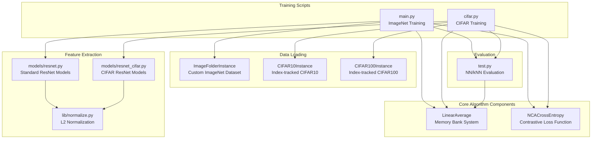
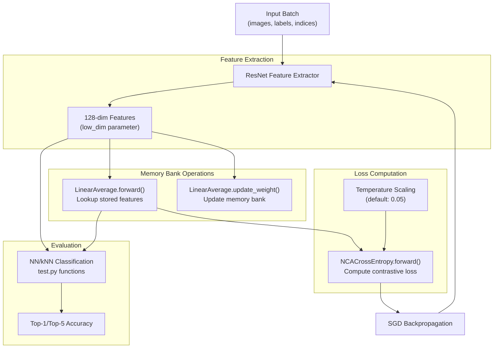
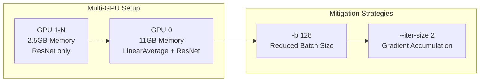

<!-- source: DeepWiki mcp.deepwiki.com · repo microsoft/snca.pytorch · page 1 Overview · fetched 2026-10-26 -->

# Overview

Relevant source files

The following files were used as context for generating this wiki page:

- [README.md](README.md)

## Purpose and Scope

This document provides an overview of the SNCA PyTorch repository, which implements **Scalable Neighborhood Component Analysis** for learning feature representations optimized for nearest neighbor classifiers. The repository contains a complete training and evaluation framework for contrastive learning using memory banks and specialized loss functions.

For detailed training procedures, see [Getting Started](#2). For in-depth algorithmic details, see [Core SNCA Components](#3). For model architecture specifics, see [Model Architectures](#4).

## What is Scalable Neighborhood Component Analysis

SNCA is a contrastive learning method that trains deep neural networks to produce feature representations optimized for nearest neighbor classification. Unlike traditional supervised learning that optimizes for softmax classification, SNCA learns embeddings where semantically similar samples are close in the feature space, enabling better generalization to new object categories.

The approach extends [Neighborhood Component Analysis (NCA)](http://www.cs.toronto.edu/~fritz/absps/nca.pdf) to work with deep networks and large-scale datasets by using a non-parametric memory bank system that stores feature representations of all training samples.

Sources: [README.md:3-6]()

## Repository Architecture

The following diagram shows the main code components and their relationships:

**SNCA System Components**

Sources: [README.md:35-64]()

## Training Pipeline Data Flow

The following diagram illustrates how data flows through the SNCA training process:

**SNCA Training Data Flow**

Sources: [README.md:44-50]()

## Key Features and Capabilities

### Pretrained Models
The repository provides three pretrained ResNet models with their corresponding feature databases:

| Model | Top-1 Accuracy | Components |
|-------|----------------|------------|
| ResNet-18 | 70.59% | Model weights + 600MB feature database |
| ResNet-34 | 74.41% | Model weights + 600MB feature database |
| ResNet-50 | 76.57% | Model weights + 600MB feature database |

### Dataset Support
- **ImageNet**: Full-scale training using `main.py` with `ImageFolderInstance`
- **CIFAR-10/100**: Specialized training using `cifar.py` with `CIFAR10Instance`/`CIFAR100Instance`

### Evaluation Methods
- **Training monitoring**: k=1 nearest neighbor for fast validation
- **Final evaluation**: k=30 nearest neighbor for comprehensive testing
- **Feature visualization**: Nearest neighbor retrieval comparisons

Sources: [README.md:15-31](), [README.md:46-50]()

## Memory and Performance Characteristics

### GPU Memory Imbalance
The `LinearAverage` module creates a significant memory bottleneck:

### Memory Requirements
- **ResNet-18**: GPU 0 requires 11GB, others require 2.5GB each
- **Deeper networks**: Require Caffe-style batch size reduction and gradient accumulation
- **Training hardware**: Models trained on V100 machines for optimal performance

Sources: [README.md:52-59]()

## Integration with Related Work

This implementation extends the [lemniscate.pytorch](https://github.com/zhirongw/lemniscate.pytorch) unsupervised learning project, adapting its memory bank approach for supervised contrastive learning. The core algorithmic components (`LinearAverage`, `NCACrossEntropy`) build upon the foundational work while adding supervised signals for improved feature learning.

Sources: [README.md:8-9]()

---

