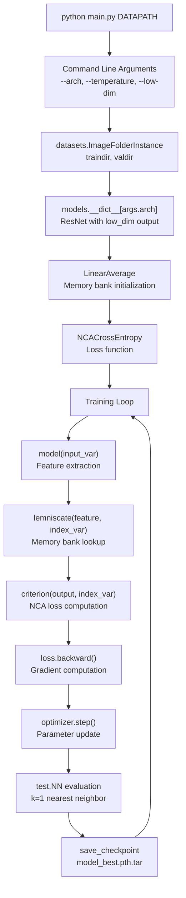
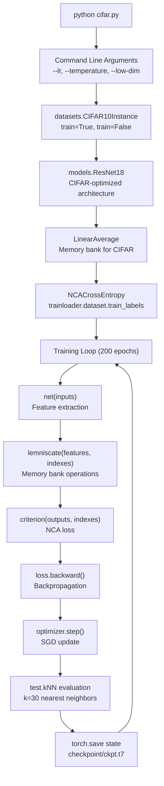
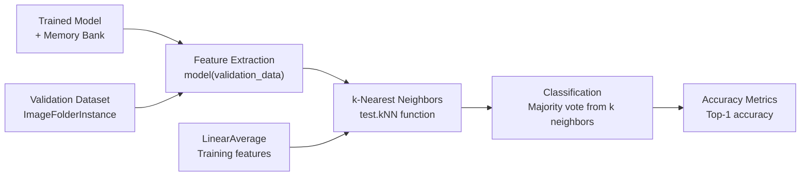
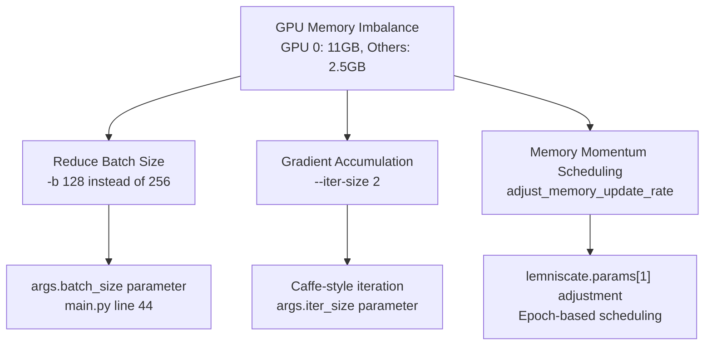

<!-- source: DeepWiki mcp.deepwiki.com · repo microsoft/snca.pytorch · page 2 Getting Started · fetched 2026-10-26 -->

# Getting Started

<details>
<summary>Relevant source files</summary>

The following files were used as context for generating this wiki page:

- [README.md](README.md)
- [cifar.py](cifar.py)
- [main.py](main.py)

</details>


This document provides a quick start guide for training and evaluating SNCA (Scalable Neighborhood Component Analysis) models on ImageNet and CIFAR datasets. It covers installation, basic usage patterns, and practical considerations for memory management.

For detailed information about the core SNCA algorithm components, see [Core SNCA Components](#3). For comprehensive training configuration options, see [Training and Evaluation](#6).

## Prerequisites

The SNCA implementation requires specific software dependencies and hardware considerations for optimal performance.

### Software Requirements

| Component | Version | Purpose |
|-----------|---------|---------|
| Python | 2.x | Runtime environment |
| PyTorch | ≥ 0.4 | Deep learning framework |
| torchvision | Compatible with PyTorch | Dataset loading and transforms |
| CUDA | Compatible | GPU acceleration |

### Hardware Considerations

SNCA training is memory-intensive due to the non-parametric memory bank. The implementation exhibits significant GPU memory imbalance:

- **Primary GPU (GPU 0)**: 11GB memory usage (ResNet + LinearAverage module)
- **Secondary GPUs**: 2.5GB memory usage (ResNet model only)
- **Recommended**: V100 or equivalent for deeper networks

Sources: [README.md:38-59]()

## Installation

Clone the repository and install dependencies:

```bash
git clone https://github.com/Microsoft/snca.pytorch
cd snca.pytorch
# Install PyTorch >= 0.4 following official instructions
```

Ensure your PyTorch installation supports your CUDA version for GPU training.

Sources: [README.md:40]()

## Training Workflows

### ImageNet Training Workflow



Sources: [main.py:80-197](), [main.py:199-244]()

### CIFAR Training Workflow



Sources: [cifar.py:110-165](), [cifar.py:148-165]()

## Basic Training Commands

### ImageNet Training

```bash
python main.py DATAPATH --arch resnet18 -j 32 --temperature 0.05 --low-dim 128 -b 256
```

**Key Parameters:**
- `DATAPATH`: Path to ImageNet dataset directory
- `--arch`: Architecture choice (resnet18, resnet34, resnet50)
- `--temperature`: Softmax temperature for contrastive learning
- `--low-dim`: Feature dimension (typically 128)
- `-b`: Batch size (may need reduction for memory constraints)

### CIFAR Training

```bash
python cifar.py --temperature 0.05 --lr 0.1
```

**Key Parameters:**
- `--temperature`: Softmax temperature parameter
- `--lr`: Initial learning rate
- `--low-dim`: Feature dimension (default 128)

Sources: [README.md:42-63](), [main.py:30-77](), [cifar.py:27-37]()

## Evaluation and Testing

### Nearest Neighbor Evaluation



### Evaluation Commands

**ImageNet Evaluation:**
```bash
python main.py DATAPATH --arch resnet18 --resume model.pth.tar -e
```

**CIFAR Evaluation:**
```bash
python cifar.py --test-only --resume ckpt.t7
```

The evaluation uses k=30 neighbors by default for final testing, while training monitoring uses k=1 for efficiency.

Sources: [README.md:48-50](), [main.py:170-172](), [cifar.py:96-98]()

## Pretrained Models

The repository provides three pretrained ResNet models with their corresponding feature databases:

| Architecture | Top-1 Accuracy | Download | Contents |
|--------------|----------------|----------|----------|
| ResNet-18 | 70.59% | Available | Model weights + ImageNet features (600MB) |
| ResNet-34 | 74.41% | Available | Model weights + ImageNet features (600MB) |
| ResNet-50 | 76.57% | Available | Model weights + ImageNet features (600MB) |

Each release contains:
- **Model weights**: 100-200MB checkpoint file
- **Feature representations**: 600MB ImageNet training features
- **Memory bank state**: Pre-computed LinearAverage parameters

Sources: [README.md:13-22]()

## Memory Management Strategies

### GPU Memory Optimization

The SNCA implementation requires careful memory management due to the LinearAverage module:



### Recommended Settings for Different Hardware

| GPU Memory | Batch Size | Iter Size | Architecture |
|------------|------------|-----------|--------------|
| 8GB | 64 | 4 | ResNet-18 |
| 11GB | 128 | 2 | ResNet-18/34 |
| 16GB+ | 256 | 1 | ResNet-50 |

Sources: [README.md:52-59](), [main.py:73-74](), [main.py:222](), [main.py:228-231]()

## Data Preparation

### ImageNet Dataset Structure

```
DATAPATH/
├── train/
│   ├── class1/
│   │   ├── img1.jpg
│   │   └── img2.jpg
│   └── class2/
└── val/
    ├── class1/
    └── class2/
```

### Dataset Loading Pipeline

The training scripts use specialized dataset classes that track sample indices:

- **ImageNet**: `datasets.ImageFolderInstance` extends torchvision's ImageFolder
- **CIFAR**: `datasets.CIFAR10Instance` extends torchvision's CIFAR10

These provide `(image, label, index)` tuples required for the memory bank operations.

Sources: [README.md:35-36](), [main.py:96-123](), [cifar.py:61-65]()

---

