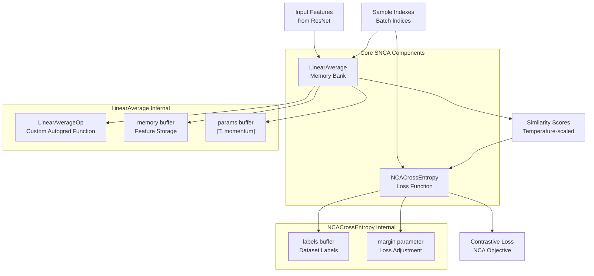
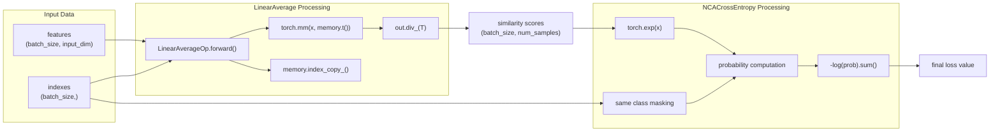

<!-- source: DeepWiki mcp.deepwiki.com · repo microsoft/snca.pytorch · page 3 Core SNCA Components · fetched 2026-10-26 -->

# Core SNCA Components

Relevant source files

The following files were used as context for generating this wiki page:

- [lib/LinearAverage.py](lib/LinearAverage.py)
- [lib/NCA.py](lib/NCA.py)
- [lib/__init__.py](lib/__init__.py)

This document provides an overview of the two fundamental algorithmic components that implement Scalable Neighborhood Component Analysis (SNCA): the memory bank system and the NCA loss function. These components work together to enable contrastive learning through non-parametric feature storage and neighborhood-based optimization.

For detailed implementation specifics of the memory bank, see [Memory Bank System (LinearAverage)](#3.1). For the loss function implementation details, see [NCA Loss Function](#3.2).

## SNCA Algorithm Overview

SNCA implements a contrastive learning approach that learns feature representations optimized for nearest neighbor classification. The algorithm maintains a memory bank of feature representations for all training samples and uses a specialized loss function to encourage samples of the same class to have similar representations while pushing apart samples from different classes.

## Core Component Architecture

The SNCA implementation consists of two primary components that handle the algorithmic core:

| Component | Class Name | File Location | Primary Responsibility |
|-----------|------------|---------------|----------------------|
| Memory Bank | `LinearAverage` | `lib/LinearAverage.py` | Non-parametric feature storage and momentum updates |
| NCA Loss | `NCACrossEntropy` | `lib/NCA.py` | Contrastive loss computation for neighborhood optimization |

### Component Architecture Diagram

Sources: `lib/LinearAverage.py:44-58`, `lib/NCA.py:8-43`

## Component Interaction Flow

The two core components work together in a sequential pipeline during training, with the `LinearAverage` component computing feature similarities and the `NCACrossEntropy` component converting these similarities into a contrastive loss.

### SNCA Training Data Flow

Sources: `lib/LinearAverage.py:8-18`, `lib/LinearAverage.py:55-57`, `lib/NCA.py:19-43`

## Implementation Architecture Details

### LinearAverage Component

The `LinearAverage` class implements a non-parametric memory bank that stores L2-normalized feature representations for all training samples. Key implementation details:

- **Memory Buffer**: Stores feature vectors using `torch.register_buffer('memory', ...)` at [lib/LinearAverage.py:53]()
- **Temperature Parameter**: Controls similarity sharpening via parameter `T` at [lib/LinearAverage.py:46]()
- **Momentum Updates**: Uses exponential moving average with momentum parameter at [lib/LinearAverage.py:46]()
- **Custom Autograd**: Implements `LinearAverageOp` function for memory updates during backpropagation at [lib/LinearAverage.py:6-42]()

### NCACrossEntropy Component

The `NCACrossEntropy` class computes the contrastive loss based on neighborhood component analysis principles:

- **Label Storage**: Maintains all dataset labels in a buffer at [lib/NCA.py:15-16]()
- **Same-Class Identification**: Creates boolean masks for same-class samples at [lib/NCA.py:26]()
- **Self-Exclusion**: Removes self-similarities from loss computation at [lib/NCA.py:29]()
- **Probability Normalization**: Computes softmax probabilities with margin adjustment at [lib/NCA.py:31-38]()

### Key Parameters and Buffers

| Parameter | Component | Default Value | Purpose |
|-----------|-----------|---------------|---------|
| `T` (temperature) | `LinearAverage` | 0.05 | Controls similarity sharpening |
| `momentum` | `LinearAverage` | 0.5 | Memory update rate |
| `inputSize` | `LinearAverage` | Variable | Feature dimension |
| `outputSize` | `LinearAverage` | Variable | Number of training samples |
| `margin` | `NCACrossEntropy` | 0 | Loss margin adjustment |

Sources: `lib/LinearAverage.py:46`, `lib/NCA.py:13`

## Component Integration Points

The core components integrate with the broader SNCA system through well-defined interfaces:

- **Feature Input**: Both components expect normalized feature vectors from ResNet models
- **Index Tracking**: Both components require sample indexes for memory bank operations and label lookup
- **Memory Management**: The `LinearAverage` component handles GPU memory allocation for the feature memory bank
- **Gradient Flow**: Custom autograd functions ensure proper gradient computation through the memory bank

These components form the algorithmic foundation that enables SNCA to learn feature representations optimized for nearest neighbor classification through contrastive learning.

Sources: `lib/LinearAverage.py:1-59`, `lib/NCA.py:1-45`

---

