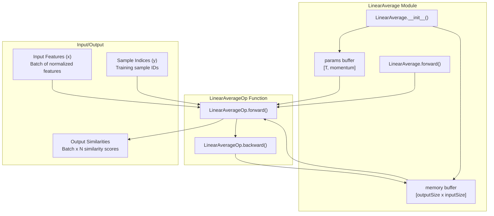
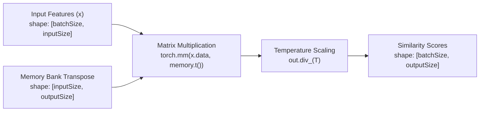
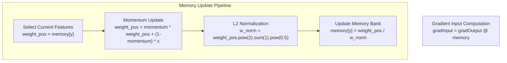

<!-- source: DeepWiki mcp.deepwiki.com · repo microsoft/snca.pytorch · page 3.1 Memory Bank System (LinearAverage) · fetched 2026-10-26 -->

# Memory Bank System (LinearAverage)

<details>
<summary>Relevant source files</summary>

The following files were used as context for generating this wiki page:

- [lib/LinearAverage.py](lib/LinearAverage.py)

</details>


## Purpose and Scope

The Memory Bank System implements a non-parametric memory bank for contrastive learning in the SNCA framework. This system maintains feature representations of all training samples and enables efficient similarity computations without storing explicit parametric weights for each class. The `LinearAverage` module serves as the core component that bridges feature extraction and contrastive loss computation.

For information about the loss function that uses this memory bank, see [NCA Loss Function](#3.2). For details on the ResNet feature extractors that feed into this system, see [Model Architectures](#4).

## Architecture Overview

The memory bank system consists of two main components: a custom autograd function (`LinearAverageOp`) that handles forward and backward computations, and a PyTorch module (`LinearAverage`) that manages the memory buffer and parameters.

**Memory Bank Architecture**



Sources: [lib/LinearAverage.py:1-59]()

## Memory Bank Initialization

The memory bank is initialized as a random matrix where each row represents the feature vector for one training sample. The initialization strategy ensures proper gradient flow during early training phases.

| Parameter | Description | Default Value | Code Location |
|-----------|-------------|---------------|---------------|
| `inputSize` | Dimensionality of input features | - | [lib/LinearAverage.py:46]() |
| `outputSize` | Number of training samples | - | [lib/LinearAverage.py:46]() |
| `T` | Temperature parameter for similarity scaling | 0.05 | [lib/LinearAverage.py:46]() |
| `momentum` | Momentum coefficient for memory updates | 0.5 | [lib/LinearAverage.py:46]() |

The memory buffer initialization follows a uniform distribution strategy:

```
stdv = 1.0 / sqrt(inputSize / 3)
memory ~ Uniform(-stdv, stdv)
```

Sources: [lib/LinearAverage.py:46-53]()

## Forward Pass Mechanics

The forward pass computes similarities between input features and all stored memory bank features through matrix multiplication and temperature scaling.

**Forward Computation Flow**



The computation is performed in [lib/LinearAverage.py:13-14]():
- Inner product: `out = torch.mm(x.data, memory.t())`
- Temperature scaling: `out.div_(T)`

Sources: [lib/LinearAverage.py:8-18]()

## Backward Pass and Memory Updates

The backward pass implements two crucial operations: gradient computation for the input features and momentum-based updates to the memory bank. This non-parametric update mechanism allows the system to learn feature representations without explicit gradient descent on memory parameters.

**Memory Update Process**



The memory update follows an exponential moving average with L2 normalization:

1. **Feature Selection**: Extract current memory vectors for batch indices [lib/LinearAverage.py:35]()
2. **Momentum Update**: Blend old and new features using momentum coefficient [lib/LinearAverage.py:36-37]()
3. **Normalization**: Apply L2 normalization to maintain unit vectors [lib/LinearAverage.py:38-39]()
4. **Memory Copy**: Update memory bank with normalized features [lib/LinearAverage.py:40]()

Sources: [lib/LinearAverage.py:21-42]()

## Parameter Configuration

The `LinearAverage` module uses two critical hyperparameters stored in a parameter buffer:

**Temperature (T)**: Controls the sharpness of the similarity distribution. Lower values create sharper distributions, while higher values create smoother distributions. The temperature scaling is applied in the forward pass [lib/LinearAverage.py:14]() and gradient computation [lib/LinearAverage.py:28]().

**Momentum**: Controls the rate of memory bank updates. Higher momentum values preserve more historical information, while lower values adapt more quickly to new features. The momentum update occurs during the backward pass [lib/LinearAverage.py:25]().

The parameters are registered as buffers to ensure they move with the module across devices:
```python
self.register_buffer('params', torch.tensor([T, momentum]))
```

Sources: [lib/LinearAverage.py:51]()

## Integration with SNCA Training

The `LinearAverage` module integrates seamlessly with the SNCA training pipeline by accepting normalized features from ResNet models and providing similarity scores to the NCA loss function. The module's `forward` method [lib/LinearAverage.py:55-57]() serves as the interface between feature extraction and loss computation.

The memory bank maintains consistency across training iterations by preserving feature representations and updating them through momentum-based averaging. This approach enables the system to learn discriminative features without requiring explicit parametric classifiers for each training sample.

Sources: [lib/LinearAverage.py:55-59]()

---

