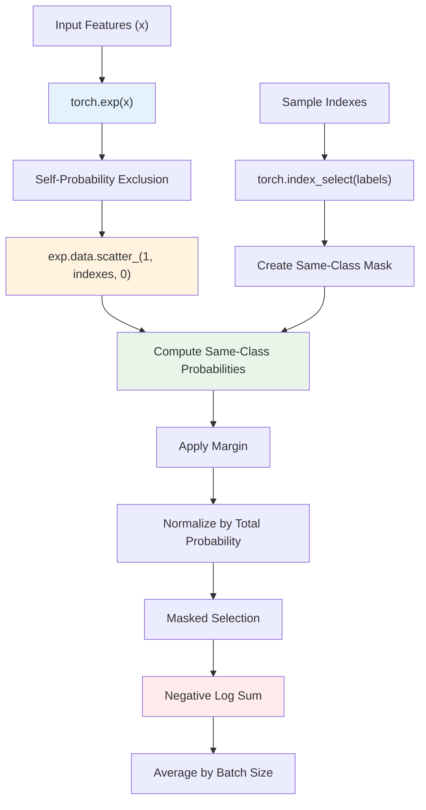
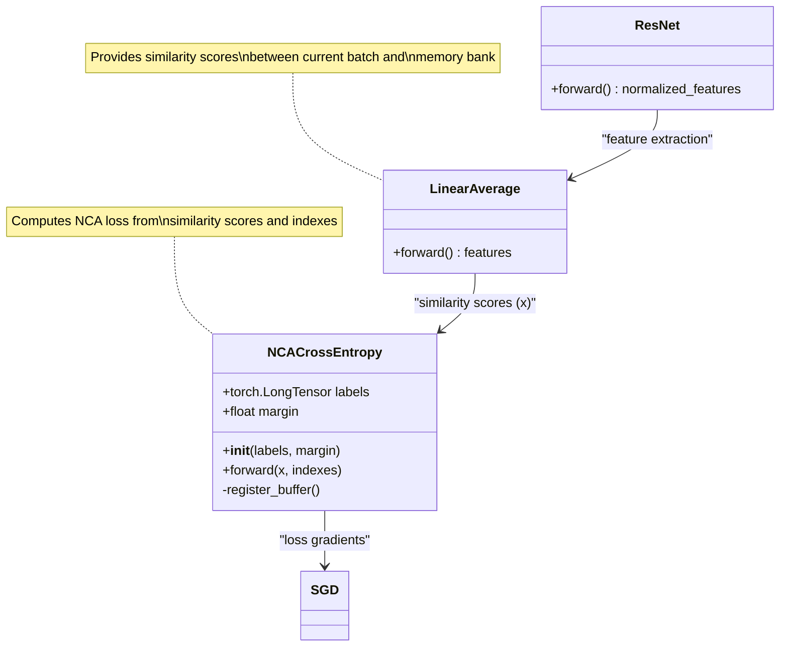
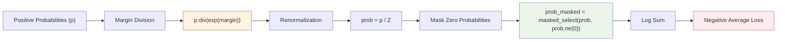

<!-- source: DeepWiki mcp.deepwiki.com · repo microsoft/snca.pytorch · page 3.2 NCA Loss Function · fetched 2026-10-26 -->

# NCA Loss Function

Relevant source files

The following files were used as context for generating this wiki page:

- [lib/NCA.py](lib/NCA.py)

This document covers the implementation of the Neighborhood Component Analysis (NCA) loss function in the SNCA framework. The NCA loss is responsible for learning feature representations that maximize the probability of correct nearest neighbor classification by optimizing the likelihood that examples with the same class label are close in the learned feature space.

For information about the memory bank system that works with this loss function, see [Memory Bank System (LinearAverage)](#3.1). For details about the overall training pipeline, see [Training and Evaluation](#6).

## Purpose and Mathematical Foundation

The `NCACrossEntropy` class implements the core NCA objective function, which maximizes the probability that randomly selected neighbors of each training example belong to the same class. The loss function computes:

**Loss = -∑ log(p_ij)**

Where `p_ij` represents the probability that example `i` selects example `j` as its neighbor, given that they share the same class label.

The probability `p_ij` is computed using a softmax over similarity scores, typically cosine similarities from the memory bank system.

Sources: [lib/NCA.py:8-17]()

## Implementation Architecture

### NCA Loss Computation Flow

Sources: [lib/NCA.py:19-43]()

### Class Structure and Components

Sources: [lib/NCA.py:8-18]()

## Core Implementation Details

### Label Storage and Indexing

The `NCACrossEntropy` class maintains a buffer containing all dataset labels, allowing efficient lookup during training:

| Component | Purpose | Implementation |
|-----------|---------|----------------|
| `self.labels` | Complete dataset labels | `torch.LongTensor` buffer registered with the module |
| `indexes` | Current batch sample indices | Used to select relevant labels via `torch.index_select` |
| Same-class mask | Boolean mask for positive pairs | Created by comparing batch labels with all dataset labels |

The label indexing mechanism at [lib/NCA.py:25-26]() creates a matrix where each row represents a training example and each column indicates whether the corresponding dataset example shares the same class.

Sources: [lib/NCA.py:13-26]()

### Probability Computation

The loss computation follows these key steps:

1. **Exponential Transformation**: Convert similarity scores to unnormalized probabilities using `torch.exp(x)`
2. **Self-Exclusion**: Remove self-similarities by setting diagonal elements to zero via `exp.data.scatter_(1, indexes.data.view(-1,1), 0)`
3. **Positive Pair Identification**: Multiply exponentials with same-class mask to isolate positive pairs
4. **Margin Application**: Apply optional margin by dividing positive probabilities by `math.exp(self.margin)`
5. **Normalization**: Compute final probabilities as `p / (Z_exclude + p)` where `Z_exclude` is the sum of negative pair exponentials

Sources: [lib/NCA.py:22-38]()

### Loss Computation and Numerical Stability

The implementation includes numerical stability measures:
- Zero probability masking at [lib/NCA.py:39]() prevents `log(0)` errors
- Margin application provides additional regularization control
- Batch averaging ensures consistent loss scaling regardless of batch size

Sources: [lib/NCA.py:34-43]()

## Integration with Training Pipeline

### Memory Bank Interaction

The NCA loss function operates on similarity scores provided by the `LinearAverage` memory bank module. The typical data flow is:

1. **Feature Extraction**: ResNet models extract normalized features
2. **Similarity Computation**: `LinearAverage` computes cosine similarities between batch features and memory bank
3. **Loss Computation**: `NCACrossEntropy` converts similarities to probabilities and computes NCA loss
4. **Gradient Backpropagation**: Loss gradients update both ResNet parameters and memory bank features

### Batch Processing Requirements

The loss function expects:
- Input tensor `x` of shape `(batch_size, n_samples)` containing similarity scores
- Index tensor `indexes` of shape `(batch_size,)` identifying which samples correspond to the current batch
- Pre-registered label buffer containing all dataset labels for mask computation

Sources: [lib/NCA.py:19-21]()

## Configuration Parameters

### Margin Parameter

The optional `margin` parameter (default 0) provides additional control over the loss landscape:
- **Positive margin**: Increases the denominator for positive pairs, making the optimization more conservative
- **Zero margin**: Standard NCA loss without additional regularization
- The margin is applied exponentially via `math.exp(self.margin)` division

### Numerical Stability Constants

The implementation uses `eps = 1e-8` for numerical stability, though this constant is defined but not actively used in the current loss computation.

Sources: [lib/NCA.py:6](), [lib/NCA.py:13](), [lib/NCA.py:35]()

---

