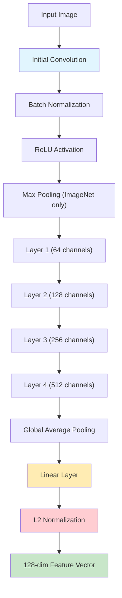
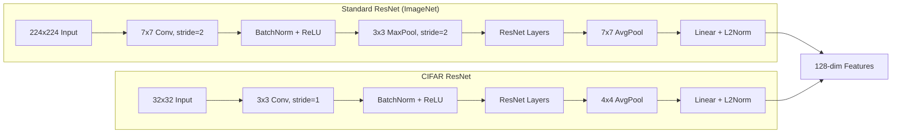
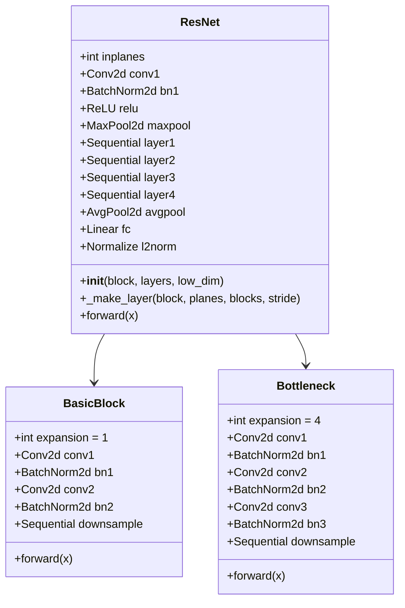
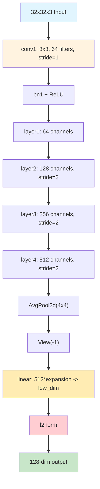
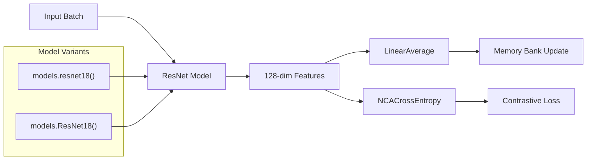

<!-- source: DeepWiki mcp.deepwiki.com · repo microsoft/snca.pytorch · page 4 Model Architectures · fetched 2026-10-26 -->

# Model Architectures

Relevant source files

The following files were used as context for generating this wiki page:

- [models/__init__.py](models/__init__.py)
- [models/resnet.py](models/resnet.py)
- [models/resnet_cifar.py](models/resnet_cifar.py)

This section documents the ResNet model architectures used for feature extraction in the SNCA framework. The repository provides two variants of ResNet implementations: standard ResNet models optimized for ImageNet-scale images and CIFAR-optimized ResNet models designed for smaller 32x32 images.

For information about how these models integrate with the memory bank system, see [LinearAverage](#3.1). For details about the normalization components used in these models, see [Normalization Utilities](#7.1).

## Architecture Overview

The SNCA implementation modifies standard ResNet architectures to output low-dimensional feature representations instead of classification logits. Both model variants share the same core design principles but differ in their layer configurations to accommodate different input image sizes.

### SNCA-Modified ResNet Architecture Flow

Sources: [models/resnet.py:132-148](), [models/resnet_cifar.py:92-102]()

## Model Variants

The repository provides two distinct ResNet implementations optimized for different datasets:

| Model Type | File | Target Dataset | Input Size | Initial Conv | Max Pool | Global Pool |
|------------|------|----------------|------------|--------------|----------|-------------|
| Standard ResNet | `models/resnet.py` | ImageNet | 224x224 | 7x7, stride=2 | 3x3, stride=2 | 7x7 |
| CIFAR ResNet | `models/resnet_cifar.py` | CIFAR-10/100 | 32x32 | 3x3, stride=1 | None | 4x4 |

### Key Architectural Differences

Sources: [models/resnet.py:94-105](), [models/resnet_cifar.py:75-82]()

## Standard ResNet Implementation

The standard ResNet implementation in [models/resnet.py]() provides the classic ResNet architectures adapted for SNCA feature learning.

### Block Types

The implementation includes two fundamental building blocks:

- **BasicBlock**: Used in ResNet-18 and ResNet-34, with expansion factor of 1
- **Bottleneck**: Used in ResNet-50, ResNet-101, and ResNet-152, with expansion factor of 4

### Available Model Configurations

| Model | Block Type | Layer Configuration | Parameters |
|-------|------------|-------------------|------------|
| `resnet18` | BasicBlock | [2, 2, 2, 2] | ~11M |
| `resnet34` | BasicBlock | [3, 4, 6, 3] | ~21M |
| `resnet50` | Bottleneck | [3, 4, 6, 3] | ~23M |
| `resnet101` | Bottleneck | [3, 4, 23, 3] | ~42M |
| `resnet152` | Bottleneck | [3, 8, 36, 3] | ~58M |

### ResNet Class Structure

Sources: [models/resnet.py:89-148](), [models/resnet.py:18-47](), [models/resnet.py:50-86]()

## CIFAR-Optimized ResNet Implementation

The CIFAR ResNet implementation in [models/resnet_cifar.py]() is specifically optimized for 32x32 pixel images used in CIFAR-10 and CIFAR-100 datasets.

### CIFAR-Specific Optimizations

1. **No Initial Downsampling**: Uses 3x3 convolution with stride=1 instead of 7x7 with stride=2
2. **No Max Pooling**: Removes the initial max pooling layer that would be too aggressive for small images
3. **Smaller Global Pooling**: Uses 4x4 average pooling instead of 7x7
4. **Simplified Interface**: Uses direct function calls instead of factory pattern

### CIFAR ResNet Architecture Flow

Sources: [models/resnet_cifar.py:92-102]()

### Available CIFAR Model Functions

The CIFAR implementation provides these factory functions:

- `ResNet18(low_dim=128)` → ResNet with BasicBlock [2,2,2,2]
- `ResNet34(low_dim=128)` → ResNet with BasicBlock [3,4,6,3]
- `ResNet50(low_dim=128)` → ResNet with Bottleneck [3,4,6,3]
- `ResNet101(low_dim=128)` → ResNet with Bottleneck [3,4,23,3]
- `ResNet152(low_dim=128)` → ResNet with Bottleneck [3,8,36,3]

Sources: [models/resnet_cifar.py:105-118]()

## SNCA-Specific Modifications

Both ResNet implementations include critical modifications for SNCA compatibility:

### Feature Dimensionality

All models output 128-dimensional feature vectors by default, controlled by the `low_dim` parameter. This low-dimensional representation is essential for the contrastive learning approach used in SNCA.

### L2 Normalization

Both implementations include L2 normalization as the final layer using the `Normalize(2)` module from [lib/normalize.py](). This ensures all feature vectors lie on the unit hypersphere, which is crucial for the neighborhood component analysis loss function.

### Weight Initialization

The standard ResNet implementation includes specific weight initialization:
- Convolutional layers: Normal distribution with std = sqrt(2/n)
- Batch normalization: weights=1, bias=0

Sources: [models/resnet.py:107-113](), [models/resnet.py:104-105](), [models/resnet_cifar.py:81-82]()

## Module Integration

The models integrate with other SNCA components through a well-defined interface:

Both model variants are imported through [models/__init__.py]() and can be instantiated using their respective factory functions. The choice between standard and CIFAR variants depends on the target dataset as configured in the training scripts.

Sources: [models/__init__.py:1-2](), [models/resnet.py:151-208](), [models/resnet_cifar.py:105-118]()

---

