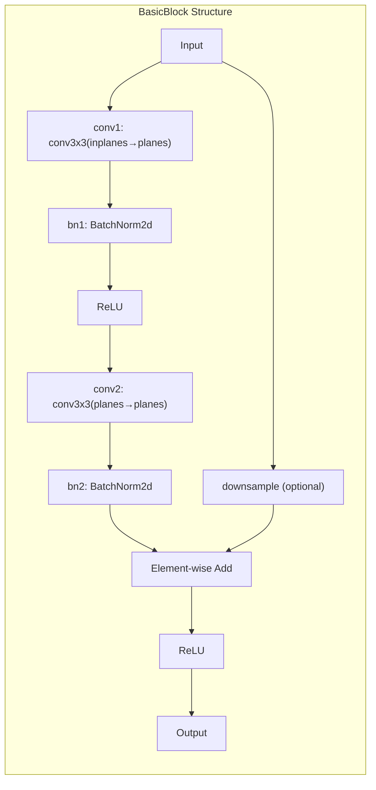
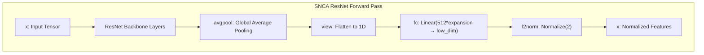
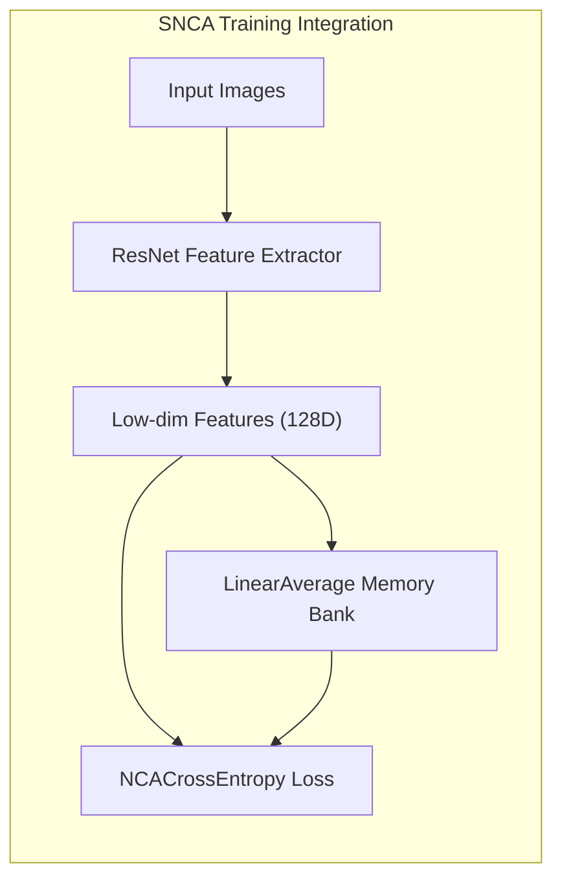

<!-- source: DeepWiki mcp.deepwiki.com · repo microsoft/snca.pytorch · page 4.1 Standard ResNet Models · fetched 2026-10-26 -->

# Standard ResNet Models

<details>
<summary>Relevant source files</summary>

The following files were used as context for generating this wiki page:

- [models/resnet.py](models/resnet.py)

</details>


This document covers the standard ResNet model implementations used for feature extraction in SNCA (Scalable Neighborhood Component Analysis). These models are specifically adapted from the original ResNet architecture to output normalized low-dimensional feature vectors suitable for contrastive learning and nearest neighbor classification.

For CIFAR-optimized ResNet variants, see [CIFAR-Optimized ResNet](#4.2). For information about how these models integrate with the SNCA training pipeline, see [ImageNet Training](#6.1).

## Architecture Overview

The standard ResNet models in this codebase implement the Deep Residual Learning architecture with key modifications for SNCA. Unlike traditional ResNet models that output class predictions, these models are designed as feature extractors that produce normalized low-dimensional embeddings.

### ResNet Architecture Components

```mermaid
graph TD
    subgraph "ResNet Feature Extractor"
        INPUT["Input Image (224x224x3)"]
        CONV1["conv1: Conv2d(3→64, 7x7, stride=2)"]
        BN1["bn1: BatchNorm2d(64)"]
        RELU1["ReLU"]
        MAXPOOL["MaxPool2d(3x3, stride=2)"]
        
        LAYER1["layer1: BasicBlock/Bottleneck layers"]
        LAYER2["layer2: BasicBlock/Bottleneck layers"] 
        LAYER3["layer3: BasicBlock/Bottleneck layers"]
        LAYER4["layer4: BasicBlock/Bottleneck layers"]
        
        AVGPOOL["avgpool: AvgPool2d(7x7)"]
        FC["fc: Linear(512*expansion → low_dim)"]
        L2NORM["l2norm: Normalize(2)"]
        OUTPUT["Output Features (low_dim)"]
    end
    
    INPUT --> CONV1
    CONV1 --> BN1
    BN1 --> RELU1
    RELU1 --> MAXPOOL
    MAXPOOL --> LAYER1
    LAYER1 --> LAYER2
    LAYER2 --> LAYER3
    LAYER3 --> LAYER4
    LAYER4 --> AVGPOOL
    AVGPOOL --> FC
    FC --> L2NORM
    L2NORM --> OUTPUT
```



Sources: [models/resnet.py:89-148]()

## Block Types

The ResNet implementation provides two types of residual blocks for different model depths and computational requirements.

### BasicBlock

The `BasicBlock` is used in shallower ResNet variants (ResNet-18, ResNet-34) and consists of two 3x3 convolutional layers with batch normalization and ReLU activations.



Sources: [models/resnet.py:18-47]()

### Bottleneck

The `Bottleneck` block is used in deeper ResNet variants (ResNet-50, ResNet-101, ResNet-152) and implements a 1x1 → 3x3 → 1x1 convolution pattern to reduce computational complexity.

| Property | BasicBlock | Bottleneck |
|----------|------------|------------|
| **Expansion factor** | 1 | 4 |
| **Convolution layers** | 2 × 3x3 | 1x1 → 3x3 → 1x1 |
| **Used in models** | ResNet-18, ResNet-34 | ResNet-50, ResNet-101, ResNet-152 |
| **Computational efficiency** | Lower | Higher (for deep networks) |

Sources: [models/resnet.py:50-86]()

## ResNet Class

The main `ResNet` class implements the complete architecture with several key modifications for SNCA feature learning.

### Key Parameters

| Parameter | Type | Default | Description |
|-----------|------|---------|-------------|
| `block` | Class | - | Block type (`BasicBlock` or `Bottleneck`) |
| `layers` | List[int] | - | Number of blocks in each layer |
| `low_dim` | int | 128 | Output feature dimensionality |

### SNCA-Specific Modifications

The ResNet implementation includes several modifications tailored for SNCA:

1. **Low-dimensional output**: The final fully connected layer outputs `low_dim` features (default 128) instead of class logits
2. **L2 normalization**: Features are L2-normalized using the `Normalize(2)` module
3. **Feature extraction focus**: No classification head, optimized for feature representation learning



Sources: [models/resnet.py:132-148](), [models/resnet.py:104-105]()

## Available Model Variants

The module provides factory functions for standard ResNet architectures with different depths:

| Model | Function | Block Type | Layer Configuration | Parameters |
|-------|----------|------------|-------------------|------------|
| **ResNet-18** | `resnet18()` | BasicBlock | [2, 2, 2, 2] | ~11.2M |
| **ResNet-34** | `resnet34()` | BasicBlock | [3, 4, 6, 3] | ~21.3M |
| **ResNet-50** | `resnet50()` | Bottleneck | [3, 4, 6, 3] | ~23.5M |
| **ResNet-101** | `resnet101()` | Bottleneck | [3, 4, 23, 3] | ~42.5M |
| **ResNet-152** | `resnet152()` | Bottleneck | [3, 8, 36, 3] | ~58.2M |

### Usage Pattern

```python
# Create ResNet-50 with 128-dimensional features
model = resnet50(low_dim=128)

# Create ResNet-18 with custom feature dimension
model = resnet18(low_dim=256)
```

Sources: [models/resnet.py:151-208]()

## Integration with SNCA System

These ResNet models serve as the backbone feature extractors in the SNCA training pipeline:



### Key Design Decisions

1. **Fixed input size**: Designed for ImageNet-scale images (224×224)
2. **Normalized output**: L2 normalization ensures features lie on unit hypersphere
3. **Low-dimensional projection**: Reduces memory requirements for large-scale contrastive learning
4. **No pretrained weights**: Empty `model_urls` dictionary indicates training from scratch

Sources: [models/resnet.py:1-11](), [models/resnet.py:104-106]()

## Dependencies

The ResNet implementation relies on several key components:

- **PyTorch modules**: `nn.Conv2d`, `nn.BatchNorm2d`, `nn.Linear`, etc.
- **Normalize module**: Custom L2 normalization from `lib.normalize`
- **Model zoo**: PyTorch's model loading utilities (though URLs are empty)

Sources: [models/resnet.py:1-4]()

---

